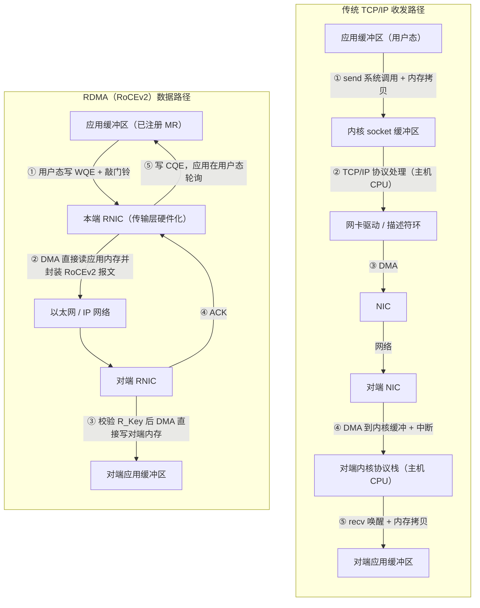
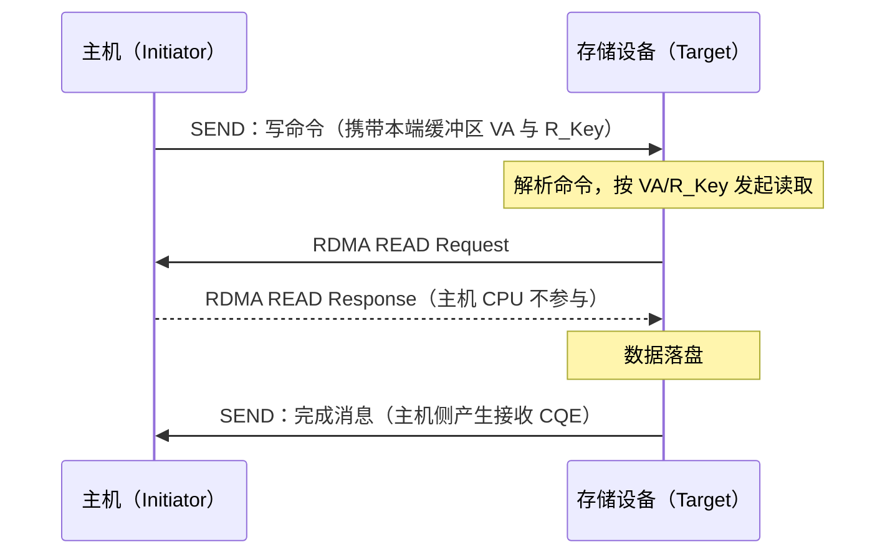
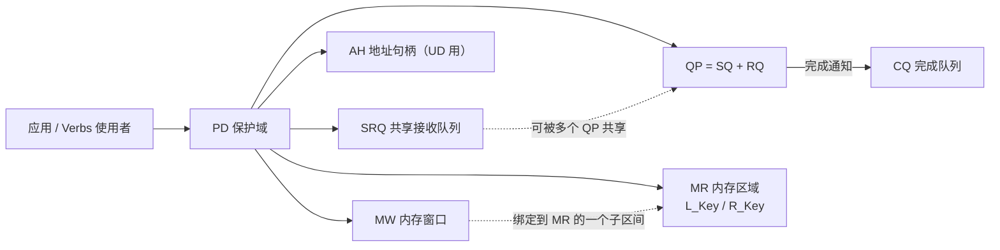
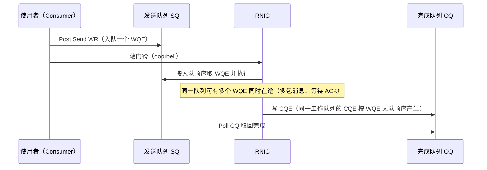
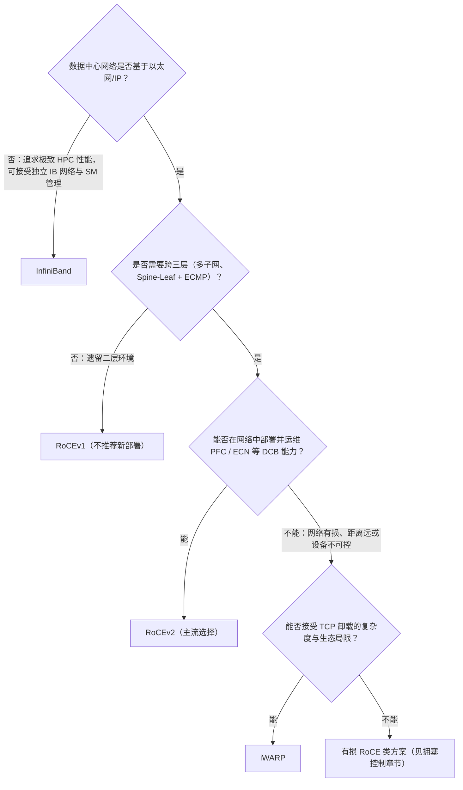

# RDMA 基础与技术对比（RDMA Fundamentals and Technology Comparison）

> **摘要**：本文从“为什么需要远程直接内存访问（Remote Direct Memory Access, RDMA）”出发，解释零拷贝、内核旁路、CPU 卸载如何带来低延迟与高吞吐；梳理 Channel 语义与 Memory 语义两类通信模型及其核心抽象（QP/CQ/MR/PD/WR/WQE/CQE/AH）；最后横向对比 InfiniBand、RoCEv1、RoCEv2 与 iWARP，给出选择 RoCEv2 的判断依据。本文是整个知识库的入口。
>
> **规范出处**：Vol1 第 3 章引言（p.101）、§3.1（p.102–103）；§3.2（p.105–109）；§3.5.1–§3.5.5（p.116–121）；§3.6（p.132–139）；§9.1 与 Table 37（p.253–256）；§10.2.1（p.461）；§10.7.2（p.537–541）；§A16.1–§A16.2（p.1911–1912）；§A17.1–§A17.2（p.1928–1930）
>
> **前置阅读**：无（入门篇）。建议具备 TCP/IP 与以太网基础。
>
> **关键词**：RDMA, Zero-copy, Kernel bypass, Transport offload, Channel semantics, Memory semantics, QP, CQ, MR, PD, L_Key/R_Key, WR/WQE/CQE, AH, InfiniBand, RoCE, RoCEv2, iWARP

---

## 1. 为什么需要 RDMA

### 1.1 传统 TCP/IP 收发路径的开销

在常见的内核 TCP/IP 协议栈中，一次“发送—接收”大致经历以下环节〔通用知识，非 IBTA 规范内容〕：

1. 应用调用 `send()`，发生系统调用与用户态/内核态切换；
2. 数据从用户缓冲区**拷贝**到内核 socket 缓冲区；
3. TCP/IP 协议处理（分段、序号、确认、重传定时器、拥塞控制）在**主机 CPU** 上执行；
4. 驱动填写描述符，NIC 通过 DMA 取走数据发出；
5. 接收端 NIC DMA 到内核缓冲区，经中断/软中断进入协议栈处理；
6. 唤醒应用，数据再次从内核**拷贝**到用户缓冲区。

即使有校验和卸载、TSO/GRO 等优化，TCP 状态机仍在主机 CPU 上运行，内存拷贝与上下文切换也无法完全消除。

| 开销来源 | 内核 TCP/IP | RDMA |
|---|---|---|
| 数据拷贝 | 收发各至少 1 次（用户↔内核） | 0 次：RNIC 直接 DMA 用户缓冲区 |
| 系统调用/上下文切换 | 每次收发 | 数据路径无（用户态直接敲门铃、轮询完成队列） |
| 协议处理 | 主机 CPU | 网卡硬件（分段、包序号 PSN（Packet Sequence Number）、ACK/NAK、重传、权限检查） |
| 中断 | 常见（可用轮询缓解） | 可完全轮询 CQ，也可按需事件通知 |
| 访问保护 | OS 校验每次 I/O | 注册内存 + Key 由硬件校验 |

### 1.2 RDMA 的四个关键特性

| 特性 | 含义 | 规范依据 |
|---|---|---|
| 零拷贝（Zero-copy） | 网卡直接在应用缓冲区与线路之间搬运数据，CPU 不做数据拷贝 | 第 3 章引言称 IBA 提供 “zero processor-copy data transfers, with no kernel involvement”〔Vol1 Ch.3, p.101〕；〔Vol1 §3.6.1, p.134〕 |
| 内核旁路（Kernel bypass） | 数据路径上的 WQE 投递、完成查询都在用户态完成，内核只负责控制路径 | OS 可允许在用户态投递 WQE，绕过操作系统〔Vol1 §3.6.1, p.134〕；架构意图是让 WR 与完成状态在用户态进程与 HCA 之间传递而不经内核〔Vol1 §10.2.1, p.461〕 |
| CPU 卸载（Transport offload） | 传输层（分段重组、序号、确认、重传、内存保护）全部由硬件执行 | IBA 硬件从 CPU 卸载大部分 I/O 通信工作〔Vol1 Ch.3, p.101〕；RoCEv2 的端到端重传逻辑“通常由硬件实现”〔Vol1 §A17.9.1, p.1946〕 |
| 低延迟/高吞吐 | 上述三点的综合结果，并减少了抖动 | 〔Vol1 §3.6.1, p.134〕把“零拷贝 + 无内核参与”称为高带宽低延迟的关键 |

此外，**内存注册（Memory Registration）+ Key** 机制让硬件代替 OS 做访问校验：注册得到的 L_Key/R_Key 所提供的保护“使 OS 无需再校验每次数据传输”〔Vol1 §3.6.1, p.134〕——这是内核旁路能够安全成立的前提。

> [!NOTE]
> 延迟的具体数值与 CPU、PCIe、网卡、交换机、报文大小强相关。业界一般认为 RDMA 小消息往返延迟可比内核 TCP 低一个数量级左右，但请以自己平台的实测为准〔业界实践〕。测试方法见 [工具与测试](../07-engineering-practice/04-tools-and-testing.md)。

### 1.3 数据路径对比图



要点：RDMA 路径上对端的 CPU 与操作系统**完全不参与**数据搬运（对 RDMA WRITE/READ 而言），本端 CPU 只负责“下指令”和“收完成”。

### 1.4 控制路径与数据路径

| 阶段 | 典型操作 | 是否经过内核 | 特点 |
|---|---|---|---|
| 控制路径（Control path） | 打开设备、分配 PD、注册 MR（锁页、建立地址转换）、创建 CQ/QP、Modify QP、建立连接（通信管理 Communication Management, CM） | 是（经驱动） | 相对昂贵，应在初始化阶段完成并复用 |
| 数据路径（Data path） | Post Send / Post Receive、敲门铃（doorbell）、Poll CQ | 否 | 每次 I/O 都执行，必须轻量 |

规范层面：Verbs 只描述语义而非 API〔Vol1 §3.5.12, p.132〕；把 WR 与完成状态在用户态进程和 HCA 之间直接传递是架构意图〔Vol1 §10.2.1, p.461〕。Linux 上的具体实现见 [Linux RDMA 软件栈](../07-engineering-practice/01-linux-rdma-stack.md)。

### 1.5 RDMA 的代价与约束

> [!WARNING]
> RDMA 并非“免费的午餐”，下列代价在设计系统时必须考虑：
> - **内存注册开销**：注册需要锁页（pinning）并建立地址转换表，频繁注册/注销会抵消收益；工程上常用 MR 缓存或预注册内存池〔业界实践〕。
> - **连接状态规模**：RC 全互联时每节点需要 M²×N 个 QP（M 为每节点进程数、N 为节点数）〔Vol1 §3.6.2, p.135；Table 37, p.255〕，网卡上下文缓存会成为瓶颈。
> - **对丢包敏感**：IB 传输“不支持选择性重传，也不支持乱序接收”〔Vol1 §9.1, p.254〕，丢一个包会触发 Go-back-N 回退重传，因此 RoCEv2 建议运行在无损网络上〔Vol1 §A17.9.1, p.1946〕。
> - **Key 不是密码学安全**：规范明确指出 Key 本身不提供安全性，能接触到网络内部的实体可获知 Key 值〔Vol1 §3.5.3, p.119〕。
> - **编程模型复杂**：异步队列、内存生命周期、完成处理都需要应用自己管理。

---

## 2. 两类通信语义〔Vol1 §3.6〕

IBA 同时提供 Channel 语义与 Memory 语义，因为二者对 I/O 与进程间通信（IPC）都有用〔Vol1 §3.6, p.132〕。

### 2.1 Channel 语义（SEND / RECEIVE）

- 一方“推送”数据，**由接收方决定数据的最终存放位置**；
- 报文只指明目的 QP，并不描述写入对端内存的哪个地址；对端 QP 的接收 WQE 提供存放地址；
- 需要请求方与响应方双方配合，规范称之为 **double-ended**（双端）〔Vol1 §3.6, p.132〕。
- 每个成功的 SEND 会消耗对端接收队列中的下一个接收 WQE，并在对端产生 CQE〔Vol1 §3.2.1, p.108〕。

### 2.2 Memory 语义（RDMA READ / WRITE / ATOMIC）

- 发起方直接读写远端节点的虚拟地址空间；远端只需事先告知缓冲区位置（虚拟地址 VA + R_Key），**不参与实际传输**，规范称之为 **single-ended**（单端）〔Vol1 §3.6, p.132〕。
- RDMA 操作一般不需要目的端接收队列参与〔Vol1 §3.2.1, p.108〕；唯一例外是带立即数（Immediate Data）的 RDMA WRITE，它会消耗对端一个接收 WQE〔Vol1 §3.2.1, p.109〕。
- ATOMIC 是对远端 64 bit 字的“读—改—写”组合操作：Compare & Swap 与 Fetch & Add〔Vol1 §3.6.1, p.134〕；远端地址必须 8 字节自然对齐〔Vol1 §10.7.2.3, p.539〕。

### 2.3 操作对照表

| 操作 | 语义 | 是否消耗对端接收 WQE | 对端是否产生 CQE | 请求方需要的远端信息 | 支持的服务类型 | 规范依据 |
|---|---|---|---|---|---|---|
| SEND（含 with Immediate / with Invalidate） | Channel | 是（C10-81） | 是 | 对端 QPN；UD 另需 AH 与 Q_Key | 所有支持的服务类型（C10-80） | §10.7.2.1, p.537 |
| RDMA WRITE | Memory | 否（C10-87） | 否 | VA + R_Key + 长度 | RC、UC、XRC、RD | §10.7.2.2, p.538 |
| RDMA WRITE with Immediate | Memory + 通知 | 是（C10-86） | 是（携带 32 bit 立即数） | 同上 | 同上 | §3.2.1, p.109 |
| RDMA READ | Memory | 否（C10-85） | 否 | VA + R_Key + 长度 | RC、XRC、RD（UC 不支持） | §10.7.2.2, p.538 |
| ATOMIC（CmpSwap / FetchAdd） | Memory | 否 | 否 | 8 字节对齐 VA + R_Key + 操作数 | RC、XRC、RD（可选特性，o10-46） | §10.7.2.3, p.539–540 |
| Bind MW / Local Invalidate / Fast Register | 本地内存管理 | — | — | — | 见规范各小节 | §10.7.2.4–§10.7.2.6, p.541–542，不产生线上报文 |

报文层面的 OpCode 与报文序列见 [OpCode 全表](../01-packet-format/05-opcodes.md) 与 [操作与报文序列](../02-transport/02-operations.md)。

### 2.4 “单边”与“双边”

业界常把 Memory 语义称为**单边操作（one-sided）**，把 Channel 语义称为**双边操作（two-sided）**，与规范的 single-ended / double-ended 对应。

> [!WARNING]
> “单边”指的是**对端 CPU/软件不参与**，而不是对端网卡不参与。对 RC 上的 RDMA WRITE，对端 RNIC 仍要查 QP 上下文、校验 PSN、校验 R_Key/PD/访问权限与地址范围、DMA 写内存并回 ACK。另外，请求方收到的确认只表示数据已到达目的端，**不代表对端应用已经消费了数据**〔Vol1 §3.6.2, p.136〕。

由于纯 RDMA WRITE 不通知对端应用，常见的“通知”手段有：使用 RDMA WRITE with Immediate；WRITE 之后紧跟一个 SEND（依赖同一 QP 上的排序规则）；或对端轮询内存中的标志位。最后一种做法需要仔细理解数据落入内存的顺序语义，详见 [事务排序与校验](../02-transport/03-ordering-and-validation.md)。

### 2.5 组合使用示例

规范给出的典型 I/O 事务就是两种语义的组合〔Vol1 §3.6, p.133〕：主机用 Channel 语义把“写盘命令”发给 I/O 设备；设备用 Memory 语义直接从主机内存读取数据；完成后设备再用 Channel 语义把完成消息推回主机。现代存储协议（如 NVMe over Fabrics 的 RDMA 传输、iSER）基本沿用这一模式〔业界实践〕。



---

## 3. 核心抽象速览

### 3.1 资源关系



| 抽象 | 英文 | 作用 | RoCEv2 相关要点 | 规范 | 详见 |
|---|---|---|---|---|---|
| QP | Queue Pair（Send Queue, SQ + Receive Queue, RQ） | 硬件提供给使用者的“虚拟通信端口”；每个 CA 最多 2^24 个 QP，由 24 bit QPN 标识 | 不存在 QP0；QP1（GSI）保留用于 CM（CA17-33，§A17.5.8） | §3.5.1, p.116；§3.2.1, p.105–106 | [QP 状态机](../03-verbs-and-resources/02-qp-state-machine.md) |
| CQ | Completion Queue | 承载 WQE 的完成记录；多个工作队列可共享一个 CQ | 无差异 | §3.2.1, p.106；C10-16, p.471 | [WR 与完成](../03-verbs-and-resources/04-work-requests-and-completions.md) |
| SRQ | Shared Receive Queue | 多个 QP 共享接收缓冲，节省内存 | 无差异 | §10.2.9 | [资源模型](../03-verbs-and-resources/01-resource-model.md) |
| MR | Memory Region | 注册一段内存，得到 L_Key/R_Key；HCA 据此做虚拟→物理地址转换与权限检查 | 无差异 | §3.5.3–§3.5.4, p.120–121 | [内存管理](../03-verbs-and-resources/03-memory-management.md) |
| MW | Memory Window | 在已有 MR 上开一个子窗口并授予远端权限，产生新的 R_Key | 无差异 | §3.6.1, p.134–135 | [内存管理](../03-verbs-and-resources/03-memory-management.md) |
| PD | Protection Domain | 规定哪些 QP 可以使用哪些 MR/MW/AH；Key 只在同一 PD 的 QP 上有效 | 无差异 | §3.5.5, p.121；C10-7、C10-8, p.466 | [资源模型](../03-verbs-and-resources/01-resource-model.md) |
| WR / WQE / CQE | Work Request / Work Queue Element / Completion Queue Element | 使用者提交 WR，硬件队列中放置 WQE，完成后在 CQ 中放置 CQE | WQE 与 CQE 不是规范定义的结构，只有 WR 相关 verbs 被规范化〔§3.2.1 脚注 3, p.106〕——格式由实现决定 | §3.2.1, p.106 | [WR 与完成](../03-verbs-and-resources/04-work-requests-and-completions.md) |
| AH / AV | Address Handle / Address Vector | AH 是 UD 每个 WR 引用的目的地址对象，内含 AV；RC/UC 的 AV 存在 QP 上下文中 | AV 的 DGID = 目的 IP，DLID 泛化为目的 MAC，SL 映射为以太网优先级 | C10-4、C10-5, p.463；§A17.4.2, p.1937–1938 | [RoCEv2 寻址](04-addressing.md) |

> [!NOTE]
> 规范用“HCA（Host Channel Adapter）”称呼主机侧网卡，Annex A17 中也沿用“RoCEv2 HCA”的说法（例如 CA17-30）。业界通常把支持 RDMA 的以太网卡称为 **RNIC**（RDMA NIC）。本知识库中二者同义。

### 3.2 工作队列模型（WR → WQE → CQE）



- 硬件按 WQE 入队顺序执行；由于需要等待对端确认、一个 WQE 可能对应多个报文，硬件可能同时处理多个 WQE；同一工作队列的 CQE 通常按 WQE 入队顺序投递〔Vol1 §3.2.1, p.106–107〕。
- 发送队列上的操作分三类：SEND、远程内存访问（RDMA）、内存绑定（MEMORY BINDING）；接收队列只有一种操作：提供接收缓冲〔Vol1 §3.2.1, p.107–108〕。

### 3.3 Key 一览

| Key | 宽度 | 由谁管理 | 用途 | 出现位置 | RoCEv2 中 |
|---|---|---|---|---|---|
| P_Key（Partition Key） | 16 bit | IB 中由 SM 下属的分区管理器配置 | 分区隔离：收发双方 QP 必须属于同一分区 | BTH | 保留；P_Key 表的填充方法不在规范范围内，但至少要有默认 P_Key〔§A17.4.7, p.1940〕 |
| Q_Key（Queue Key） | 32 bit | 使用者/HCA | 数据报服务的接收访问控制 | DETH | 保留 |
| L_Key（Local Key） | 32 bit | 注册时由 HCA 分配 | WR 中描述本地内存 | WR 的分散/聚集元素（Scatter/Gather Element, SGE），不上线 | 保留 |
| R_Key（Remote Key） | 32 bit | 注册/绑定时由 HCA 分配 | 授权远端访问本地内存 | RETH、AtomicETH | 保留 |
| M_Key / B_Key | — | SM / 基板管理器 | 管理类访问控制 | MAD | 不适用（对应管理类不适用，§A17.6, p.1942–1943） |

依据：〔Vol1 §3.5.3, p.119–121〕。各 Key 的详细校验规则见 [内存管理](../03-verbs-and-resources/03-memory-management.md) 与 [RoCEv2 寻址](04-addressing.md)。

### 3.4 传输服务类型速览

| 服务 | 面向连接 | 可靠 | 支持的操作 | 最大消息 | 全互联时每节点所需 QP（M 进程 × N 节点） | RoCEv2 中的地位 |
|---|---|---|---|---|---|---|
| RC（Reliable Connection） | 是 | 是 | SEND、WRITE、READ、ATOMIC | 2^31 字节 | M²×N | 主力服务 |
| UC（Unreliable Connection） | 是 | 否 | SEND、WRITE | 2^31 字节 | M²×N | 较少使用 |
| UD（Unreliable Datagram） | 否 | 否 | 仅 SEND（单包） | 单个路径 MTU（Path MTU, PMTU）包，0–4096 字节 | M | CM（QP1 上的 MAD）也用 UD |
| XRC（Extended Reliable Connection） | 发送侧面向连接 | 是 | 同 RC | 2^31 字节 | M×N | 可选服务（§9.7.9） |
| RD（Reliable Datagram） | 否（经 EE 上下文） | 是 | SEND、WRITE、READ、ATOMIC | 单个 PMTU | M 个 QP + N 个 EE 上下文 | 规范未排除，业界几乎无实现〔业界实践〕 |
| Raw Datagram | 否 | 否 | 原始报文 | 单个 PMTU | — | **不支持**（CA17-28） |

依据：〔Vol1 §9.1, p.253；Table 37, p.255–256；§3.6.2, p.135–139〕。UD/Raw 不支持 Memory 语义〔Vol1 §3.5.2, p.119〕。详见 [传输服务类型](../02-transport/01-service-types.md)。

---

## 4. 技术对比：InfiniBand / RoCEv1 / RoCEv2 / iWARP

### 4.1 协议栈对比

```text
  InfiniBand         RoCE (v1)          RoCEv2             iWARP (外部: IETF)
+--------------+   +--------------+   +--------------+   +--------------+
| App / ULP    |   | App / ULP    |   | App / ULP    |   | App / ULP    |
| Verbs        |   | Verbs        |   | Verbs        |   | Verbs        |
+--------------+   +--------------+   +--------------+   +--------------+
| IB Transport |   | IB Transport |   | IB Transport |   | RDMAP        |
| BTH + ETHs   |   | BTH + ETHs   |   | BTH + ETHs   |   | DDP          |
|              |   |              |   +--------------+   | MPA          |
|              |   |              |   | UDP dst 4791 |   +--------------+
+--------------+   +--------------+   +--------------+   | TCP          |
| IB Network   |   | IB Network   |   | IPv4 / IPv6  |   +--------------+
| GRH (opt.)   |   | GRH (always) |   |              |   | IPv4 / IPv6  |
+--------------+   +--------------+   +--------------+   +--------------+
| IB Link LRH  |   | Ethernet MAC |   | Ethernet MAC |   | Ethernet MAC |
| IB PHY       |   | Ethernet PHY |   | Ethernet PHY |   | Ethernet PHY |
+--------------+   +--------------+   +--------------+   +--------------+
 Mgmt: IB SM/SA     Mgmt: Ethernet     Mgmt: Eth/IP       Mgmt: Eth/IP
```

RoCE 保留 IB 的 Verbs 语义、传输层与网络层协议，用以太网替换 IB 的链路层与物理层，网络管理也采用以太网的体系〔Vol1 §A17.2.2, p.1928〕；RoCEv2 进一步用 IP 头替代 GRH，并加 UDP 头作为无状态封装层〔Vol1 §A17.2.4, p.1930〕。iWARP 则是 IETF 定义的另一套协议族：RDMAP（RFC 5040）/ DDP（RFC 5041）/ MPA（RFC 5044），运行在 TCP 上（DDP 也可经 RFC 5043 运行在 SCTP 上）〔外部: IETF RFC 5040–5044〕。

### 4.2 综合对比表

| 维度 | InfiniBand | RoCE（v1） | RoCEv2 | iWARP |
|---|---|---|---|---|
| 规范 | IBTA Vol1/Vol2 | IBTA Vol1 Annex A16 | IBTA Vol1 Annex A17 | IETF RFC 5040/5041/5044 等〔外部〕 |
| 物理层/链路层 | IB 自定义：LRH、虚通道（VL）、逐 VL 信用流控〔§3.7.2, p.141–142〕 | 以太网（MAC 头与 FCS 由以太网定义，CA16-2、CA16-3） | 以太网 | 以太网（或任何 IP 承载） |
| 网络层 | GRH（IPv6 格式，跨子网时需要） | GRH，每个包必须携带（CA16-4） | IPv4 或 IPv6（CA17-1） | IPv4 或 IPv6 |
| 传输层 | IB 传输层（BTH + 扩展头） | 同 IB 第 9 章（CA16-15） | 同 IB 第 9 章（CA17-25）；UDP 仅作封装 | RDMAP/DDP/MPA + TCP〔外部〕 |
| 线上识别方式 | LRH 的 LNH 字段 | Ethertype 0x8915〔§A17.2.3, p.1929〕 | UDP 目的端口 = IANA 分配值（CA17-20），即 4791〔外部: IANA〕 | TCP 连接 + MPA 握手〔外部〕 |
| 是否可 IP 路由 | 跨 IB 子网需 IB 路由器 | **否**，限于以太网二层域〔§A17.2.3, p.1929〕 | **是**，可穿越 IP 三层路由器〔§A17.2.4, p.1930〕 | 是 |
| 可靠性由谁提供 | IB 传输层（RC：PSN、ACK/NAK、超时重传，硬件实现） | 同 IB | 同 IB（端到端重传，通常硬件实现，§A17.9.1） | TCP（RNIC 内需 TCP 卸载）〔外部〕 |
| 丢包恢复方式 | Go-back-N，不支持选择性重传〔§9.1, p.254〕 | 同 IB | 同 IB | TCP 机制（含 SACK 等）〔外部〕 |
| 拥塞控制 | IB CC（Annex A10，FECN/BECN/CNP，可选） | A10 不适用，F/B 位被忽略（CA16-16），A16 未定义替代机制 | RoCEv2 拥塞管理（RoCEv2 Congestion Management, RCM）：显式拥塞通知（Explicit Congestion Notification, ECN）标记触发拥塞通知包（Congestion Notification Packet, CNP）反馈（可选，CA17-44~46），具体算法（如 DCQCN）不在规范内 | TCP 拥塞控制〔外部〕 |
| 是否需要无损网络 | 链路层天然无损（信用流控） | 未强制，但底层不丢包时效率更高〔§A16.2, p.1911〕 | 建议无损（should），通常用 IEEE 802.1Qbb 基于优先级的流量控制（Priority-based Flow Control, PFC）〔§A17.9.1, p.1946〕 | 不需要 |
| 交换设备 | IB 交换机（由 SM 配置转发表） | 支持数据中心桥接（Data Center Bridging, DCB）的以太网交换机〔业界实践〕 | 以太网交换机 / IP 路由器（PFC、增强传输选择 ETS（Enhanced Transmission Selection）、ECN）〔§A17.9〕 | 普通以太网/IP 设备 |
| 寻址 | LID（子网内）+ GID | GID（在 GRH 中）+ MAC | GID = IP 地址，MAC 由 ARP/ND 解析〔§A17.4.1–§A17.4.2〕 | IP 地址 + TCP 端口 |
| 管理面 | 子网管理器（Subnet Manager, SM）、子网管理服务（Subnet Administration, SA）等 IB 管理类 | 以太网管理；IB 管理类中仅保留 CM〔§A16.4〕 | 以太网/IP 管理；仅保留 CM〔§A17.6〕 | 以太网/IP 管理 |
| 语义覆盖 | 全集：RC/UC/UD/XRC/RD、Atomic、多播 | 同 IB，但无 Raw（CA16-14） | 同 IB，但无 Raw（CA17-28） | 面向连接；Atomic 与 Immediate 由 RFC 7306 扩展〔外部〕 |
| 典型生态 | HPC、AI 训练集群〔业界实践〕 | 早期部署，新部署已基本转向 RoCEv2〔业界实践〕 | 云数据中心、存储（NVMe-oF、SMB Direct）、AI 集群〔业界实践〕 | 部分存储与特定厂商产品〔业界实践〕 |

### 4.3 关键差异解读

1. **可靠性放在哪一层**。IB/RoCE 把可靠性做在“轻量”的 IB 传输层：每 QP 只需维护 PSN、消息序号（Message Sequence Number, MSN）、定时器等少量状态，但采用 Go-back-N，丢包代价大，因此需要无损网络和拥塞控制来“尽量不丢包”。iWARP 依赖 TCP，对丢包更宽容，但网卡要实现完整的 TCP 状态机，硬件复杂度与每连接状态都显著更高〔业界实践〕。
2. **为什么 RoCEv2 用 UDP**。UDP 头是无状态封装层：固定的目的端口让设备无状态地识别 RoCEv2 报文；源端口作为不透明的流标识，供网络做等价多路径（Equal-Cost Multi-Path, ECMP）等转发优化〔§A17.2.4, p.1930〕。UDP 校验和建议置 0，完整性由端到端 ICRC 保证〔§A17.3.2.4、§A17.3.3, p.1935〕。
3. **对应用透明**。RoCEv2 只改变线上报文格式，报文在 API 之下生成和消费，应用可以透明地运行在任意 RDMA 服务之上〔§A17.2.4, p.1930〕。
4. **拥塞控制只规定“框架”**。RoCEv2 规范只规定 ECN 标记 → 目的端产生 CNP → 源端降速、之后可提速的框架，降速/提速参数与算法均不在规范范围内〔§A17.9.3, p.1947–1948〕。详见 [ECN 与 CNP](../05-congestion-control-and-qos/03-ecn-and-cnp.md) 与 [DCQCN](../05-congestion-control-and-qos/04-dcqcn.md)。

### 4.4 何时选择 RoCEv2



| 选择 RoCEv2 的理由 | 需要付出的代价 |
|---|---|
| 复用以太网/IP 基础设施、运维体系与人才 | 需要端到端配置 PFC/ETS/ECN，配置错误会导致丢包、PFC 风暴甚至死锁 |
| 可三层路由，适配 Spine-Leaf 拓扑与 ECMP | ECMP 哈希冲突、incast 拥塞需要专门调优 |
| 与 IB 共用 Verbs 与传输层，软件生态（Linux rdma-core、NCCL、NVMe-oF 等）成熟〔业界实践〕 | 拥塞控制算法与参数依赖厂商实现，互通需验证 |
| 报文格式固定、无 TCP 状态机，硬件实现相对简单 | Go-back-N 对丢包敏感，必须依靠网络“少丢包” |

对应配置与调优见 [无损以太网与 PFC](../05-congestion-control-and-qos/01-lossless-ethernet-pfc.md)、[配置指南](../07-engineering-practice/02-configuration-guide.md)、[性能调优](../07-engineering-practice/03-performance-tuning.md)。

### 4.5 面向硬件实现者的视角

**「硬件实现要点」**

- **解析/封装简单**：以太网、IPv4/IPv6、UDP、BTH 都是定长或易定长的头，适合流水线解析；RoCEv2 IPv4 要求 IHL=5（CA17-3）、DF=1 且不分片（CA17-7、CA17-8），进一步简化了接收侧。
- **传输状态小**：RC 每 QP 主要维护期望 PSN、发送 PSN、MSN、重传定时器、重试计数等，与 TCP 的重组队列、窗口、SACK 记分板相比小得多。
- **必须实现的“重”模块**：线速 ICRC（CRC-32）、Go-back-N 重传与重复请求处理、内存地址转换与保护（MTT/MPT 一类结构）、拥塞控制（CNP 生成与速率限制器）、MAC 层 PFC 响应。
- **学习与验证捷径**：Linux 的 Soft-RoCE（`rdma_rxe` 驱动）是纯软件的 RoCEv2 实现，可作为互通对端与参考模型；Wireshark 能解码 UDP 4791 上的 RoCEv2 报文〔业界实践: Linux rdma_rxe / Wireshark〕。

总体架构见 [RNIC 总体架构](../06-hardware-implementation/01-rnic-architecture.md)，FPGA 落地见 [FPGA 实现要点](../06-hardware-implementation/05-fpga-implementation-notes.md)。

---

## 5. 要点回顾

- RDMA 的价值来自三件事：**零拷贝、内核旁路、传输层硬件卸载**；内存注册 + Key 机制让硬件代替 OS 做访问保护，使内核旁路得以安全实现。
- **Channel 语义**（SEND/RECV）是双端的，接收方决定数据落点；**Memory 语义**（READ/WRITE/ATOMIC）是单端的，发起方指定远端 VA + R_Key。
- “单边”只意味着对端 CPU 不参与；对端 RNIC 仍完整执行校验、写内存与确认。RDMA WRITE with Immediate 会消耗对端接收 WQE。
- 核心抽象：QP（SQ+RQ）、CQ、SRQ、MR/MW（L_Key/R_Key）、PD、WR/WQE/CQE、AH/AV；WQE/CQE 格式由实现决定。
- RC 是 RoCEv2 的主力服务；UD 用于 CM 等数据报场景；Raw 服务在 RoCEv2 中不存在（CA17-28）。
- RoCE 保留 IB 传输层与 Verbs，用以太网替换链路层与物理层；RoCEv2 再用 IP + UDP 替换 GRH，从而可三层路由。
- IB/RoCE 的可靠性来自 IB 传输层（Go-back-N），iWARP 的可靠性来自 TCP；前者对丢包敏感、硬件简单，后者容忍丢包、硬件复杂。
- RoCEv2 建议运行在无损网络上，拥塞控制规范只定义 ECN/CNP 框架，算法由实现决定。

## 自测

<details><summary>Q1：RDMA WRITE 与 RDMA WRITE with Immediate 对响应方资源的影响有何不同？</summary>

答：普通 RDMA WRITE 不消耗响应方接收队列的 WQE，响应方也不产生 CQE（C10-87）；带立即数的 RDMA WRITE 成功完成时会消耗一个接收 WQE（C10-86），立即数通过该接收 WQE 对应的 CQE 交给对端应用〔Vol1 §3.2.1, p.109；§10.7.2.2, p.538〕。因此使用 WRITE with Immediate 时对端必须预先投递接收 WQE。
</details>

<details><summary>Q2：为什么说“单边操作”并不意味着对端网卡不参与？</summary>

答：单边只表示对端 CPU/软件不参与数据传输。对端 RNIC 仍需根据 DestQP 找到 QP 上下文，检查 PSN、P_Key、OpCode，校验 R_Key、PD、访问权限与地址范围，再 DMA 写入内存，并为 RC 生成 ACK。并且该 ACK 只表示数据到达目的端，不表示对端应用已经处理〔Vol1 §3.6.2, p.136〕。
</details>

<details><summary>Q3：M 个进程分布在 N 个节点上并要求全互联，RC、XRC、UD 每个节点各需要多少 QP？</summary>

答：RC 需要 M²×N，XRC 需要 M×N，UD 只需 M〔Vol1 Table 37, p.255〕。这是 RC 在大规模集群中遇到 QP 规模瓶颈、进而催生 XRC 等方案的原因。
</details>

<details><summary>Q4：RoCEv2 与 iWARP 的可靠性分别由谁提供？这对网络提出了怎样不同的要求？</summary>

答：RoCEv2 的可靠性由 IB 传输层提供（CA17-25），采用 Go-back-N、不支持选择性重传〔Vol1 §9.1, p.254〕，因此规范建议底层网络无损（通常用 PFC）〔Vol1 §A17.9.1, p.1946〕。iWARP 的可靠性由 TCP 提供，可在普通有损 IP 网络上工作，但 RNIC 要实现 TCP，复杂度更高〔外部/业界实践〕。
</details>

<details><summary>Q5：为什么 RoCEv1 不能跨 IP 子网通信？</summary>

答：RoCEv1 报文是 Ethertype 为 0x8915 的普通以太网帧，以太网头后直接跟 IB GRH，不携带 IP 头，因此普通 IP 路由器无法转发它，只能在以太网二层域内通信〔Vol1 §A17.2.3, p.1929〕。
</details>

## 参考

- 规范：IBTA Vol1 Release 1.4，第 3 章（§3.1–§3.6，p.101–139）、§9.1 与 Table 37（p.253–256）、§10.2.1（p.461）、§10.7.2（p.537–542）、Annex A16（p.1911–1927）、Annex A17（p.1928–1949）。
- 外部：IETF RFC 5040（RDMAP）、RFC 5041（DDP）、RFC 5042（DDP/RDMAP 安全）、RFC 5043（DDP over SCTP）、RFC 5044（MPA）、RFC 7306（RDMA 协议扩展：Atomic 与 Immediate）。
- 外部：IANA Service Name and Transport Protocol Port Number Registry（UDP 4791 / RoCEv2）。
- 业界实践：Linux rdma-core（libibverbs、librdmacm）、Linux `rdma_rxe`（Soft-RoCE）驱动、Wireshark InfiniBand/RoCE 解码器。
- 本库相关：[从 IB 到 RoCEv2 的演进](02-roce-evolution.md)、[分层架构映射](03-architecture-and-layering.md)、[RoCEv2 寻址](04-addressing.md)、[术语表](../08-reference/01-glossary.md)。
