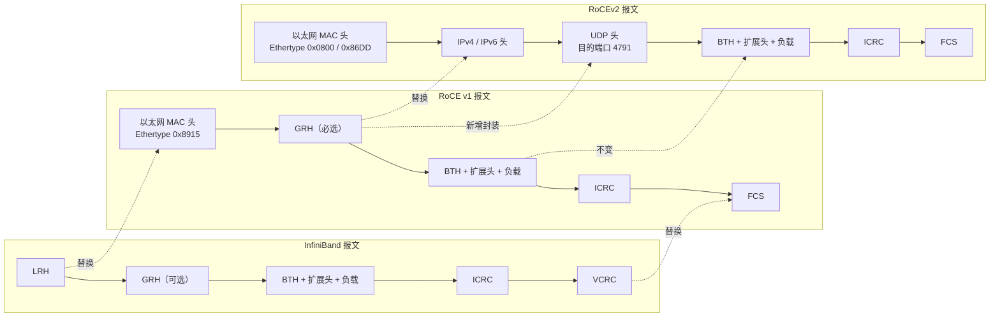
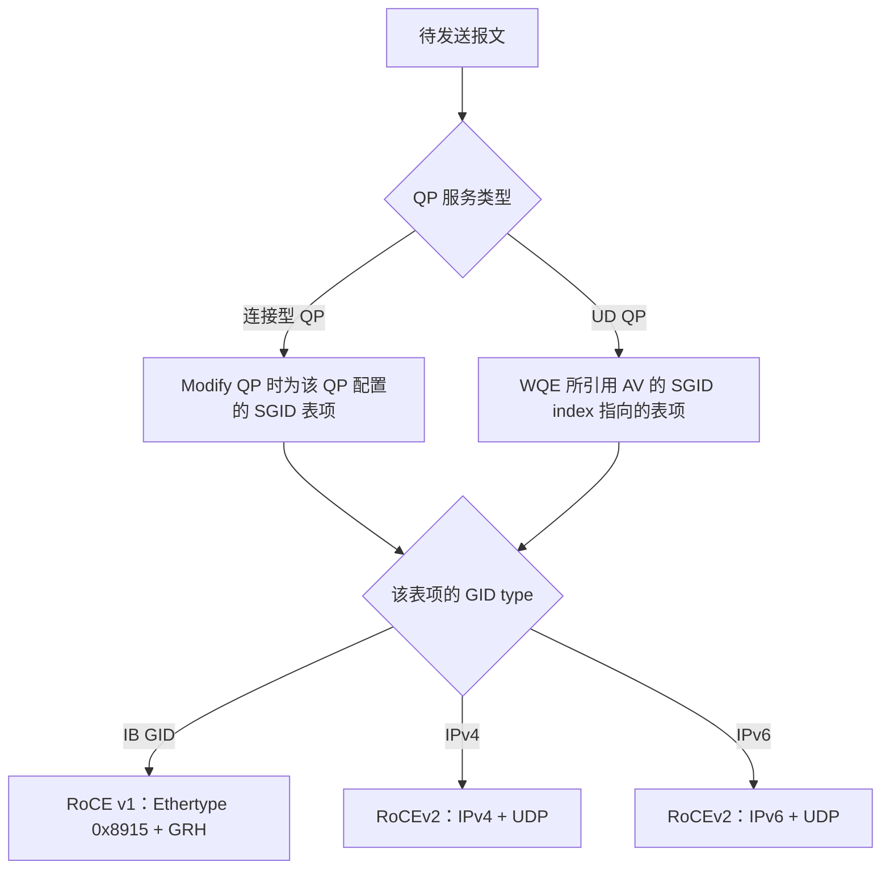
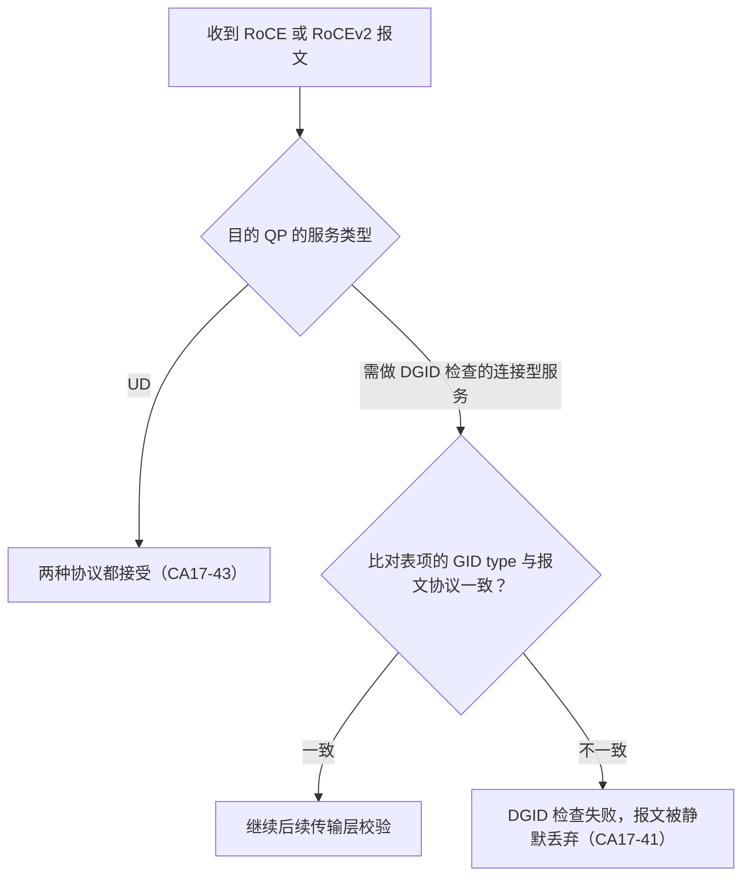

# 从 InfiniBand 到 RoCEv1 / RoCEv2 的演进（From InfiniBand to RoCE v1 and RoCEv2）

> **摘要**：本文沿“InfiniBand → RoCE（Annex A16）→ RoCEv2（Annex A17）”的主线，说明每一步替换了什么、保留了什么、为什么这样做；用自绘图还原 Annex A17 中 Figure 344–348 的含义；逐条列出 RoCEv2 的“变与不变”及其规范依据，并概览 Annex A17 的合规条款（CA17-1…46）与 RoCE v1/v2 互通规则。
>
> **规范出处**：Vol1 §A16.1–§A16.10（p.1911–1927）；Vol1 §A17.1–§A17.9（p.1928–1949）；Vol1 §3.7（p.139–146）；Vol1 §5.2（p.168–172）；Vol1 §7.8.1（p.218–219）；Vol1 §8.3–§8.4（p.248–251）；Vol2 §A3.1（p.688）
>
> **前置阅读**：[RDMA 基础与技术对比](01-rdma-fundamentals.md)
>
> **关键词**：InfiniBand, RoCE, RoCEv2, Annex A16, Annex A17, Optional Normative, Ethertype 0x8915, UDP 4791, GRH, LRH, VCRC, FCS, GID type, RCM, CNP

---

## 1. 演进时间线

| 时间 | 事件 | 来源 |
|---|---|---|
| 1999 | InfiniBand 行业协会（InfiniBand Trade Association, IBTA）成立 | 〔外部: IBTA〕 |
| 2000 | InfiniBand 架构规范 1.0 发布 | 〔外部: IBTA〕 |
| 2007 | IETF 发布 iWARP 协议族 RFC 5040–5045 | 〔外部: IETF〕 |
| — | RoCE 附录以 Vol1 Release 1.2.1 为基础编写 | 〔Vol1 §A16.1, p.1911〕 |
| 2010 | IBTA 发布 RoCE（Annex A16） | 〔外部: IBTA 新闻稿〕 |
| 2014 | IBTA 发布 RoCEv2（Annex A17） | 〔外部: IBTA 新闻稿〕 |
| 2015 | DCQCN 提出面向 RoCEv2 的端到端拥塞控制算法 | 〔论文: DCQCN, SIGCOMM 2015〕 |
| 2015 年 8 月 | IBTA 公布首次 RoCE plugfest（适配器、线缆、交换机互通测试）结果 | 〔Vol2 §A3.1, p.688〕 |
| 2016 | 微软发表大规模商用以太网上部署 RoCEv2 的经验 | 〔论文: RDMA over Commodity Ethernet at Scale, SIGCOMM 2016〕 |
| 2020 | IBA Vol1/Vol2 Release 1.4（本知识库的依据版本，含 A16、A17） | 规范文本 |
| 2023 | Ultra Ethernet Consortium（UEC）成立 | 〔外部: UEC〕 |
| 2024 | Meta 发表在 AI 训练集群中大规模使用 RoCE 的经验 | 〔论文: RDMA over Ethernet for Distributed AI Training at Meta Scale, SIGCOMM 2024〕 |

> [!NOTE]
> 规范正文本身不记载发布年份；表中带“外部/论文”标注的年份来自公开资料，仅供建立时间感。

---

## 2. InfiniBand：一套完整的分层体系

InfiniBand 架构（InfiniBand Architecture, IBA）定义了 OSI 模型的前四层——物理层、链路层、网络层、传输层——以及配套的管理框架，并定义了软件接口及其 Verbs〔Vol1 §A17.2.1, p.1928〕。其数据包结构如下〔Vol1 §5.2, Figure 45/46, p.169–170〕：

```text
IB 子网内报文（无 GRH）：
+---------+----------+-------------+--------------+---------+---------+
| LRH 8B  | BTH 12B  | ETHs (opt.) | Payload      | ICRC 4B | VCRC 2B |
|         |          |             | 0..4096B+pad |         |         |
+---------+----------+-------------+--------------+---------+---------+

IB 跨子网报文（有 GRH）：
+---------+----------+----------+-------------+---------+---------+---------+
| LRH 8B  | GRH 40B  | BTH 12B  | ETHs (opt.) | Payload | ICRC 4B | VCRC 2B |
+---------+----------+----------+-------------+---------+---------+---------+
```

| 层 | IB 中的关键机制 | 依据 |
|---|---|---|
| 链路层 | 本地路由头（Local Route Header, LRH，8 字节）承载 SLID/DLID、SL、VL；交换机按 DLID 转发；逐 VL 的信用制链路级流控；可变 CRC（Variant CRC, VCRC）覆盖全包、逐跳重算 | §3.7.2, p.141–142；§5.2.1, p.171 |
| 网络层 | 全局路由头（Global Route Header, GRH，40 字节，格式同 IPv6 头）承载 SGID/DGID；IB 路由器按 DGID 转发并替换 LRH；跨子网或多播时必须携带 | §3.7.3, p.142；§8.3, p.248；C8-1, p.249 |
| 传输层 | 基本传输头（Base Transport Header, BTH）+ 扩展传输头（ETH）；不变 CRC（Invariant CRC, ICRC）覆盖端到端不变字段 | §3.7.4, p.143；§7.8.1, p.218 |
| 管理 | 子网管理器（SM）经 QP0 配置 LID、转发表；通用服务（SA、CM 等）经 QP1 | §3.7.5, p.145–146 |

GRH 中 `NxtHdr` 对非 Raw 的 IBA 报文固定为 0x1B（C8-7）〔Vol1 §8.4.1, p.250〕——这个值在 RoCEv2 中被 IP 头的 Protocol/Next Header = 0x11（UDP）取代。

---

## 3. RoCE（v1）：把 IB 传输层搬到以太网二层（Annex A16）

### 3.1 定位与目标

- Annex A16 允许 IB 使用非 IB 定义的链路层和物理层，这一能力被命名为 RDMA over Converged Ethernet（RoCE，读作 “Rocky”）；**支持 RoCE 是可选的，但一旦支持就必须满足本附录要求**〔Vol1 §A16.1, p.1911〕。
- 保留 IB 的软件接口、传输服务与协议，假定底层以太网使用常规管理方式，不使用 SM、SA 等 IB 管理基础设施〔Vol1 §A16.2, p.1911〕。
- 架构目标：在以太网二层上提供 RDMA；保持 Verbs 定义与现有实现兼容；保持内存管理范式；保持 IB 传输架构（RC、UC、UD、RD、XRC 以及 Atomic）〔Vol1 §A16.2.1, p.1912〕。
- 一个端节点可以混合存在 RoCE 端口与 IB 端口，RoCE 端口仍纳入端口编号空间〔Vol1 §A16.2.1, p.1912〕。

### 3.2 报文格式（Figure 343）

RoCE 报文与 IB 报文布局相同，但有三点例外〔Vol1 §A16.3.1, p.1912〕：每个包都含 GRH；用 MAC 头替代 LRH；以以太网 FCS 结尾。

```text
RoCE (v1) 帧（Figure 343 / 345）：
+-------------------+----------+----------------+---------+---------+--------+
| Ethernet MAC hdr  | GRH 40B  | BTH 12B + ETHs | Payload | ICRC 4B | FCS 4B |
| Ethertype=0x8915  | (always) |                |         |         |        |
+-------------------+----------+----------------+---------+---------+--------+
```

| 条款 | 要求 | 页码 |
|---|---|---|
| CA16-1 | RoCE 端口生成的报文须符合 Figure 343 结构 | p.1913 |
| CA16-2 | MAC 头字段不由本附录定义，但 Ethertype 必须为 **0x8915**，DMAC/SMAC 为二层目的/源端口的 MAC 地址 | p.1913 |
| CA16-3 | **不含 VCRC**，改为以太网 FCS | p.1913 |
| CA16-4 | 每个 RoCE 报文必须含有效 GRH | p.1913 |

MAC 头在概念上承担 LRH 的作用：提供足够的源/目的信息让以太网把包交换到目的端点〔Vol1 §A16.3.1, p.1912〕。

### 3.3 ICRC

ICRC 按基础规范“带 GRH”的情形计算；尽管没有 LRH，计算仍先输入 **64 bit 全 1**（等效于被整体屏蔽的 LRH），MAC 头不参与 ICRC〔Vol1 §A16.3.2, p.1913〕。基础规范在带 GRH 时屏蔽 LRH 全部字段及 GRH 的 Flow Label、Traffic Class、Hop Limit〔Vol1 §7.8.1, p.218–219〕。RoCEv2 延续了这一思路，见 §5 和 [ICRC 计算](../01-packet-format/06-icrc.md)。

### 3.4 Annex A16 其它要点

| 主题 | 规则 | 依据 |
|---|---|---|
| 管理 | 除通信管理（CM）外，其余 IB 管理类不在附录范围内；不要求每个子网有 SM（CA16-5）、不要求 SMA（CA16-6）、不要求 SA（CA16-7） | §A16.4, p.1913–1915 |
| QP0 | 概念未定义；DestQP=QP0 的报文静默丢弃（CA16-8） | §A16.4.3, p.1915 |
| MAD 时间参数 | RespTimeValue 默认 19、SubnetTimeout 默认 18（CA16-9） | §A16.4.4, p.1915 |
| 地址解析 | 二层地址分配与 GID→MAC 解析不在范围内，假定使用 ARP/ND | §A16.5.1, p.1916 |
| CM | REQ/LAP 中 LID 字段保留并忽略，REJ 码 13/19、APR 码 7 不得发送（CA16-10~13） | §A16.5.2, p.1917 |
| Raw | 不支持 Raw 服务（CA16-14、CA16-19） | §A16.6, p.1917；§A16.9.14, p.1925 |
| 传输层 | 遵循第 9 章（CA16-15）；必须支持静态速率控制（CA16-15.1.1） | §A16.7, p.1917–1919 |
| 拥塞控制 | Annex A10 不适用，BTH 的 F/B 位不使用并被忽略（CA16-16） | §A16.7.4, p.1919 |
| SL | SL 0–7 映射到以太网优先级 0–7，8–15 保留；使用保留 SL 返回 Invalid Address Vector（CA16-18） | §A16.8.1, p.1920 |
| 地址向量 | 只含 GID，不含 LID、Path Bits 等二层引用（CA16-17） | §A16.8, p.1920 |

### 3.5 局限：只能在二层域内通信

RoCE 报文是携带 IEEE 分配 Ethertype（0x8915）的普通以太网帧，以太网头之后紧跟 GRH；因为没有 IP 头，**无法被常规 IP 路由器跨越以太网二层子网转发**，只能在以太网二层域内提供 RDMA 服务〔Vol1 §A17.2.3, p.1929〕。这正是 RoCEv2 要解决的问题。

---

## 4. RoCEv2：IP 可路由的 RoCE（Annex A17）

### 4.1 定位

- Annex A17 是 **Optional Normative**：可选实现，但若实现则必须遵守其中的合规条款；它沿袭 RoCE 附录的思路，定义了一种使用 IP 网络层（用 IP 头替代 GRH）的新 IB 协议变体，从而允许 IP 路由〔Vol1 §A17.1, p.1928〕。
- RoCEv2 被描述为对 RoCE 报文格式的“简单修改”：用 IP 头替代 GRH 以穿越三层路由器，再加一个 UDP 头作为 RDMA 传输报文在 IP 上的**无状态封装层**〔Vol1 §A17.2.4, p.1930〕。
- 使用众所周知的 UDP 目的端口无状态地识别 RoCEv2 报文；UDP 源端口作为不透明的流标识，供网络做转发优化（如 ECMP）〔Vol1 §A17.2.4, p.1930〕。
- 由于只改变线上报文格式，而 RDMA 报文在 API 之下产生和消费，应用可以完全透明地运行在 RoCEv2 上〔Vol1 §A17.2.4, p.1930〕。

### 4.2 Figure 344–348 解读

> [!NOTE]
> 规范 PDF 中这几幅图是图片，未被抽取为文本。下表与随后的图根据正文描述**自绘重建**，用于说明含义，并非原图复制。

| 图号 | 标题 | 页码 | 含义（据正文重建） |
|---|---|---|---|
| Figure 344 | InfiniBand and RoCE Protocol Stacks | p.1929 | IB 与 RoCE 的协议栈并列：二者共享 Verbs、IB 传输层、IB 网络层；IB 用 IB 链路/物理层与 IB 管理，RoCE 用以太网链路/物理层与以太网管理（对应 §A17.2.2 正文） |
| Figure 345 | RoCE Packet Format | p.1929 | 以太网 L2 头（Ethertype 0x8915）+ GRH + BTH 及后续 + ICRC + FCS |
| Figure 346 | RoCEv2 and RoCE Frame Format Differences | p.1930 | 对比两种帧：RoCEv2 中 Ethertype 指示 IP，GRH 位置换成 IP 头，其后插入 UDP 头，BTH 及以后不变 |
| Figure 347 | RoCEv2 Protocol Stack | p.1931 | 在 Figure 344 基础上增加 RoCEv2 栈：IB 网络层被 IP + UDP 取代，链路层为以太网，管理为以太网/IP |
| Figure 348 | RoCEv2 Packet Format | p.1931 | RoCEv2 报文的规范格式：以太网头 + IPv4/IPv6 头 + UDP 头 + BTH + 扩展头 + 负载 + ICRC + FCS；CA17-2 要求报文符合此图 |

**协议栈（对应 Figure 344 / 347）：**

```text
        InfiniBand             RoCE (v1)               RoCEv2
   +------------------+   +------------------+   +------------------+
   | RDMA App / ULP   |   | RDMA App / ULP   |   | RDMA App / ULP   |
   | RDMA API (Verbs) |   | RDMA API (Verbs) |   | RDMA API (Verbs) |
   +------------------+   +------------------+   +------------------+
   | IB Transport     |   | IB Transport     |   | IB Transport     |
   +------------------+   +------------------+   +------------------+
   | IB Network (GRH) |   | IB Network (GRH) |   | UDP              |
   |                  |   |                  |   | IPv4 / IPv6      |
   +------------------+   +------------------+   +------------------+
   | IB Link (LRH)    |   | Ethernet Link    |   | Ethernet Link    |
   | IB PHY           |   | Ethernet PHY     |   | Ethernet PHY     |
   +------------------+   +------------------+   +------------------+
   | IB Management    |   | Ethernet Mgmt    |   | Ethernet/IP Mgmt |
   +------------------+   +------------------+   +------------------+
```

**帧格式（对应 Figure 345 / 346 / 348）：**

```text
RoCE (v1):
+------------------+-------------+----------------+---------+------+-----+
| Eth L2 header    | IB GRH      | IB BTH + ETHs  | Payload | ICRC | FCS |
| Ethertype 0x8915 | 40B         | 12B + ...      |         | 4B   | 4B  |
+------------------+-------------+----------------+---------+------+-----+

RoCEv2:
+------------------+-------------+----------+----------------+---------+------+-----+
| Eth L2 header    | IP header   | UDP hdr  | IB BTH + ETHs  | Payload | ICRC | FCS |
| Ethertype 0x0800 | IPv4 20B    | 8B       | 12B + ...      |         | 4B   | 4B  |
|   or 0x86DD      | or IPv6 40B | dst 4791 |                |         |      |     |
|                  | proto = 17  |          |                |         |      |     |
+------------------+-------------+----------+----------------+---------+------+-----+
```

**头部替换关系：**



### 4.3 头部开销对比

下表只计各协议的固定头与校验字段（不含扩展传输头、pad、前导码/SFD/帧间隙 20 字节）：

| 报文类型 | 组成 | 开销（字节） | 带 802.1Q 标签 |
|---|---|---|---|
| IB 子网内 | LRH 8 + BTH 12 + ICRC 4 + VCRC 2 | 26 | — |
| IB 跨子网 | LRH 8 + GRH 40 + BTH 12 + ICRC 4 + VCRC 2 | 66 | — |
| RoCE（v1） | MAC 14 + GRH 40 + BTH 12 + ICRC 4 + FCS 4 | 74 | 78 |
| RoCEv2 / IPv4 | MAC 14 + IPv4 20 + UDP 8 + BTH 12 + ICRC 4 + FCS 4 | 62 | 66 |
| RoCEv2 / IPv6 | MAC 14 + IPv6 40 + UDP 8 + BTH 12 + ICRC 4 + FCS 4 | 82 | 86 |

可见 RoCEv2/IPv4 比 RoCE v1 还少 12 字节（IPv4 20 + UDP 8 < GRH 40），RoCEv2/IPv6 则多出 UDP 的 8 字节。逐字节布局、MTU 与有效带宽计算见 [帧整体布局与 MTU](../01-packet-format/01-frame-layout.md)。

---

## 5. RoCEv2 “改了什么 / 没改什么”

### 5.1 保留

| 项目 | 说明 | 依据 |
|---|---|---|
| IB 传输层（第 9 章） | 服务类型、OpCode、PSN、ACK/NAK、重传、排序、头校验全部沿用，仅有附录列明的例外 | CA17-25〔§A17.4, p.1936〕；CA17-39〔§A17.7.4, p.1945〕 |
| BTH 与扩展传输头 | 紧跟在 UDP 头之后，格式不变 | Figure 348〔§A17.3, p.1931〕 |
| ICRC 算法 | 仍按 §7.8.1 的 CRC-32 计算，只改变起始方式与屏蔽字段 | CA17-22〔p.1935–1936〕 |
| Verbs 语义 | 保留，按 §A17.5 做必要修改 | §A17.2.4〔p.1930〕；CA17-30〔§A17.5, p.1940〕 |
| 通信管理（第 12 章） | 继续使用 IB CM 协议，只调整与本地地址（LID）有关的字段 | §A17.6.1〔p.1943〕；CA17-34~38 |
| GSI / QP1 | 保留，Get Special QP 只适用于 QP1 | §A17.5.8〔p.1942〕 |
| P_Key 分区 | BTH 中 P_Key 仍按第 9 章校验，P_Key 表至少含默认 P_Key | §A17.4.7〔p.1940〕 |
| GID 与 SGID index 机制 | GID 改由 IP 地址担任，AV 仍通过 SGID index 引用端口 GID 表 | §A17.4.1.1〔p.1936〕；§A17.4.2–§A17.4.3〔p.1937–1938〕 |
| Address Vector | 各分量保留原有行为，除非附录明确列出例外 | §A17.4.2〔p.1937〕 |
| SGID/DGID 校验 | §9.6.1.2.3 规则继续适用（IPv4 地址先映射为 GID） | §A17.4.4.2〔p.1939〕 |

### 5.2 替换

| IB 中的元素 | RoCEv2 中的替代 | 依据 |
|---|---|---|
| LRH 及其全部字段 | 以太网 MAC 头；规范中所有关于 LRH 的描述对 RoCEv2 端口不适用 | §A17.4.1.2〔p.1936〕 |
| GRH | IPv4/IPv6 头 + UDP 头 | §A17.1〔p.1928〕；§A17.2.4〔p.1930〕 |
| GRH.NxtHdr = 0x1B（C8-7） | IPv4 Protocol / IPv6 Next Header = 0x11（UDP），再由 UDP 目的端口标识 RoCEv2 | CA17-10、CA17-16、CA17-20 |
| VCRC | 以太网 FCS（逐跳） | Figure 348〔p.1931〕；RoCE 中见 CA16-3 |
| GID = SM 配置的子网前缀 + GUID | GID = 端口上配置的 IP 地址（IPv4 映射为 ::ffff:a.b.c.d） | §A17.4.1.1〔p.1936〕；§A17.4.3〔p.1938〕 |
| DLID | 泛化为 “Destination L2 Address”（DMAC） | §A17.4.2〔p.1937〕 |
| SA 路径查询 | OS 提供的 ARP/ND 与路由服务（规范范围外） | §A17.4.2〔p.1937〕 |
| SL → VL 映射 | SL 0–7 直接映射为以太网优先级 0–7，SL 8–15 保留 | §A17.4.2〔p.1938〕 |
| GRH TClass / HopLmt | IP DSCP / IPv4 TTL 或 IPv6 Hop Limit | CA17-4、CA17-9、CA17-13、CA17-17 |
| IB 链路级信用流控 | 建议无损以太网，通常为 IEEE 802.1Qbb PFC | §A17.9.1〔p.1946〕 |
| IB QoS（Annex A13） | DSCP/802.1Q 标识 + ETS（802.1Qaz） | §A17.4.9〔p.1940〕；§A17.9.2〔p.1946–1947〕 |
| IB 拥塞控制（Annex A10） | RCM：IP ECN 标记 + RoCEv2 CNP | §A17.4.8〔p.1940〕；§A17.9.3〔p.1947〕 |
| IB 子网管理 | 以太网/IP 管理实践（规范范围外） | §A17.6〔p.1943〕 |

### 5.3 移除（不适用）

| 项目 | 依据 |
|---|---|
| 管理类：SM、SA、PM、DevMgt、BM、SNMP 隧道、Vendor、Application、CC、Boot、BIS | §A17.6〔p.1942–1943〕 |
| QP0（SMI）；DestQP=0 的报文静默丢弃 | §A17.6，CA17-33〔p.1943〕 |
| IB Raw 数据报（Raw IPv6 / Raw Ethertype） | §A17.4.6，CA17-28〔p.1939〕；§A17.5.9〔p.1942〕 |
| Base LID、LMC、VL 数量、SM 地址、InitTypeReply 等端口属性 | §A17.5.1〔p.1940–1941〕 |
| Source Path Bits | §A17.4.2〔p.1937〕 |
| BTH 的 F（FECN）/ B（BECN）位语义 | CA17-29〔p.1940〕 |
| 多播 MLID | §A17.5.6〔p.1942〕 |
| Client Reregistration、Port Change Event | CA17-31、CA17-32〔p.1942〕 |
| CapabilityMask：IsSM、IsSMDisabled、IsSNMPTunnelingSupported、IsClientReregistrationSupported | §A17.5.1〔p.1941〕 |
| 基础规范 GRH 检查 C9-43.1.1、C9-43.1.2、C9-44 | §A17.4.4〔p.1938〕 |
| “本地路由报文”（C17-9）、反压限制（C17-19/20）、QP0 支持（C17-24）、SM 加载 P_Key 表（C17-7） | §A17.7.1–§A17.7.5〔p.1944–1945〕 |

### 5.4 新增

| 新增内容 | 说明 | 依据 |
|---|---|---|
| IPv4 格式 | 端口必须同时支持 RoCEv2/IPv4 与 RoCEv2/IPv6 | CA17-1〔p.1932〕 |
| IP 头字段规则 | IHL=5、DSCP、ECN、长度、DF=1、不分片、TTL、协议号、地址 | CA17-3~19〔p.1932–1934〕 |
| UDP 规则 | 目的端口为 IANA 分配值（4791）、长度覆盖到 ICRC、校验和建议为 0 | CA17-20、CA17-21；§A17.3.2.4〔p.1934–1935〕 |
| UDP 源端口熵 | 源端口作不透明流标识供 ECMP；有顺序要求的报文（如连接型 QP）应使用固定值 | §A17.3.2.1〔p.1934〕；§A17.9.4〔p.1948〕 |
| 新的 ICRC 规则 | 先输入 64 bit 全 1，再从 IP 头开始计算；屏蔽 IP 可变字段与 UDP 校验和 | CA17-22〔p.1935–1936〕 |
| GID type 属性 | 端口 GID 表项须标注 IPv4 / IPv6 / IB GID，并据此选择出站协议 | CA17-26〔p.1938〕；§A17.8 |
| 端口类型 “RoCEv2” 与 “RoCE Supported” 能力位 | 后者表示端口可同时以 RoCE 与 RoCEv2 模式工作 | §A17.5.1〔p.1941〕 |
| IP 版本校验 | 替换 C9-45 | CA17-27〔p.1939〕 |
| UD CQE 远端地址信息 | 源 L2 地址 + 报文为 IPv4/IPv6/RoCE 的标志 | §A17.4.5.1〔p.1939〕 |
| UD 接收缓冲 L3 头布局 | 前 40 字节放 IP 头；IPv4 头放在偏移 20 处 | §A17.4.5.2〔p.1939〕 |
| AV 中 DMAC 的约定值 | 0xFFFFFFFFFFFF 表示由 verbs 实现自行做 L3→L2 解析 | §A17.4.2〔p.1937〕 |
| RCM（ECN + CNP） | 可选；RoCEv2 CNP 的 OpCode 为 0b1000_0001（0x81），而 IB（Annex A10）CNP 为 0x80 | CA17-44~46；Figure 349〔p.1947–1948〕 |
| v1/v2 互通规则 | 由 GID type 决定 QP 工作在 RoCE 还是 RoCEv2 模式 | CA17-40~43〔p.1945–1946〕 |

逐字段规则见 [以太网/IP/UDP 头字段](../01-packet-format/02-ethernet-ip-udp.md)、[ICRC](../01-packet-format/06-icrc.md)、[ECN 与 CNP](../05-congestion-control-and-qos/03-ecn-and-cnp.md)。

---

## 6. Annex A17 的 “Optional Normative” 性质与合规条款

### 6.1 含义

- **可选**：一个 HCA 可以只实现 IB 端口而不实现 RoCEv2；
- **规范性**：一旦声称支持 RoCEv2，就必须满足附录中的全部 CA17 合规条款〔Vol1 §A17.1, p.1928〕。
- 条款强度沿用规范惯例：*shall* 为强制，*should* 为建议，*may* 为允许。附录中若干关键行为是 *should* 而非 *shall*，例如：连接型 QP 的 UDP 源端口应固定〔§A17.3.2.1〕、UDP 校验和应为 0〔§A17.3.2.4〕、网络应配置为无损〔§A17.9.1〕、收到 CNP 后一段时间应提速（CA17-46 本身就是 *should*）。

> [!IMPORTANT]
> 合规条款覆盖的是端点（HCA）行为。交换机、路由器的配置（PFC、ECN 标记、ECMP 哈希）在 A17 中只有建议性描述，不构成 CA17 条款〔§A17.9〕。

### 6.2 CA17-1 … CA17-46 分组概览

| 条款 | 主题 | 章节 | 页码 |
|---|---|---|---|
| CA17-1 ~ 2 | 同时支持 IPv4/IPv6；报文须符合 Figure 348 | §A17.3.1 | p.1932 |
| CA17-3 ~ 12 | IPv4 头：IHL、DSCP、ECN、Total Length、Flags、Fragment Offset、TTL、Protocol、SIP、DIP | §A17.3.1.1 | p.1932–1933 |
| CA17-13 ~ 19 | IPv6 头：DSCP、ECN、Payload Length、Next Header、Hop Limit、SIP、DIP | §A17.3.1.2 | p.1933–1934 |
| CA17-20 ~ 21 | UDP 目的端口与长度 | §A17.3.2 | p.1934–1935 |
| CA17-22 | ICRC 生成/校验规则 | §A17.3.3 | p.1935–1936 |
| CA17-23 ~ 24 | 入站报文校验；不合规报文静默丢弃 | §A17.3.4 | p.1936 |
| CA17-25 | 遵循第 9 章 IB 传输层 | §A17.4 | p.1936 |
| CA17-26 | GID 表项的 GID type 属性 | §A17.4.3 | p.1938 |
| CA17-27 | IP 版本号检查（替换 C9-45） | §A17.4.4.1 | p.1939 |
| CA17-28 | 不支持 IB Raw 数据报 | §A17.4.6 | p.1939 |
| CA17-29 | 忽略 BTH 的 F/B 位 | §A17.4.8 | p.1940 |
| CA17-30 | 采纳 Verbs 修改 | §A17.5 | p.1940 |
| CA17-31 ~ 32 | 不支持 Client Reregistration、Port Change Event | §A17.5.10 | p.1942 |
| CA17-33 | DestQP=QP0 的报文静默丢弃 | §A17.6 | p.1943 |
| CA17-34 ~ 38 | CM 消息（REQ/REJ/LAP/APR/SAP）中 LID 相关规则 | §A17.6.1 | p.1943–1944 |
| CA17-39 | 对所有入站报文做传输层错误检查（替换 C17-21） | §A17.7.4 | p.1945 |
| CA17-40 ~ 43 | 与 RoCE（v1）端点互通 | §A17.8 | p.1945–1946 |
| CA17-44 ~ 46 | RoCEv2 拥塞管理（RCM） | §A17.9.3 | p.1947–1948 |

被替换或宣布不适用的基础规范条款：C9-45 → CA17-27；C9-43.1.1、C9-43.1.2、C9-44 不适用〔§A17.4.4〕；C11-13（就 QP0 而言）与 o11-1 不适用〔§A17.5.8〕；C17-7、C17-9、C17-19、C17-20、C17-24 不适用，C17-21 → CA17-39〔§A17.7〕。

逐条清单与实现检查项见 [Annex A17 合规条款清单](../08-reference/03-compliance-checklist.md)。

---

## 7. RoCE v1 / v2 互通（§A17.8）

RoCEv2 端口与 RoCE 端口可以互通：RoCEv2 端口**可选地**具备生成与处理 RoCE 报文的能力，由 Query HCA 中的 “RoCE Supported” 能力位指示；协议选择（RoCE 还是 RoCEv2）由端口 GID 表对应表项的 GID type 控制〔Vol1 §A17.8, p.1945；§A17.5.1, p.1941〕。GID type 中的 “IB GID” 正是为与 RoCE 互通而设〔§A17.4.3 脚注 63, p.1938〕。

| 条款 | 规则 |
|---|---|
| CA17-40 | 支持 RoCE 的 RoCEv2 端口上的**连接型 QP**，按 Modify QP 为该 QP 配置的端口 GID 表项的 GID type 工作在 RoCE 或 RoCEv2 模式 |
| CA17-41 | 对需要做 DGID 检查的入站报文，若用于比对的 GID 表项的 GID type 与报文协议不匹配，则视为检查失败 |
| CA17-42 | **UD QP** 按 WQE 中 AV 所引用 GID 表项的 GID type 决定每个报文以 RoCE 还是 RoCEv2 发送 |
| CA17-43 | UD QP 对 RoCE 与 RoCEv2 报文都视为有效并接收 |

此外，涉及 RoCE 连接的 CM 报文本身就是 RoCE 报文；RoCEv2 连接的 CM 报文则是与目标连接同类型（IPv4 或 IPv6）的普通 RoCEv2 报文〔Vol1 §A17.6.1, p.1943〕。





**「工程提示」**

- 〔业界实践: Linux〕当网卡同时支持 RoCE v1 与 v2 时，内核会为每个 IP 地址各生成一个 v1 表项和一个 v2 表项，sysfs 中分别显示为 `IB/RoCE v1` 与 `RoCE v2`（见 [RoCEv2 寻址](04-addressing.md)）。
- 〔业界实践: Linux rdma_cm〕设备支持时 `rdma_cm` 优先使用 RoCE v2；可通过 configfs 的 `default_roce_mode` 属性调整每个端口的默认模式（路径形如 `/sys/kernel/config/rdma_cm/<dev>/ports/<port>/default_roce_mode`，以所用内核版本为准）。
- 两端 GID type 选择不一致（一端 v1、一端 v2）是“建连失败/报文被静默丢弃”的常见原因，排查方法见 [排障指南](../07-engineering-practice/05-troubleshooting.md)。

---

## 8. 后续发展（点到为止）

- **大规模数据中心部署**：微软在 SIGCOMM 2016 报告了 RoCEv2 在商用以太网上的大规模部署及 PFC 相关问题（死锁、风暴等）〔论文: SIGCOMM 2016〕；其后又报告了在 Azure 存储中跨数据中心集群使用 RDMA 的经验〔论文: Empowering Azure Storage with RDMA, NSDI 2023〕。
- **AI 训练集群**：Meta 在 SIGCOMM 2024 介绍了用于分布式 AI 训练的 RoCE 网络设计与运维经验〔论文: SIGCOMM 2024〕；GPU 集群的后端网络大量采用 RoCEv2〔业界实践〕。
- **拥塞控制与“有损 RoCE”**：DCQCN（SIGCOMM 2015）、TIMELY（SIGCOMM 2015）、IRN（SIGCOMM 2018，改进丢包恢复以降低对 PFC 的依赖）、HPCC（SIGCOMM 2019）等研究持续演进〔论文〕；各网卡厂商也提供了降低对 PFC 依赖的私有特性（厂商相关，以所用产品文档为准）。详见 [DCQCN](../05-congestion-control-and-qos/04-dcqcn.md) 与 [其他拥塞控制与有损 RoCE](../05-congestion-control-and-qos/05-advanced-cc-and-lossy-roce.md)。
- **Ultra Ethernet Consortium**：2023 年在 Linux 基金会下成立，面向 AI/HPC 定义新的以太网传输协议栈（Ultra Ethernet Transport），并于 2025 年发布 1.0 规范；它是独立于 RoCEv2 的新协议，而非 Annex A17 的修订〔外部: UEC，具体技术细节待核实〕。
- **规范本身**：本知识库以 Vol1/Vol2 Release 1.4 为准；若使用更新版本的 IBTA 规范，请核对 A16/A17 是否有勘误或增补。

---

## 9. 要点回顾

- IB 定义了物理、链路、网络、传输四层 + 管理 + Verbs；RoCE 保留 Verbs、传输层与 GRH，用以太网替换链路/物理层，Ethertype 为 0x8915，只能在二层域内通信。
- RoCEv2 用 IP 头替代 GRH，再加 UDP 头作为无状态封装（目的端口 4791），从而可被 IP 路由器转发；对应用透明。
- Annex A17 是 Optional Normative：可选实现，实现则必须满足 CA17-1…46。
- 保留：IB 传输层、BTH/扩展头、ICRC 算法、Verbs、CM、QP1、P_Key；替换：LRH→MAC 头、GRH→IP+UDP、VCRC→FCS、SL→以太网优先级、IB CC→RCM、IB QoS→DSCP/ETS。
- 移除：SM/SA 等 11 个管理类、QP0、Raw、LID/LMC/Path Bits、F/B 位语义、MLID；新增：IPv4、GID type、UDP 源端口熵、新的 ICRC 屏蔽规则、RCM（CNP OpCode 0x81）。
- RoCEv2/IPv4 头开销（62 字节）比 RoCE v1（74 字节）还小；RoCEv2/IPv6 为 82 字节。
- v1/v2 互通由 GID type 决定：连接型 QP 看 Modify QP 配置的表项，UD 看每个 WQE 的 AV；UD 两种都收；GID type 与报文协议不符的 DGID 检查视为失败。

## 自测

<details><summary>Q1：RoCE v1 的 ICRC 为什么要先输入 64 bit 全 1？RoCEv2 为什么沿用这一做法？</summary>

答：IB 带 GRH 的报文计算 ICRC 时，LRH 的全部字段被替换为全 1 参与计算〔§7.8.1, p.218–219〕；RoCE 没有 LRH，为与基础规范保持一致，仍在 GRH 之前输入 64 bit 全 1〔§A16.3.2, p.1913〕。RoCEv2 规定 ICRC 计算同样以 64 bit 全 1 开始，规范脚注说明这是为了与 RoCE（v1）的 ICRC（运行一个“假 LRH”）等效〔§A17.3.3, CA17-22 及脚注 61, p.1935〕。
</details>

<details><summary>Q2：列举 RoCEv2 中三项属于 *should* 而非 *shall* 的行为。</summary>

答：例如：① 有顺序要求的报文（如同一连接型 QP）应使用固定的 UDP 源端口〔§A17.3.2.1, p.1934〕；② UDP 校验和应置 0〔§A17.3.2.4, p.1935〕；③ 底层网络应配置为无损〔§A17.9.1, p.1946〕；④ 支持 RCM 时，距最近一次 CNP 经过可配置的时间/字节数后应提速（CA17-46）。
</details>

<details><summary>Q3：一个 RoCEv2 HCA 收到 DestQP=0 的报文，或收到 IPv4 头 Version 字段为 6 的 RoCEv2/IPv4 报文，应如何处理？</summary>

答：都静默丢弃。前者依据 CA17-33（RoCEv2 端口没有 QP0）〔§A17.6, p.1943〕；后者依据 CA17-27（替换了基础规范的 C9-45）〔§A17.4.4.1, p.1939〕。
</details>

<details><summary>Q4：RoCEv2 的 CNP 与 IB（Annex A10）的 CNP 在 BTH OpCode 上有何区别？</summary>

答：RoCEv2 CNP 的 OpCode 为 0b1000_0001（0x81）〔Figure 349, p.1948〕；IB 拥塞控制使用的 CNP OpCode 为 0b1000_0000（0x80），基础规范 Table 38 中 100_00001–100_11111 标为保留〔Table 38, p.259〕。
</details>

<details><summary>Q5：一个同时支持 RoCE 与 RoCEv2 的端口上，UD QP 如何决定某个报文按哪种协议发送？收到报文时又如何处理？</summary>

答：发送时按该 WQE 所引用 AV 中 SGID index 指向的 GID 表项的 GID type 选择 RoCE 或 RoCEv2（CA17-42）；接收时 RoCE 与 RoCEv2 报文都视为有效（CA17-43）〔§A17.8, p.1945–1946〕。
</details>

## 参考

- 规范：IBTA Vol1 Release 1.4，Annex A16（p.1911–1927）、Annex A17（p.1928–1949）、§3.7（p.139–146）、§5.2（p.168–172）、§7.8.1（p.218–219）、§8.3–§8.4（p.248–251）、Table 38（p.257–259）；Vol2 Release 1.4 Annex A3（p.688–691）。
- 外部：IBTA 关于 RoCE（2010）与 RoCEv2（2014）发布的新闻稿；IANA 端口注册表（UDP 4791）；IETF RFC 5040–5045；Ultra Ethernet Consortium 官网。
- 论文：Zhu et al., *Congestion Control for Large-Scale RDMA Deployments*（DCQCN），SIGCOMM 2015；Guo et al., *RDMA over Commodity Ethernet at Scale*，SIGCOMM 2016；Mittal et al., *Revisiting Network Support for RDMA*（IRN），SIGCOMM 2018；Bai et al., *Empowering Azure Storage with RDMA*，NSDI 2023；Gangidi et al., *RDMA over Ethernet for Distributed AI Training at Meta Scale*，SIGCOMM 2024。
- 业界实践：Linux 内核 `drivers/infiniband/core/cache.c`（GID type 字符串）、`cma_configfs.c`（`default_roce_mode`）。
- 本库相关：[分层架构映射](03-architecture-and-layering.md)、[RoCEv2 寻址](04-addressing.md)、[合规条款清单](../08-reference/03-compliance-checklist.md)、[规范章节对照](../08-reference/02-spec-section-map.md)。
