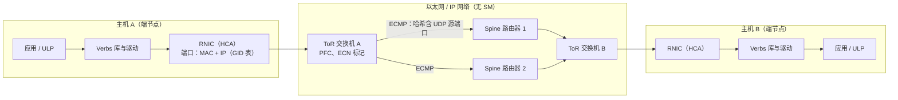
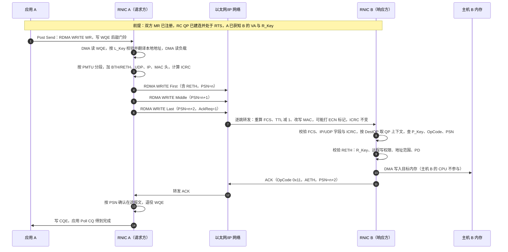

# IBA 分层架构在 RoCEv2 中的映射（IBA Layered Architecture Mapped onto RoCEv2）

> **摘要**：以 IBA 分层模型（物理/链路/网络/传输/上层协议 + 管理）为骨架，逐层说明 RoCEv2 保留了什么、用以太网/IP 的什么替代；把 HCA、端口、交换机、路由器、子网等 IBA 组件映射到 RNIC、以太网交换机、IP 路由器、IP 子网；梳理管理平面的差异（QP0 消失、QP1/GSI 只承载 CM）；最后以一次 RDMA WRITE 为例走通端到端事务流。
>
> **规范出处**：Vol1 §3.1（p.101–105）、§3.3（p.109–110）、§3.4（p.111–116）、§3.7（p.139–146）、§3.8（p.147–148）、§3.9（p.148–155）；§9.7.2（p.311–312）、§9.7.5.1（p.331–345）；§10.2.4.5（p.470）；§A16.4（p.1913–1916）；§A17.2（p.1928–1930）、§A17.3.3（p.1935–1936）、§A17.4（p.1936–1940）、§A17.6–§A17.7（p.1942–1945）、§A17.9（p.1946–1949）
>
> **前置阅读**：[RDMA 基础与技术对比](01-rdma-fundamentals.md)、[从 IB 到 RoCEv2 的演进](02-roce-evolution.md)
>
> **关键词**：Layered architecture, Physical/Link/Network/Transport layer, LRH, GRH, BTH, ICRC, VCRC, FCS, HCA, RNIC, Switch, Router, Subnet, SM, SMA, GSA, GSI, QP0, QP1, Transaction flow

---

## 1. IBA 分层模型回顾（§3.7）

IBA 的运行可以描述为一系列层次：各层协议彼此独立，每层依赖下层提供的服务并向上层提供服务〔Vol1 §3.7, p.139〕。下图依据 Figure 25（IBA Architecture Layers, p.140）重绘：

```text
              End Node A                                             End Node B
            +------------+                                         +------------+
 Upper      | Consumer   |       <-- Consumer Operations -->       | Consumer   |
            +------------+                                         +------------+
 Transport  | IBA Ops    |       <-- Messages (QP to QP) -->       | IBA Ops    |
            | SAR        |                                         | SAR        |
            +------------+                 Router                  +------------+
 Network    | Network    |   <-- Inter-subnet routing (GRH) -->    | Network    |
            |            |           [GRH packet relay]            |            |
            +------------+                 Switch                  +------------+
 Link       | Link enc.  |      <-- Subnet routing (LRH) -->       | Link enc.  |
            | MAC        |           [LRH packet relay]            | MAC        |
            |            |        flow control on each link        |            |
            +------------+                                         +------------+
 Physical   | PHY        |     <== signaling on each link ==>      | PHY        |
            +------------+                                         +------------+
```

| 层 | IB 中的职责 | 主要报文元素 | 依据 |
|---|---|---|---|
| 物理层 | 比特如何上线、符号编码、包定界（起始/结束定界符）、空闲符号、信号规则；具体由 Vol2 规定 | 符号流 | §3.7.1, p.140–141 |
| 链路层 | 包格式与包操作协议：链路管理包（训练、信用、链路完整性，不转发）与数据包；子网内按 LID 交换；逐 VL 信用流控 | LRH、VCRC | §3.7.2, p.141–142 |
| 网络层 | 子网间路由；路由器按 GRH 转发并替换 LRH，SGID/DGID 不变且受 ICRC 保护；路由器重算 VCRC 但不动 ICRC | GRH | §3.7.3, p.142 |
| 传输层 | 把包交给正确的 QP 并指示如何处理；按 MTU 分段/重组（SAR）；可靠服务的 ACK/NAK；RC 的端到端消息级流控 | BTH、扩展传输头（ETH）、ICRC | §3.7.4, p.143–145 |
| 上层协议 | 各类 ULP 经 Verbs 使用 IBA；IB 自身的管理协议（子网管理、通用服务） | MAD | §3.7.5, p.145–146 |

两类 CRC 的分工是理解“哪些字段可以在途中被修改”的关键：不变 CRC（Invariant CRC, ICRC）覆盖端到端不变的字段，可变 CRC（Variant CRC, VCRC）覆盖全部字段；交换机、路由器修改可变字段时只需重算 VCRC，从而在允许逐跳修改的同时保持端到端完整性〔Vol1 §3.7.2, p.142〕。

---

## 2. RoCEv2 中的逐层映射

### 2.1 映射总表

| 层/功能 | IB 中是什么 | RoCEv2 中由什么替代/保留 | 状态 | 规范依据 | 详见 |
|---|---|---|---|---|---|
| 物理层 | IB PHY（Vol2 定义的速率、编码、介质） | 以太网 PHY（IEEE 802.3），规范范围外 | 替换 | §A17.2.2, p.1928 | [IB 物理层与以太网 PHY](../08-reference/04-ib-physical-layer-vs-ethernet.md) |
| 链路层：寻址与交换 | LRH（DLID/SLID、LNH、PktLen），交换机按 DLID 查 SM 下发的转发表 | 以太网 MAC 头（DMAC/SMAC/Ethertype，可带 802.1Q 标签），交换机按 MAC/VLAN 转发；LRH 全部不适用 | 替换 | §A17.4.1.2, p.1936 | [以太网/IP/UDP 头](../01-packet-format/02-ethernet-ip-udp.md) |
| 链路层：完整性 | VCRC（16 bit，逐跳） | 以太网 FCS（32 bit，逐跳） | 替换 | Figure 348, p.1931 | [帧布局](../01-packet-format/01-frame-layout.md) |
| 链路层：无损 | 逐 VL 信用流控 | 建议无损，典型为 IEEE 802.1Qbb PFC | 替换（建议性） | §A17.9.1, p.1946 | [无损以太网与 PFC](../05-congestion-control-and-qos/01-lossless-ethernet-pfc.md) |
| 链路层：服务等级 | SL→VL 映射、VL 仲裁 | SL 0–7 → 以太网优先级；ETS 调度 | 替换 | §A17.4.2, p.1938；§A17.9.2, p.1946–1947 | [QoS](../05-congestion-control-and-qos/02-qos-dscp-pcp-ets.md) |
| 网络层 | GRH（IPv6 格式）、IB 路由器；GID = 子网前缀 + GUID | IPv4/IPv6 头、IP 路由器；GID = IP 地址；TClass→DSCP，HopLmt→TTL/Hop Limit | 替换 | §A17.1, p.1928；§A17.3.1；§A17.4.1.1, p.1936 | [RoCEv2 寻址](04-addressing.md) |
| 封装层 | （无） | UDP 头：目的端口 4791 标识 RoCEv2；源端口作 ECMP 熵；校验和建议为 0 | 新增 | §A17.2.4, p.1930；§A17.3.2, p.1934–1935 | [ECMP 与负载均衡](../05-congestion-control-and-qos/06-ecmp-and-load-balancing.md) |
| 传输层 | BTH + ETH；RC/UC/UD/XRC/RD；PSN、ACK/NAK、SAR；端到端信用 | 完整保留；不支持 Raw；BTH 的 F/B 位不用；ICRC 改为从 IP 头开始计算 | 保留 | CA17-25、CA17-28、CA17-29、CA17-22 | [BTH](../01-packet-format/03-bth.md)、[传输服务](../02-transport/01-service-types.md) |
| 拥塞控制 | Annex A10：交换机按 VL 检测拥塞，置 FECN，目的端回 BECN/CNP，CC 管理器配置参数 | RCM：IP ECN 标记 → 目的端生成 CNP → 源端按 QP 降速；可选 | 替换 | §A17.4.8, p.1940；§A17.9.3, p.1947–1948 | [ECN 与 CNP](../05-congestion-control-and-qos/03-ecn-and-cnp.md)、[IB CC 对比](../05-congestion-control-and-qos/07-ib-cc-vs-rocev2-cc.md) |
| 上层 / Verbs | Verbs 语义接口 | 保留，按 §A17.5 修改（端口类型、GID type、LID 无效等） | 保留（修改） | CA17-30, p.1940 | [Verbs 的 RoCEv2 修改](../03-verbs-and-resources/05-verbs-roce-specifics-and-programming.md) |
| 管理 | SM/SMA（QP0，SMP）；GSA（QP1，GMP）：SA、PM、CM、DevMgt、BM、SNMP 等 | 只保留 CM（经 QP1，以普通 RoCEv2 报文承载），其余管理类不适用；L2/L3 由以太网/IP 管理 | 大部分移除 | §A17.6, p.1942–1943 | [MAD 与 GSI](../04-connection-management/03-mad-and-gsi.md) |

### 2.2 对照图

```text
        InfiniBand                                RoCEv2
 +---------------------------+         +---------------------------+
 | ULP / Verbs               |  ====>  | ULP / Verbs (CA17-30)     |  保留（修改）
 +---------------------------+         +---------------------------+
 | IB Transport: BTH + ETHs  |  ====>  | IB Transport: BTH + ETHs  |  保留（CA17-25）
 +---------------------------+         +---------------------------+
 |                           |         | UDP (dst port 4791)       |  新增：无状态封装
 | IB Network: GRH           |  ---->  | IPv4 / IPv6               |  替换
 +---------------------------+         +---------------------------+
 | IB Link: LRH, VL, credits |  ---->  | Ethernet MAC, 802.1Q, PFC |  替换
 | VCRC                      |  ---->  | FCS                       |  替换
 +---------------------------+         +---------------------------+
 | IB PHY (Vol2)             |  ---->  | Ethernet PHY (802.3)      |  替换
 +---------------------------+         +---------------------------+
 | IB Mgmt: SM/SA/PM/... CM  |  ---->  | Ethernet/IP mgmt + IB CM  |  仅保留 CM
 +---------------------------+         +---------------------------+
```

> [!WARNING]
> 在 IP 世界里 UDP 是“传输层”，但在 RoCEv2 中 UDP 只是**无状态封装层**〔§A17.2.4, p.1930〕：真正的可靠传输（PSN、ACK/NAK、重传）由其后的 IB 传输层（BTH）完成。不要把 UDP 头当作 RoCEv2 的传输层来理解——例如 QP 的分用依据是 BTH 的 DestQP，而不是 UDP 端口；UDP 校验和也建议置 0，由 ICRC 承担端到端完整性。

### 2.3 ICRC 与 FCS 的分工在 RoCEv2 中如何延续

| 校验 | 覆盖范围 | 谁计算/校验 | 途中设备是否改写 |
|---|---|---|---|
| ICRC（32 bit） | 从 IP 头到负载/pad（含 UDP 头、BTH、扩展头），其中 IP 头可变字段与 UDP 校验和按全 1 参与 | 仅端点 RNIC | 不改写：路由器改 TTL、IPv4 头校验和、DSCP/ECN、IPv6 Flow Label/Hop Limit 都不影响 ICRC |
| FCS（32 bit） | 整个以太网帧 | 每一跳的 MAC | 逐跳校验；任何改写帧内容的设备（如路由器改写 MAC、TTL）都必须重新生成 |

依据：RoCEv2 实现了一个覆盖报文所有不变字段的 32 bit 端到端 CRC，提供超出逐跳更新的以太网 FCS 的保护〔Vol1 §A17.3.3, p.1935〕；被替换为全 1 的字段列表见 CA17-22〔p.1935–1936〕。

> [!WARNING]
> IP 源/目的地址、UDP 端口都**被 ICRC 覆盖**（不在屏蔽列表中）。因此任何改写这些字段的中间设备（例如 NAT/端口转换）都会导致接收端 ICRC 校验失败并静默丢弃（CA17-24）。RoCEv2 报文路径上不应存在此类改写。计算细节见 [ICRC](../01-packet-format/06-icrc.md)。

---

## 3. IBA 组件与 RoCEv2 世界的对应物（§3.4）

IBA 设备分为交换机、路由器、通道适配器、中继器以及连接它们的链路；管理基础设施包括子网管理器与通用服务代理〔Vol1 §3.4, p.111〕。

| IBA 组件 | IB 中的定义 | RoCEv2 中的对应物 | 说明 |
|---|---|---|---|
| 通道适配器 HCA/TCA（Channel Adapter） | 端节点中产生和消费报文的设备；HCA 提供 Verbs 接口，TCA 的使用者接口语义不由规范定义；本质是“带特殊保护功能的可编程 DMA 引擎”，内含内存转换与保护（MTP）〔§3.4.2, p.111–112〕 | RNIC（RDMA NIC）；规范在 A17 中仍称 HCA/CA | A17 声明第 17 章对 CA 的大多数要求适用于含 RoCEv2 端口的 CA，仅列出例外〔§A17.7, p.1944〕 |
| 端口（Port） | 每端口有 LID（或 LID 区间）、一个或多个 GID、独立收发缓冲与 VL〔§3.4.2, p.112〕 | 以太网端口（Linux 中对应一个 netdev）：MAC 地址 + 配置的 IP 地址（即 GID 表项） | RoCE 端口仍计入端口编号空间〔§A16.2.1, p.1912〕 |
| GUID | 厂商分配的 EUI-64 Node GUID / Port GUID，作持久标识〔§3.4.2, p.112〕 | 不参与线上寻址；Node GUID 仍出现在 CM 消息的 Local CA GUID 字段〔§12.7.9, p.734〕 | 见 [RoCEv2 寻址](04-addressing.md) |
| 交换机（Switch） | 按 LRH 的 DLID 与 SM 配置的转发表转发，是子网内路由的基本部件〔§3.4.3, p.113〕 | 以太网交换机（按 MAC/VLAN 二层转发）；数据中心中常为三层交换机 | 无 SM，交换机由以太网/IP 管理面配置 |
| 路由器（Router） | 按 GRH 的 DGID 转发，在子网间替换 LRH；源端须指定路由器 LID 并给出目的 GID〔§3.4.4, p.114〕 | IP 路由器 / 三层交换机：按目的 IP 转发，改写 MAC 头、递减 TTL/Hop Limit | ECMP 哈希可包含 UDP 源端口〔§A17.9.4, p.1948〕；可做 ECN 标记〔§A17.9.3〕；应把 RoCEv2 映射到启用 PFC 的优先级〔§A17.9.1〕 |
| 子网（Subnet） | 由一个 SM 管理的一组端口，由子网前缀标识〔§3.4.4, p.114；§4.1, p.160〕 | IP 子网 / 二层广播域（VLAN） | RoCE v1 限于二层域；RoCEv2 可跨 IP 子网 |
| 链路与中继器 | 铜缆、光缆、背板走线；中继器仅工作在物理层〔§3.4.1, p.111〕 | 以太网链路、线缆与光模块 | IB 与以太网线缆的管理接口差异见 Vol2 Annex A3〔p.688–691〕 |
| 子网管理器 SM / SMA | 发现拓扑、分配 LID、配置转发表与 P_Key 等〔§3.4.5.1, p.115〕 | 不存在；由以太网/IP 管理实践替代（规范范围外） | §A17.6, p.1943 |
| 通用服务代理 GSA | 经 GSI（QP1）提供 SA、PM、CM 等服务〔§3.4.5.3, p.116〕 | 仅 CM 代理保留 | §A17.6.1, p.1943 |



---

## 4. 管理平面差异

### 4.1 IB 管理体系回顾

- 子网管理由子网管理器（Subnet Manager, SM）与各节点的子网管理代理（Subnet Management Agent, SMA）共同完成，使用一种特殊的 MAD——子网管理包（Subnet Management Packet, SMP），发往专用的 QP0；子网管理接口（SMI）支持 LID 路由与定向路由（Directed Route），后者用于交换机和端节点尚未配置时的通信〔Vol1 §3.4.5.2, p.115–116；§3.7.5.1, p.145〕。
- 通用服务使用通用管理包（General Management Packet, GMP），经通用服务接口（General Service Interface, GSI）发往每个端口的 QP1，由对应的通用服务代理（GSA）处理〔Vol1 §3.7.5.2, p.146〕。
- QP0（SMI）、QP1（GSI）以及 Raw IPv6/Raw Ethertype QP 被称为特殊 QP，只允许特权使用者直接访问（C10-13）〔Vol1 §10.2.4.5, p.470〕。

### 4.2 RoCEv2 中各管理类的去留

Annex A17 明确列出以下管理类及其规范性条款对 RoCEv2 端口不适用：子网管理（SM）、子网管理服务（SA）、性能管理、设备管理、基板管理、SNMP 隧道、厂商自定义、应用自定义、拥塞控制、启动管理与 BIS；RoCEv2 端口接入的 IP 子网使用常规以太网/IP 管理实践与标准，不在规范范围内〔Vol1 §A17.6, p.1942–1943〕。

| 管理类 | IB 中的作用 | RoCEv2 | 以太网/IP 世界中的常见替代〔业界实践〕 |
|---|---|---|---|
| Subnet Management（SM） | 拓扑发现、LID 分配、转发表、端口配置 | 不适用 | 交换机自身的二层学习与路由协议（如 BGP/OSPF）、LLDP、DHCP、网管或 SDN 控制器 |
| Subnet Administration（SA） | PathRecord、ServiceRecord、多播组管理 | 不适用 | ARP/ND + 主机路由表（§A17.4.2）；Linux `rdma_cm` 地址与路由解析 |
| Performance Management（PM） | 标准性能计数器 | 不适用 | 网卡/交换机计数器（sysfs、ethtool、SNMP、流式遥测） |
| Device Management（DevMgt，Annex A8） | I/O 资源管理 | 不适用 | — |
| Baseboard Management（BM） | 机箱管理（IB-ML） | 不适用 | BMC 带外管理 |
| SNMP Tunneling | 在 IB 上隧道传输 SNMP | 不适用 | 原生 SNMP |
| Vendor / Application Specific | 厂商、应用自定义管理 | 不适用 | 厂商工具 |
| Congestion Control（Annex A10） | CC 管理器配置拥塞参数 | 不适用 | RCM 参数通过厂商接口配置（规范范围外） |
| Boot Management（Annex A5）、BIS（Boot Information Service，Annex A6） | 启动管理与启动信息服务 | 不适用 | PXE 等以太网启动方案 |
| **Communication Management（CM）** | 建立/释放连接 | **保留** | IB CM 协议经 QP1 运行（如 Linux `ib_cm`/`rdma_cm`） |

此外，任何引用 RoCE 端口的 IB 方法/属性组合可以在 MAD 公共状态（Common Status）中返回错误码 7（字段值无效）〔Vol1 §A17.6, p.1943〕。

### 4.3 QP0 与 QP1

| | QP0（SMI） | QP1（GSI） |
|---|---|---|
| IB 中 | 专供 SM 与 SMA 通信，SMP 走 VL15〔§3.5.8.2, p.124〕 | 承载所有 GMP（SA、CM、PM 等） |
| RoCEv2 中 | **不存在**：DestQP=QP0 的报文静默丢弃（CA17-33）〔§A17.6, p.1943〕；C17-24（每端口须支持 QP0）不适用〔§A17.7.5, p.1945〕 | **保留**：Get Special QP 只适用于 QP1；对其它类型调用返回 “Invalid Special QP Type”〔§A17.5.8, p.1942〕 |
| 线上形态 | — | CM MAD 作为 UD 报文发往 QP1，本身就是与目标连接同类型（IPv4/IPv6）的普通 RoCEv2 报文〔§A17.6.1, p.1943〕 |
| 适用的传输层规则 | — | 沿用第 9 章：QP1 的 P_Key 与端口任一 P_Key 匹配即有效（C9-42, p.297）；Q_Key 须等于众所周知的 0x80010000（C9-49, p.301） |

CM 消息中与 LID 有关的字段在 RoCEv2 中保留并在接收时忽略、相关拒绝码不得发送（CA17-34~38）〔§A17.6.1, p.1943–1944〕。CM 协议的细节见 [IB CM 协议在 RoCEv2 上的应用](../04-connection-management/01-cm-protocol.md)，MAD 格式见 [MAD 与 GSI](../04-connection-management/03-mad-and-gsi.md)。

> [!NOTE]
> Annex A16 为 RoCE 规定了 MAD 的默认 RespTimeValue=19、SubnetTimeout=18（CA16-9），并描述了 RoCE 上 MAD 响应的“可逆路径”构造方法〔§A16.4.4, p.1915–1916〕；Annex A17 正文没有重复这两部分内容。实现 RoCEv2 时可参考 A16 的做法，但需注意它们不是 CA17 条款。

---

## 5. 一次 RDMA WRITE 的端到端流程

### 5.1 规范中的 IBA 事务流（§3.8）

规范对一次事务的描述可以概括为〔Vol1 §3.8, p.147–148〕：

1. 使用者投递 WR，SQ 上出现一个 WQE；CA 检测到投递，读取 WQE，解释命令、校验并翻译 WQE 中的虚拟地址，访问数据；
2. 把待发送消息切分为一个或多个报文，每个报文加传输头（序号、OpCode 等）；目的端在远端子网时加网络头（源/目的 GID）；再加本地路由头，并计算 VCRC 与 ICRC；
3. 交换机可能更换 VL 而必须重算 VCRC，但不动 ICRC；路由器改写 LRH、更新 GRH 字段，同样只更新 VCRC；
4. 目的端做常规有效性检查，校验 VCRC 与 ICRC；根据传输头找到目标 QP，用 QP 上下文校验来源、检查 PSN 无遗漏，然后写内存，必要时发送确认；
5. 可靠服务检测到丢包时，以 NAK 告知期望的序号，发起方从该报文开始重发；
6. 发起方收到确认后在 CQ 上生成 CQE 并从 SQ 退役该 WQE；目标端总是按发送顺序确认，因此 WQE 按投递顺序退役。

### 5.2 RoCEv2 版本：时序图



### 5.3 逐步说明

| 步骤 | 执行者 | 动作 | 涉及字段/资源 | 依据 | 详见 |
|---|---|---|---|---|---|
| 0 | 双方软件 | 注册 MR、创建 CQ/QP，通过 CM（QP1 上的 MAD）交换 QPN、起始 PSN、GID 等，QP 迁移到 RTS；目标缓冲区的 VA/R_Key 通过私有数据或应用协议告知对端 | PD、MR、QP 上下文、AV | §3.5.3, p.120；§A17.6.1 | [QP 状态机](../03-verbs-and-resources/02-qp-state-machine.md)、[CM 协议](../04-connection-management/01-cm-protocol.md) |
| 1 | 应用 A | Post Send：SGE（本地地址、长度、L_Key）、远端 VA、R_Key、OpCode=RDMA WRITE、是否要求完成通知；敲门铃 | WR → WQE | §3.2.1, p.106 | [WR 与完成](../03-verbs-and-resources/04-work-requests-and-completions.md) |
| 2 | RNIC A | 取 WQE；用 L_Key 查本地 MR，检查 PD 与权限，VA→PA 翻译，DMA 读数据 | MTP（内存转换与保护） | §3.4.2, p.112；§3.8, p.147 | [内存管理](../03-verbs-and-resources/03-memory-management.md) |
| 3 | RNIC A | 按路径 MTU 分段：首包 OpCode 0x06（WRITE First，带 RETH：VA、R_Key、DMA 长度），中间包 0x07，末包 0x08；单包消息用 0x0A（WRITE Only）；每包 PSN 加 1 | BTH、RETH | Table 38, p.257；§3.7.4, p.143–144 | [OpCode 全表](../01-packet-format/05-opcodes.md)、[扩展传输头](../01-packet-format/04-extended-transport-headers.md) |
| 4 | RNIC A | 末包置 AckReq，要求响应方安排确认（C9-116） | BTH.A | §9.7.5.1.6, p.344 | [PSN 与 ACK/NAK](../02-transport/05-psn-and-ack-nak.md) |
| 5 | RNIC A | 封装：UDP（源端口为该 QP 的固定值，目的端口 4791，校验和 0）；IP（DSCP=AV.Traffic Class，ECN=ECT 或 00，TTL=AV.Hop Limit，DF=1，协议 17，SIP/DIP 来自 GID）；MAC（DMAC 为已解析的下一跳 MAC，可带 802.1Q 优先级）；计算 ICRC，MAC 追加 FCS | UDP、IP、MAC 头，ICRC | CA17-3~22；§A17.4.2 | [以太网/IP/UDP 头](../01-packet-format/02-ethernet-ip-udp.md)、[ICRC](../01-packet-format/06-icrc.md) |
| 6 | 网络 | 二层交换/三层路由；路由器改写 MAC、递减 TTL；拥塞时可把 ECN 置为 11；PFC 可暂停上游 | — | §A17.9, p.1946–1948 | [PFC](../05-congestion-control-and-qos/01-lossless-ethernet-pfc.md)、[ECMP](../05-congestion-control-and-qos/06-ecmp-and-load-balancing.md) |
| 7 | RNIC B | 校验 FCS；检查 IP/UDP/ICRC 规则，不符合则静默丢弃（CA17-24、CA17-27）；DestQP≠0（CA17-33）；按第 9 章检查 OpCode 与 QP 状态、P_Key、PSN，以及 SGID/DGID | IP/UDP 头、BTH | CA17-23~25；§9.6；§A17.4.4 | [排序与入站校验](../02-transport/03-ordering-and-validation.md) |
| 8 | RNIC B | 校验 RETH：R_Key 有效、MR/MW 允许远程写、地址与长度在范围内、PD 与 QP 一致；DMA 写内存；不消耗接收 WQE（C10-87） | RETH、MR 表 | §10.7.2.2, p.538 | [响应方行为](../02-transport/07-responder.md) |
| 9 | RNIC B | 生成 ACK：OpCode 0x11（RC Acknowledge），AETH（Syndrome=ACK、MSN），PSN 为最近一个被确认请求的 PSN（C9-95）；可合并确认多个请求 | BTH、AETH | §9.7.5.1.1–§9.7.5.1.2, p.331–332 | [PSN 与 ACK/NAK](../02-transport/05-psn-and-ack-nak.md) |
| 10 | RNIC A | 校验 ACK，按 PSN 确认在途报文，退役 WQE；若请求了完成通知，写 CQE | CQ | §3.8, p.148 | [请求方行为](../02-transport/06-requester.md) |
| 11 | 应用 A | Poll CQ 得到成功完成 | CQE | §3.2.1, p.106 | — |

> [!IMPORTANT]
> 对 SEND 与 RDMA WRITE，ACK 可以在数据真正写入响应方内存之前就发出：它只表示数据已到达响应节点的“故障域”，即 CA 已收下数据并将把它写入内存（或至少会把失败告知响应方应用）〔Vol1 §9.7.5.1.6, p.344–345〕。因此，请求方的完成 ≠ 对端应用已看到数据。

### 5.4 异常路径速览

| 异常 | 响应方/请求方行为 | 详见 |
|---|---|---|
| 中途丢包（PSN 不连续） | 响应方回 NAK（PSN Sequence Error），请求方从期望 PSN 起 Go-back-N 重传 | [PSN 与 ACK/NAK](../02-transport/05-psn-and-ack-nak.md) |
| ACK 丢失或无响应 | 请求方传输定时器超时（Ttr = 4.096 µs × 2^Local ACK Timeout，〔§9.7.6, p.364〕）后重传，重试计数耗尽则出错 | [请求方行为](../02-transport/06-requester.md) |
| ICRC 错、IP/UDP 字段非法 | 静默丢弃（CA17-24），最终由请求方超时重传恢复 | [错误处理](../02-transport/08-error-handling.md) |
| R_Key 无效/越界/无权限 | NAK（Remote Access Error），请求方 QP 进入错误状态 | [错误处理](../02-transport/08-error-handling.md) |
| 报文被打 ECN=11 标记 | 响应方（支持 RCM 时）向源端发 CNP，源端对该 QP 降速（CA17-44、CA17-45） | [ECN 与 CNP](../05-congestion-control-and-qos/03-ecn-and-cnp.md) |
| WRITE with Immediate 而对端无接收 WQE | RNR NAK，请求方按 RNR 定时器等待后重试 | [请求方行为](../02-transport/06-requester.md) |

### 5.5 IB 与 RoCEv2 事务流差异对照

| 环节 | IB（§3.8） | RoCEv2 |
|---|---|---|
| 网络头 | 仅当目的端在远端子网时加 GRH | 总是加 IP + UDP 头 |
| 链路头与 CRC | 加 LRH，端点计算 VCRC 与 ICRC | 加 MAC 头，端点计算 ICRC，FCS 由 MAC 生成 |
| 交换节点 | 交换机可改 VL、重算 VCRC | 以太网交换机二层转发，FCS 必要时重算 |
| 路由节点 | 路由器改写 LRH 与 GRH 字段，重算 VCRC | IP 路由器改写 MAC、TTL、IPv4 头校验和，可能改 DSCP/ECN，重算 FCS；ICRC 因屏蔽规则不受影响 |
| 目的端链路检查 | 帧定界、编码/极性、对齐、VCRC | FCS（由以太网 MAC 完成） |
| 目的端网络检查 | GRH 检查（§9.6.1.2） | IP 版本与 RoCEv2 头字段规则（CA17-24、CA17-27），SGID/DGID 由 IP 地址映射后检查 |
| 拥塞反馈 | FECN/BECN（Annex A10） | ECN → CNP（RCM） |

---

## 6. 硬件实现要点

**「硬件实现要点」** 把分层映射落到 RNIC 的功能模块上（具体微架构见 [RNIC 总体架构](../06-hardware-implementation/01-rnic-architecture.md)）：

| 层/功能 | RNIC 中的典型模块 | 设计关注点 |
|---|---|---|
| 物理层 + MAC | 以太网 PCS/MAC IP 核 | 线速 FCS；PFC 帧的生成与按优先级暂停响应 |
| 链路/网络/封装 | 报文解析器（parser）与组装器（deparser）：Ethernet、802.1Q、IPv4/IPv6、UDP | 每 QP 预生成头模板（MAC/IP/UDP），发送时只填 PSN、长度等动态字段；接收侧按 Ethertype→IP 协议号→UDP 4791 快速分类 |
| 端到端完整性 | ICRC 引擎 | 发送插入、接收校验都要按 CA17-22 屏蔽可变字段；与 FCS 并行计算 |
| 传输层 | QP 上下文存储/缓存；请求方引擎（取 WQE、分段、PSN）；响应方引擎（校验、PSN/重复检测、ACK/NAK）；重传与定时器 | QP 上下文命中率决定大规模连接下的性能；Go-back-N 需能从任意 PSN 回退重放 |
| 内存访问 | MTP：Key/PD 检查、VA→PA 翻译表 | 翻译表缓存与缺失处理延迟 |
| 拥塞控制 | ECN 检测与 CNP 生成；每 QP 速率限制器 | CA17-44~46 只规定框架，算法（如 DCQCN）需自行实现 |
| 主机接口 | PCIe DMA、门铃、CQE 写回、事件/中断 | 门铃与 WQE 获取延迟是小消息延迟的主要组成 |
| 管理 | QP1（GSI）报文 | 通常交由驱动/固件软件处理〔业界实践〕 |

发送/接收数据通路分别见 [发送数据通路](../06-hardware-implementation/02-tx-datapath.md)、[接收数据通路](../06-hardware-implementation/03-rx-datapath.md)，可靠性见 [可靠性引擎](../06-hardware-implementation/04-reliability-engine.md)。

---

## 7. 要点回顾

- IBA 分五层（物理、链路、网络、传输、上层协议）加管理；ICRC 端到端、VCRC 逐跳的分工让中间设备可以安全改写可变字段。
- RoCEv2 **保留**传输层（BTH/ETH、RC/UC/UD/XRC、PSN、ACK/NAK）与 Verbs，**替换**物理层/链路层（以太网 PHY/MAC、FCS、PFC、优先级）与网络层（IP），并**新增** UDP 作为无状态封装层。
- UDP 在 RoCEv2 中不是传输层：QP 分用看 BTH 的 DestQP，端到端完整性看 ICRC。
- IP 地址与 UDP 端口都在 ICRC 覆盖范围内，路径上不能有 NAT 类改写。
- 组件映射：HCA→RNIC，IB 交换机→以太网交换机，IB 路由器→IP 路由器，IB 子网→IP 子网/VLAN；没有 SM。
- 管理平面只剩 CM：QP0 不存在（CA17-33），QP1 保留，CM MAD 是普通 RoCEv2 报文；其余 11 个管理类不适用。
- 一次 RDMA WRITE：Post WR → 取 WQE、翻译地址 → 分段封装 → 网络转发（ICRC 不变）→ 响应方校验并写内存 → ACK（可合并）→ 请求方生成 CQE；ACK 只表示数据进入对端故障域。

## 自测

<details><summary>Q1：IP 路由器转发 RoCEv2/IPv4 报文时会改写哪些字段？为什么接收端的 ICRC 仍然能校验通过？</summary>

答：路由器改写 MAC 头（DMAC/SMAC），递减 TTL 并更新 IPv4 头校验和，还可能改写 DSCP 或把 ECN 置为 11，然后重算 FCS。ICRC 计算时 IPv4 的 TTL、头校验和、TOS（DSCP+ECN）都按全 1 参与，MAC 头根本不在覆盖范围内，因此这些改写不影响 ICRC〔CA17-22, p.1935–1936〕。
</details>

<details><summary>Q2：为什么说 UDP 在 RoCEv2 中不是传输层？请给出两条规范依据。</summary>

答：① 规范把 UDP 头定位为 RDMA 传输报文在 IP 上的“无状态封装层”〔§A17.2.4, p.1930〕；② 含 RoCEv2 端口的 HCA 必须遵循第 9 章 IB 传输层（CA17-25），可靠性、排序、QP 分用都由 BTH 及其后的头完成；此外 UDP 校验和建议置 0〔§A17.3.2.4, p.1935〕，完整性由 ICRC 保证。
</details>

<details><summary>Q3：Annex A17 中哪些 IB 管理类不适用？唯一保留的是什么？它在线上是什么形态？</summary>

答：不适用的有：子网管理、子网管理服务（SA）、性能管理、设备管理、基板管理、SNMP 隧道、厂商自定义、应用自定义、拥塞控制、启动管理、BIS〔§A17.6, p.1942–1943〕。唯一保留的是通信管理（CM），其报文是发往 QP1 的 MAD，作为与目标连接同类型（IPv4/IPv6）的普通 RoCEv2 报文传输〔§A17.6.1, p.1943〕。
</details>

<details><summary>Q4：请求方收到 RDMA WRITE 的 ACK 时，能否断定数据已经写入对端内存并被对端应用看到？</summary>

答：不能。规范说明 SEND/RDMA WRITE 的 ACK 可以在数据实际写入内存之前发出，它只表示数据已到达响应节点的故障域〔§9.7.5.1.6, p.344–345〕；且确认不是“使用者级”的确认〔§3.6.2, p.136〕。应用层需要额外的通知机制（如 WRITE with Immediate 或后续 SEND）。
</details>

<details><summary>Q5：RoCEv2 端口收到 DestQP=1 的 CM 报文时，P_Key 与 Q_Key 如何校验？</summary>

答：沿用第 9 章：QP1 的 BTH.P_Key 只要与该端口 P_Key 表中任一值匹配即有效（C9-42, p.297）；DETH.Q_Key 必须等于众所周知的 GSI Q_Key 0x80010000（C9-49, p.301）。RoCEv2 端口的 P_Key 表至少含默认 P_Key〔§A17.4.7, p.1940〕。
</details>

## 参考

- 规范：IBTA Vol1 Release 1.4，§3.1–§3.9（p.101–155）、§9.6（p.297–303）、§9.7.2（p.311–312）、§9.7.5.1（p.331–346）、§10.2.4.5（p.470）、§12.7.9（p.734）、Annex A16（p.1911–1927）、Annex A17（p.1928–1949）；Vol2 Release 1.4 Annex A3（p.688–691）。
- 外部：IEEE 802.3（以太网）、IEEE 802.1Q（VLAN 与优先级）、IEEE 802.1Qbb（PFC）、IEEE 802.1Qaz（ETS）、RFC 3168（ECN）。
- 业界实践：Linux `ib_cm` / `rdma_cm`（CM 经 QP1 运行）。
- 本库相关：[RoCEv2 寻址](04-addressing.md)、[RNIC 总体架构](../06-hardware-implementation/01-rnic-architecture.md)、[规范章节对照](../08-reference/02-spec-section-map.md)。
