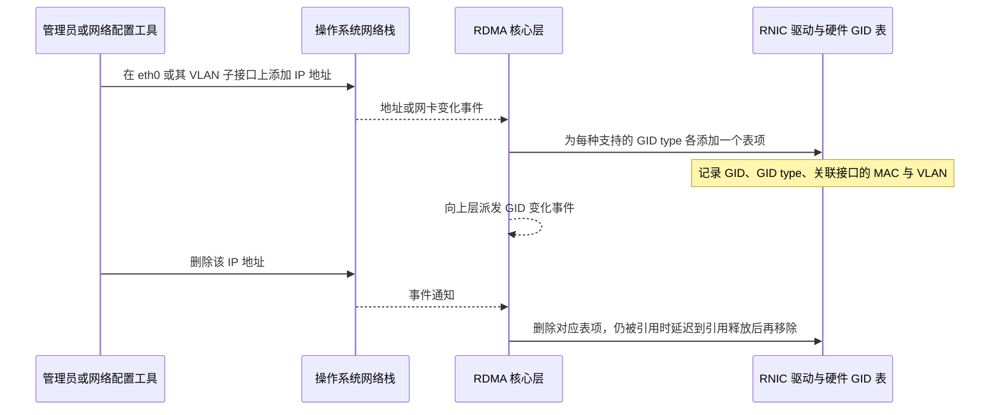
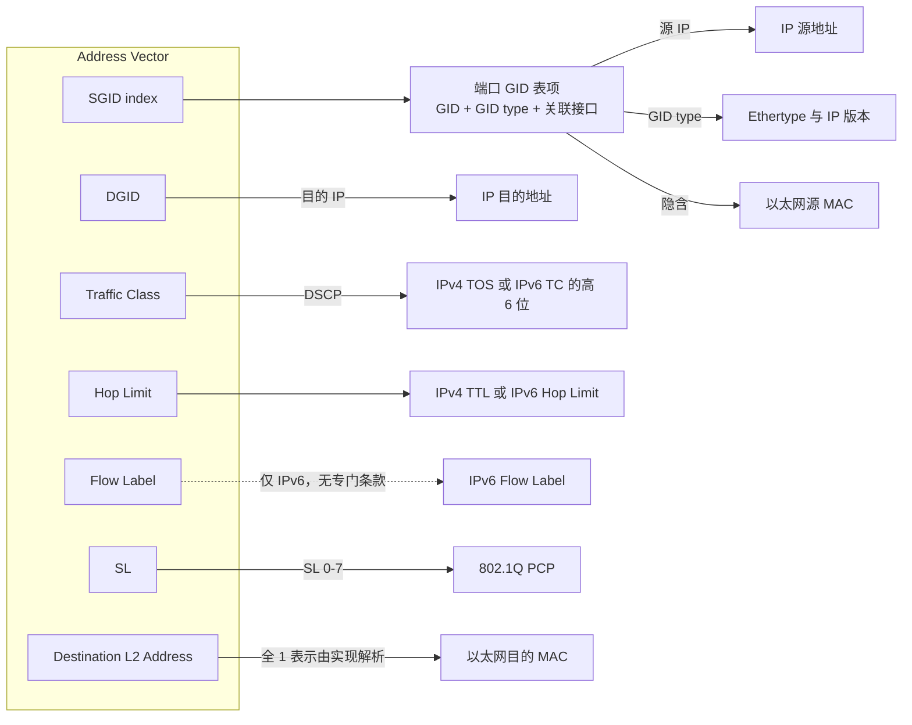
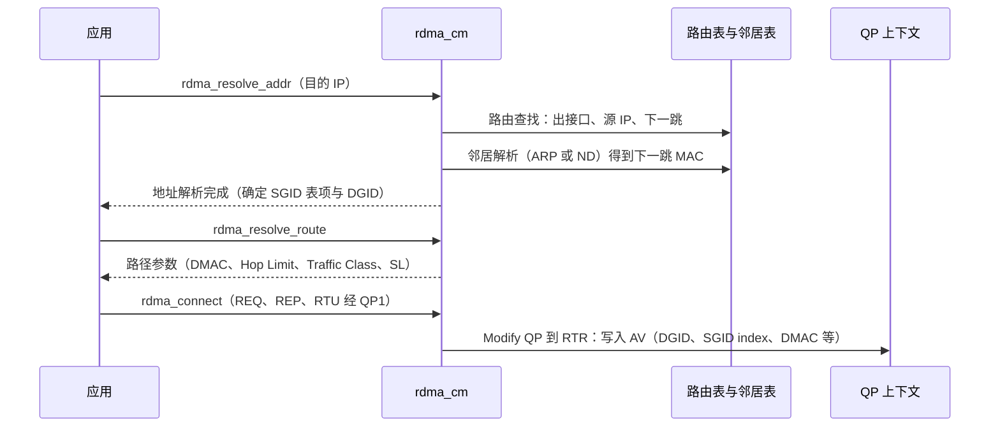

# RoCEv2 寻址：GID、GID 表、Address Vector、QPN、P_Key（RoCEv2 Addressing）

> **摘要**：RoCEv2 把 IB 的全局标识符（Global Identifier, GID）直接定义为 IP 地址，用“端口 GID 表 + GID type”决定报文的 L3 协议与源地址，再通过地址向量（Address Vector, AV）把 Traffic Class、Hop Limit、服务等级（Service Level, SL）等路径参数映射到 IP/以太网头字段；QP 编号（QP Number, QPN）、P_Key、Q_Key 等传输层标识原样保留。本文逐项对比这些概念在 IB 与 RoCEv2 中的异同，给出计算示例、Linux 实践与硬件实现要点。
>
> **规范出处**：Vol1 §3.5.10（p.125–127）；Vol1 第 4 章 §4.1（p.158–166）；§9.2.8（p.261）；§9.6.1.1.3、§9.6.1.2（p.297–299）；§9.6.1.5.1（p.301）；§10.2.2（p.462–465）；§10.2.5（p.470–471）；§10.5.3（p.500）；§10.9.1–§10.9.3（p.556–559）；§11.2.2.1（p.598–599）；§A16.5、§A16.8（p.1916–1921）；§A17.4.1–§A17.4.7（p.1936–1940）；§A17.5（p.1940–1942）；§A17.8（p.1945–1946）
>
> **前置阅读**：[分层架构映射](03-architecture-and-layering.md)
>
> **关键词**：GID, SGID index, GID type, IPv4-mapped IPv6, Port GID table, Address Vector, Address Handle, DMAC, SL/PCP, Traffic Class/DSCP, Hop Limit/TTL, Flow Label, ARP/ND, QPN, QP1, P_Key, Q_Key

---

## 1. IB 寻址概念回顾与 RoCEv2 适用性

IB 中，QP 的地址是“端口地址（GID + LID）+ QPN”的组合；与一个 QP 通信需要一组信息（LID 和/或 GID、QPN、SL、路径 MTU 等），通常向 SA 查询路径获得〔Vol1 §3.5.10, p.126〕。端口（endport）可以有 LID（子网内唯一）与 GID（可跨子网唯一）两类单播标识〔Vol1 §4.1, p.159〕。

| 标识 | 宽度 | IB 中由谁分配 | 作用域 | IB 中出现在 | RoCEv2 中 | 依据 |
|---|---|---|---|---|---|---|
| Node/Port GUID | 64 bit（EUI-64） | 制造商（C4-1、C4-2） | 全球唯一 | 管理报文、CM 消息 | 不参与线上寻址；Node GUID 仍出现在 CM 消息的 Local CA GUID 字段 | §4.1, p.159–160；§12.7.9, p.734 |
| LID | 16 bit | SM | 子网内 | LRH 的 SLID/DLID | **不适用**：LRH 不适用，Base LID/LMC 无效 | §4.1.3, p.164–166；§A17.4.1.2；§A17.5.1 |
| LMC / Path Bits | 3 bit / 最多 7 bit | SM / AV | — | SLID 低位 | **不适用** | §4.1.3, p.165；§A17.4.2 |
| GID | 128 bit | 子网前缀 + GUID，或其它本地分配值 | 全局 | GRH 的 SGID/DGID | **= IP 地址**（IPv6 直接使用，IPv4 映射） | §4.1, p.160；§A17.4.1.1, p.1936 |
| GID 前缀（子网前缀） | 64 bit | SM（默认 FE80::/64） | 子网 | GID 高 64 位 | 概念上由 IP 前缀/子网掩码取代 | §4.1.1, p.160 |
| QPN | 24 bit | CA | CA 内 | BTH.DestQP、DETH.SrcQP | 保留；无 QP0，QP1 保留 | §3.5.10, p.125；§9.2.8, p.261；CA17-33 |
| P_Key | 16 bit | 分区管理器（经 SM） | 分区 | BTH | 保留；P_Key 表填充方法不在规范范围 | §3.5.3, p.120；§A17.4.7, p.1940 |
| Q_Key | 32 bit | 使用者/CA | 每个数据报 QP | DETH | 保留 | §10.2.5, p.470 |
| MGID / MLID | 128 / 16 bit | SM | 多播组 | GRH.DGID / LRH.DLID | MLID **不适用**；A17 未专门展开多播寻址，按“GID = IP 地址”原则对应 IP 多播地址 | §4.1.1, p.162；§A17.5.6, p.1942 |
| Service ID | 64 bit | IBTA/应用 | — | CM 的 REQ/SIDR_REQ | 保留；Annex A11 定义了 IP 端口到 Service ID 的映射 | §3.5.10, p.126–127；§A11.5, p.1852 |

> [!NOTE]
> 基础规范明确说 GID 借用了 IPv6 地址的格式与诸多语义，但 **IBA 并不定义 GID 与 IPv6 地址之间的对应关系**〔Vol1 §4.1, p.160〕。RoCEv2 恰恰相反：它把 GID **定义为** IP 地址〔Vol1 §A17.4.1.1, p.1936〕。这是 RoCEv2 寻址与 IB 寻址最本质的区别。

---

## 2. GID = IP 地址（§A17.4.1.1）

### 2.1 规则

为便于沿用基础规范的文字，RoCEv2 的 L3 地址统称为 GID：

- **IPv6**：GID 与 IPv6 地址格式相同，IPv6 的源/目的 IP 直接就是 SGID/DGID；
- **IPv4**：源/目的 IPv4 地址按 IPv4-mapped IPv6 地址的通用规则编码进 SGID/DGID，即规范所写的 “GID =::ffff:<IPv4 Address>”〔Vol1 §A17.4.1.1, p.1936〕。IPv4-mapped 地址格式见〔外部: RFC 4291 §2.5.5.2〕。

### 2.2 IPv4 映射 GID 的位布局

```text
 31                              16 15                               0
+----------------------------------+----------------------------------+
|                        0x0000_0000                                  |  GID[127:96]  字节 0-3
+----------------------------------+----------------------------------+
|                        0x0000_0000                                  |  GID[95:64]   字节 4-7
+----------------------------------+----------------------------------+
|             0x0000               |              0xFFFF              |  GID[63:32]   字节 8-11
+----------------------------------+----------------------------------+
|                   IPv4 address (network byte order)                 |  GID[31:0]    字节 12-15
+----------------------------------+----------------------------------+
```

| 字节偏移 | GID 位 | 宽度 | 内容 | 说明 |
|---|---|---|---|---|
| 0–9 | [127:48] | 80 bit | 全 0 | IPv4-mapped 前缀 |
| 10–11 | [47:32] | 16 bit | 0xFFFF | IPv4-mapped 标志 |
| 12–15 | [31:0] | 32 bit | IPv4 地址（网络序，大端） | 线上 IPv4 头中真正携带的部分 |

### 2.3 计算示例

**IPv4：192.168.1.10**

1. 点分十进制 → 字节：192 = 0xC0，168 = 0xA8，1 = 0x01，10 = 0x0A，即 IPv4 = 0xC0A8010A；
2. 套用 ::ffff:a.b.c.d：GID = `::ffff:192.168.1.10`；
3. 完整 128 bit：`0x0000_0000_0000_0000_0000_FFFF_C0A8_010A`；
4. 不压缩的冒号格式（与 Linux sysfs 显示一致）：`0000:0000:0000:0000:0000:ffff:c0a8:010a`；
5. 字节序列：`00 00 00 00 00 00 00 00 00 00 FF FF C0 A8 01 0A`；
6. 上线时 IPv4 头的地址字段只携带 `C0 A8 01 0A`。

**IPv6：2001:db8::10** → GID 即 `2001:0db8:0000:0000:0000:0000:0000:0010`，字节序列 `20 01 0D B8 00 … 00 10`。

参考实现（已用 Python 3.12 运行验证）：

```python
import ipaddress

def ip_to_gid(ip: str) -> bytes:
    """RoCEv2: IPv6 地址直接作 GID；IPv4 映射为 ::ffff:a.b.c.d（Vol1 §A17.4.1.1）"""
    addr = ipaddress.ip_address(ip)
    if addr.version == 4:
        addr = ipaddress.IPv6Address("::ffff:" + ip)
    return addr.packed

def gid_to_ip(gid: bytes) -> str:
    addr = ipaddress.IPv6Address(gid)
    return str(addr.ipv4_mapped) if addr.ipv4_mapped else str(addr)

def gid_str(gid: bytes) -> str:
    """与 Linux sysfs（%pI6）相同的不压缩格式"""
    h = gid.hex()
    return ":".join(h[i:i + 4] for i in range(0, 32, 4))

g = ip_to_gid("192.168.1.10")
print(g.hex())                             # 00000000000000000000ffffc0a8010a
print(gid_str(g))                          # 0000:0000:0000:0000:0000:ffff:c0a8:010a
print(gid_to_ip(g))                        # 192.168.1.10
print(gid_str(ip_to_gid("2001:db8::10")))  # 2001:0db8:0000:0000:0000:0000:0000:0010
```

### 2.4 接收方向：从 IP 头还原 GID

传输层的 SGID/DGID 校验（§9.6.1.2.3）对 RoCEv2 继续适用：IPv6 报文直接以 SIP/DIP 作为 SGID/DGID；IPv4 报文先把 SIP/DIP 映射为 `::ffff:SIP` / `::ffff:DIP` 再参与校验〔Vol1 §A17.4.4.2, p.1939〕。此外 DGID 检查还要比对协议类型：用于比对的 GID 表项的 GID type 与报文协议不一致即视为检查失败（CA17-41）。

> [!WARNING]
> IP 源/目的地址都被 ICRC 覆盖（CA17-22 的屏蔽列表不含地址字段）。NAT 等改写地址的设备会使 ICRC 失效、报文被静默丢弃；同时 GID 校验也会因地址变化而失败。参见 [分层架构映射](03-architecture-and-layering.md) 与 [ICRC](../01-packet-format/06-icrc.md)。

---

## 3. 端口 GID 表与 GID type

### 3.1 基础规范中的 GID 表（§10.2.2.1）

- 每个 HCA 源端口有一张 GID 表，包含该端口的有效 GID，可经 Query HCA 获得；CI 必须为每个源端口维护该表（C10-1）〔Vol1 §10.2.2.1, p.462〕。
- 每个 Address Vector 含一个 **Source GID Index**，指向源 GID 表的某一项，该项即该 AV 的源 GID〔Vol1 §10.2.2.1, p.462〕。
- GID 表第一项（index 0）是只读的不变值（C10-2）〔Vol1 §10.2.2.1, p.462〕。

### 3.2 RoCEv2 的端口 GID 表（§A17.4.3）

- 每个 RoCEv2 端口维护一张端口 GID 表，包含配置到该端口的**全部 L3 地址**〔Vol1 §A17.4.3, p.1938〕；
- 新增 “GID type” 属性标明地址类型：**IPv4、IPv6 或 IB GID**（CA17-26）；其中 “IB GID” 用于与 RoCE（v1）互通〔§A17.4.3 脚注 63, p.1938〕；
- 出站报文的协议由所选表项的 GID type 决定（见 [演进 §7](02-roce-evolution.md)）〔§A17.4.2, p.1937；§A17.8, p.1945〕；
- **由软件栈负责随 L3 地址的创建/删除维护 GID 表**，通常通过订阅操作系统的回调/事件服务实现〔Vol1 §A17.4.3, p.1938〕；
- 源 MAC 不显式出现在 AV 中，而是由所选 SGID 隐含，由实现借助操作系统服务获得〔Vol1 §A17.4.2, p.1937–1938〕。

| GID 表项属性 | 来源 | 用途 |
|---|---|---|
| GID 值 | 端口上配置的 IP 地址（IPv4 为映射形式） | 源 IP（CA17-11、CA17-18）；入站 DGID 比对 |
| GID type | IPv4 / IPv6 / IB GID（CA17-26） | 选择 Ethertype、IP 版本，以及 RoCE 还是 RoCEv2 |
| 关联的二层接口 | 操作系统 | 隐含源 MAC（§A17.4.2）；〔业界实践: Linux〕还决定 VLAN（表项关联到具体 netdev，如 VLAN 子接口） |

〔业界实践: Linux mlx5 驱动 `set_roce_addr()`〕驱动向硬件写入 GID 表项时，一并下发 RoCE 版本、L3 类型、MAC 与 VLAN 信息——可见硬件 GID 表项通常不只存放 128 bit 地址本身。

### 3.3 GID 表的维护流程



上图为〔业界实践: Linux `roce_gid_mgmt.c` / `cache.c`〕的行为概括；规范只要求“软件随 L3 地址变化维护 GID 表”。

### 3.4 Linux 中查看 GID 表

〔业界实践: Linux 内核 sysfs，路径以所用内核版本为准〕

```shell
# GID 值（以 %pI6 格式输出，不压缩零）
cat /sys/class/infiniband/mlx5_0/ports/1/gids/3
# 0000:0000:0000:0000:0000:ffff:c0a8:010a

# 该表项的 GID type：输出 "IB/RoCE v1" 或 "RoCE v2"
cat /sys/class/infiniband/mlx5_0/ports/1/gid_attrs/types/3
# RoCE v2

# 该表项关联的网络接口
cat /sys/class/infiniband/mlx5_0/ports/1/gid_attrs/ndevs/3
# eth0

# 一次性列出（含 GID type）
ibv_devinfo -v
```

一个示意性的 GID 表（设备名、MAC、地址、索引顺序均为假设，实际顺序取决于驱动、内核版本与地址添加顺序）：

| index | gids/N | gid_attrs/types/N | gid_attrs/ndevs/N | 来源 |
|---|---|---|---|---|
| 0 | `fe80:0000:0000:0000:0e42:a1ff:fe8b:1234` | IB/RoCE v1 | eth0 | 默认 GID：fe80::/64 + 由 MAC 0c:42:a1:8b:12:34 派生的接口标识 |
| 1 | `fe80:0000:0000:0000:0e42:a1ff:fe8b:1234` | RoCE v2 | eth0 | 同上 |
| 2 | `0000:0000:0000:0000:0000:ffff:c0a8:010a` | IB/RoCE v1 | eth0 | IPv4 192.168.1.10 |
| 3 | `0000:0000:0000:0000:0000:ffff:c0a8:010a` | RoCE v2 | eth0 | IPv4 192.168.1.10 |
| 4 | `2001:0db8:0000:0000:0000:0000:0000:0010` | IB/RoCE v1 | eth0 | IPv6 2001:db8::10 |
| 5 | `2001:0db8:0000:0000:0000:0000:0000:0010` | RoCE v2 | eth0 | IPv6 2001:db8::10 |

规范 GID type 与 Linux 表示的对应：

| 规范（CA17-26） | Linux sysfs `types` | rdma-core `enum ibv_gid_type` | 说明 |
|---|---|---|---|
| IB GID（用于 RoCE v1 互通） | `IB/RoCE v1` | `IBV_GID_TYPE_IB` / `IBV_GID_TYPE_ROCE_V1` | 内核出于用户态兼容，IB 与 RoCE v1 显示为同一字符串 |
| IPv4 | `RoCE v2` | `IBV_GID_TYPE_ROCE_V2` | Linux 不单独存“IPv4/IPv6”，而是看 GID 是否为 IPv4 映射地址来区分（`rdma_gid_attr_network_type()`） |
| IPv6 | `RoCE v2` | `IBV_GID_TYPE_ROCE_V2` | 同上 |

编程接口：rdma-core 提供 `ibv_query_gid_ex()` / `ibv_query_gid_table()`，返回的 `struct ibv_gid_entry` 含 GID、索引、端口号、GID type 与关联接口的 ifindex〔业界实践: rdma-core libibverbs〕。

**「工程提示」**

> [!TIP]
> - **不要硬编码 SGID index**。同一型号网卡在不同主机、不同内核、不同 VLAN 配置下，“IPv4 + RoCE v2”所在的索引可能不同。用 `rdma_cm`（自动按路由选择 SGID）或按“IP 地址 + GID type”查表确定索引。perftest 等工具的 `-x <gid_index>` 参数尤其容易踩坑〔业界实践〕。
> - 默认 GID（fe80 开头）是 IPv6 链路本地地址，**不能被路由器转发**，跨子网通信必须选用可路由的 IPv4/IPv6 表项。
> - 两端选择了不同的 GID type（一端 v1 一端 v2）会导致建连失败或报文被静默丢弃（CA17-41）。

---

## 4. Address Vector 在 RoCEv2 中的含义（§A17.4.2）

### 4.1 AV 的组成与存放位置

Create Address Handle 的地址向量包含：Service Level、Send GRH Flag、Destination LID、Loopback Indicator（可选）、全局目的地才有的 Flow Label / Hop Limit / Traffic Class / Source GID Index、目的 GID（或 MGID）、Maximum Static Rate、Source Path Bits、Physical Port〔Vol1 §11.2.2.1, p.598–599〕。AV 存放的位置随服务类型不同：

| 服务类型 | AV 存放位置 | 依据 |
|---|---|---|
| RC / UC（连接型） | QP 上下文，只能通过 Modify QP 修改 | C10-4〔§10.2.2.2, p.463〕 |
| RD | EE 上下文，WR 引用 EE 上下文 | o10-1〔p.463〕 |
| UD | Address Handle，每个 WR 引用一个 AH；AH 属于某个 PD | C10-5〔p.463〕；C10-8、C10-10〔p.466〕 |

### 4.2 各分量的映射

RoCEv2 的 AV 既含 L2、L3 地址信息，也含其它路径参数；除下表注明的例外，各分量保持原有语义〔Vol1 §A17.4.2, p.1937〕。

| AV 分量 | IB 中的含义 | RoCEv2 中的含义 | 落到报文的字段 | 依据 | 备注 |
|---|---|---|---|---|---|
| Physical Port | 发送端口 | 同；决定使用哪张端口 GID 表 | — | §11.2.2.1, p.599 | — |
| Source GID Index | 源 GID 表索引 | 指向端口 GID 表项：给出源 IP 与 GID type，并隐含源 MAC | IP SIP；Ethertype 与 IP 版本（或 RoCE v1）；以太网 SMAC | CA17-11、CA17-18；§A17.4.2–§A17.4.3 | 〔业界实践: Linux〕表项关联的 netdev 还决定 VLAN |
| Destination GID | 目的 GID | 目的 IP（IPv4 为映射形式） | IP DIP | CA17-12、CA17-19 | IPv4 只有低 32 bit 上线 |
| Traffic Class（8 bit） | GRH.TClass | 区分服务码点（Differentiated Services Code Point, DSCP）的取值来源 | IPv4 TOS / IPv6 Traffic Class 中的 DSCP | CA17-4、CA17-13 | 见下方 8 bit 与 6 bit 的说明 |
| Hop Limit（8 bit） | GRH.HopLmt | IP 跳数限制 | IPv4 TTL / IPv6 Hop Limit | CA17-9、CA17-17 | 跨路由器时必须足够大 |
| Flow Label（20 bit） | GRH.FlowLabel | A17 无专门条款（CA17-13~19 未涉及）；按“保留原行为”可对应 IPv6 Flow Label，IPv4 无此字段 | IPv6 Flow Label | §A17.4.2, p.1937；ICRC 屏蔽见 CA17-22 | 〔业界实践: Linux〕常用来派生 UDP 源端口；Soft-RoCE（rxe）发送 IPv6 时 Flow Label 填 0 |
| Service Level（4 bit） | 选择 VL | 以太网优先级：SL 0–7 直接映射为优先级 0–7，SL 8–15 保留 | 802.1Q 标签的优先级码点（Priority Code Point, PCP），帧带标签时 | §A17.4.2, p.1938 | 使用保留 SL 可返回 Invalid Address Vector（§A17.5.3–§A17.5.5） |
| Send GRH Flag | 是否带 GRH | **恒为 TRUE** | — | §A17.4.2, p.1937 | 与 RoCE 相同 |
| Destination LID | 目的端口或路由器的 LID | 泛化为 **Destination L2 Address**（DMAC）；取 0xFFFFFFFFFFFF 表示由 verbs 实现（Create AH / Modify QP）自行做 L3→L2 解析 | 以太网 DMAC | §A17.4.2, p.1937 | 跨子网时是下一跳（网关）MAC，而非最终主机 MAC（IP 网络常识） |
| Source Path Bits | SLID 低位 | **不适用** | — | §A17.4.2, p.1937 | — |
| Maximum Static Rate | 静态速率控制 | A17 未作专门规定，静态速率控制属第 9 章 | — | §9.11, p.456–459 | A16 曾要求 RoCE 端口必须支持（CA16-15.1.1） |
| Loopback Indicator（可选） | 本端口回环 | A17 未作专门规定 | — | §10.2.2.3, p.464–465 | — |



> [!NOTE]
> **Traffic Class 是 8 bit，DSCP 只有 6 bit。** 规范只规定“DSCP 字段取 AV 的 Traffic Class 值”（CA17-4、CA17-13）。〔业界实践: Linux rxe、irdma 等驱动〕把 Traffic Class 作为完整的 IPv4 TOS / IPv6 Traffic Class 字节写入，即 DSCP = TC >> 2，低 2 位处于 ECN 位置；例如 DSCP 26 对应 TC 104，若希望同时置 ECN=10（ECT(0)）常写作 106。ECN 位的实际取值受“是否支持 RCM”约束：不支持时必须为 00（CA17-5、CA17-14）。不同厂商实现可能不同，以所用驱动/固件文档为准。

> [!NOTE]
> **SL 与 PCP。** 以太网优先级只能通过 802.1Q 标签中的 PCP 携带；不带 VLAN 标签的纯三层网络中，交换机通常依据 DSCP 做分类〔业界实践〕。〔业界实践: Linux `cma.c` 的 `iboe_tos_to_sl()`〕`rdma_cm` 会根据 ToS 经内核优先级映射（及 VLAN egress 映射）推导 SL。QoS 配置详见 [QoS：DSCP/PCP/ETS](../05-congestion-control-and-qos/02-qos-dscp-pcp-ets.md)。

---

## 5. L3→L2 地址解析（ARP/ND）

- 与 RoCE 一样，L3→L2 地址解析机制**不在规范范围内**；假定实现遵循常规做法，使用操作系统已有服务（如主机中的 ARP 与路由基础设施）〔Vol1 §A17.4.2, p.1937；§A16.5.1, p.1916〕。
- 两种模式〔Vol1 §A17.4.2, p.1937〕：
  1. **预先解析**：通过 Create Address Handle 把已解析的 DMAC 作为 “Destination L2 Address” 传入，实现原样使用；规范脚注指出这允许在生成 AV 之前完成解析，正如 Linux 现有 RDMA CM 的做法（脚注 62）。
  2. **委托解析**：把 “Destination L2 Address” 置为 0xFFFFFFFFFFFF，由 Create Address Handle / Modify QP 的实现完成解析。



上图为〔业界实践: Linux librdmacm / 内核 `cma.c`〕的典型流程。此外，用户态为 RoCE 端口创建 AH 时，内核会在 `rdma_create_user_ah()` 中调用 `ib_resolve_eth_dmac()` 解析 DMAC〔业界实践: Linux `verbs.c`〕。

> [!WARNING]
> 连接型 QP 的目的地址存放在 QP 上下文中，**只能通过 Modify QP 修改**（C10-4）〔Vol1 §10.2.2.2, p.463〕。因此建连时写入的 DMAC（通常是网关 MAC）不会随邻居表变化自动更新；若下一跳 MAC 改变（如网关切换），已有连接可能需要重新 Modify QP 或重建连接。此外 Hop Limit 必须大于路径上的路由器数量（经过 k 个路由器至少需要 k+1），否则报文会在途中因 TTL/Hop Limit 耗尽被丢弃；GRH 时代的同一语义见〔Vol1 §8.3.6, p.249〕：取 0 或 1 可确保报文不被转发出本地子网。

---

## 6. QPN

- QPN 为 24 bit（BTH.DestQP）〔Vol1 §9.2.8, p.261〕，每个 CA 最多 2^24 个 QP〔Vol1 §3.5.1, p.116〕；QPN 由 CA 分配，在 CA 内唯一〔Vol1 §3.5.10, p.125〕。
- 除 Raw 数据报外，报文都携带目的 QP 的 QPN，CA 收到报文后用该 QPN 的上下文处理它〔Vol1 §3.5.10, p.126〕。
- RoCEv2 中“QP 的地址”= IP 地址（GID）+ QPN。**UDP 端口不参与 QP 寻址**：目的端口固定为 4791（CA17-20），源端口只是流标识（§A17.3.2.1）。

| QPN | 含义 | IB 中 | RoCEv2 中 | 依据 |
|---|---|---|---|---|
| 0 | QP0（SMI） | 子网管理专用 | **不存在**；DestQP=0 的报文静默丢弃 | CA17-33〔§A17.6, p.1943〕 |
| 1 | QP1（GSI） | 通用服务 | **保留**，承载 CM；Get Special QP 仅适用于 QP1 | §A17.5.8〔p.1942〕 |
| 0xFFFFFF | 多播 QPN | UD 多播报文的目的 QPN；任何正确挂接到多播组的 QP 都可接收 | 保留（MLID 不适用） | o10-35〔§10.5.3, p.500〕；§A17.5.6 |
| 其它 | 普通 QP | 由 CA 分配 | 同 | §3.5.10, p.125 |

---

## 7. P_Key 与分区（§A17.4.7）

### 7.1 基础规则

| 规则 | 内容 | 依据 |
|---|---|---|
| 格式 | 16 bit；最高位为成员类型（1 = Full，0 = Limited），低 15 位为分区键 | §10.9.1.1, p.556–557 |
| 默认 P_Key | 0xFFFF 表示默认分区，具有 Full 成员资格（C10-115） | §10.9.1.2, p.557 |
| 无效 P_Key | 低 15 位全 0 即无效（C10-116） | §10.9.1.2, p.557 |
| 上电初值 | 无非易失存储且分区管理器尚未初始化时，P_Key 表表现为仅 index 0 一项有效、值为默认 P_Key（C10-123） | §10.9.2, p.558 |
| 匹配规则 | 双方都不是无效 P_Key、低 15 位相等、且不同时为 Limited 成员 | §10.9.3, p.558–559 |
| 入站校验 | QP1：与端口任一 P_Key 匹配即可（C9-42）；QP0、QP1 以外：与接收队列关联的 P_Key 比较，不匹配则静默丢弃（C9-43） | §9.6.1.1.3, p.297 |

```python
def pkey_valid(p: int) -> bool:
    return (p & 0x7FFF) != 0                      # C10-116：低 15 位全 0 为无效

def pkey_match(m_pkey: int, e_pkey: int) -> bool:
    """§10.9.3：报文 P_Key（M）与端节点 P_Key（E）的匹配规则"""
    if not (pkey_valid(m_pkey) and pkey_valid(e_pkey)):
        return False
    if (m_pkey & 0x7FFF) != (e_pkey & 0x7FFF):
        return False
    return bool((m_pkey | e_pkey) & 0x8000)        # 不能双方都是 Limited 成员

assert pkey_match(0xFFFF, 0xFFFF)      # 默认分区，Full 与 Full
assert pkey_match(0x7FFF, 0xFFFF)      # Limited 与 Full：允许
assert not pkey_match(0x7FFF, 0x7FFF)  # Limited 与 Limited：不匹配
assert not pkey_match(0x8000, 0x8000)  # 低 15 位为 0：无效 P_Key
```

（已用 Python 3.12 运行验证。）

### 7.2 RoCEv2 中的变化

- P_Key 表的填充方法**不在附录范围内**；附录依赖“上电时 P_Key 表至少已用默认 P_Key 初始化”这一前提；入站报文 BTH 中的 P_Key 仍按第 9 章校验〔Vol1 §A17.4.7, p.1940〕。
- 基础规范假定由 SM 设置 P_Key 表的 C17-7 对 RoCEv2 端口不适用〔Vol1 §A17.7.1, p.1944〕。
- RoCEv2 CNP 的 BTH.P_Key 取被 ECN 标记报文中的 P_Key〔Figure 349, p.1948〕。

**「工程提示」** 〔业界实践〕Linux 下 RoCE 设备的 P_Key 表通常只有一项 0xFFFF（可用 `cat /sys/class/infiniband/<dev>/ports/<port>/pkeys/0` 查看）；以太网环境中的租户隔离一般依靠 VLAN/VRF 等网络手段，而不是 P_Key。

---

## 8. Q_Key 与 UD 寻址细节

### 8.1 Q_Key

- Q_Key 用于数据报服务，校验远端发送方是否有权访问本地接收队列；须在投递接收 WQE 之前设置到 QP 上下文〔Vol1 §10.2.5, p.470〕。
- UD（QP0、QP1 除外）用 QP 上下文中的 Q_Key 校验入站报文，不匹配则静默丢弃（C10-14、C9-50）〔p.470；p.301〕。
- 最高位为 1 的 Q_Key 是“受控 Q_Key”：发送 WR 中若给出此类 Q_Key，报文改用 QP 上下文中的 Q_Key（C10-15）〔Vol1 §10.2.5, p.471〕。
- 发往 QP1 的报文，其 Q_Key 必须等于众所周知的 GSI Q_Key **0x80010000**（C9-49）〔Vol1 §9.6.1.5.1, p.301〕——它的最高位为 1，正是受控 Q_Key。
- 以上规则在 RoCEv2 中不变。

### 8.2 UD 完成信息与 L3 头散布

- **CQE 远端地址信息**：RoCEv2 中 UD 的 CQE 携带源 L2 地址（SMAC），以及一个标志，指示收到的是 IPv4、IPv6 还是 RoCE 报文〔Vol1 §A17.4.5.1, p.1939〕。
- **接收缓冲前 40 字节**：保留给入站报文的 L3 头。IPv6 头占满 40 字节；IPv4 头放在后 20 字节（距缓冲区起始偏移 20），此时前 20 字节内容未定义〔Vol1 §A17.4.5.2, p.1939〕。

```text
UD 接收缓冲区（使用者投递的接收缓冲起始处）
offset 0                    20                   40
       +--------------------+--------------------+--------------------
IPv6:  |            IPv6 header (40 bytes)       | SEND payload ...
       +--------------------+--------------------+--------------------
IPv4:  | undefined (20 B)   | IPv4 header (20 B) | SEND payload ...
       +--------------------+--------------------+--------------------
```

> [!TIP]
> 应优先使用 CQE 中的 L3 类型标志（§A17.4.5.1）判断头格式。若所用接口没有暴露该标志，只能从缓冲区内容推断：由于 IPv4 情形下前 20 字节是未定义的“垃圾”，可能恰好像一个 IPv6 头，需要再用 IHL=5 与 IPv4 头校验和确认。Linux 内核 `ib_get_rdma_header_version()` 就采用这一判定思路，并用 `union rdma_network_hdr` 描述这 40 字节〔业界实践: Linux `verbs.c` / `ib_verbs.h`〕。

下面的 C 代码按上述思路实现（已用 gcc `-std=c99 -Wall -Wextra` 编译并测试）：

```c
#include <stdint.h>
#include <string.h>

/* 计算 IPv4 头校验和（20 字节，校验和字段按 0 计算） */
static uint16_t ipv4_hdr_csum(const uint8_t *h)
{
    uint32_t sum = 0;
    for (int i = 0; i < 20; i += 2) {
        if (i == 10)                        /* 跳过 Header Checksum 字段本身 */
            continue;
        sum += (uint32_t)((h[i] << 8) | h[i + 1]);
    }
    while (sum >> 16)
        sum = (sum & 0xffff) + (sum >> 16);
    return (uint16_t)~sum;
}

/* buf：UD 接收缓冲区起始地址，前 40 字节保留给 L3 头（Vol1 §A17.4.5.2）。
 * 返回 4、6，或 0（无法识别）。 */
static int ud_l3_version(const uint8_t *buf)
{
    const uint8_t *v4 = buf + 20;           /* IPv4 头位于偏移 20 */

    if ((buf[0] >> 4) != 6)                 /* 不是 IPv6，则只可能是 IPv4 */
        return ((v4[0] >> 4) == 4) ? 4 : 0;
    /* 对 IPv4 而言前 20 字节内容未定义，可能恰好“像”IPv6，需进一步判断 */
    if ((v4[0] & 0x0f) != 5)                /* RoCEv2/IPv4 的 IHL 必为 5（CA17-3） */
        return 6;
    if (ipv4_hdr_csum(v4) == (uint16_t)((v4[10] << 8) | v4[11]))
        return 4;
    return 6;
}

/* 取源地址并按 §A17.4.1.1 规则转换为 16 字节 GID */
static int ud_src_gid(const uint8_t *buf, uint8_t gid[16])
{
    int ver = ud_l3_version(buf);

    if (ver == 6) {
        memcpy(gid, buf + 8, 16);           /* IPv6 源地址：头内偏移 8 */
    } else if (ver == 4) {
        memset(gid, 0, 10);
        gid[10] = 0xff;
        gid[11] = 0xff;
        memcpy(gid + 12, buf + 20 + 12, 4); /* IPv4 源地址：头内偏移 12 */
    }
    return ver;
}
```

回复 UD 发送方时，可以根据 CQE 与这 40 字节构造 AH（rdma-core 提供 `ibv_init_ah_from_wc()` / `ibv_create_ah_from_wc()`）〔业界实践: rdma-core〕。UD 与多播的更多细节见 [UC/UD/多播](../02-transport/04-unreliable-services.md)。

---

## 9. 与 RoCE v1 寻址（A16.5、A16.8）的对比

| 方面 | RoCE（v1） | RoCEv2 |
|---|---|---|
| GID 的语义 | IB GID，承载于 GRH；附录未把它定义为 IP 地址〔业界实践: Linux 等实现通常也从 IP 地址派生 v1 GID〕 | 定义为 IP 地址〔§A17.4.1.1〕 |
| 线上携带 | GRH 的 SGID/DGID（各 128 bit） | IPv4 头（各 32 bit）或 IPv6 头（各 128 bit） |
| 地址分配与 L3→L2 解析 | 不在范围内，假定使用 ARP/ND〔§A16.5.1, p.1916〕 | 同〔§A17.4.2, p.1937〕 |
| AV 中的二层信息 | 只能含 GID，不得含 LID、Path Bits 等二层引用（CA16-17） | DLID 泛化为 DMAC，可携带已解析的 MAC，或用全 1 委托实现解析〔§A17.4.2〕 |
| Send GRH Flag | 恒置位〔§A16.9.3, p.1922〕 | 恒为 TRUE〔§A17.4.2〕 |
| SL | SL 0–7 → 优先级 0–7，8–15 保留，用保留值返回 Invalid AV（CA16-18） | 相同规则〔§A17.4.2, p.1938；§A17.5.3〕 |
| GID type | 无此概念 | IPv4 / IPv6 / IB GID（CA17-26） |
| 可路由性 | 仅以太网二层域 | 可跨 IP 子网 |
| 跳数限制 | GRH.HopLmt | IPv4 TTL / IPv6 Hop Limit |
| 回环 GID | 回环 GID（::1）保留给 Raw，含此 GID 的报文被静默丢弃〔§A16.7.2, p.1918〕 | 基础规范规则继续适用：保留 GID 与回环 GID 不是有效的 DGID/SGID〔§9.6.1.2.3, p.299〕 |
| 多播 | MLID 不适用〔§A16.9.10〕 | MLID 不适用〔§A17.5.6〕 |
| UD CQE 远端信息 | 不含 16 bit SLID 与 DLID 路径位〔§A16.9.12, p.1925〕 | SMAC + IPv4/IPv6/RoCE 标志〔§A17.4.5.1〕 |

---

## 10. 硬件实现要点

**「硬件实现要点」**

- **SGID 表**：每端口一张表，表项至少含 128 bit GID、GID type，通常还含源 MAC 与 VLAN（参见上文 mlx5 驱动下发的内容）；发送路径用 QP 上下文或 AH 中的 SGID index 查表，得到 SIP、Ethertype/IP 版本与 SMAC/VLAN。表的增删由驱动随 IP 地址变化发起，硬件需支持在线更新且不影响正在使用其它表项的 QP。
- **发送头模板**：连接型 QP 的 AV 在 RTR 时固定（C10-4），可在 QP 上下文中预生成 MAC/VLAN/IP/UDP 头模板；IPv4 时只取 GID 低 32 bit 填地址，并计算 IPv4 头校验和；DSCP/TTL 来自 AV，ECN 由 RCM 策略决定。
- **接收侧 GID 还原**：IPv4 报文把 SIP/DIP 补成 `::ffff:` 映射形式，再与 QP 上下文中的远端 GID、本端 GID 表比对；同时比对 GID type 与报文协议（CA17-41）。可直接用“10 字节 0 + 0xFFFF + 4 字节地址”的拼接，无需真正存储 128 bit。
- **UD 接收**：把 IP 头写入接收缓冲前 40 字节（IPv4 写到偏移 20），CQE 中报告 SMAC 与 L3 类型（§A17.4.5）。
- **QPN 查找**：24 bit DestQP 索引 QP 上下文；DestQP=0 直接丢弃（CA17-33）；0xFFFFFF 走多播查找路径。
- **P_Key**：至少实现一项 0xFFFF；比较时只比低 15 位并检查成员类型（§10.9.3）；QP1 与端口全部 P_Key 比较。

更多见 [接收数据通路](../06-hardware-implementation/03-rx-datapath.md) 与 [发送数据通路](../06-hardware-implementation/02-tx-datapath.md)。

---

## 11. 要点回顾

- RoCEv2 中 GID 就是 IP 地址：IPv6 直接使用，IPv4 映射为 `::ffff:a.b.c.d`；例如 192.168.1.10 → `0000:0000:0000:0000:0000:ffff:c0a8:010a`。
- LID、LMC、Source Path Bits、SM 分配的子网前缀在 RoCEv2 中都不适用；QPN、P_Key、Q_Key 保留。
- 每个端口维护 GID 表，表项带 GID type（IPv4/IPv6/IB GID），由软件随 IP 地址增删维护；GID type 决定出站协议，源 MAC 由 SGID 隐含。
- AV 映射：SGID index→SIP/协议/SMAC，DGID→DIP，Traffic Class→DSCP，Hop Limit→TTL/Hop Limit，SL 0–7→以太网优先级，DLID→DMAC（全 1 表示由实现解析），Send GRH 恒为 TRUE，Source Path Bits 不适用。
- L3→L2 解析（ARP/ND）不在规范范围，可预先解析后传入，也可委托 verbs 实现；连接型 QP 的 DMAC 写入 QP 上下文后只能通过 Modify QP 修改。
- QPN 24 bit；QP0 不存在（CA17-33），QP1 保留给 CM；UDP 端口不参与 QP 寻址。
- P_Key 表的填充方法不在规范范围，但至少要有默认 P_Key 0xFFFF；入站 P_Key 照常校验。
- UD：CQE 报告 SMAC 与 L3 类型；接收缓冲前 40 字节放 IP 头，IPv4 在偏移 20。

## 自测

<details><summary>Q1：写出 10.0.0.1 对应的 RoCEv2 GID（128 bit 十六进制），并说明线上 IPv4 头中实际携带哪些字节。</summary>

答：10.0.0.1 = 0x0A000001，GID = `::ffff:10.0.0.1` = `0x0000_0000_0000_0000_0000_FFFF_0A00_0001`，即 `0000:0000:0000:0000:0000:ffff:0a00:0001`。线上 IPv4 头的地址字段只携带 `0A 00 00 01` 四个字节，高 96 bit 不上线〔§A17.4.1.1, p.1936〕。
</details>

<details><summary>Q2：AV 中的 Destination LID 在 RoCEv2 中变成了什么？它取 0xFFFFFFFFFFFF 时意味着什么？</summary>

答：DLID 被泛化为 “Destination L2 Address”，可携带已解析的目的 MAC；取 0xFFFFFFFFFFFF 时，表示由 Create Address Handle / Modify QP 的实现自行完成 L3→L2 地址解析〔§A17.4.2, p.1937〕。
</details>

<details><summary>Q3：同一个 IPv4 地址在 Linux 的 GID 表中为什么常出现两次？发送报文时由什么决定用哪一项？</summary>

答：网卡同时支持 RoCE v1 与 v2 时，内核为每个 IP 地址按每种支持的 GID type 各建一个表项，sysfs 中分别显示 `IB/RoCE v1` 与 `RoCE v2`〔业界实践: Linux〕。规范上，出站协议由所选表项的 GID type 决定：连接型 QP 看 Modify QP 时配置的 SGID index（CA17-40），UD 看每个 WQE 的 AV 中的 SGID index（CA17-42）。
</details>

<details><summary>Q4：RoCEv2 端口上收到一个 DestQP = 0x000000 的报文和一个 DETH.Q_Key ≠ 0x80010000 且 DestQP = 1 的报文，分别如何处理？</summary>

答：前者：RoCEv2 端口没有 QP0，静默丢弃（CA17-33）〔§A17.6, p.1943〕。后者：发往 QP1 的报文 Q_Key 必须等于众所周知的 GSI Q_Key 0x80010000（C9-49），否则 Q_Key 校验失败，UD 报文被静默丢弃（C9-50）〔§9.6.1.5.1, p.301〕。
</details>

<details><summary>Q5：UD QP 收到一个 RoCEv2/IPv4 SEND，应用从接收缓冲区的哪个偏移读 IPv4 头？前 20 字节是什么？</summary>

答：IPv4 头位于接收缓冲区偏移 20 处（40 字节保留区的后半部分），前 20 字节内容未定义〔§A17.4.5.2, p.1939〕。判断报文类型应优先使用 CQE 中的 IPv4/IPv6/RoCE 标志〔§A17.4.5.1〕。
</details>

## 参考

- 规范：IBTA Vol1 Release 1.4，§3.5.10（p.125–127）、第 4 章（p.158–166）、§9.2.8（p.261）、§9.6.1（p.297–303）、§10.2.2（p.462–465）、§10.2.5（p.470–471）、§10.5.3（p.500）、§10.9（p.556–559）、§11.2.2.1（p.598–599）、§12.7.9（p.734）、Annex A11 §A11.5（p.1852）、Annex A16（p.1911–1927）、Annex A17 §A17.4–§A17.8（p.1936–1946）、Figure 349（p.1948）。
- 外部：RFC 4291（IPv6 地址架构，IPv4-mapped 地址 §2.5.5.2）；RFC 826（ARP）；RFC 4861（IPv6 邻居发现）；IEEE 802.1Q（PCP）；RFC 2474、RFC 3168（DSCP、ECN）。
- 业界实践：Linux 内核 `drivers/infiniband/core/cache.c`、`roce_gid_mgmt.c`、`sysfs.c`、`cma.c`、`verbs.c`，`include/rdma/ib_verbs.h`；`drivers/infiniband/sw/rxe/rxe_net.c`；`drivers/infiniband/hw/mlx5/main.c`；rdma-core `libibverbs`（`ibv_query_gid_ex`、`ibv_query_gid_table`、`ibv_init_ah_from_wc`）。以上实现细节随版本变化，以所用版本为准。
- 本库相关：[演进与互通](02-roce-evolution.md)、[以太网/IP/UDP 头字段](../01-packet-format/02-ethernet-ip-udp.md)、[资源模型](../03-verbs-and-resources/01-resource-model.md)、[Verbs 的 RoCEv2 修改](../03-verbs-and-resources/05-verbs-roce-specifics-and-programming.md)、[IP CM 与 rdma_cm](../04-connection-management/02-ip-cm-and-rdma-cm.md)。
