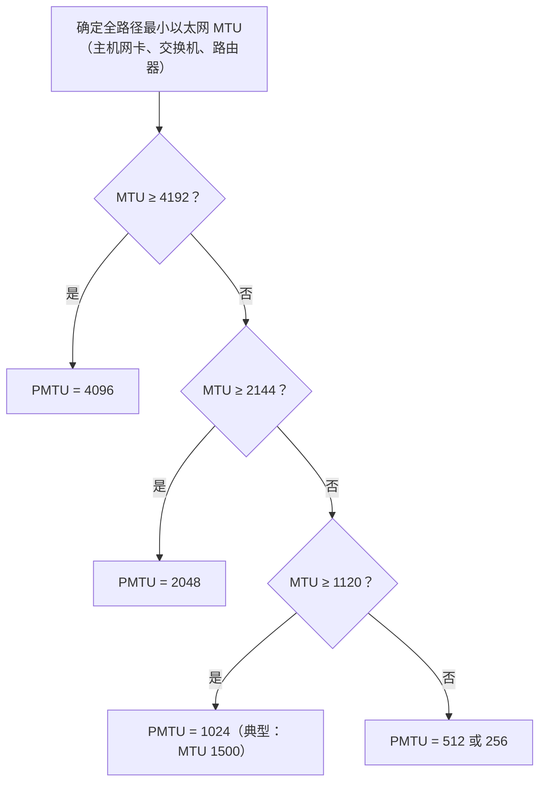

# RoCEv2 帧整体布局、开销与 MTU（Frame Layout, Overhead and MTU）

> **摘要**：本文给出 RoCEv2 帧从前导码到 FCS 的逐字节布局、各类报文的长度与线速效率计算方法，说明 IB MTU 与以太网 MTU 的换算关系、以太网最小帧填充的处理，并用一个逐字节标注的 RDMA WRITE Only 报文把所有字段串起来。它是阅读本目录其余文件和设计收发数据通路的"总地图"。
>
> **规范出处**：Vol1 §A17.2.4（p.1930）；§A17.3（p.1931–1936）；§A17.9.3 Figure 349（p.1948）；§A16.3（p.1912–1913）；§5.2（p.168–179）；§9.7.3.4（p.317）；§9.7.4.1.6（p.330）；§12.7.28（p.736）；§14.2.5.6 Table 164（p.906、909）
>
> **前置阅读**：[RoCE 演进](../00-overview/02-roce-evolution.md)、[分层架构](../00-overview/03-architecture-and-layering.md)
>
> **关键词**：帧布局, 封装开销, PMTU, 以太网 MTU, 线速效率, 包率, 以太网填充, PadCnt, ICRC, FCS

## 1. 帧的整体结构

### 1.1 三种封装的对比

RoCEv2 只改变"线上格式"：用 **IP 头取代 IB 全局路由头（Global Routing Header, GRH）**，并加入 **UDP 头**作为无状态封装层；从基本传输头（Base Transport Header, BTH）开始的内容与 InfiniBand 完全相同〔Vol1 §A17.2.4, p.1930〕。

| 封装 | 链路层头 | 网络层头 | 封装层 | 传输层及以后 | 链路层尾 |
|---|---|---|---|---|---|
| InfiniBand（本地包） | LRH 8 B | （无，或 GRH 40 B） | — | BTH + 扩展头 + 负载 + pad + ICRC | VCRC 2 B |
| RoCE（v1，Annex A16） | 以太网头，Ethertype 0x8915 | GRH 40 B（必有，CA16-4） | — | 同上 | 以太网 FCS 4 B（无 VCRC，CA16-3） |
| **RoCEv2（Annex A17）** | 以太网头，Ethertype 0x0800 / 0x86DD | IPv4 20 B / IPv6 40 B | UDP 8 B，目的端口 4791 | 同上 | 以太网 FCS 4 B |

> [!NOTE]
> 规范的 Figure 348（RoCEv2 Packet Format）是图片，正文以文字描述其结构；RoCEv2 CNP 的 Figure 349 以列表形式给出了"MAC 头 / IPv4 或 IPv6 头 / UDP 头 / BTH / … / ICRC / FCS"的完整次序〔Vol1 §A17.9.3, p.1948〕，与上表一致。

### 1.2 字节级总图（IPv4、无 VLAN、RDMA WRITE First 为例）

```text
 线路上（物理层看到的）：
 +----------+-----+--------------- Ethernet frame (DMAC..FCS, >= 64 B) ----------------+-------+
 | Preamble | SFD |                                                                    |  IFG  |
 |   7 B    | 1 B |                                                                    |>=12 B |
 +----------+-----+--------------------------------------------------------------------+-------+

 以太网帧（偏移为十进制，从 DMAC 首字节算起）：
 0      6      12   14       34      42      54       70            70+P
 +------+------+----+--------+-------+-------+--------+-------------+------+------+------+
 | DMAC | SMAC |Type|  IPv4  |  UDP  |  BTH  |  RETH  | Payload (P) | pad  | ICRC | FCS  |
 |  6   |  6   | 2  |   20   |   8   |  12   |   16   |   0..PMTU   | 0-3  |  4   |  4   |
 +------+------+----+--------+-------+-------+--------+-------------+------+------+------+
                    |<---------------- IP Total Length (CA17-6) ----------------->|
                             |<-------------- UDP Length (CA17-21) -------------->|
                                     |<----- IB transport: BTH..pad ------>|
                    |<---- ICRC input (after 64-bit all-ones prefix) ----->|
 |<------------------- FCS coverage (+ Ethernet pad, if any) -------------------->|
```

图中箭头依次为：IP Total Length 与 UDP Length 的覆盖范围（都到 ICRC 末字节为止）；由 OpCode 决定的 IB 传输层部分；ICRC 的输入范围（先送入 64 bit 全 1，再从 IP 头首字节到 pad 末字节，可变字段置 1）；FCS 的覆盖范围（DMAC 到 ICRC，若有以太网填充也包含在内）。

各组成部分一览：

| 部分 | 长度 | 是否必有 | 说明 / 出处 |
|---|---|---|---|
| 前导码（Preamble）+ 帧起始定界符（SFD） | 7 + 1 B | 线路开销 | 不属于帧，〔外部: IEEE 802.3〕 |
| DMAC / SMAC | 6 + 6 B | 是 | 取值规则见 [02-ethernet-ip-udp.md](02-ethernet-ip-udp.md) |
| 802.1Q 标签 | 4 B | 可选 | TPID 0x8100 + TCI（PCP 来自 SL）〔Vol1 §A17.4.2, p.1938〕 |
| Ethertype | 2 B | 是 | 0x0800（IPv4）/ 0x86DD（IPv6）〔Vol1 §A17.3.1.1–2, p.1932–1933〕 |
| IPv4 头 / IPv6 头 | 20 B / 40 B | 是 | IHL 固定为 5（CA17-3），IPv6 无扩展头（Next Header = 0x11，CA17-16） |
| UDP 头 | 8 B | 是 | 目的端口 4791（CA17-20） |
| BTH | 12 B | 是 | 见 [03-bth.md](03-bth.md) |
| 扩展传输头（ETH） | 0–28 B（RC）；XRC 最多 32 B；RD 最多 40 B | 由 OpCode 决定 | 见 [04-extended-transport-headers.md](04-extended-transport-headers.md)、[05-opcodes.md](05-opcodes.md) |
| 负载（Payload） | 0 – PMTU（≤ 4096 B） | 由 OpCode 决定 | C5-7、C5-8〔Vol1 §5.2.13, p.179〕 |
| pad | 0–3 B | 负载非 4 字节对齐时 | 由 BTH.PadCnt 指示（C5-9） |
| ICRC | 4 B | 是 | 端到端不变量 CRC，见 [06-icrc.md](06-icrc.md) |
| 以太网 pad | 0–2 B（见 §6） | 帧不足 64 B 时 | 位于 ICRC 之后、FCS 之前，不属于 IP 包 |
| FCS | 4 B | 是 | 逐跳重算的以太网 CRC-32 |
| 帧间隙（IFG） | ≥ 12 B | 线路开销 | 〔外部: IEEE 802.3〕 |

### 1.3 各头部起始偏移速查

对硬件解析器而言，RoCEv2 的一个重要特点是**头部偏移只取决于"VLAN 标签个数"与"IP 版本"两个变量**：IPv4 IHL 必须为 5（无 IP 选项，CA17-3），IPv6 的 Next Header 必须为 0x11（不能有扩展头，CA17-16）。

| L2/L3 组合 | IP 头 | UDP 头 | BTH | 第一个扩展头 | WRITE First 的负载起点 |
|---|---|---|---|---|---|
| 无 VLAN + IPv4 | 14 | 34 | 42 | 54 | 70 |
| 单 VLAN + IPv4 | 18 | 38 | 46 | 58 | 74 |
| 双层 VLAN（QinQ）+ IPv4 | 22 | 42 | 50 | 62 | 78 |
| 无 VLAN + IPv6 | 14 | 54 | 62 | 74 | 90 |
| 单 VLAN + IPv6 | 18 | 58 | 66 | 78 | 94 |

> [!TIP]
> 由于以太网头是 14 字节，上表中 BTH 与负载的起始偏移在所有组合下都满足 `offset mod 4 = 2`。而 RDMA 的目标虚拟地址本身可以是任意字节对齐的〔Vol1 §9.3.3.1, p.263〕，因此 DMA 引擎无论如何都需要一个**字节粒度的移位器**（barrel shifter）把负载对齐到主机内存地址；不要假设负载在数据总线上是 4/8 字节对齐的。

## 2. 长度字段之间的关系

设扩展头总长为 `E`（由 OpCode 查表，见 [05-opcodes.md](05-opcodes.md)），负载长度为 `P`，pad 长度 `pad = (4 − P mod 4) mod 4`（等于 BTH.PadCnt）：

| 量 | 公式 | 依据 |
|---|---|---|
| IPv4 Total Length | `20 + 8 + 12 + E + P + pad + 4` | CA17-6：从 IPv4 头首字节到 ICRC 末字节 |
| IPv6 Payload Length | `8 + 12 + E + P + pad + 4`（= UDP Length） | CA17-15：从 IPv6 头之后（即 UDP 头）到 ICRC 末字节。原文括注"i.e. the BTH"是笔误，Payload Length 必须包含 8 字节 UDP 头〔Vol1 §A17.3.1.2.3, p.1934〕，见 [02-ethernet-ip-udp.md](02-ethernet-ip-udp.md) §4.2 |
| UDP Length | `8 + 12 + E + P + pad + 4` | CA17-21：从 UDP 头首字节到 ICRC 末字节 |
| 帧长（DMAC…FCS） | `L2 + IP 包长 + 4`，不足 64 B 时填充到 64 B | L2 = 14 / 18 / 22 |
| 线上占用 | `帧长 + 8（前导码+SFD）+ 12（最小 IFG）` | 〔外部: IEEE 802.3〕 |

接收端反推负载长度：

```text
P = UDP.Length − 8 − 12 − E(OpCode) − PadCnt − 4
  = IPv4.TotalLength − 20 − 8 − 12 − E − PadCnt − 4      （IPv6 用 PayloadLength − 8 − 12 − E − PadCnt − 4）
```

> [!NOTE]
> IB 中接收端用 LRH:PktLen 判断包长与负载长度（例如 C9-91/C9-92 的长度校验都以 LRH:PktLen 为依据〔Vol1 §9.7.4.1.6, p.330〕）。RoCEv2 中"LRH 及其所有字段均不适用"〔Vol1 §A17.4.1.2, p.1936〕，所以实现上只能用 IP/UDP 长度字段代替 PktLen —— 这是规范的自然推论，A17 并未逐条改写这些条款。三个长度（IP、UDP、实际收到的字节数）应当相互一致，不一致的报文按 CA17-24 静默丢弃。

## 3. 常见报文类型的长度

### 3.1 固定开销表

下表给出**帧长（DMAC…FCS）中除"负载 + pad"以外的字节数**，即 `L2 + L3 + 8 + 12 + E + 4 + 4`。实际帧长 = 表中值 + P + pad（若结果 < 64 B 则填充到 64 B）。

| 报文类型（RC，除注明外） | 扩展头 E | IPv4 | IPv4 + VLAN | IPv6 | IPv6 + VLAN |
|---|---|---|---|---|---|
| SEND First / Middle / Last / Only | 0 | 62 | 66 | 82 | 86 |
| SEND Last/Only with Immediate | ImmDt 4 | 66 | 70 | 86 | 90 |
| SEND Last/Only with Invalidate | IETH 4 | 66 | 70 | 86 | 90 |
| RDMA WRITE First / Only | RETH 16 | 78 | 82 | 98 | 102 |
| RDMA WRITE Middle / Last | 0 | 62 | 66 | 82 | 86 |
| RDMA WRITE Last with Immediate | ImmDt 4 | 66 | 70 | 86 | 90 |
| RDMA WRITE Only with Immediate | RETH + ImmDt 20 | 82 | 86 | 102 | 106 |
| RDMA READ Request（无负载） | RETH 16 | 78 | 82 | 98 | 102 |
| RDMA READ Response First / Last / Only | AETH 4 | 66 | 70 | 86 | 90 |
| RDMA READ Response Middle | 0 | 62 | 66 | 82 | 86 |
| Acknowledge（ACK/NAK，无负载） | AETH 4 | **66** | 70 | 86 | 90 |
| CmpSwap / FetchAdd（无负载） | AtomicETH 28 | 90 | 94 | 110 | 114 |
| ATOMIC Acknowledge（无负载） | AETH + AtomicAckETH 12 | 74 | 78 | 94 | 98 |
| RoCEv2 CNP（无负载） | 16 B 保留区 | **78** | 82 | 98 | 102 |
| UD SEND Only | DETH 8 | 70 | 74 | 90 | 94 |
| UD SEND Only with Immediate | DETH + ImmDt 12 | 74 | 78 | 94 | 98 |

（表值由脚本按上式逐项计算；CNP 的 16 字节保留区见〔Vol1 §A17.9.3 Figure 349, p.1948〕。）

### 3.2 满 PMTU 报文的帧长示例

First / Middle 包的负载必须恰好等于 PMTU（C9-69〔Vol1 §9.7.3.4, p.317〕），所以多包消息中绝大多数包都是"满包"：

| PMTU | WRITE Middle（IPv4） | WRITE First（IPv4） | READ Resp First（IPv4） | WRITE Middle（IPv6+VLAN） |
|---|---|---|---|---|
| 1024 | 1086 | 1102 | 1090 | 1110 |
| 2048 | 2110 | 2126 | 2114 | 2134 |
| 4096 | 4158 | 4174 | 4162 | 4182 |

> [!TIP]
> 接收缓冲 / FIFO 的最大帧长按"最坏组合"估算：PMTU 4096、IPv6 + VLAN、RC WRITE Only with Immediate 为 106 + 4096 = **4202 B**；若支持 XRC 再加 4 B，QinQ 再加 4 B。

## 4. 线速效率与包率

### 4.1 公式

```text
W   = 帧长 + 20                      # 每包线上占用字节（7 前导码 + 1 SFD + 12 IFG）
η   = P / W                          # 负载效率
PPS = R / (8 × W)                    # 包率，R 为 MAC 速率（bit/s）
Goodput = R × η
```

> [!NOTE]
> 这里的 `R` 是 MAC 层速率（100GbE 即 100 Gb/s）。PCS 的 64b/66b 编码、RS-FEC 等开销位于 MAC 之下，由更高的线路波特率补偿，不再从 100 Gb/s 中扣除〔外部: IEEE 802.3〕；物理层细节见 [IB 物理层与以太网对比](../08-reference/04-ib-physical-layer-vs-ethernet.md)。

### 4.2 算例：100GbE、PMTU 4096、RDMA WRITE Middle（IPv4，无 VLAN）

1. 帧长 = 14 + 20 + 8 + 12 + 4096 + 4 + 4 = **4158 B**（Middle 无扩展头，4096 已是 4 的倍数，pad = 0）。
2. 线上占用 W = 4158 + 20 = **4178 B**。
3. 效率 η = 4096 / 4178 = **98.04 %**，即开销 82 B/包（1.96 %）。
4. 包率 = 100×10⁹ / (8 × 4178) ≈ **2.992 Mpps**；Goodput ≈ **98.04 Gb/s**。

整条消息还要加上 First 包的 16 B RETH：1 MiB 的 RDMA WRITE 在 PMTU 4096 下共 256 包，线上总字节 = 256 × 82 + 16 + 1 048 576 = 1 069 584 B，效率 **98.036 %**。ACK 走反方向，在全双工链路上不占用正向带宽。

### 4.3 PMTU 与封装对效率的影响（RDMA WRITE Middle）

| PMTU | IPv4 | IPv4 + VLAN | IPv6 | IPv6 + VLAN | 包率 @100G（IPv4） |
|---|---|---|---|---|---|
| 256 | 75.74 % | 74.85 % | 71.51 % | 70.72 % | 36.98 Mpps |
| 512 | 86.20 % | 85.62 % | 83.39 % | 82.85 % | 21.04 Mpps |
| 1024 | 92.59 % | 92.25 % | 90.94 % | 90.62 % | 11.30 Mpps |
| 2048 | 96.15 % | 95.97 % | 95.26 % | 95.08 % | 5.869 Mpps |
| 4096 | 98.04 % | 97.94 % | 97.57 % | 97.48 % | 2.992 Mpps |

结论：从 PMTU 1024 提高到 4096，WRITE 吞吐上限提高约 5.9 %，同时包率降为 1/4，可显著减轻 RNIC 的每包处理压力（解析、查表、PSN 检查、DMA 描述符）。

### 4.4 小包包率

以太网最小帧 64 B 时 W = 84 B：

| MAC 速率 | 64 B 帧包率 | RoCEv2 ACK（IPv4，66 B）包率 |
|---|---|---|
| 25 Gb/s | 37.20 Mpps | 36.34 Mpps |
| 100 Gb/s | 148.81 Mpps | 145.35 Mpps |
| 200 Gb/s | 297.62 Mpps | 290.70 Mpps |
| 400 Gb/s | 595.24 Mpps | 581.40 Mpps |

> [!TIP]
> 「硬件实现要点」RoCEv2 最短的帧（零长度 SEND Only，IPv4 无 VLAN）只有 62 B，最常见的小包 ACK 是 66 B。按线速设计接收流水线时，应以"每 84～86 B 一个包"作为最坏包率，并为 ACK/CNP 的生成预留同量级的发包能力。

## 5. IB MTU 与以太网 MTU

### 5.1 IB MTU 的取值与编码

IB 的 "MTU" 指**负载**上限（Path Packet Payload MTU），只能取 256、512、1024、2048、4096 字节之一〔Vol1 §12.7.28, p.736〕，负载最大 4096 B〔Vol1 Figure 46, p.170〕。在管理属性与 Verbs 中用 4 bit 枚举表示：

| 编码 | 1 | 2 | 3 | 4 | 5 | 0、6–15 |
|---|---|---|---|---|---|---|
| MTU（字节） | 256 | 512 | 1024 | 2048 | 4096 | 保留 |

（PortInfo:MTUCap / NeighborMTU〔Vol1 §14.2.5.6 Table 164, p.906、909〕与 PathRecord:Mtu〔Vol1 §15.2.5.16, p.1040〕均使用此编码；Linux 内核 `enum ib_mtu` 的 `IB_MTU_256 = 1 … IB_MTU_4096 = 5` 与之相同〔业界实践: Linux `include/rdma/ib_verbs.h`〕。）

### 5.2 约束：整个 IP 包不能超过以太网 MTU

以太网 MTU 指 IP 包（L3）长度上限。RoCEv2 规定 IPv4 必须置 DF=1、Fragment Offset=0（CA17-7、CA17-8），IPv6 中途路由器本来也不分片〔外部: RFC 8200〕，所以**每个 RoCEv2 包必须整个装进链路 MTU**：

```text
IP 头 + 8 + 12 + E_max + PMTU + 4  ≤  以太网 MTU
```

`E_max` 取"能携带负载的 OpCode 中扩展头最长者"：RC/UC 为 RETH + ImmDt = 20 B，XRC 为 24 B，UD 为 12 B，RD 为 32 B。

| 服务 / IP 版本 | 每包额外开销（IP 包内） | PMTU 1024 需要 | PMTU 2048 需要 | PMTU 4096 需要 |
|---|---|---|---|---|
| RC，IPv4 | 64 B | 1088 | 2112 | 4160 |
| RC，IPv6 | 84 B | 1108 | 2132 | 4180 |
| XRC，IPv6 | 88 B | 1112 | 2136 | 4184 |
| Linux 预留值 | 96 B | 1120 | 2144 | 4192 |

由此：
- **以太网 MTU 1500**：只能用 PMTU **1024**（2048 需要至少 2112 B）。
- **以太网 MTU ≥ 4192（常见配置为 4200 或 9000 巨帧）**：可用 PMTU **4096**；再增大以太网 MTU 对 RoCE 没有收益，因为 IB 负载上限就是 4096。

> [!NOTE]
> 〔业界实践: Linux `include/rdma/ib_addr.h` 的 `iboe_get_mtu()`〕 内核从网卡 MTU 中扣除 `IB_GRH_BYTES(40) + IB_UDP_BYTES(8) + IB_BTH_BYTES(12) + IB_EXT_XRC_BYTES(4) + IB_EXT_ATOMICETH_BYTES(28) + IB_ICRC_BYTES(4)` = 96 B，再向下取最近的 IB MTU 作为 RoCE 端口的 active MTU（以所用内核版本源码为准）。连接实际使用的 path MTU 还会与对端能力、应用在 Modify QP 中设置的值取最小，见 [QP 状态机](../03-verbs-and-resources/02-qp-state-machine.md)。下图的阈值即按 96 B 预留计算。



> [!WARNING]
> 「工程提示」DF=1 意味着路径上任何一跳 MTU 偏小都会导致**大包被丢弃而小包正常**：建链、小消息都能通，一传大消息就超时重传直至 QP 进入错误状态。硬件数据通路通常不处理 ICMP "Fragmentation Needed"/"Packet Too Big"，因此不能依赖路径 MTU 发现，必须保证全网 MTU 配置一致。排查方法见 [排障指南](../07-engineering-practice/05-troubleshooting.md)。

## 6. 以太网最小帧与填充

以太网要求帧（DMAC…FCS）至少 64 B，不足时在数据之后、FCS 之前填充〔外部: IEEE 802.3〕。对 RoCEv2 来说：

- 填充字节位于 **ICRC 之后、FCS 之前**，**不属于 IP 包**，也**不参与 ICRC**，但被 FCS 覆盖。
- 它与 BTH.PadCnt 指示的"传输层 pad"是两回事：后者位于负载之后、ICRC 之前，**参与 ICRC**。

按 §3.1 的表计算，IPv4 无 VLAN 时 ACK 为 66 B、ATOMIC Acknowledge 为 74 B、CNP 为 78 B，**都不需要以太网填充**。真正短于 64 B 的只有**零长度的 SEND Only（RC/UC，不带 Immediate/Invalidate）**：14 + 20 + 8 + 12 + 4 + 4 = 62 B，需要 2 B 填充。另外，交换机剥离 VLAN 标签后（66 B → 62 B）也必须重新填充〔外部: IEEE 802.1Q〕，所以接收端不能假设"带 VLAN 发出的短包到达时仍然没有填充"。

零长度 SEND Only 的完整帧（字段取值同 §7 的示例连接，PSN = 0x5A3C02）：

```text
0000  02 00 00 00 00 02 02 00 00 00 00 01 08 00 45 6A     DMAC SMAC Type | IPv4 …
0010  00 2C 2B 1B 40 00 40 11 8B CD C0 A8 01 0A C0 A8     Total Length = 0x2C = 44
0020  01 14 C8 F1 12 B7 00 18 00 00 04 40 FF FF 00 00     UDP Length = 0x18 = 24 | BTH: OpCode 0x04 SEND Only
0030  12 A7 80 5A 3C 02 4D 1B AD 3D 00 00 37 61 93 5E     … PSN | ICRC 4D 1B AD 3D | 以太网 pad 00 00 | FCS
```

> [!IMPORTANT]
> 接收端必须**用 IPv4 Total Length（或 IPv6 Payload Length / UDP Length）定位 ICRC**，而不是取"FCS 之前的最后 4 字节"。规范要求 IP/UDP 长度字段准确覆盖到 ICRC 末字节（CA17-6、CA17-15、CA17-21），以太网填充只能由此识别并丢弃。许多 MAC IP 核在交给用户逻辑前会剥掉 FCS，但**不会**剥掉以太网填充。

## 7. 完整示例：RoCEv2/IPv4 RDMA WRITE Only（16 字节负载）

### 7.1 参数

| 项目 | 取值 |
|---|---|
| 二层 | DMAC 02:00:00:00:00:02，SMAC 02:00:00:00:00:01，无 VLAN |
| 三层 | 192.168.1.10 → 192.168.1.20，Traffic Class 0x6A（DSCP 26 + ECN 10），TTL 64，Identification 0x2B1A |
| 四层 | 源端口 0xC8F1（51441），目的端口 4791 |
| 传输层 | RC RDMA WRITE Only（0x0A），M = 1，P_Key 0xFFFF，DestQP 0x0012A7，AckReq = 1，PSN 0x5A3C01 |
| RETH | VA 0x00007F3AC0001000，R_Key 0x00021F37，DMA Length 16 |
| 负载 | ASCII "RoCEv2 ICRC demo"（16 B，PadCnt = 0） |

（M = 1 是因为不使用路径迁移时 QP 的迁移状态机停留在 MIGRATED 状态，该状态下所有出站包 MigReq 置 1〔Vol1 §17.2.8.1.1–2, p.1202–1203〕，详见 [03-bth.md](03-bth.md)。）

### 7.2 十六进制 dump（94 字节，含 FCS）

```text
0000  02 00 00 00 00 02 02 00 00 00 00 01 08 00 45 6A
0010  00 4C 2B 1A 40 00 40 11 8B AE C0 A8 01 0A C0 A8
0020  01 14 C8 F1 12 B7 00 38 00 00 0A 40 FF FF 00 00
0030  12 A7 80 5A 3C 01 00 00 7F 3A C0 00 10 00 00 02
0040  1F 37 00 00 00 10 52 6F 43 45 76 32 20 49 43 52
0050  43 20 64 65 6D 6F 81 30 D3 F3 44 6B AB 25
```

### 7.3 逐字段标注

| 偏移（hex） | 字节 | 字段 | 含义 |
|---|---|---|---|
| 00–05 | 02 00 00 00 00 02 | DMAC | 下一跳 MAC（AV 的 Destination L2 Address 或解析结果） |
| 06–0B | 02 00 00 00 00 01 | SMAC | 由所选 SGID 对应的接口隐含 |
| 0C–0D | 08 00 | Ethertype | IPv4 |
| 0E | 45 | Version / IHL | 4 / 5（CA17-3） |
| 0F | 6A | TOS | DSCP 011010b = 26，ECN 10b = ECT(0) |
| 10–11 | 00 4C | Total Length | 76 = 20 + 8 + 12 + 16 + 16 + 4（CA17-6） |
| 12–13 | 2B 1A | Identification | 任意值（DF=1 不分片），但**参与 ICRC** |
| 14–15 | 40 00 | Flags / Fragment Offset | 010b（DF）/ 0（CA17-7、CA17-8） |
| 16 | 40 | TTL | 64，来自 AV 的 Hop Limit（CA17-9） |
| 17 | 11 | Protocol | UDP（CA17-10） |
| 18–19 | 8B AE | Header Checksum | 按 RFC 791 计算 |
| 1A–1D | C0 A8 01 0A | Source IP | 192.168.1.10（CA17-11） |
| 1E–21 | C0 A8 01 14 | Destination IP | 192.168.1.20（CA17-12） |
| 22–23 | C8 F1 | UDP Source Port | 51441，连接内固定（§A17.3.2.1） |
| 24–25 | 12 B7 | UDP Destination Port | 4791（CA17-20） |
| 26–27 | 00 38 | UDP Length | 56 = 8 + 12 + 16 + 16 + 4（CA17-21） |
| 28–29 | 00 00 | UDP Checksum | 0（§A17.3.2.4） |
| 2A | 0A | BTH.OpCode | 000_01010b：RC RDMA WRITE Only |
| 2B | 40 | SE / M / PadCnt / TVer | 0 / 1 / 00 / 0000 |
| 2C–2D | FF FF | P_Key | 默认分区键（Full 成员） |
| 2E | 00 | F / B / Resv6 | 全 0（RoCEv2 忽略 F/B，CA17-29） |
| 2F–31 | 00 12 A7 | DestQP | 0x0012A7 |
| 32 | 80 | A / Resv7 | AckReq = 1 |
| 33–35 | 5A 3C 01 | PSN | 0x5A3C01 |
| 36–3D | 00 00 7F 3A C0 00 10 00 | RETH.VA | 0x00007F3AC0001000 |
| 3E–41 | 00 02 1F 37 | RETH.R_Key | 0x00021F37 |
| 42–45 | 00 00 00 10 | RETH.DMA Length | 16 |
| 46–55 | 52 6F … 6D 6F | Payload | "RoCEv2 ICRC demo" |
| 56–59 | 81 30 D3 F3 | ICRC | 规范记法 0x8130D3F3，按 [06-icrc.md](06-icrc.md) 的参考实现计算 |
| 5A–5D | 44 6B AB 25 | FCS | 对 00–59 计算的以太网 CRC-32（低字节先发） |

> [!TIP]
> 用 Scapy 或 Python 生成这类报文后，可在 Wireshark 中直接查看：UDP 4791 会被识别为 RoCEv2（Wireshark 中称为 RRoCE）并解析 BTH/RETH 等字段（以所用 Wireshark 版本为准）〔业界实践: Wireshark〕。抓包与报文构造工具见 [工具与测试](../07-engineering-practice/04-tools-and-testing.md)。

## 8. 「硬件实现要点」

1. **固定偏移解析**：IHL = 5、IPv6 无扩展头，使得 RoCEv2 的所有头部偏移都可以由 `{VLAN 个数, IP 版本}` 两个变量决定（§1.3），解析器可以完全用组合逻辑在头部到达的那一拍算出所有字段位置，不需要逐头"跳转"。
2. **长度三方核对**：从 IP 长度、UDP 长度、MAC 实际收到的字节数三者导出包长，必须满足 `UDP.Length = IP 负载长度` 且 `L2 + IP 包长 ≤ 帧长 − 4`；多出来的部分视为以太网填充丢弃，不足则为截断包丢弃（CA17-24）。
3. **ICRC 按长度截止**：ICRC 引擎的"最后一个有效字节"由 IP 长度计算得到，而不是 MAC 的帧结束信号（§6）。
4. **负载切分**：负载长度 `P = UDP.Length − 24 − E − PadCnt`（§2）；`E` 由 OpCode 查表一拍得到，查找表见 [05-opcodes.md](05-opcodes.md)。
5. **缓冲规划**：最大帧 4202 B（§3.2）；头部（不含负载）最长为 18 + 40 + 8 + 12 + 28 = 106 B（IPv6 + VLAN 的 Atomic 请求），在 512 bit 数据总线上最多占两拍。
6. **最坏包率**：按 64～66 B 小包线速设计（100G 约 145～149 Mpps，§4.4），这决定了 QP 上下文查找、PSN 检查等每包操作的流水线吞吐要求，参见 [接收通路](../06-hardware-implementation/03-rx-datapath.md)。

## 9. 要点回顾

- RoCEv2 帧 = 以太网头 [+VLAN] + IPv4(20)/IPv6(40) + UDP(8) + BTH(12) + 扩展头 + 负载 + pad + ICRC(4) + FCS(4)；BTH 及以后与 IB 完全相同。
- 头部偏移只由 VLAN 个数和 IP 版本决定（IHL=5、IPv6 无扩展头），BTH 起点恒满足 offset mod 4 = 2。
- IPv4 Total Length、IPv6 Payload Length、UDP Length 都覆盖到 ICRC 末字节；接收端据此定位 ICRC 并剥离以太网填充。
- IPv4 无 VLAN 时最小开销 62 B（+20 B 线上开销）；PMTU 4096 的满包效率约 98 %，PMTU 1024 约 92.6 %。
- IB MTU 只有 256–4096 五档（编码 1–5），整个 IP 包必须 ≤ 以太网 MTU：MTU 1500 → PMTU 1024；MTU ≥ 4192（如 4200、9000）→ PMTU 4096。
- DF=1 不分片，路径 MTU 不一致会造成"大包黑洞"。
- 以太网填充位于 ICRC 之后、FCS 之前，不参与 ICRC；BTH.PadCnt 指示的传输层 pad 位于 ICRC 之前，参与 ICRC。
- ACK（66 B）、CNP（78 B）在 IPv4 下都不需要以太网填充；只有零长度 SEND Only（62 B）需要。

## 自测

<details><summary>Q1：IPv6 + 单 VLAN 时，RDMA READ Response First（PMTU 2048）的帧长与 IPv6 Payload Length 各是多少？</summary>

答：固定开销 90 B（表 3.1），帧长 = 90 + 2048 = 2138 B；IPv6 Payload Length = 8 + 12 + 4（AETH）+ 2048 + 4 = 2076。
</details>

<details><summary>Q2：一条网络链路 MTU 为 2100（IPv4），RoCE 端口能否使用 PMTU 2048？</summary>

答：不能保证。RC 中带负载且扩展头最长的是 WRITE Only with Immediate（RETH + ImmDt = 20 B），IP 包长 = 20 + 8 + 12 + 20 + 2048 + 4 = 2112 > 2100，这类包会因 DF=1 被丢弃。应使用 PMTU 1024，或把 MTU 提高到至少 2112（Linux 保守地要求 2144）。
</details>

<details><summary>Q3：接收端收到一个 64 B 的帧，IPv4 Total Length 为 44，FCS 之前的最后 4 字节是 00 00 xx xx，ICRC 在哪里？</summary>

答：ICRC 在 IP 包的最后 4 字节，即帧偏移 14 + 44 − 4 = 54 起的 4 个字节；其后的 2 字节是以太网填充，不属于 IP 包。这正是零长度 SEND Only 的情形（§6）。
</details>

<details><summary>Q4：100GbE 上 PMTU 4096、IPv6 + VLAN 的 RDMA WRITE Middle 理论 Goodput 是多少？</summary>

答：帧长 = 86 + 4096 = 4182 B，线上 W = 4202 B，η = 4096/4202 ≈ 97.48 %，Goodput ≈ 97.48 Gb/s，包率 ≈ 2.975 Mpps。
</details>

<details><summary>Q5：BTH.PadCnt 的 pad 与以太网填充有什么区别？</summary>

答：前者在负载之后、ICRC 之前，使"负载 + pad"为 4 的倍数，由 PadCnt 指示，参与 ICRC 计算，计入 IP/UDP 长度；后者在 ICRC 之后、FCS 之前，只为凑够 64 B 最小帧，不计入 IP/UDP 长度，不参与 ICRC，但被 FCS 覆盖。
</details>

## 参考

- 规范：Vol1 §A17.2.4（p.1930）、§A17.3（p.1931–1936）、§A17.4.1.2（p.1936）、§A17.9.3 Figure 349（p.1948）；§A16.3（p.1912–1913）；§5.2 Figure 46（p.170）、§5.2.13（p.178–179）；§9.3.3.1（p.263）；§9.7.3.4（p.317）；§9.7.4.1.6（p.330）；§12.7.28（p.736）；§14.2.5.6 Table 164（p.906、909）；§15.2.5.16（p.1040）；§17.2.8.1（p.1201–1203）。
- 外部：IEEE 802.3（以太网帧格式、最小帧、前导码与 IFG）；IEEE 802.1Q（VLAN 标签）；RFC 791（IPv4）；RFC 8200（IPv6）；RFC 768（UDP）。
- 业界实践：Linux 内核 `include/rdma/ib_addr.h`（`iboe_get_mtu()`）、`include/rdma/ib_pack.h`（头部长度常量）；Wireshark InfiniBand/RRoCE 解析器。
- 相关文件：[02-ethernet-ip-udp.md](02-ethernet-ip-udp.md)、[03-bth.md](03-bth.md)、[05-opcodes.md](05-opcodes.md)、[06-icrc.md](06-icrc.md)、[性能调优](../07-engineering-practice/03-performance-tuning.md)、[常数与公式速查](../08-reference/05-constants-and-formulas.md)。
