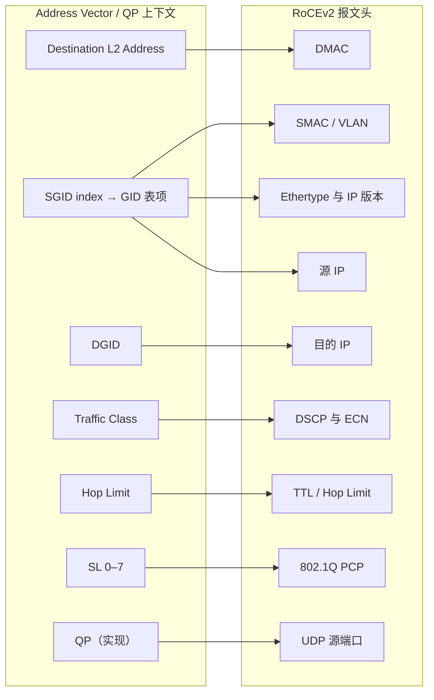
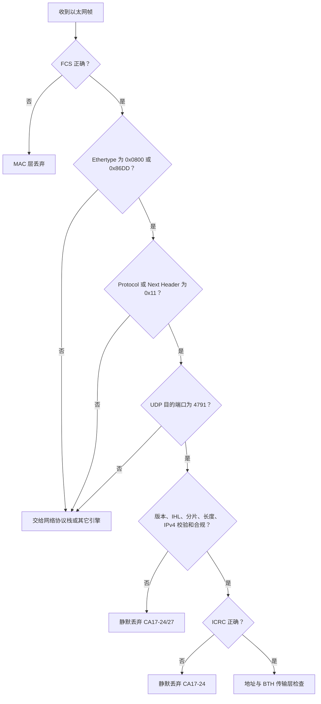

# 以太网/IPv4/IPv6/UDP 头字段规则（Ethernet, IPv4, IPv6 and UDP Header Fields）

> **摘要**：RoCEv2 把 IB 传输层装进普通的 UDP/IP/以太网报文。本文逐字段说明这层"外壳"如何由地址向量（Address Vector, AV）和 QP 上下文填写、受哪些合规条款约束、哪些字段在 ICRC 中被屏蔽，并整理出接收端解析器应检查的条件清单。
>
> **规范出处**：Vol1 §A17.3.1–§A17.3.4（p.1931–1936）；§A17.4.1–§A17.4.4（p.1936–1939）；§A17.9.2–§A17.9.4（p.1946–1949）；§A16.3.1（p.1912–1913）；§8.3–§8.4（p.248–252）
>
> **前置阅读**：[01-frame-layout.md](01-frame-layout.md)、[RoCEv2 寻址](../00-overview/04-addressing.md)
>
> **关键词**：Ethertype, DSCP, ECN, Traffic Class, TTL, Hop Limit, UDP 4791, 源端口熵, DF, 静默丢弃, CA17-1…CA17-27

## 1. 字段来源总览：从 Address Vector 到报文头

RoCEv2 端口必须同时支持 IPv4 与 IPv6 两种封装（CA17-1），报文格式必须符合 Figure 348 并按 §A17.3.1.1 / §A17.3.1.2 设置各字段（CA17-2）〔Vol1 §A17.3.1, p.1932〕。头部字段几乎都来自 AV：RoCEv2 中 AV 的 "Send GRH" 标志恒为 TRUE，源地址通过 **SGID index** 引用端口 GID 表，GID 表项的 **GID type** 决定出站协议〔Vol1 §A17.4.2, p.1937〕。

| AV / 上下文组件 | 填入的报文字段 | 依据 |
|---|---|---|
| Destination L2 Address（原 DLID 的泛化） | DMAC；取值 0xFFFFFFFFFFFF 表示由 Verbs 实现自行做 L3→L2 解析 | §A17.4.2, p.1937 |
| SGID index → 端口 GID 表项 | 源 IP（CA17-11、CA17-18）；**SMAC 由所选 SGID 隐含**；GID type 决定 IPv4 / IPv6 / RoCEv1 封装 | §A17.4.2–§A17.4.3, p.1937–1938；CA17-26 |
| DGID | 目的 IP（CA17-12、CA17-19）；IPv4 以 `::ffff:a.b.c.d` 形式存放 | §A17.4.1.1, p.1936 |
| Traffic Class | IPv4 / IPv6 的 DSCP（实践中为整个 TOS/TC 字节，见 §6） | CA17-4、CA17-13 |
| Hop Limit | IPv4 TTL / IPv6 Hop Limit | CA17-9、CA17-17 |
| SL | 以太网优先级（802.1Q PCP）：SL 0–7 直接映射为优先级 0–7，SL 8–15 保留 | §A17.4.2, p.1938 |
| Flow Label | IPv6 Flow Label（A17 未规定取值，见 §4.3） | — |
| Source Path Bits | 不适用 | §A17.4.2, p.1937 |
| QP / 实现 | UDP 源端口（流标识，连接内应固定） | §A17.3.2.1, p.1934 |



> [!NOTE]
> L3→L2 地址解析（ARP / IPv6 邻居发现）不在规范范围内，规范假设实现使用操作系统的现有服务完成〔Vol1 §A17.4.2, p.1937〕。Linux 的 rdma_cm 会在创建 AH 之前就解析好 DMAC，并通过 "Destination L2 Address" 传给驱动（规范脚注 62 即以此为例）。

## 2. 以太网头

### 2.1 布局

本知识库统一采用规范的位编号约定：每行一个 32 bit 字，**bit 31 为该字最高位**，字节 0 占 bits 31–24 且最先发送（网络序）。图中 D = DEI；无 VLAN 标签时 Ethertype 位于字节 12–13。

```text
 字节   31           24 23           16 15            8 7             0
       +---------------------------------------------------------------+
 0-3   |                          DMAC[47:16]                          |
       +-------------------------------+-------------------------------+
 4-7   |          DMAC[15:0]           |          SMAC[47:32]          |
       +-------------------------------+-------------------------------+
 8-11  |                          SMAC[31:0]                           |
       +-------------------------------+-----+-+-----------------------+
12-15  |   TPID = 0x8100 (optional)    | PCP |D|          VID          |
       +-------------------------------+-----+-+-----------------------+
16-17  |    Ethertype 0x0800/0x86DD    |
       +-------------------------------+
```

### 2.2 字段规则

| 字段 | 宽度 | RoCEv2 取值 | 依据 |
|---|---|---|---|
| DMAC | 48 | 下一跳的 MAC：AV 中已解析好的 Destination L2 Address，或由 Create AH / Modify QP 的实现解析得到；跨子网时为网关 MAC | §A17.4.2, p.1937 |
| SMAC | 48 | 所选 SGID 所在网络接口的 MAC，由实现通过操作系统服务获得 | §A17.4.2, p.1937–1938 |
| TPID | 16 | 0x8100（仅当带 802.1Q 标签） | 〔外部: IEEE 802.1Q〕 |
| PCP | 3 | 以太网优先级 = SL（0–7） | §A17.4.2, p.1938 |
| DEI | 1 | 通常为 0 | 〔外部: IEEE 802.1Q〕 |
| VID | 12 | 规范未涉及；Linux 中每个 GID 表项关联一个网络设备，VLAN 子接口上的 IP 地址生成独立的 GID 表项，选中该 SGID 即决定 VID | 〔业界实践: Linux RDMA GID 表〕 |
| Ethertype | 16 | IPv4 0x0800、IPv6 0x86DD（IEEE 分配值）；RoCE v1 为 0x8915 | §A17.3.1.1–2, p.1932–1933；CA16-2 |

> [!TIP]
> 「工程提示」是否携带 VLAN 标签取决于网络的优先级识别方式：基于 PCP 的 PFC 需要 802.1Q 标签承载优先级；交换机采用 "trust DSCP"（L3 信任）模式时，可以完全不带 VLAN，由 DSCP 映射到优先级队列。两种方式的配置与取舍见 [QoS：DSCP/PCP/ETS](../05-congestion-control-and-qos/02-qos-dscp-pcp-ets.md)。

### 2.3 组播 DMAC

UD 多播的 DGID 为 IPv4 组播地址（以 `::ffff:` 映射）或 IPv6 组播地址，对应的 DMAC 按标准 IP 组播映射：IPv4 为 `01:00:5E` + 地址低 23 位〔外部: RFC 1112 §6.4〕，IPv6 为 `33:33` + 地址低 32 位〔外部: RFC 2464 §7〕。RoCEv2 中 MLID 不再使用〔Vol1 §A17.5.6, p.1942〕，多播细节见 [UC/UD/多播](../02-transport/04-unreliable-services.md)。

## 3. IPv4 头

### 3.1 布局

```text
 字节   31           24 23           16 15            8 7             0
       +-------+-------+-----------+---+-------------------------------+
 0-3   | Ver=4 | IHL=5 |   DSCP    |ECN|         Total Length          |
       +-------+-------+-----------+---+-----+-------------------------+
 4-7   |        Identification         |Flags|     Fragment Offset     |
       +---------------+---------------+-----+-------------------------+
 8-11  |      TTL      | Protocol=0x11 |        Header Checksum        |
       +---------------+---------------+-------------------------------+
12-15  |                       Source IP Address                       |
       +---------------------------------------------------------------+
16-19  |                    Destination IP Address                     |
       +---------------------------------------------------------------+
```

### 3.2 字段表

"ICRC" 列：**屏蔽** = 计算 ICRC 时替换为全 1；**覆盖** = 按原值参与 ICRC（规则见 [06-icrc.md](06-icrc.md)）。

| 字节 | 位 | 宽度 | 字段 | RoCEv2 取值 | 条款 | ICRC | 接收端 |
|---|---|---|---|---|---|---|---|
| 0 | 31–28 | 4 | Version | 4 | CA17-27 | 覆盖 | ≠ 4 静默丢弃 |
| 0 | 27–24 | 4 | IHL | 5（无选项） | CA17-3 | 覆盖 | ≠ 5 静默丢弃（CA17-24） |
| 1 | 23–18 | 6 | DSCP | AV 的 Traffic Class | CA17-4 | 屏蔽 | 不检查 |
| 1 | 17–16 | 2 | ECN | 支持 RCM：01 或 10；不支持：00 | CA17-5 | 屏蔽 | 11（CE）触发 CNP（CA17-44） |
| 2–3 | 15–0 | 16 | Total Length | IPv4 头首字节到 ICRC 末字节 | CA17-6 | 覆盖 | 与帧长、UDP Length 一致 |
| 4–5 | 31–16 | 16 | Identification | 规范未规定（DF=1 不用于重组） | — | 覆盖 | 不检查 |
| 6 | 15–13 | 3 | Flags | 010b（DF=1，MF=0） | CA17-7 | 覆盖 | ≠ 010b 静默丢弃（CA17-24），尤其 MF=1 的分片无法处理 |
| 6–7 | 12–0 | 13 | Fragment Offset | 0 | CA17-8 | 覆盖 | ≠ 0 静默丢弃 |
| 8 | 31–24 | 8 | TTL | AV 的 Hop Limit | CA17-9 | 屏蔽 | 不检查 |
| 9 | 23–16 | 8 | Protocol | 0x11（UDP） | CA17-10 | 覆盖 | ≠ 0x11 即非 RoCEv2 |
| 10–11 | 15–0 | 16 | Header Checksum | 按 RFC 791 计算 | — | 屏蔽 | 错误则丢弃〔外部: RFC 1122 §3.2.1.2〕 |
| 12–15 | 31–0 | 32 | Source IP | SGID 表项中的 IPv4 地址 | CA17-11 | 覆盖 | 连接型 QP 做 SGID 检查 |
| 16–19 | 31–0 | 32 | Destination IP | DGID 中的 IPv4 地址 | CA17-12 | 覆盖 | 须为本端口地址（见 §7） |

> [!WARNING]
> 除 TOS、TTL、Header Checksum 外，IPv4 头的其余字段（包括 **Identification 和源/目的地址**）都参与 ICRC。任何会改写这些字段的中间设备 —— 典型的是 **NAT/PAT**（改地址、改 UDP 端口）—— 都会让 ICRC 校验失败、报文被静默丢弃。RoCEv2 只能穿越"普通路由"，不能穿越 NAT。

### 3.3 IPv4 头校验和

RoCEv2 对 IPv4 头校验和没有特殊规定，按 RFC 791 计算 16 bit 反码和；它在 ICRC 中被屏蔽，因为路由器每跳递减 TTL 后都会更新它。以 [01-frame-layout.md](01-frame-layout.md) §7 的示例为例：

```text
45 6A | 00 4C | 2B 1A | 40 00 | 40 11 | 00 00 | C0 A8 | 01 0A | C0 A8 | 01 14
求和（进位回卷）= 0x7451，取反 = 0x8BAE  → 报文中 Header Checksum = 8B AE
```

## 4. IPv6 头

### 4.1 布局

```text
 字节   31           24 23           16 15            8 7             0
       +-------+-----------+---+---------------------------------------+
 0-3   | Ver=6 |   DSCP    |ECN|              Flow Label               |
       +-------+-----------+---+-------+---------------+---------------+
 4-7   |        Payload Length         | Next Hdr=0x11 |   Hop Limit   |
       +-------------------------------+---------------+---------------+
 8-11  |                    Source Address [127:96]                    |
       +---------------------------------------------------------------+
12-15  |                    Source Address [95:64]                     |
       +---------------------------------------------------------------+
16-19  |                    Source Address [63:32]                     |
       +---------------------------------------------------------------+
20-23  |                     Source Address [31:0]                     |
       +---------------------------------------------------------------+
24-27  |                 Destination Address [127:96]                  |
       +---------------------------------------------------------------+
28-31  |                  Destination Address [95:64]                  |
       +---------------------------------------------------------------+
32-35  |                  Destination Address [63:32]                  |
       +---------------------------------------------------------------+
36-39  |                  Destination Address [31:0]                   |
       +---------------------------------------------------------------+
```

Source Address 即 SGID、Destination Address 即 DGID。

Traffic Class 共 8 bit（bits 27–20），高 6 位为 DSCP、低 2 位为 ECN〔外部: RFC 2474、RFC 3168〕。其布局与 IB GRH 完全相同（GRH 本就按 IPv6 头设计，NxtHdr 为 0x1B〔Vol1 §8.3、C8-7, p.248–250〕）。

### 4.2 字段表

| 字节 | 位 | 宽度 | 字段 | RoCEv2 取值 | 条款 | ICRC | 接收端 |
|---|---|---|---|---|---|---|---|
| 0 | 31–28 | 4 | Version | 6 | CA17-27 | 覆盖 | ≠ 6 静默丢弃 |
| 0–1 | 27–22 | 6 | DSCP | AV 的 Traffic Class | CA17-13 | 屏蔽 | 不检查 |
| 1 | 21–20 | 2 | ECN | 支持 RCM：01 或 10；不支持：00 | CA17-14 | 屏蔽 | 11 触发 CNP |
| 1–3 | 19–0 | 20 | Flow Label | A17 未规定（见 §4.3） | — | 屏蔽 | 不检查 |
| 4–5 | 31–16 | 16 | Payload Length | IPv6 头之后（即 UDP 头）到 ICRC 末字节 | CA17-15 | 覆盖 | 与帧长、UDP Length 一致 |
| 6 | 15–8 | 8 | Next Header | 0x11（UDP） | CA17-16 | 覆盖 | ≠ 0x11 即非 RoCEv2 |
| 7 | 7–0 | 8 | Hop Limit | AV 的 Hop Limit | CA17-17 | 屏蔽 | 不检查 |
| 8–23 | — | 128 | Source Address | SGID 表项中的 IPv6 地址 | CA17-18 | 覆盖 | 连接型 QP 做 SGID 检查 |
| 24–39 | — | 128 | Destination Address | AV 的 DGID | CA17-19 | 覆盖 | 须为本端口地址 |

> [!NOTE]
> CA17-15 的原文说 Payload Length 从"IPv6 头之后的第一个字节（即 BTH）"算起〔Vol1 §A17.3.1.2.3, p.1934〕，但 IPv6 头之后紧跟的其实是 UDP 头。结合 CA17-21（UDP Length 从 UDP 头起算）和 IPv6 本身的定义〔外部: RFC 8200〕，Payload Length 应包含 8 字节 UDP 头，即与 UDP Length 相等；括号中的 "BTH" 应理解为笔误。〔业界实践: Linux rxe `rxe_net.c`〕 也是用"skb 长度 − IPv6 头长度"（含 UDP 头）填写该字段；[06-icrc.md](06-icrc.md) 的 IPv6 示例同样按此构造。

### 4.3 Flow Label 与扩展头

- **Flow Label**：A17 没有为 RoCEv2 的 IPv6 Flow Label 规定取值，只在 ICRC 中屏蔽它。可参考 GRH 的语义：不使用时置 0（C8-4），使用时同一对 QP 之间的报文应保持恒定的非零值（C8-5）〔Vol1 §8.4.1, p.250〕。〔业界实践: Linux rxe `rxe_net.c`〕 软件实现 rxe 发送 IPv6 时 Flow Label 固定为 0；Linux 内核还把 AV 的 flow label 作为计算 UDP 源端口的输入（§5.3）。硬件实现的做法厂商相关，以文档为准。
- **扩展头**：Next Header 必须是 0x11（CA17-16），因此合规的 RoCEv2/IPv6 报文**不带任何 IPv6 扩展头**，UDP 头固定位于 IPv6 头后（偏移 40）。解析器遇到 Next Header ≠ 0x11 时直接按"非 RoCEv2"处理即可。

## 5. UDP 头

### 5.1 布局

```text
 字节   31           24 23           16 15            8 7             0
       +-------------------------------+-------------------------------+
 0-3   |          Source Port          |    Destination Port = 4791    |
       +-------------------------------+-------------------------------+
 4-7   |            Length             |    Checksum (should be 0)     |
       +-------------------------------+-------------------------------+
```

Source Port 是流标识（ECMP 熵）；Length 从 UDP 头首字节算到 ICRC 末字节。

### 5.2 字段表

| 字节 | 字段 | RoCEv2 取值 | 依据 | ICRC | 接收端 |
|---|---|---|---|---|---|
| 0–1 | Source Port | 不透明的流标识，网络设备可将其纳入 ECMP 哈希；**有顺序要求的报文（如同一连接 QP）应使用固定值** | §A17.3.2.1, p.1934；§A17.9.4, p.1948 | **覆盖** | 不检查（回包可沿用） |
| 2–3 | Destination Port | IANA 为 RoCEv2 分配的端口 **4791**（0x12B7） | CA17-20；〔外部: IANA 端口注册表〕 | 覆盖 | ≠ 4791 即非 RoCEv2 |
| 4–5 | Length | UDP 头首字节到 ICRC 末字节 | CA17-21 | 覆盖 | 与 IP 长度一致 |
| 6–7 | Checksum | **应**置 0 | §A17.3.2.4, p.1935 | **屏蔽** | 规范未规定非零时如何处理（待核实/实现相关） |

> [!NOTE]
> 规范正文中 CA17-20 只写"IANA 为 RoCEv2 分配的值"，脚注 60 注明"分配后再更新"〔Vol1 §A17.3.2.2, p.1934–1935〕。该端口后来已由 IANA 登记为 4791，业界实现均使用此值（如 Linux `include/rdma/ib_verbs.h` 中 `#define ROCE_V2_UDP_DPORT 4791`）。

> [!WARNING]
> UDP 源端口**不在 ICRC 屏蔽之列**：中间设备改写源端口（NAT/PAT、某些负载均衡器）会导致 ICRC 失败。只有 UDP Checksum 被屏蔽，所以路径上的设备如果要补算 UDP 校验和是安全的。

另外，RFC 8200 原则上要求 IPv6 上的 UDP 校验和非零，RFC 6935/6936 为隧道类封装放宽了这一限制〔外部: RFC 6935、RFC 6936〕。RoCEv2 规范仍建议对 IPv6 也置 0，由 ICRC 提供端到端完整性保护；个别中间设备或主机协议栈对零校验和的 IPv6 UDP 报文可能处理不同，部署时需要验证（实现相关）。

### 5.3 源端口与 ECMP

ECMP 路由器通常对 `{SIP, DIP, Protocol, SPort, DPort}` 五元组做哈希选路。RoCEv2 的目的端口恒为 4791，所以**源端口是 RoCEv2 流量唯一的"熵"来源**：同一连接 QP 的报文用恒定源端口以保证同路径、不乱序；彼此没有顺序约束的报文可以用不同的源端口〔Vol1 §A17.9.4, p.1948–1949〕。

〔业界实践: Linux `include/rdma/ib_verbs.h`〕 内核提供 `rdma_get_udp_sport(fl, lqpn, rqpn)`：若 AV 的 flow label 为 0，先用 `rdma_calc_flow_label()` 由本端与对端 QPN 的乘积折叠出一个 20 bit 对称 flow label，再由 `rdma_flow_label_to_udp_sport()` 折叠为 14 bit 并或上 0xC000，得到 **0xC000–0xFFFF** 范围内的源端口；注释要求"所有 RoCE v2 驱动都应使用同一约定"（以所用内核版本为准）。ECMP 熵、多路径与乱序问题详见 [ECMP 与负载均衡](../05-congestion-control-and-qos/06-ecmp-and-load-balancing.md)。

## 6. Traffic Class、DSCP 与 ECN

### 6.1 字节内的位置

IPv4 的 TOS 字节与 IPv6 的 Traffic Class 字节布局相同：

```text
    7   6   5   4   3   2   1   0   (bit)
  +-----------------------+-------+
  |         DSCP          |  ECN  |
  +-----------------------+-------+
```

| ECN 码点 | 名称 | 含义〔外部: RFC 3168 §5〕 | RoCEv2 中的用法 |
|---|---|---|---|
| 00 | Not-ECT | 发送端不支持 ECN | 不支持 RCM 的 HCA 必须发送 00（CA17-5、CA17-14） |
| 01 | ECT(1) | 支持 ECN 的传输 | 支持 RCM 的 HCA 可发送 01 或 10，表示报文可被网络标记 |
| 10 | ECT(0) | 支持 ECN 的传输 | 同上（实践中更常用） |
| 11 | CE | 途经拥塞点，已被标记 | 发送端不应使用；接收端收到有效的 CE 报文时生成 CNP（CA17-44） |

> [!NOTE]
> 按 RFC 3168，交换机的主动队列管理对 Not-ECT 报文只能丢弃而不能标记；ECT(1) 在 L4S 架构中另有用途〔外部: RFC 9331〕，与普通 ECN 流量混跑时需留意交换机配置。RCM 的完整行为见 [ECN 与 CNP](../05-congestion-control-and-qos/03-ecn-and-cnp.md)。

### 6.2 规范字面与业界实践

规范写的是 "DSCP 字段设置为 AV 的 Traffic Class 值"（CA17-4、CA17-13），而 AV 的 Traffic Class 继承自 GRH 的 8 bit TClass〔Vol1 §8.3.2, p.248〕，DSCP 却只有 6 bit，字面上存在歧义。实践中的通行做法是**把 8 bit Traffic Class 当作整个 TOS / Traffic Class 字节填写**：

- 〔业界实践: Linux rxe `rxe_net.c`〕IPv4 中直接 `iph->tos = av->grh.traffic_class`；IPv6 中把 traffic_class 作为整个 Traffic Class 字节写入。于是 `DSCP = TC >> 2`、`ECN = TC & 3`。
- 〔业界实践: NVIDIA/Mellanox、perftest〕rdma_cm 设置的 ToS（内核 `rdma_set_service_type()`，用户态 `RDMA_OPTION_ID_TOS`）、perftest 的 `--tclass` 也按整字节理解，例如常见的 `tclass 106` 即 DSCP 26 + ECN 10。网卡开启 ECN/DCQCN 后，ECN 位可能由硬件按拥塞控制配置改写（厂商相关，以文档为准）。

| AV Traffic Class | 二进制 | DSCP | ECN | 说明 |
|---|---|---|---|---|
| 0 | 000000_00 | 0 | 00 | 默认值 |
| 104（0x68） | 011010_00 | 26 | Not-ECT | 只设 DSCP 26 |
| 106（0x6A） | 011010_10 | 26 | ECT(0) | 常见的 RoCE 配置 |
| 105（0x69） | 011010_01 | 26 | ECT(1) | 合法但较少用 |
| 107（0x6B） | 011010_11 | 26 | **CE** | **错误配置** |

> [!WARNING]
> 若应用或配置把 Traffic Class 的低两位设成 11，每个报文出门时就已是 "CE"。接收端会对几乎每个包都生成 CNP（CA17-44），发送端持续降速，吞吐断崖式下降且没有任何报错。设置 tclass/ToS 时，低两位只应为 00、01 或 10。

## 7. 入站校验与静默丢弃

### 7.1 规范要求

- RoCEv2 报文按 §A17.4 修改后的规则校验（CA17-23）。
- 不符合 §A17.3.1（Ethertype 与 IP 头字段）、§A17.3.2（UDP 头字段）、§A17.3.3（ICRC）规则的报文**静默丢弃**（CA17-24）〔Vol1 §A17.3.4, p.1936〕。
- GRH 检查被替换：C9-43.1.1、C9-43.1.2、C9-44 不适用；IP 版本不符静默丢弃（CA17-27，替代 C9-45）；SGID/DGID 检查仍按 §9.6.1.2.3 执行，IPv4 地址按 `::ffff:<IPv4>` 映射为 GID，且 DGID 检查扩展为"GID type 必须与报文协议匹配"（CA17-41）〔Vol1 §A17.4.4, p.1938–1939〕。
- 所有入站报文都要做传输层错误检查（CA17-39）〔Vol1 §A17.7.4, p.1945〕。

"静默丢弃"的确切含义（不回 ACK、不消耗 WQE、不推进期望 PSN 等）见 [排序与校验](../02-transport/03-ordering-and-validation.md)。

### 7.2 解析器检查清单

| 编号 | 检查项 | 失败处理 | 依据 |
|---|---|---|---|
| L2-1 | FCS 正确 | MAC 丢弃 | 〔外部: IEEE 802.3〕 |
| L2-2 | DMAC 为本端口单播 MAC 或已加入的组播 MAC | 不接收 | 实现（MAC 过滤） |
| L2-3 | VLAN 标签个数与 VID 合法 | 实现相关 | 〔业界实践〕 |
| L2-4 | Ethertype 为 0x0800 / 0x86DD（0x8915 → RoCEv1 路径，若支持互通） | 非 RoCE，交给网络协议栈 | §A17.3.1；CA16-2；§A17.8 |
| L3-1 | IP Version 与 Ethertype 一致（4 / 6） | 静默丢弃 | CA17-27 |
| L3-2 | IPv4 IHL = 5 | 静默丢弃 | CA17-3、CA17-24 |
| L3-3 | IPv4 头校验和正确 | 丢弃 | 〔外部: RFC 1122 §3.2.1.2〕 |
| L3-4 | IPv4 MF = 0、Fragment Offset = 0（DF = 1） | 静默丢弃（RoCEv2 不做重组） | CA17-7、CA17-8、CA17-24 |
| L3-5 | Protocol / Next Header = 0x11 | 非 RoCEv2，交给协议栈 | CA17-10、CA17-16 |
| L3-6 | IP 长度与实际收到的字节数一致（多余部分为以太网填充） | 静默丢弃 | CA17-6、CA17-15、CA17-24 |
| L4-1 | UDP 目的端口 = 4791 | 非 RoCEv2，交给协议栈 | CA17-20 |
| L4-2 | UDP Length = IP 负载长度，且 ≥ 8 + 12 + 4 | 静默丢弃 | CA17-21、CA17-24 |
| L4-3 | UDP Checksum 非零时是否校验 | 规范未规定（实现相关） | §A17.3.2.4 |
| CRC | ICRC 按 CA17-22 重算后一致 | 静默丢弃 | CA17-22、CA17-24 |
| ADDR | 连接型 QP：SGID/DGID（由 SIP/DIP 映射）按 C9-47.1.1 校验，GID type 与报文协议一致；UD：仅多播检查 DGID（C9-46） | 静默丢弃 | §A17.4.4.2；CA17-41 |
| TRN | BTH 及之后的传输层检查（TVer、DestQP≠0、P_Key …） | 见 [03-bth.md](03-bth.md) | CA17-25、CA17-33、CA17-39 |

DSCP、ECN、TTL/Hop Limit、Flow Label、Identification **都不作为丢弃条件**；其中 ECN = 11 是生成 CNP 的触发条件而非错误。



### 7.3 「硬件实现要点」

1. **分流优先**：RNIC 与普通网卡共用端口时，先用 Ethertype + Protocol + UDP 目的端口三项做"是否 RoCEv2"的分类，不匹配的报文原样交给以太网队列；只有确认是 RoCEv2 之后，才对它施加 CA17-24 的静默丢弃规则。
2. **IPv4 校验和**：10 个 16 bit 字的反码加法树，验证时判断"含校验和字段在内的反码和是否为 0xFFFF"即可，可与头部到达同拍完成。
3. **长度一致性**：IP 长度、UDP 长度、帧长三者的比较结果同时决定"ICRC 在哪里结束"和"是否截断包"，参见 [01-frame-layout.md](01-frame-layout.md) §8。
4. **丢弃原因计数器**：为每一类静默丢弃单独计数（IP 头错误、UDP 长度错误、ICRC 错误、P_Key 不匹配、QP 不存在……）。"静默"意味着协议层面没有任何反馈，计数器几乎是现场定位问题的唯一手段，可对照 [排障指南与计数器字典](../07-engineering-practice/05-troubleshooting.md) 设计。
5. **延迟提交**：ICRC 结果要到包尾才知道。头部检查可以提前做，但更新 QP 状态（期望 PSN、ACK 调度、原子操作执行等）必须等 ICRC 通过后再提交，详见 [06-icrc.md](06-icrc.md) 与 [接收通路](../06-hardware-implementation/03-rx-datapath.md)。

## 8. 要点回顾

- Ethertype：IPv4 0x0800、IPv6 0x86DD；RoCE v1 为 0x8915。RoCEv2 端口必须同时支持 IPv4 与 IPv6（CA17-1）。
- 头部字段由 AV 填写：DMAC ← Destination L2 Address（或实现解析）、SIP/SMAC ← SGID 表项、DIP ← DGID、DSCP ← Traffic Class、TTL/Hop Limit ← Hop Limit、PCP ← SL（0–7）。
- IPv4：IHL=5、DF=1、Fragment Offset=0、Protocol=0x11、Total Length 覆盖到 ICRC；IPv6：Next Header=0x11（无扩展头）、Payload Length 覆盖到 ICRC。
- UDP：目的端口 4791，源端口是 ECMP 熵且连接内固定，Length 覆盖到 ICRC，Checksum 应为 0。
- ICRC 只屏蔽 IPv4 的 TOS/TTL/校验和、IPv6 的 Traffic Class/Flow Label/Hop Limit 和 UDP 校验和；地址、Identification、UDP 端口都受保护，所以 RoCEv2 不能穿越 NAT。
- 实践中 Traffic Class 按整个 TOS 字节填写（DSCP = TC >> 2），低两位千万不能是 11。
- 不合规的报文静默丢弃（CA17-24、CA17-27）；DSCP/ECN/TTL 不是丢弃条件，ECN=11 触发 CNP。

## 自测

<details><summary>Q1：一个 RoCEv2/IPv4 报文的 TOS 字节是 0x6A，经过两跳路由后变成了 0x6B，TTL 从 64 变成 62。接收端的 ICRC 会失败吗？应该做什么？</summary>

答：不会失败，TOS、TTL、IPv4 头校验和在 ICRC 中都被屏蔽。0x6B 的 ECN 位为 11（CE），表示途中拥塞被标记；若接收端支持 RCM，应向源端发送 CNP（CA17-44）。
</details>

<details><summary>Q2：为什么说 UDP 源端口是 RoCEv2 唯一的 ECMP 熵？它为什么要在连接内保持不变？</summary>

答：同一对端点之间的 RoCEv2 报文 SIP、DIP、协议号和目的端口（4791）都相同，只有源端口可变，因此 ECMP 哈希的差异只能来自源端口。连接 QP 的报文有严格的顺序要求（IB 传输层不支持乱序接收），若源端口变化可能走不同路径导致乱序，触发 PSN 序列错误和重传，所以规范要求有顺序要求的报文使用固定值（§A17.3.2.1、§A17.9.4）。
</details>

<details><summary>Q3：接收端看到一个 Ethertype 0x86DD、Next Header = 0x2C（分片头）、内层为 UDP 4791 的报文，应如何处理？</summary>

答：合规的 RoCEv2/IPv6 报文 Next Header 必须为 0x11（CA17-16），不能带扩展头，更不可能被分片。该报文不符合 §A17.3.1 的规则，按 CA17-24 静默丢弃（或在分类阶段直接视为非 RoCEv2 交给协议栈，二者在 RoCE 引擎看来结果相同：不进入传输层处理）。
</details>

<details><summary>Q4：AV 的 Traffic Class 设为 96，IPv4 报文的 TOS、DSCP、ECN 分别是多少？如果网卡支持 RCM，这个配置有什么问题？</summary>

答：按业界通行的整字节做法，TOS = 96 = 0x60，DSCP = 24，ECN = 00（Not-ECT）。ECN 为 00 的报文不会被交换机标记 CE（只会在拥塞时被丢弃或靠 PFC 反压），RCM 就无从感知拥塞；应使用 98（ECT(0)）或由网卡在开启 ECN 时自动设置 ECT 位（厂商相关）。
</details>

## 参考

- 规范：Vol1 §A17.3.1–§A17.3.4（p.1931–1936）、§A17.4.1–§A17.4.4（p.1936–1939）、§A17.5.6（p.1942）、§A17.7.4（p.1945）、§A17.8（p.1945–1946）、§A17.9.2–§A17.9.4（p.1946–1949）；§A16.3.1（p.1912–1913）；§8.3.2（p.248）、§8.4.1（p.249–251）；§9.6.1.2（p.297–300）。
- 外部：RFC 791（IPv4）、RFC 768（UDP）、RFC 1112 §6.4、RFC 1122 §3.2.1.2、RFC 2464 §7、RFC 2474（DSCP）、RFC 3168（ECN）、RFC 8200（IPv6）、RFC 6935 / RFC 6936（IPv6 UDP 零校验和）、RFC 9331（L4S ECN）；IEEE 802.1Q、IEEE 802.3；IANA 服务名与端口号注册表（UDP 4791）。
- 业界实践：Linux 内核 `drivers/infiniband/sw/rxe/rxe_net.c`、`include/rdma/ib_verbs.h`（`rdma_get_udp_sport()` 等）；perftest；NVIDIA/Mellanox RoCE 配置文档（以所用版本为准）。
- 相关文件：[01-frame-layout.md](01-frame-layout.md)、[06-icrc.md](06-icrc.md)、[QoS](../05-congestion-control-and-qos/02-qos-dscp-pcp-ets.md)、[ECN 与 CNP](../05-congestion-control-and-qos/03-ecn-and-cnp.md)、[配置指南](../07-engineering-practice/02-configuration-guide.md)。
