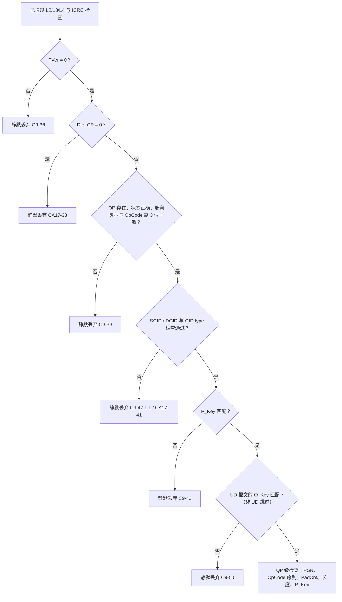

# 基本传输头 BTH 逐字段详解（Base Transport Header）

> **摘要**：基本传输头（Base Transport Header, BTH）是每个 RoCEv2 报文都携带的 12 字节传输层头，紧跟在 UDP 头之后。它回答了接收端的四个核心问题：这是什么操作（OpCode）、交给哪个 QP（DestQP）、属于哪个分区（P_Key）、在序列中的位置（PSN）。本文逐位解释每个字段在 RoCEv2 中的取值与校验规则，并给出硬件解析的位切片、P_Key 匹配与 QP 查表要点。
>
> **规范出处**：Vol1 §9.2（p.256–262）；§5.2.3 Table 6（p.172–174）；§9.6.1.1（p.295–297）；§9.7.4.1.4（p.327–328）；§9.10 Table 63/65（p.450–456）；§10.9.1–§10.9.3（p.556–559）；§17.2.8.1（p.1201–1203）；§A17.4.7–§A17.4.8（p.1940）；§A17.6（p.1942–1943）；§A17.9.3 Figure 349（p.1948）；§A10.3.1（p.1814–1815）
>
> **前置阅读**：[01-frame-layout.md](01-frame-layout.md)、[02-ethernet-ip-udp.md](02-ethernet-ip-udp.md)
>
> **关键词**：OpCode, SE, MigReq, PadCnt, TVer, P_Key, FECN, BECN, Resv8a, DestQP, AckReq, PSN, CA17-29, CA17-33

## 1. BTH 的位置与作用

- 所有 IBA 传输服务都必须携带 BTH（C9-1）〔Vol1 §9.2, p.256〕。在 RoCEv2 中 BTH 就是 UDP 负载的第一个字节，位于帧偏移 42（IPv4）/ 46（IPv4 + VLAN）/ 62（IPv6）/ 66（IPv6 + VLAN）。
- BTH 之后跟哪些扩展传输头、是否有负载，完全由 OpCode 决定（C9-2）〔Vol1 §9.2.1, p.257〕，见 [04-extended-transport-headers.md](04-extended-transport-headers.md) 与 [05-opcodes.md](05-opcodes.md)。
- RoCEv2 对 BTH 格式**没有任何改动**，只改变了两个字段的语义：F/B 位不再使用（CA17-29），DestQP = 0 的报文直接丢弃（CA17-33）；另外 RoCEv2 CNP 使用了新的 OpCode 0x81。

## 2. 布局与字段表

### 2.1 布局

位编号沿用规范约定：每行一个 32 bit 字，bit 31 为最高位，字节 0（bits 31–24）最先发送〔Vol1 Figure 67, p.256〕。

```text
 字节   31           24 23           16 15            8 7             0
       +---------------+-+-+---+-------+-------------------------------+
 0-3   |    OpCode     |S|M|Pad| TVer  |             P_Key             |
       +-+-+-----------+-+-+---+-------+-------------------------------+
 4-7   |F|B|   Resv6   |                    DestQP                     |
       +-+-+-----------+-----------------------------------------------+
 8-11  |A|    Resv7    |                      PSN                      |
       +-+-------------+-----------------------------------------------+
```

图例：S = SE（Solicited Event），M = MigReq，Pad = PadCnt，F/B = FECN/BECN（规范写作 F/Res1、B/Res1），A = AckReq。第 4 字节（F、B、Resv6）即 §7.8.1 所称的 **Resv8a**，计算 ICRC 时整字节替换为 0xFF。

### 2.2 字段表

| 字节 | 位（字内） | 宽度 | 字段 | 含义 | RoCEv2 备注 | ICRC |
|---|---|---|---|---|---|---|
| 0 | 31–24 | 8 | OpCode | 高 3 位服务类型 + 低 5 位操作，决定后续头与负载 | 同 IB；RoCEv2 CNP 为 0x81 | 覆盖 |
| 1 | 23 | 1 | SE（Solicited Event） | 请求响应方触发 CQ 事件 | 同 IB | 覆盖 |
| 1 | 22 | 1 | M（MigReq） | 路径迁移状态 | 不使用 APM 时为 1；CNP 中为 0 | 覆盖 |
| 1 | 21–20 | 2 | PadCnt | 负载后 pad 字节数（0–3） | 同 IB | 覆盖 |
| 1 | 19–16 | 4 | TVer | 传输头版本，必须为 0 | 同 IB | 覆盖 |
| 2–3 | 15–0 | 16 | P_Key | 分区键 | 至少有默认 0xFFFF（§A17.4.7） | 覆盖 |
| 4 | 31 | 1 | F / Res1（FECN） | IB 拥塞控制前向标记 | **不使用，接收忽略**（CA17-29） | **屏蔽** |
| 4 | 30 | 1 | B / Res1（BECN） | IB 拥塞控制后向标记 | **不使用，接收忽略**（CA17-29） | **屏蔽** |
| 4 | 29–24 | 6 | Resv6 | 保留（variant），发 0 收忽略（C9-6） | 同 IB | **屏蔽** |
| 5–7 | 23–0 | 24 | DestQP | 目的 QP 号 | DestQP = 0 静默丢弃（CA17-33） | 覆盖 |
| 8 | 31 | 1 | A（AckReq） | 请求响应方调度确认 | 同 IB | 覆盖 |
| 8 | 30–24 | 7 | Resv7 | 保留，发 0 收忽略（C9-7） | 同 IB | 覆盖 |
| 9–11 | 23–0 | 24 | PSN | 包序列号（模 2²⁴） | 同 IB；CNP 中为 0 | 覆盖 |

〔Vol1 §5.2.3 Table 6, p.173–174；§9.2.1–§9.2.14, p.257–262〕。按字节取字段时的掩码（与 Linux rxe `rxe_hdr.h` 中的 `BTH_*_MASK` 定义一致〔业界实践: Linux rxe〕）：

| 字节 | 掩码 | 字段 | 字节 | 掩码 | 字段 |
|---|---|---|---|---|---|
| 1 | 0x80 | SE | 4 | 0x80 | F（FECN） |
| 1 | 0x40 | M | 4 | 0x40 | B（BECN） |
| 1 | 0x30 | PadCnt | 4 | 0x3F | Resv6 |
| 1 | 0x0F | TVer | 8 | 0x80 | A（AckReq） |
| — | — | — | 8 | 0x7F | Resv7 |

### 2.3 字段的生成来源与接收校验

规范 §9.10 用两张表总结了每个字段"谁来填、谁来查"（Tr = 传输层固定值或计算值，QP = QP 上下文，WQE = 工作请求，NC = 不检查）：

| 字段 | 生成（RC / UC / XRC / UD） | 接收校验（RC / UC / XRC / UD） |
|---|---|---|
| OpCode | Tr / Tr / Tr / Tr | Tr / Tr / Tr / Tr |
| TVer | Tr（=0） | Tr |
| P_Key | QP / QP / QP / QP | QP / QP / QP / QP（QP1 只需属于端口 P_Key 表） |
| DestQP | QP / QP / QP / WQE | Tr |
| PadCnt | WQE（由数据长度算出） | WQE |
| SE | WQE | Tr（交给上层） |
| M | Tr | Tr / Tr / Tr / NC |
| AckReq | Tr / **0** / Tr / **0** | Tr / NC / Tr / NC |
| PSN | QP | QP / QP / QP / **NC** |

〔Vol1 §9.10 Table 63, p.451；Table 65, p.455〕

## 3. 字段详解

### 3.1 OpCode（8 bit）

| Code[7:5] | 服务类型 | Code[7:5] | 服务类型 |
|---|---|---|---|
| 000 | 可靠连接 RC | 100 | 拥塞通知包 CNP |
| 001 | 不可靠连接 UC | 101 | 扩展可靠连接 XRC |
| 010 | 可靠数据报 RD | 110–111 | 厂商自定义（Manufacturer Specific） |
| 011 | 不可靠数据报 UD | | |

〔Vol1 Table 38, p.257–259〕

- 低 5 位 Code[4:0] 编码具体操作及其在消息中的位置（First / Middle / Last / Only）。完整列表、各 OpCode 携带的扩展头和硬件查找表见 [05-opcodes.md](05-opcodes.md)。
- **RoCEv2 CNP**：OpCode = 0b1000_0001（0x81）〔Vol1 §A17.9.3 Figure 349, p.1948〕；基础规范 Table 38 中 100_00000（0x80）是 IB CNP，100_00001–11111 为保留。
- 厂商自定义 OpCode 在双方确认支持之前不应在设备之间使用〔Vol1 §9.2.2, p.259–260〕。
- 接收端：OpCode[7:5] 必须与目的 QP 的服务类型一致（C9-38），否则静默丢弃（C9-39）；RC QP 收到 RC/RD 保留 OpCode 时回 NAK-Invalid Request（C9-84）〔Vol1 §9.7.4.1.4, p.327〕。

### 3.2 SE（Solicited Event，1 bit）

- 请求方置 1，要求响应方调用 CQ 事件处理程序〔Vol1 §9.2.3, p.260〕。
- **只应**在 SEND、SEND with Immediate、RDMA WRITE with Immediate、SEND with Invalidate 的 Last 或 Only 包中置位。
- SE **不属于报文头校验**（C9-4）：即使在不该出现的包里置了 SE，也不会因此产生 NAK。
- 来源是 WR 的 "solicited" 标志；它与接收端 CQ 的"仅 solicited 事件"通知模式配合使用，见 [WR 与完成](../03-verbs-and-resources/04-work-requests-and-completions.md)。

### 3.3 M（MigReq，1 bit）

- 用于自动路径迁移（Automatic Path Migration, APM）：1 表示连接已迁移，0 表示迁移状态无变化〔Vol1 §9.2.4, p.260〕。
- APM 状态机**无论是否支持 APM 都初始化为 MIGRATED 状态**，而 MIGRATED 状态下所有出站请求与响应包的 MigReq 都置 1；只有管理操作把 QP 置为 REARM 时才发送 MigReq = 0〔Vol1 §17.2.8.1.1–§17.2.8.1.4, p.1202–1203〕。
- 因此**不使用 APM 的 RoCEv2 连接，正常数据包 M = 1**（抓包中常见 "MigReq: True"〔业界实践: Wireshark 抓包〕）；而 RoCEv2 CNP 明确要求 M = 0（Figure 349）。
- A17 并未排除 APM（Modify QP 的 Alternate Path 按 RoCEv2 地址向量修改，CM 的 LAP/APR 也有相应条款 CA17-36/37），但多数 RoCE 部署不使用它〔业界实践〕。

### 3.4 PadCnt（2 bit）

负载按 4 字节为单位发送，PadCnt 指示在负载之后追加了几个 pad 字节（0–3），使"负载 + pad"成为 4 的倍数（C5-9）〔Vol1 §9.2.5, p.260；§5.2.13, p.179〕。

| 报文 | PadCnt | 依据 |
|---|---|---|
| First / Middle 请求包（SEND、RDMA WRITE） | **必须为 0**（负载 = PMTU，本身是 4 的倍数）。RC 收到非 0 回 NAK-Invalid Request；UC 视为非法 OpCode | C9-85〔p.328〕；C9-199〔p.415〕 |
| Last / Only 包 | `(4 − P mod 4) mod 4` | C5-9 |
| READ Response First / Middle | 0（负载为满 PMTU） | §9.4.4, p.281；Figure 99, p.347 |
| READ Response Last / Only | 按负载长度 | C5-9 |
| 无负载的包（ACK、READ Request、Atomic、Atomic ACK、CNP） | 0 | — |

> [!NOTE]
> 规范没有规定 pad 字节的取值（§7.8.4 样例中为 0x00），发送端通常填 0。pad 字节**计入 IP/UDP 长度并参与 ICRC**，接收端用 PadCnt 从总长度中扣除后才得到真实负载长度（见 [01-frame-layout.md](01-frame-layout.md) §2）。

### 3.5 TVer（4 bit）

- 传输头版本，适用于 BTH、扩展头和 ICRC，**必须为 0x0**（C9-5）〔Vol1 §9.2.6, p.261〕。
- 接收端：TVer ≠ 0 静默丢弃（C9-36）〔Vol1 §9.6.1.1.1, p.295〕。这是头部校验的第一步。

### 3.6 P_Key（16 bit）

```text
 字节   15            8 7             0
       +-+-----------------------------+
 0-1   |M|    Partition Key [14:0]     |
       +-+-----------------------------+
```

M（bit 15）为成员类型：1 = Full 成员，0 = Limited 成员；这里的 M 与 BTH 的 MigReq 无关。

- 最高位表示成员类型（1 = Full，0 = Limited）〔Vol1 §10.9.1.1, p.556–557〕。
- **0xFFFF 是默认分区键**（Full 成员）（C10-115）；低 15 位全 0 的 P_Key 无效（C10-116）〔Vol1 §10.9.1.2, p.557〕。
- **匹配规则**：双方都不是无效 P_Key、低 15 位相等、且不能双方都是 Limited 成员〔Vol1 §10.9.3, p.558–559〕。
- **接收检查**：目的 QP 为 QP1（GSI）时，与端口 P_Key 表中任一项匹配即可（C9-42）；其它 QP 与该 QP 关联的 P_Key 比较，不匹配静默丢弃（C9-43）〔Vol1 §9.6.1.1.3, p.297〕。
- **RoCEv2**：P_Key 表的填充方法不在规范范围内，但上电时至少要有默认 P_Key；BTH 中的 P_Key 仍按第 9 章校验〔Vol1 §A17.4.7, p.1940〕。实际 RoCE 驱动通常只提供 0xFFFF 一项〔业界实践，以驱动实现为准〕。
- RoCEv2 CNP 的 P_Key 取被 ECN 标记报文 BTH 中的同一值（Figure 349）。

### 3.7 F / B / Resv6（"Resv8a" 字节）

- F（FECN）和 B（BECN）是 IB 拥塞控制（Annex A10）使用的位，交换机途中可以改写，因此与 Resv6 一起被定义为"variant"、**不参与 ICRC**（计算时替换为全 1）；发送端必须置 0（C9-6）〔Vol1 §9.2.9–§9.2.11, p.261；§A10.3.1 Table 555, p.1814–1815〕。§7.8.1 把这一整个字节称为 **BTH:Resv8a**。
- RoCEv2 不使用 IB 拥塞控制：**F、B 位不使用，RoCEv2 端口接收时忽略**（CA17-29）〔Vol1 §A17.4.8, p.1940〕。RoCEv2 的拥塞信号改由 IP 头 ECN 字段承载，见 [ECN 与 CNP](../05-congestion-control-and-qos/03-ecn-and-cnp.md)。

> [!WARNING]
> 收发两侧计算 ICRC 时都要把 BTH 第 4 字节替换成 0xFF，**但报文里实际发送的仍是 0x00**。常见错误是把屏蔽后的 0xFF 写回了报文，或者接收端没有屏蔽，导致与对端互通时 ICRC 全部失败。

### 3.8 DestQP（24 bit）

- 目的端的 QP 号〔Vol1 §9.2.8, p.261〕。RC/UC/XRC 来自 QP 上下文，UD 来自 WR（AH 与远端 QPN）。
- **QP0**：RoCEv2 端口没有 QP0（它只用于 IB 子网管理），**DestQP = 0 的报文静默丢弃**（CA17-33）〔Vol1 §A17.6, p.1943〕。
- **QP1**：通用服务接口（GSI），RoCEv2 的 CM 报文（MAD）发往 QP1；Q_Key 必须为众所周知的 0x80010000（C9-49）〔Vol1 §9.6.1.5.1, p.301〕。
- **0xFFFFFF**：UD 多播 QP，仅当本地至少有一个 QP 配置为多播时才有效（o9-23）〔Vol1 §9.6.1.1.2, p.295〕。
- **接收检查**：QP 必须存在、处于可接收该包的状态、服务类型与 OpCode[7:5] 一致（C9-37、C9-38），否则对 RC/UC/UD/XRC 静默丢弃（C9-39）。可接收的状态：请求包 —— RTR、RTS、SQD、SQE；响应包 —— RTS、SQD、SQE〔Vol1 Table 40, p.296〕。
- RoCEv2 CNP 的 DestQP 是"需要被降速的那个 QP"，即被标记报文的源 QP（Figure 349）。

### 3.9 A（AckReq，1 bit）

- 请求响应方为该包调度一个确认〔Vol1 §9.2.12, p.261〕；响应方收到 A = 1 的有效请求包时必须为它调度响应，响应的 PSN 不小于该请求的 PSN（C9-116）〔Vol1 §9.7.5.1.6, p.344〕。RC/XRC 由传输层设置；**UC 和 UD 发送 0、接收不检查**（Table 63/65）。
- RDMA READ 和 ATOMIC 请求无论 A 位如何都会产生响应，A 位对它们没有作用〔Vol1 §9.7.5.1.6, p.345〕。
- 常见策略是在每条消息的 Last/Only 包上置 A；受端到端信用限制的 SEND 必须在发出的那一个包上置 A（C9-163）〔Vol1 §9.7.7.2.5, p.381〕。ACK 合并与定时器的细节见 [PSN 与 ACK/NAK](../02-transport/05-psn-and-ack-nak.md)。

### 3.10 Resv7（7 bit）

发送置 0、接收忽略（C9-7），但与 Resv6 不同，**Resv7 参与 ICRC**〔Vol1 §9.2.13, p.262〕。因此接收端可以忽略它的值，ICRC 计算时却不能把它屏蔽。

### 3.11 PSN（24 bit）

- 标识包在序列中的位置，用于检测丢包与重复包〔Vol1 §9.2.14, p.262〕；所有运算模 2²⁴。
- 请求方：每个请求包 PSN + 1；RDMA READ Request 之后的下一个请求包 PSN = READ 的 PSN + 预期响应包数（Table 42）〔Vol1 §9.7.3.1, p.313–314〕。
- UD 也生成 PSN 但接收端不检查（Table 65）；RoCEv2 CNP 的 PSN 固定为 0（Figure 349）。
- 期望 PSN、重复区间、ACK/NAK 中 PSN 的含义见 [PSN 与 ACK/NAK](../02-transport/05-psn-and-ack-nak.md)。

## 4. 入站 BTH 检查摘要

规范 §9.6 的报文头校验流程（Figure 83）按顺序检查 TVer、目的 QP、GRH、P_Key、DETH/XRC、LRH〔Vol1 §9.6, p.292–303〕。在 RoCEv2 中：GRH 检查改为 IP 头检查（§A17.4.4），LRH 检查不适用（§A17.4.1.2），并新增 DestQP = 0 的丢弃规则（CA17-33）。



通过上述检查后才进入 QP 级校验：PSN 检查、OpCode 序列检查（Table 45）、OpCode 功能与 PadCnt 检查（C9-82…C9-85）、长度检查（C9-91…C9-94）、R_Key 检查等，其中一部分错误以 NAK 报告而不是静默丢弃。完整流程见 [排序与校验](../02-transport/03-ordering-and-validation.md) 与 [响应方行为](../02-transport/07-responder.md)。

## 5. 「硬件实现要点」

### 5.1 位切片

约定一：把 BTH 的 12 个字节按网络序拼成 96 bit 向量，`bth[95:88]` 为第 0 字节（最先到达）。规范中"第 k 个 32 bit 字的 bit n"对应 `bth[64 − 32k + n]`：

```verilog
// bth[95:64] = 字 0，bth[63:32] = 字 1，bth[31:0] = 字 2
wire [7:0]  opcode = bth[95:88];
wire        se     = bth[87];
wire        migreq = bth[86];
wire [1:0]  padcnt = bth[85:84];
wire [3:0]  tver   = bth[83:80];
wire [15:0] pkey   = bth[79:64];
wire        fecn   = bth[63];      // RoCEv2 忽略（CA17-29）
wire        becn   = bth[62];      // RoCEv2 忽略（CA17-29）
wire [5:0]  resv6  = bth[61:56];
wire [23:0] destqp = bth[55:32];
wire        ackreq = bth[31];
wire [6:0]  resv7  = bth[30:24];
wire [23:0] psn    = bth[23:0];
```

约定二：很多 FPGA 以太网 IP 的 AXI4-Stream 接口采用"包内第 i 个字节位于 `tdata[8*i +: 8]`"的小端字节通道排列（以所用 IP 手册为准），此时多字节字段需要逐字节重排。IPv6 时 BTH 起始偏移为 62/66，在 512 bit（64 字节）总线上会跨越第一拍边界，需要把相邻两拍拼起来再抽取：

```systemverilog
function automatic logic [95:0] get_bth(input logic [1023:0] two_beats, // {第 1 拍, 第 0 拍}
                                        input int unsigned  off);       // BTH 在第 0 拍内的字节偏移
    logic [95:0] r;
    for (int i = 0; i < 12; i++)
        r[95 - 8*i -: 8] = two_beats[8*(off + i) +: 8];   // 字节 i → 网络序位置
    return r;
endfunction
```

### 5.2 P_Key 匹配

```systemverilog
function automatic logic pkey_match(input logic [15:0] m,   // 报文中的 P_Key
                                    input logic [15:0] e);  // QP 关联的 P_Key
    return (m[14:0] != 15'd0) && (e[14:0] != 15'd0)   // 都不是无效 P_Key（C10-116）
        && (m[14:0] == e[14:0])                       // 低 15 位相等
        && (m[15] | e[15]);                           // 不能双方都是 Limited 成员
endfunction
```

QP1 的报文需要与端口 P_Key 表中的每个有效项并行比较（C9-42）；RoCE 端口通常只有一两项，用寄存器阵列即可。

### 5.3 DestQP 查表与特殊 QP

1. 第一拍拿到 BTH 后即可并行启动：OpCode 译码（服务类型、扩展头长度、是否有负载，见 [05-opcodes.md](05-opcodes.md)）和 QP 上下文查找。
2. QPN 通常由"索引 + 校验位"组成，用索引直接寻址上下文表或上下文缓存，再用其余位和 valid 位确认命中；具体编码方式是实现自由（厂商相关）。
3. 特殊值优先处理：`destqp == 0` → 丢弃并计数（CA17-33）；`destqp == 1` → GSI 路径（常交给软件或专用队列）；`destqp == 24'hFFFFFF` → 按 DGID 查多播组。
4. 上下文读回后再做状态 / 服务类型 / P_Key / PSN 等比较；在 ICRC 结果返回之前不得提交任何状态更新（见 [06-icrc.md](06-icrc.md)）。

### 5.4 发送端 BTH 生成

| 字段 | 生成方式 |
|---|---|
| OpCode | 由 WR 类型（SEND / WRITE / READ / ATOMIC，是否带 Immediate / Invalidate）和分段位置（First / Middle / Last / Only）组合查表 |
| SE | 仅在 Last/Only 包上取 WR 的 solicited 标志 |
| M | 取 QP 的 APM 状态（正常为 MIGRATED → 1） |
| PadCnt | Last/Only 包为 `(−P) & 3`，其余为 0 |
| TVer / F / B / Resv6 / Resv7 | 全 0 |
| P_Key | QP 上下文的 P_Key index 指向端口 P_Key 表 |
| DestQP | RC/UC/XRC 取自 QP 上下文；UD 取自 WR |
| A | 按请求方策略（如每条消息的末包、信用受限时） |
| PSN | QP 的 next PSN，按 Table 42 递增 |

更完整的发送通路设计见 [发送数据通路](../06-hardware-implementation/02-tx-datapath.md)。

## 6. 要点回顾

- BTH 固定 12 字节：OpCode(8) | SE M PadCnt(2) TVer(4) | P_Key(16) | F B Resv6(6) | DestQP(24) | A Resv7(7) | PSN(24)。
- OpCode 高 3 位是服务类型（000 RC、001 UC、010 RD、011 UD、100 CNP、101 XRC、110/111 厂商自定义），低 5 位是操作；RoCEv2 CNP 为 0x81。
- 不使用 APM 时 M 恒为 1（APM 状态机停在 MIGRATED）；CNP 中 M = 0。
- PadCnt 只在 Last/Only（以及 READ Response Last/Only）包中可能非 0；First/Middle 非 0 属于非法请求。
- TVer 必须为 0；默认 P_Key 0xFFFF，低 15 位相等且不同时为 Limited 才算匹配。
- BTH 第 4 字节（F/B/Resv6，即 Resv8a）在 ICRC 中被屏蔽，RoCEv2 忽略 F/B（CA17-29）；Resv7 则参与 ICRC。
- DestQP = 0 静默丢弃（CA17-33）；QP1 用于 CM/GSI；0xFFFFFF 为 UD 多播。
- UC/UD 的 AckReq 恒为 0；UD 的 PSN 不检查。

## 自测

<details><summary>Q1：抓包看到 BTH 第 1 字节为 0x62，代表什么？</summary>

答：0x62 = 0110_0010b：SE = 0，M = 1，PadCnt = 10b = 2，TVer = 0010b = 2。TVer 非 0，接收端应按 C9-36 静默丢弃（合规发送端不会产生这样的包）。若是 0x60，则表示 M = 1、PadCnt = 2、TVer = 0，是正常的 Last/Only 包，负载长度模 4 余 2。
</details>

<details><summary>Q2：一个 RC 响应方收到 RDMA WRITE Middle 包，PadCnt = 1，应该怎么处理？</summary>

答：First/Middle 包的 PadCnt 必须为 0。RC 响应方应返回 NAK-Invalid Request（C9-85），该包不执行、期望 PSN 不推进；若是 UC 则视为非法 OpCode，不回 NAK（UC 没有确认机制）。
</details>

<details><summary>Q3：为什么 F/B 位在 ICRC 中被屏蔽，而 Resv7 却参与 ICRC？</summary>

答：F/B 是 IB 网络中交换机可以途中改写的拥塞标记位，属于"可变"字段，若参与端到端 ICRC 就会在被标记后校验失败，所以它们所在的整个字节（含 Resv6）被定义为 variant 并屏蔽。Resv7 没有任何途中修改的用途，按规范"included in the invariant CRC"。RoCEv2 虽然不使用 F/B，但 ICRC 规则沿用 §7.8.1，仍然屏蔽该字节。
</details>

<details><summary>Q4：两端 P_Key 分别是 0x7FFF 和 0x7FFF，能通信吗？0x7FFF 和 0xFFFF 呢？</summary>

答：0x7FFF 与 0x7FFF 低 15 位相同但双方都是 Limited 成员，不匹配，不能通信；0x7FFF 与 0xFFFF 低 15 位相同且一方是 Full 成员，匹配，可以通信。
</details>

<details><summary>Q5：RoCEv2 CNP 的 BTH 中哪些字段有明确规定？</summary>

答：OpCode = 0x81，DestQP = 需要降速的 QP（被标记报文的源 QP），PSN = 0，SE = 0，M = 0，P_Key 与被标记报文相同；BTH 之后是 16 字节保留区（发 0、收忽略）〔Vol1 §A17.9.3 Figure 349, p.1948〕。
</details>

## 参考

- 规范：Vol1 §5.2.3 Table 6（p.172–174）；§9.2（p.256–262）、Figure 67（p.256）、Table 38（p.257–259）；§9.6.1.1（p.295–297）、Table 40（p.296）；§9.6.1.5.1（p.301）；§9.7.3.1 Table 42（p.313–314）；§9.7.4.1.4（p.327–328）；§9.7.5.1.6（p.344–345）；§9.7.7.2.5（p.381）；§9.8.2.2.5 C9-199（p.415）；§9.10 Table 63/65（p.450–456）；§10.9.1–§10.9.3（p.556–559）；§17.2.8.1（p.1201–1203）；§A10.3.1（p.1814–1815）；§A17.4.7–§A17.4.8（p.1940）；§A17.6（p.1942–1943）；§A17.9.3 Figure 349（p.1948）。
- 业界实践：Linux 内核 `drivers/infiniband/sw/rxe/rxe_hdr.h`（BTH 掩码与访问函数）；Wireshark InfiniBand 解析器。
- 相关文件：[04-extended-transport-headers.md](04-extended-transport-headers.md)、[05-opcodes.md](05-opcodes.md)、[06-icrc.md](06-icrc.md)、[接收通路](../06-hardware-implementation/03-rx-datapath.md)、[FPGA 实现要点](../06-hardware-implementation/05-fpga-implementation-notes.md)。
