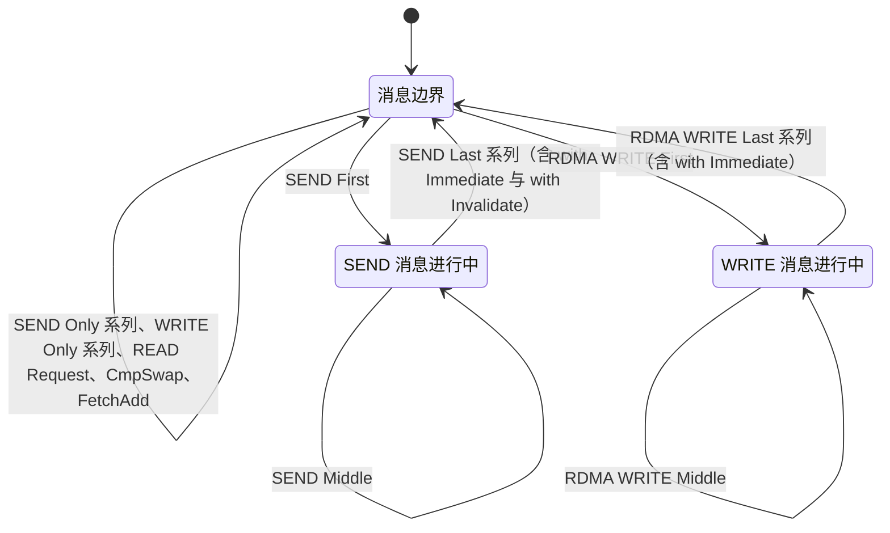
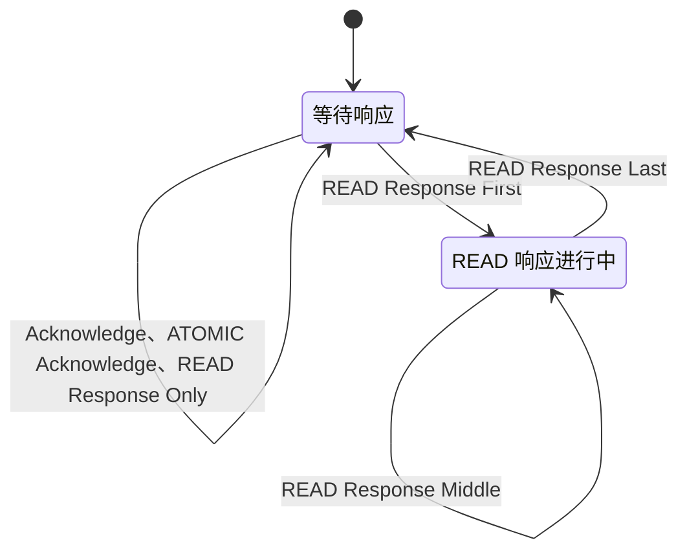

# OpCode 全表与报文头组合（OpCode Table and Header Combinations）

> **摘要**：BTH 的 8 bit OpCode 决定一个报文是什么操作、处于消息的哪个位置、后面跟哪些扩展头、有没有负载。本文按规范 Table 38 列出全部已定义的 OpCode（含 RoCEv2 新增的 CNP 0x81），说明合法的包序列约束，并给出可直接用于 RTL 或 Python 的 OpCode 查找表与头长度计算方法。
>
> **规范出处**：Vol1 §9.2.1–§9.2.2 Table 38（p.257–260）；§9.4（p.267–291）；§9.7.3.1 Table 42（p.313–314）；§9.7.3.3 Table 43（p.316–317）；§9.7.4.1.3–§9.7.4.1.4 Table 45（p.325–328）；§9.7.7.2.4–§9.7.7.2.5（p.378–381）；§9.8.2.2.2 Table 55（p.411–413）；§9.10 Table 63（p.451）；§A10.3.2（p.1815–1816）；§A17.9.3 Figure 349（p.1948）
>
> **前置阅读**：[03-bth.md](03-bth.md)、[04-extended-transport-headers.md](04-extended-transport-headers.md)
>
> **关键词**：OpCode, Table 38, First/Middle/Last/Only, CNP 0x81, OpCode 序列, PSN, 查找表, 头长度

## 1. OpCode 的结构

```text
    7   6   5   4   3   2   1   0   (bit)
  +-----------+-------------------+
  |  Service  |     Operation     |
  +-----------+-------------------+
```

高 3 位（Service）为服务类型，低 5 位（Operation）为具体操作。

- **Code[7:5]**：000 RC、001 UC、010 RD、011 UD、100 CNP、101 XRC、110–111 厂商自定义〔Vol1 Table 38, p.257–259〕。
- **Code[4:0]**：在 RC、UC、RD、XRC 中含义基本一致（例如 01010 在四种服务中都是 "RDMA WRITE Only"），差别只在于各服务类型额外插入的扩展头以及支持哪些操作。

下面的矩阵给出 Code[4:0] 在各服务类型中的取值（"—" 表示该服务中为保留值）：

| Code[4:0] | 操作 | RC | UC | RD | XRC |
|---|---|---|---|---|---|
| 00000 | SEND First | 0x00 | 0x20 | 0x40 | 0xA0 |
| 00001 | SEND Middle | 0x01 | 0x21 | 0x41 | 0xA1 |
| 00010 | SEND Last | 0x02 | 0x22 | 0x42 | 0xA2 |
| 00011 | SEND Last with Immediate | 0x03 | 0x23 | 0x43 | 0xA3 |
| 00100 | SEND Only | 0x04 | 0x24 | 0x44 | 0xA4 |
| 00101 | SEND Only with Immediate | 0x05 | 0x25 | 0x45 | 0xA5 |
| 00110 | RDMA WRITE First | 0x06 | 0x26 | 0x46 | 0xA6 |
| 00111 | RDMA WRITE Middle | 0x07 | 0x27 | 0x47 | 0xA7 |
| 01000 | RDMA WRITE Last | 0x08 | 0x28 | 0x48 | 0xA8 |
| 01001 | RDMA WRITE Last with Immediate | 0x09 | 0x29 | 0x49 | 0xA9 |
| 01010 | RDMA WRITE Only | 0x0A | 0x2A | 0x4A | 0xAA |
| 01011 | RDMA WRITE Only with Immediate | 0x0B | 0x2B | 0x4B | 0xAB |
| 01100 | RDMA READ Request | 0x0C | — | 0x4C | 0xAC |
| 01101 | RDMA READ Response First | 0x0D | — | 0x4D | 0xAD |
| 01110 | RDMA READ Response Middle | 0x0E | — | 0x4E | 0xAE |
| 01111 | RDMA READ Response Last | 0x0F | — | 0x4F | 0xAF |
| 10000 | RDMA READ Response Only | 0x10 | — | 0x50 | 0xB0 |
| 10001 | Acknowledge | 0x11 | — | 0x51 | 0xB1 |
| 10010 | ATOMIC Acknowledge | 0x12 | — | 0x52 | 0xB2 |
| 10011 | CmpSwap | 0x13 | — | 0x53 | 0xB3 |
| 10100 | FetchAdd | 0x14 | — | 0x54 | 0xB4 |
| 10101 | （RD：RESYNC） | — | — | 0x55 | — |
| 10110 | SEND Last with Invalidate | 0x16 | — | — | 0xB6 |
| 10111 | SEND Only with Invalidate | 0x17 | — | — | 0xB7 |
| 11000–11111 | 保留 | — | — | — | — |

UD 只定义了 SEND Only（0x64）与 SEND Only with Immediate（0x65）；CNP 类只定义了 0x80（IB），RoCEv2 另定义 0x81（§3）。

## 2. 全表

列说明：**扩展头**按线上次序列出（BTH 之后、负载之前）；**E** 为扩展头总字节数；**负载**指该 OpCode 是否带负载字段（"Only" 类负载可以为 0 字节）；**位置**用于 OpCode 序列检查；**消耗接收 WQE** 指该类消息在响应方是否消耗一个接收 WQE（SEND 类整条消息消耗 1 个，WRITE with Immediate 由携带 ImmDt 的末包消耗〔Vol1 §9.7.7.2.4–§9.7.7.2.5, p.378–381〕）。全表由下文 §5 的查找表代码生成，并已逐项与 Table 38 核对。

| OpCode | 服务 | 名称 | 扩展头 | E | 负载 | 方向 | 位置 | 消耗接收 WQE |
|---|---|---|---|---|---|---|---|---|
| 0x00 | RC | SEND First | — | 0 | 有 | 请求 | First | 是 |
| 0x01 | RC | SEND Middle | — | 0 | 有 | 请求 | Middle | 是 |
| 0x02 | RC | SEND Last | — | 0 | 有 | 请求 | Last | 是 |
| 0x03 | RC | SEND Last with Immediate | ImmDt | 4 | 有 | 请求 | Last | 是 |
| 0x04 | RC | SEND Only | — | 0 | 有 | 请求 | Only | 是 |
| 0x05 | RC | SEND Only with Immediate | ImmDt | 4 | 有 | 请求 | Only | 是 |
| 0x06 | RC | RDMA WRITE First | RETH | 16 | 有 | 请求 | First | 否 |
| 0x07 | RC | RDMA WRITE Middle | — | 0 | 有 | 请求 | Middle | 否 |
| 0x08 | RC | RDMA WRITE Last | — | 0 | 有 | 请求 | Last | 否 |
| 0x09 | RC | RDMA WRITE Last with Immediate | ImmDt | 4 | 有 | 请求 | Last | 是 |
| 0x0A | RC | RDMA WRITE Only | RETH | 16 | 有 | 请求 | Only | 否 |
| 0x0B | RC | RDMA WRITE Only with Immediate | RETH, ImmDt | 20 | 有 | 请求 | Only | 是 |
| 0x0C | RC | RDMA READ Request | RETH | 16 | 无 | 请求 | 单包 | 否 |
| 0x0D | RC | RDMA READ Response First | AETH | 4 | 有 | 响应 | First | — |
| 0x0E | RC | RDMA READ Response Middle | — | 0 | 有 | 响应 | Middle | — |
| 0x0F | RC | RDMA READ Response Last | AETH | 4 | 有 | 响应 | Last | — |
| 0x10 | RC | RDMA READ Response Only | AETH | 4 | 有 | 响应 | Only | — |
| 0x11 | RC | Acknowledge | AETH | 4 | 无 | 响应 | 单包 | — |
| 0x12 | RC | ATOMIC Acknowledge | AETH, AtomicAckETH | 12 | 无 | 响应 | 单包 | — |
| 0x13 | RC | CmpSwap | AtomicETH | 28 | 无 | 请求 | 单包 | 否 |
| 0x14 | RC | FetchAdd | AtomicETH | 28 | 无 | 请求 | 单包 | 否 |
| 0x16 | RC | SEND Last with Invalidate | IETH | 4 | 有 | 请求 | Last | 是 |
| 0x17 | RC | SEND Only with Invalidate | IETH | 4 | 有 | 请求 | Only | 是 |
| 0x20 | UC | SEND First | — | 0 | 有 | 请求 | First | 是 |
| 0x21 | UC | SEND Middle | — | 0 | 有 | 请求 | Middle | 是 |
| 0x22 | UC | SEND Last | — | 0 | 有 | 请求 | Last | 是 |
| 0x23 | UC | SEND Last with Immediate | ImmDt | 4 | 有 | 请求 | Last | 是 |
| 0x24 | UC | SEND Only | — | 0 | 有 | 请求 | Only | 是 |
| 0x25 | UC | SEND Only with Immediate | ImmDt | 4 | 有 | 请求 | Only | 是 |
| 0x26 | UC | RDMA WRITE First | RETH | 16 | 有 | 请求 | First | 否 |
| 0x27 | UC | RDMA WRITE Middle | — | 0 | 有 | 请求 | Middle | 否 |
| 0x28 | UC | RDMA WRITE Last | — | 0 | 有 | 请求 | Last | 否 |
| 0x29 | UC | RDMA WRITE Last with Immediate | ImmDt | 4 | 有 | 请求 | Last | 是 |
| 0x2A | UC | RDMA WRITE Only | RETH | 16 | 有 | 请求 | Only | 否 |
| 0x2B | UC | RDMA WRITE Only with Immediate | RETH, ImmDt | 20 | 有 | 请求 | Only | 是 |
| 0x40 | RD | SEND First | RDETH, DETH | 12 | 有 | 请求 | First | 是 |
| 0x41 | RD | SEND Middle | RDETH, DETH | 12 | 有 | 请求 | Middle | 是 |
| 0x42 | RD | SEND Last | RDETH, DETH | 12 | 有 | 请求 | Last | 是 |
| 0x43 | RD | SEND Last with Immediate | RDETH, DETH, ImmDt | 16 | 有 | 请求 | Last | 是 |
| 0x44 | RD | SEND Only | RDETH, DETH | 12 | 有 | 请求 | Only | 是 |
| 0x45 | RD | SEND Only with Immediate | RDETH, DETH, ImmDt | 16 | 有 | 请求 | Only | 是 |
| 0x46 | RD | RDMA WRITE First | RDETH, DETH, RETH | 28 | 有 | 请求 | First | 否 |
| 0x47 | RD | RDMA WRITE Middle | RDETH, DETH | 12 | 有 | 请求 | Middle | 否 |
| 0x48 | RD | RDMA WRITE Last | RDETH, DETH | 12 | 有 | 请求 | Last | 否 |
| 0x49 | RD | RDMA WRITE Last with Immediate | RDETH, DETH, ImmDt | 16 | 有 | 请求 | Last | 是 |
| 0x4A | RD | RDMA WRITE Only | RDETH, DETH, RETH | 28 | 有 | 请求 | Only | 否 |
| 0x4B | RD | RDMA WRITE Only with Immediate | RDETH, DETH, RETH, ImmDt | 32 | 有 | 请求 | Only | 是 |
| 0x4C | RD | RDMA READ Request | RDETH, DETH, RETH | 28 | 无 | 请求 | 单包 | 否 |
| 0x4D | RD | RDMA READ Response First | RDETH, AETH | 8 | 有 | 响应 | First | — |
| 0x4E | RD | RDMA READ Response Middle | RDETH | 4 | 有 | 响应 | Middle | — |
| 0x4F | RD | RDMA READ Response Last | RDETH, AETH | 8 | 有 | 响应 | Last | — |
| 0x50 | RD | RDMA READ Response Only | RDETH, AETH | 8 | 有 | 响应 | Only | — |
| 0x51 | RD | Acknowledge | RDETH, AETH | 8 | 无 | 响应 | 单包 | — |
| 0x52 | RD | ATOMIC Acknowledge | RDETH, AETH, AtomicAckETH | 16 | 无 | 响应 | 单包 | — |
| 0x53 | RD | CmpSwap | RDETH, DETH, AtomicETH | 40 | 无 | 请求 | 单包 | 否 |
| 0x54 | RD | FetchAdd | RDETH, DETH, AtomicETH | 40 | 无 | 请求 | 单包 | 否 |
| 0x55 | RD | RESYNC | RDETH, DETH | 12 | 无 | 请求 | 单包 | 否 |
| 0x64 | UD | SEND Only | DETH | 8 | 有 | 请求 | Only | 是 |
| 0x65 | UD | SEND Only with Immediate | DETH, ImmDt | 12 | 有 | 请求 | Only | 是 |
| 0x80 | CNP | CNP（IB，Annex A10） | — | 0 | 无 | CNP | 单包 | 否 |
| 0x81 | CNP | CNP（RoCEv2，Annex A17） | 16 B 保留区 | 16 | 无 | CNP | 单包 | 否 |
| 0xA0 | XRC | SEND First | XRCETH | 4 | 有 | 请求 | First | 是 |
| 0xA1 | XRC | SEND Middle | XRCETH | 4 | 有 | 请求 | Middle | 是 |
| 0xA2 | XRC | SEND Last | XRCETH | 4 | 有 | 请求 | Last | 是 |
| 0xA3 | XRC | SEND Last with Immediate | XRCETH, ImmDt | 8 | 有 | 请求 | Last | 是 |
| 0xA4 | XRC | SEND Only | XRCETH | 4 | 有 | 请求 | Only | 是 |
| 0xA5 | XRC | SEND Only with Immediate | XRCETH, ImmDt | 8 | 有 | 请求 | Only | 是 |
| 0xA6 | XRC | RDMA WRITE First | XRCETH, RETH | 20 | 有 | 请求 | First | 否 |
| 0xA7 | XRC | RDMA WRITE Middle | XRCETH | 4 | 有 | 请求 | Middle | 否 |
| 0xA8 | XRC | RDMA WRITE Last | XRCETH | 4 | 有 | 请求 | Last | 否 |
| 0xA9 | XRC | RDMA WRITE Last with Immediate | XRCETH, ImmDt | 8 | 有 | 请求 | Last | 是 |
| 0xAA | XRC | RDMA WRITE Only | XRCETH, RETH | 20 | 有 | 请求 | Only | 否 |
| 0xAB | XRC | RDMA WRITE Only with Immediate | XRCETH, RETH, ImmDt | 24 | 有 | 请求 | Only | 是 |
| 0xAC | XRC | RDMA READ Request | XRCETH, RETH | 20 | 无 | 请求 | 单包 | 否 |
| 0xAD | XRC | RDMA READ Response First | AETH | 4 | 有 | 响应 | First | — |
| 0xAE | XRC | RDMA READ Response Middle | — | 0 | 有 | 响应 | Middle | — |
| 0xAF | XRC | RDMA READ Response Last | AETH | 4 | 有 | 响应 | Last | — |
| 0xB0 | XRC | RDMA READ Response Only | AETH | 4 | 有 | 响应 | Only | — |
| 0xB1 | XRC | Acknowledge | AETH | 4 | 无 | 响应 | 单包 | — |
| 0xB2 | XRC | ATOMIC Acknowledge | AETH, AtomicAckETH | 12 | 无 | 响应 | 单包 | — |
| 0xB3 | XRC | CmpSwap | XRCETH, AtomicETH | 32 | 无 | 请求 | 单包 | 否 |
| 0xB4 | XRC | FetchAdd | XRCETH, AtomicETH | 32 | 无 | 请求 | 单包 | 否 |
| 0xB6 | XRC | SEND Last with Invalidate | XRCETH, IETH | 8 | 有 | 请求 | Last | 是 |
| 0xB7 | XRC | SEND Only with Invalidate | XRCETH, IETH | 8 | 有 | 请求 | Only | 是 |

未列出的值：RC 0x15、0x18–0x1F；UC 0x2C–0x3F；RD 0x56–0x5F；UD 0x60–0x63、0x66–0x7F；CNP 0x82–0x9F；XRC 0xB5、0xB8–0xBF 为保留；**0xC0–0xFF 为厂商自定义**，在双方确认支持之前不应在设备间使用〔Vol1 §9.2.2, p.259–260〕。所有 OpCode 都附带 ICRC（及 IB 中的 VCRC）〔Vol1 Table 38 注 a, p.259〕。

几点补充：
- **AckReq**：对 RC/XRC/RD 请求有意义；UC、UD 发送时恒为 0（Table 63）；READ Request 与原子请求无论如何都会得到响应，A 位对它们不起作用；响应包和 CNP 不使用该位。详见 [03-bth.md](03-bth.md)。
- **UC 不支持** READ、原子操作和 SEND with Invalidate；RD 不支持 SEND with Invalidate；原子操作只在 RC/RD/XRC 中可用〔Vol1 Table 39, p.268〕。
- **XRC 的响应包**（0xAD–0xB2）不带 XRCETH，**RD 的响应包**带 RDETH 但不带 DETH。
- **RESYNC**（0x55）只用于 RD，负载长度为 0，不消耗请求方发送 WQE 和响应方接收 WQE〔Vol1 §9.4.2, p.275〕。

## 3. RoCEv2 CNP（0x81）与 IB CNP（0x80）

| 项目 | IB CNP（Annex A10） | RoCEv2 CNP（Annex A17） |
|---|---|---|
| OpCode | 0b1000_0000 = **0x80** | 0b1000_0001 = **0x81** |
| 封装 | LRH + [GRH] + BTH + ICRC + VCRC | MAC + IPv4/IPv6 + UDP + BTH + **16 B 保留区** + ICRC + FCS |
| 触发条件 | 收到 BTH.FECN = 1 的报文 | 收到 IP.ECN = 11（CE）的有效报文（CA17-44） |
| DestQP | 被 FECN 标记报文的源 QP | 需要降速的 QP（被标记报文的源 QP） |
| PSN | 0，接收忽略 | 0 |
| SE / M | 不置位 | 0 / 0 |
| P_Key | 与被标记报文相同 | 与被标记报文相同 |
| 拥塞位 | BECN 置 1 | 不使用 BTH 的 F/B（CA17-29） |
| 规范 | §A10.3.2, p.1815–1816 | §A17.9.3 Figure 349, p.1948 |

> [!IMPORTANT]
> 基础规范 Table 38 中 100_00001（0x81）属于保留值，**RoCEv2 CNP 的 0x81 是 Annex A17 Figure 349 定义的**。实现 RoCEv2 时，OpCode 解码表必须把 0x81 当作合法的 CNP，而 IB 的 0x80 CNP 在 RoCEv2 端口上没有定义（Annex A10 不适用于 RoCEv2，§A17.4.8）。16 字节保留区发送置 0、接收忽略，它使 RoCEv2 CNP 的帧长为 78 B（IPv4）。

一个 RoCEv2 CNP 的完整帧（接收端 192.168.1.20 发往源端 192.168.1.10，被降速的 QP 为 0x000B1E；IP 头中 DSCP 48、UDP 源端口 0xD1E0 为示例值，规范未规定 CNP 的这些字段，厂商相关）：

```text
0000  02 00 00 00 00 01 02 00 00 00 00 02 08 00 45 C0     … IPv4，TOS 0xC0（DSCP 48，ECN 00）
0010  00 3C 00 00 40 00 40 11 B6 82 C0 A8 01 14 C0 A8     Total Length 60
0020  01 0A D1 E0 12 B7 00 28 00 00 81 00 FF FF 00 00     UDP Length 40 | OpCode 0x81，SE=M=0，P_Key 0xFFFF
0030  0B 1E 00 00 00 00 00 00 00 00 00 00 00 00 00 00     DestQP 0x000B1E，A=0，PSN 0 | 保留区 …
0040  00 00 00 00 00 00 FC 74 E1 DB F0 48 01 E1           … 保留区 | ICRC FC 74 E1 DB | FCS
```

CNP 的产生与响应行为（NP/RP、DCQCN）见 [ECN 与 CNP](../05-congestion-control-and-qos/03-ecn-and-cnp.md) 和 [DCQCN](../05-congestion-control-and-qos/04-dcqcn.md)。

## 4. 合法的包序列

### 4.1 请求方向

请求方生成的 OpCode 必须符合"有效 OpCode 序列表"（C9-67，Table 43）〔Vol1 §9.7.3.3, p.316–317〕；RC 响应方按同一张表（Table 45）检查，序列非法时回 NAK-Invalid Request（C9-81）〔Vol1 §9.7.4.1.3, p.325–326〕；UC 响应方用 Table 55 检查，非法时**静默丢弃当前消息**，并只接受新的 First/Only 包（C9-187…C9-189）〔Vol1 §9.8.2.2.2, p.411–413〕。

| 上一个有效包 | 当前包允许的 OpCode |
|---|---|
| 无（建连后的第一个包） | First 或 Only |
| First | Middle（消息 ≥ 3 包）或 Last（消息恰为 2 包），**操作类型必须与前一个包一致** |
| Middle | Middle 或 Last，操作类型必须一致 |
| Last | First 或 Only |
| Only | First 或 Only |

此外，同一个发送队列上的多包消息不能与其它操作交织（C9-13、C9-18）〔Vol1 §9.4.1, p.271；§9.4.3, p.278〕。READ Request、CmpSwap、FetchAdd 是单包请求，在序列检查中与 Only 同类。



负载长度与 OpCode 位置的约束同样是序列合法性的一部分：First/Middle 负载必须恰为 PMTU，Last 为 1…PMTU，Only 为 0…PMTU —— 零长度传输只能用 Only 包表达（C9-69…C9-71、C9-92）〔Vol1 §9.7.3.4, p.317；§9.7.4.1.6, p.330〕。

### 4.2 响应方向

响应总是严格按序返回（C9-27）〔Vol1 §9.5, p.291〕。ACK 和 ATOMIC Acknowledge 都是单包；一个 RDMA READ Request 的响应是一条消息：



READ 响应的 First/Middle 负载为满 PMTU、Last 为 1…PMTU、Only 为 0…PMTU，PSN 连续递增（C9-117）〔Vol1 §9.7.5.1.9, p.346–347〕。

### 4.3 PSN 的消耗

| 当前请求包 | 下一个请求包的 PSN |
|---|---|
| SEND、RDMA WRITE、ATOMIC 的任一包 | 当前 PSN + 1（模 2²⁴） |
| RDMA READ Request | 当前 PSN + 预期 READ 响应包数（模 2²⁴） |

〔Vol1 §9.7.3.1 Table 42, p.314〕。例如 PMTU 1024 时一个 3000 B 的 READ 需要 3 个响应包，若 READ Request 的 PSN 为 100，响应包 PSN 为 100、101、102，下一个请求包 PSN 为 103。

## 5. 「硬件实现要点」：OpCode 查找表

### 5.1 Python 参考表（已运行验证）

下面的代码从 RC 的公共定义派生出 UC/RD/XRC，生成的 84 个条目与 §2 全表一致；`split_udp_payload()` 演示了接收端如何用查表结果切分报文。

```python
ETH_LEN = {"RDETH": 4, "DETH": 8, "XRCETH": 4, "RETH": 16, "AtomicETH": 28,
           "AETH": 4, "AtomicAckETH": 8, "ImmDt": 4, "IETH": 4, "CNPRSVD": 16}

# Code[4:0] 的公共定义：(名称, 扩展头, 是否带负载)
_BASE = {
    0x00: ("SEND First", [], True),                 0x01: ("SEND Middle", [], True),
    0x02: ("SEND Last", [], True),                  0x03: ("SEND Last with Immediate", ["ImmDt"], True),
    0x04: ("SEND Only", [], True),                  0x05: ("SEND Only with Immediate", ["ImmDt"], True),
    0x06: ("RDMA WRITE First", ["RETH"], True),     0x07: ("RDMA WRITE Middle", [], True),
    0x08: ("RDMA WRITE Last", [], True),            0x09: ("RDMA WRITE Last with Immediate", ["ImmDt"], True),
    0x0A: ("RDMA WRITE Only", ["RETH"], True),      0x0B: ("RDMA WRITE Only with Immediate", ["RETH", "ImmDt"], True),
    0x0C: ("RDMA READ Request", ["RETH"], False),   0x0D: ("RDMA READ Response First", ["AETH"], True),
    0x0E: ("RDMA READ Response Middle", [], True),  0x0F: ("RDMA READ Response Last", ["AETH"], True),
    0x10: ("RDMA READ Response Only", ["AETH"], True), 0x11: ("Acknowledge", ["AETH"], False),
    0x12: ("ATOMIC Acknowledge", ["AETH", "AtomicAckETH"], False),
    0x13: ("CmpSwap", ["AtomicETH"], False),        0x14: ("FetchAdd", ["AtomicETH"], False),
    0x16: ("SEND Last with Invalidate", ["IETH"], True),
    0x17: ("SEND Only with Invalidate", ["IETH"], True),
}
_REQUESTS = {0x00, 0x01, 0x02, 0x03, 0x04, 0x05, 0x06, 0x07, 0x08, 0x09, 0x0A, 0x0B,
             0x0C, 0x13, 0x14, 0x16, 0x17}             # 请求类（其余为响应类）

OPCODES = {}
for lo, (n, h, p) in _BASE.items():
    OPCODES[0x00 | lo] = ("RC " + n, h, p)                          # RC: 0x00-0x17
    if lo <= 0x0B:
        OPCODES[0x20 | lo] = ("UC " + n, h, p)                      # UC: 0x20-0x2B
    xh = (["XRCETH"] + h) if lo in _REQUESTS else h                 # XRC 响应不带 XRCETH
    OPCODES[0xA0 | lo] = ("XRC " + n, xh, p)                        # XRC: 0xA0-0xB7
    if lo <= 0x14:                                                  # RD: 0x40-0x54（+0x55 RESYNC）
        rh = ["RDETH"] + (["DETH"] if lo in _REQUESTS else []) + h
        OPCODES[0x40 | lo] = ("RD " + n, rh, p)
OPCODES[0x55] = ("RD RESYNC", ["RDETH", "DETH"], False)
OPCODES[0x64] = ("UD SEND Only", ["DETH"], True)
OPCODES[0x65] = ("UD SEND Only with Immediate", ["DETH", "ImmDt"], True)
OPCODES[0x80] = ("CNP (IB, Annex A10)", [], False)
OPCODES[0x81] = ("CNP (RoCEv2, Annex A17)", ["CNPRSVD"], False)


def ext_len(opcode: int) -> int:
    return sum(ETH_LEN[h] for h in OPCODES[opcode][1])


def split_udp_payload(udp_payload: bytes):
    """udp_payload = BTH 首字节 ~ ICRC 末字节（长度 = UDP.Length - 8）。"""
    opcode, flags = udp_payload[0], udp_payload[1]
    if opcode not in OPCODES:
        raise ValueError(f"reserved/vendor opcode 0x{opcode:02X}")
    pad = (flags >> 4) & 0x3
    hdr = 12 + ext_len(opcode)
    pay = len(udp_payload) - hdr - pad - 4          # 负载字节数（不含 pad/ICRC）
    if pay < 0 or (pay + pad) % 4:
        raise ValueError("length inconsistent with opcode/PadCnt")
    if not OPCODES[opcode][2] and pay + pad != 0:
        raise ValueError("payload present on header-only opcode")
    return OPCODES[opcode][0], hdr, pay, pad
```

对 [01-frame-layout.md](01-frame-layout.md) 的示例报文（UDP 负载 48 B）运行，得到 `('RC RDMA WRITE Only', 28, 16, 0)`：头部 28 B（BTH 12 + RETH 16）、负载 16 B、pad 0；对上面的 CNP 得到 `('CNP (RoCEv2, Annex A17)', 28, 0, 0)`。

### 5.2 RTL 查找表（256 × 24 bit ROM）

把上表编码成一个以 OpCode 为地址的 ROM，接收端第一拍拿到 BTH 后一次读出所有解析控制信息：

| 位 | 字段 | 位 | 字段 |
|---|---|---|---|
| 0 | valid（0 = 保留 / 厂商自定义） | 9 | has_reth |
| 1 | has_payload | 10 | has_atomiceth |
| 2 | is_response | 11 | has_aeth |
| 3 | consumes_rq_wqe | 12 | has_atomicacketh |
| 5:4 | pos（0 = Only/单包，1 = First，2 = Middle，3 = Last） | 13 | has_immdt |
| 6 | has_rdeth | 14 | has_ieth |
| 7 | has_deth | 15 | is_cnp |
| 8 | has_xrceth | 21:16 | ext_len（字节，0–40） |

生成 `$readmemh` 文件的脚本（与 5.1 的表配合使用，已运行验证）：

```python
BIT = {"RDETH": 6, "DETH": 7, "XRCETH": 8, "RETH": 9, "AtomicETH": 10,
       "AETH": 11, "AtomicAckETH": 12, "ImmDt": 13, "IETH": 14}
POS = {"First": 1, "Middle": 2, "Last": 3}          # Only / 单包 = 0


def rom_word(op: int) -> int:
    if op not in OPCODES:
        return 0                                      # valid = 0：保留 / 厂商自定义
    name, hdrs, pay = OPCODES[op]
    is_resp = (op >> 5) in (0, 2, 5) and 0x0D <= (op & 0x1F) <= 0x12
    uses_wqe = "SEND" in name or ("WRITE" in name and "Immediate" in name)
    pos = next((v for k, v in POS.items() if k in name), 0)
    w = 1 | pay << 1 | is_resp << 2 | uses_wqe << 3 | pos << 4
    for h in hdrs:
        if h in BIT:
            w |= 1 << BIT[h]
    w |= ((op >> 5) == 4) << 15 | ext_len(op) << 16
    return w


with open("opcode_rom.hex", "w") as f:               # 256 行，每行 6 个十六进制字符
    f.writelines(f"{rom_word(op):06X}\n" for op in range(256))
```

部分条目：0x0A → `100203`（ext_len 16、RETH、有负载）；0x0B → `14220B`（ext_len 20、RETH + ImmDt、消耗 WQE）；0x0D → `040817`（AETH、响应、First）；0x81 → `108001`（CNP、ext_len 16）；0x15 / 0xC0 → `000000`（无效）。

### 5.3 头长度与负载长度

```text
hdr_len  = 12 + ext_len(OpCode)                                  # BTH + 扩展头
pay_len  = UDP.Length − 8 − hdr_len − PadCnt − 4                  # 负载（不含 pad、ICRC）
pay_off  = UDP 起点 + 8 + hdr_len                                  # 负载在帧中的偏移
icrc_off = IP 起点 + IP 包长 − 4                                    # 不能用帧尾定位，见 01-frame-layout.md §6
```

各扩展头在 BTH 之后的偏移由存在位按固定次序做前缀和得到，见 [04-extended-transport-headers.md](04-extended-transport-headers.md) §10。

> [!TIP]
> 「硬件实现要点」把"valid = 0"（保留或厂商自定义 OpCode）与"服务类型和 QP 不一致"分开计数：前者多半是对端实现问题或报文损坏，后者常见于 QP 号被复用、旧连接的迟到报文。RC 中 Code[4:0] 为保留值时规范要求回 NAK-Invalid Request（C9-84），而 OpCode[7:5] 与 QP 服务类型不一致时是静默丢弃（C9-39），两者的处理路径不同。

## 6. 要点回顾

- OpCode = 服务类型（[7:5]）+ 操作（[4:0]）；同一操作在 RC/UC/RD/XRC 中低 5 位相同，例如 RDMA WRITE Only = 0x0A / 0x2A / 0x4A / 0xAA。
- 已定义 84 个 OpCode：RC 23 个（0x00–0x14、0x16、0x17）、UC 12 个（0x20–0x2B）、RD 22 个（0x40–0x55）、UD 2 个（0x64、0x65）、CNP 2 个（0x80 IB、0x81 RoCEv2）、XRC 23 个；0xC0–0xFF 为厂商自定义。
- RoCEv2 CNP 的 0x81 来自 Annex A17 Figure 349，基础 Table 38 中它是保留值；CNP 在 BTH 后带 16 B 保留区。
- 请求序列：First → Middle* → Last 或 Only，操作类型必须一致，多包消息不能交织；RC 违例回 NAK-Invalid Request，UC 静默丢弃当前消息。
- 消耗接收 WQE 的只有 SEND 类和 WRITE with Immediate；READ 请求的下一个请求包 PSN 要跳过所有预期响应包。
- 硬件上用 256 项 ROM 把 OpCode 一次译码为"扩展头存在位 + 长度 + 位置 + 方向"，再用前缀和得到各头偏移与负载长度。

## 自测

<details><summary>Q1：OpCode 0xA9 和 0x49 分别是什么？各带哪些扩展头？</summary>

答：0xA9 = 101_01001b，XRC 的 RDMA WRITE Last with Immediate，带 XRCETH + ImmDt（8 B）；0x49 = 010_01001b，RD 的 RDMA WRITE Last with Immediate，带 RDETH + DETH + ImmDt（16 B）。
</details>

<details><summary>Q2：RC 响应方依次收到 SEND First、RDMA WRITE Middle，会怎样？</summary>

答：First 之后只能是同一操作类型的 Middle 或 Last，RDMA WRITE Middle 的操作类型不匹配，属于非法 OpCode 序列，RC 响应方返回 NAK-Invalid Request（C9-81）。
</details>

<details><summary>Q3：为什么 0x81 不能出现在 IB 链路上，而 0x80 不应出现在 RoCEv2 中？</summary>

答：基础规范 Table 38 只定义了 0x80（IB CNP，Annex A10），0x81 在其中是保留值；0x81 是 Annex A17 为 RoCEv2 CNP 定义的。RoCEv2 端口不适用 Annex A10 的 IB 拥塞控制（§A17.4.8），所以 RoCEv2 中拥塞通知使用 0x81 的格式。
</details>

<details><summary>Q4：一条 10000 B 的 RC SEND（PMTU 4096）会产生哪些 OpCode？如果改为 RDMA WRITE with Immediate 呢？</summary>

答：SEND：0x00（SEND First，4096 B）、0x01（SEND Middle，4096 B）、0x02（SEND Last，1808 B），若带 Immediate 则末包为 0x03。RDMA WRITE with Immediate：0x06（WRITE First，带 RETH，4096 B）、0x07（WRITE Middle，4096 B）、0x09（WRITE Last with Immediate，带 ImmDt，1808 B）；只有 0x09 这个包消耗接收 WQE。
</details>

<details><summary>Q5：PSN 为 0xFFFFFE 的 RDMA READ 请求读取 5000 B（PMTU 2048），响应包和下一个请求的 PSN 是多少？</summary>

答：需要 ⌈5000/2048⌉ = 3 个响应包：READ Response First（0xFFFFFE）、Middle（0xFFFFFF）、Last（0x000000）；下一个请求包 PSN = (0xFFFFFE + 3) mod 2²⁴ = 0x000001。
</details>

## 参考

- 规范：Vol1 §9.2.1–§9.2.2 Table 38（p.257–260）；§9.4（p.267–291）、Table 39（p.268）、§9.4.2（p.275）；§9.5（p.291）；§9.7.3.1 Table 42（p.313–314）；§9.7.3.3–§9.7.3.4 Table 43（p.316–317）；§9.7.4.1.3–§9.7.4.1.6 Table 45（p.325–330）；§9.7.5.1.9（p.346–348）；§9.7.7.2.4–§9.7.7.2.5（p.378–381）；§9.8.2.2.2 Table 55（p.411–413）；§9.10 Table 63（p.451）；§A10.3.2（p.1815–1816）；§A17.4.8（p.1940）；§A17.9.3 Figure 349（p.1948）。
- 相关文件：[03-bth.md](03-bth.md)、[04-extended-transport-headers.md](04-extended-transport-headers.md)、[操作与报文序列](../02-transport/02-operations.md)、[服务类型](../02-transport/01-service-types.md)、[接收通路](../06-hardware-implementation/03-rx-datapath.md)、[常数与公式速查](../08-reference/05-constants-and-formulas.md)。
