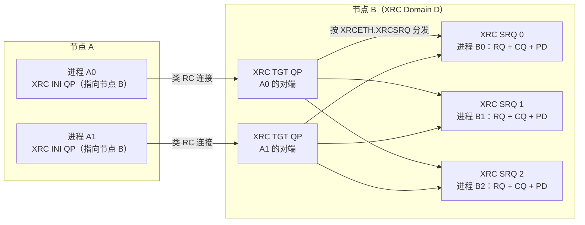
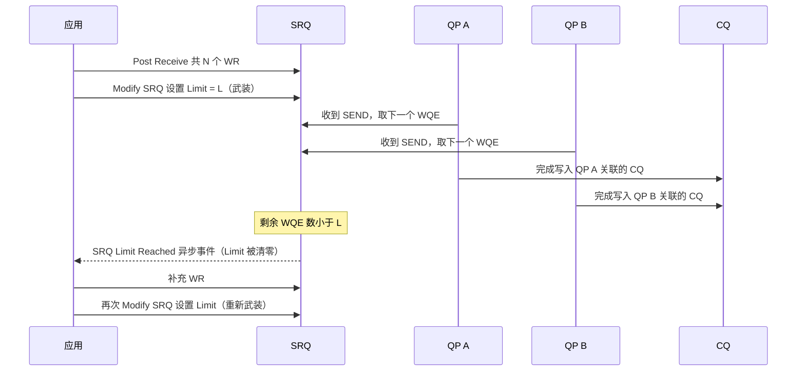

# 传输服务类型（Transport Service Types）

> **摘要**：IBA 传输层以"队列对（Queue Pair, QP）"为载体，向上层提供 5 种 IBA 传输服务（RC、RD、XRC、UD、UC）与 2 种非 IBA 封装（Raw IPv6、Raw Ethertype）。服务类型决定了可靠性、连接模型、可用操作、报文中出现哪些扩展传输头，也决定了硬件里 QP 上下文要保存什么状态。本文以规范 Table 37/39 为基准逐项对比各服务，说明其在 RoCEv2 中的地位（Raw 被禁止、RD 无业界实现），深入讲解 XRC、SRQ 以及 NVIDIA 私有的 DC，并给出选型建议。
>
> **规范出处**：Vol1 §9.1（p.253–256，Table 37）；§9.2（p.256–260）；§9.4（p.267–268，Table 39）；§9.7.8 RD（p.382–399）；§9.7.9 XRC（p.399–402）；§9.8（p.402–422）；§10.2.9 SRQ、§10.2.10 XRC 软件接口（p.475–479）；§11.6.3.1 关联异步事件（p.691–692）；Chapter 17 Table 376（p.1194–1196）；Annex A17 §A17.4.6（p.1939）、§A17.5（p.1940–1942）
>
> **前置阅读**：[BTH 逐字段详解](../01-packet-format/03-bth.md)、[OpCode 全表](../01-packet-format/05-opcodes.md)、[HCA 资源模型](../03-verbs-and-resources/01-resource-model.md)
>
> **关键词**：QP, RC, UC, RD, UD, XRC, Raw, SRQ, SRQ Limit, XRCETH, XRC Domain, EE Context, RDD, DC

---

## 1. 传输服务在协议栈中的位置

### 1.1 QP、请求方与响应方

- QP 由发送队列（Send Queue, SQ）与接收队列（Receive Queue, RQ）组成。主机上传输层的客户是 Verbs 层：它向队列投递缓冲区或命令（WQE, Work Queue Element），硬件把数据从缓冲区搬出或搬入〔Vol1 §9.1, p.253〕。
- 发起操作、向网络注入消息的 QP 称为**请求方（requester）**；接收消息的 QP 称为**响应方（responder）**〔§9.1, p.253〕。一个连接型 QP 的 SQ 侧充当请求方、RQ 侧充当响应方，两半各自维护独立的 PSN，彼此无关〔§9.7.1, p.305〕。
- 一个 **IBA 操作** = 请求消息 +（仅可靠服务才有的）响应。请求消息由一个或多个请求包组成；除 RDMA READ Response 外，响应只有一个包，也称"确认（acknowledge）"；一个响应可以确认"某消息的一部分"直到"多条消息"〔§9.1, p.254, Figure 66〕。
- QP 在创建时与一种服务类型关联〔§9.1, p.253〕；HCA 侧通过 Create QP 的服务类型参数确定（见 [资源模型](../03-verbs-and-resources/01-resource-model.md)）。

### 1.2 服务类型在报文里如何体现

除 Raw 外，每个 IBA 报文都带 BTH；Raw 报文不使用 IBA 传输层，因此没有 BTH〔§9.2, p.256〕。服务类型编码在 **BTH.OpCode[7:5]**〔Table 38, p.257–259〕：

| OpCode[7:5] | 含义 | 在 RoCEv2 中 |
|---|---|---|
| `000` | RC 可靠连接 | 主力服务 |
| `001` | UC 不可靠连接 | 可用（以设备能力为准） |
| `010` | RD 可靠数据报 | 规范定义，业界几乎无实现（见 §3.4） |
| `011` | UD 不可靠数据报 | 必需（QP1/GSI 承载 CM 报文） |
| `100` | CNP | IB CNP = `0x80`；RoCEv2 CNP = `0x81`，见 [ECN 与 CNP](../05-congestion-control-and-qos/03-ecn-and-cnp.md) |
| `101` | XRC 扩展可靠连接 | 可选 |
| `110`–`111` | 厂商自定义 OpCode | 仅在双方明确支持时使用〔§9.2.2, p.259–260〕 |

入站头校验要求 OpCode[7:5] 与目的 QP 配置的服务类型一致（C9-38），不一致则静默丢弃（C9-39），详见 [排序与校验](03-ordering-and-validation.md)。

### 1.3 HCA 必须支持哪些服务

Chapter 17 的 Table 376 规定〔p.1194–1196〕：

- HCA 必须能在其支持的任一 QP 上提供 **UD、RC、UC** 三种服务；
- ATOMIC 操作的生成与响应均为**可选**；
- 若支持某种传输服务，则必须支持该服务定义的全部操作（ATOMIC 除外）；
- RD 与 XRC 的条款都是以"若 CA 实现/声称支持该服务"为前提的可选条款（o 前缀，如 o9-100、o9-3.a1），即**可选**；
- MTU 必须支持 {256}、{256,512}、…、{256…4096} 之一；RC/XRC/UC 的 MTU 由 QP 指定，RD 由 EE Context 指定，UD/Raw 由 WQE 决定包大小。

### 1.4 可靠与不可靠的根本差别

| | 可靠服务（RC / XRC / RD） | 不可靠服务（UC / UD） |
|---|---|---|
| 序号 | 每包 PSN，检测乱序、重复、丢失 | 仍生成 PSN（UC 响应方据此检测丢包；UD 响应方可忽略） |
| 确认 | ACK / NAK / RNR NAK | 无 |
| 恢复 | 请求方重传**丢失包及其后的所有包**（Go-Back-N） | 无重传；UC 丢弃当前消息，UD 的恢复不在规范范围内 |
| 乱序 | **不支持**选择性重传，也**不支持**乱序接收 | 乱序即视为丢失 |

依据〔§9.1, p.253–254〕。"IBA does not support selective packet retransmission nor the out-of-order reception of packets" 这句话是理解 RoCEv2 为什么强烈建议无损网络（§A17.9.1）的关键：一次丢包会让整个在途窗口重传。参见 [PSN 与 ACK/NAK](05-psn-and-ack-nak.md)、[无损以太网与 PFC](../05-congestion-control-and-qos/01-lossless-ethernet-pfc.md)。

---

## 2. 规范对比表

### 2.1 属性对比（重组自 Table 37，p.255–256）

| 属性 | RC / XRC | RD | UD | UC | Raw（IPv6 / Ethertype） |
|---|---|---|---|---|---|
| 可扩展性：N 个节点、每节点 M 个进程全互联，每节点每 CA 所需 QP 数 | RC：M²·N；XRC：M·N | M（另需 EE Context） | M | M²·N | 至少 1 |
| 检测数据损坏 | 是 | 是 | 是 | 是 | 是 |
| 交付保证 | 恰好一次 | 恰好一次 | 无保证 | 无保证 | 无保证 |
| 顺序保证 | 按连接有序 | 同一源 QP 发往多个目的 QP 的包有序 | 无 | 乱序与重复包可被检测 | 无 |
| 检测丢失 | 是 | 是 | 否 | 是 | 否 |
| 错误恢复 | 双方都检测错误；请求方可透明恢复（重传、备用路径等），仅当目的端不可用或所有路径失效才停止 | 同 RC | 部分错误包不交付；收发双方都不被告知 | 有错包（含序号错）被检测，可被响应方记录；请求方不被告知 | 有错包不交付；双方都不被告知 |
| RDMA 与 ATOMIC | 是 | 是 | 否 | 仅 RDMA WRITE | 否 |
| Bind Memory Window | 是 | 是 | 否 | 是 | 否 |
| IBA 不可靠多播 | 否 | 否 | **是** | 否 | 否 |
| Raw 多播 | 否 | 否 | 否 | 否 | 是 |
| 远端失效（Remote Invalidation） | 是 | 否 | 否 | 否 | 否 |
| 共享接收队列（SRQ） | 是 | 否 | 是 | 否（见 §4.1 注） | 否 |
| 消息长度 | 0 ~ 2³¹ 字节，可多包；实现可支持更小上限，实际上限可由上层协商 | 同左 | 单个 PMTU 包（0 ~ 4096 字节） | 0 ~ 2³¹ 字节，可多包 | 单个 PMTU 包（0 ~ 4096 字节） |
| 面向连接 | 连接：本地 QP 只连一个远端 QP，无其它流量 | 无连接（对客户端呈现为无连接，每 CA 用一个或多个 EE Context 提供可靠性） | 无连接 | 连接 | 无连接 |

> [!NOTE]
> 抽取文本中 RC/UC 的"M\*N"前缺失的上标"2"（排版上标丢失）。M²·N 与 §9.7.8 的"RC 需 M²·(N−1) 个 QP"〔p.382〕及 §9.7.9.1 的"N·p·p"〔p.400〕一致；N 与 N−1 的区别只在于是否计入本节点内部通信〔§9.7.9.1 脚注 12, p.400〕。

### 2.2 传输功能支持（Table 39，p.268）

| 传输功能 | RC | UC | XRC | RD | UD | Raw |
|---|---|---|---|---|---|---|
| SEND | 支持 | 支持 | 支持 | 支持 | 支持 | 不适用 |
| RESYNC | — | — | — | 支持 | — | — |
| RDMA WRITE | 支持 | 支持 | 支持 | 支持 | — | 不适用 |
| RDMA READ | 支持 | — | 支持 | 支持 | — | 不适用 |
| ATOMIC | 可选 | — | 可选 | 可选 | — | 不适用 |

> [!WARNING]
> §9.4.5 第 1 条写"ATOMIC Operations are only supported by the Reliable Connection and Reliable Datagram transport services"〔p.283〕，这是 XRC 并入正文之前的旧文字。Table 39〔p.268〕与 §10.7.2.3（o10-45.1.1、o10-46）〔p.539–540〕明确 XRC（INI QP）也支持 ATOMIC。以 Table 39 为准。

### 2.3 综合对比大表（含 RoCEv2 视角）

| 维度 | RC | UC | RD | UD | XRC | Raw |
|---|---|---|---|---|---|---|
| 通信模型 | 一对一连接 | 一对一连接 | 数据报，经 EE Context 复用 | 数据报，一对多 | INI→TGT 单向连接，目标端按 XRCETH 分发到 SRQ | 数据报 |
| ACK / 重传 | 有 | 无 | 有 | 无 | 有 | 无 |
| SEND / SEND w/ Imm | ✔ / ✔ | ✔ / ✔ | ✔ / ✔ | 仅 SEND Only / Only w/ Imm | ✔ / ✔ | 无 BTH |
| RDMA WRITE / w/ Imm | ✔ / ✔ | ✔ / ✔ | ✔ / ✔ | ✘ | ✔ / ✔ | ✘ |
| RDMA READ | ✔ | ✘ | ✔（每 QP/EEC 只允许 1 个在途） | ✘ | ✔ | ✘ |
| ATOMIC | 可选 | ✘ | 可选（同样只允许 1 个在途） | ✘ | 可选 | ✘ |
| SEND with Invalidate | ✔ | ✘ | ✘ | ✘ | ✔（OpCode `0xB6/0xB7`） | ✘ |
| 最大消息 | 2³¹ B | 2³¹ B | 2³¹ B | ≤ PMTU | 2³¹ B | ≤ PMTU |
| 每 QP 在途消息 | 多条 | 多条 | 1 条（o9-102/103） | 多条 | 多条 | — |
| PSN 用法 | 每包 +1；READ 请求预留"响应包数"个 PSN；响应方严格比对 ePSN 并区分重复/无效区 | 每包 +1；响应方检测乱序并丢弃当前消息 | 按 EE Context 维护，规则同 RC | 每包 +1（QP0/QP1 可不递增）；响应方可忽略 | 按 INI↔TGT 连接维护，规则同 RC | 无 |
| 请求包必带扩展头 | 视操作 | 视操作 | RDETH + DETH | DETH | XRCETH | — |
| 多播 | ✘ | ✘ | ✘ | ✔ | ✘ | Raw 多播 |
| SRQ | ✔ | 可选（见 §4.1 注） | ✘ | ✔ | 必须用 XRC SRQ | ✘ |
| 典型用途 | 存储、RPC、集合通信等通用 RDMA | 可容忍丢失的单向写/流 | （无实际产品） | 管理报文（QP1）、服务发现、多播、大扇出 RPC | 大规模多进程全互联（如 MPI） | IB 网络中承载非 IBA 协议 |
| RoCEv2 地位 | ✔ 主力 | ✔ 规范要求（设备支持度以文档为准） | 未被 A17 排除，但业界几乎无实现 | ✔ 必需 | 可选 | ✘ 禁止（CA17-28） |

依据：Table 37/38/39〔p.255–259, 268〕、Table 51〔p.383–384〕、§9.7.3.1〔p.313–314〕、§9.8〔p.402–420〕、§A17.4.6〔p.1939〕。

---

## 3. 各服务要点

### 3.1 RC（Reliable Connection）

- 一个本地 QP 只与一个远端 QP 相连；发送端严格按 WQE 投递顺序发送（C9-25），响应方按到达顺序执行 SEND/WRITE/ATOMIC（C9-28；READ 可被延后执行，见 [排序与校验](03-ordering-and-validation.md)）。
- 每包 PSN 递增；READ 请求之后的下一个请求 PSN = READ PSN + 预期响应包数（Table 42, p.314）。
- 响应方可合并确认（coalesced ACK），请求方用 BTH.A（AckReq）位请求确认。
- RQ 未关联 SRQ 时，HCA 必须在 ACK 中回送端到端（E2E）信用；关联 SRQ 时**不得**生成信用（Table 376, p.1195）。
- RDMA READ / ATOMIC 的最大在途数在连接建立时协商；响应方为其保留"隐藏资源"以应对重复请求（§9.4.5.3, p.286–287）。

RC 的 PSN/ACK/NAK、请求方与响应方状态机分别见 [PSN 与 ACK/NAK](05-psn-and-ack-nak.md)、[请求方行为](06-requester.md)、[响应方行为](07-responder.md)、[错误处理](08-error-handling.md)。

### 3.2 UC（Unreliable Connection）

一对一连接、支持 SEND 与 RDMA WRITE（含 Immediate）、消息最长 2³¹ 字节、可多包，但没有 ACK；响应方检测到乱序后丢弃当前消息并等待下一个 First/Only 包（C9-184、C9-186）。完整行为见 [UC / UD / 多播](04-unreliable-services.md)。

### 3.3 UD（Unreliable Datagram）

无连接；每条消息只有一个包，负载不超过 PMTU（C9-12）；每包携带 DETH（Q_Key + 源 QP）；只支持 SEND（可带 Immediate）；唯一支持 IBA 多播的服务。QP1（GSI）就是 UD QP，RoCEv2 的 CM 报文由它承载。见 [UC / UD / 多播](04-unreliable-services.md)、[MAD 与 GSI](../04-connection-management/03-mad-and-gsi.md)。

### 3.4 RD（Reliable Datagram）

**原理**〔§9.7.8, p.382–386〕：

- 可靠性由"端到端上下文（End-to-End Context, EEC）"提供：每个远端节点至少一个 EEC，保存定位远端、序列化与确认、可靠性所需的状态；QP 仍提供队列、WQE 指针与保护参数。多个 QP 可共用一个 EEC，一个 QP 也可逐消息选择不同 EEC。
- 动机：N 个节点各 M 个进程全互联时，RC 每节点需 M²·(N−1) 个 QP，RD 只需 M 个 QP + N 个 EEC。
- 报文：请求包带 RDETH（EE Context 号，24 bit）+ DETH（Q_Key、源 QP）；响应包带 RDETH（+AETH）（Table 38, p.258）。
- QP 与 EEC 通过可靠数据报域（Reliable Datagram Domain, RDD）关联，发送前与接收时都要检查 RDD（o9-34、o9-38）。

**限制**（这也是它没有被广泛实现的原因之一）：

| 限制 | 依据 |
|---|---|
| 每个 EEC、每个 QP 同时只能有 1 条消息在途 | Table 51（p.384）、o9-102、o9-103 |
| 每个 QP 或 EEC 只能有 1 个在途 RDMA READ、1 个在途 ATOMIC | §9.7.8.3.2–3（p.391） |
| 接收队列溢出必须用 RNR NAK 表示（无 E2E 信用） | o9-111（p.391） |
| Q_Key 不匹配返回 NAK-Invalid RD Request | C9-50（p.301） |
| 与 EEC 无关的错误（Q_Key、R_Key、RNR）不得拆除 EEC | o9-107（p.385） |
| 某 QP 出错需"放弃/挂起"消息后发送 RESYNC 重新同步 EEC 的 PSN | §9.7.8.5（p.392–399） |

**业界现状** 〔业界实践: Linux 内核 `include/rdma/ib_verbs.h`、rdma-core〕：Linux 内核的 `enum ib_qp_type` 只有 SMI、GSI、RC、UC、UD、RAW_IPV6、RAW_ETHERTYPE、RAW_PACKET、XRC_INI、XRC_TGT 和驱动私有类型，**没有 RD**；用户态 libibverbs 同样不提供 RD QP。Annex A17 并未禁止 RD（§A17.5.5 甚至为 RoCEv2 端口调整了 Modify/Query EE Context 的 Address Vector），但实际 RoCEv2 网卡与软件栈中几乎找不到 RD。XRC（§3.5）正是"吸取 RD 的思路、去掉单消息在途限制"的替代方案〔§9.7.9.1, p.400〕。

### 3.5 XRC（Extended Reliable Connection）

#### 3.5.1 动机与数量计算

RC 实现进程间全互联时，每节点需要 N·p·p 个 QP（N 个节点、每节点 p 个进程）〔§9.7.9.1, p.400〕。XRC 的思路是"请求端像 RC，响应端像 RD"〔§10.2.10, p.478〕：

- 每个进程对每个远端**节点**只需一个 XRC INI QP（而不是对每个远端**进程**一个）；
- 目标节点上每个进程只需一个 XRC SRQ，可接收来自集群中任意进程的消息；
- 每节点的 XRC TGT QP 是远端各 INI QP 的对端。

每节点所需对象数〔§9.7.9.1, p.401〕：**N·p 个 XRC INI QP + p 个 XRC SRQ + N·p 个 XRC TGT QP**。

| 规模 | RC QP（N·p²） | XRC INI | XRC TGT | XRC SRQ | 请求端 QP 缩减倍数 |
|---|---|---|---|---|---|
| N=64, p=32 | 65 536 | 2 048 | 2 048 | 32 | 32 |
| N=100, p=64 | 409 600 | 6 400 | 6 400 | 64 | 64 |

即请求端 QP 数缩小为 RC 的 1/p〔§9.7.9.1, p.400："reducing by a factor of p"〕。注意 INI/TGT 都是"半个"QP：通过一对 INI/TGT 的通信是**单向**的〔p.401〕，若 A、B 双向通信，两端各需一个 INI 和一个 TGT。

与 RD 相比，XRC 消除了 RD 最大的限制——每个 EEC 只允许一条在途消息；XRC QP 在线上可以有任意多条在途消息，因为 INI QP 静态绑定到一个目的节点（通过连接上下文），不存在 SQ 与 EEC 的动态关联〔p.400〕。

#### 3.5.2 对象模型

〔§10.2.10, p.478–479；§9.7.9.1, p.400–401〕

| 对象 | 类比 | 说明 |
|---|---|---|
| XRC INI QP | 没有响应方的 RC QP | 只有 SQ；每个 WR 指定目标 XRC SRQ 号（Post Send 新增输入参数） |
| XRC TGT QP | 没有请求方的 RD EEC | 只有响应方状态（ePSN、重复检测等）；不能 Post Send；仍需进入 RTS 以支持路径迁移 |
| XRC SRQ | 没有请求方的 RD QP（接收侧） | 真正投递接收 WR 的地方；绑定 PD、CQ、XRC 域；从专用集合分配 |
| XRC Domain | RDD | TGT QP 只能访问**同域**的 XRC SRQ |

INI 与 TGT 从 HCA 总 QP 数中分配，状态机与 RC QP 相同〔p.479〕。



#### 3.5.3 XRCETH 格式

XRC 扩展传输头（XRC Extended Transport Header, XRCETH）4 字节〔§9.3.8, p.267〕，位编号沿用规范（bit 31 为 32 bit 字的最高位，网络字节序）：

```text
bit  31            24 23                                             0
    +----------------+-----------------------------------------------+
 +0 |    Reserved    |                 XRCSRQ (24)                   |
    +----------------+-----------------------------------------------+
```

| 字节偏移 | 位 | 宽度 | 字段 | 含义 | RoCEv2 备注 |
|---|---|---|---|---|---|
| 0 | 31:24 | 8 | Reserved | 发送置 0，接收忽略 | 计入 ICRC |
| 1–3 | 23:0 | 24 | XRCSRQ | 响应方用于本包的 XRC SRQ 号 | 与 QPN 同为 24 bit |

XRCETH 紧跟 BTH，出现在**所有 XRC 请求包**中（SEND First/Middle/Last/Only、RDMA WRITE 各型、READ Request、CmpSwap、FetchAdd）；XRC 的响应包（Acknowledge、READ Response、ATOMIC Acknowledge）与 RC 相同，**不带** XRCETH〔Table 38, p.259〕。XRC OpCode 为 `0xA0`–`0xB7`，详见 [OpCode 全表](../01-packet-format/05-opcodes.md)。

#### 3.5.4 报文与处理规则

〔o9-3.a1, p.267；o9-114.a5–a10, p.401–402；§10.2.10, p.479〕

1. 请求方必须按规定填写 XRCETH（o9-3.a1）。
2. 同一 XRC 消息的所有包必须携带**完全相同**的 XRCETH（o9-114.a5）。
3. 响应方**必须**校验 First/Only 包所指 XRC SRQ 的 XRC 域与 TGT QP 的域相同（o9-114.a6）；**可以**校验 Middle/Last 包所指 SRQ 与前面各包一致。
4. 响应方使用 **XRC SRQ 的 PD**（而非 TGT QP 的 PD）做保护检查（o9-114.a7）——包括不消耗接收 WQE 的 RDMA 请求〔§10.2.10, p.479〕。
5. 需要接收 WQE 时从该 XRC SRQ 取（o9-114.a8）；需要完成时写入该 XRC SRQ 的 CQ（o9-114.a9）。
6. XRC ACK 中的端到端信用必须置为"无效"（o9-114.a10），因为 SRQ 被多个 TGT QP 共享，信用无法按连接计算〔p.401〕。

#### 3.5.5 校验失败的处理（规范两处描述不一致）

- §9.6.1.3 与 Figure 83 把 `XRC_check` 定义为"XRC SRQ 与 XRC TGT QP 在同一域"，失败时**静默丢弃**〔p.294, 300〕。
- Figure 90（RC/XRC 入站请求校验）与 Table 61 则规定：XRC Domain 违规、XRCETH 无效（SRQ 不存在/状态不对、Middle/Last 的 XRCETH 与 First/Only 不同）返回 **NAK-Invalid RD Request**（借用 RD 的 NAK 码，脚注称"不会混淆，因为这是 XRC QP"），按 Responder Class K 处理，即 XRC TGT QP 进入错误状态〔p.319, 437〕。

> [!WARNING]
> 两处描述并不完全一致（待核实各厂商实现的取舍）。设计时建议：头部解析阶段只做"能否关联到 TGT QP"的判断；域/SRQ 校验放在 QP 级处理中按 Table 61 生成 NAK，并为两种行为都准备互通测试用例。错误类别详见 [错误处理](08-error-handling.md)。

#### 3.5.6 其它特性与限制

〔§9.7.9.1, p.401；§10.2.10, p.479〕

- 通过一对 INI/TGT 的通信是单向的。
- XRC SRQ 没有 SQ，因此 Bind Window、Fast Register、Local Invalidate 等本地操作需借助辅助 RC QP 执行；XRC 不支持 Type 2 Memory Window。
- 响应端 CQ 由目标 SRQ 决定，所以经同一 TGT QP 发往**不同** SRQ 的消息之间**没有**顺序保证。
- 在 XRC SRQ 上成功 Poll 到一个完成，即保证可以再投递一个 WR。
- 出错时 TGT QP 产生异步事件；相关接收 WQE 以错误刷新，并关联到 WQE 原本所投递的 SRQ。

#### 3.5.7 Verbs 用法示意

〔业界实践: Linux rdma-core `libibverbs/verbs.h`；以所用版本文档为准〕下例省略错误处理，仅示意对象关系：

```c
#include <fcntl.h>
#include <infiniband/verbs.h>

/* 目标节点：打开 XRC 域（fd = -1 表示不与其它进程共享）并创建 XRC SRQ */
struct ibv_xrcd_init_attr xa = {
    .comp_mask = IBV_XRCD_INIT_ATTR_FD | IBV_XRCD_INIT_ATTR_OFLAGS,
    .fd = -1,
    .oflags = O_CREAT,
};
struct ibv_xrcd *xrcd = ibv_open_xrcd(ctx, &xa);

struct ibv_srq_init_attr_ex sa = {
    .attr = { .max_wr = 1024, .max_sge = 1 },
    .comp_mask = IBV_SRQ_INIT_ATTR_TYPE | IBV_SRQ_INIT_ATTR_PD |
                 IBV_SRQ_INIT_ATTR_XRCD | IBV_SRQ_INIT_ATTR_CQ,
    .srq_type = IBV_SRQT_XRC,
    .pd = pd, .xrcd = xrcd, .cq = cq,
};
struct ibv_srq *xsrq = ibv_create_srq_ex(ctx, &sa);
uint32_t srqn;
ibv_get_srq_num(xsrq, &srqn);           /* 通过带外方式告知发送方 */

/* 目标节点：TGT QP（IBV_QPT_XRC_RECV，无 SQ/RQ/CQ） */
struct ibv_qp_init_attr_ex ta = {
    .qp_type = IBV_QPT_XRC_RECV,
    .comp_mask = IBV_QP_INIT_ATTR_XRCD,
    .xrcd = xrcd,
};
struct ibv_qp *tgt = ibv_create_qp_ex(ctx, &ta);

/* 发送节点：INI QP 为 IBV_QPT_XRC_SEND；每个 WR 指定远端 SRQ 号 */
struct ibv_send_wr wr = { .opcode = IBV_WR_SEND /* 其余字段略 */ };
wr.qp_type.xrc.remote_srqn = srqn;      /* 新式接口：ibv_wr_set_xrc_srqn() */
```

#### 3.5.8 XRC 与 RoCEv2

- Annex A17 对 XRC 没有额外限制；§A17.5.4 明确把 "MODIFY/QUERY XRC TARGET QP" 的 Address Vector 按 RoCEv2 规则修改（SL 8–15 保留，使用将返回 Invalid Address Vector）〔p.1941〕。
- XRCETH 增加 4 字节头开销，计算 RoCEv2 PMTU 与以太网 MTU 的关系时要计入，见 [帧布局与 MTU](../01-packet-format/01-frame-layout.md)。
- 是否支持 XRC 以设备与驱动能力为准（如 Query Device 的能力位）。

### 3.6 Raw Datagram

IB 的 Raw IPv6 / Raw Ethertype 由 IB 链路层（LRH.LNH）区分，不经过 IBA 传输层。RoCEv2 没有 IB 链路层，因此**不支持** Raw（CA17-28）〔§A17.4.6, p.1939〕。原因与 Verbs 层的相应删除见 [UC / UD / 多播 §5](04-unreliable-services.md)。

---

## 4. 共享接收队列（Shared Receive Queue, SRQ）

### 4.1 动机与适用服务

不用 SRQ 时，每个 QP 必须独立投递足以应付其峰值速率的接收 WR；连接一多，大量 WQE 与数据缓冲在空闲连接上被浪费，且 HCA 无法把它们回收给其它连接用；若依赖 RC 的消息流控让对端退避，又会增加延迟〔§10.2.9.1, p.475〕。SRQ 让多个 QP 共享接收 WR 及其数据缓冲：任一关联 QP 收到需要接收 WQE 的消息时，HCA 取 SRQ 中**下一个可用** WQE；完成写入**收到消息的那个 QP** 所关联的 CQ〔p.475〕。

> [!NOTE]
> 规范对 UC + SRQ 的描述不一致：§10.2.9.1 写"RC, UC or UD QPs can be associated with an SRQ"〔p.475〕，Table 37 的 SRQ 一行却把 UC 标为"No"〔p.255〕；而 o11-35.2-1.1 以 "If an HCA supports attachment of UC QPs to SRQ" 开头〔p.692〕，Table 61 也区分了 "UC (SRQ)" 的错误类别〔p.436–438〕。综合来看，**UC + SRQ 为可选能力**，RC + SRQ 与 UD + SRQ 为常规能力。XRC 则必须使用 XRC SRQ。

### 4.2 顺序规则

〔C10-99.2.1, p.547；§10.8.3.2, p.547–548；§10.8.5, p.551〕

- 关联到 SRQ 的各 QP 必须**按顺序**从 SRQ 取 WQE（o10-53.2.1）；多个 QP 交替取用会打乱原始投递顺序，因此接收完成相对于 SRQ 投递顺序可以**乱序**。
- 对 RC 或 UC QP，经 SRQ 的接收完成必须按**远端 SQ 提交 Send WR 的顺序**返回（o10-53.2.2）。
- 关联 SRQ 的 QP，其**发送**完成仍按提交顺序返回。

### 4.3 SRQ Limit（低水位）事件

〔§10.2.9.3, p.476–477；o11-5.2.4, p.692〕

| 要点 | 说明 |
|---|---|
| 武装（arm） | 消费者通过 Modify SRQ 把 SRQ Limit 设为**大于 0** 的值即武装 |
| 触发 | 当 SRQ 中 WQE 数**小于** SRQ Limit 时产生 "SRQ Limit Reached" 关联异步事件（对 RC、UD；支持 UC 挂 SRQ 时同样适用，o11-35.2-1.1） |
| 一次性 | 事件产生后 CI 把 SRQ Limit **清零**（自动解除武装），必须重新武装才会再次触发 |
| 重复武装 | 可多次武装，后一次覆盖前一次；多次武装后收到事件时存在"是哪次武装触发"的歧义，应 Query SRQ 确认是否仍处于武装状态 |
| 建议用法 | 先 Post 足量 WR（大于将设置的 Limit），再创建 QP 并 Modify SRQ 设置 Limit，以减少用户态/内核态切换 |



### 4.4 Last WQE Reached、状态与销毁

- 对关联 SRQ 且处于 Error 状态的 QP，当最后一个 WQE 产生 CQE、或 QP 进入 Error 时 RQ 上已无 WQE，CI 产生 "Last WQE Reached" 关联异步事件（o11-5.2.5, p.692）。工程上应等到此事件再销毁 QP，以免丢失已取走但尚未完成的 WQE。
- SRQ 只有两个状态：Non-Error 与 Error。SRQ 灾难性错误使其进入 Error，此后 QP 不能再从中取 WQE，Query/Modify 返回立即错误，唯一出路是 Destroy SRQ〔§10.2.9.5, p.478〕。
- 仍有 QP 关联时 Destroy SRQ 返回立即错误；仍有未完成 WR 时可以销毁，未完成的 WR 一并释放（o10-10.2.3–5, p.477–478）。
- 支持调整 SRQ 大小的 HCA，缩到当前未完成 WQE 数以下或 SRQ Limit 以下时必须返回立即错误（o10-10.2.2, p.477）；调整期间远端可能超时，建议先静默（如 SQD）〔p.477〕。

### 4.5 SRQ 与端到端信用、RNR

HCA 中关联 SRQ 的 RQ **不得**生成 E2E 流控信用（Table 376, p.1195），ACK 中的信用字段因此为"无效"。请求方无法预知对端缓冲是否充足，SRQ 耗尽时只能靠 **RNR NAK** 让对端退避重试（见 [请求方行为](06-requester.md)、[响应方行为](07-responder.md)）。

> [!TIP]
> **工程提示**：(1) Limit 设为"峰值突发 × 补充延迟"量级，收到事件后批量补充；(2) RC QP 的 RNR 重试次数与最小 RNR 定时器要配合 SRQ 补充速度设置，避免 RNR 重试耗尽把连接打入错误态；(3) 多播 UD QP 共享同一 SRQ 时，**每个**关联 QP 都会各取一个 WQE（§10.5.1.1, p.498–499），SRQ 容量要按"副本数"估算。

〔业界实践: Linux rdma-core〕对应接口为 `ibv_modify_srq(srq, &attr, IBV_SRQ_LIMIT)`、异步事件 `IBV_EVENT_SRQ_LIMIT_REACHED` 与 `IBV_EVENT_QP_LAST_WQE_REACHED`：

```c
struct ibv_srq_attr sattr = { .srq_limit = 64 };
ibv_modify_srq(srq, &sattr, IBV_SRQ_LIMIT);          /* 武装 */

struct ibv_async_event ev;
if (ibv_get_async_event(ctx, &ev) == 0) {
    if (ev.event_type == IBV_EVENT_SRQ_LIMIT_REACHED) {
        refill_srq(ev.element.srq);                  /* 应用自定义：补充 WR */
        ibv_modify_srq(ev.element.srq, &sattr, IBV_SRQ_LIMIT); /* 重新武装 */
    }
    ibv_ack_async_event(&ev);
}
```

### 4.6 硬件实现要点

- **SRQ = 多消费者环形队列**：多个 QP 的接收引擎竞争同一个读指针，需要仲裁/原子递增；每次出队后与 Limit 比较，满足"WQE 数 < Limit 且已武装"时投递事件并清零 Limit。
- **预取副作用**：若每个 QP 为降低延迟从 SRQ 预取 WQE，出错时这些"已取未用"的 WQE 无法退回。规范已考虑到这点：UD/UC 的 Class E 错误要求把**已被该 QP 取走**的后续 WQE 也以错误完成，而 SRQ 中未被取走的 WQE 不受影响（o9-161.2.1/2, p.444–445）。
- **完成路由**：CQE 写入"收包 QP"的 CQ，CQE 中要带 QP 号（Poll for Completion 的 QP Number 字段在支持 SRQ 时必须有效，p.679），以便软件区分来源。

---

## 5. DC（Dynamically Connected Transport）——非 IBTA 标准

〔业界实践: NVIDIA/Mellanox mlx5，rdma-core `mlx5dv_create_qp(3)`、`mlx5dv_wr_post(3)`；以 NVIDIA 官方文档为准〕

> [!IMPORTANT]
> DC **不是** IBTA 规范定义的传输服务：Vol1 1.4 的 OpCode 表中没有 DC 的服务编码，Annex A17 也未涉及。它是 NVIDIA（Mellanox）网卡的私有扩展，只能在支持它的同厂商设备之间使用；其线上报文格式与连接握手过程不属于 IBTA 规范，本文不展开。

- **对象**：DCI（DC Initiator，发起端）与 DCT（DC Target，目标端）。通过 `mlx5dv_create_qp()` 在 `dc_init_attr.dc_type` 中选择 `MLX5DV_DCTYPE_DCI` 或 `MLX5DV_DCTYPE_DCT`；创建 DCT 时提供 `dct_access_key`。
- **按 WR 寻址**：DCI 每个 WR 用 `mlx5dv_wr_set_dc_addr(mqp, ah, remote_dctn, remote_dc_key)` 指定目的地址（AH）、远端 DCT 号与 DC Key；man page 说明 DCI 可用的 WR 构造器与 RC QP 相同。
- **并发**：DCI 可配置多个并发"流（stream）"（`dci_streams.log_num_concurent`），同一 stream_id 的 WR 按序处理。
- **可扩展性**：每个进程只需少量 DCI（与集群节点数无关）+ 一个 DCT，就能对任意对端做可靠的 RDMA/SEND，资源开销接近 UD，语义接近 RC。
- **代价**：顾名思义，DCI 与目标之间的"连接"是按需动态建立和拆除的，频繁切换目标会带来额外开销（具体机制以厂商文档为准）；厂商锁定、无法与其它厂商互通。

| 对比 | RC | XRC | DC（私有） | UD |
|---|---|---|---|---|
| 每进程 QP 数（全互联） | O(N·p) | O(N) 个 INI + 1 个 SRQ（另：每节点 N·p 个 TGT） | O(1) 个 DCI + 1 个 DCT | O(1) |
| 可靠 / RDMA / ATOMIC | ✔ / ✔ / 可选 | ✔ / ✔ / 可选 | ✔ / ✔ / 以厂商文档为准 | ✘ / ✘ / ✘ |
| 标准化 | IBTA | IBTA | 厂商私有 | IBTA |

---

## 6. RoCEv2 适用性汇总

| 服务 | 规范依据 | RoCEv2 中的地位 | 业界现状 |
|---|---|---|---|
| RC | 第 9 章（CA17-25） | 必须支持（Table 376） | 主力；存储、AI、RPC 几乎都基于 RC |
| UC | 第 9 章 §9.8.2 | 必须支持（Table 376） | 设备支持度不一，选型前查询设备能力 |
| UD | 第 9 章 §9.8.3；§A17.4.5 | 必须支持；QP1（GSI）承载 CM 报文 | 普遍支持；RoCEv2 对 UD CQE 与接收缓冲有专门规定 |
| XRC | §9.7.9、§10.2.10；§A17.5.4 | 可选 | 部分设备支持 |
| RD | §9.7.8；§A17.5.5 | 可选，A17 未禁止 | 几乎无实现（Linux 无 RD QP 类型） |
| Raw | §9.8.4；**CA17-28** | **禁止** | — |
| DC | 无（非 IBTA） | 不在规范内 | NVIDIA 私有 |

另外两条贯穿所有服务的 RoCEv2 规则：没有 QP0，DestQP = 0 的报文静默丢弃（CA17-33）；BTH 的 F/B 位不使用、接收忽略（CA17-29）〔p.1940, 1943〕。

---

## 7. 选型建议

以下为工程建议，并非规范要求；涉及具体软件的部分为〔业界实践〕，以各项目文档为准。

| 场景 | 推荐服务 | 理由 | 注意 |
|---|---|---|---|
| 存储（NVMe-oF/RDMA、iSER、NFS over RDMA、SMB Direct） | RC | 需要可靠、大块 RDMA READ/WRITE、Send with Invalidate | 连接数随主机×队列数增长，关注 QP 上下文缓存命中 |
| AI 训练集合通信（如 NCCL over RoCE） | RC | 大消息带宽、RDMA WRITE（with Imm）通知 | 常用多 QP 分散 ECMP 哈希（源端口），见 [ECMP](../05-congestion-control-and-qos/06-ecmp-and-load-balancing.md) |
| 中小规模 MPI | RC（+SRQ） | 延迟最低、实现成熟 | SRQ 低水位与 RNR 参数配合 |
| 大规模多核 MPI 全互联 | XRC、UD，或 NVIDIA 平台上的 DC | 降低 QP 数与内存占用 | XRC/DC 依赖设备支持；UD 需软件分段与可靠性 |
| 大扇出低延迟 RPC | UD（软件实现可靠性）或 RC | UD 每进程 QP 数恒定 | UD 消息 ≤ PMTU；可参考〔论文: FaSST, OSDI 2016〕 |
| 服务发现、行情/流媒体组播 | UD + 多播 | 唯一支持 IBA 多播的服务 | 组成员管理依赖 IGMP/MLD，见 [UC / UD / 多播](04-unreliable-services.md) |
| 可容忍丢失的单向数据流（遥测、视频帧） | UC（若设备支持）或 UD | UC 支持 RDMA WRITE 与多包消息且无 ACK 开销 | UC 丢包即丢整条消息，应用需自带序号 |
| 连接管理 / 管理报文 | UD（QP1/GSI） | 规范规定 | Q_Key 固定为 `0x80010000` |
| FPGA/ASIC 最小可用实现 | RC + QP1 上的 UD | 覆盖主流应用与 CM 互通 | 规范层面 HCA 还须支持 UC（Table 376）；若声明合规须补齐 |

---

## 8. 硬件实现要点

1. **按 OpCode[7:5] 早分流**：接收流水线在解析出 BTH 后立即根据服务类别选择上下文类型与检查序列（RC/XRC 走可靠响应方路径，UC 走 Figure 115 的不可靠路径，UD 走 DETH/Q_Key 路径，`100` 进入 CNP 处理）。
2. **上下文按"半 QP"组织**：XRC INI 只需请求方状态，XRC TGT 只需响应方状态，RC 两者都有。把 QP 上下文拆成"请求方段 + 响应方段 + 公共段（PD、P_Key 索引、AV、服务类型）"，INI/TGT 只分配所需段，可显著节省片上缓存。
3. **各服务需要的状态（设计参考）**：

| 状态 | RC | UC | UD | XRC INI | XRC TGT | XRC SRQ |
|---|---|---|---|---|---|---|
| 发送 PSN / 未确认窗口 / 重传定时器 / 重试计数 | ✔ | 仅发送 PSN | 仅发送 PSN | ✔ | — | — |
| 响应方 ePSN / MSN / 重复请求资源（READ、ATOMIC） | ✔ | 仅 ePSN 与当前消息状态 | — | — | ✔ | — |
| 远端 QPN 与 AV | 上下文中 | 上下文中 | 每个 WQE 中 | 上下文中 | 上下文中 | — |
| Q_Key | — | — | ✔ | — | — | — |
| XRC 域 / PD / CQ / RQ 环 | — | — | — | — | XRC 域 | ✔ |

4. **RD 可以不做**：除非目标是完整合规，否则 RD 的 EEC/RDD/RESYNC 逻辑投入产出比极低；XRC 能以更小代价获得可扩展性。
5. **Raw 与 QP0 的入口直接拒绝**：RoCEv2 端口上 DestQP=0 静默丢弃（CA17-33），Raw 不存在（CA17-28），可在解析早期以极低成本丢弃。

---

## 9. 要点回顾

- IBA 定义 5 种传输服务（RC、RD、XRC、UD、UC）+ 2 种 Raw 封装；服务类别编码在 BTH.OpCode[7:5]。
- HCA 必须支持 RC、UC、UD；ATOMIC、RD、XRC 可选（Table 376）。
- 可靠服务用 PSN + ACK/NAK 与 Go-Back-N，**不支持**选择性重传与乱序接收。
- UD 单包消息 ≤ PMTU、只支持 SEND、唯一支持多播；UC 支持 SEND/WRITE 多包消息但无 ACK。
- RD 用 EEC 复用实现"可靠数据报"，但每 EEC/QP 只能 1 条在途消息，业界几乎无实现；Linux 无 RD QP 类型。
- XRC = "请求端像 RC、响应端像 RD"：INI QP、TGT QP、XRC SRQ、XRC 域；XRCETH 4 字节携带目标 SRQ 号，使请求端 QP 数缩小为 RC 的 1/p。
- SRQ 让多个 QP 共享接收 WQE；关联 SRQ 的 RQ 不发 E2E 信用；SRQ Limit 事件是一次性的低水位告警。
- RoCEv2 禁止 Raw（CA17-28）、没有 QP0（CA17-33）；DC 是 NVIDIA 私有扩展，不是 IBTA 标准。

## 自测

<details><summary>Q1：N=32 个节点、每节点 p=16 个进程做全互联，RC 与 XRC 每节点分别需要多少 QP/SRQ？</summary>

答：RC 需 N·p² = 32×256 = 8192 个 QP。XRC 需 N·p = 512 个 INI QP、N·p = 512 个 TGT QP、p = 16 个 XRC SRQ（§9.7.9.1, p.401）。请求端 QP 从 8192 降到 512，缩小 p=16 倍。
</details>

<details><summary>Q2：XRC 的 ACK 中为什么不能携带有效的端到端信用？对请求方意味着什么？</summary>

答：XRC SRQ 被多个 TGT QP 共享，接收 WQE 不属于任何一个连接，无法按连接计算信用，因此 o9-114.a10 要求信用置为无效（与普通 SRQ 相同，Table 376）。请求方不能用信用做发送门控，接收缓冲不足时依靠 RNR NAK 退避重试。
</details>

<details><summary>Q3：一个 XRC RDMA WRITE（不带 Immediate）不消耗接收 WQE，响应方做保护检查时用哪个 PD？</summary>

答：用 XRCETH 所指 XRC SRQ 的 PD，而不是 TGT QP 的 PD（o9-114.a7；§10.2.10 明确"包括不消耗接收 WQE 的 RDMA"）。
</details>

<details><summary>Q4：SRQ Limit 事件触发后，为什么不会持续收到同样的事件？</summary>

答：事件产生后 CI 把 SRQ Limit 清零，相当于解除武装（§10.2.9.3, p.476）。消费者补充 WQE 后必须再次 Modify SRQ 设置 Limit 才能重新武装。
</details>

<details><summary>Q5：为什么说 RoCEv2 端口上"没有 Raw 服务"并不妨碍网卡收发普通 IP 流量？</summary>

答：IB 的 Raw 是 IB 链路层（LRH.LNH）层面的封装，用于在 IB 网络里承载非 IBA 协议。RoCEv2 运行在以太网上，普通 IP/以太网流量本来就走网卡的以太网路径，不需要也不允许经 IBA 的 Raw QP 收发（CA17-28、§A17.5.8–A17.5.9）。
</details>

## 参考

- 规范：IBTA Vol1 Rel 1.4 —— §9.1（p.253–256，Table 37）；§9.2（p.256–260，Table 38）；§9.3.8 XRCETH（p.267）；§9.4（p.267–268，Table 39）；§9.4.5（p.283）；§9.7.8（p.382–399，Table 51）；§9.7.9（p.399–402）；§9.8（p.402–422）；Table 61/62（p.436–439）；§10.2.9（p.475–478）；§10.2.10（p.478–479）；§10.7.2.3（p.539–540）；§10.8.3（p.546–551）；§11.4.2.1（p.679）；o11-5.2.4/5（p.692）；Table 376（p.1194–1196）；§A17.4.6、§A17.5.4–A17.5.5、§A17.6（p.1939–1943）。
- 外部 / 业界实践：
  - Linux 内核 `include/rdma/ib_verbs.h`（`enum ib_qp_type`）。
  - rdma-core：`ibv_open_xrcd(3)`、`ibv_create_srq_ex(3)`、`ibv_modify_srq(3)`、`libibverbs/verbs.h`。
  - rdma-core（NVIDIA mlx5）：`mlx5dv_create_qp(3)`、`mlx5dv_wr_post(3)`（DC 相关）。
  - 〔论文: A. Kalia et al., "FaSST: Fast, Scalable and Simple Distributed Transactions with Two-sided (RDMA) Datagram RPCs", OSDI 2016〕。
- 相关文件：[传输操作](02-operations.md)、[排序与校验](03-ordering-and-validation.md)、[UC / UD / 多播](04-unreliable-services.md)、[资源模型](../03-verbs-and-resources/01-resource-model.md)、[QP 状态机](../03-verbs-and-resources/02-qp-state-machine.md)。
