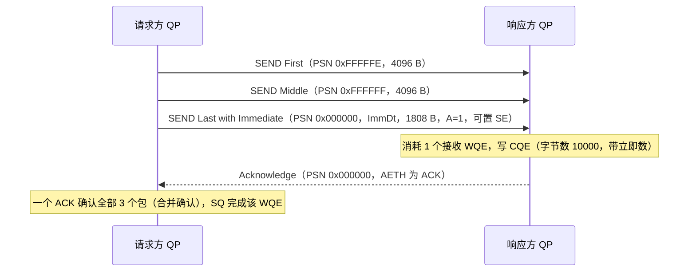
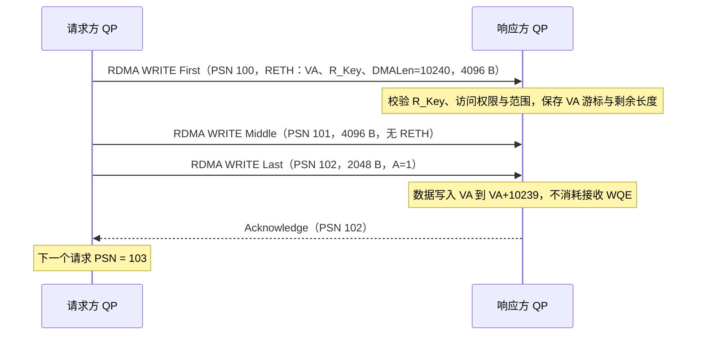
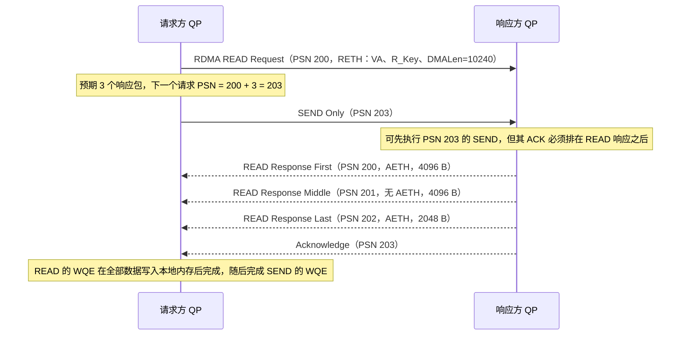
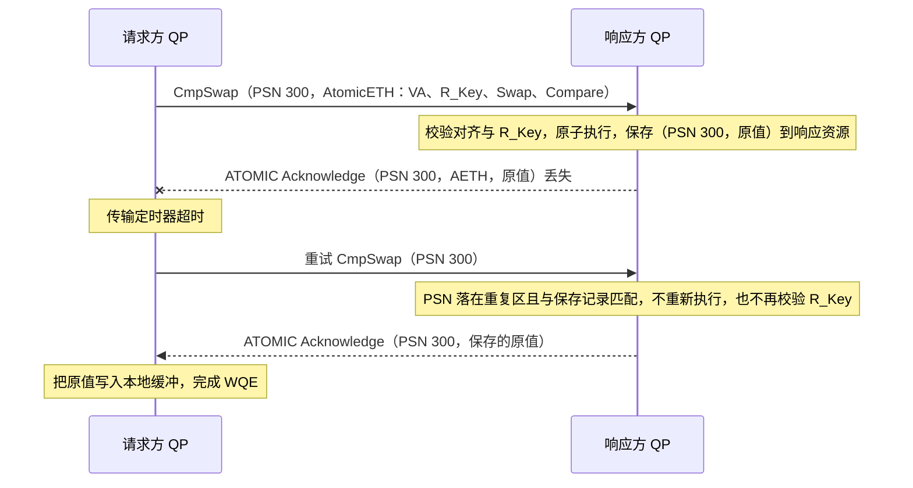

# 传输操作与报文序列（Transport Operations and Packet Sequences）

> **摘要**：本文逐一拆解 IBA 传输层定义的线上操作——SEND（含 with Immediate、with Invalidate）、RDMA WRITE（含 with Immediate）、RDMA READ、ATOMIC（CmpSwap、FetchAdd）以及 RD 专用的 RESYNC：语义、是否消耗接收 WQE、报文头组合、分段规则、PSN 消耗与多包时序。所有规则均对照 Vol1 第 9 章原文核实，并给出 RoCEv2 帧长计算与发送分段器的参考实现。
>
> **规范出处**：Vol1 §9.2.3–9.2.5（p.260）；§9.3（p.262–267）；§9.4（p.267–291）；§9.7（p.304–305）；§9.7.1（p.308–309）；§9.7.3.1、§9.7.3.4（p.313–317）；§9.7.4.1.4–9.7.4.1.6（p.327–330）；§9.7.5.1（p.331–338）；Table 61/62（p.436–439）；§10.6.5（p.518–521）；§10.7.2（p.537–540）；§11.4.1.1（p.663–670）；§11.4.2.1（p.675–680）
>
> **前置阅读**：[传输服务类型](01-service-types.md)、[BTH 逐字段详解](../01-packet-format/03-bth.md)、[扩展传输头](../01-packet-format/04-extended-transport-headers.md)、[OpCode 全表](../01-packet-format/05-opcodes.md)
>
> **关键词**：SEND, RDMA WRITE, RDMA READ, ATOMIC, CmpSwap, FetchAdd, Immediate Data, Invalidate, IETH, RETH, AtomicETH, PMTU, PadCnt, PSN, RESYNC

---

## 1. 操作总览

### 1.1 两类语义

- **通道语义（channel semantics，也称 push）**：SEND。发起方不知道数据会放到远端何处，由远端 CA 放入该 QP 下一个可用接收缓冲——HCA 上即 RQ 头部 WQE 指向的缓冲〔Vol1 §9.4.1, p.268〕。
- **内存语义（memory semantics）**：RDMA WRITE、RDMA READ、ATOMIC。请求携带远端虚拟地址（VA）与 R_Key，直接访问远端已注册的内存区域；VA、长度、R_Key 由上层协议事先交换（例如放在一条 SEND 消息里），交换过程不属于 IBA〔§9.4.3, p.276〕。

### 1.2 操作总表

| 操作 | 适用服务（Table 39） | 请求包 | 响应（可靠服务） | 响应方消耗接收 WQE？ | 主要依据 |
|---|---|---|---|---|---|
| SEND | RC、UC、RD、UD、XRC | SEND First / Middle / Last / Only | Acknowledge | 是（C10-81） | §9.4.1 |
| SEND with Immediate | 同上 | Last / Only with Immediate 带 ImmDt | Acknowledge | 是 | §9.4.1、§9.3.6 |
| SEND with Invalidate | RC、XRC | Last / Only with Invalidate 带 IETH | Acknowledge | 是 | §9.4.1.1 |
| RDMA WRITE | RC、UC、RD、XRC | WRITE First（RETH）/ Middle / Last / Only（RETH） | Acknowledge | 否（C10-87） | §9.4.3 |
| RDMA WRITE with Immediate | 同上 | Last / Only with Immediate 带 ImmDt | Acknowledge | 是，且仅在成功完成时（C10-86） | §9.4.3 |
| RDMA READ | RC、RD、XRC | READ Request（RETH） | READ Response First / Middle / Last / Only | 否（C10-85） | §9.4.4 |
| CmpSwap / FetchAdd | RC、RD、XRC（可选） | CmpSwap / FetchAdd（AtomicETH） | ATOMIC Acknowledge（AETH + AtomicAckETH） | 否（只有 SEND 与 WRITE with Imm 会占用接收 WQE，Table 62 注 a） | §9.4.5 |
| RESYNC | 仅 RD | RESYNC（RDETH + DETH，零负载） | Acknowledge | 否（双方都不消耗 WQE） | §9.4.2 |

Local Invalidate、Fast Register、Bind Memory Window 是发送队列上的**本地**操作，不产生线上报文，见 [内存管理](../03-verbs-and-resources/03-memory-management.md)。

### 1.3 RC 报文的 OpCode 与扩展头

〔Table 38, p.257〕下表为 RC（OpCode[7:5]=`000`）；UC 只有 `0x20`–`0x2B`（SEND 与 WRITE 部分）；XRC 为 `0xA0`–`0xB7`，其**请求包**在 BTH 后先加 4 字节 XRCETH；UD 只有 `0x64`（SEND Only）与 `0x65`（SEND Only with Immediate），带 8 字节 DETH。完整表见 [OpCode 全表](../01-packet-format/05-opcodes.md)。

| OpCode | 报文 | BTH 之后的扩展头 | 扩展头字节 | 负载 |
|---|---|---|---|---|
| `0x00` / `0x01` / `0x02` | SEND First / Middle / Last | — | 0 | 有 |
| `0x03` | SEND Last with Immediate | ImmDt | 4 | 有 |
| `0x04` | SEND Only | — | 0 | 0 ~ PMTU |
| `0x05` | SEND Only with Immediate | ImmDt | 4 | 0 ~ PMTU |
| `0x06` | RDMA WRITE First | RETH | 16 | 有 |
| `0x07` / `0x08` | RDMA WRITE Middle / Last | — | 0 | 有 |
| `0x09` | RDMA WRITE Last with Immediate | ImmDt | 4 | 有 |
| `0x0A` | RDMA WRITE Only | RETH | 16 | 0 ~ PMTU |
| `0x0B` | RDMA WRITE Only with Immediate | RETH, ImmDt | 20 | 0 ~ PMTU |
| `0x0C` | RDMA READ Request | RETH | 16 | 无 |
| `0x0D` | RDMA READ Response First | AETH | 4 | 有 |
| `0x0E` | RDMA READ Response Middle | — | 0 | 有 |
| `0x0F` | RDMA READ Response Last | AETH | 4 | 有 |
| `0x10` | RDMA READ Response Only | AETH | 4 | 0 ~ PMTU |
| `0x11` | Acknowledge | AETH | 4 | 无 |
| `0x12` | ATOMIC Acknowledge | AETH, AtomicAckETH | 12 | 无 |
| `0x13` / `0x14` | CmpSwap / FetchAdd | AtomicETH | 28 | 无 |
| `0x16` | SEND Last with Invalidate | IETH | 4 | 有 |
| `0x17` | SEND Only with Invalidate | IETH | 4 | 0 ~ PMTU |

---

## 2. 分段规则（适用于所有多包消息）

### 2.1 路径 MTU（PMTU）

IBA 的 PMTU 取 256、512、1024、2048、4096 字节之一；RC/UC/XRC 的 MTU 由 QP 指定，UD 由 WQE 决定包大小且不得超过 PMTU（Table 376, p.1195；C9-12）。IBA MTU 定义的是**传输层数据负载**的最大字节数，不含各层头部〔§9.8.4.1, p.422〕。RoCEv2 中 PMTU 必须与以太网 MTU 匹配（扣除 Eth/IP/UDP/BTH/扩展头/ICRC），换算方法见 [帧布局与 MTU](../01-packet-format/01-frame-layout.md)。

### 2.2 First / Middle / Last / Only 的负载长度

| 包类型 | 负载长度 | PadCnt | 依据 |
|---|---|---|---|
| First | **恰好 PMTU** | 必须为 0 | C9-69；C9-85（RC 违反则 NAK-Invalid Request） |
| Middle | **恰好 PMTU** | 必须为 0 | C9-69；C9-85 |
| Last | **1 ~ PMTU** | 0–3 | C9-71 |
| Only | **0 ~ PMTU** | 0–3 | C9-70 |
| READ Response First / Middle | 恰好 PMTU | 0 | C9-99 |
| READ Response Last | 1 ~ PMTU | 0–3 | C9-99 |
| READ Response Only | 0 ~ PMTU | 0–3 | C9-99 |

〔§9.7.3.4, p.317；§9.7.4.1.4, p.328；§9.7.5.1.3, p.334〕UC 有对应的条款 C9-177~179（请求方）、C9-195~197 与 C9-199（响应方）〔p.408, 415〕。

由此得到三个推论：

1. **零长度传输只能用单包消息**（"the only way to create a zero byte length transfer is by use of a single packet message"，C9-70）。
2. Last 包不能为空，所以长度恰为 k·PMTU 的消息由 k−1 个满包加一个**满 PMTU 的 Last 包**组成。
3. 接收端在收到 Last/Only 之前不知道消息总长（SEND 尤其如此，§9.4.1, p.271）；RDMA WRITE 可从 First 包的 RETH.DMALen 得知总长。

### 2.3 包数与 PSN 消耗

设消息长度 L、路径 MTU 为 PMTU，则包数 `n = max(1, ⌈L / PMTU⌉)`，Last 包负载 `L − (n−1)·PMTU`。

| 当前请求 | 下一个请求包的 PSN | 依据 |
|---|---|---|
| SEND、RDMA WRITE、ATOMIC 的每个包 | 当前 PSN + 1（模 2²⁴） | Table 42, p.314 |
| RDMA READ Request（1 个包） | 当前 PSN + **预期 READ 响应包数 n**（模 2²⁴） | Table 42, p.314；C9-66 |

READ 请求在请求 PSN 序列中留下一个"洞"，使所有响应包的 PSN 单调递增：响应包 PSN 从 READ 请求的 PSN 开始逐个加 1（C9-96, p.332）。零长度 READ 也有 1 个响应包（READ Response Only），因此占 1 个 PSN（C9-99）。

> [!IMPORTANT]
> 一个发送队列在途的 PSN 总数不得超过 8 388 608（2²³），其中包括所有 SEND、WRITE、ATOMIC 请求包以及**所有预期的 READ 响应包**（C9-61, p.308–309）。一条 2³¹ 字节的 READ 在 PMTU=4096 时占 2¹⁹ 个 PSN，在 PMTU=256 时占 2²³ 个——恰好用尽整个有效窗口。请求方硬件必须把"预期响应包数"计入在途 PSN 计数，详见 [PSN 与 ACK/NAK](05-psn-and-ack-nak.md)。

参考实现（Python，已实际运行验证）：

```python
import math

PSN_MOD = 1 << 24          # PSN 为 24 bit，模 2^24
VALID_PMTU = (256, 512, 1024, 2048, 4096)

def segment(op, length, pmtu, psn, imm=False, inv=False):
    """把一条 RC SEND/WRITE 消息切成请求包，返回 (包列表, 下一个请求 PSN)。"""
    assert op in ("SEND", "WRITE") and pmtu in VALID_PMTU
    assert 0 <= length <= 2**31                     # C9-10 / C9-16
    assert not (imm and inv) and not (inv and op != "SEND")
    n = max(1, math.ceil(length / pmtu))            # 零长度也要 1 个 Only 包
    pkts = []
    for i in range(n):
        first, last = i == 0, i == n - 1
        size = pmtu if not last else length - pmtu * (n - 1)
        kind = "Only" if n == 1 else "First" if first else "Last" if last else "Middle"
        hdrs = ["RETH"] if (op == "WRITE" and first) else []   # RETH 只在 First/Only
        if last and imm:
            hdrs.append("ImmDt"); kind += " with Immediate"     # ImmDt 只在 Last/Only
        if last and inv:
            hdrs.append("IETH"); kind += " with Invalidate"     # IETH 只在 Last/Only
        pad = (4 - size % 4) % 4                    # First/Middle 恒为 0（C9-85）
        pkts.append((f"{op} {kind}", (psn + i) % PSN_MOD, size, pad, hdrs))
    return pkts, (psn + n) % PSN_MOD

def read_request(length, pmtu, psn):
    """READ 请求只有 1 个包，但占用 n 个 PSN（n = 预期响应包数，Table 42）。"""
    n = max(1, math.ceil(length / pmtu))
    rsp = [("Only" if n == 1 else "First" if i == 0 else "Last" if i == n - 1 else "Middle",
            (psn + i) % PSN_MOD) for i in range(n)]
    return rsp, (psn + n) % PSN_MOD
```

运行结果（节选）：

```text
segment("WRITE", 10240, 4096, psn=100)
  ('WRITE First',  100, 4096, 0, ['RETH'])
  ('WRITE Middle', 101, 4096, 0, [])
  ('WRITE Last',   102, 2048, 0, [])          next PSN = 103
segment("SEND", 10000, 4096, psn=0xFFFFFE, imm=True)
  ('SEND First',  16777214, 4096, 0, [])
  ('SEND Middle', 16777215, 4096, 0, [])
  ('SEND Last with Immediate', 0, 1808, 0, ['ImmDt'])   next PSN = 1（回绕）
segment("WRITE", 0, 1024, psn=7, imm=True)
  ('WRITE Only with Immediate', 7, 0, 0, ['RETH', 'ImmDt'])   next PSN = 8
read_request(10240, 4096, psn=200)  -> 响应 PSN 200/201/202，下一个请求 PSN = 203
read_request(0, 4096, psn=200)      -> 响应 Only PSN 200，下一个请求 PSN = 201
```

### 2.4 PadCnt 与 RoCEv2 中的负载长度

- 负载以 4 字节为单位传送；BTH.PadCnt（2 bit）给出附加在负载末尾的填充字节数 0–3，用于把负载"撑"到 4 的倍数（负载本身可以是 0 字节）〔§9.2.5, p.260〕：`PadCnt = (4 − L_pkt mod 4) mod 4`。
- First/Middle 负载恰为 PMTU（4 的倍数），PadCnt 必须为 0，否则 RC 返回 NAK-Invalid Request（C9-85），UC 视为非法 OpCode（C9-199）。
- 第 9 章的长度检查以 LRH:PktLen 为基础，而 RoCEv2 中 LRH 及其字段全部不适用〔§A17.4.1.2, p.1936〕。实现时可由 UDP Length（含 UDP 头至 ICRC，CA17-21）推出负载长度（推导式，非规范原文）：

```text
payload_len = UDP.Length − 8(UDP) − 12(BTH) − ExtHdrLen(OpCode) − PadCnt − 4(ICRC)
```

### 2.5 各头部出现的位置

| 头 / 位 | 出现在 | 依据 |
|---|---|---|
| RETH（16 B） | WRITE First / Only（含 Only with Imm）；READ Request | C9-19、C9-23；Table 38 |
| ImmDt（4 B） | SEND / WRITE 的 Last / Only **with Immediate** | §9.3.6, p.266；Table 38 |
| IETH（4 B） | SEND Last / Only **with Invalidate** | §9.3.7, p.266–267；§9.4.1.1 |
| AETH（4 B） | Acknowledge；READ Response First / Last / Only（**Middle 不带**）；ATOMIC Acknowledge | C9-24, p.282；C9-97/98, p.334 |
| AtomicETH（28 B） | CmpSwap / FetchAdd | o9-15, p.285 |
| AtomicAckETH（8 B） | ATOMIC Acknowledge | o9-16, p.285 |
| DETH（8 B） | UD 每个包；RD 请求包 | Table 38 |
| XRCETH（4 B） | XRC 每个请求包，同一消息内取值相同 | o9-114.a5, p.401 |
| SE 位 | 应只在 SEND、SEND with Imm、SEND with Invalidate、WRITE with Imm 的 Last / Only 包置位 | §9.2.3, p.260 |

### 2.6 不交织与消息长度上限

- **不交织**：同一发送队列上，一条多包消息一旦开始，在其 Last 包发出前不得插入其它请求包（C9-13, p.271；C9-18, p.278）。注意 READ 请求之后，请求方可以继续发送新的请求而不必等响应返回（§9.4.4, p.281）。
- **长度上限**：SEND 消息 0 ~ 2³¹ 字节（C9-10, p.268）；RDMA WRITE / READ 的 RETH.DMALen 0 ~ 2³¹ 字节（C9-9, p.264；C9-16, p.275；C9-22, p.279）。DMALen 字段 32 bit，可编码到 2³²−1，但合法上限是 2³¹（含）。实现可以支持更小的上限，实际上限可由上层协商（Table 37, p.256）。
- **响应方检查**：READ 的 DMALen 大于 2³¹ 时返回 NAK-Invalid Request（C9-94, p.330）；对 WRITE，响应方**可选**地检查 DMALen 不超过 2³¹，以及消息结束时各包负载之和等于 DMALen，不符可视为非法请求（p.330）。
- UD 消息只能是单包，负载 ≤ PMTU（C9-12, p.269）。

---

## 3. SEND

### 3.1 语义要点

〔§9.4.1, p.268–271〕

- 一次 SEND 传送一条消息；RC、RD、UC、XRC 可多包（HCA 必须分段与重组，C9-11、o9-4），UD 只能单包（C9-12）。
- 响应方每收到一条 SEND 消息就消耗一个接收 WQE（C10-81, p.537）。没有可用 WQE 时，RC 返回 RNR NAK，UC/UD 静默丢弃（Table 61, p.438）。
- 接收缓冲不足以容纳该 SEND 时，RC 返回 NAK-Invalid Request（C9-91, p.330），错误类别为 Responder Class C（QP 进入错误态）。
- HCA 对 SEND 的源、目的缓冲**没有对齐要求**（p.271）。
- 每个请求包至少包含 LRH、BTH、ICRC、VCRC（C9-14），响应至少包含 LRH、BTH、AETH、ICRC、VCRC（C9-15）——RoCEv2 中 LRH/VCRC 分别由 Eth+IP+UDP 头与以太网 FCS 取代。

### 3.2 示例：10 000 字节 SEND with Immediate（PMTU = 4096，RC，起始 PSN = 0xFFFFFE）



PSN 跨越 2²⁴ 回绕（0xFFFFFF → 0x000000）是正常现象，所有 PSN 比较都必须按模 2²⁴ 进行。响应方可以把多个请求包合并确认（coalesced ACK），也可以对每个包确认；请求方在希望得到确认的包上置 AckReq（A）位，详见 [PSN 与 ACK/NAK](05-psn-and-ack-nak.md)。

### 3.3 Immediate Data

- 4 字节 ImmDt 只能出现在 SEND 或 RDMA WRITE 的 Last/Only "with Immediate" 包中〔§9.3.6, p.266〕。
- 立即数对传输层不透明，被放入接收端的 CQE；接收完成中的"传输字节数"**不包括**立即数（§11.4.2.1, p.679）。
- 〔业界实践: Linux rdma-core〕`struct ibv_wc` 中 `imm_data` 为网络字节序（`__be32`），`wc_flags` 含 `IBV_WC_WITH_IMM` 时有效。

### 3.4 零长度 SEND

零长度 SEND 使用 "SEND Only"（或 Only with Immediate / Only with Invalidate），没有负载字段，其余字段照常〔p.270, p.272〕。它仍然消耗一个接收 WQE。

> [!NOTE]
> RoCEv2 + IPv4、无 VLAN 时，零长度 SEND Only 的以太网帧（不含 FCS）只有 14+20+8+12+4 = 58 字节，小于以太网最小帧（不含 FCS 60 字节），MAC 会补 2 字节填充。接收端必须用 IP/UDP 长度定位 ICRC，而不是取"帧尾 4 字节"。见 [排序与校验 §5](03-ordering-and-validation.md)。

### 3.5 SEND with Invalidate

〔§9.4.1.1, p.272–275〕

**语义**：与普通 SEND 相同，只是最后一个（或唯一的）包带 4 字节 IETH，内含请求响应方使之失效的 R_Key——相当于把"远端失效"捎带（piggy-back）在 SEND 上。

- 报文：长消息为 SEND First → Middle… → **SEND Last with Invalidate**；≤ PMTU 或零长度为 **SEND Only with Invalidate**（RC `0x16/0x17`，XRC `0xB6/0xB7`）。
- 失效只是让**这个 R_Key** 不再能访问对应的内存区域/窗口；翻译与保护资源保留，引用同一内存的其它 R_Key 不受影响；失效操作不改变内存内容〔p.272–273〕。
- 失效操作可以由紧邻传输层硬件**之上**的软件驱动（通道接口的一部分）执行，此时传输层硬件只把 IETH 向上传递，因此 **IETH 不属于传输头校验**的一部分（p.273–274）；但失效必须在常规头校验成功之后才能发生（o9-5.2.1, p.273）。
- 传输层 ACK/NAK **不反映**失效成功与否；失效可在 ACK 之前或之后执行（p.273）。

**排序规则**（p.273）：

1. SEND with Invalidate 与**其后**的任何操作之间**没有**顺序保证——不能指望它阻止后续操作访问被失效的区域。
2. 其**之前**的 RDMA WRITE、SEND、ATOMIC 在它执行之前执行（正常排序）。
3. 它可能影响**之前**尚未完成的 RDMA READ；若有 READ 在途，应在 SEND with Invalidate 的 WR 上设置 Fence，等 READ 完成再发。
4. 确认总是按序返回，请求方 WQE 总是按序完成。

**响应方的 R_Key 校验**（o9-5.2.2, p.274–275，执行失效前必须全部满足，摘要）：

| # | 条件（R_Key 必须……） |
|---|---|
| 1 | 不处于 invalid 状态 |
| 2 | 若 L_Key/R_Key 共用键空间，不得等于保留 L_Key |
| 3–4 | 不得引用经 Register / Reregister Memory Region 创建的 MR，不得引用共享 MR |
| 5 | 引用的 MR 必须与接收 IETH 的 QP 属于同一 PD |
| 6 | 不得引用 Type 1 Memory Window |
| 7–9 | 对 Type 2A/2B 窗口：处于有效状态时，不得关联到其它 QP（2A）或其它 PD/QP（2B）；处于 free 状态时不得关联到其它 PD |

失效失败（R_Key 非法或不可失效）在 RC 上按 Responder Class J 处理：当前 WQE 以错误完成、后续 WQE 刷新、QP 进入错误态（Table 61/62, p.438–439）；对非共享 PMR，R_Key 不被失效、产生完成错误、QP 进入错误态（o10-37.2.24, p.521）。

**完成**：接收完成中带 "R_Key Invalidated" 指示与被失效的 R_Key（§11.4.2.1, p.679）；若该 SEND 以 Memory Management Operation Error 完成，则 R_Key 未被失效。〔业界实践: Linux rdma-core〕对应 `IBV_WC_WITH_INV` 标志与 `ibv_wc.invalidated_rkey`。

**Verbs 适用范围**：Table 100 中 Send with Invalidate 的 R_Key 修饰符标注为 "Only for RC"（p.667）；支持基础内存管理扩展的 CI 必须在 RC QP 上支持 Send with Invalidate（o10-38.2.1, p.537）。XRC 虽在 OpCode 表中定义了 with Invalidate 报文（Table 38/37），能否在 XRC INI QP 上使用以设备能力为准。

> [!TIP]
> 远端失效与本地失效（Local Invalidate WR，§10.6.5, p.518–521）、Fast Register 的配合是存储协议（如 NVMe-oF、iSER）中"用完即撤销远端访问权"的常用模式，详见 [内存管理](../03-verbs-and-resources/03-memory-management.md)。规范指出：发送端的 SEND with Invalidate 完成并不保证远端失效已成功；但接收端拿到"Send with Invalidate 的接收完成"时失效一定已经完成（p.520）。

---

## 4. RDMA WRITE

### 4.1 语义要点

〔§9.4.3, p.275–279；§9.7.4.1.5, p.329〕

- 把 0 ~ 2³¹ 字节写入目的 QP 虚拟地址空间中**一段连续的虚拟地址**（物理上不必连续）。
- 目的端必须先为 QP 分配内存范围并关联一个 32 bit R_Key（HCA 上即注册 MR），再把 VA、长度、R_Key 交给对端。
- RETH 只在 First/Only 包中出现，携带起始 VA、R_Key 和**整条消息**的长度 DMALen（§9.4.3, p.278）。
- 响应方需校验：R_Key 有效、VA 与长度落在 R_Key 对应区域内、访问类型（远程写）允许、PD 匹配；对 WRITE 的长度检查**按包**进行（规范以 LRH:PktLen 为依据，RoCEv2 中由 IP/UDP 长度推出）。违反即 R_Key 违规，返回 NAK-Remote Access Error（C9-89），且之前收到的请求必须先执行完（C9-90）。
- 不带 Immediate 的 WRITE **不消耗**接收 WQE（C10-87）；QP 必须使能远程写，否则不得写入目标内存（C10-88, p.538）。

### 4.2 示例：10 KB RDMA WRITE（PMTU = 4096，RC）



RoCEv2（IPv4、无 VLAN）各包长度（Python 计算核实；以太网帧含 14 B 头与 4 B FCS，不含前导码与帧间隙）：

| 包 | 扩展头 | 负载 | IPv4 Total Length | UDP Length | 以太网帧 |
|---|---|---|---|---|---|
| WRITE First | RETH 16 B | 4096 | 4156 | 4136 | 4174 |
| WRITE Middle | — | 4096 | 4140 | 4120 | 4158 |
| WRITE Last | — | 2048 | 2092 | 2072 | 2110 |
| Acknowledge（反向） | AETH 4 B | 0 | 48 | 28 | 66 |

可见 PMTU=4096 时，带 RETH 的 First 包 IP 长度为 4156 字节，接口 IP MTU 必须不小于它（再加 VLAN、XRCETH 等还需更多）。MTU 规划见 [帧布局与 MTU](../01-packet-format/01-frame-layout.md)。

### 4.3 RDMA WRITE with Immediate

- 立即数位于最后一个（或唯一的）包；**不写入**目标虚拟地址，而是在最后一个 WRITE 包处理成功后交给客户——HCA 上放入完成队列（p.276）。
- 成功完成的 WRITE with Immediate **消耗一个接收 WQE**（C10-86）；接收完成中的字节数为写入的数据长度，不含立即数（p.679）。
- 用法：一次操作同时完成"数据落地 + 通知对端"，接收方无需轮询数据区。

### 4.4 零长度 RDMA WRITE

- 使用 "RDMA WRITE Only" 或 "RDMA WRITE Only with Immediate"，没有负载，其余字段（含 RETH）照常（p.277）。
- **R_Key 不校验**：RC 见 C9-88（p.329），RD/XRC 见 o9-55，UC 见 C9-193（p.414），"即使请求带有 Immediate 数据"。UC 的 C9-192.2.1 更明确：只有 DMALen **非零**时才检查 R_Key 有效性、VA 与长度范围、访问类型和 PD——因此零长度 WRITE 的 VA 与 R_Key 实际上可以是任意值。
- Verbs 层允许 Scatter/Gather 列表为零个元素（Table 100 注 b, p.668）。
- 两种常见用法：
  - **零长度 WRITE with Immediate** 作为纯通知（"门铃"），消耗对端一个接收 WQE；
  - **零长度 WRITE 且置 AckReq** 作为 NOP，迫使响应方返回显式确认（§9.7, p.305 列举的手段之一，前提是响应方支持 RDMA WRITE）。

---

## 5. RDMA READ

### 5.1 语义要点

〔§9.4.4, p.279–282〕

- 一个 READ 请求可读取远端 0 ~ 2³¹ 字节虚拟连续的数据；请求只有一个包（RETH），响应方按 PMTU 分段返回 READ Response 包（C9-21），请求方把数据重组到本地内存。
- READ 包从不携带 Immediate 数据；READ **不消耗**响应方接收 WQE（C10-85）。
- 每 QP 同时在途的 READ 数在连接建立时协商，响应方可以把它限制到 1；若支持 ATOMIC，这个数目把 READ 与 ATOMIC 合计（p.281）。〔业界实践: Linux rdma-core〕对应 QP 属性 `max_rd_atomic`（本端发起）与 `max_dest_rd_atomic`（本端作为响应方接受）。
- 发出 READ 请求后，请求方可以继续发送其它请求，无需等待响应（p.281）。

### 5.2 示例：10 KB READ 后跟一个 SEND（PMTU = 4096）



要点：

- 响应包 PSN 从 READ 请求 PSN 起连续递增（C9-96）；
- First 与 Last（或 Only）带 AETH，Middle 不带（C9-24、C9-97、C9-98）。First 的 AETH 隐式确认此前未确认的请求（合并确认规则），Last 的 AETH 显式确认本 READ（p.333–334）；
- 由于 READ 的"放宽排序"，响应方可以在 READ 完成前开始执行其后到达的 SEND/WRITE，但在 READ 响应发完之前不得确认它们（C9-101, p.335）；所有确认包严格有序（C9-27, p.291）。

### 5.3 零长度 READ

零长度 READ 是允许的；其响应是**单个** "RDMA READ Response Only" 包（无负载），占用 1 个 PSN（C9-99, p.334）。R_Key 不校验（C9-88、o9-55）。

### 5.4 响应过程中出错

若响应方在返回多包 READ 响应的过程中检测到错误，必须提前终止：不发送出错部分的任何负载，并把出错那个包的 OpCode 改为 **Acknowledge**（而不是 READ Response Last），在 AETH 中填入相应 NAK 码（C9-100, p.334）。

### 5.5 READ 的重试

〔p.282〕请求方未收到正确响应时会重试 READ：

- 重试的 READ 可以只重读第一次没有成功返回的部分，起始地址与长度可以不同；
- 其 PSN 必须落在响应方的**重复区**内，但不必与原请求相同；所有可能重复的响应包，无论来自原请求还是重试请求，PSN 与数据必须完全一致；
- 响应方对重试的 READ **会重新校验** R_Key 与 VA（与 ATOMIC 不同，见 §6.6）。

---

## 6. ATOMIC（CmpSwap / FetchAdd）

### 6.1 规则摘要

〔§9.4.5, p.283–290〕

1. 对远端一个 64 bit 存储单元执行读-改-写，保证同一 CA 上其它 QP 的操作不会插在读与写之间。
2. 使用与 RDMA 相同的远程寻址（VA + R_Key），VA 位于目标 QP 的地址空间。
3. 只有两种包："ATOMIC Command"（CmpSwap 或 FetchAdd 请求，单包）与 "ATOMIC Acknowledge"。适用 RC、RD、XRC（可选，Table 39）。
4. 不支持 Immediate 数据。
5. 强烈建议完全由硬件实现；即使借助软件，也必须与纯硬件实现不可区分，性能不得影响上层（脚注 8, p.283）。
6. VA 必须 8 字节自然对齐（低 3 位为 0），否则响应方返回 **NAK-Invalid Request**（p.283, p.290）。

### 6.2 报文格式（摘要）

〔§9.3.4, p.265；§9.3.5.3, p.266〕完整字段表见 [扩展传输头](../01-packet-format/04-extended-transport-headers.md)。

```text
AtomicETH（28 字节，CmpSwap / FetchAdd 请求）
bit  31                                                              0
    +----------------------------------------------------------------+
 +0 |                    Virtual Address [63:32]                     |
 +4 |                    Virtual Address [31:0]                      |
 +8 |                             R_Key                              |
+12 |                 Swap (或 Add) Data [63:32]                     |
+16 |                 Swap (或 Add) Data [31:0]                      |
+20 |                    Compare Data [63:32]                        |
+24 |                    Compare Data [31:0]                         |
    +----------------------------------------------------------------+

AtomicAckETH（8 字节，ATOMIC Acknowledge 中紧跟 AETH）
    +----------------------------------------------------------------+
 +0 |                 Original Remote Data [63:32]                   |
 +4 |                 Original Remote Data [31:0]                    |
    +----------------------------------------------------------------+
```

FetchAdd 请求中 Compare Data 字段仍然存在（AtomicETH 固定 28 字节），其值不被使用。

### 6.3 语义

整个函数体相对其它 QP 的原子操作是原子的（§9.4.5.1）：

```c
#include <stdint.h>

/* 响应方在目标内存（本机字节序）上执行；线上的三个 64 bit 字段均为大端 */
static uint64_t cmp_swap(volatile uint64_t *va, uint64_t compare, uint64_t swap)
{
    uint64_t orig = *va;
    if (orig == compare)
        *va = swap;              /* 仅在相等时写入 */
    return orig;                 /* 无论是否相等都返回原值 */
}

static uint64_t fetch_add(volatile uint64_t *va, uint64_t add)
{
    uint64_t orig = *va;
    *va = orig + add;            /* 无符号加；有符号数等价于补码加，进位丢弃 */
    return orig;
}
```

- **字节序**：线上 Compare、Swap/Add、Original 三个字段均为大端；响应方在目标内存的本机字节序上运算，并把原值转换回大端返回；请求方内存上的操作使用请求方本机字节序（p.283–285）。例：大端请求方对小端响应方发 CmpSwap，响应方先把两个字段转成小端再比较、交换，原值转成大端放入响应。
- FetchAdd 用二进制补码加、不保存进位（o10-42, p.539）；把数解释为有符号还是无符号由消费者决定（p.539）。

### 6.4 原子性保证

| 保证 | 条款 | 说明 |
|---|---|---|
| 相对同一 CA 上其它 QP 的并发 ATOMIC | o9-17（强制，p.286） | 最低保证 |
| 相对其它 CA、IO 设备与 CPU 的并发内存访问 | o9-18（可选，p.286） | HCA 必须通过 Verbs 报告是否支持 |

〔业界实践: Linux rdma-core〕`ibv_query_device()` 返回的 `atomic_cap` 取值为 `IBV_ATOMIC_NONE`、`IBV_ATOMIC_HCA`（仅保证 HCA 内部原子）或 `IBV_ATOMIC_GLOB`（对 CPU 等也原子）。若只有 HCA 级保证，CPU 不应与 RDMA ATOMIC 并发修改同一 64 bit 字。

### 6.5 示例：CmpSwap 及其丢 ACK 重试



ATOMIC 请求必须得到显式响应；ATOMIC Acknowledge 的 PSN 与请求 PSN 相同（o9-58, p.332）。

### 6.6 响应方保存的状态与重复请求

〔§9.4.5.3, p.286–290〕

- 只有**有效的新** ATOMIC 请求（头校验通过、PSN 等于 ePSN、R_Key 有效、地址 64 bit 对齐）才会被保存：保存回复数据、PSN 以及"来自 ATOMIC"的标记，存于 QP（RD 为 EEC）的连接上下文。
- 支持多个在途 ATOMIC/READ 时，按 FIFO 保存，深度等于连接建立时协商的最大在途 ATOMIC + READ 数；重复的请求不会再次保存。READ 的执行可能占用同一组资源。
- 重复 ATOMIC 的处理：请求有效、是 ATOMIC（可比较 OpCode 与保存的一致）、PSN 在重复区、且与某条保存记录的 PSN 匹配——满足则返回保存的结果，**不重新执行**（ATOMIC 非幂等），也不再校验 R_Key、不再翻译 VA；不满足则丢弃（Table 61 "Invalid duplicate ATOMIC Request"：无 NAK，Class D）。
- ATOMIC **至多执行一次**；未执行时用相应 NAK 报告（例如 R_Key 保护错误）。若执行之后、响应到达之前发生不可恢复错误，请求方无法得知远端内存状态，需由上层处理；重试全部失败时连接进入错误态，同样无法确定是否已执行（p.288–289）。

### 6.7 错误一览

| 情形 | 响应 | 依据 |
|---|---|---|
| VA 未 8 字节对齐 | NAK-Invalid Request（RC：Class C，QP 进入错误态） | p.283；Table 61 |
| R_Key 无效、范围未完全覆盖目标 8 字节、无远程原子权限、PD 不符 | NAK-Remote Access Error；**不**占用保存资源，相同 PSN 的请求在远端补注册后重发可以成功 | p.290；C9-89 |
| 在途 READ/ATOMIC 超过协商值 | NAK-Invalid Request | C9-86, p.328；Table 61 |
| QP 未使能 ATOMIC 或 CA 不支持 | NAK-Invalid Request | C9-83, p.327；Table 61 |
| 无效的重复 ATOMIC | 静默丢弃 | Table 61（Class D） |

### 6.8 排序要点

〔§9.4.5.2, p.286〕

- 对请求方而言，ATOMIC 在响应返回时才算完成。
- 若 READ 先于 ATOMIC 投递，ATOMIC 可能先于 READ 读取数据就完成其内存操作（响应方可推迟 READ）；需要严格顺序时在 ATOMIC 上设置 Fence。
- ATOMIC 在之前的（非 READ）请求访问内存**之后**、之后的请求访问内存**之前**访问内存；但由于响应与 CQE 的产生需要时间，后续请求可能在请求方写出 ATOMIC 的 CQE 之前就访问了响应方内存。
- 完整的排序矩阵见 [排序与校验](03-ordering-and-validation.md)。

### 6.9 硬件实现要点

- **原子执行单元**：需要在主机内存上做读-改-写。若平台支持，可用 PCIe AtomicOp（FetchAdd、Swap、CAS）把原子性交给 Root Complex，从而有机会提供对 CPU 也成立的全局原子性〔外部: PCI Express Base Specification，AtomicOp〕；否则只能在 HCA 内部用地址哈希锁表串行化同一 8 字节地址上的原子操作，只能提供 HCA 级原子性（o9-17）。
- **保存资源 FIFO**：每 QP 一个，深度 = 协商的最大在途 READ + ATOMIC 数；ATOMIC 表项存 {PSN, OpCode, 原值}，READ 表项存 {起始 PSN, VA, R_Key, DMALen}，用于重复请求的应答（见 [响应方行为](07-responder.md)）。
- **检查先于副作用**：对齐、R_Key、范围、权限检查必须在发起内存读-改-写之前完成；失败的请求不得占用保存资源（p.290）。
- 字节序转换放在原子单元入口/出口，与主机端序配置相关。

---

## 7. RESYNC（仅 RD，简述）

〔§9.4.2, p.275；§9.7.3.2.2, p.315–316；o9-38.a2, p.321–322〕

- OpCode `0x55`（RD `10101`），带 RDETH + DETH，**负载必须为零**（C9-15.a1）。
- 作用：在某个 QP 的消息被"放弃（abandon）"或"挂起（suspend）"后，强制响应方把 ePSN 重置为请求方给定的值，同时让响应方放弃尚未完成的当前消息，并让请求方确定当前消息在响应方的状态。
- 响应方即使当前请求尚未完成也必须接受 RESYNC；RESYNC 本身不消耗请求方的 Send WQE，也不消耗响应方的接收 WQE。
- PSN 规则（o9-35.a1）：RESYNC 的 PSN = 当前请求（含所有重试）用过的最大 PSN + 1；若当前请求是 READ，则为最后一个预期响应包 PSN + 1。例：当前请求 3 个包 PSN 4、5、6 → RESYNC PSN 7；PSN 24、预期 5 个响应包的 READ → RESYNC PSN 29。
- 响应方收到 PSN ≥ ePSN 的 RESYNC：ePSN ← RESYNC PSN + 1，以 RESYNC 的 PSN 作为响应 PSN，中止未完成的当前请求（若其已消耗接收 WQE，则以错误完成）；PSN < ePSN 时视为重复请求，不改 ePSN。

RD 在 RoCEv2 中几乎没有实现（见 [传输服务类型](01-service-types.md)），RESYNC 仅作了解。

---

## 8. 工程提示：操作的选择与组合

> [!TIP]
> - **数据 + 通知**：用 RDMA WRITE with Immediate 代替"WRITE + SEND"，少一个报文、少一次接收 WQE 的数据拷贝。
> - **门铃**：零长度 WRITE with Immediate 只消耗对端一个接收 WQE，不需要 R_Key（不校验）。
> - **请求确认**：在需要显式确认的消息末包置 AckReq；也可用零长度 WRITE + AckReq 作 NOP（§9.7, p.305）。
> - **READ 深度**：`max_rd_atomic` / `max_dest_rd_atomic` 过小会使 READ 串行化、带宽受 RTT 限制；过大则消耗响应方隐藏资源。调优见 [性能调优](../07-engineering-practice/03-performance-tuning.md)。
> - **不要轮询数据的最后一个字节**：规范不保证一条消息内数据写入内存的顺序（§9.5, p.292），见 [排序与校验](03-ordering-and-validation.md)。

---

## 9. 硬件实现要点：发送分段与接收重组

**发送侧（分段器）**：

- 每个 WQE 展开为 n 个包：按 §2.3 公式计算 n 与每包负载，OpCode 由 {操作类型, 位置 First/Middle/Last/Only, Imm/Inv 标志} 查表得到；RETH 只拼在第一个包，ImmDt/IETH 只拼在最后一个包；PadCnt 只可能在 Last/Only 非零。
- PSN 分配：SEND/WRITE 每包 +1；READ 请求一次性预留 n 个 PSN；同时累加"在途 PSN 数"并与 2²³ 上限比较（C9-61）。
- 多包消息发送期间不得切换到同一 SQ 的其它 WQE（C9-13/C9-18）；按该条款的字面范围理解，本 QP **响应方一半**产生的 READ 响应、ACK（方向相反，不属于该 SQ 的操作）可以与之交错发出。

**接收侧（重组状态，每 QP）**：

| 状态 | SEND | RDMA WRITE |
|---|---|---|
| 当前消息类型与期望的下一个包（Middle/Last） | ✔ | ✔ |
| 当前接收 WQE 指针与已写入的 Scatter 偏移 | ✔ | 仅 with Imm 在末包才取 WQE |
| 目标 VA 游标、剩余长度、R_Key 校验结果 | — | ✔（来自 First 包的 RETH） |

WRITE 的 Middle/Last 包不带 RETH，响应方必须在 QP 上下文中保存当前消息的 VA 游标与剩余长度。RC 的 Go-Back-N 重传从 NAK 指示的 PSN（即响应方的 ePSN）开始，可能正好是消息中间的一个 Middle 包，响应方要能接着已保存的游标继续写入；PSN 小于 ePSN 的包按重复包处理，不重复执行。见 [请求方行为](06-requester.md)、[响应方行为](07-responder.md)、[发送数据通路](../06-hardware-implementation/02-tx-datapath.md)、[接收数据通路](../06-hardware-implementation/03-rx-datapath.md)。

---

## 10. 要点回顾

- SEND 是通道语义、消耗接收 WQE；WRITE/READ/ATOMIC 是内存语义，只有 WRITE with Immediate（成功时）消耗接收 WQE。
- First/Middle 负载必须恰为 PMTU（PadCnt=0），Last 为 1~PMTU，Only 为 0~PMTU；零长度传输只能用 Only 包。
- RETH 只在 WRITE First/Only 与 READ Request；ImmDt、IETH 只在 Last/Only；AETH 在 READ Response 的 First/Last/Only，不在 Middle。
- SEND/WRITE/ATOMIC 每包占 1 个 PSN；READ 请求占"响应包数"个 PSN；在途 PSN 不超过 2²³（含预期 READ 响应）。
- 消息与 DMALen 上限 2³¹ 字节（含）；UD 消息不超过 PMTU。
- 零长度 READ/WRITE 不校验 R_Key（VA 也不检查）；零长度 READ 仍有一个 Response Only 包。
- ATOMIC：64 bit、8 字节对齐、线上大端；至多执行一次；重复请求返回保存结果而不重新执行、不再校验 R_Key；原子性至少相对同 CA 的其它 QP。
- SEND with Invalidate 的失效发生在头校验之后，ACK 不反映失效结果；与后续操作无顺序保证，前面有 READ 时应加 Fence。

## 自测

<details><summary>Q1：PMTU=1024，一条 3072 字节的 RDMA WRITE with Immediate 由哪些包组成？各带哪些扩展头？</summary>

答：3 个包：WRITE First（RETH，1024 B）、WRITE Middle（1024 B）、WRITE Last with Immediate（ImmDt，1024 B）。Last 包负载为满 PMTU 也合法（1~PMTU），PadCnt 均为 0。
</details>

<details><summary>Q2：READ 请求 PSN=0xFFFFFE、DMALen=5000、PMTU=2048，响应包的 PSN 和下一个请求的 PSN 分别是多少？</summary>

答：n = ⌈5000/2048⌉ = 3，响应包 PSN 为 0xFFFFFE、0xFFFFFF、0x000000（First 带 AETH、Middle 不带、Last 带 AETH，Last 负载 904 B）；下一个请求 PSN = (0xFFFFFE + 3) mod 2²⁴ = 0x000001。
</details>

<details><summary>Q3：零长度 RDMA WRITE with Immediate 的 R_Key 填 0 会被拒绝吗？它会消耗对端什么资源？</summary>

答：不会。零长度 READ/WRITE 不校验 R_Key（C9-88、o9-55、C9-193，"即使带有 Immediate"），UC 的 C9-192.2.1 还说明此时也不检查 VA/长度/访问权限/PD。它在成功完成时消耗对端一个接收 WQE（C10-86），立即数写入 CQE。
</details>

<details><summary>Q4：ATOMIC ACK 丢失后请求方重试，响应方此时恰好已经撤销了该 R_Key，结果如何？</summary>

答：只要重试请求有效、PSN 在重复区且与保存的 ATOMIC 记录匹配，响应方直接返回保存的原值，不重新执行，也不再校验 R_Key、不翻译 VA（p.289），所以重试仍成功返回原结果。
</details>

<details><summary>Q5：多包 READ 响应发送到一半时响应方发现本地内存翻译错误，应如何处理？</summary>

答：按 C9-100 提前终止：不发送出错部分的负载，把出错这个包的 OpCode 改为 Acknowledge（而非 READ Response Last），在 AETH 中填入相应 NAK 码（本地错误对应 NAK-Remote Operational Error，§9.7.4.1.7）。
</details>

## 参考

- 规范：IBTA Vol1 Rel 1.4 —— §9.2.3–9.2.5（p.260）；§9.3.3–9.3.7（p.263–267）；§9.4.1（p.268–271）；§9.4.1.1（p.272–275）；§9.4.2（p.275）；§9.4.3（p.275–279）；§9.4.4（p.279–282）；§9.4.5（p.283–290）；§9.5（p.291–292）；§9.7（p.304–305）；§9.7.1（p.308–309）；§9.7.3（p.313–317）；§9.7.4.1.4–6（p.327–330）；§9.7.5.1（p.331–338）；§9.8.2（p.406–416）；Table 61/62（p.436–439）；§10.6.5（p.518–521）；§10.7.2（p.537–540）；Table 99/100（p.664–668）；§11.4.2.1（p.675–680）；§A17.3.2.3、§A17.4.1.2（p.1935–1936）。
- 外部：〔外部: PCI Express Base Specification，AtomicOp〕；〔业界实践: Linux rdma-core `libibverbs/verbs.h`（`ibv_wc`、`IBV_WC_WITH_INV`、`atomic_cap`）〕。
- 相关文件：[OpCode 全表](../01-packet-format/05-opcodes.md)、[扩展传输头](../01-packet-format/04-extended-transport-headers.md)、[PSN 与 ACK/NAK](05-psn-and-ack-nak.md)、[请求方行为](06-requester.md)、[响应方行为](07-responder.md)、[内存管理](../03-verbs-and-resources/03-memory-management.md)、[WR 与完成](../03-verbs-and-resources/04-work-requests-and-completions.md)。
