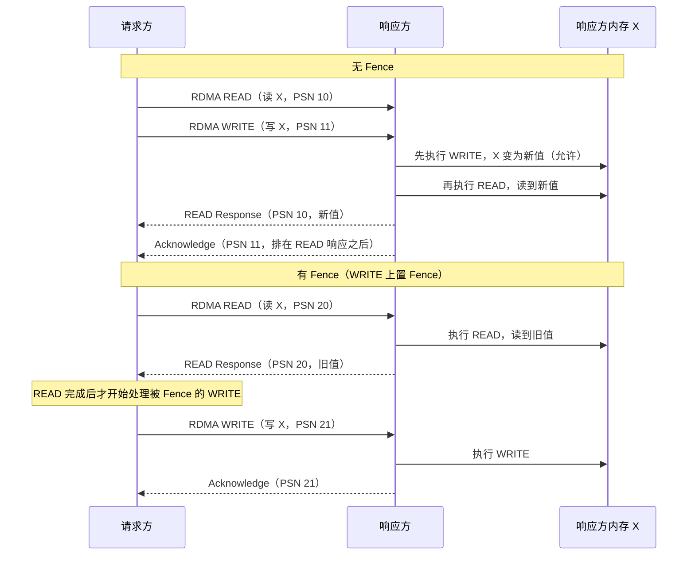
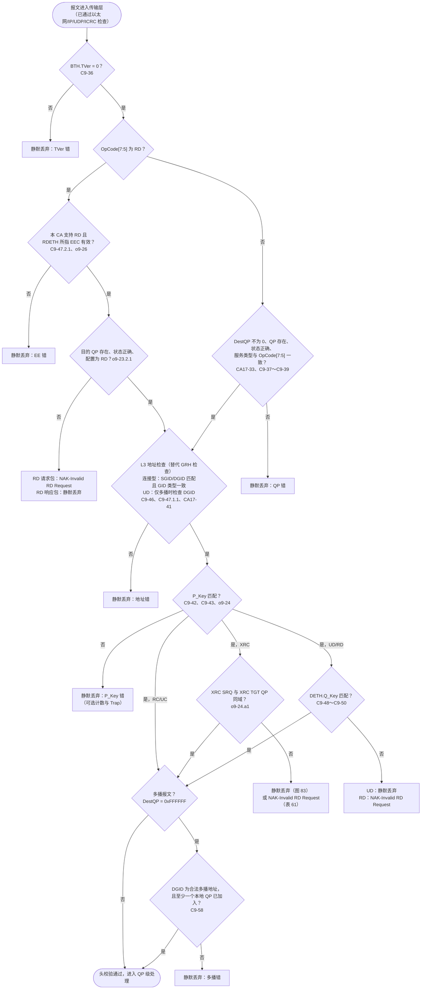
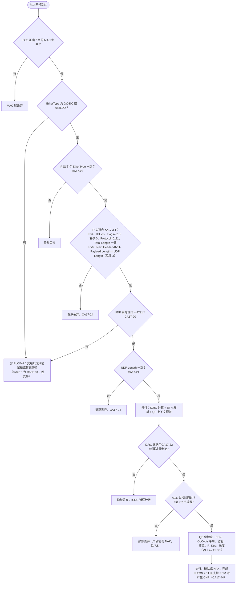

# 事务排序与入站报文头校验（Transaction Ordering and Packet Header Validation）

> **摘要**：第一部分整理同一 QP 内请求的发送、执行、确认、完成与数据可见性顺序——§9.5 的各条款、Table 79 操作排序矩阵、RDMA READ 的"放宽排序"、Fence 指示符、ATOMIC 与 Invalidate 的特例，以及 RoCEv2 中"同一路径"这一隐含前提。第二部分讲解 §9.6 入站报文头校验状态机在 RoCEv2 中的替换（CA17-27、CA17-33、CA17-41 等），并把 Annex A17 的报文格式检查（CA17-24）与第 9 章的检查合并成一张有序检查表，作为硬件解析器设计参考。
>
> **规范出处**：Vol1 §9.4.1.1.1（p.273）；§9.4.5.2（p.286）；§9.5（p.291–292）；§9.6（p.292–304）；§9.7（p.304）；§9.7.5.1.3（p.333–336）；Table 61（p.436–438）；§10.6.5.1（p.520–521）；§10.8.3–10.8.5（p.546–551）；§10.9.3（p.558–559）；§11.4.1.1（p.663–669）；Annex A17 §A17.3（p.1931–1936）、§A17.4.1–A17.4.4（p.1936–1939）、§A17.6（p.1942–1943）、§A17.8（p.1945–1946）、§A17.9.4（p.1948–1949）
>
> **前置阅读**：[传输操作与报文序列](02-operations.md)、[以太网/IP/UDP 头](../01-packet-format/02-ethernet-ip-udp.md)、[BTH](../01-packet-format/03-bth.md)、[ICRC](../01-packet-format/06-icrc.md)
>
> **关键词**：Ordering, Fence, Relaxed READ Ordering, Table 79, Data Visibility, Header Validation, Silent Drop, TVer, DestQP, P_Key, Q_Key, SGID/DGID, GID type, CA17-24, CA17-27, CA17-33, CA17-41

---

## 1. 排序的五个维度

讨论"顺序"之前先分清对象。§9.5 定义的是**同一 QP**内事务的传输、执行与完成顺序〔p.291〕；不同 QP 之间没有任何顺序保证（"The ordering across multiple Work Queues is undefined"，p.550）。

| 维度 | 含义 | 主要条款 |
|---|---|---|
| 发送顺序 | 请求消息按 WQE 投递顺序发出；分段时负载顺序与 WQE 数据段顺序一致 | C9-25、C9-26 |
| 执行顺序 | 响应方按消息到达顺序执行 SEND、RDMA WRITE、ATOMIC；RDMA READ 可以被推迟 | C9-28；§9.4.5.2；§9.7.5.1.3 |
| 确认顺序 | 所有确认包严格有序：之前的 READ 响应与 ATOMIC 响应必须先于之后的任何确认注入网络 | C9-27、o9-19 |
| 完成顺序 | 请求方按发送顺序完成 WQE；所有 WQE 按投递顺序完成，与执行顺序无关 | C9-29、C9-30、C9-32 |
| 数据可见性 | 应用何时可以依赖内存中的数据 | o9-20、o9-21、o9-21.a1、C9-33 |

§9.5 还陈述了一条底层前提："Packets from a given source QP to a given destination QP travel on the same path through the fabric and are received in the same order they were injected"〔p.291〕。在 RoCEv2 中，这一前提依赖 UDP 源端口固定（见 §6）。

---

## 2. §9.5 条款逐条

〔§9.5, p.291–292〕

| 条款 | 内容（意译） | 约束对象 |
|---|---|---|
| C9-25 | 请求方按 WQE 投递顺序发送请求消息 | 请求方 |
| C9-26 | 分段为 PMTU 大小的消息，其负载顺序与 WQE 定义的数据段顺序一致 | 请求方 |
| C9-27 | （HCA，可靠服务）所有确认包强顺序：之前的 READ 响应、ATOMIC 响应必须先于之后的 SEND/WRITE 确认、READ 响应或 ATOMIC 响应注入网络 | 响应方 |
| o9-19 | 同上，适用于实现 RC 的 TCA、实现 RD 或 XRC 的 CA | 响应方 |
| C9-28 | 响应方按消息到达顺序执行 SEND、RDMA WRITE、ATOMIC；对不支持的功能所产生的响应（NAK、静默丢弃或记录错误）也按 PSN 顺序产生 | 响应方 |
| —（p.292） | 应用**不得**依赖一条消息内部数据写入内存的顺序；例如消息内不同数据段的目标缓冲重叠时，不保证后发的数据覆盖先发的 | 应用 |
| C9-29 | 接收端完成按发送顺序进行（仅对 SEND 与 RDMA WRITE with Immediate），且**不意味着**之前的 READ 已完成，除非请求方使用了 Fence | 响应方 |
| C9-30 | 请求方按发送顺序完成 WQE | 请求方 |
| C9-31 | 设置了 Fence 属性的 WR 必须阻塞，直到之前所有 RDMA Read 与 Atomic WR 完成 | 请求方 |
| C9-32 | 所有 WQE 按投递顺序完成，与其执行顺序无关 | 双方 |
| —（p.292） | 由于可靠服务请求与响应的顺序保证，请求方可以在收到响应时就写 CQ 完成 | 请求方 |
| o9-20 | 应用在下列事件之一发生前，不得依赖响应方 RDMA WRITE 缓冲的内容：带 Immediate 的最后一个 WRITE 包到达并完成；后续一条 SEND 到达并完成；后续一个 ATOMIC 更新了某内存单元 | 应用 |
| o9-21 | 请求方在对应 WQE 完成前不得依赖 READ 目标缓冲的内容 | 应用 |
| o9-21.a1 | 响应方在 SEND 完成前不得依赖其缓冲内容 | 应用 |
| C9-33 | 在接收 WQE 完成前不得依赖接收缓冲内容 | 应用 |

---

## 3. 发送队列操作排序矩阵（Table 79）

§10.8.3.3 用 Table 79 规定同一发送队列上"先投递的操作"与"后投递的操作"之间的处理与完成通知顺序〔p.548–551〕。行 = 先投递的操作，列 = 后投递的操作：

| 先 \ 后 | Send | Bind Window | RDMA Write | RDMA Read | Atomic | Fast Register PMR | Local Invalidate |
|---|---|---|---|---|---|---|---|
| **Send** | # | # | # | # | # | NR | L |
| **Bind Window** | # | # | # | # | # | NR | L |
| **RDMA Write** | # | # | # | # | # | NR | L |
| **RDMA Read** | **F** | **F** | **F** | # | **F** | NR | L |
| **Atomic** | **F** | **F** | **F** | # | **F** | NR | L |
| **Fast Register PMR** | # | # | # | # | # | # | L |
| **Local Invalidate** | # | # | # | # | # | # | # |

Table 80 的符号〔p.551〕：

- **#**：顺序总是保持；
- **F**：仅当**后一个**操作设置了 Fence 指示符时才保持顺序；
- **NR**：Fast Register 与之前的操作之间不要求保持顺序；
- **L**：仅当 Invalidate 操作设置了 Local Invalidate Fence 指示符时才保持顺序。

读表要点：

1. 只有 **RDMA Read 与 Atomic 作为"先"操作**时才出现 F——它们在请求方完成得晚（要等响应数据返回），后续操作可能已经被目标端执行并观察到。
2. READ→READ、Atomic→READ 为 #：后一个 READ 不会越过之前的 READ/ATOMIC。READ→Atomic 为 F，与 §9.4.5.2 第 2 条一致；ATOMIC 的排序与 Fence 考虑与 RDMA Read 相同（C11-25.2.2, p.665）。
3. Bind 之后投递的 WR 在 Bind 完成前不得开始执行，但 Bind 本身可以在之前的操作完成前开始（C10-98.2.1, p.546）。
4. Fast Register 和"放宽顺序"的 Local Invalidate 可能在之前的 Bind 开始前就执行（p.549）。

---

## 4. 为什么 RDMA READ 是"放宽排序"的

### 4.1 规则来源

- 响应方**可以推迟** READ 的执行（§9.4.5.2 第 2 条, p.286）；
- 响应方可以在 READ 完成前开始执行其后到达的 SEND 或 RDMA WRITE（§9.7.5.1.3, p.335）；
- 但在执行这些后续请求前，必须先校验 READ 请求的头字段；在 READ 响应全部发出前，不得确认这些后续请求（C9-101, p.335）。

于是"READ 之后的 SEND/WRITE"在**执行**上可能先于 READ，但在**确认**与**完成**上一定在 READ 之后。

### 4.2 后果（§10.8.3.3 列举的四种情形，p.548–549）

| # | 情形 | 风险 |
|---|---|---|
| 1 | READ 尚未完成，后续 Send/Write/Atomic 已被目标端观察到；目标应用随即修改了 READ 要读的数据 | READ 读回新数据而非原数据 |
| 2 | 后续 Send/Write/Atomic 直接写到了 READ 正在读取的区域 | READ 返回被后续操作修改过的数据 |
| 3 | READ 或 ATOMIC 因 ACK 失败在请求方以错误完成，但后续操作已被目标端观察到 | 目标端据此采取了不应采取的动作 |
| 4 | 后续 Send with Invalidate 先在目标端执行了失效 | 之前的 READ 因 R_Key 已失效而失败 |

对每种情形，在**后一个**操作上设置 Fence 即可保证：它在之前所有 READ（与 ATOMIC）完成之前不会被目标端观察到。

### 4.3 时序对比：READ 后紧跟写同一地址的 WRITE



### 4.4 综合矩阵：响应方执行顺序与可见性（无 Fence 时）

下表由 C9-28、§9.4.5.2、§9.7.5.1.3 与 Table 79 综合整理（行 = 先到达的请求，列 = 后到达的请求）。所有情况下**确认与完成**都严格按序（C9-27、C9-30、C9-32），差别只在"执行/对目标端可见"的先后。

| 先 \ 后 | SEND / RDMA WRITE | RDMA READ | ATOMIC |
|---|---|---|---|
| **SEND / RDMA WRITE** | 按到达顺序执行（C9-28） | 有序：READ 只可能被推迟，不会越过之前的请求（Table 79：#） | 有序：ATOMIC 在之前的非 READ 请求访问内存**之后**才访问内存（§9.4.5.2 第 3 条） |
| **RDMA READ** | **不保证**：后者可先于 READ 执行（p.335），READ 可能读到后者写入的数据；需在后者上置 Fence | 有序（Table 79：#） | **不保证**：ATOMIC 可能在 READ 读数据之前执行（§9.4.5.2 第 2 条）；需 Fence |
| **ATOMIC** | 执行上有序（ATOMIC 先于后续请求访问内存，§9.4.5.2 第 3 条）；但若 ATOMIC 在请求方以错误完成（如 ACK 丢失导致重试耗尽），后者可能已被目标端观察到，故 Table 79 为 F | 有序（Table 79：#） | 执行上按到达顺序（C9-28）；可见性问题同左，Table 79 为 F |

---

## 5. Fence 与其它排序特例

### 5.1 Fence 指示符

- 定义：设置 Fence 的 WR 必须阻塞，直到同一发送队列上之前所有 RDMA Read 与 Atomic 操作**完成**（C9-31, p.292；C10-100, p.548）。这是**请求方**的停顿：被 Fence 的 WR 在之前的 READ/ATOMIC 响应全部返回前不会开始发送。
- 适用范围：Post Send 的描述写明 Fence 只对 RC 与 RD 有效（§11.4.1.1, p.669）；Table 100 标注为"可靠 QP 可选"（p.666）；XRC INI QP 使用与 RC QP 相同的属性（p.664）。
- 代价：每个 Fence 都会在流水线中制造至少一个往返时延的空泡，只在确有依赖时使用。
- 〔业界实践: Linux rdma-core〕对应 `ibv_send_wr.send_flags` 的 `IBV_SEND_FENCE`。

> [!TIP]
> **工程提示**：典型需要 Fence 的模式——(1) READ 远端缓冲后，用 SEND 通知对端"可以复用该缓冲"；(2) READ 之后发 SEND with Invalidate 撤销同一 R_Key；(3) 用 ATOMIC 获取远端锁后，再 WRITE 被保护的数据（Fence 只保证 ATOMIC 成功完成后 WRITE 才可能被观察到，并不会替你检查 CmpSwap 是否真的抢到了锁，应用仍需先检查返回的原值）。

### 5.2 ATOMIC 的排序规则

〔§9.4.5.2, p.286〕请求方在响应返回时才认为 ATOMIC 完成；READ 先投递时 ATOMIC 可能先于 READ 读取数据就完成内存操作，严格顺序需对 ATOMIC 加 Fence；ATOMIC 在之前的（非 READ）请求访问内存之后、之后的请求访问内存之前访问内存；每个 ATOMIC 都需要显式响应。细节见 [传输操作 §6](02-operations.md)。

### 5.3 Invalidate 的排序

| 场景 | 规则 | 依据 |
|---|---|---|
| 入站 SEND with Invalidate | 失效可在收到消息到完成消息之间任意时刻发生，但必须在**之前所有非 READ 消息**处理完成之后；与**后续**发往同一连接的消息没有顺序关系（后续消息可能在失效前部分或全部执行） | o10-37.2.21, p.520；§9.4.1.1.1, p.273 |
| 出站 SEND with Invalidate | 与后续操作无顺序保证；前面有 READ 在途时应加 Fence | p.273 |
| Local Invalidate（放宽） | 可在投递后任意时刻执行，但必须在产生完成之前、且在任何后续 WQE 开始执行之前 | o10-37.2.19, p.520 |
| Local Invalidate（强顺序，需支持 Local Invalidate Fence） | 在同一 SQ 之前所有 WQE 完成之后执行，且下一个 WQE 在其完成前不得开始 | o10-37.2.20, p.520；o10-53.2.4, p.549 |

---

## 6. 数据可见性与完成顺序

### 6.1 不要依赖消息内部的写入顺序

规范明确：应用不得依赖一条消息内部数据写入内存的顺序（p.292）；对 RDMA WRITE 缓冲的依赖必须等到 o9-20 列出的三类事件之一。因此"轮询 WRITE 缓冲最后一个字节来判断整条消息已到达"的做法**在规范上没有保证**，是否可行取决于具体网卡、PCIe 与 CPU 的实现。

〔业界实践: Linux rdma-core `ibv_query_qp_data_in_order(3)`〕rdma-core 提供 `ibv_query_qp_data_in_order(qp, op, flags)` 供应用查询"本 QP 接收侧某类操作的数据是否按序写入"，能力位为 `IBV_QUERY_QP_DATA_IN_ORDER_WHOLE_MSG`（整条消息按序）与 `IBV_QUERY_QP_DATA_IN_ORDER_ALIGNED_128_BYTES`（每个 128 字节对齐块内按序）；man page 注明结果仅在数据由 CPU 读取且目标不是 relaxed ordering MR 时有效，且只描述单个 WQE 内的顺序。可移植代码应使用 WRITE with Immediate 或随后的 SEND 作为"数据已就绪"的信号。

### 6.2 完成顺序

| 队列 | 完成顺序 | 依据 |
|---|---|---|
| 发送队列 | 按投递顺序完成，与执行顺序无关 | C9-30、C9-32；§10.8.5, p.551 |
| 接收队列（RC/UC/UD，无 SRQ） | 按投递顺序完成 | C10-99.2.1, p.547 |
| 关联 SRQ 的接收 | 可相对 SRQ 投递顺序乱序；但 RC/UC QP 的接收完成按远端 SQ 提交顺序返回 | §10.8.3.2, p.547–548；o10-53.2.2 |
| RD 接收队列 | 可乱序完成；来自同一远端 SQ 的消息按序完成 | o10-52、o10-53, p.547；§9.7.8.4, p.391 |
| XRC SRQ | 经同一 TGT QP 发往不同 XRC SRQ 的消息之间无顺序保证 | §10.2.10, p.479 |
| 多个工作队列共用一个 CQ | 各队列之间的 CQE 顺序不作规定 | §10.8.5, p.551 |

### 6.3 RoCEv2 的前提：同一路径

- §9.5 假设同一对 QP 之间的包走同一路径、按注入顺序到达（p.291）。RoCEv2 把这一点交给 UDP 源端口：网络设备把源端口作为 ECMP 哈希的一部分；有顺序要求的报文序列（如连接型 QP 的报文）**应**使用固定的源端口，没有顺序约束的报文可以使用不同值〔§A17.3.2.1, p.1934；§A17.9.4, p.1948–1949〕。
- 若在连接中途改变源端口（例如为规避拥塞重新哈希），新旧路径时延不同可能导致乱序：RC 响应方会把提前到达的包当作 PSN 序列错误（NAK + Go-Back-N），UC 会丢弃当前消息。负载均衡策略见 [ECMP 与负载均衡](../05-congestion-control-and-qos/06-ecmp-and-load-balancing.md)。
- 〔业界实践: NVIDIA mlx5，`mlx5dv_create_qp(3)`〕部分厂商提供允许接收端乱序放置数据的私有 QP 选项（如 `MLX5DV_QP_CREATE_OOO_DP`，需收发两端同时设置），其语义超出 IBTA 1.4 的排序模型，以厂商文档为准。

---

## 7. §9.6 入站报文头校验

### 7.1 目的、范围与"静默丢弃"

- 对每个交给传输层的报文做头校验，目的是确认它能否关联到某个 QP；不能则**静默丢弃**（silently discarded）。头校验只适用于使用 IBA 传输的报文，且既适用于请求包也适用于响应包〔§9.6, p.292–293；§9.6.1, p.295〕。
- 能关联到 QP 之后，还要与 QP（或 EEC）上下文作进一步比较，这部分属于 §9.7（可靠）与 §9.8（不可靠）的 QP 级校验（C9-35, p.293），见 [响应方行为](07-responder.md)、[UC / UD / 多播](04-unreliable-services.md)。
- ICRC 校验发生在传输层之前，ICRC 错误的报文在到达传输层之前就被静默丢弃（p.293 脚注 10）；被丢弃的包最终可能在传输层表现为序列错误（§9.7, p.304）。

"静默丢弃"的确切含义〔p.293–295〕：

| 响应方 | 请求方 |
|---|---|
| 不返回任何确认；不消耗接收 WQE；不执行该包；之前收到的请求照常执行并完成；**不更新** ePSN；继续等待有效请求 | 不因该包完成任何 Send WQE；不采取直接动作，但可以递增错误计数或产生类似事件 |

另外：被静默丢弃的包**不得**用于满足传输定时器（不能因它重置超时）；队列状态不变，连接或 EE Context 不被拆除〔p.295〕。

### 7.2 校验流程（已按 Annex A17 改写为 RoCEv2 版本）

原图为 Figure 83〔p.294〕。下图保留其顺序与分支，按 §A17.4 做了替换：LRH 检查全部删除（§A17.4.1.2），GRH 检查改为 IP 地址检查（§A17.4.4），并加入 CA17-33。



### 7.3 BTH 检查

**TVer**（C9-36, p.295）：唯一合法的传输版本是 0；不支持的版本静默丢弃。

**目的 QP 与 OpCode**（§9.6.1.1.2, p.295–297）：

- C9-37：目的 QP 必须存在，且 QP 状态允许接收该报文。
- C9-38：OpCode[7:5] 指示的服务（RC、UC、RD、UD、XRC）必须与目的 QP 的配置一致。
- C9-39：对 RC、UC、UD、XRC，目的 QP 不存在、未配置为所请求服务、或状态不对时，静默丢弃。
- o9-23：DestQP = `0xFFFFFF` 只有在本地至少有一个 QP 配置为 IBA 不可靠多播时才有效。
- o9-23.2.1（RD）：EE Context 有效但目的 QP 无效时，RD **请求**包返回 NAK-Invalid RD Request，RD **响应**包静默丢弃。
- **CA17-33（RoCEv2）**：DestQP = QP0 的报文静默丢弃（RoCEv2 端口没有 QP0）〔§A17.6, p.1943〕。

QP 状态要求（Table 40, p.296）：

| 报文类别 | QP 必须处于 |
|---|---|
| 请求包（由 RQ 处理） | RTR、RTS、SQD 或 SQE |
| 确认/响应包（由 SQ 处理） | RTS、SQD 或 SQE |

**P_Key**（§9.6.1.1.3, p.297）：

- C9-41：目的为 QP0 时不检查 P_Key（RoCEv2 无 QP0，不适用）。
- C9-42：目的为 QP1 时，与收包端口 P_Key 表中**任一**表项匹配即有效。
- C9-43：其它 QP（RD 除外）与接收队列关联的 P_Key 比较，不匹配则静默丢弃；o9-24：RD 与 EE Context 的 P_Key 比较。
- RoCEv2 中 P_Key 表的填充方法不在规范范围内，但至少有默认 P_Key；BTH 中的 P_Key 仍按第 9 章校验〔§A17.4.7, p.1940〕。

P_Key 匹配算法（§10.9.3, p.558–559；C10-115/116, p.557）——以下 Python 为对规则的直接转写：

```python
def pkey_is_invalid(pkey: int) -> bool:
    return (pkey & 0x7FFF) == 0              # C10-116：低 15 位全 0 为无效 P_Key

def pkey_match(m_pkey: int, e_pkey: int) -> bool:
    """m_pkey：报文中的 P_Key；e_pkey：本端用于比较的 P_Key。"""
    if pkey_is_invalid(m_pkey) or pkey_is_invalid(e_pkey):
        return False
    if (m_pkey & 0x7FFF) != (e_pkey & 0x7FFF):
        return False                          # 分区号（低 15 位）必须相同
    return bool((m_pkey | e_pkey) & 0x8000)   # 最高位为成员类型：两者不能都是受限成员(0)

assert pkey_match(0xFFFF, 0xFFFF)             # 默认分区（C10-115），全成员
assert pkey_match(0x7FFF, 0xFFFF)             # 受限成员 ↔ 全成员：允许
assert not pkey_match(0x7FFF, 0x7FFF)         # 受限成员之间：不允许
assert not pkey_match(0x8000, 0x8000)         # 无效 P_Key
```

不匹配的报文按"发往不存在的设备"处理：不返回 ACK，可选地递增计数并发 Trap（§10.9.3–10.9.4, p.559）。

### 7.4 "GRH 检查"在 RoCEv2 中的替换

〔§A17.4.4, p.1938–1939；§9.6.1.2, p.297–300〕

| 基础规范条款 | 原含义 | RoCEv2 中 |
|---|---|---|
| C9-43.1.1 | UD 多播包必须带 GRH | 不适用（RoCEv2 包总有 IP 头） |
| C9-43.1.2 | 连接型 QP：GRH 有无须与 QP 配置一致 | 不适用 |
| C9-44 | GRH.NxtHdr 必须为 0x1B（IBA 传输） | 不适用（Protocol/Next Header = 0x11） |
| C9-45 | GRH.IPVer 必须为 6 | **由 CA17-27 替换**：IPv6 报文版本必须为 6，IPv4 报文版本必须为 4，否则静默丢弃 |
| §9.6.1.2.3（C9-46、C9-47.1.1） | SGID/DGID 校验 | **仍适用**：IPv6 的 SIP/DIP 即 SGID/DGID；IPv4 的 SIP/DIP 映射为 `::ffff:<IPv4>` 后参与比较；另由 CA17-41 增加 GID 类型检查 |

SGID/DGID 校验规则（p.298–300）：

- **UD**（C9-46）：不校验 SGID；只有多播包才校验 DGID。
- **RC、UC、RD、XRC**（C9-47.1.1）：SGID 与 DGID 都必须校验，不通过即静默丢弃。

| 对象 | 先排除 | 再比较（至少命中一项） |
|---|---|---|
| DGID | 保留 GID（`::`）；Loopback GID（`::1`）；多播范围的 DGID 但本地无关联 QP | ① 主路径 DGID；② 高 64 位为默认前缀 `fe80::/64` 且低 64 位等于主路径 DGID 的低 64 位；③④ 若支持 APM，对备用路径做同样比较 |
| SGID | 多播 GID；Loopback GID | ① 主路径 SGID；② `fe80::/64` 前缀 + 主路径 SGID 低 64 位；③④ 若支持 APM，对备用路径做同样比较 |

> [!NOTE]
> 原文措辞为"与 Primary DGID/SGID 比较"，这里的 Primary SGID/DGID 是连接管理为该连接装载到传输层的主路径地址对〔p.298〕。对**入站**报文而言，报文 DGID 应等于本端地址、报文 SGID 应等于对端地址——实现时注意比较方向（解释性说明）。`fe80::/64` 前缀规则对 IPv6 链路本地地址有意义，对 IPv4 映射地址不会命中。

**CA17-41**（§A17.8, p.1945）：做 DGID 检查时，若用于比较的端口 GID 表项的 GID 类型（IPv4 / IPv6 / IB GID，CA17-26）与收到报文的协议不一致，检查视为失败。典型情形：同一个 IP 地址在 GID 表中可能同时有"IB GID"类型（供 RoCE v1 互通使用，§A17.4.3 脚注 63）与"IPv4"/"IPv6"类型的表项；若连接配置引用的是 RoCE v1 表项，而报文以 RoCEv2 封装到达，即使地址数值相同也判为失败。〔业界实践: Linux〕各表项的类型可在 `/sys/class/infiniband/<设备>/ports/<端口>/gid_attrs/types/<索引>` 查看。UD QP 在支持 RoCE v1 的 RoCEv2 端口上同时接受两种报文（CA17-43）。

### 7.5 XRC、RDETH、DETH 检查

**XRC**（§9.6.1.3, p.300）：`XRC_check` 为"XRC SRQ 与 XRC TGT QP 在同一域"；o9-24.a1 要求按 §9.7.9.2 的 XRC 报文规则校验 XRCETH。失败时 Figure 83 写静默丢弃，而 Table 61 写 NAK-Invalid RD Request（Class K）——两处不一致，详见 [传输服务类型 §3.5.5](01-service-types.md)。

**RDETH**（§9.6.1.4, p.300–301）：CA 不支持 RD 时 RD 报文静默丢弃（C9-47.2.1）；EE Context 不存在或状态不对时静默丢弃（o9-26，Table 41：请求包需 EEC 处于 RTS、SQD 或 RTR，响应包需 RTS 或 SQD）。

**DETH:Q_Key**（§9.6.1.5, p.301–302）：

| 条款 | 规则 |
|---|---|
| C9-48 | 目的为 QP0 时不校验 Q_Key（RoCEv2 不适用） |
| C9-49 | 目的为 QP1 时，Q_Key 等于知名值 **`0x80010000`** 即有效 |
| C9-50 | 其它数据报 QP 用接收队列的 Q_Key 比较；不匹配时 UD **静默丢弃**，RD 返回 NAK-Invalid RD Request（PSN 为出错包的 PSN，EEC 的 PSN 不变） |
| C9-51 | 在 Q_Key 与 P_Key 都检查完之前不得返回确认 |
| C10-14 | UD QP（QP0/QP1 除外）用 QP 上下文中的 Q_Key 校验，不匹配静默丢弃（p.470） |

Q_Key 违规可选地递增计数并发 Trap（§10.2.5, p.471；Table 61 脚注 a）。

### 7.6 LRH 检查与多播检查

- **LRH 检查**（C9-52～C9-57、o9-27、o9-28）：RoCEv2 中 LRH 及其字段全部不适用〔§A17.4.1.2, p.1936〕，整段删除；其"确认报文到达正确端点"的作用由 IP 地址检查承担（与 RoCE v1 的处理思路一致，§A16.7.1, p.1918）。
- **多播检查**（C9-58、C9-59, p.303）：DestQP = `0xFFFFFF` 的报文是 IBA 不可靠多播报文，有效条件为：带 GRH（RoCEv2 中恒有 IP 头）、DGID 是合法多播地址、本地至少有一个 QP 配置为多播；否则静默丢弃。DGID 用于把报文映射到本地 QP（C9-59）。详见 [UC / UD / 多播](04-unreliable-services.md)。

### 7.7 不参与头校验的字段

| 字段 | 规则 |
|---|---|
| BTH.SE | 不属于头校验，不满足使用条件也不产生 NAK（C9-4, p.260） |
| BTH.F / BTH.B | RoCEv2 中不使用，接收时忽略（CA17-29, p.1940） |
| BTH.Resv6、Resv7 | 发送置 0，接收忽略（C9-6、C9-7, p.261–262） |
| IETH | 不属于传输头校验，由通道接口在失效前校验（p.273–274） |
| BTH.M（MigReq） | 由自动路径迁移状态机使用（§17.2.8），不是头校验项 |

### 7.8 失败动作汇总

| 检查 | 失败动作 | 计数/事件 |
|---|---|---|
| TVer、QP 不存在/状态/服务不符、DestQP=0、地址、P_Key、多播 | 静默丢弃（Responder Class D，Table 61 "Packet Header Violation"） | 可计数；P_Key 可选 Trap |
| UD Q_Key | 静默丢弃 | Q_Key 违规计数（可选）与 Trap |
| RD Q_Key、RD 目的 QP 无效 | NAK-Invalid RD Request | — |
| XRC 域 / XRCETH | 静默丢弃（图 83）或 NAK-Invalid RD Request + TGT QP 错误态（表 61） | 异步事件 |
| ICRC | 传输层之前静默丢弃 | ICRC 错误计数 |

---

## 8. RoCEv2 入站总流程（硬件实现要点）

### 8.1 端到端流程

CA17-24 规定：不符合 §A17.3.1（以太网类型与 IP 头）、§A17.3.2（UDP 头）、§A17.3.3（ICRC）规则的 RoCEv2 报文静默丢弃〔p.1936〕；CA17-23/25/39 要求在此基础上按第 9 章（含 §A17.4 的修改）做传输层校验〔p.1936, 1945〕。



### 8.2 有序检查表

"判定时机"一列指硬件中最早能得出结论的时刻：**头部**（解析到对应字段即可）、**上下文**（需读 QP/SRQ/组表）、**帧尾**（需整帧到齐）。

| # | 层 | 检查项 | 依据 | 失败动作 | 判定时机 |
|---|---|---|---|---|---|
| 1 | L2 | FCS 正确 | 〔外部: IEEE 802.3〕 | MAC 丢弃并计数 | 帧尾 |
| 2 | L2 | 目的 MAC 为本端口单播或已加入的多播 MAC | 实现相关 | 不接收 | 头部 |
| 3 | L2 | （可选 802.1Q 标签后）EtherType 为 0x0800 / 0x86DD | §A17.3.1.1–2 | 非 RoCEv2，交其它路径 | 头部 |
| 4 | L3 | IP 版本与 EtherType 一致 | **CA17-27** | 静默丢弃 | 头部 |
| 5 | L3 | IPv4 IHL = 5 | CA17-3 + CA17-24 | 静默丢弃 | 头部 |
| 6 | L3 | IPv4 Flags = 010、Fragment Offset = 0 | CA17-7、CA17-8 + CA17-24 | 静默丢弃（分片报文必须丢弃；对 DF 位的宽容程度见注 1） | 头部 |
| 7 | L3 | IPv4 Protocol / IPv6 Next Header = 0x11（IPv6 不允许扩展头） | CA17-10、CA17-16 | 非 UDP，不是 RoCEv2 | 头部 |
| 8 | L3 | IPv4 头校验和正确 | 〔外部: RFC 791〕（该字段在 ICRC 中被屏蔽，ICRC 不保护它） | 丢弃 | 头部（20 字节后） |
| 9 | L3 | IPv4 Total Length（= 20 + UDP Length）/ IPv6 Payload Length（= UDP Length，见注 3）与实际收到的字节数一致 | CA17-6、CA17-15 + CA17-24 | 静默丢弃 | 帧尾 |
| 10 | L3 | DIP 属于本端口 GID 表或已加入的多播组 | 实现的入口过滤；规范层面体现在 #20、#24 | 不作为本端口 RoCE 报文接收 | 头部 |
| 11 | L4 | UDP 目的端口 = 4791 | CA17-20〔外部: IANA〕 | 非 RoCEv2 | 头部 |
| 12 | L4 | UDP Length 与 IP 长度一致：IPv4 时 = Total Length − 20；IPv6 时 = Payload Length | CA17-21 + CA17-24 | 静默丢弃 | 头部 |
| 13 | L4 | UDP Checksum | §A17.3.2.4（发送 should 置 0） | 见注 2 | — |
| 14 | ICRC | ICRC 正确 | **CA17-22** + CA17-24 | 静默丢弃并计数 | 帧尾 |
| 15 | BTH | TVer = 0 | C9-36 | 静默丢弃 | 头部 |
| 16 | BTH | OpCode 合法：服务类别受支持（如 RD）、非未协商的厂商码 | C9-38、C9-47.2.1、§9.2.2 | 静默丢弃（RC 保留码见 #25） | 头部 |
| 17 | BTH | DestQP ≠ 0 | **CA17-33** | 静默丢弃 | 头部 |
| 18 | BTH | DestQP = 0xFFFFFF 转多播处理 | o9-23、C9-58 | 无合法组则静默丢弃 | 上下文 |
| 19 | QP | QP 存在、状态符合 Table 40、服务类型一致 | C9-37～C9-39 | 静默丢弃（RD 请求例外） | 上下文 |
| 20 | L3/QP | 连接型：SGID/DGID 匹配且 GID 类型一致 | C9-47.1.1、§A17.4.4.2、**CA17-41** | 静默丢弃 | 上下文 |
| 21 | BTH/QP | P_Key 匹配 | C9-42、C9-43、§10.9.3 | 静默丢弃（可选计数/Trap） | 上下文 |
| 22 | XRCETH | XRC SRQ 存在、状态正确、同域；同一消息 XRCETH 一致 | o9-24.a1、o9-114.a5/a6 | 见 7.5 | SRQ 上下文 |
| 23 | DETH | Q_Key 匹配（QP1 为 0x80010000） | C9-49、C9-50 | UD 静默丢弃 | 上下文 |
| 24 | 多播 | DGID 合法且有已加入的 QP | C9-58、C9-59 | 静默丢弃 | 组表 |
| 25 | QP 级 | PSN、OpCode 序列、功能与保留码、资源、R_Key、长度与 PadCnt | §9.7.4、§9.8.1 | RC/XRC 多为 NAK；UC/UD 静默丢弃 | 上下文 + 帧尾 |
| 26 | 副作用 | IP.ECN = 11 的有效报文触发 CNP | CA17-44（可选的 RCM） | — | 全部检查通过后 |

注 1：CA17-7 要求 Flags = `010`，严格按 CA17-24，DF=0 的报文也属不合规；MF=1 或偏移非 0 的分片报文必须丢弃（RoCEv2 不做分片重组）。对 DF 位是否宽容属实现选择（待核实各实现的互通行为）。

注 2：规范只要求发送方 *should* 置 0，未要求接收方校验 UDP Checksum；该字段在 ICRC 计算中被替换为全 1（CA17-22(d)），不影响 ICRC。是否检查非 0 校验和属实现选择。

注 3：CA17-15 原文把 IPv6 Payload Length 定义为从"IPv6 头之后的第一个字节（i.e. the BTH）"起直到 ICRC 的长度〔§A17.3.1.2.3, p.1934〕。括号中的"即 BTH"是规范笔误——IPv6 头之后紧跟的是 UDP 头。按 RFC 8200 的定义以及实际实现（如 Linux rxe），**IPv6 Payload Length = UDP 头(8) + BTH(12) + 扩展头 + 负载 + pad + ICRC(4)，恰好等于 UDP Length（CA17-21）**〔外部: RFC 8200〕。若按"从 BTH 起算"生成或校验，会比正确值少 8 字节，与主流实现无法互通。

### 8.3 固定偏移解析

由于 IPv4 必须 IHL=5（CA17-3）、IPv6 的 Next Header 必须直接是 UDP（CA17-16），RoCEv2 头部不存在可变长的 IP 选项或扩展头，解析器只需处理 4 种（不考虑多层 VLAN）固定布局（偏移从目的 MAC 第一个字节算起）：

| 封装 | L2 头 | IP 头 | UDP 起始 | BTH 起始 | 扩展头起始 |
|---|---|---|---|---|---|
| IPv4，无 VLAN | 14 | 20 | 34 | 42 | 54 |
| IPv4，单 VLAN | 18 | 20 | 38 | 46 | 58 |
| IPv6，无 VLAN | 14 | 40 | 54 | 62 | 74 |
| IPv6，单 VLAN | 18 | 40 | 58 | 66 | 78 |

扩展头的种类、顺序和总长度完全由 OpCode 决定（Table 38），适合用 256 项的 ROM 描述符表在一个周期内查出。示例（C，仅列部分条目）：

```c
#include <stdint.h>

enum {
    H_XRCETH = 1u << 0, H_RDETH = 1u << 1, H_DETH = 1u << 2, H_RETH = 1u << 3,
    H_ATOMICETH = 1u << 4, H_AETH = 1u << 5, H_ATOMICACKETH = 1u << 6,
    H_IMMDT = 1u << 7, H_IETH = 1u << 8
};

typedef struct {
    uint8_t  valid;        /* 本实现支持该 OpCode */
    uint8_t  is_response;  /* Acknowledge / READ 响应 / ATOMIC Acknowledge */
    uint8_t  position;     /* 0=First 1=Middle 2=Last 3=Only（单包请求与响应记为 Only） */
    uint8_t  ext_len;      /* BTH 之后扩展头总字节数 */
    uint16_t hdr_mask;     /* H_* 位图；线上顺序即上面枚举的顺序 */
} opcode_desc_t;

static const opcode_desc_t opdesc[256] = {
    [0x00] = { 1, 0, 0, 0,  0 },                        /* RC SEND First */
    [0x04] = { 1, 0, 3, 0,  0 },                        /* RC SEND Only */
    [0x06] = { 1, 0, 0, 16, H_RETH },                   /* RC RDMA WRITE First */
    [0x0B] = { 1, 0, 3, 20, H_RETH | H_IMMDT },         /* RC RDMA WRITE Only with Immediate */
    [0x0C] = { 1, 0, 3, 16, H_RETH },                   /* RC RDMA READ Request */
    [0x0D] = { 1, 1, 0, 4,  H_AETH },                   /* RC RDMA READ Response First */
    [0x11] = { 1, 1, 3, 4,  H_AETH },                   /* RC Acknowledge */
    [0x12] = { 1, 1, 3, 12, H_AETH | H_ATOMICACKETH },  /* RC ATOMIC Acknowledge */
    [0x13] = { 1, 0, 3, 28, H_ATOMICETH },              /* RC CmpSwap */
    [0x17] = { 1, 0, 3, 4,  H_IETH },                   /* RC SEND Only with Invalidate */
    [0x64] = { 1, 0, 3, 8,  H_DETH },                   /* UD SEND Only */
    [0xA6] = { 1, 0, 0, 20, H_XRCETH | H_RETH },        /* XRC RDMA WRITE First */
    /* 其余条目按 Table 38 填写；未列出的 OpCode 默认 valid = 0 */
};
```

### 8.4 负载长度与最小帧填充

- 负载长度由 UDP Length 推出：`payload = UDP.Length − 8 − 12 − ext_len − PadCnt − 4`（IPv6 时 Payload Length 与 UDP Length 相等，也可由它推出，见 §8.2 注 3）；结果为负或与 OpCode 的长度规则（First/Middle = PMTU，Last 1~PMTU，Only 0~PMTU）不符时按非法请求处理（RC：NAK-Invalid Request；UC/UD：静默丢弃）。见 [传输操作 §2](02-operations.md)。
- **最小帧填充**：IPv4、无 VLAN 的零长度 SEND Only（RC/UC）帧长（不含 FCS）为 14+20+8+12+4 = 58 字节，小于以太网最小帧（不含 FCS 60 字节），发送端 MAC 会补 2 字节。ACK（62 字节）、READ 请求（74 字节）、UD SEND Only（66 字节）都不需要填充。接收端必须按 IP/UDP 长度定位 ICRC，忽略以太网填充，否则会对零长度 SEND 误报 ICRC 错误。

### 8.5 ICRC 判定时刻与"提交"策略

- 头部检查（#3～#21）在收到前 ~100 字节内即可完成，但 ICRC（#14）要到帧尾才能判定。规范把 ICRC 错误定义为"到达传输层之前就丢弃"，因此**任何**传输层副作用——更新 ePSN、调度 ACK/NAK、写主机内存、生成 CQE、触发 CNP——都必须等 ICRC 通过后才能提交。
- 尤其不能对 ICRC 未验证的报文发 NAK：报文头可能已损坏（例如 PSN 错位），据此产生的 NAK 会误导请求方。
- 推荐做法：片上接收缓冲按"存储转发"保存整包（最大约 PMTU 4096 + 头部），与此同时并行做 ICRC 计算、OpCode 查表和 QP 上下文预取；帧尾判定通过后再提交 DMA 与状态更新。若为降低时延而在 ICRC 判定前就把负载 DMA 到主机，必须保证失败时能撤销且不暴露给应用——由于 RETH 中的 VA/R_Key 本身可能已损坏，这种"推测写"风险很高，不建议采用。
- 被静默丢弃的报文不得重置传输定时器（p.295）：请求方的 ACK 超时逻辑只能由**通过校验**的响应驱动。

### 8.6 计数器建议

为排障按丢弃原因分别计数：ICRC 错误、IP/UDP 格式不合规、TVer 错、未知或状态不符的 QP、DestQP=0、地址/GID 类型不匹配、P_Key 违规、Q_Key 违规、XRC 违规、多播无接收者、OpCode 序列错、长度错等。Q_Key 违规计数在 Table 61 脚注 a 中被点名。计数器的现场用法见 [排障指南与计数器字典](../07-engineering-practice/05-troubleshooting.md)，接收流水线设计见 [接收数据通路](../06-hardware-implementation/03-rx-datapath.md)。

---

## 9. 要点回顾

- 排序只在同一 QP（同一工作队列）内有定义；跨 QP、跨队列无顺序保证。
- 请求按投递顺序发送；响应方按到达顺序执行 SEND/WRITE/ATOMIC，READ 可推迟；所有确认严格有序；WQE 按投递顺序完成。
- Table 79：只有 READ 与 ATOMIC 作为前一个操作时，后续 Send/Write/Atomic/Bind 才需要 Fence；READ→READ 总是有序。
- Fence 是请求方停顿：等之前所有 READ/ATOMIC 完成再处理被 Fence 的 WR，代价是一个往返时延。
- 应用不得依赖消息内部的写入顺序；"数据已就绪"应以 WRITE with Immediate、后续 SEND 或 ATOMIC 的完成为准。
- RoCEv2 中"同一路径"依赖固定的 UDP 源端口；中途改源端口可能造成乱序并触发 Go-Back-N。
- §9.6 头校验失败几乎都是静默丢弃：不 ACK、不消耗 WQE、不更新 ePSN、不重置定时器。
- RoCEv2 替换：LRH 检查删除；GRH 检查换成 IP 版本检查（CA17-27）+ SGID/DGID 检查（IPv4 映射为 `::ffff:x.x.x.x`）+ GID 类型一致（CA17-41）；DestQP=0 静默丢弃（CA17-33）；F/B 位忽略（CA17-29）。
- 不符合 A17 报文格式规则（IP/UDP/ICRC）的报文静默丢弃（CA17-24）；任何副作用都要等 ICRC 通过后再提交。

## 自测

<details><summary>Q1：请求方依次投递 RDMA READ（读 X）和 RDMA WRITE（写 X），都不带 Fence。READ 可能读到 WRITE 写入的新值吗？WRITE 的 ACK 会先于 READ 响应返回吗？</summary>

答：可能读到新值——响应方可推迟 READ，并可先执行其后的 WRITE（§9.7.5.1.3, p.335；Table 79 中 READ→Write 为 F）。但 WRITE 的确认不会先于 READ 响应：确认严格有序（C9-27），且 READ 响应发完之前不得确认后续请求（C9-101）。要保证读到旧值，需在 WRITE 上置 Fence。
</details>

<details><summary>Q2：一个 RC 报文 ICRC 正确，但 BTH.P_Key 与目的 QP 的 P_Key 低 15 位相同、两者最高位都为 0，会发生什么？</summary>

答：两者都是受限成员，按 §10.9.3 不匹配；C9-43 要求静默丢弃：不返回 ACK/NAK，不更新 ePSN，可选地递增 P_Key 违规计数并发 Trap。
</details>

<details><summary>Q3：RoCEv2 端口收到一个 EtherType 为 0x0800、IP 头版本字段却为 6 的报文，应如何处理？依据是什么？</summary>

答：静默丢弃。CA17-27 替换了基础规范的 C9-45：IPv4 封装的 RoCEv2 报文版本必须为 4，IPv6 的必须为 6（§A17.4.4.1, p.1939）。
</details>

<details><summary>Q4：为什么硬件不能在 ICRC 校验通过之前就根据 PSN 发出 NAK-PSN Sequence Error？</summary>

答：ICRC 错误的报文在规范中被定义为到达传输层之前就静默丢弃（p.293 脚注 10、CA17-24），它对传输层"不存在"；而且损坏的报文头中 PSN、DestQP 都不可信，据此发 NAK 可能把错误的重传起点告诉请求方，甚至发往错误的 QP。
</details>

<details><summary>Q5：入站 UD 报文的 DIP 不在本端口任何 GID 中，按 §9.6 会被传输层拒绝吗？</summary>

答：按 C9-46，UD 不校验 SGID，DGID 只在多播报文中校验，因此传输层头校验本身不会因为单播 DIP 而拒绝它。实践中网卡在入口按 DMAC/DIP 做地址过滤（实现相关），这样的报文通常到不了 RoCE 处理路径。
</details>

## 参考

- 规范：IBTA Vol1 Rel 1.4 —— §9.2.3（p.260）；§9.4.1.1.1（p.273）；§9.4.5.2（p.286）；§9.5（p.291–292）；§9.6（p.292–304，Figure 83、Table 40/41）；§9.7（p.304）；§9.7.5.1.3（p.333–336）；Table 61（p.436–438）；§10.2.5（p.470–471）；§10.6.5.1（p.520–521）；§10.8.3–10.8.5（p.546–551，Table 79/80）；§10.9.1–10.9.4（p.556–559）；§11.4.1.1（p.663–669）；§A16.7.1（p.1918）；§A17.3（p.1931–1936）；§A17.4.1–A17.4.4、§A17.4.7–A17.4.8（p.1936–1940）；§A17.6（p.1942–1943）；§A17.8（p.1945–1946）；§A17.9.4（p.1948–1949）。
- 外部：〔外部: IEEE 802.3（FCS、最小帧长）〕；〔外部: RFC 791（IPv4 头校验和）〕；〔外部: RFC 8200（IPv6 Payload Length 定义）〕；〔外部: IANA 端口 4791〕；〔业界实践: Linux rdma-core `ibv_query_qp_data_in_order(3)`、`IBV_SEND_FENCE`〕；〔业界实践: Linux 内核 sysfs `gid_attrs/types`〕；〔业界实践: NVIDIA mlx5 `mlx5dv_create_qp(3)`〕。
- 相关文件：[传输操作](02-operations.md)、[PSN 与 ACK/NAK](05-psn-and-ack-nak.md)、[响应方行为](07-responder.md)、[错误处理](08-error-handling.md)、[ICRC](../01-packet-format/06-icrc.md)、[接收数据通路](../06-hardware-implementation/03-rx-datapath.md)、[合规条款清单](../08-reference/03-compliance-checklist.md)。
