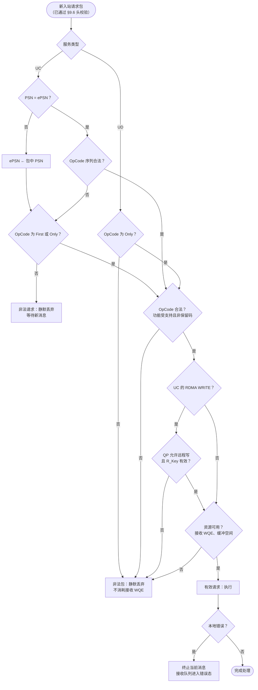
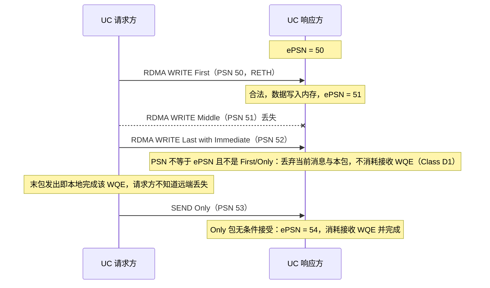
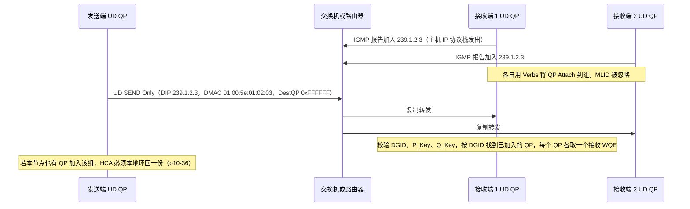

# UC / UD / 多播（Unreliable Connection, Unreliable Datagram and Multicast）

> **摘要**：不可靠服务没有 ACK 与重传，但仍有 PSN 和完整的头校验。本文详述 UC 的请求方/响应方行为（PSN 检查、丢包后丢弃当前消息并等待下一个 First/Only）、UD 的单包数据报模型（DETH、Q_Key 规则、GSI 的知名 Q_Key、RoCEv2 中 40 字节 L3 头区与 CQE 地址信息）、IBA 多播在 RoCEv2 中的映射（IP 多播地址即 MGID、MLID 无效、多播 MAC 映射），并解释 RoCEv2 为什么不支持 Raw 服务。
>
> **规范出处**：Vol1 §9.3.2 DETH（p.263）；§9.6.1.5、§9.6.1.6.2（p.301–303）；§9.8（p.402–422）；Table 61/62（p.436–439）；§9.9.3.1.4–6（p.443–445）；§10.2.5（p.470–471）；§10.5（p.497–500）；§11.4.1.2、§11.4.2.1（p.674–680）；Annex A16 §A16.6（p.1917）；Annex A17 §A17.4.1.1（p.1936）、§A17.4.5–A17.4.6（p.1939）、§A17.5.6–A17.5.9（p.1942）、§A17.6（p.1942–1943）、§A17.8（p.1945–1946）、§A17.9.4（p.1948–1949）
>
> **前置阅读**：[传输服务类型](01-service-types.md)、[传输操作](02-operations.md)、[RoCEv2 寻址](../00-overview/04-addressing.md)
>
> **关键词**：UC, UD, ePSN, OpCode Sequence, Class D/D1/E, DETH, Q_Key, GSI, QP1, 0x80010000, GRH 区, IBV_WC_GRH, SMAC, Multicast, MGID, MLID, 0xFFFFFF, IGMP, MLD, Raw Datagram

---

## 1. 不可靠服务的共同特征

IBA 定义两种不可靠服务：不可靠连接（UC，支持 SEND 与 RDMA WRITE）和不可靠数据报（UD，只支持 SEND）。共同特征〔§9.8, p.402〕：

1. 请求方收不到任何消息接收确认；
2. 没有包顺序保证；
3. 响应方照常校验入站包（头字段、CRC），损坏的包可能被静默丢弃，进而导致整条消息被丢弃；
4. 检测到错误（如丢包、乱序）时响应方不停止，继续接收后续包；
5. 响应方在按正确顺序收到完整消息、数据已提交到本地故障域、所有有效性检查（含 ICRC）都完成后，才认为操作完成；
6. 请求方在 Last 或 Only 包被提交到网络后即认为消息操作完成。

响应方先按 §9.6 做头校验（C9-165，无效即静默丢弃），再按 Figure 115 做 QP 级校验（C9-171）。下图依据 Figure 115〔p.405〕简化重绘：



---

## 2. UC（Unreliable Connection）

### 2.1 特性

〔Table 52, p.406〕

| 特性 | 说明 |
|---|---|
| 交付保证 | 对请求方无保证；响应方可能丢弃消息 |
| 请求方视角的顺序 | 无保证，请求方不能假设消息按序到达 |
| 响应方视角的顺序 | 响应方检测并丢弃乱序包；丢包可能导致整条消息被丢弃；丢包后从**下一条新消息的第一个包**恢复 |
| 支持的操作 | SEND 与 RDMA WRITE（均可带 Immediate） |
| 消息大小 | 最大 2³¹ 字节，可多包 |

UC 的 OpCode 为 `0x20`–`0x2B`（Table 38, p.258），没有 READ、ATOMIC、ACK，也没有 SEND with Invalidate。

### 2.2 请求方行为

〔§9.8.2.1, p.406–409〕

- **PSN**：每个请求包都带当前 PSN（C9-172）。连接建立时客户把 next PSN 编程为 0 ~ 16 777 215 之间的任意值；第一个请求包使用该初始值（C9-173）；只有在发送队列处于可发送状态时才更新 PSN，例如 HCA 的 QP 在 INIT 状态时不更新（C9-174）；每个包比前一个包 PSN 加 1（模 2²⁴）（C9-175，Table 53：SEND、RDMA WRITE 均为 +1）。
- **OpCode 序列**：必须符合 Table 54（C9-176，见 §2.4 表）。
- **负载长度**：First/Middle 必须恰为 PMTU（C9-177）；Only 为 0~PMTU，零长度传输只能用单包消息（C9-178）；Last 为 1~PMTU（C9-179）。
- **完成**：当最后一个包的最后一个字节已提交到线路且无本地错误，或检测到导致终止发送的本地错误时，请求方即认为 SEND/RDMA WRITE 完成（C9-180，原文以"VCRC 的最后一个字节"为准，RoCEv2 中对应以太网帧发送完毕）。此时响应方内存状态未知（p.409）。

### 2.3 响应方行为：PSN 检查

〔§9.8.2.2.1, p.409–411〕

| 条款 | 规则 |
|---|---|
| C9-181 | 响应方维护期望 PSN（ePSN），即下一个入站请求包应携带的 PSN |
| p.410 | ePSN 可以在建立连接时由客户初始化（只能在 INIT 状态设置），但**不是必须的**——因为响应方会接受任何有效的 First/Only 包并以其 PSN 作为 ePSN |
| C9-182 | 只有接收队列处于可接收状态时才更新 ePSN |
| C9-183 | 入站包 PSN 与 ePSN **不完全相等**即判为乱序（UC 没有 RC 那样的"重复区"） |
| C9-184 | 若入站包 OpCode 为 First 或 Only，**无论是否乱序**都接受它，并以其 PSN 作为新的 ePSN，与原 ePSN 无关 |
| C9-185 | ePSN 的推进规则与请求方计算下一个 PSN 的规则相同（每包 +1） |
| o9-131 | PSN 不符时，响应方**可以**通知其客户有一条或多条消息丢失，通知机制不在规范范围内 |
| C9-186 | 检测到乱序时若有多包消息正在进行，**当前消息被静默丢弃**；响应方随后等待新消息的第一个包。若本乱序包本身就是 First/Only，则把它当作新消息处理 |

"新消息"指 OpCode 为 First 或 Only 的入站请求包；"当前消息"指自最近一个 First/Only 以来收到的所有包（不含本包）〔p.411〕。

### 2.4 响应方行为：OpCode 序列、功能、R_Key 与长度

**OpCode 序列检查**（C9-187, p.411–412；Table 55, p.413，与请求方 Table 54 相同）：

| 上一个有效包 | 本包允许的 OpCode | 不合法时的含义 |
|---|---|---|
| 无（连接建立后第一个包） | First、Only | Middle/Last 表示至少丢了当前消息的 First |
| First | Middle（消息 ≥ 3 包）、Last（消息恰为 2 包），且操作类型（SEND / RDMA WRITE）必须一致 | First/Only 表示丢了上一条消息的 Last |
| Middle | Middle、Last，操作类型一致 | 同上 |
| Last | First、Only | Middle/Last 表示丢了当前消息的 First |
| Only | First、Only | 同上 |

- C9-188：检测到非法序列时，当前消息被静默丢弃，响应方等待新的 First/Only，其它请求包一律静默丢弃。
- C9-189：若引起非法序列的本包是 First 或 Only，则把它作为新请求消息的第一个包。

**功能校验**（C9-190、C9-191, p.413）：请求的功能（SEND 或 RDMA WRITE）必须被接收队列支持，且 OpCode 不是保留码；否则静默丢弃。

**R_Key 校验**（C9-192.2.1、C9-193, p.414）：只有 RDMA WRITE 且 RETH.DMALen **非零**时才检查——R_Key 有效、VA 与长度在 R_Key 限定范围内（按包检查）、访问类型（写）允许、PD 符合 §10.2.3；任何一项失败即 R_Key 违规。零长度 WRITE（即使带 Immediate）不检查 R_Key。

**长度校验**（C9-194～C9-199, p.414–415）：SEND 必须检查接收 WQE 指定的缓冲是否足够；First/Middle 负载必须恰为 PMTU，Only 为 0~PMTU，Last 为 1~PMTU；First/Middle 包的 PadCnt 必须为 `00`，否则 OpCode 非法。

**消息完成**（§9.8.2.2.7, p.416）：响应方在以下条件全部满足时才认为一条入站消息成功完成，并完成当前 WQE：检测到有效的 First/Only 作为开始；检测到同一消息的 Only/Last 作为结束且 PSN 无跳变；First 到 Last 之间所有包按序成功接收（或成功收到 Only）；负载已无错提交到本地故障域；所有有效性检查（含 ICRC）完成。出错时**无法保证**响应方内存状态：出错前部分数据可能已经写入内存。

### 2.5 示例：多包 WRITE with Immediate 中间包丢失



注意第一个包的数据已经写进了响应方内存，但因为没有 Immediate 完成，接收端应用看不到这条消息——这正是 o9-20 要求"以完成为准"的原因（见 [排序与校验](03-ordering-and-validation.md)）。

### 2.6 UC 错误行为

〔Table 61, p.436–438；Table 62, p.439；§9.9.3.1.4–6, p.443–445〕

| 错误 | UC（未关联 SRQ） | UC（关联 SRQ） |
|---|---|---|
| 头校验违规（§9.6） | Class D | Class D |
| 不支持或保留的 OpCode | Class D | Class D |
| PSN 乱序 | Class D | Class D |
| OpCode 序列错：缺 Last，本包为 First/Only | **Class D1** | **Class E** |
| OpCode 序列错：缺 First，本包不是 First/Only | Class D | Class D |
| R_Key 违规 | Class D | Class E |
| 资源未就绪（无接收 WQE） | Class D（见注） | Class D |
| 长度错误 | Class D | Class E |
| 本地 QP 错误、WQE 格式错误 | Class A | Class A |

各类行为（Table 62 与 §9.9.3.1）：

- **Class D**：静默丢弃，不发 ACK/NAK，不通知响应方客户，不消耗接收 WQE，队列状态不变（C9-223.1.1）。
- **Class D1**（仅 UC）：静默丢弃，不通知客户；终止当前消息但**不消耗**当前接收 WQE，WQE 复位以接收下一条 SEND 或 WRITE with Immediate；等待新消息的第一个包（其 PSN 可能大于 ePSN）；若本包是 First/Only 则作为新消息的开始（C9-224）。
- **Class E**（UC/UD 关联 SRQ 时）：检测到错误的接收队列上的 WQE 以错误完成；该 QP 已从 SRQ 取走的后续 WQE 也以错误完成，SRQ 中未被取走的 WQE 不受影响；接收队列继续工作、不进入错误态，SRQ 不受影响（o9-161.2.2）。
- **Class A**：当前 WQE 以错误完成，后续 WQE 刷新，接收队列进入错误态。

> [!NOTE]
> Table 61 脚注 d：UC 的 RDMA WRITE with Immediate 在没有可用接收 WQE 时，可能已经执行了 WRITE 的数据部分，然后才丢弃"立即数"部分〔p.439〕。也就是说"数据写入了、通知却丢了"是合规行为。

### 2.7 工程提示

> [!TIP]
> - UC 适合"偶尔丢一条无所谓、但要低开销"的单向数据流（遥测、周期性状态推送、帧数据）。应用应在消息里自带序号或在 Immediate 中编码序号，以便检测丢失。
> - UC 没有 READ/ATOMIC，也没有 E2E 信用与 RNR：接收方 WQE 不足时消息被静默丢弃。用 SRQ + Limit 事件保持接收资源充足。
> - Table 376 要求 HCA 支持 UC，但实际 RoCE 设备对 UC（尤其 UC + SRQ）的支持程度不一，使用前查询设备能力，以厂商文档为准。

---

## 3. UD（Unreliable Datagram）

### 3.1 特性

〔Table 56, p.417；§9.8.3, p.416–417〕

| 属性 | UD |
|---|---|
| 损坏数据检测与丢弃 | 是，出错静默丢弃 |
| OpCode 与服务校验 | 是，出错静默丢弃 |
| 接收缓冲溢出 | 是，报告为 WR 错误 |
| 数据重复 | 否 |
| 顺序保证 | 否 |
| 丢失检测 | 不要求 |
| RDMA / ATOMIC | 否 / 否 |
| Immediate | 支持 |
| 最大 SEND 消息 | 一个 PMTU 大小的包，负载 256 ~ 4096 字节；超过 PMTU 的消息不会被投递 |
| 请求完成时 SEND 的状态 | 已提交到网络传输 |

- 一个源 QP 可以把每条消息发往同一或不同节点上的任意目的 QP；每条消息都要提供目的地址（Address Handle）、目的 QP 号、目的 Q_Key 等；响应方要把请求方地址、QP 号交给客户（p.416–417）。
- C9-200：发送 UD 消息的设备必须把消息限制为单包，且包不应超过源与目的之间的 PMTU，否则会被丢弃。

### 3.2 报文格式与 DETH

UD 只有两种 OpCode（Table 38, p.259）：`0x64` SEND Only（BTH + DETH + 负载）与 `0x65` SEND Only with Immediate（BTH + DETH + ImmDt + 负载）。

数据报扩展传输头（Datagram Extended Transport Header, DETH）8 字节〔§9.3.2, p.263〕：

```text
bit  31            24 23                                             0
    +----------------+-----------------------------------------------+
 +0 |                        Q_Key (32)                              |
    +----------------+-----------------------------------------------+
 +4 |    Reserved    |                 SrcQP (24)                    |
    +----------------+-----------------------------------------------+
```

| 字节偏移 | 位 | 宽度 | 字段 | 含义 | RoCEv2 备注 |
|---|---|---|---|---|---|
| 0–3 | 31:0 | 32 | Q_Key | 授权访问目的队列；响应方与目的 QP 的 Q_Key 比较 | 照常使用 |
| 4 | 31:24 | 8 | Reserved | 发送置 0，接收忽略（C9-8） | 计入 ICRC |
| 5–7 | 23:0 | 24 | SrcQP | 源 QP 号；作为回复报文的目的 QP | 接收方在 CQE 中得到 |

### 3.3 Q_Key 规则

| 场景 | 规则 | 依据 |
|---|---|---|
| 发送：WR 中 Q_Key 最高位为 1 | 报文使用 **QP 上下文**中的 Q_Key | C10-15, p.471 |
| 发送：WR 中 Q_Key 最高位为 0 | 报文使用 **WR** 中的 Q_Key | C10-15 |
| 接收：目的为 QP1（GSI） | Q_Key 等于知名值 **`0x80010000`** 才有效 | C9-49, p.301 |
| 接收：其它 UD QP | 与 QP 上下文的 Q_Key 比较，不匹配静默丢弃 | C9-50, p.301；C10-14, p.470 |
| 接收：RD | 不匹配返回 NAK-Invalid RD Request | C9-50 |
| 前置条件 | 必须先在 QP 上下文中设置 Q_Key，才能向该 QP 投递接收描述符 | §10.2.5, p.470 |
| 计数 | 目的端可选支持 Q_Key 违规计数器与 Trap（可通过 Verbs 查询/设置） | §10.2.5, p.471 |

Q_Key 的取值不由 Verbs 之下管理（p.470）；Raw QP 不执行 Q_Key（p.471）。注意 GSI 的知名 Q_Key `0x80010000` 最高位为 1。〔业界实践: Linux 内核 `include/rdma/ib_verbs.h`〕设备能力位 `IB_DEVICE_BAD_QKEY_CNTR` / `IB_DEVICE_BAD_PKEY_CNTR` 表示设备是否提供 Q_Key / P_Key 违规计数器。

### 3.4 请求方与响应方行为

**请求方**（§9.8.3.1, p.417–419）：

- PSN：每个请求比前一个加 1（模 2²⁴）；QP0、QP1 不要求递增（C9-204）。初始 PSN 在发送队列处于 INIT 状态时由客户装载，可为任意 24 bit 值；发送过程中只在 RTS 状态更新。
- 完成：最后一个字节提交到线路且无本地错误，或检测到导致终止发送的本地错误（§9.8.3.1.2）。完成时响应方内存状态未知。

**响应方**（§9.8.3.2, p.419–420）：

| 检查 | 规则 | 失败处理 |
|---|---|---|
| PSN | 可以忽略（o9-144）；需要检测乱序的应用（如基于多播的媒体流）可以自行校验，但不在规范范围内 | — |
| 长度 | 接收 WQE 的缓冲须足够；负载 0~PMTU（C9-205） | 静默丢弃（非 SRQ：Class D；SRQ：Class E） |
| OpCode | 必须是本接收队列支持的 SEND，且非保留码（C9-206） | 静默丢弃 |
| 接收 WQE | 没有可用接收 WQE 时请求非法（C9-207） | 静默丢弃（Class D） |
| Q_Key / P_Key | 见 §3.3 与 [排序与校验 §7](03-ordering-and-validation.md) | 静默丢弃 |
| 本地错误 | 例如本地内存翻译错误，可能使接收队列进入错误态 | Class A |

完成条件（§9.8.3.2.5, p.420）：负载已无错提交到本地故障域，且所有有效性检查完成；之后完成当前 WQE。OpCode 或长度错误时不消耗 WQE。

### 3.5 GSI（QP1）在 RoCEv2 中

- QP1 就是 UD QP，RoCEv2 的通信管理（CM）报文就是 QP1 上的 MAD，以与目标连接同类型（IPv4/IPv6）的普通 RoCEv2 报文承载〔§A17.6.1, p.1943〕。
- Q_Key 必须为 `0x80010000`（C9-49）；P_Key 与端口 P_Key 表任一表项匹配即可（C9-42）；PSN 不要求递增（C9-204）；接收完成中的 P_Key index 只对 GSI 有效（p.680）。
- RoCEv2 端口没有 QP0：Get Special QP 只适用于 QP1，对其它特殊 QP 返回 "Invalid Special QP Type"〔§A17.5.8, p.1942〕；DestQP=0 的报文静默丢弃（CA17-33）。

详见 [MAD 与 GSI](../04-connection-management/03-mad-and-gsi.md)、[IB CM 协议](../04-connection-management/01-cm-protocol.md)。

### 3.6 UD 接收缓冲的 40 字节 L3 头区

- **基础规范**：UD QP 接收缓冲（Scatter/Gather 列表所指）的前 40 字节存放入站报文的 GRH；没有 GRH 时这 40 字节内容未定义；是否有 GRH 由 Work Completion 中的一个标志指示（§11.4.1.2, p.675）。UD 接收完成报告的字节数 = 负载长度 + 40，**无论是否有 GRH 都包含这 40 字节**（§11.4.2.1, p.679）。
- **RoCEv2**〔§A17.4.5.2, p.1939〕：这 40 字节填入 IP 头。IPv6 头占满 40 字节；IPv4 头只有 20 字节，放在后半段（即**从缓冲起始偏移 20 处**），前 20 字节内容未定义。规范只规定放入 IP 头，UDP 头与 BTH/DETH 不写入缓冲。

```text
offset:  0                    20                   40
         +--------------------+--------------------+------------------
  IPv6:  |            IPv6 header (40 B)           | UD payload ...
         +--------------------+--------------------+------------------
  IPv4:  |  undefined (20 B)  | IPv4 header (20 B) | UD payload ...
         +--------------------+--------------------+------------------
```

〔业界实践: Linux rdma-core `libibverbs/verbs.c`〕`ibv_init_ah_from_wc()` / `ibv_create_ah_from_wc()` 在 `wc_flags` 含 `IBV_WC_GRH` 时解析这 40 字节以构造回复用的 AH，其内部 `get_grh_header_version()` 用启发式判断 IP 版本：

1. 若字节 0 的高 4 位不是 6：偏移 20 处 IPv4 头的版本为 4 则判为 IPv4，否则报错；
2. 若字节 0 的高 4 位是 6（可能是真 IPv6，也可能是未定义区恰好如此）：偏移 20 处若 IHL ≠ 5 则判为 IPv6；IHL = 5 时重新计算该 IPv4 头校验和，正确则判为 IPv4，否则判为 IPv6。

这个启发式正是"前 20 字节未定义"带来的后果。使用示例（片段）：

```c
/* recv_buf 为该接收 WR 的第一个 SGE 起始地址，至少 40 + 负载 字节 */
if (wc.status == IBV_WC_SUCCESS && (wc.wc_flags & IBV_WC_GRH)) {
    struct ibv_grh *grh = (struct ibv_grh *)recv_buf;
    struct ibv_ah *ah = ibv_create_ah_from_wc(pd, &wc, grh, port_num);
    /* 用 ah + wc.src_qp（来自 DETH.SrcQP）+ 对端 Q_Key 回复 */
}
size_t payload_len = wc.byte_len - 40;   /* byte_len 恒含 40 字节头区 */
```

> [!WARNING]
> 投递 UD 接收 WR 时必须为头区额外预留 40 字节，否则缓冲不足会导致长度错误（静默丢弃或以错误完成）。在 RoCE 中每个报文都有 L3 头，`IBV_WC_GRH` 通常总被置位（以驱动实现为准）。

### 3.7 UD 接收完成中的远端地址

- **基础规范**（Table 103, p.679–680）：对 UD，完成中返回 16 bit SLID、4 bit SL、24 bit 源 QP、DLID Path Bits/Loopback 指示（多播报文不适用），以及"GRH Present"指示。
- **RoCEv2**〔§A17.4.5.1, p.1939；§A17.5.7, p.1942〕：远端地址信息改为**源 L2 地址（源 MAC）**和一个**标志**，指示收到的是 IPv4、IPv6 还是 RoCE（v1）报文。LRH 不存在，SLID 没有意义。
- 〔业界实践: Linux 内核 `include/rdma/ib_verbs.h`〕内核 `struct ib_wc` 有 `smac[ETH_ALEN]`、`vlan_id`、`network_hdr_type` 字段与 `IB_WC_WITH_SMAC`、`IB_WC_WITH_VLAN`、`IB_WC_WITH_NETWORK_HDR_TYPE` 标志；`network_hdr_type` 取 `enum rdma_network_type`（`RDMA_NETWORK_IB`、`RDMA_NETWORK_ROCE_V1`、`RDMA_NETWORK_IPV4`、`RDMA_NETWORK_IPV6`）。用户态 `struct ibv_wc` 没有 SMAC 与网络头类型字段，IPv4/IPv6 由上述 40 字节头区推断，目的 MAC 在创建 AH 时由内核解析（对应 §A17.4.2 中 "Destination L2 Address = 0xFFFFFFFFFFFF 表示由 Verbs 实现解析" 的做法）。

### 3.8 UD 在 RoCEv2 中的其它要点

- **每个 WR 自带地址**：AH 中的 DGID、SGID index（其 GID 类型决定发出 RoCEv2-IPv4、RoCEv2-IPv6 还是 RoCE v1 报文，CA17-42）、Hop Limit（→ TTL/Hop Limit）、Traffic Class（→ DSCP）、SL（→ 以太网优先级，SL 8–15 保留）。见 [RoCEv2 寻址](../00-overview/04-addressing.md)。
- **双协议接收**：支持 RoCE v1 的 RoCEv2 端口上，UD QP 必须同时接受 RoCE 与 RoCEv2 报文（CA17-43, p.1946）。
- **UDP 源端口**：数据报之间没有顺序约束，源端口可以取不同值以分散 ECMP 路径（§A17.9.4, p.1948–1949）；具体如何选择属实现。
- **最大报文**：PMTU = 4096 时，IPv4 UD 包的 IP 总长（Total Length）= 20+8+12+8+4096+4 = 4148 字节（带 Immediate 为 4152）；IPv6 包含 40 字节 IPv6 头共 4168（4172）字节，其中 IPv6 Payload Length 字段 = 4128（4132），等于 UDP Length——注意 CA17-15 原文"(i.e. the BTH)"是笔误，Payload Length 必须从 UDP 头算起〔p.1934；外部: RFC 8200〕。以太网 MTU 必须容纳整个 IP 包，否则只能使用更小的 PMTU。见 [帧布局与 MTU](../01-packet-format/01-frame-layout.md)。

### 3.9 硬件实现要点

- **发送**：每个 WQE 要取 AH（地址向量缓存）、远端 QPN、Q_Key（按 C10-15 在 WR 与 QP 上下文间选择），生成 Eth/IP/UDP 头；消息长度大于 PMTU 时应在本地以错误完成，而不是发出注定被丢弃的报文。
- **接收**：先写 40 字节头区（IPv6 头写满；IPv4 头写在偏移 20），再写负载；CQE 填源 QP（来自 DETH）、源 MAC、网络头类型、Immediate 标志与数据、字节数（含 40）。
- **QP1**：Q_Key 硬比较 `0x80010000`，P_Key 与整张端口表比较，与普通 UD QP 的比较逻辑不同。
- **无状态**：UD 响应方不维护 ePSN，也没有消息重组状态，上下文只需 Q_Key、P_Key、PD、CQ、RQ/SRQ 指针。

---

## 4. 多播

### 4.1 IBA 多播模型

〔§10.5, p.497–500；§9.6.1.6.2, p.303〕

- 多播指把一条消息发往一个多播地址，由可能位于多个端口上的多个 QP 接收。IB 中多播地址由 MGID 与 MLID 共同定义（多个 MGID 可对应同一个 MLID，同一子网中一个 MGID 不能对应多个 MLID）。
- 两类多播：**IBA 不可靠多播**（只能用 UD QP）与 **Raw 多播**（只能用 Raw QP）。两者对 HCA 都是可选的；不支持 IBA 不可靠多播时，可查询到的多播组数为 0；支持时至少支持一个组（o10-33）。
- **接收**：UD QP 必须通过 Verbs 的 Attach 加入多播组才能接收（o10-34）；Attach 只是把接收 QP 分配给组，资源不足时立即报错；每个组可加入一个或多个 QP，加入同一组的 QP 应与入站报文属于同一分区。有效多播报文会投递给与该多播地址关联的**每一个** UD QP——即使这些 QP 共享同一个 SRQ，也要为每个 QP 各取一个 WQE、各拷贝一份数据、各生成一个完成；SRQ 中没有 WQE 时该份报文被丢弃（p.498–499）。
- **发送**：任何 UD QP 都可以发多播，发送方不必加入组；目的多播地址通过 WR 的 Address Handle 指定（p.499）；Address Handle 与多播报文中的目的 QP 号用 `0xFFFFFF`（p.500；§11.4.1.1, p.669）。只允许 SEND，消息不应超过 PMTU（p.499）。
- **目的 QP 号**：CI 必须丢弃目的 QP 不是 `0xFFFFFF` 的 IBA 不可靠多播报文（o10-35）；接收方可以用任意 QP 号的 QP 接收，只要已加入该组（p.500）。
- **环回**：支持 IBA 不可靠多播的 CI 必须支持多播环回——本节点有 QP 加入了该组时，本节点发出的多播消息也要投递给它们（o10-36）。
- **有效性**（C9-58、C9-59）：DestQP = `0xFFFFFF` 的报文要成为有效多播报文，必须带 GRH、DGID 为合法多播 GID、本地至少一个 QP 配置为多播；否则静默丢弃。DGID 用于把报文映射到本地 QP。
- 组的创建、销毁与成员加入/退出属于网络管理职责；组的 MTU 在创建时指定（p.500）。

### 4.2 在 RoCEv2 中的映射

| IB 概念 | RoCEv2 中 | 依据 |
|---|---|---|
| MGID | IP 多播地址：IPv6 地址直接作为 GID；IPv4 地址映射为 `::ffff:<IPv4>` | §A17.4.1.1, p.1936 |
| MLID | **不使用**：Attach/Detach 的 MLID 输入被忽略，"Invalid multicast MLID" 不再是合法的 Verb 结果 | §A17.5.6, p.1942 |
| SA 多播成员管理 | 子网管理与子网管理员（SA）不适用；RoCEv2 端口接入 IP 子网，使用常规 IP/以太网管理手段（规范范围外） | §A17.6, p.1942–1943 |
| 多播报文 | DIP = 组的 IP 多播地址，BTH.DestQP = `0xFFFFFF`，目的 MAC 由 IP 多播地址映射（见 §4.3） | C9-58；〔外部: RFC 1112、RFC 2464〕 |
| "必须带 GRH" | RoCEv2 报文总带 IP 头，C9-43.1.1 不适用 | §A17.4.4, p.1938 |
| DGID 检查 | DGID 必须是合法多播地址且有本地 QP 加入；DGID 映射到 QP | C9-58、C9-59、C9-46 |
| P_Key / Q_Key | 照常对每个接收 QP 检查 | C9-43、C9-50 |

> [!NOTE]
> 对 IPv4，规范没有逐字说明 `::ffff:<IPv4>` 形式的 DGID 如何算"合法多播 GID"。按 IPv4 映射规则的自然解释，应判断 DIP 是否属于 IPv4 多播地址段 224.0.0.0/4（实现者解释，待核实）。

### 4.3 多播 MAC 地址映射

〔外部: RFC 1112 §6.4（IPv4）、RFC 2464 §7（IPv6）〕

| 协议 | 映射规则 | 示例（Python `ipaddress` 计算核实） |
|---|---|---|
| IPv4 | `01:00:5E` + IP 地址低 23 位 | 239.1.2.3 → `01:00:5e:01:02:03`；239.129.2.3、224.129.2.3 也映射到同一 MAC |
| IPv6 | `33:33` + IP 地址低 32 位 | `ff12::8000:1` → `33:33:80:00:00:01`；`ff0e::1:ff00:1234` → `33:33:ff:00:12:34` |

```python
import ipaddress

def mcast_mac(ip: str) -> str:
    a = ipaddress.ip_address(ip)
    assert a.is_multicast
    b = a.packed
    if a.version == 4:
        return "01:00:5e:%02x:%02x:%02x" % (b[1] & 0x7F, b[2], b[3])   # 低 23 位
    return "33:33:%02x:%02x:%02x:%02x" % tuple(b[12:16])              # 低 32 位

assert mcast_mac("239.1.2.3") == mcast_mac("239.129.2.3") == "01:00:5e:01:02:03"
assert mcast_mac("ff12::8000:1") == "33:33:80:00:00:01"
```

IPv4 有 5 bit 地址信息在映射中丢失，32 个 IP 组共享一个 MAC。因此网卡的 MAC 过滤只能粗筛，最终必须按 DIP（DGID）区分组——这与 C9-59"用 DGID 把报文映射到 QP"一致。

### 4.4 组成员管理（规范范围外）

- 二层交换机通常依赖 IGMP/MLD Snooping 限制多播泛洪，跨三层需要多播路由（如 PIM-SM）〔外部: RFC 3376（IGMPv3）、RFC 3810（MLDv2）、RFC 4541（Snooping）、RFC 7761（PIM-SM）〕。若网络未启用这些机制，多播可能被当作广播泛洪。
- 〔业界实践: Linux 内核 `drivers/infiniband/core/cma.c`，以所用内核版本为准〕`rdma_join_multicast()` 在 RoCE 端口上：MGID 由 IP 多播地址生成；对 IPv4 且 GID 类型为 RoCEv2 的组，非 send-only 加入时内核会在对应网络接口上加入该 IP 多播组（`ip_mc_inc_group`，由内核 IP 协议栈发出 IGMP 报告），并把 Hop Limit 设为非 1 的默认值以便跨路由；IPv6 + RoCEv2 组在该代码路径返回 `-ENOTSUPP`；组的 MTU 取自网络接口 MTU；P_Key 取 `0xFFFF`。



### 4.5 硬件实现要点

- **接收多播查找**：MAC 过滤（粗筛）→ 以 DIP/DGID 查多播组表（CAM 或哈希）→ 得到已加入 QP 的列表 → 对每个 QP 独立做 P_Key/Q_Key 检查、取 WQE、DMA、写 CQE。扇出数决定一个入站包要消耗多少 DMA 带宽与 WQE，应有上限并在 Query HCA 中报告（〔业界实践: Linux〕`ibv_device_attr` 的 `max_mcast_grp`、`max_mcast_qp_attach`、`max_total_mcast_qp_attach`）。
- **共享 SRQ 的扇出**：同一个包可能需要从同一 SRQ 连续取多个 WQE，取不到的那份直接丢弃（p.499）。
- **环回**：发送方向的多播包要同时送入本地接收流水线（o10-36），不能依赖交换机回送。
- **目的 QP 号**：发送多播时 BTH.DestQP 固定 `0xFFFFFF`；接收时 DestQP 不是 `0xFFFFFF` 却发往多播 DGID 的包必须丢弃（o10-35）。

---

## 5. Raw 服务为什么不支持（CA17-28）

### 5.1 IB 的 Raw Datagram 是什么

〔§9.8.4, p.420–422〕IB 允许在 IB 子网中承载其它协议，这类报文称为 Raw Datagram，不使用 IBA 传输层（没有 BTH，也没有 ICRC），由 LRH 的 Link Next Header（LNH）字段区分：

| LNH[1:0] | 结构 | 说明 |
|---|---|---|
| `01` | LRH + IPv6 头 + 负载 + VCRC | Raw IPv6；IPv6 Next Header 不得指示 IBA 传输（C9-208） |
| `00` | LRH + RWH（含 16 bit Ethertype）+ 负载 + VCRC | Raw Ethertype |

Raw QP 由本地管理（o9-146），负载可超过 MTU（Table 57），不执行 Q_Key（p.471）；Raw 多播的分发由实现策略决定（§10.5.1.2, p.499）。

### 5.2 为什么在 RoCEv2 中不适用

- Raw 服务由 **IB 链路层**提供（靠 LRH.LNH 识别）。RoCEv2 不使用 IB 链路层（LRH 全部不适用，§A17.4.1.2），因此 Raw Ethertype 与 Raw IPv6 都不适用〔§A17.4.6, p.1939〕：
  - **CA17-28**：声明符合 Annex A17 的 HCA 不得在 RoCEv2 端口上支持 IB Raw Datagram 的概念；所有关于 Raw 报文的描述对 RoCEv2 端口都不适用。
  - RoCE v1 的同类条款为 CA16-14（§A16.6, p.1917）。
- 也没有必要：RoCEv2 网卡本身就是以太网网卡，普通 IPv6/以太网流量直接走网卡的以太网路径，无需借道 IBA 的 Raw QP。
- **Verbs 层随之修改**：Get Special QP 在 RoCEv2 端口上只适用于 QP1（§A17.5.8, p.1942）；Post Send 的操作类型矩阵删去 Raw 一行（§A17.5.9, p.1942）。

> [!NOTE]
> 〔业界实践: Linux 内核 `enum ib_qp_type`〕Linux 中 `IB_QPT_RAW_IPV6`、`IB_QPT_RAW_ETHERTYPE` 对应 IB 的两种 Raw 服务；而 `IB_QPT_RAW_PACKET`（用户态 `IBV_QPT_RAW_PACKET`）是另一个概念——在以太网端口上通过 Verbs 收发完整以太网帧的驱动功能。两者名称相近但含义不同；后者是否可用以驱动文档为准。

---

## 6. 要点回顾

- 不可靠服务没有 ACK/重传，但请求方仍生成 PSN，响应方仍做完整头校验，错误包静默丢弃且响应方继续工作。
- UC：PSN 必须与 ePSN 完全相等；First/Only 包无条件接受并重置 ePSN；乱序或序列错时丢弃当前消息，等待下一个 First/Only。
- UC 丢消息时，已到达的部分数据可能已写入内存；WRITE with Immediate 甚至可能"数据写入、通知丢失"。
- UD：单包消息 ≤ PMTU，只有 SEND Only（可带 Immediate），每包带 DETH（Q_Key + SrcQP）；响应方可以忽略 PSN。
- Q_Key：发送时 WR 中 Q_Key 最高位为 1 则用 QP 上下文的 Q_Key；QP1 的 Q_Key 固定为 `0x80010000`；不匹配的 UD 包静默丢弃。
- RoCEv2 UD 接收缓冲前 40 字节放 IP 头：IPv6 占满，IPv4 位于偏移 20、前 20 字节未定义；接收字节数恒含这 40 字节。
- RoCEv2 UD 完成中的远端地址为源 MAC + IPv4/IPv6/RoCE 标志；Linux 用户态通过解析 40 字节头区推断 IP 版本。
- 多播只用 UD；RoCEv2 中组由 IP 多播地址（GID）标识，MLID 被忽略，DestQP 为 `0xFFFFFF`，多播 MAC 由 IP 地址映射，组成员管理依赖 IGMP/MLD。
- Raw 是 IB 链路层概念，RoCEv2 端口不得支持（CA17-28）。

## 自测

<details><summary>Q1：UC 响应方 ePSN=100，依次收到 PSN 101 的 SEND Middle、PSN 102 的 SEND Last、PSN 103 的 SEND Only，各包如何处理？</summary>

答：PSN 101 ≠ ePSN 且不是 First/Only：若有当前消息则丢弃当前消息，并静默丢弃本包（C9-186、C9-188）；PSN 102 的 Last 同样不是 First/Only，静默丢弃；PSN 103 的 Only 无条件接受，ePSN 置为 104，消耗一个接收 WQE 并完成（C9-184）。整个过程不发送任何 NAK。
</details>

<details><summary>Q2：应用投递 UD 接收 WR 时只给了 1024 字节缓冲，PMTU=1024，对端发来 1024 字节负载的 SEND，会怎样？</summary>

答：UD 接收缓冲前 40 字节保留给 L3 头，实际需要 1064 字节；缓冲不足属长度错误（C9-205），按 Table 61 静默丢弃（未关联 SRQ 时 Class D；关联 SRQ 时 Class E，WQE 以错误完成）。
</details>

<details><summary>Q3：RoCEv2 IPv4 UD 报文到达后，应用在接收缓冲的哪个偏移能读到源 IP 地址？</summary>

答：IPv4 头位于缓冲偏移 20 处（§A17.4.5.2），源地址在 IPv4 头内偏移 12，因此在缓冲偏移 32～35；偏移 0～19 内容未定义。
</details>

<details><summary>Q4：两个不同的 IPv4 多播组 239.1.2.3 与 239.129.2.3 在同一网卡上都有 QP 加入，网卡如何区分？</summary>

答：两者映射到同一个 MAC `01:00:5e:01:02:03`（只取低 23 位），MAC 过滤无法区分；网卡必须按 DIP（即 DGID）查多播组表，把报文投递给对应组的 QP（C9-59）。
</details>

<details><summary>Q5：为什么 UD 的 PSN 可以被响应方忽略，而请求方仍要递增 PSN？</summary>

答：UD 是单包、无确认、无重组的数据报，响应方不需要 PSN 来重组或确认（o9-144）；但规范仍要求请求方逐包递增（C9-204，QP0/QP1 除外），这样需要检测丢包或乱序的应用（如基于多播的媒体流）可以自行利用 PSN（p.419）。
</details>

## 参考

- 规范：IBTA Vol1 Rel 1.4 —— §9.3.2（p.263）；§9.6.1.5、§9.6.1.6.2（p.301–303）；§9.8（p.402–422，Figure 115、Table 52–57）；Table 61/62（p.436–439）；§9.9.3.1.4–6（p.443–445）；§10.2.5（p.470–471）；§10.5（p.497–500）；§11.4.1.1（p.669）；§11.4.1.2、§11.4.2.1（p.674–680，Table 103）；§A16.6（p.1917）；§A17.4.1.1（p.1936）；§A17.4.4–A17.4.6（p.1938–1939）；§A17.5.6–A17.5.9（p.1942）；§A17.6–A17.6.1（p.1942–1943）；§A17.8（p.1945–1946）；§A17.9.4（p.1948–1949）。
- 外部：〔外部: RFC 1112 §6.4〕；〔外部: RFC 2464 §7〕；〔外部: RFC 8200（IPv6 Payload Length）〕；〔外部: RFC 3376、RFC 3810、RFC 4541、RFC 7761〕；〔业界实践: Linux rdma-core `libibverbs/verbs.c`（`get_grh_header_version()`、`ibv_init_ah_from_wc()`）〕；〔业界实践: Linux 内核 `include/rdma/ib_verbs.h`（`struct ib_wc`、`enum rdma_network_type`、`enum ib_qp_type`）、`drivers/infiniband/core/cma.c`（`cma_iboe_join_multicast()`）〕。
- 相关文件：[传输服务类型](01-service-types.md)、[排序与校验](03-ordering-and-validation.md)、[错误处理](08-error-handling.md)、[RoCEv2 寻址](../00-overview/04-addressing.md)、[MAD 与 GSI](../04-connection-management/03-mad-and-gsi.md)、[RDMA IP CM 与 rdma_cm](../04-connection-management/02-ip-cm-and-rdma-cm.md)、[WR 与完成](../03-verbs-and-resources/04-work-requests-and-completions.md)。
