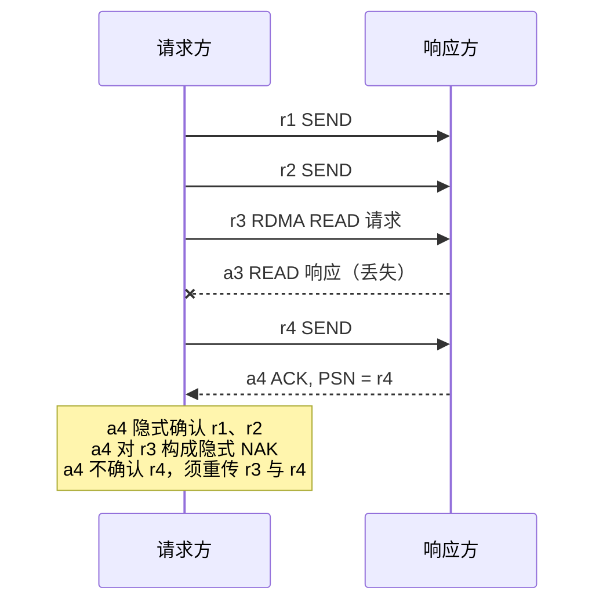
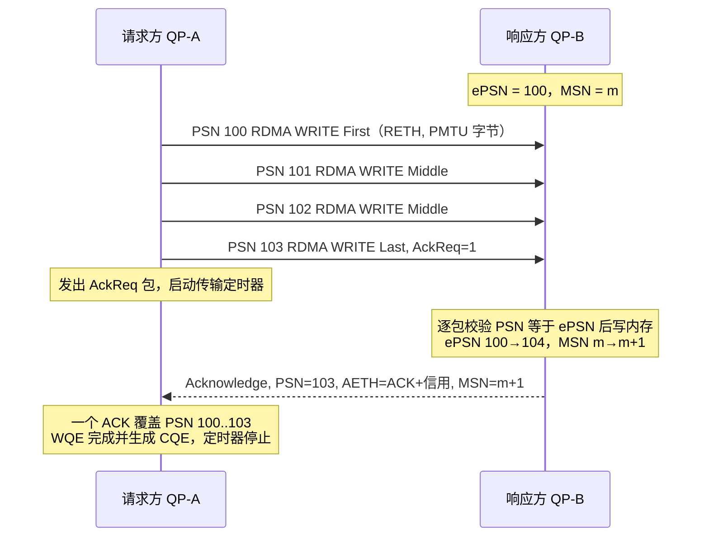
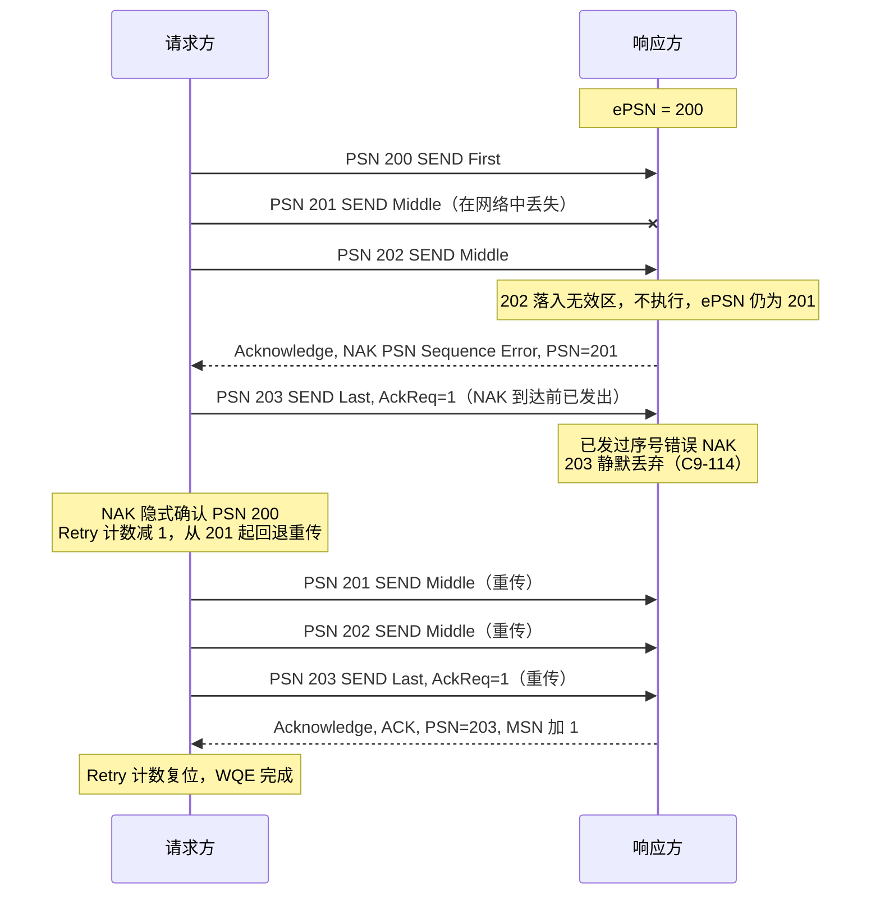
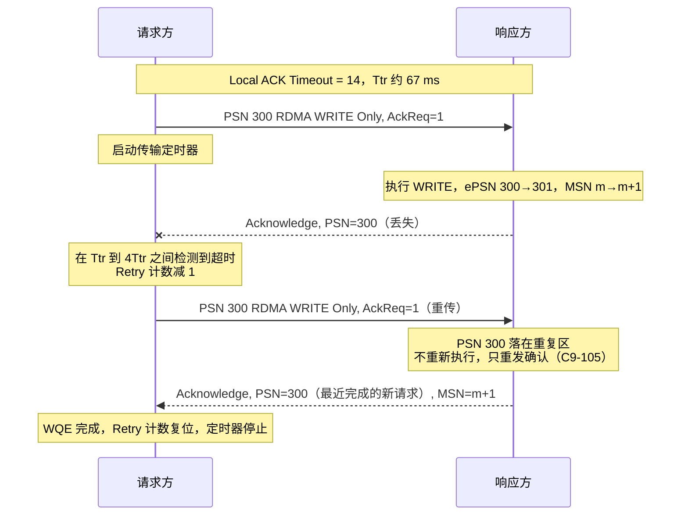

# PSN 模型与 ACK/NAK 协议（PSN Model and ACK/NAK Protocol）

> **摘要**：RC 可靠传输依靠"24 位包序号（PSN）+ ACK/NAK 确认 + 传输定时器"实现消息"至多一次、按序、无损坏"的交付。本文讲清 PSN 的分配与比较规则、有效/重复/无效区的划分、ACK 合并与隐式确认、AETH 的 Syndrome / NAK 码 / RNR 定时器 / 信用编码，以及 MSN 与端到端信用流控——它们是请求方与响应方实现的共同基础。
>
> **规范出处**：Vol1 §9.7（p.304–305）；§9.7.1 PSN（p.305–311）；§9.7.2 ACK/NAK 协议（p.311–313）；§9.7.3.1（p.313–314）；§9.7.5.1（p.331–348）；§9.7.5.2 AETH（p.348–355）；§9.7.7.1 MSN（p.367–371）；§9.7.7.2 端到端流控（p.371–381）；§9.2.12 AckReq（p.261）；§9.3.5 AETH（p.265–266）；Annex A17 CA17-25（p.1936）
>
> **前置阅读**：[BTH 详解](../01-packet-format/03-bth.md)、[扩展传输头](../01-packet-format/04-extended-transport-headers.md)、[操作与报文序列](02-operations.md)
>
> **关键词**：PSN, ePSN, 有效区/重复区/无效区, ACK, NAK, RNR NAK, AckReq, ACK 合并, 隐式 NAK, AETH, Syndrome, MSN, SSN, LSN, Credit

## 1. 可靠服务的基本要素

RoCEv2 端口必须实现第 9 章定义的 IB 传输层（CA17-25）〔Vol1 §A17.4, p.1936〕，所以 RC 的可靠机制与 InfiniBand 完全一致。规范对可靠服务（Reliable Service）的承诺是：在没有不可恢复错误的前提下，消息**至多一次（at most once）、按序、无损坏**地从请求方（Requester）交付到响应方（Responder）〔Vol1 §9.7, p.304〕。

| 要素 | 作用 | 详见 |
|---|---|---|
| CRC（RoCEv2 中为以太网 FCS + ICRC） | 检测损坏。损坏包在传输层之下被丢弃，最终在传输层表现为**序号错误**〔p.304〕 | [ICRC](../01-packet-format/06-icrc.md) |
| 包序号 PSN（Packet Sequence Number） | 检测丢包/乱序/重复，把响应与请求关联 | 本文 §2 |
| ACK/NAK 协议 | 让请求方确定性地获知请求是否被正确接收 | 本文 §3–§6 |
| 传输定时器（Transport Timer） | 发现响应"持续缺席"（请求或响应丢失） | [请求方行为](06-requester.md) |

两端对"完成"的判定标准不同〔Vol1 §9.7, p.304–305〕：
- **响应方**：收到合法的 Last/Only 包；该消息全部包按 PSN 顺序到齐；SEND/WRITE 负载已提交到本地故障域（fault zone）；READ/ATOMIC 的响应已提交上线（committed to the wire）；最后一包的确认已提交上线。
- **请求方**：READ/ATOMIC 的全部响应包已收到并写入本地内存；确认消息已收到并通过校验。

> [!IMPORTANT]
> **C9-60**：请求方在把 WQE 视为完成之前必须等到所需的响应；若完成某 WQE 需要**显式**响应，请求方有责任保证该响应会到来〔Vol1 §9.7, p.305〕。可选手段：每个消息最后一包置 AckReq；只在需要显式响应的消息上置 AckReq；未置 AckReq 时以置 AckReq 的方式重发该请求；或发一个置 AckReq 的 "NOP"（例如零长度 RDMA WRITE，前提是对端支持 RDMA WRITE）。

## 2. PSN：24 位序号空间

### 2.1 一个方向上的四个"PSN"

每个 QP 的发送队列与对端 QP 的接收队列构成一个方向。**两个方向的 PSN 完全独立**，不同连接之间也毫无关系〔Vol1 §9.7.1, p.305–306, Figure 84〕。在一个方向上有四个概念〔Vol1 §9.7.1.1, p.310–311, Figure 89〕：

| 名称 | 所在端 | 含义 |
|---|---|---|
| Next PSN | 请求方 | 下一个请求包将使用的 PSN；生成请求包时拷入 BTH 成为"当前 PSN"，随后计算新的 Next PSN |
| Expected PSN（ePSN） | 响应方 | 期望在下一个**新**请求包 BTH 中看到的 PSN |
| Response PSN | 响应方 | 写入响应包 BTH 的 PSN，用来把响应关联到请求 |
| 可接受的响应 PSN 区间 | 请求方 | 由于 ACK 可合并，请求方无法预知下一个响应的 PSN，只能接受"最老未确认请求 PSN … 最近发送请求的预期响应 PSN"之间的任意值 |

除 RDMA READ 响应外，请求包 PSN 与对应响应包 PSN 是 1:1 关系〔p.310〕。

### 2.2 请求方的 PSN 分配

- 建连时，传输层的客户（CM / Verbs 使用者）把初始 PSN 设为 0…16,777,215 之间的任意值，响应方的初始 ePSN 必须设为同一值；第一个请求包必须携带这个初始 PSN（C9-65）〔Vol1 §9.7.3.1, p.313〕。
- 之后每生成一个请求包 PSN 加 1（模 2^24）。**唯一例外**：紧跟在 RDMA READ 请求之后的那个请求包，其 PSN = 该 READ 最后一个预期响应包的 PSN + 1（C9-66）。即 READ 请求在请求 PSN 序列中"留洞"，使所有响应包的 PSN 单调递增〔p.313–314, Table 42〕。

| 当前请求包 | 下一个请求包的 PSN |
|---|---|
| SEND、RDMA WRITE、ATOMIC 的任一包 | 当前 PSN + 1（mod 2^24） |
| RDMA READ 请求 | 当前 PSN + n（mod 2^24），n = 预期 READ 响应包数 |

n 由请求方自行算出：除 Last/Only 外每个响应包都必须装满 PMTU〔p.314〕，故 n = ⌈DMALen / PMTU⌉；零长度 READ 也有一个 "RDMA READ Response Only" 响应（C9-99 第 5 条）〔p.334〕，故 n = 1。

示例（PMTU = 1024，初始 PSN = 100）：

| WQE | 操作 | 长度 | 请求包 PSN | 预期响应 PSN | 下一个可用 PSN |
|---|---|---|---|---|---|
| W1 | SEND | 3000 B | 100、101、102（First/Middle/Last） | 由 ACK 覆盖 | 103 |
| W2 | RDMA READ | 4096 B | 103（1 个请求包） | 103、104、105、106 | 107 |
| W3 | RDMA WRITE | 0 B | 107（WRITE Only） | 由 ACK 覆盖 | 108 |
| W4 | ATOMIC FetchAdd | 8 B | 108 | 108（ATOMIC Acknowledge） | 109 |

> [!NOTE]
> 响应方计算 ePSN 的规则与请求方完全相同（C9-75）〔Vol1 §9.7.4.1.2, p.322〕：收到 PSN=103 的合法 READ 请求后，ePSN 直接从 103 前进到 107。

### 2.3 有效区、重复区与无效区

24 位 PSN 可以唯一命名 16,777,216 个包。为了让响应方区分"重复包"与"丢包后的乱序包"，**C9-61** 规定：任一发送队列在任何时刻**未完成（outstanding）的 PSN 不超过 8,388,608（2^23）个**——包括所有 SEND、RDMA WRITE、ATOMIC 请求包以及所有预期的 READ 响应包〔Vol1 §9.7.1, p.308–309〕。于是 PSN 空间被分成相等的两半〔Figure 88, p.309〕：

```text
  PSN 环（模 2^24），以响应方的 ePSN 为基准：

    ePSN-(2^23-1) ………… ePSN-1  |  ePSN  |  ePSN+1 ………… ePSN+2^23
  |<----- 重复区（2^23-1 个）---->|<新请求>|<------ 无效区（2^23 个）------>|
  |<----------- 有效区（2^23 个，含 ePSN）--------->|
```

- **新请求（Expected）**：PSN == ePSN。正常校验、执行后前移 ePSN，有效区窗口随之滑动〔p.323–324〕。
- **有效重复请求（Valid Duplicate）**：落在有效区但不等于 ePSN，即"响应方已见过并执行过"的 PSN〔p.309, p.324〕。
- **无效请求（Invalid）**：落在有效区之外，通常说明前面有请求包在网络中丢失 → NAK-PSN Sequence Error〔p.324–325〕。

第三种异常是**陈旧包**（Stale Packet，"TIME WAIT packet"）：旧连接残留在网络中的包被复用同一 QP 的新连接收到。传输层**没有**防护机制，由连接管理负责：让 QP 经过足够长的 Time Wait 再复用〔p.308〕；CM 选择 Starting PSN 时也应尽量降低旧包落入有效窗口的概率〔Vol1 §12.7.31, p.737〕。

### 2.4 PSN 运算与比较的参考实现

下面的 C 代码按 §9.7.1 的严格定义实现分类，已用 gcc 编译并以含回绕的用例验证：

```c
#include <stdint.h>

#define PSN_MASK 0xFFFFFFu          /* 24 bit */
#define PSN_HALF 0x800000u          /* 2^23  */

static inline uint32_t psn_add(uint32_t psn, uint32_t n) { return (psn + n) & PSN_MASK; }
static inline uint32_t psn_diff(uint32_t a, uint32_t b) { return (a - b) & PSN_MASK; } /* (a-b) mod 2^24 */

/* 通用比较：>0 表示 a 在 b 之后，0 相等，<0 表示 a 在 b 之前 */
static inline int psn_cmp(uint32_t a, uint32_t b)
{
    uint32_t d = psn_diff(a, b);
    if (d == 0) return 0;
    return (d < PSN_HALF) ? 1 : -1;
}

typedef enum { PSN_NEW, PSN_DUPLICATE, PSN_INVALID } psn_class_t;

/* 响应方分类：有效区 = 含 ePSN 在内的 2^23 个 PSN（Figure 88） */
static psn_class_t rsp_classify(uint32_t psn, uint32_t epsn)
{
    uint32_t d = psn_diff(psn, epsn);
    if (d == 0)       return PSN_NEW;        /* == ePSN                    */
    if (d > PSN_HALF) return PSN_DUPLICATE;  /* ePSN-(2^23-1) … ePSN-1     */
    return PSN_INVALID;                      /* ePSN+1 … ePSN+2^23         */
}

/* 请求方：响应 PSN 是否落在 [lo, hi]（含两端，模 2^24） */
static inline int psn_in_window(uint32_t psn, uint32_t lo, uint32_t hi)
{
    return psn_diff(psn, lo) <= psn_diff(hi, lo);
}

/* READ 请求之后下一个请求包的 PSN（Table 42） */
static uint32_t next_psn_after_read(uint32_t read_psn, uint64_t dma_len, uint32_t pmtu)
{
    uint32_t n = (dma_len == 0) ? 1u : (uint32_t)((dma_len + pmtu - 1) / pmtu);
    return psn_add(read_psn, n);
}
/* 验证输出示例：psn=FFFFFE,ePSN=000005 → DUP；psn=000002,ePSN=FFFFF0 → INVALID；
 * READ psn=FFFFFE,len=700,PMTU=256 → 下一个 PSN = 000001 */
```

对应的硬件逻辑只需一个 24 位减法器：

```verilog
wire [23:0] d      = rx_psn - epsn;          // 24 位减法天然取模 2^24
wire        is_new = (d == 24'd0);
wire        is_dup = d[23] & (|d[22:0]);     // d ∈ [2^23+1, 2^24-1]
wire        is_inv = ~is_new & ~is_dup;      // d ∈ [1, 2^23]
```

> [!WARNING]
> 很多实现直接用"24 位有符号差值"比较（例如 Linux rxe 的 `psn_compare()`：`diff = (psn_a - psn_b) << 8` 再按 s32 判断）〔业界实践: Linux drivers/infiniband/sw/rxe/rxe_verbs.h〕。这种写法把差值恰好为 2^23 的点归为"之前"（重复），与规范的严格定义差一个值。该边界只有在未完成包数达到 C9-61 上限 2^23 的极端情况下才可能触及；实际硬件的未完成窗口远小于此，但写验证用例时应知道这一差异。

### 2.5 初始化与状态约束

- 响应方的初始 ePSN 只能在 QP 处于 Init 状态时由客户设置；在 RQ 能正常接收请求之前（例如仍在 Init 状态），HCA 不得更新 ePSN（C9-76）〔Vol1 §9.7.4.1.2, p.322–323〕。
- Verbs 中 RQ PSN 在 Init→RTR 迁移时设置，SQ PSN 在 RTR→RTS 迁移时设置〔Vol1 §11.2.5.2, p.612〕；libibverbs 中对应 `ibv_qp_attr.rq_psn` / `sq_psn`〔业界实践: Linux rdma-core〕。详见 [QP 状态机](../03-verbs-and-resources/02-qp-state-machine.md)。
- CM 的 REQ / REP 消息各带一个 24 位 Starting PSN 字段（REQ 字节偏移 44，REP 字节偏移 20）〔Vol1 §12.6.5 Table 106, p.718；§12.6.8 Table 110, p.727〕，用于双方约定两个方向的初始 PSN，见 [CM 协议](../04-connection-management/01-cm-protocol.md)。
- RC 每个 QP 在途消息数与在途包数的上限均为 2^23，最大消息长度为 2^31 字节〔Vol1 §9.7.7, Table 49, p.366〕。

## 3. ACK/NAK 协议总则

### 3.1 基本规则

规范中 "acknowledge" 一词同时指正确认（ACK）与负确认（NAK）；"response" 泛指响应方返回的 ACK 包、NAK 包、READ 响应或 ATOMIC 响应〔Vol1 §9.7.2, p.312〕。协议规则汇总如下〔p.312〕：

1. 可靠服务上收到的**每个请求包都必须被确认**（显式或隐式）。
2. 每个 RDMA READ 请求都需要**显式响应**——带合法 AETH 的 READ 响应；AETH 出现在 READ 响应的 First 和 Last（或 Only）包中。
3. 每个 ATOMIC 请求都需要显式响应——带合法 AETH 与 AtomicAckETH 的 ATOMIC Acknowledge 包。
4. 确认可以**合并（coalesce）**：一个确认包可以确认此前的一个或多个请求包。
5. 确认包必须按原请求包被接收时的 **PSN 顺序**返回（含 READ 响应）。
6. READ 响应由一个或多个包组成；其余响应都恰好一个包。

> [!IMPORTANT]
> **C9-63**（RC HCA 响应方）：必须确认每个收到的请求包；必须为每个 READ 请求、每个 ATOMIC 请求生成显式响应；必须按原请求包的 PSN 顺序生成响应包（含 READ 响应）〔Vol1 §9.7.2, p.312〕。**C9-27**：所有确认包强有序——之前的 READ 响应与 ATOMIC 响应必须先于后续的任何响应注入网络〔Vol1 §9.5, p.291〕。

### 3.2 响应报文的种类

| 响应 | BTH OpCode（RC） | 扩展头 | 负载 |
|---|---|---|---|
| Acknowledge（ACK / RNR NAK / NAK） | 0x11（000_10001） | AETH | 无 |
| ATOMIC Acknowledge | 0x12（000_10010） | AETH + AtomicAckETH（8 B 原值） | 无 |
| RDMA READ Response First | 0x0D（000_01101） | AETH | 恰好 PMTU |
| RDMA READ Response Middle | 0x0E（000_01110） | 无 AETH | 恰好 PMTU |
| RDMA READ Response Last | 0x0F（000_01111） | AETH | 1…PMTU |
| RDMA READ Response Only | 0x10（000_10000） | AETH | 0…PMTU |

出处：OpCode 表〔Vol1 §9.2, Table 38, p.257–259〕；READ 响应头部与长度（C9-24, p.282；C9-97/C9-98/C9-99, p.334）；ATOMIC 响应头部（o9-16, p.285）。完整 OpCode 表见 [OpCode 全表](../01-packet-format/05-opcodes.md)。

### 3.3 响应 PSN 的取值规则

| 情形 | 响应包 BTH.PSN | 依据 |
|---|---|---|
| 对 SEND / WRITE 的 ACK | 被确认的"最近一个**新**请求包"的 PSN（不是重复包的 PSN） | C9-95〔p.331–332〕 |
| READ 响应 | 从原 READ 请求的 PSN 开始逐包 +1、单调递增 | C9-96〔p.332〕、C9-117〔p.346〕 |
| ATOMIC 响应 | 等于 ATOMIC 请求的 PSN | o9-58〔p.332〕 |
| 对重复 SEND / WRITE 的 ACK | 最近完成的新请求的 PSN | §9.7.5.1.4〔p.339〕 |
| 对重复 ATOMIC 的响应 | 该重复请求的 PSN | §9.7.5.1.4〔p.343〕 |
| NAK（READ 响应过程以外） | 响应方的 ePSN（出错包不推进 ePSN，故即出错包的 PSN） | C9-111〔p.343〕、C9-121〔p.350〕、C9-125〔p.351〕 |
| READ 响应过程中出错的 NAK | 指向被 NAK 的那个 READ 响应包的 PSN | C9-112〔p.343〕、C9-100〔p.334〕 |
| RNR NAK | 被 RNR NAK 的那个请求包的 PSN | C9-113〔p.343〕 |
| NAK-Remote Access Error | 引发访问错误的请求包 PSN | C9-124〔p.350〕 |
| NAK-Remote Operational Error | 检测到错误时正在执行的请求的 PSN | C9-126〔p.351〕 |
| AckReq 触发的响应 | 等于或（模 2^24 意义下）大于该请求的 PSN | C9-116〔p.344〕 |

> [!IMPORTANT]
> **C9-113.a1**：携带 NAK 码的包一律使用 **Acknowledge** OpCode。即使正在返回 READ 响应，出错时也要把该包替换为 Acknowledge 而不是 READ Response First/Middle/Last/Only〔Vol1 §9.7.5.1.5, p.343〕；C9-100 要求多包 READ 响应中途出错时不发送出错部分的数据，并把出错包改为带 NAK 码的 Acknowledge〔p.334〕。

## 4. ACK 合并与隐式确认

### 4.1 合并规则

响应方不必为每个请求包单独回 ACK，可以用一个确认包确认多个先前的请求包，称为**确认合并（acknowledge coalescing）**。一个 BTH.PSN = P 的响应包对 PSN 早于 P 的未确认请求有如下含义〔Vol1 §9.7.5.1.2, p.332–333〕：

1. 若存在 PSN 早于 P 的未完成 **READ 或 ATOMIC** 请求，则该响应对其中**最老的一个**构成**隐式否定确认（implied NAK）**；该 READ/ATOMIC 之后提交的请求都不被确认。
2. 对 PSN 早于 P 的未完成 SEND / RDMA WRITE 请求包构成**隐式肯定确认**——除非它们位于上述 READ/ATOMIC 之后。
3. 若响应是 READ 响应，由其 **First（或 Only）包**隐式确认之前的未完成请求（以尽快完成它们）。
4. READ 响应的 **Last（或 Only）包**只显式确认该 READ 请求本身。

规范 Figure 93 的例子（p.333）：



请求方据此把 r3 判为"隐式 NAK 序号错误"（Implied NAK Sequence Error，Class A，可重试，消耗 Retry 计数）〔Vol1 §9.9.2.3, Table 59, p.428〕，处理细节见 [请求方行为](06-requester.md)。

### 4.2 NAK 同样具有"合并"效果

- 发出 NAK-PSN Sequence Error 之前，响应方必须先执行并完成出错包之前收到的所有请求；该 NAK 对之前未完成的 SEND/WRITE 构成隐式 ACK，对未完成的 READ/ATOMIC 构成隐式 NAK〔Vol1 §9.7.4.1.2, p.324〕（C9-79, p.325）。
- 发出 NAK-Invalid Request、NAK-Remote Access Error 之前同样要先完成之前的请求（C9-87, p.328；C9-90, p.329）；规范指出此类 NAK "effectively coalesces responses to earlier outstanding request"〔p.328〕。

### 4.3 READ 的宽松排序与 ACK

由于 READ 请求的排序放宽，响应方可以在 READ 之后的 SEND / WRITE 上先行执行；但执行前必须先校验 READ 请求的头部字段，并且在未完成的 READ 响应发送完之前**不得确认**这些后续请求（C9-101）〔Vol1 §9.7.5.1.3, p.335–336, Figure 94〕。这正是 §3.1 "响应按 PSN 顺序返回"的体现。

### 4.4 对重复请求的确认

对重复 SEND/WRITE 的确认使用"最近完成的新请求的 PSN"，可以理解为合并规则的逻辑延伸：请求方像处理普通合并 ACK 一样处理它，其中任何未完成的重复 READ/ATOMIC 被视为 NAK〔Vol1 §9.7.5.1.4, p.339, Figure 96〕。重复请求的完整处理见 [响应方行为](07-responder.md)。

## 5. AckReq 与确认调度

BTH 中的 **AckReq（A）位**要求响应方为该请求调度一个确认〔Vol1 §9.2.12, p.261〕。规范不规定响应的调度方式本身，只规定〔Vol1 §9.7.5.1.6, p.344–345〕：

- **C9-116**：收到 AckReq=1 的合法请求包时，响应方**必须**为其调度响应，响应 PSN 等于或晚于该请求的 PSN。在准备该响应期间，响应方仍继续接收后续请求（包括其他 AckReq=1 的请求），最终可能用一个合并 ACK 一并确认。
- 未置 AckReq 时，响应方可以有意合并，甚至**无限期**等待，直到某个请求要求调度响应为止。因此请求方发送队列中**最后一个 WQE 的最后一包**应置 AckReq（或用其他手段逼出响应），否则可能永远等不到 ACK。
- 对 SEND / WRITE，ACK 可以在数据真正写入内存**之前**发出：ACK 只表示数据已到达响应节点的故障域——通道适配器保证写入内存，或至少把失败通知响应端应用。
- 不置 AckReq 并不禁止响应方回 ACK；READ / ATOMIC 总是需要显式响应，AckReq 对它们没有影响。
- 置 AckReq 的 SEND/WRITE 也是请求方**启动传输定时器**的条件之一〔Vol1 §9.7.6.1.3, p.363〕，见 [请求方行为](06-requester.md)。

> [!TIP]
> 常见做法是在每个消息的最后一包置 AckReq，并对超长消息每隔若干包再置一次。例如 Linux 软件 RoCE（rxe）在每个消息的末包、或连续超过 64 个包未置 AckReq 时置位（`RXE_MAX_PKT_PER_ACK = 64`）〔业界实践: Linux drivers/infiniband/sw/rxe/rxe_req.c、rxe_param.h〕。硬件实现可将该间隔做成可配置参数，在 ACK 带宽开销与重传粒度之间折中。

## 6. AETH：Syndrome、NAK 码与 RNR 定时器

### 6.1 格式

ACK 扩展传输头（ACK Extended Transport Header, AETH）共 4 字节，出现在所有 Acknowledge 包以及 READ 响应的 First / Last / Only 包中〔Vol1 §9.3.5, p.265–266〕：

```text
  bit  31  30 29  28        24 23                                            0
      +---+------+------------+-----------------------------------------------+
      | R | Type |   Value    |              MSN（Message Sequence Number）    |
      +---+------+------------+-----------------------------------------------+
      |<------ Syndrome 8 bit ->|<------------------- 24 bit ------------------>|
```

| 字节偏移 | 位 | 宽度 | 字段 | 含义 |
|---|---|---|---|---|
| 0 | 31 | 1 | Syndrome[7] | 保留，发送置 0（C9-119.a1, p.348） |
| 0 | 30:29 | 2 | Syndrome[6:5] | 类型：00 ACK，01 RNR NAK，10 保留，11 NAK |
| 0 | 28:24 | 5 | Syndrome[4:0] | 信用编码 / RNR 定时器 / NAK 码 |
| 1–3 | 23:0 | 24 | MSN | 响应方已完成的最后一个消息的序号 |

完整的扩展头字段布局见 [扩展传输头](../01-packet-format/04-extended-transport-headers.md)。

### 6.2 Syndrome 编码（Table 46）

| bit 7 | bits 6:5 | bits 4:0 | 含义 | 十六进制范围 |
|---|---|---|---|---|
| 0 | 00 | C CCCC | ACK，C CCCC = 端到端信用编码（11111 表示信用无效） | 0x00–0x1F |
| 0 | 01 | T TTTT | RNR NAK，T TTTT = RNR 定时器编码 | 0x20–0x3F |
| 0 | 10 | X XXXX | 保留 | 0x40–0x5F |
| 0 | 11 | N NNNN | NAK，N NNNN = NAK 码 | 0x60–0x7F |

依据：C9-119 / Table 46〔Vol1 §9.7.5.2, p.348〕。"011 NNNNN" 编码使 NAK 包也能携带 MSN〔p.349〕。

### 6.3 NAK 码（Table 47）

| 码（bits 4:0） | 名称 | 典型触发 | NAK 的 BTH.PSN | 请求方处理 |
|---|---|---|---|---|
| 0 0000 | PSN Sequence Error | 请求 PSN 落入无效区（多为前面的包丢失） | 响应方 ePSN（C9-121） | 自动重试（Class A），Retry 计数耗尽 → Transport Retry Counter Exceeded |
| 0 0001 | Invalid Request | 不支持的功能/保留 OpCode、OpCode 序列错、长度错、READ/ATOMIC 资源不足、ATOMIC 地址未 8 字节对齐 | ePSN，即出错包 PSN（C9-125） | Class B → Remote Invalid Request Error |
| 0 0010 | Remote Access Error | R_Key 无效、VA/长度越界、访问类型不允许、PD 不匹配 | 出错包 PSN（C9-124） | Class B → Remote Access Error |
| 0 0011 | Remote Operational Error | 响应方本地故障（与请求方无关，如畸形接收 WQE） | 正在执行的请求 PSN（C9-126） | Class B → Remote Operation Error |
| 0 0100 | Invalid RD Request | RD/XRC 专用（Q_Key、RDD、XRC 域等违例） | — | RC 中不会出现 |
| 0 0101–1 1111 | 保留 | — | — | 视为畸形包**静默丢弃**（C9-120），可能最终导致请求方超时 |

出处：Table 47〔Vol1 §9.7.5.2.2, p.349〕；各 NAK 的语义〔§9.7.5.2.3–9.7.5.2.7, p.350–352〕；请求方故障类别〔§9.9.2.3, Table 59, p.428–429〕。

> [!NOTE]
> 规范只对"保留 NAK 码"明确规定了丢弃（C9-120, p.349；C9-135, p.356）。Syndrome 类型 10（保留）规范未单列条款，**设计建议**同样按畸形包静默丢弃。

### 6.4 RNR NAK 与 RNR 定时器（Table 48）

RNR NAK（Receiver Not Ready）表示接收队列**暂时**无法接受请求，最典型的原因是没有可用的接收 WQE；它可以针对**任何类型**的请求（SEND、READ、WRITE…）〔Vol1 §9.7.5.2.8, p.352〕。规则要点：

- 响应方在 AETH 的定时器字段填入 Table 48 的合法编码（C9-129, p.353）；对 HCA，"因接收 WQE 未就绪"而产生的 RNR NAK，其定时器值取自 QP 属性 "Minimum RNR NAK Timer Field"〔Vol1 §9.10.1, Table 63 注 b, p.452；§11.2.5.2, p.615–616〕。
- 请求方必须至少等待定时器指定的时间才能重试，否则响应方可以静默丢弃该重试包（C9-130, p.353）。
- 重试的必须是"完全相同的请求消息"，从 RNR NAK 中给出的 PSN 开始；**不得**用同一 PSN 换成另一个请求消息（C9-128, p.352–353）。
- 请求方用 3 位 RNR 重试计数器限制重试次数，**7 表示无限重试**（C9-132, p.354），细节见 [请求方行为](06-requester.md)。
- RNR NAK 会浪费带宽（被拒绝的包需要重发），规范建议只把它作为"偶尔"使用的延迟机制〔p.355〕。

RNR 定时器编码（Table 48，单位 ms）〔Vol1 §9.7.5.2.8, p.354–355〕：

| 编码 | 延迟 | 编码 | 延迟 | 编码 | 延迟 | 编码 | 延迟 |
|---|---|---|---|---|---|---|---|
| 00000 | 655.36 | 01000 | 0.16 | 10000 | 2.56 | 11000 | 40.96 |
| 00001 | 0.01 | 01001 | 0.24 | 10001 | 3.84 | 11001 | 61.44 |
| 00010 | 0.02 | 01010 | 0.32 | 10010 | 5.12 | 11010 | 81.92 |
| 00011 | 0.03 | 01011 | 0.48 | 10011 | 7.68 | 11011 | 122.88 |
| 00100 | 0.04 | 01100 | 0.64 | 10100 | 10.24 | 11100 | 163.84 |
| 00101 | 0.06 | 01101 | 0.96 | 10101 | 15.36 | 11101 | 245.76 |
| 00110 | 0.08 | 01110 | 1.28 | 10110 | 20.48 | 11110 | 327.68 |
| 00111 | 0.12 | 01111 | 1.92 | 10111 | 30.72 | 11111 | 491.52 |

该表与 §6.6 的信用编码表结构相同（每两个编码翻一倍，奇数编码为 1.5 倍），可用移位实现；下式已用脚本与 Table 48 / Table 50 全部表项逐一比对：

```c
/* 共享解码：code 1..30 → 1,2,3,4,6,8,12,16,…,24576,32768（Table 50 的信用数） */
static inline uint32_t log_table_decode(uint8_t code)
{
    code &= 0x1F;
    if (code <= 1) return code;                       /* 0→0, 1→1 */
    return (2u + (code & 1u)) << ((code >> 1) - 1);   /* 2→2, 3→3, 4→4, 5→6, … */
}

/* RNR 定时器：单位 10 µs；00000 特殊表示 655.36 ms，11111 = 491.52 ms */
static inline uint32_t rnr_timer_10us(uint8_t code)
{
    code &= 0x1F;
    return (code == 0) ? 65536u : log_table_decode(code);
}
```

### 6.5 MSN（Message Sequence Number）

MSN 位于 AETH 低 3 字节，表示**响应方已完成的消息数**，用来帮助请求方更快地完成 WQE〔Vol1 §9.7.7.1, p.367；§9.3.5.2, p.266〕：

- 请求方在逻辑上给每个发送 WQE 分配一个递增的 **SSN**（Send Sequence Number），初始化后第一个 WQE 的 SSN = 1；响应方把 MSN 初始化为 0，此后每**成功完成一个新的合法请求消息**就加 1（24 位）〔p.367–368〕。SSN 只是帮助理解的逻辑概念，实现不必真的维护它〔p.367〕。
- **C9-147**：任何携带 AETH 的响应包都必须带 MSN〔p.367〕；**C9-149**：无论正确认、负确认还是重复确认，都要填入 MSN 计数器〔p.370〕。
- **C9-148**：MSN 不因重复请求而增加；每个请求消息只加一次；READ / ATOMIC 增加后的 MSN 在响应的 Last/Only 包中返回；对 READ，响应方也可以在校验完请求、开始发送数据之前就增加 MSN，并在**第一个**响应包的 AETH 中带回〔p.368〕。
- 请求方收到新 MSN 后，从最老的未完成 WQE 开始向后完成，直到 SSN == MSN 的 WQE 或**第一个未完成的 READ/ATOMIC**（以先到者为准），因为 READ/ATOMIC 必须等到显式响应才能完成〔§9.7.7.1.1, p.368–370, Figure 103/104〕。

Figure 104 的情形（p.370）：

| 请求 | PSN | SSN | 响应 | 说明 |
|---|---|---|---|---|
| SEND1 | 1 | 1 | — | |
| SEND2 | 2 | 2 | — | |
| READ3（3 个响应包） | 3 | 3 | a3(MSN=4)、a4、a5(MSN=4) | READ 宽松排序，响应方可先完成 SEND4 |
| SEND4 | 6 | 4 | a6(MSN=4) | |

收到 a3 时 MSN=4 表示响应方已完成 SEND1、SEND2、SEND4（以及 READ3 的校验），但请求方只能先完成 SEND1、SEND2——READ3 挡在中间。

### 6.6 端到端信用流控（End-to-End Flow Control）

端到端（消息级）流控让响应方把接收资源"授信"给请求方：没有信用，请求方就不能发送会消耗接收 WQE 的请求〔Vol1 §9.7.7.2, p.371–381〕。

**基本规则**〔p.371–372〕：
1. 只用于 RC；信用由响应方的接收队列产生、由请求方的发送队列消费。
2. **一个信用 = 一个已投递的接收 WQE**，按消息计、与消息长度无关；有信用不代表一定有足够内存。
3. 不关联 SRQ 的 HCA 接收队列**必须**产生信用；关联 SRQ 的**不得**产生信用（C9-150.2.1, p.372），并在 AETH 填 11111（o9-95.2.2, p.373；C9-158.2.1, p.377）。CM 的 REQ/REP 中有 1 位 "End-to-End Flow Control" 字段声明本端是否真的实现了信用〔Vol1 §12.7.26, p.736〕。
4. 信用以 5 位编码放在 AETH Syndrome[4:0]，相对于同一 AETH 中的 MSN 解释。

**响应方计数**：RESET 状态下信用计数为 0；进入 INIT/RTR/SQD/RTS 后每投递一个接收 WQE 加 1（C9-155, p.373）；每收到一个会消耗 WQE 的请求消息（SEND、带立即数的 RDMA WRITE）减 1，READ、不带立即数的 WRITE、ATOMIC 不改变计数（C9-157.2.1, p.377）。每个 ACK（含主动 ACK）都填入当前信用编码与当前 MSN；编码向下取整到可表示值，例如 5 个信用填 b00100（= 4）（C9-158.2.1, p.377）。

**信用编码（Table 50）**——表中数值是"加到 MSN 上得到 LSN 的值"〔p.378–379〕：

| 编码 | 信用 | 编码 | 信用 | 编码 | 信用 | 编码 | 信用 |
|---|---|---|---|---|---|---|---|
| 00000 | 0 | 01000 | 16 | 10000 | 256 | 11000 | 4096 |
| 00001 | 1 | 01001 | 24 | 10001 | 384 | 11001 | 6144 |
| 00010 | 2 | 01010 | 32 | 10010 | 512 | 11010 | 8192 |
| 00011 | 3 | 01011 | 48 | 10011 | 768 | 11011 | 12288 |
| 00100 | 4 | 01100 | 64 | 10100 | 1024 | 11100 | 16384 |
| 00101 | 6 | 01101 | 96 | 10101 | 1536 | 11101 | 24576 |
| 00110 | 8 | 01110 | 128 | 10110 | 2048 | 11110 | 32768 |
| 00111 | 12 | 01111 | 192 | 10111 | 3072 | 11111 | 无效（invalid） |

**请求方行为**〔p.378–381〕：
- **LSN（Limit Sequence Number）= MSN + 信用数**（C9-161）。SSN ≤ LSN 的请求可以自由发送；SSN > LSN 的 WQE 称为"受限（limited）"。
- 每发送一个**不消耗**接收 WQE 的请求（READ、不带立即数的 WRITE、ATOMIC），LSN 加 1〔p.380〕；这类请求总可以不顾信用地发送，但**不得**为了找它们而越过排在前面的受限 WQE 乱序发送，也不得违反 Fence 规则（C9-160, p.378）。
- 受限 WQE 的处理（C9-162 / C9-163, p.381）：READ、不带立即数的 WRITE、ATOMIC 照常发送；**SEND** 只能发出**一个包**且必须置 AckReq，然后停下等待确认；**带立即数的 WRITE** 可以发完整个消息（只有携带立即数的那个包真正消耗 WQE），末包置 AckReq 后停下等待。
- 收到信用"无效"（11111）时可随意发送；一旦收到过"无效"，请求方可以在该连接上永久忽略信用字段，因此响应方此后若又恢复发送有效信用，结果不可预测〔p.379〕。
- 规范脚注 11 指出一种人为受限的情形：在 2 个信用下发送 Send, RDMA, RDMA, RDMA 会把 LSN 加 3，若随后到来的响应只给出 MSN+1 的信用，LSN 会被回拉 2，直到后续 RDMA 的 ACK 到来前请求方都处于受限状态〔p.381〕。

**信用的传递**〔p.372–374〕：
- 捎带（piggyback）：任何 MSN 有效的 ACK 都可携带信用。
- 主动 ACK（unsolicited acknowledge）：重发最近一次**正确认**并更新信用字段，OpCode 一律为 Acknowledge（即使最近一次是 READ/ATOMIC 响应）；不能通过重发 NAK 来制造（协议禁止重复 NAK）；其 MSN 必须有效（C9-152）。对请求方而言它看起来是一个重复 ACK，只起传递信用的作用。
- 初始信用：连接刚建立时还没有可以重发的 ACK，此时用"初始 PSN − 1"作为主动 ACK 的 PSN（例如初始 PSN 为 0x000000 则用 0xFFFFFF）。请求方会把它看作"幽灵 ACK"，但可以接受其中的 MSN 与信用——这是"幽灵 ACK 必须丢弃"规则的例外〔p.374〕。若响应方不提供初始信用，请求方按受限 WQE 规则工作（C9-156）。
- 请求方必须从重复 ACK 中提取信用（C9-144, p.365）；若 ACK 的 PSN 恰为请求方期望 PSN − 1，应恢复其中的信用并丢弃其余内容（C9-217, p.434–435）。
- XRC 的响应总是携带无效信用〔Vol1 §9.10.1, Table 63 注 c, p.452〕。

例（Figure 107, p.380）：AETH 中 MSN = 0x000018、信用 = 6 → LSN = 0x00001E；SSN = 0x00001F 的请求 32 为受限 WQE。

## 7. 典型场景时序

### 7.1 正常多包 WRITE + 合并 ACK



### 7.2 丢包 → NAK（PSN Sequence Error）→ Go-back-N 重传



### 7.3 ACK 丢失 → 超时重传 → 重复请求 → 响应方重发 ACK



> [!NOTE]
> 规范没有使用 "Go-back-N" 这一术语，但在 §9.1 中明确：检测到错误（如缺包）时，请求方要重传缺失的包**以及其后的所有包**；IBA 不支持选择性重传，也不支持乱序接收〔Vol1 §9.1, p.254〕。配合响应方在发出序号错误 NAK 后丢弃一切非 ePSN 的新请求（C9-114/C9-122），请求方必须从 NAK 指示的 PSN（或更早）起把后续包全部重发〔Vol1 §9.7.6.1.2, p.360–362〕。选择性重传（Selective Repeat）属于规范之外的扩展，参见 [高级拥塞控制与有损 RoCE](../05-congestion-control-and-qos/05-advanced-cc-and-lossy-roce.md)〔论文: IRN, SIGCOMM 2018〕。

## 8. 「硬件实现要点」

- **PSN 运算**：所有 PSN 比较都用 24 位减法 + 最高位/零检测（§2.4），不要用 32 位无符号比较，否则回绕点必出错。READ 的 n 值需要一个除以 PMTU 的运算，PMTU 只有 256/512/1024/2048/4096 五种，`⌈len/PMTU⌉` 可用"右移 + 低位非零进位"实现。
- **请求方响应窗口**：维护三个指针——最老有效请求、最老未确认 PSN（una）、最大前进 PSN（max）；响应 PSN 落在 [una, max] 才是"期望的响应"，其余为重复或幽灵 ACK（详见 [请求方行为](06-requester.md)）。
- **Syndrome 处理**：bits[6:5] 做 4 选 1 译码；ACK 分支的信用与 RNR 定时器共用 §6.4 的移位解码器。信用**编码**可用"最高位位置 p + 次高位"实现：n ≥ 2 时 `code = min(30, 2p + n[p-1])`，n < 2 时 `code = n`，该式已对 0…199999 全部取值与查表法比对一致。
- **MSN / 信用**：响应方每 QP 一个 24 位 MSN 计数器；信用计数可由接收队列"生产者指针 − 已消耗计数"推导，生成 ACK 时再编码，无需单独存储编码值。
- **响应保序**：同一 QP 的所有响应（ACK、NAK、READ 响应、ATOMIC 响应）必须严格按 PSN 顺序发出（C9-27、C9-63），实现上常用"每 QP 一个响应描述符 FIFO + READ 响应引擎"，NAK 与合并 ACK 作为 FIFO 中的条目参与排序。
- **NAK 去重**：响应方需要一个"已发序号错误 NAK"标志位，在收到 PSN == ePSN 的合法请求前不再发 NAK（C9-114），见 [响应方行为](07-responder.md)。

更完整的重传 / 定时器 / 重复请求处理的硬件结构见 [可靠性引擎](../06-hardware-implementation/04-reliability-engine.md)。

## 9. 要点回顾

- PSN 为 24 位、模 2^24；两个方向独立；初始 PSN 由建连双方约定，请求方首包使用初始 PSN（C9-65）。
- 每个请求包 PSN 加 1，READ 请求按预期响应包数 n = max(1, ⌈len/PMTU⌉) 推进 PSN（C9-66, Table 42）。
- 未完成 PSN ≤ 2^23（C9-61）；响应方以 ePSN 为界划分新请求、重复区（2^23−1 个）与无效区（2^23 个）。
- 每个请求包都必须被确认；READ / ATOMIC 需要显式响应；响应严格按 PSN 顺序返回（C9-63、C9-27）。
- ACK 可合并：PSN 为 P 的响应隐式确认之前的 SEND/WRITE，但对之前最老的未完成 READ/ATOMIC 构成隐式 NAK。
- AckReq=1 时响应方必须调度响应（C9-116）；未置时响应方可无限期合并，所以发送队列尾包应置 AckReq。
- AETH Syndrome：00 ACK（信用）/ 01 RNR NAK（定时器）/ 10 保留 / 11 NAK（码 0–4 有效，保留码静默丢弃）。
- NAK 一律用 Acknowledge OpCode；序号错误 NAK 的 PSN 为 ePSN（C9-121）；RNR NAK 的 PSN 为被拒请求的 PSN（C9-113）。
- MSN 统计已完成的新消息，不计重复；LSN = MSN + 信用；SRQ 关联的 QP 不发信用（填 11111）。

## 自测

<details><summary>Q1：PMTU = 4096，某 RDMA READ 请求 PSN = 0xFFFFFE，DMALen = 10000 字节。紧随其后的 SEND 请求 PSN 是多少？READ 的响应包分别用哪些 PSN？</summary>

答：n = ⌈10000/4096⌉ = 3，响应包 PSN 为 0xFFFFFE、0xFFFFFF、0x000000；下一个请求的 PSN = (0xFFFFFE + 3) mod 2^24 = 0x000001（C9-66, Table 42）。
</details>

<details><summary>Q2：响应方 ePSN = 0x000010，依次收到 PSN 为 0xFFFFF0、0x000011、0x800010 的请求包，分别如何归类？</summary>

答：0xFFFFF0：差值 (0xFFFFF0 − 0x10) mod 2^24 = 0xFFFFE0 > 2^23 → 重复区，按重复请求处理；0x000011：差值 1 → 无效区，回 NAK-PSN Sequence Error（PSN = 0x000010）；0x800010：差值恰为 2^23 → 按规范严格定义属于无效区（有效区只含 ePSN 在内的 2^23 个 PSN），而 24 位有符号比较的实现会把它当作"之前"——这是唯一的边界差异。
</details>

<details><summary>Q3：收到 AETH Syndrome = 0x62、0x3F、0x1F、0x45 时，请求方分别应如何理解？</summary>

答：0x62 = 0_11_00010 → NAK，码 2 = Remote Access Error（Class B，完成状态 Remote Access Error）；0x3F = 0_01_11111 → RNR NAK，定时器 491.52 ms；0x1F = 0_00_11111 → ACK，信用字段无效（可不受信用限制发送）；0x45 = 0_10_00101 → 类型 10 为保留，按畸形包处理（设计建议：静默丢弃）。
</details>

<details><summary>Q4：响应方 RQ 上有 100 个可用接收 WQE，当前 MSN = 0x000050。它在 ACK 中应填什么信用编码？请求方算出的 LSN 是多少？</summary>

答：100 无法精确表示，向下取整到 96，编码 01101（C9-158.2.1 的"向下取整"做法，如 5 → b00100）；LSN = 0x50 + 96 = 0x50 + 0x60 = 0x0000B0。
</details>

<details><summary>Q5：请求方依次发出 SEND(r1)、SEND(r2)、READ(r3)、SEND(r4)，READ 响应丢失，随后收到 PSN = r4 的 ACK。哪些 WQE 可以完成？下一步做什么？</summary>

答：该 ACK 隐式确认 r1、r2（可完成）；对最老的未完成 READ r3 构成隐式 NAK，r4 不被确认（§9.7.5.1.2, Figure 93）。请求方记一次 "Implied NAK Sequence Error"（Class A，Retry 计数减 1），从 r3 开始重发 r3、r4。
</details>

## 参考

- 规范：Vol1 §9.1（p.254）；§9.7 Reliable Service（p.304–381），其中 §9.7.1（p.305–311）、§9.7.2（p.311–313）、§9.7.3.1（p.313–314）、§9.7.5（p.331–355）、§9.7.7（p.366–381）；§9.2.12、§9.3.5（p.261、p.265–266）；§9.5（p.291–292）；§9.9.2.3 Table 59（p.428–429）；§9.10.1 Table 63（p.450–452）；§11.2.5.2（p.611–617）；§12.7.26、§12.7.31（p.736–737）；Annex A17 §A17.4（p.1936）。
- 外部：〔业界实践: Linux drivers/infiniband/sw/rxe（rxe_verbs.h、rxe_req.c、rxe_param.h）〕；〔论文: R. Mittal et al., "Revisiting Network Support for RDMA"（IRN）, SIGCOMM 2018〕。
- 相关文件：[请求方行为](06-requester.md)、[响应方行为](07-responder.md)、[错误处理](08-error-handling.md)、[可靠性引擎](../06-hardware-implementation/04-reliability-engine.md)。
