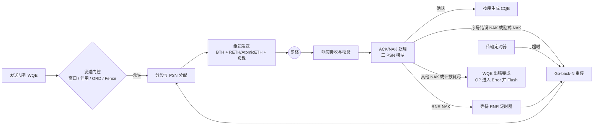

# 请求方行为：重传、超时、RNR 与 READ/ATOMIC（Requester Behavior）

> **摘要**：请求方负责把 WQE 切分成请求包、分配 PSN、跟踪未完成请求，并根据 ACK / NAK / 超时决定"完成、重传还是报错"。本文按规范梳理请求包生成规则、响应校验与"三 PSN 模型"、传输定时器（Ttr = 4.096 µs × 2^LocalAckTimeout）、Retry 与 RNR 两个重试计数器、Go-back-N 重传的定位方法、READ/ATOMIC 的特殊处理以及 CQE 的生成时机，最后给出每 QP 请求方状态字段清单。
>
> **规范出处**：Vol1 §9.7.3（p.313–318）；§9.7.5.2.8 RNR NAK（p.352–355）；§9.7.6 请求方接收响应（p.355–366）；§9.7.7（p.366–381）；§9.4.4–§9.4.5（p.279–290）；§9.5（p.291–292）；§9.9.2（p.424–435）；§9.10.2 Table 64（p.453–454）；§10.8.6（p.554）；§11.2.1.2（p.588–591）；§11.2.5.2（p.611–617）；§12.7.29–§12.7.39（p.736–738）
>
> **前置阅读**：[PSN 模型与 ACK/NAK 协议](05-psn-and-ack-nak.md)、[操作与报文序列](02-operations.md)、[事务排序与入站校验](03-ordering-and-validation.md)
>
> **关键词**：Requester, Next PSN, 三 PSN 模型, Transport Timer, Local ACK Timeout, Retry Count, RNR Retry Count, Go-back-N, 隐式 NAK, Initiator Depth, Responder Resources, Fence, CQE

## 1. 请求方的职责总览



规范对请求方的要求分散在 §9.7.3（生成请求）、§9.7.6（接收响应、定时器）、§9.7.7（MSN、信用）与 §9.9.2（错误）中，本文按实现顺序把它们串起来。PSN 与 AETH 的编码细节见 [PSN 与 ACK/NAK](05-psn-and-ack-nak.md)，错误分类见 [错误处理](08-error-handling.md)。

## 2. 生成请求包（§9.7.3）

### 2.1 PSN

- 每个请求包的 BTH.PSN 填"当前 PSN"（C9-64）；首包用建连时约定的初始 PSN（C9-65）〔Vol1 §9.7.3.1, p.313〕。
- 每包加 1；READ 之后的请求包 = READ 最后一个预期响应包 PSN + 1（C9-66, Table 42）〔p.314〕。计算方法与示例见 [PSN 与 ACK/NAK §2.2](05-psn-and-ack-nak.md)。

### 2.2 OpCode 序列

请求方生成的 OpCode 必须符合有效序列表（C9-67, Table 43），且取值符合 OpCode 表（C9-68）〔Vol1 §9.7.3.3, p.317〕：

| 前一个包 | 当前包允许的 OpCode |
|---|---|
| 无（如建连后第一个包） | First 或 Only |
| First | Middle（消息 ≥ 3 包）或 Last（消息恰为 2 包），操作类型必须与前一包一致 |
| Middle | Middle 或 Last，操作类型必须一致 |
| Last | First 或 Only（新消息） |
| Only | First 或 Only |

### 2.3 负载长度

| OpCode 位置 | 负载长度 | 条款 |
|---|---|---|
| First / Middle | 恰好 PMTU | C9-69 |
| Only | 0 … PMTU（零字节传输只能用单包消息） | C9-70 |
| Last | 1 … PMTU | C9-71 |
| RDMA WRITE 的 RETH.DMALen | 0 … 2^31 字节 | C9-72 |

出处〔Vol1 §9.7.3.4, p.317〕；RDMA READ 的 DMALen 同样为 0 … 2^31（C9-22）〔Vol1 §9.4.4, p.279〕。正因为非末包都等于 PMTU，PSN 与字节偏移之间是简单的线性关系，这是 §6.2 重传定位的基础。

### 2.4 AckReq 的设置

规范把"确保拿到需要的显式响应"交给请求方（C9-60, p.305）。常见策略：每个消息末包置 AckReq；发送队列最后一个 WQE 的末包必须置位或用其他方法逼出响应，否则响应方可能无限期合并〔Vol1 §9.7.5.1.6, p.344〕；受信用限制的 SEND 单包必须置 AckReq（C9-163, p.381）。置 AckReq 的 SEND/WRITE 包同时是启动传输定时器的条件（§4）。

### 2.5 发送门控：什么时候可以发下一个包

| 门控条件 | 依据 | 说明 |
|---|---|---|
| 未完成 PSN 不超过 2^23 | C9-61〔p.308〕 | 实现通常远小于该值，例如 Linux rxe 限制为 128 个未确认 PSN（`RXE_MAX_UNACKED_PSNS`）〔业界实践: Linux rxe_param.h、rxe_req.c〕 |
| 端到端信用：消耗 RWQE 的请求需 SSN ≤ LSN | C9-159…C9-163〔p.378–381〕 | 受限 SEND 只发一包且置 AckReq，见 [PSN 与 ACK/NAK §6.6](05-psn-and-ack-nak.md) |
| 未完成 READ + ATOMIC < Initiator Depth | §12.7.30〔p.736〕、§9.4.4〔p.281〕、§9.4.5.3〔p.286〕 | 超出会被对端 NAK-Invalid Request（C9-86），两端 QP 均进入 Error |
| Fence：前序 READ/ATOMIC 未完成时阻塞带 Fence 的 WR | C9-31〔p.292〕 | 见 §7.5 |
| RNR 等待：定时器未到期前不得重发被 RNR NAK 的请求 | C9-130〔p.353〕 | 新请求也不应越过它发送（必须保序，C9-25） |
| QP 状态允许发送（RTS；SQD 时在消息边界停止） | §10.3〔p.483–493〕 | 见 [QP 状态机](../03-verbs-and-resources/02-qp-state-machine.md) |
| 速率控制：静态速率（§9.11, p.456）与拥塞控制的注入速率（CA17-45） | §9.11、§A17.9.3 | 见 [DCQCN](../05-congestion-control-and-qos/04-dcqcn.md) |

## 3. 接收响应的校验（§9.7.6.1）

### 3.1 校验步骤

1. **包头校验**：按 §9.6 校验，不合格**静默丢弃**（C9-133）〔p.355〕。RoCEv2 还包括 IP/UDP/ICRC 规则（CA17-24）〔p.1936〕；被静默丢弃的包不计入传输定时器的"收到响应"〔Vol1 §9.6, p.295〕。
2. **PSN 检查**：检测乱序响应，并据此识别合并确认（C9-134）〔p.355〕。
3. **Syndrome 合法性**：按 Table 47 检查，含保留 NAK 码的响应直接丢弃（C9-135）〔p.356〕。
4. **类型一致性**：响应必须与未完成请求的类型相符。拥塞时可能出现"期待 READ/ATOMIC 响应却收到 ACK"（即使 PSN 正好匹配），反之亦然；不一致时按 Table 59 处理〔p.356〕——在期望 PSN 上收到意外 OpCode 属于 **Bad Response**（Class B），但规范允许两种例外不按 Bad Response 处理：重复 READ 请求导致的 READ 响应 OpCode 乱序，以及期待 READ/ATOMIC 响应时收到的（可能是主动发送的）ACK，后者可直接丢弃〔Vol1 §9.9.2.3, Table 59 注 d, p.430〕。
5. **本地错误**：处理响应时请求方自身的故障（如写本地内存出错），按 §9.9.2（p.424–435）处理〔§9.7.6.1, p.356〕。

### 3.2 三 PSN 模型

请求方校验响应 PSN 依赖三个点〔Vol1 §9.7.6.1, p.357–358, Figure 100〕：

1. **最大前进点（Maximum Forward Progress）**：已发送请求的逻辑最大 PSN，**包括为 READ 响应预留的 PSN**，是有效区的右边界。
2. **最老未确认请求（Oldest Unacknowledged）**：请求方眼中响应方的最大进展，也是重复区的终点。
3. **最老有效请求（Oldest Valid）**：有效区的左边界。

```text
  |<-------------------------- 有效区 ------------------------------>|<---- 无效区 ---->
  最老有效请求              最老未确认 (una)                    最大前进点 (max)
  |------- 重复区 -----------|========= 未确认区 [una, max] ==========|
     重复响应：丢弃                期望的响应：正常处理                 幽灵 ACK：丢弃
     （但须提取信用）
```

- 落在 [una, max] 的响应是**期望响应**。
- 落在 una 之前（仍在有效区内）的是**重复响应**：丢弃且无副作用（C9-138, C9-145），但若对端产生端到端信用，必须先提取信用（C9-144）〔p.362, p.365〕。
- 有效区之外的是**幽灵 ACK（ghost acknowledge）**，必须丢弃（C9-136）〔p.358〕；例外是建连初期 PSN = 初始 PSN − 1 的主动 ACK，可接受其中的 MSN 与信用〔p.374〕。

**重传时的"高水位"**：重传意味着请求方"回退"发送一个比最大前进点小的 PSN，此时仍必须保留最大前进点。因为响应方可能把重传包当作重复请求，回复"它自己的最远进展"，其 PSN 可能大于被重传包的 PSN（但不会超过最大前进点）。维护"最大前进点、最老未确认、当前重传 PSN"三个指针即规范所说的**三 PSN 范式（three PSN paradigm）**〔Vol1 §9.7.6.1.1, p.358–360, Figure 101〕。

> 例：请求方发出 PSN 1…10，响应方全部收到并执行，但 PSN 5…10 的 ACK 丢失。超时后请求方从 una = 5 重传，响应方发现 5 落在重复区，回 PSN = 10 的 ACK（最近完成的新请求）。请求方必须接受这个"超前"的 PSN（10 ≤ max），一次性完成到 10 并停止重传 6…10。

### 3.3 响应处理决策表

| 收到的响应（PSN = P） | 条件 | 请求方动作 |
|---|---|---|
| ACK | P ∈ [una, max] | 按合并规则完成 PSN ≤ P 的 SEND/WRITE；若越过某个未完成 READ/ATOMIC → **隐式 NAK**（§3.4）；una 前移；Retry/RNR 计数复位；有未完成期望响应则重启定时器，否则停止 |
| ACK | P 在重复区（含 una − 1 的主动 ACK） | 丢弃，仅提取信用与 MSN（C9-144/C9-145/C9-217） |
| ACK | P 在有效区之外 | 幽灵 ACK，丢弃（C9-136） |
| READ Response First / Middle / Last / Only | P == 下一个期望的 READ 响应 PSN | 写入本地缓冲（偏移 = 已收包数 × PMTU）；First/Only 的 AETH 隐式确认之前请求；Last/Only 完成该 READ |
| READ Response | P 越过期望 PSN（中间有响应包丢失） | 规范要求检测乱序（C9-134），未规定必须立即重试：可作为隐式 NAK 立即从缺口重发 READ，也可丢弃并等超时（Linux rxe 采用后者）〔业界实践: rxe_comp.c check_psn()〕 |
| ATOMIC Acknowledge | P == 该 ATOMIC 的 PSN | 把 AtomicAckETH 中的原值写回本地缓冲，完成 |
| NAK-PSN Sequence Error | P ∈ [una, max] | P 之前的请求按合并规则确认；从 P（或更早）Go-back-N 重传；Retry − 1（C9-137） |
| RNR NAK | P ∈ [una, max] | P 之前按合并规则确认；RNR 计数 − 1（值为 7 时不减）；等待 ≥ 定时器后从 P 重发**同一**消息（C9-128/C9-130/C9-132） |
| NAK-Invalid Request / Remote Access / Remote Operational | P ∈ [una, max] | P 之前按合并规则完成；P 所在 WQE 以对应状态出错完成，QP 进入 Error，后续 WQE Flush（Class B） |
| 任意 | 保留 NAK 码 | 丢弃（C9-120/C9-135），可能最终导致超时 |
| 类型与未完成请求不符 | P 为期望 PSN | Bad Response（Class B），上述两种例外除外 |

### 3.4 隐式 NAK 的推断规则

规范在合并规则中定义：若存在 PSN 早于响应 PSN 的未完成 READ 或 ATOMIC 请求，该响应对其中最老的一个构成隐式否定确认，其后的请求都不被确认〔Vol1 §9.7.5.1.2, p.332〕。Table 59 把它列为 **Implied NAK Sequence Error**："请求方检测到一个 ACK，其 PSN 大于某个 READ 或 ATOMIC 响应的期望 PSN"，属本地检测错误，未超重试上限时为 Class A（可重试）〔Vol1 §9.9.2.3, Table 59, p.428〕。实现上可表述为：

```text
# P = 响应包的 PSN
# covered(W)：响应为正确认（ACK / READ 响应 / ATOMIC 响应）时 W.last_psn 不晚于 P；
#             响应为 NAK / RNR NAK 时 W.last_psn 早于 P（被 NAK 的那个请求本身不算确认）
for 未完成 WQE W（从最老开始）:
    if W 是 SEND/WRITE:
        if covered(W): 确认 W（可完成）
        else:          break
    else:                                          # W 是 READ / ATOMIC
        if P 落在 W 自己的响应 PSN 区间内:  交给 READ/ATOMIC 响应处理；break
        if P 晚于 W.last_psn:               隐式 NAK：Retry − 1，从 W 开始 Go-back-N 重传
        break                              # W 之后的请求都不被这个响应确认
```

> [!NOTE]
> Linux rxe 的 `check_psn()` 正是这样实现：若响应 PSN 晚于最老 WQE 的 `last_psn` 而该 WQE 是未完成的 READ/ATOMIC，则进入重试流程〔业界实践: Linux drivers/infiniband/sw/rxe/rxe_comp.c〕。

## 4. 传输定时器（Transport Timer）

### 4.1 启动、重启与停止

每个发送队列必须实现一个传输定时器来发现丢失的响应（C9-139）〔Vol1 §9.7.6.1.3, p.363〕。它**不**为每个请求单独计时，而是检测"响应持续缺席"；它度量的是以下两者中较短的一个：自发出一个 AckReq=1 的包以来的时间，或自最后一个合法确认到达以来的时间〔p.363〕。

| 事件 | 定时器动作 |
|---|---|
| 定时器未运行，且（发出 AckReq=1 的 SEND/WRITE 包，或发出 READ 请求，或发出 ATOMIC 请求） | **启动** |
| 收到一个新的入站确认包，且仍有未完成的期望响应 | **重启** |
| 不再有未完成的期望响应 | **停止** |

"期望响应"由置 AckReq 的请求包、READ 请求或 ATOMIC 请求产生；"未完成的期望响应"即尚未被确认的此类请求的响应〔p.363–364〕。一个推论：AckReq=0 的 Middle 包本身不启动定时器——这也是消息末包应置 AckReq 的原因之一。

### 4.2 超时时间 Ttr 与检测窗口

> [!IMPORTANT]
> **C9-140**：Ttr = 4.096 µs × 2^(Local ACK Timeout)。Local ACK Timeout 为 5 位，**0 表示禁用定时器**；非零最小值由 CA 厂商定义，QP 上下文中写入的非零值小于该最小值时，CA 可使用其最小值〔Vol1 §9.7.6.1.3, p.364〕。
>
> **C9-141**：QP 必须能检测超时；超时间隔应在请求被调度之后开始，超时条件 To 的检测时刻应满足 **Ttr ≤ To ≤ 4·Ttr**〔p.364〕。

Local ACK Timeout 取值与 Ttr（由公式计算）：

| 值 | Ttr | 4·Ttr | 值 | Ttr | 4·Ttr |
|---|---|---|---|---|---|
| 0 | 定时器禁用 | — | 16 | 268.435 ms | 1.074 s |
| 1 | 8.192 µs | 32.768 µs | 17 | 536.871 ms | 2.147 s |
| 2 | 16.384 µs | 65.536 µs | 18 | 1.074 s | 4.295 s |
| 3 | 32.768 µs | 131.072 µs | 19 | 2.147 s | 8.590 s |
| 4 | 65.536 µs | 262.144 µs | 20 | 4.295 s | 17.180 s |
| 5 | 131.072 µs | 524.288 µs | 21 | 8.590 s | 34.360 s |
| 6 | 262.144 µs | 1.049 ms | 22 | 17.180 s | 68.7 s（≈1.1 min） |
| 7 | 524.288 µs | 2.097 ms | 23 | 34.360 s | 137.4 s（≈2.3 min） |
| 8 | 1.049 ms | 4.194 ms | 24 | 68.7 s（≈1.1 min） | 274.9 s（≈4.6 min） |
| 9 | 2.097 ms | 8.389 ms | 25 | 137.4 s（≈2.3 min） | 549.8 s（≈9.2 min） |
| 10 | 4.194 ms | 16.777 ms | 26 | 274.9 s（≈4.6 min） | 1099.5 s（≈18.3 min） |
| 11 | 8.389 ms | 33.554 ms | 27 | 549.8 s（≈9.2 min） | 2199.0 s（≈36.7 min） |
| 12 | 16.777 ms | 67.109 ms | 28 | 1099.5 s（≈18.3 min） | 4398 s（≈1.22 h） |
| 13 | 33.554 ms | 134.218 ms | 29 | 2199.0 s（≈36.7 min） | 8796 s（≈2.44 h） |
| 14 | 67.109 ms | 268.435 ms | 30 | 4398 s（≈1.22 h） | 17592 s（≈4.89 h） |
| 15 | 134.218 ms | 536.871 ms | 31 | 8796 s（≈2.44 h） | 35184 s（≈9.77 h） |

### 4.3 如何选择 Local ACK Timeout

- 规范建议：REQ 发送方按 **2 × PacketLifeTime + 本端 CA ACK Delay** 计算并通过 CM 告知对端；对端不强制使用，但"强烈建议"使用。取值过小会增加超时重传次数与 CA 的工作量；过大则延长发现丢包（如线路 CRC 错误）的时间〔Vol1 §12.7.34, p.737–738〕。
- REP 中的 Target ACK Delay（4.096 µs × 2^x）是目标 CA 从收到消息到发出 ACK/NAK 的最大预期间隔，接收方应结合网络传播时延估计超时〔§12.7.33, p.737〕；Query HCA 返回本端的 "Local CA ACK Delay"，供计算上述两个字段使用〔§11.2.1.2, p.591〕。
- RoCEv2 没有 IB SA 的 PathRecord。Linux rdma_cm 在 RoCE 上把路径的 PacketLifeTime 固定为 16（`CMA_IBOE_PACKET_LIFETIME`），再由 `cm_ack_timeout()` 按"2 × 生存期 + ACK 延迟"折算，结果通常为 17 或 18（Ttr ≈ 0.54 s / 1.07 s）；perftest 默认 timeout = 14、retry = 7〔业界实践: Linux drivers/infiniband/core/cma.c、cm.c；linux-rdma/perftest〕。具体数值以所用内核与工具版本为准。
- 从首次超时到报 Transport Retry Counter Exceeded 的总时间约为 (Retry Count + 1) × [Ttr, 4·Ttr]。例如 timeout = 14、Retry Count = 7：约 0.54 s～2.1 s；timeout = 18：约 8.6 s～34 s。

> [!TIP]
> 在启用 PFC 的无损网络中，PFC 暂停与拥塞排队会显著拉长 ACK 的尾延迟。Local ACK Timeout 过小会引发"伪超时"——重传包又加重拥塞；过大则在真实丢包（链路误码、ICRC 错误、配置错误导致的静默丢弃）时恢复极慢。应以实测 RTT 尾延迟（含暂停）为依据，并结合应用对故障检测时间的要求选择，详见 [性能调优](../07-engineering-practice/03-performance-tuning.md)。

## 5. 重试计数器

### 5.1 Retry Count（错误重试计数器）

- **位宽**：3 位（C9-142）〔p.364〕；由 CM REQ 的 Retry Count 字段（3 位，字节偏移 47[5]）传递——"REQ 发送方希望接收方对超时、序号错误等重试的总次数"〔§12.7.38, p.738；§12.6.5 Table 106, p.718〕；Verbs 在 RTR→RTS 迁移时设置（"Retry count，仅 RC"）〔§11.2.5.2, p.612, p.616〕，libibverbs 中为 `retry_cnt`〔业界实践: rdma-core〕。
- **递减**：传输定时器对某请求包超时一次（C9-142）、某请求包收到一次 NAK-PSN Sequence Error（C9-137, p.360）、发生一次隐式 NAK（§9.9.2.1.1, p.425），各减 1。三者共用同一个计数器（C9-212, p.431）。
- **重装**：该未完成请求被清除时重装（C9-137/C9-142）；"每当一个包被正确确认，重试计数器就应重装"〔p.426〕。
- **耗尽**：不支持自动路径迁移（APM）时，再次超时 / 再次收到序号错误 NAK 即宣告本地检测错误（C9-143, p.364–365；C9-137），完成状态为 **Transport Retry Counter Exceeded**〔p.426〕；支持 APM 时先迁移到备用路径、重装计数器再重试，仍失败才报错（o9-82, p.360–361；o9-86, p.365；o9-152, p.426）。

### 5.2 RNR Retry Count（RNR 重试计数器）

- **位宽**：3 位，"在建连时用响应方提供的信息装载"（C9-132）〔p.354〕；CM 的 REQ 与 REP 都有 3 位 RNR Retry Count 字段（"REQ 或 REP 发送方希望接收方对 RNR NAK 重试的总次数"）〔§12.7.39, p.738；Table 106 偏移 50[5], p.718；Table 110 偏移 27, p.727〕，接收方不接受时可用 REJ 原因码 29 "RNR Retry Count Reject" 拒绝〔§12.6.7.2, p.725〕；libibverbs 中为 `rnr_retry`。
- **特殊值**：**7 表示无限重试**，计数器不递减（C9-132；§9.9.2.1.1, p.425）。
- **递减 / 重装**：每收到一个 RNR NAK 减 1；收到任何非 RNR NAK 的确认即视为 RNR 已清除，计数器重装〔p.425〕。
- **重试时机**：必须至少等待 AETH 定时器字段指定的时间（C9-130, p.353），之后若计数器非零可以重发；必须是从 RNR NAK 指定 PSN 开始的完全相同的请求消息（C9-128）。
- **耗尽**：完成状态 **RNR Retry Counter Exceeded**，Class B〔Table 59, p.428；Table 93, p.577〕。

> [!WARNING]
> **边界差一次的问题**：C9-132 说"计数器在 RNR 定时器到期时已减到 0 则记录错误"，而 §9.9.2.1.1 说"计数器为 0 时又收到 RNR NAK 才出错"，两种读法对"第几次失败报错"相差一次；Retry Count 的 C9-143 与 §9.9.2.1.1 措辞也有类似差异。工程上普遍按"值为 N 表示最多重传 N 次，第 N+1 次失败报错"实现，例如 Linux rxe 收到 RNR NAK 时"计数 > 0 则减 1 并重试，否则报错"〔业界实践: Linux rxe_comp.c〕。另外注意：规范只给 **RNR** 计数器定义了"7 = 无限"；rxe 对 `retry_cnt == 7` 也不递减（等效无限），这不是规范行为，硬件 RNIC 是否如此以厂商文档为准。

### 5.3 两个计数器对比

| 项目 | Retry Count | RNR Retry Count |
|---|---|---|
| 位宽 | 3 位（C9-142） | 3 位（C9-132） |
| 递减事件 | 传输定时器超时、NAK-PSN Sequence Error、隐式 NAK | RNR NAK（值为 7 时不递减） |
| 重装时机 | 请求被确认 / 清除 | 收到非 RNR NAK 的确认 |
| 特殊值 | 无（7 就是 7 次） | 7 = 无限重试 |
| 重传前等待 | 超时：检测本身在 [Ttr, 4·Ttr]；NAK：可立即重传 | ≥ RNR NAK 的定时器值 |
| 耗尽结果 | 支持 APM 则先迁移；最终 Transport Retry Counter Exceeded | RNR Retry Counter Exceeded |
| CM 字段 | 仅 REQ：Retry Count（§12.7.38） | REQ 与 REP：RNR Retry Count（§12.7.39） |
| libibverbs | `retry_cnt` → `IBV_WC_RETRY_EXC_ERR` | `rnr_retry` → `IBV_WC_RNR_RETRY_EXC_ERR` |

Figure 119 给出的 Class A 处理逻辑〔Vol1 §9.9.2.4.1, p.431〕可直接作为状态机实现的骨架：

```text
if (packet sequence error || local ack timeout)   error_retry_cnt--   // 隐式 NAK 同样计入（§9.9.2.1.1）
if (RNR NAK)                                      rnr_retry_cnt--     // 值为 7 时不减
if (!(sequence error || timeout || RNR NAK))      reload both counters
if (error_retry_cnt expired)                      goto Class B        // RC：WQE 出错完成，QP→Error
if (rnr_retry_cnt expired)                        goto Class B
```

## 6. Go-back-N 重传

### 6.1 触发条件与重传起点

| 触发 | 计数器 | 重传起点 | 依据 |
|---|---|---|---|
| 传输定时器超时 | Retry − 1 | 最老未确认请求（una） | C9-141/C9-142〔p.364〕 |
| NAK-PSN Sequence Error（PSN = P） | Retry − 1 | P；也可以从更早的包开始，这些包会被响应方当作普通重复请求 | C9-121〔p.350〕；§9.7.6.1.2〔p.360–362〕 |
| 隐式 NAK | Retry − 1 | 被隐式 NAK 的 READ / ATOMIC | §9.7.5.1.2〔p.332〕；Table 59〔p.428〕 |
| RNR NAK（PSN = P） | RNR − 1 | 从 P 开始的同一消息，等待 ≥ 定时器 | C9-128、C9-130〔p.353〕 |

对 RC 而言，收到 NAK 后请求方只有两个选择：重试同一请求包，或把当前 WQE 以错误完成并通知客户；并非所有 NAK 都可重试〔Vol1 §9.7.6.1.2, p.362〕。只有 NAK-PSN Sequence Error 与 RNR NAK 应被自动重试，其余 NAK 码必须立即报告给客户且不能重试〔Vol1 §9.9.2.2, p.426〕。

由于响应方在发出序号错误 NAK 后会丢弃一切非 ePSN 的新请求（C9-114, C9-122），请求方必须从起点开始把**之后所有已发出的包**按原 PSN 重新发送，这就是 Go-back-N 的语义；规范 §9.1 也明确 IBA 不支持选择性重传与乱序接收〔Vol1 §9.1, p.254〕。

### 6.2 从哪条 WQE、哪个偏移重新开始

由于非末包恰好 PMTU（C9-69），PSN 与字节偏移呈线性关系。为每个未完成 WQE 记录 `first_psn` / `last_psn`（READ 的 `last_psn` 为最后一个预期响应包 PSN），即可定位：

```c
#include <stdint.h>

#define PSN_MASK 0xFFFFFFu
static inline uint32_t psn_diff(uint32_t a, uint32_t b) { return (a - b) & PSN_MASK; }
static inline int psn_in_window(uint32_t psn, uint32_t lo, uint32_t hi)
{ return psn_diff(psn, lo) <= psn_diff(hi, lo); }

enum op_class { OP_SEND, OP_WRITE, OP_READ, OP_ATOMIC };

typedef struct {
    uint32_t first_psn, last_psn;   /* READ: last_psn = 最后一个预期响应包 PSN */
    enum op_class op;
    uint64_t remote_va;             /* WRITE / READ / ATOMIC */
    uint32_t length;                /* 消息总长度（字节） */
} wqe_track_t;

typedef struct {
    int      wqe_idx;               /* 从哪条 WQE 开始 */
    uint32_t k;                     /* 该 WQE 内跳过的包数（READ：已按序收到的响应包数） */
    uint64_t byte_off;              /* 偏移 = k * PMTU */
    uint64_t read_va;               /* 仅 READ：重发请求的 VA */
    uint32_t read_len;              /* 仅 READ：重发请求的 DMALen */
} retry_point_t;

/* ring[head..tail) 为按 PSN 递增排列的未完成 WQE；P 为重传起点；log2_pmtu ∈ 8..12 */
static int locate_retry(const wqe_track_t *ring, int head, int tail, int size,
                        uint32_t P, unsigned log2_pmtu, retry_point_t *rp)
{
    for (int i = head; i != tail; i = (i + 1) % size) {
        const wqe_track_t *w = &ring[i];
        if (!psn_in_window(P, w->first_psn, w->last_psn))
            continue;
        rp->wqe_idx  = i;
        rp->k        = psn_diff(P, w->first_psn);
        rp->byte_off = (uint64_t)rp->k << log2_pmtu;
        rp->read_va  = 0;
        rp->read_len = 0;
        if (w->op == OP_READ) {                         /* §9.4.4：只重读未收到的部分 */
            rp->read_va  = w->remote_va + rp->byte_off;
            rp->read_len = w->length - (uint32_t)rp->byte_off;
        }
        return 0;
    }
    return -1;                                          /* P 不属于任何未完成 WQE */
}
```

（已用 gcc 编译验证：SEND 跨 0xFFFFFF→0x000000 回绕、READ 从第 2 个响应包重读等用例输出正确。）定位后的处理：

| WQE 类型 | 从第 k 个包恢复的方法 |
|---|---|
| SEND / RDMA WRITE | 跳过前 k 个包：本地 SGL 偏移 = k × PMTU；包 k 的 OpCode 与原来完全相同（k = 0 → First/Only，最后一包 → Last，其余 Middle）；RETH 只在 First/Only，ImmDt/IETH 只在 Last/Only。响应方的 OpCode 序列状态停在中间，因此续传 Middle/Last 是合法的 |
| RDMA READ | 发一个**新的** READ 请求：PSN' = P，VA' = VA + k × PMTU，DMALen' = DMALen − k × PMTU，R_Key 不变（§7.3） |
| ATOMIC | 原样重发（同 PSN、同 AtomicETH），由响应方返回保存的结果（§7.4） |
| 之后的所有 WQE | 从头按原 PSN 重新发送 |

> [!NOTE]
> Linux rxe 的 `req_retry()` 采用同样的思路：把发送 PSN 回退到最老未确认 PSN，对第一个 WQE，SEND/WRITE 跳过 `npsn = comp.psn − first_psn` 个包，READ 则把 iova 前移"已收字节数按 MTU 向下取整"，其后的 WQE 全部从头重发〔业界实践: Linux drivers/infiniband/sw/rxe/rxe_req.c〕。

## 7. RDMA READ 与 ATOMIC 的特殊处理

### 7.1 未完成数上限：Initiator Depth 与 Responder Resources

| 参数 | 含义 | 出处 |
|---|---|---|
| Responder Resources | 发送方作为**目标**时，愿意同时支持的、来自远端 QP 的未完成 READ/ATOMIC 数（可为 0） | §12.7.29〔p.736〕 |
| Initiator Depth | 发送方作为**发起方**时，对远端 QP 同时未完成的 READ/ATOMIC 数（可为 0） | §12.7.30〔p.736–737〕 |

- 协商规则：REQ 的接收方选择的本地 Initiator Depth 不得超过 REQ 中提供的 Responder Resources，否则应发 REJ；REP 的接收方判断 REP 提供的 Responder Resources 是否满足它想用的 Initiator Depth，不满足则发 REJ（原因码 27 "Insufficient Responder Resources"）〔p.725, p.736–737〕。
- READ 的最大未完成数在建连时协商，响应方可以把它限制到每 QP 仅 1 个；支持 ATOMIC 时，该数同时涵盖 ATOMIC 与 READ〔Vol1 §9.4.4, p.281〕。请求方有责任保证未确认的 READ 与 ATOMIC 合计不超过接收方资源〔§9.4.5.3, p.286〕。超过时响应方返回 NAK-Invalid Request（C9-86）〔p.328〕。
- 能力上限通过 Query HCA 获取：Max Responder Resources per QP、Max Initiator Depth per QP〔§11.2.1.2, p.591〕；Modify QP 在 Init→RTR 设置 "Number of responder resources for RDMA Read/atomic ops"，在 RTR→RTS 设置 "Number of Outstanding RDMA Read/atomic ops at destination"〔§11.2.5.2, p.612〕。
- 〔业界实践: rdma-core〕libibverbs 对应 `max_dest_rd_atomic`（入向，常称 IRD）与 `max_rd_atomic`（出向，常称 ORD）；librdmacm 对应 `rdma_conn_param.responder_resources` / `initiator_depth`。本端 `max_rd_atomic` 必须 ≤ 对端 `max_dest_rd_atomic`。

### 7.2 READ 响应的接收

- 响应 PSN 从 READ 请求 PSN 起连续递增（C9-96, C9-117）；AETH 只在 First / Last / Only 中（C9-97, C9-98）；First/Middle 恰好 PMTU，Last 为 1…PMTU，Only 为 0…PMTU（C9-99）〔p.332–334, p.346〕。第 k 个响应包的数据写到本地 SGL 偏移 k × PMTU 处。
- READ 响应负载总量过多或过少 → 本地检测的 **Length error**（Class B）→ 完成状态 Local Length Error〔Table 59, p.429；Table 93, p.578〕。
- 在期望 PSN 上收到错误类型的包（例如该是 Middle 却来了 Last，或 READ 响应的 AETH 中带 NAK 码）→ **Bad Response**（Class B）〔Table 59 注 d, p.430〕。
- 响应方中途出错时会停止发送数据，并把出错的那个包换成带 NAK 码的 Acknowledge（C9-100, p.334）；此时 READ 的本地目标缓冲内容不确定〔Vol1 §10.3.1.7, p.492〕。

### 7.3 READ 的重传

规范对重试的 READ 请求规定〔Vol1 §9.4.4, p.282〕：
- 不必与原请求相同的地址与长度，可以**只重读首次未成功响应的部分**；
- 响应方会对重试请求重新校验 R_Key 与虚拟地址；
- 重试 READ 的 PSN 必须落在响应方的重复区，且不必等于原 PSN；
- 重试请求必须精确对应原请求的一个子集，使所有可能出现的重复响应包——无论来自原请求还是重试请求——具有**相同的负载数据与 PSN**。

例：READ PSN = 500，VA = 0x1000_0000，DMALen = 10000，PMTU = 4096 → 响应 PSN 500/501/502。收到 500（First，4096 B）后 501 丢失，502 到达时被检测为乱序。请求方重发 READ：**PSN = 501，VA = 0x1000_1000，DMALen = 5904**，R_Key 不变。响应方（ePSN = 503）判定 501 在重复区且属于原 READ 的 PSN 范围，重新读取并从 PSN 501 开始响应（C9-107）。注意：重试请求只有 5904 字节，响应会以 First(501) + Last(502) 的 OpCode 返回，而不是原来的 Middle + Last——这就是 Table 59 注 d 允许"重复 READ 导致的 READ 响应 OpCode 乱序"不按 Bad Response 处理的原因；Linux rxe 的 `check_ack()` 中也有专门分支处理这种情况，其注释写明"部分数据的 READ 重试可能从 Response First 或 Response Only 重新开始"〔业界实践: rxe_comp.c〕。

### 7.4 ATOMIC 的重传与"至多一次"

- ATOMIC 保证**至多执行一次**；请求或响应丢失时请求方按正常流程重试，重试包与原请求完全相同（同 PSN）〔Vol1 §9.4.5.3, p.288–289〕。
- 响应方识别出重复 ATOMIC 后**不重新执行**，而是返回原执行时保存的结果；它不会对重试的 ATOMIC 重新校验 R_Key，也不重新翻译虚拟地址〔p.289〕。保存结果的 FIFO 深度等于建连时协商的未完成 ATOMIC + READ 数〔§9.4.5.3, p.287〕，所以请求方遵守 Initiator Depth 限制时，被重试的 ATOMIC 一定能找到保存的结果（o9-67 指出"只要请求方遵守未完成 ATOMIC 数的限制，就不应发生找不到的情况"）〔p.343〕。
- 如果所有重试都失败，请求方无法确定 ATOMIC 是否已在目标执行，但连接已处于 Error 状态，需要由上层协议处理〔p.288–289〕。

### 7.5 排序与 Fence

- READ / ATOMIC 是宽松排序的：响应方可以先执行 READ 之后的请求；排在 READ 之后的 ATOMIC 也可能在 READ 读取数据之前就修改目标内存。需要严格顺序时，给后一个 WR 加 **Fence**〔Vol1 §9.4.5.2, p.286〕。
- **C9-31**：带 Fence 属性的 WR 必须阻塞，直到之前所有 RDMA READ 与 ATOMIC WR 都完成〔Vol1 §9.5, p.292〕。接收端的完成顺序只对 SEND 与带立即数的 WRITE 有意义，并不意味着之前的 READ 已完成，除非请求方使用了 Fence（C9-29）〔p.292〕。

## 8. 完成（CQE）的生成

| WQE 类型 | 可以成功完成的条件 |
|---|---|
| SEND / RDMA WRITE | 其最后一个包被确认覆盖：显式 ACK、PSN 更大的合并 ACK、更晚请求的 NAK / RNR NAK（PSN 更大）、更晚 READ 的 First/Only 响应、更晚 ATOMIC 的响应 |
| RDMA READ | 全部响应包已收到并写入本地内存，且收到 Last/Only 包（其 AETH 显式确认该 READ） |
| ATOMIC | 收到 ATOMIC Acknowledge，且原值已写入本地缓冲 |

- **按序完成**：WQE 必须按发送 / 提交的顺序完成，与执行顺序无关（C9-30, C9-32）〔p.292〕。因此即使 READ 之后的 SEND 已被 MSN 或 ACK 覆盖，也要等 READ 完成后才能产生 SEND 的 CQE（Figure 104, p.370）。由于可靠服务对请求与响应的排序保证，请求方可以在收到响应时就写 CQE〔p.292〕。
- **MSN 辅助完成**：收到新 MSN 时，从最老 WQE 起完成到 SSN == MSN 或第一个未完成的 READ/ATOMIC 为止（§9.7.7.1.1, p.368–370）。
- **不请求信号（unsignaled）的 WR**：成功时不产生 CQE，其完成由同一发送队列上后续 WR 的 CQE 间接确认；取到后续 WR 的完成后，CI 不得再访问该 WR 的缓冲（C10-108）〔Vol1 §10.8.6, p.554〕。
- **出错**：本地在发送过程中检测到的错误，CA 应停止该 QP 的发送，保存错误状态直到之前所有未完成 WQE 都完成，再以错误完成受影响的 WQE（C9-209）〔p.424〕；Class B 错误：当前 WQE 以错误完成，发送队列（RC 为整个 QP）进入 Error，后续 WQE 以 "Flushed in Error" 完成（C9-214）；处于 Error 状态时到达的确认一律静默丢弃（C9-215）〔p.432〕。完成状态与 QP 状态变化的完整对照见 [错误处理](08-error-handling.md)。

## 9. 「硬件实现要点」

### 9.1 每 QP 请求方状态字段（设计建议）

下表是一个可行的上下文划分（非规范要求；位宽为建议值，SQ 深度以 64K 为例）。规范 Table 64 列出的连接参数（XmitPSN、AckPSN、Error Retries、RNR Retry init/counter、Local ACK Timeout、SSN、LSN、Num_RDMA_Reads、Tx WQE pointer、Tx ACK WQE pointer 等）都能在其中找到对应项〔Vol1 §9.10.2, Table 64, p.453–454〕。

| 字段 | 建议位宽 | 说明 |
|---|---|---|
| qp_state | 3 | Reset/Init/RTR/RTS/SQD/SQEr/Error |
| pmtu_log2 | 3 | 8…12（256…4096 B） |
| dest_qpn | 24 | 对端 QPN |
| next_psn | 24 | 下一个**新**包的 PSN（XmitPSN） |
| una_psn | 24 | 最老未确认 PSN（AckPSN，期望的下一个响应 PSN） |
| max_psn | 24 | 最大前进点（含 READ 预留），三 PSN 模型的高水位 |
| retry_psn / in_retry | 24 + 1 | 重传进行中的当前 PSN 与标志 |
| tx_wqe_idx / tx_pkt_idx | 16 / 24 | 正在发送的 WQE 及其包序号（Tx WQE pointer） |
| ack_wqe_idx | 16 | 最老未完成 WQE（Tx ACK WQE pointer） |
| ssn / lsn / e2e_valid | 24 / 24 / 1 | 端到端信用（收到"无效"后可永久置 e2e_valid = 0） |
| local_ack_timeout | 5 | Ttr 指数，0 = 禁用 |
| tmr_run / tmr_age | 1 / 2 | 传输定时器（见 §9.3） |
| retry_init / retry_cnt | 3 / 3 | Error Retries |
| rnr_init / rnr_cnt | 3 / 3 | RNR Retry init / counter（7 = 无限） |
| rnr_wait / rnr_deadline | 1 / 16–32 | RNR 等待及到期时间（分辨率 10 µs 即可） |
| rd_atomic_out / max_rd_atomic | 8 / 8 | 未完成 READ+ATOMIC 数与上限（ORD） |
| fence_wait | 1 | 有 Fence WR 在等待 |
| last_tx_op | 5 | 已发出包的 OpCode 类别，用于序列校验与续传 |
| err_pending / err_status | 1 / 5 | 第一个错误及其完成状态（C9-209 要求暂存） |
| 每未完成 WQE 跟踪项 | ≈ 64–96 | first_psn(24)、last_psn(24)、op(3)、signaled/fence(2)、READ 已收字节或包数(24) |

### 9.2 重传定位的实现

- **PSN↔WQE 映射**：PSN 沿发送队列单调递增，在 SQ 旁维护一个"影子环"保存每个 WQE 的 first_psn/last_psn，即可从 ack_wqe_idx 开始顺序查找或二分查找重传起点（§6.2）。
- **偏移计算**：PMTU 是 2 的幂，k × PMTU 只是移位；但本地 SGL 偏移还需要遍历 SGE。可以在 WQE 跟踪项里缓存"每个 SGE 的累计长度前缀"，或在重传时重新遍历（SGE 数通常很少）。
- **负载来源**：WR 完成前其数据缓冲归 CI 使用（Verbs 语义），所以 RNIC 一般**不需要片上重传缓冲**——重传时重新从主机内存 DMA 读取负载即可；inline 数据保存在 WQE 内，WQE 槽位在完成前不会被复用（设计建议）。
- **调度优先级**：重传应优先于新 WQE；重传追上 max_psn 之后再继续发送新包，next_psn 在重传期间保持不变。

### 9.3 传输定时器的实现

C9-139 只要求每个发送队列一个定时器，C9-141 允许检测时刻落在 [Ttr, 4·Ttr]，因此可以用很粗的硬件结构（设计建议）：

- **扫描法**：每 QP 保存最近一次启动/重启的时间戳，后台扫描器周期性检查 `now − stamp ≥ Ttr`。若对某 QP 的扫描周期为 S，检测时刻落在 [Ttr, Ttr + S)，只要 **S ≤ 3·Ttr** 就满足上限 4·Ttr。
- **两位老化法**：为每个 Local ACK Timeout 档位提供周期为 Ttr 的全局节拍；重启时 age 清零，每个节拍 age 加 1，**age 到 2 即超时**，检测时刻落在 (Ttr, 2·Ttr]，满足 C9-141，且每 QP 只需 2 位状态。
- 重启操作只是清零 age / 更新时间戳，可在 ACK 处理流水线中一拍完成；RNR 定时器是独立的"到期时间"，分辨率 10 µs 即可满足 Table 48。

更多结构（重传队列、PSN 映射表、与发送调度器的交互）见 [可靠性引擎](../06-hardware-implementation/04-reliability-engine.md) 与 [发送数据通路](../06-hardware-implementation/02-tx-datapath.md)。

## 10. 要点回顾

- 请求包 PSN 每包加 1，READ 按预期响应包数推进；First/Middle 负载恰为 PMTU，因此 PSN 与偏移线性对应。
- 响应校验依赖三 PSN 模型：[una, max] 为期望响应，之前为重复（丢弃但提取信用），有效区外为幽灵 ACK（丢弃）；重传时必须保留高水位 max。
- 若响应 PSN 越过一个未完成的 READ/ATOMIC，构成隐式 NAK（Class A），需从该 READ/ATOMIC 重传。
- 传输定时器每 QP 一个：发出 AckReq / READ / ATOMIC 时启动，收到确认时重启，无未完成期望响应时停止；Ttr = 4.096 µs × 2^n，n = 0 禁用，检测窗口 [Ttr, 4·Ttr]。
- Retry Count 与 RNR Retry Count 都是 3 位；前者由超时 / 序号错误 NAK / 隐式 NAK 递减，后者由 RNR NAK 递减且 7 = 无限；耗尽分别报 Transport Retry Counter Exceeded 与 RNR Retry Counter Exceeded。
- 重传等效 Go-back-N：从 NAK 的 PSN（或更早）或最老未确认 PSN 开始重发所有后续包；RNR 后必须重发完全相同的消息。
- READ 重传可以只重读缺失部分（PSN、VA、长度按 k × PMTU 平移）；ATOMIC 原样重发，靠响应方保存的结果保证至多一次。
- 未完成 READ+ATOMIC 受 Initiator Depth 约束，且必须 ≤ 对端 Responder Resources。
- WQE 按序完成；Class B 错误使当前 WQE 出错完成、QP 进入 Error、后续 WQE Flush。

## 自测

<details><summary>Q1：Local ACK Timeout = 16、Retry Count = 3，链路彻底中断。从最后一次发出带 AckReq 的包开始，大约多久后应用会看到 IBV_WC_RETRY_EXC_ERR？</summary>

答：每次超时检测在 [Ttr, 4·Ttr] = [268 ms, 1.07 s] 之间；Retry Count = 3 允许重传 3 次，第 4 次超时报错，共 4 次超时，约 1.07 s～4.3 s（未计 APM）。
</details>

<details><summary>Q2：请求方依次发送 WRITE（PSN 10–12）、READ（PSN 13，预期 2 个响应包）、SEND（PSN 15）。收到 PSN = 15 的 ACK，请求方该怎么做？</summary>

答：ACK 隐式确认 WRITE（10–12）；READ 的响应 PSN 区间为 13–14，ACK 的 PSN 15 越过了未完成的 READ → 隐式 NAK（Class A，Retry − 1）；SEND 不被确认。请求方从 READ 开始重发：READ（PSN 13）与 SEND（PSN 15）。
</details>

<details><summary>Q3：为什么请求方在重传 PSN 5 时，收到 PSN = 10 的 ACK 是合法的？请求方需要维护哪些指针？</summary>

答：响应方可能早已执行到 10，把 PSN 5 当作重复请求，按规则回复"最近完成的新请求"的 PSN 10。请求方必须保留最大前进点（max）这一高水位，只要 10 ∈ [una, max] 就是合法响应。三个指针：最大前进点、最老未确认 PSN、当前重传 PSN（三 PSN 范式）。
</details>

<details><summary>Q4：READ（PSN 700，VA 0x2000_0000，长度 9000，PMTU 2048）已收到响应 700、701，之后超时。重试 READ 的 PSN、VA、长度分别是多少？响应会用什么 OpCode？</summary>

答：n = ⌈9000/2048⌉ = 5（PSN 700–704），k = 2：PSN = 702，VA = 0x2000_0000 + 2×2048 = 0x2000_1000，长度 = 9000 − 4096 = 4904（3 个包）。响应 OpCode 为 First(702)、Middle(703)、Last(704)，请求方需接受这种因重试导致的"First 出现在中间"（Table 59 注 d 的例外）。
</details>

<details><summary>Q5：RNR Retry Count 设为 7 与 Retry Count 设为 7 有何不同？</summary>

答：RNR Retry Count = 7 是规范定义的"无限重试"，计数器不递减（C9-132）；Retry Count 没有特殊值，7 就是最多 7 次重传，耗尽后报 Transport Retry Counter Exceeded。（某些软件实现把 retry_cnt = 7 也当作无限，属非规范行为。）
</details>

## 参考

- 规范：Vol1 §9.4.4–§9.4.5（p.279–290）；§9.5（p.291–292）；§9.6（p.292–303）；§9.7.3（p.313–318）；§9.7.5.1.2（p.332–333）；§9.7.5.2.8（p.352–355）；§9.7.6（p.355–366）；§9.7.7（p.366–381）；§9.9.2（p.424–435）；§9.10.2 Table 64（p.453–454）；§10.3.1.7（p.492–493）；§10.8.6（p.554）；§11.2.1.2（p.588–591）；§11.2.5.2（p.611–617）；§12.6.5、§12.6.7.2、§12.6.8（p.717–727）；§12.7.29–§12.7.39（p.736–738）；Annex A17 CA17-24、CA17-45（p.1936, p.1947）。
- 外部：〔业界实践: Linux drivers/infiniband/sw/rxe（rxe_req.c、rxe_comp.c、rxe_param.h）〕；〔业界实践: Linux drivers/infiniband/core/cma.c、cm.c〕；〔业界实践: linux-rdma/rdma-core libibverbs（verbs.h、ibv_modify_qp(3)）〕；〔业界实践: linux-rdma/perftest〕。
- 相关文件：[PSN 与 ACK/NAK](05-psn-and-ack-nak.md)、[响应方行为](07-responder.md)、[错误处理](08-error-handling.md)、[WR 与完成](../03-verbs-and-resources/04-work-requests-and-completions.md)、[可靠性引擎](../06-hardware-implementation/04-reliability-engine.md)。
