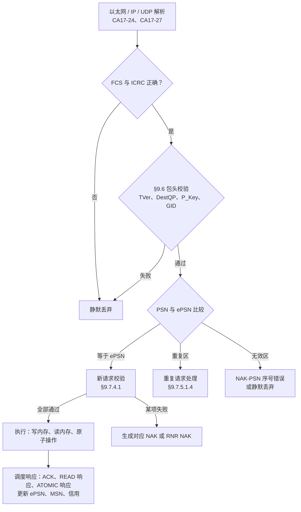
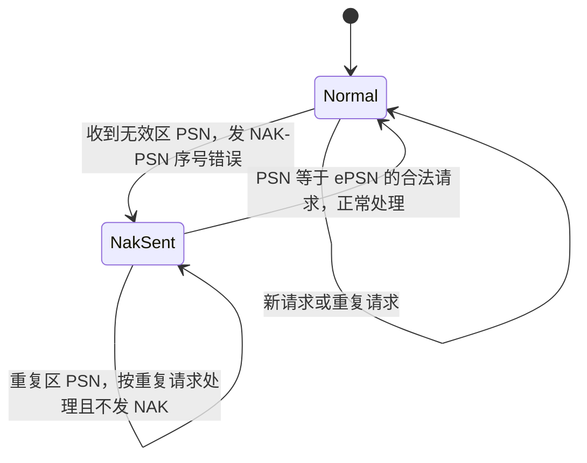
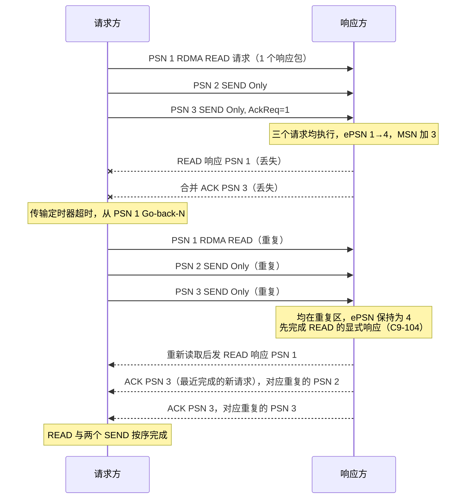
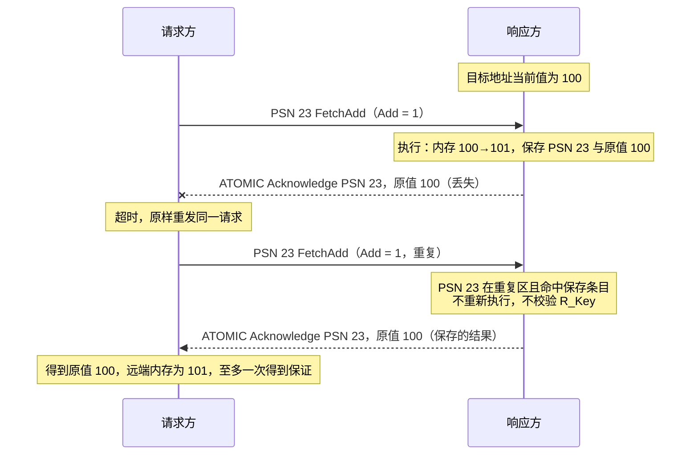

# 响应方行为：PSN 检查、重复请求与 NAK 生成（Responder Behavior）

> **摘要**：响应方对每个入站请求按固定顺序校验（包头 → PSN → OpCode 序列 → OpCode 支持 → 资源 → R_Key → 长度 → 执行），据此执行请求、回 ACK、返回 NAK 或静默丢弃；它还必须正确处理重复请求（重复 SEND/WRITE 只回 ACK、重复 READ 重读、重复 ATOMIC 返回保存的结果），并保证所有响应严格按 PSN 顺序发出。本文给出完整的校验顺序表、NAK 生成规则、"NAK 只发一次"的状态机、Responder Resources 的含义以及每 QP 响应方状态清单。
>
> **规范出处**：Vol1 §9.6（p.292–303）；§9.7.4（p.318–331）；§9.7.5（p.331–355）；§9.7.7.1–§9.7.7.2（p.367–381）；§9.4.4–§9.4.5（p.279–290）；§9.5（p.291–292）；§9.9.3（p.435–449）；§9.10.2 Table 64（p.453–454）；§11.2.5.2（p.615–616）；§11.6.3.1（p.691）；§12.7.29（p.736）；Annex A17 CA17-24（p.1936）、CA17-27（p.1939）、CA17-33（p.1943）、CA17-41（p.1945）
>
> **前置阅读**：[PSN 模型与 ACK/NAK 协议](05-psn-and-ack-nak.md)、[事务排序与入站校验](03-ordering-and-validation.md)、[操作与报文序列](02-operations.md)
>
> **关键词**：Responder, ePSN, 入站校验, 重复请求, NAK-PSN Sequence Error, NAK-Invalid Request, NAK-Remote Access Error, NAK-Remote Operational Error, RNR NAK, Responder Resources, ATOMIC 结果缓存, MSN, Credit

## 1. 响应方处理流水线概览

RC HCA 的入站请求必须按 Figure 90 的流程校验（C9-73）〔Vol1 §9.7.4.1, p.318–319〕。各错误条件对应的响应方行为由 §9.9.3 的 Table 61 / Table 62 统一规定〔p.436–439〕，汇总见 [错误处理](08-error-handling.md)。

## 2. 前置：静默丢弃类检查

在进入 PSN 检查之前，入站包要先通过链路层、网络层和 §9.6 的包头校验，任何一项失败都**静默丢弃**：

| 检查 | 条款 / 出处 |
|---|---|
| 不符合 RoCEv2 的以太网 / IP / UDP / ICRC 规则 | CA17-24〔§A17.3.4, p.1936〕 |
| IP 版本号与报文类型不符（IPv6 报文版本 ≠ 6、IPv4 报文版本 ≠ 4） | CA17-27〔§A17.4.4.1, p.1939〕 |
| BTH.DestQP = QP0 | CA17-33〔§A17.6, p.1943〕 |
| ICRC 错误（与 VCRC、LVer 错误一样在到达传输层前丢弃） | §9.6 脚注 10〔p.293〕；CA17-22〔p.1935〕 |
| BTH.TVer ≠ 0 | C9-36〔p.295〕 |
| 目的 QP 不存在、状态不允许接收、或服务类型与 OpCode[7:5] 不符 | C9-37 / C9-38 / C9-39〔p.295–296〕 |
| P_Key 与接收队列的 P_Key 不匹配 | C9-43〔p.297〕 |
| RC 的 SGID / DGID 校验失败（RoCEv2 由 IP 地址映射得到 GID；GID type 与报文协议不符视为失败） | C9-47.1.1〔p.299〕；§A17.4.4.2〔p.1939〕；CA17-41〔p.1945〕 |
| QP 处于 Error 状态 | C10-41.2.1〔p.493〕 |

规范对"静默丢弃"的定义〔Vol1 §9.6, p.293, p.295〕：不返回确认；不消耗接收 WQE；不执行该包；之前收到的请求照常执行完成；**不更新 ePSN**；继续等待合法请求；该包也**不计入**请求方传输定时器的"收到响应"。连接不拆除，队列状态不变。完整的包头校验流程见 [事务排序与入站校验](03-ordering-and-validation.md)。

## 3. 新请求的校验顺序（§9.7.4.1，Figure 90）

| 步骤 | 检查 | 失败时的处理 | NAK 的 BTH.PSN | RC 故障类别 | 依据 |
|---|---|---|---|---|---|
| 0 | PSN 与 ePSN 比较 | 等于 → 继续；重复区 → §5；无效区 → NAK-PSN Sequence Error（静默期内则丢弃） | ePSN | Class B | C9-74、C9-78、C9-79〔p.322–325〕 |
| 1 | OpCode 序列（Table 45） | NAK-Invalid Request | ePSN | Class C | C9-81〔p.326〕 |
| 2 | OpCode 是否被本 QP 支持（功能未启用、RC/RD 保留 OpCode） | NAK-Invalid Request | ePSN | Class C | C9-82、C9-83、C9-84〔p.327〕 |
| 2a | First / Middle 包 PadCnt ≠ 0 | NAK-Invalid Request | ePSN | — | C9-85〔p.328〕 |
| 2b | READ / ATOMIC 资源不足（超出 Responder Resources） | NAK-Invalid Request | ePSN | Class C | C9-86〔p.328〕 |
| 2c | ATOMIC 的 VA 未按 8 字节自然对齐 | NAK-Invalid Request | ePSN | Class C | §9.4.5 第 4 条〔p.283〕 |
| 3 | 资源是否可用（如需要接收 WQE 而没有） | RNR NAK（对 RC 为可选） | 被拒请求的 PSN | Class B | Figure 90〔p.319〕；C9-113〔p.343〕 |
| 4 | RDMA / ATOMIC 请求的 R_Key（零长度 READ/WRITE 不校验，C9-88） | NAK-Remote Access Error | 出错包 PSN | Class C | C9-89、C9-90〔p.329〕；C9-124〔p.350〕 |
| 5 | 长度（见下文） | NAK-Invalid Request | ePSN | Class C | C9-91…C9-94〔p.330〕 |
| 6 | 执行过程中的本地错误（如畸形接收 WQE、本地地址翻译失败） | NAK-Remote Operational Error | 正在执行的请求 PSN | Class A | §9.7.4.1.7〔p.330–331〕；C9-126〔p.351〕 |
| 7 | 全部通过 | 执行，进入完成处理与响应调度 | — | — | C9-77〔p.323〕 |

说明：
- Figure 90 中还有一个 XRC 分支（检查远端 XRC 域与 XRCETH，失败回 NAK-Invalid RD），RC 不涉及。长度校验（§9.7.4.1.6）没有画在 Figure 90 中，实现上通常与 OpCode / R_Key 校验并行完成；多个错误同时出现时，图中的先后决定上报哪个 NAK 码。
- **长度校验**包括：接收 WQE 的缓冲不足以容纳入站 SEND（C9-91）；负载长度与 OpCode 不一致——First/Middle 必须等于 PMTU、Only 为 0…PMTU、Last 为 1…PMTU（C9-92、C9-93）；READ 的 DMALen 大于 2^31（C9-94）。对 RDMA WRITE，响应方**可选**地检查 DMALen ≤ 2^31，以及在消息结束时核对负载总和是否等于 DMALen〔p.330〕。WRITE 的 R_Key 边界按每个包检查，READ 则按 RETH.DMALen 一次检查〔p.329〕。
- R_Key 违例包括：RETH / AtomicETH 中的 R_Key 无效；VA、长度或访问类型超出该 R_Key 的本地限制；对 HCA 还包括保护域（PD）违例〔p.329〕。

> [!IMPORTANT]
> 对**新请求**返回任何 NAK 时都遵循同一模式〔p.324, p.328〕：出错包**不执行**；出错包之前收到的请求必须**先执行并完成**，然后才能发 NAK（C9-79、C9-87、C9-90）——这个 NAK 因此同时充当对之前请求的合并确认；响应方**不更新 ePSN**。对 RC 而言，Class C（NAK-Invalid Request、NAK-Remote Access Error）与 Class A（NAK-Remote Operational Error）还会让**响应方自己的 QP 进入 Error 状态**，见 [错误处理](08-error-handling.md)。

## 4. PSN 检查与序号错误（§9.7.4.1.2）

### 4.1 三种结果

响应方必须在执行请求之前，用接收队列比较 BTH.PSN 与 ePSN（C9-74），ePSN 的计算规则与请求方生成 PSN 的规则相同（C9-75）〔p.322〕：

| 结果 | 判定 | 处理 |
|---|---|---|
| 新请求 | PSN == ePSN | 正常校验并按排序规则执行，执行后调度响应（C9-77）；ePSN 前移（READ 前移 n），有效区窗口随之滑动〔p.323–324〕 |
| 有效重复请求 | 落在有效区但 ≠ ePSN | 按 §9.7.5.1.4 处理（C9-78），见本文 §5 |
| 无效请求 | 落在有效区之外 | 不执行；先完成之前的请求；返回 NAK-PSN Sequence Error；不更新 ePSN（C9-79）〔p.324–325〕 |

ePSN 只能在接收队列处于可接收请求的状态时更新，例如 Init 状态下不得修改（C9-76）〔p.323〕。

### 4.2 序号错误 NAK 只发一次

> [!IMPORTANT]
> - **C9-121**：序号错误 NAK 的 BTH.PSN 填响应方的 **ePSN**，让请求方至少回退到出错点重新发送〔p.350〕。
> - **C9-80 / C9-114**：发出序号错误 NAK 后，在收到合法的新请求（PSN == ePSN）或合法的重复请求之前，响应方**不得再产生 ACK 或 NAK**；除重复请求外，其余新请求一律忽略〔p.325, p.343〕。**C9-122**：除合法重复请求外，丢弃所有 PSN ≠ ePSN 的后续请求〔p.350〕。
> - **C9-115**：响应方继续按规则响应重复请求，但处理重复请求时出现的错误**不得**返回 NAK〔p.344〕。
>
> 规范的出发点是"响应方在任一时刻最多只能有一个未决 NAK"〔§9.7.6.1.3, p.362〕；序号错误不会使队列停止，也不需要拆除连接〔p.325〕，接收队列不消耗任何 WQE〔p.350〕。

规范还指出：返回序号错误 NAK **或 RNR NAK** 之后，响应方都会等待请求方发来 ePSN 的包〔p.343〕。因此**设计建议**用同一个"NAK 未决"标志覆盖两种情况：RNR NAK 之后，请求方在收到 RNR NAK 前已经发出的后续包（PSN > ePSN）应静默丢弃，而不是再回一个序号错误 NAK。〔业界实践: Linux rxe 的 `check_psn()` 用 `sent_psn_nak` 标志实现了序号错误的去重，见 drivers/infiniband/sw/rxe/rxe_resp.c〕

### 4.3 Communication Established 事件

对 RC/UC，若 QP 仍处于 RTR 状态时收到第一个包且处理无误，CI 应产生 **Communication Established** 关联异步事件；CI 至少要在入站校验通过"actual PSN = ePSN?"这一步之后才能产生该事件（C11-35）〔Vol1 §11.6.3.1, p.691〕。CM 用它在 RTU 丢失时推进连接状态，见 [CM 协议](../04-connection-management/01-cm-protocol.md)。

## 5. 重复请求处理（§9.7.5.1.4）

### 5.1 总体规则

| 条款 | 要求 |
|---|---|
| C9-102 | 重复请求通过校验后，响应方必须产生响应〔p.336〕 |
| C9-103 | 处理重复请求的整个过程中**不更新 ePSN**，即使生成响应时出错〔p.336–337〕 |
| C9-104 | 对重复 READ / ATOMIC 的显式响应，必须先于对其后重复 SEND / WRITE 的确认发出〔p.337, Figure 95〕 |
| C9-110 | 对所有重复请求按 PSN 顺序响应；若正在响应（新或重复）请求时收到 PSN 更早的重复请求，必须停止当前响应、转而响应更早的那个；被打断的响应不必恢复，由请求方负责重发〔p.341〕 |
| C9-115 | 处理重复请求时出现错误不返回 NAK〔p.344〕 |

连续收到的多个重复请求之间不要求 PSN 连续〔p.337〕。各类重复请求的动作汇总于 Table 44〔p.324〕：

| 重复的请求 | 响应方动作 |
|---|---|
| SEND、RDMA WRITE（或 RD 的 RESYNC） | 不重新执行，只调度确认 |
| RDMA READ | 重新执行（重新读取数据），调度 READ 响应 |
| ATOMIC | **不重新执行**；校验请求后返回该 ATOMIC 保存的结果 |

### 5.2 重复 SEND / WRITE

- **C9-105**：不重新执行，只为该重复包生成一个响应包（排在任何未完成的重复 READ / ATOMIC 响应之后）〔p.338–339〕。所以重复 SEND 不消耗接收 WQE，重复 WRITE 不再写内存，MSN 也不增加（C9-148）。
- 确认的 PSN 为**最近完成的新请求**的 PSN。可以把它看作合并确认的延伸：响应方告诉请求方"从该重复请求到最近完成的请求之间的一切我都已执行"；请求方像对待普通合并 ACK 一样处理它，其中未完成的重复 READ/ATOMIC 视为被 NAK〔p.339, Figure 96〕。
- **C9-106**：对重复 SEND / WRITE 回确认的过程中检测到错误时，静默丢弃该重复请求，以免与可能未决的、针对新请求的 NAK 混淆〔p.339〕。

例（Figure 96, p.340）：请求方发 PSN 1、2、3，响应方回了 PSN=1 与 PSN=3 的 ACK；请求方因超时重发 PSN 1，响应方回复的是 PSN=3 的 ACK（a3 的重发）。

### 5.3 重复 READ

- **C9-107**：响应方必须重新生成读数据；第一个响应包的 PSN 等于重复请求的 PSN，之后按 READ 的正常规则递增〔p.340〕。
- **合法性**：重复 READ 的 PSN 必须在重复区内，并落在原 READ 所分配的响应 PSN 范围内；所请求的数据必须完全包含在原 READ 请求的数据范围之内（原请求的真子集）。否则该请求无效，响应方**可以**静默丢弃〔p.341〕。响应方会对重试的 READ 重新校验 R_Key 与虚拟地址〔§9.4.4, p.282〕。
- **C9-108**：在发出第一个响应包之前出错 → 静默丢弃该重复请求；**C9-109**：已发出一个或多个响应包之后出错 → 中止响应，不再发送后续包〔p.340〕。
- 重复 READ 响应完成后，对之后的重复 SEND / WRITE 可以用最近完成的请求的 PSN 确认〔p.341–342, Figure 97〕。

例：原 READ PSN = 500、VA = V、DMALen = 10000、PMTU = 4096，分配的响应 PSN 为 500–502，ePSN 已到 503。
- 重复 READ（PSN 501，VA = V + 4096，DMALen = 5904）：PSN 在原范围内、数据为原范围的子集 → 合法，从 PSN 501 开始重发 2 个响应包（First、Last）。
- 重复 READ（PSN 501，VA = V + 4096，DMALen = 8000）：请求范围超出原 READ 的末端 V + 10000 → 无效，可静默丢弃。

为了做上述判断，响应方必须在 READ/ATOMIC 资源中保存原 READ 的 PSN 范围、VA、DMALen 与 R_Key（Table 64 中的 "RDMAR/VA/R_Key/Size" 与 "RDMA PSN#"）〔p.454〕。

### 5.4 重复 ATOMIC

接收队列只能为有限数量的 ATOMIC 保存结果。收到重复 ATOMIC 时，把它的 PSN 与最近执行过的 ATOMIC 的 PSN 比较〔p.342〕：

| 条款 | 情况 | 处理 |
|---|---|---|
| o9-66 | PSN 与某个最近执行过的 ATOMIC 完全匹配 | 返回保存的结果，**不重新执行**〔p.342〕 |
| o9-67 | 没有匹配 | 请求无效，静默丢弃（只要请求方遵守未完成 ATOMIC 数的限制就不应发生）〔p.343〕 |
| o9-68 | 本地错误导致无法重现原结果 | 静默丢弃〔p.343〕 |

返回保存结果的条件〔Vol1 §9.4.5.3, p.289〕：请求合法（包头与 OpCode 合法）；是 ATOMIC 操作（可检查 OpCode 与保存的操作相同）；PSN 在重复区；PSN 与某个保存的 ATOMIC 匹配。对重试的 ATOMIC，响应方**不**校验 R_Key、也不翻译虚拟地址〔p.289〕。响应的 PSN 等于该重复请求的 PSN〔p.343〕。PSN 找不到匹配的重复 ATOMIC 属于 Table 61 的 "Invalid duplicate ATOMIC Request"，按 Class D（静默丢弃、不通知客户）处理〔p.438〕。

### 5.5 Responder Resources：要保存多少个结果

- **定义**：Responder Resources 是本端作为目标时，愿意同时支持的来自远端 QP 的未完成 RDMA READ / ATOMIC 数，可以为 0；能力上限由 Query HCA 查询〔Vol1 §12.7.29, p.736〕。Verbs 在 Init→RTR 设置 "Number of responder resources for RDMA Read/atomic ops"，可被向上取整到支持的值但不超过 HCA 最大值〔§11.2.5.2, p.612, p.615〕；libibverbs 中为 `max_dest_rd_atomic`，常称 IRD〔业界实践: rdma-core〕。
- **保存什么**：响应方保存应答数据、PSN 以及"该数据来自 ATOMIC"的标志，存放在 QP 上下文（RC 的 "connection context"）中；READ 的执行可能占用与保存 ATOMIC 结果相同的资源〔Vol1 §9.4.5.3, p.286–287〕。
- **保存规则**〔p.287〕：只保存**合法的新** ATOMIC 请求（包头合法、PSN == ePSN、R_Key 有效、地址 8 字节对齐）；支持多个未完成 ATOMIC / READ 时按 **FIFO** 顺序保存每个合法请求的信息，**FIFO 深度等于建连时协商的最大未完成 ATOMIC + READ 数**；重复的 ATOMIC 或 READ 不再重复保存。发生保护错误（NAK-Remote Access）的请求不占用这些隐藏资源〔p.290〕。
- **为什么深度 N 就够**：请求方的 Initiator Depth ≤ 本端 Responder Resources = N，它只有在最老的 READ/ATOMIC 已收到响应（已完成）后，才会发出第 N+1 个 READ/ATOMIC；已完成的请求不会再被重试，所以 FIFO 中最老的条目被覆盖是安全的。
- **超限**：新的 READ / ATOMIC 到达时资源不足 → NAK-Invalid Request（C9-86），对 RC 属 Table 61 的 "Too many RDMA READ or ATOMIC Requests"，Class C〔p.328, p.436〕，响应方 QP 进入 Error，并向本端客户报告 Local Access Violation Work Queue 异步错误〔Vol1 §10.10.4, Table 94, p.580〕。

建议的资源条目（设计建议，对应 Table 64 的 "RDMAR/VA/R_Key/Size or ATOMIC result"、"RDMA PSN# or ATOMIC PSN#"、"RDMAR/ATOMIC Use"〔p.454〕）：

| 字段 | 位宽 | 说明 |
|---|---|---|
| valid / use | 1 / 1 | use：1 = READ，0 = ATOMIC（与 Table 64 的约定一致） |
| first_psn / last_psn | 24 / 24 | READ 的响应 PSN 范围；ATOMIC 两者相同 |
| va / r_key / length | 64 / 32 / 32 | READ 的原始请求范围，用于判断重复 READ 是否为子集 |
| atomic_result | 64 | ATOMIC 的原值（AtomicAckETH） |
| atomic_op | 1 | CmpSwap / FetchAdd，可用于检查重复请求的 OpCode |
| state | 2 | 待执行 / 发送中 / 已完成 |

### 5.6 时序示例

重复 READ 与重复 SEND 的响应顺序（参照 Figure 97, p.342）：

ATOMIC 响应丢失后的重试（参照 §9.4.5.3 Figure 82, p.289–290）：

## 6. NAK 的生成

| NAK | 触发 | BTH.PSN | 响应方后续状态（RC） | 依据 |
|---|---|---|---|---|
| PSN Sequence Error | 无效区 PSN（静默期外的第一个） | ePSN | QP 不变，不消耗 WQE，进入"NAK 未决"静默期（Class B） | C9-79、C9-114、C9-121、C9-221 |
| RNR NAK | 接收资源暂不可用 | 被拒请求的 PSN | 不消耗 WQE，ePSN 不变（Class B） | C9-113、C9-129、C9-221 |
| Invalid Request | OpCode 序列错、不支持的功能/保留 OpCode、PadCnt、READ/ATOMIC 超限、ATOMIC 未对齐、长度错误 | ePSN（即出错包 PSN） | **QP 进入 Error**（Class C） | C9-81…C9-87、C9-91…C9-94、C9-125、C9-222.1.1 |
| Remote Access Error | R_Key / 边界 / 权限 / PD 违例 | 出错包 PSN | **QP 进入 Error**（Class C） | C9-89、C9-90、C9-124 |
| Remote Operational Error | 响应方本地故障（畸形接收 WQE、本地 QP 错误等） | 正在执行的请求 PSN | **QP 进入 Error**，当前接收 WQE 出错完成，其余 Flush（Class A） | C9-126、C9-220 |
| READ 响应中途出错 | 读本地内存出错等 | 出错的那个 READ 响应包的 PSN | 不发出错部分数据，该包改为 Acknowledge + NAK 码 | C9-100、C9-112 |

通用规则：NAK 一律使用 Acknowledge OpCode（C9-113.a1）；除 READ 外 NAK 的 PSN 为 ePSN（C9-111）〔p.343〕；新请求的 NAK 之前必须完成之前所有请求；处理重复请求时不发 NAK（C9-115）；任一时刻最多一个未决 NAK〔p.362〕。各 NAK 码的语义见 [PSN 与 ACK/NAK §6.3](05-psn-and-ack-nak.md)。

## 7. RNR NAK

- **触发**：接收队列暂时无法接受入站请求，例如当前没有已投递的合法接收 WQE〔Vol1 §9.7.5.2.8, p.352〕。响应方可以对**任何类型**的请求返回 RNR NAK；规范也不禁止把它用于不影响整个消息的临时问题（如内存页不在位）〔p.352, p.355〕。在信用初始化流程中，规范注明"只有当请求会消耗接收 WQE 时才返回 RNR NAK，否则正常处理"〔Figure 106 注, p.376〕。
- **可选性**：对 RC，RNR NAK 的生成是可选的（Figure 90 标注 "optional for RC service"）〔p.319〕；Query HCA 中有 "RNR-NAK generation for RC service is supported" 指示〔§11.2.1.2, p.591〕；不支持生成 RNR NAK 的 TCA 不应简单地把响应拖延到超出通常响应时间〔Table 61 注 c, p.438〕。
- **定时器值**：当报文目标接收队列没有接收 WR 时，HCA 发送的 RNR NAK 定时器字段取 QP 的 "Minimum RNR NAK Timer Field Value"，它是这类 RNR NAK 的**最小**值，不影响因其他原因发出的 RNR NAK；若设置的值不是 Table 48 的合法编码，CI 返回立即错误〔Vol1 §11.2.5.2, p.615–616〕；其他原因的 RNR NAK 定时器值由实现决定〔Table 63 注 b, p.452〕。libibverbs 中为 `min_rnr_timer`〔业界实践: rdma-core〕。
- **状态**：PSN = 被 RNR NAK 的包的 PSN（C9-113）；不消耗 WQE、不改变接收队列状态（Class B，C9-221）〔p.441〕。请求方若未等满定时器就重发，响应方可以静默丢弃（C9-130）〔p.353〕。
- **WQE 消耗点**：SEND 在第一个包就要占用接收 WQE；带立即数的 RDMA WRITE 只有携带立即数的那个包（Last/Only）才消耗 WQE〔§9.7.7.2.5, p.381〕。因此带立即数 WRITE 的 RNR NAK 可能落在末包上，此前各包的数据已写入目标内存；请求方从 RNR NAK 的 PSN 重发末包即可。
- **代价**：RNR NAK 会消耗带宽（被拒的包需要重发），规范建议只在本地资源"偶尔"不可用时使用〔p.355〕。

> [!TIP]
> 应用层应预先投递足够的接收 WQE；使用 SRQ 时可设置 SRQ Limit，在可用 WQE 低于阈值时通过 "SRQ Limit Reached" 异步事件及时补充（o11-5.2.4）〔Vol1 §11.6.3.1, p.692〕。RNR NAK 的计数器与排查方法见 [排障指南](../07-engineering-practice/05-troubleshooting.md)。

## 8. ACK 的生成时机与内容

### 8.1 何时回确认

- 收到 AckReq = 1 的合法请求包时**必须**调度响应（C9-116）；未置 AckReq 时可以合并，甚至无限期等待〔p.344〕。
- READ 请求必须以 READ 响应显式确认，ATOMIC 必须以 ATOMIC Acknowledge 显式确认（C9-63）〔p.312〕。
- 所有确认严格有序（C9-27）；READ 之后已执行的请求，在 READ 响应发出之前不得确认（C9-101）〔p.291, p.335〕。
- SEND / WRITE 的 ACK 可以在数据真正写入内存之前发出，只要数据已进入响应节点的故障域〔p.344–345〕。
- 可随时发送主动 ACK（重发最近一次正确认并更新信用）来传递信用〔p.372–374〕。

### 8.2 确认的内容

- BTH：OpCode = Acknowledge（0x11），PSN 按 [PSN 与 ACK/NAK §3.3](05-psn-and-ack-nak.md) 的规则填写，DestQP = 对端 QPN。
- AETH：Syndrome = ACK + 信用编码（关联 SRQ 时填 11111，C9-158.2.1）；MSN 为当前计数（C9-147、C9-149）〔p.367, p.370, p.377〕。
- **MSN 更新**（C9-148）：初始化为 0；每成功完成一个**新的**合法请求消息加 1，重复请求不加；每个消息只加一次；READ / ATOMIC 加 1 后的 MSN 放在响应的 Last/Only 包中返回；READ 也可以在校验完成、发送数据之前就加 1，并在第一个响应包中带回〔p.368〕。
- **信用更新**：进入 INIT/RTR/SQD/RTS 后每投递一个接收 WQE 加 1（C9-155）；每收到一个消耗 WQE 的请求消息减 1（C9-157.2.1）；ACK 中填当前信用的编码（向下取整）〔p.373, p.377〕。

### 8.3 合并策略（设计建议）

- 典型策略：遇到 AckReq 立即调度；否则在"累计 N 个包"或"距上次 ACK 超过 T µs"时补发一个 ACK。T 必须远小于请求方的 Ttr，否则请求方会因"迟到的合并 ACK"而超时重传；CM 的 Target ACK Delay（§12.7.33, p.737）应反映这里的最坏情况。
- ACK 越少，反向带宽、PCIe 与请求方 CQE 处理开销越低，但请求方释放窗口、生成 CQE 的延迟越高；多数场景下"消息末包置 AckReq + 响应方立即确认"已足够。

## 9. 「硬件实现要点」

### 9.1 每 QP 响应方状态（设计建议）

| 字段 | 建议位宽 | 说明（括号内为 Table 64 中的对应参数） |
|---|---|---|
| epsn | 24 | 期望 PSN（Rx ePSN） |
| msn | 24 | 已完成的新消息数（Rx MSN） |
| last_ack_psn | 24 | 最近一次正确认的 PSN，用于重复确认与主动 ACK |
| ack_pending / ackreq_seen | 1 / 1 | 有待发确认；收到过 AckReq |
| nak_outstanding | 1 | 已发序号错误 NAK（或 RNR NAK），在收到 ePSN 的合法请求前保持 |
| op_seq_state | 3 | 空闲 / SEND 中 / WRITE 中 / 带立即数 WRITE 中……用于 Table 45 校验 |
| cur_rwqe_idx / rwqe_offset | 16 / 32 | 当前 SEND 使用的接收 WQE 及已写入字节数（Rx WQE pointers） |
| wr_va / wr_rkey / wr_remain | 64 / 32 / 32 | 多包 WRITE 的上下文：First 包 RETH 给出，后续包逐包推进 |
| credits | 16 | 可用信用数（Rx credits），也可由接收队列指针推导 |
| min_rnr_timer | 5 | RNR NAK 定时器编码 |
| ird / rd_head / rd_tail | 8 / 8 / 8 | Responder Resources 及 READ/ATOMIC 资源 FIFO 指针（Num_RDMA_Reads） |
| rd_resp_cursor | ≈ 8 + 24 + 64 + 32 | READ 响应引擎进度：条目号、当前 PSN、当前 VA、剩余长度 |
| access_flags / pd | 3 / 24 | 允许的远端 READ/WRITE/ATOMIC；保护域 |
| pmtu_log2 / qp_state | 3 / 3 | |

### 9.2 响应队列与保序

- 推荐每 QP 一个**统一的响应描述符队列**：ACK（PSN、MSN、Syndrome）、NAK、READ（资源条目号）、ATOMIC（资源条目号）按 PSN 顺序入队，由发送侧按序取出；READ 响应由单独的 DMA 读引擎分段生成。这样天然满足 C9-27 / C9-63 的强有序要求，以及 C9-101"READ 响应发完前不确认后续请求"。
- 长 READ 会阻塞其后的 ACK（队头阻塞），这是协议要求的语义；为降低影响，可以让后续 SEND/WRITE 先**执行**（C9-101 允许），只是确认排在 READ 响应之后。
- 收到 PSN 更早的重复请求时，按 C9-110 中止当前响应、从更早的 PSN 重新开始；实现上即把响应引擎的游标重置到对应资源条目。
- ATOMIC 必须在之前的非 READ 请求访问内存之后、之后的请求访问内存之前执行〔§9.4.5.2 第 3 条, p.286〕，原子单元应位于按序执行的流水线上，而不是与 READ 引擎并行乱序。

### 9.3 与 DMA 写的交互：先校验后写，还是直通写

- 决定一个包能否执行所需的检查（PSN、OpCode 序列与支持、接收资源、该包的 R_Key 边界、负载长度与 OpCode 的一致性）都只依赖**包头**和 QP / MR / WQE 上下文，可以在负载写入之前完成——"先校验后写"在逻辑上没有障碍。
- 真正的问题是 **FCS / ICRC 位于包尾**。如果在 ICRC 校验通过之前就把负载直通写入主机内存，一旦该包损坏（规范要求它在到达传输层之前就被丢弃），已写入的数据无法撤销；更糟的是，若损坏恰好发生在 VA / R_Key 等字段且仍通过了边界检查，数据会被写到错误位置，后续重传也无法修复。
- 因此**设计建议**：接收侧按包"存储转发"——缓存不超过 PMTU + 头部的整包，FCS/ICRC 正确后再提交 DMA 写；不推荐对 RC 负载做无缓冲的直通写。ACK 可以在包被接收缓冲接纳、写操作已确定会完成后就发出（"进入故障域"即可，p.344），不必等主机内存写完成。
- SEND 与带立即数 WRITE 的 CQE 必须在其数据写入之后才对软件可见。若 DMA 写使用 PCIe 宽松排序（Relaxed Ordering），CQE 写需要额外的排序保证（设计建议，〔外部: PCI Express Base Specification 的事务排序规则〕）。
- 接收 WQE 的获取延迟决定 SEND First/Only 包能否在流水线中及时处理；应预取接收 WQE 到片上缓存，否则只能在流水线停顿与回 RNR NAK 之间二选一。
- 重复的 SEND / WRITE 包只需丢弃负载并调度确认，不触发任何 DMA。

更完整的接收数据通路与可靠性引擎结构见 [接收数据通路](../06-hardware-implementation/03-rx-datapath.md) 与 [可靠性引擎](../06-hardware-implementation/04-reliability-engine.md)。

## 10. 要点回顾

- 入站包先过 RoCEv2 L2/L3/UDP/ICRC 与 §9.6 包头校验，失败一律静默丢弃（不 ACK、不消耗 WQE、不更新 ePSN）。
- 新请求的校验顺序：PSN → OpCode 序列 → OpCode 支持（含 PadCnt、READ/ATOMIC 资源、ATOMIC 对齐）→ 接收资源（RNR）→ R_Key → 长度 → 执行（本地错误 → Remote Operational Error）。
- 对新请求发 NAK 前必须先完成之前的请求，且不更新 ePSN；RC 下 Invalid Request / Remote Access Error（Class C）与 Remote Operational Error（Class A）会让响应方 QP 也进入 Error。
- 序号错误 NAK 填 ePSN，且在收到 ePSN 的合法请求前不再发任何 NAK；处理重复请求时不发 NAK。
- 重复 SEND/WRITE 只回确认（PSN = 最近完成的新请求）；重复 READ 在原范围内重读，PSN 从重复请求的 PSN 起；重复 ATOMIC 返回保存的结果、不重执行、不校验 R_Key。
- Responder Resources 是允许的未完成 READ+ATOMIC 数，也是 ATOMIC/READ 资源 FIFO 的深度；超限回 NAK-Invalid Request。
- RNR NAK 的 PSN 为被拒包的 PSN，定时器取 min_rnr_timer；不消耗 WQE、不改变状态。
- MSN 只为新完成的消息加 1；信用随接收 WQE 投递 / 消耗增减，关联 SRQ 时填 11111。

## 自测

Q1：响应方 ePSN = 1000，依次收到 PSN 1002、1003、1000、1001 的 SEND Only 包（1001 原本已丢失后被重传）。响应方分别怎么做？

答：1002 落在无效区 → 不执行，回 NAK-PSN Sequence Error（PSN = 1000），进入 NAK 未决状态；1003 → 静默丢弃（C9-114/C9-122）；1000 == ePSN → 正常执行，退出静默期，ePSN = 1001；1001 == ePSN → 正常执行，ePSN = 1002，之后请求方会继续重传 1002、1003。

Q2：RC 响应方收到一个 R_Key 无效的 RDMA WRITE First 包，此前还有两个已收到但尚未确认的 SEND。正确的处理顺序是什么？响应方 QP 最终处于什么状态？

答：先执行并完成两个 SEND，再发 NAK-Remote Access Error，PSN 为出错包的 PSN（C9-89、C9-90、C9-124）；不更新 ePSN。RC 下 R_Key 违例属 Responder Class C：响应方 QP 进入 Error 状态；该 WRITE 不消耗接收 WQE，因此向本端客户报告 Local Access Violation Work Queue 异步错误（Table 94）。

Q3：原 READ：PSN 40，VA 0x8000，长度 3000，PMTU 1024（响应 PSN 40–42），ePSN = 43。分别收到重复 READ（PSN 41，VA 0x8400，长度 1976）与（PSN 41，VA 0x8400，长度 3000），响应方如何处理？

答：前者：PSN 在原范围内，请求范围 0x8400–0x8BB8 = 原范围（0x8000 起 3000 字节，即 0x8000–0x8BB8）的子集 → 合法，重新读取并从 PSN 41 发 2 个响应包（First、Last）。后者：范围超出原 READ 末端 → 无效，可静默丢弃（p.341）。

Q4：IRD = 4 时，为什么响应方只需保存最近 4 个 READ/ATOMIC 的上下文？

答：请求方的 Initiator Depth ≤ 4，只有在最老的 READ/ATOMIC 已收到响应（已完成）后才会发出第 5 个；已完成的请求不会再被重试，所以 FIFO 中最老的条目可以安全覆盖。规范也明确 FIFO 深度等于协商的最大未完成数（§9.4.5.3, p.287）。

Q5：响应方因没有接收 WQE 对 PSN 77 的 SEND First 回了 RNR NAK，随后收到 PSN 78（SEND Middle）。应如何处理？为什么？

答：PSN 78 > ePSN（77）落在无效区。规范指出发出 RNR NAK 后响应方会等待 ePSN 的包（p.343），且任一时刻最多一个未决 NAK（p.362），设计上应静默丢弃 78，而不是再回一个序号错误 NAK；请求方等满 RNR 定时器后会从 77 重发整个消息。

## 参考

- 规范：Vol1 §9.4.4–§9.4.5（p.279–290）；§9.5（p.291–292）；§9.6（p.292–303）；§9.7.4（p.318–331）；§9.7.5（p.331–355）；§9.7.6.1.3（p.362）；§9.7.7.1–§9.7.7.2（p.367–381）；§9.9.3（p.435–449）；§9.10.1–§9.10.2（p.450–454）；§10.3.1.7（p.492–493）；§10.10.4 Table 94（p.579–581）；§11.2.1.2（p.591）；§11.2.5.2（p.611–616）；§11.6.3.1（p.691–692）；§12.7.29、§12.7.33（p.736–737）；Annex A17 §A17.3.4、§A17.4.4、§A17.6、§A17.8（p.1936–1945）。
- 外部：〔业界实践: Linux drivers/infiniband/sw/rxe/rxe_resp.c（check_psn、duplicate_request）〕；〔业界实践: linux-rdma/rdma-core libibverbs〕；〔外部: PCI Express Base Specification（事务排序规则）〕。
- 相关文件：[PSN 与 ACK/NAK](05-psn-and-ack-nak.md)、[请求方行为](06-requester.md)、[错误处理](08-error-handling.md)、[接收数据通路](../06-hardware-implementation/03-rx-datapath.md)、[可靠性引擎](../06-hardware-implementation/04-reliability-engine.md)。
