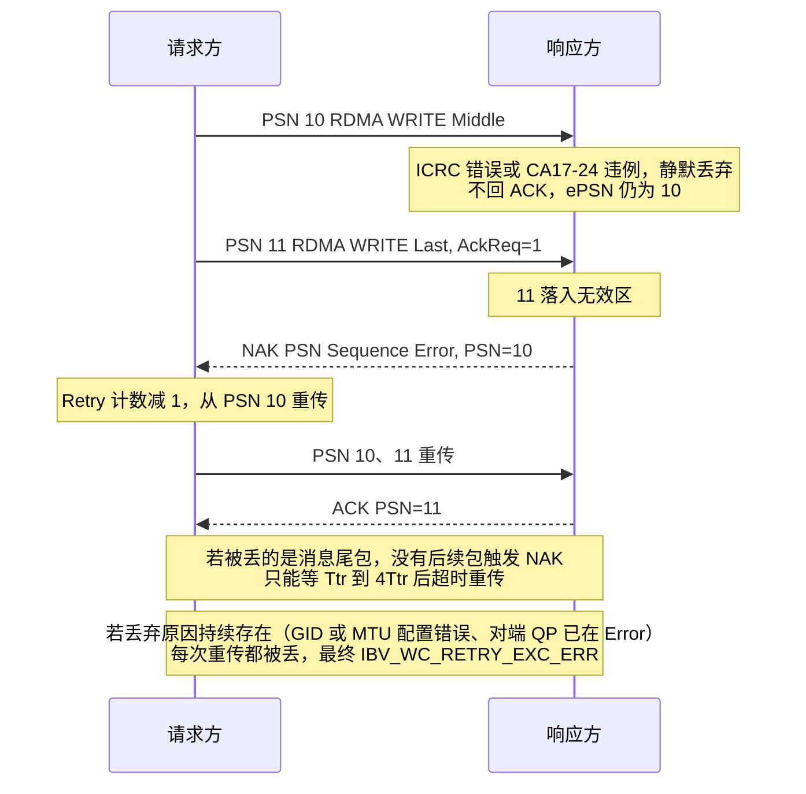

# 错误检测与处理（Error Detection and Handling）

> **摘要**：IB 传输层采用分层错误管理：可重试的错误（丢包、超时、RNR）由硬件自动恢复，对上层不可见；不可恢复的错误则以"完成错误"或"异步事件"报告，并让 QP 进入 Error 状态、冲刷（Flush）其余 WR。本文整理规范 §9.9 的请求方 / 响应方故障类别、§10.10 的错误处理语义，给出 RC 的"错误条件 → 检测方 → 报文行为 → 完成状态 → QP 状态"总表、规范完成状态与 libibverbs `ibv_wc_status` 的对照，并单列 RoCEv2 特有的静默丢弃条件及其在请求方的表现。
>
> **规范出处**：Vol1 §9.6（p.292–295）；§9.9 错误检测与处理（p.422–449）；§10.3.1.6–§10.3.1.7（p.491–493）；§10.10 错误处理语义（p.563–582）；§11.6.2–§11.6.3（p.687–695）；Annex A17 CA17-22（p.1935）、CA17-24（p.1936）、CA17-27（p.1939）、CA17-31/32（p.1942）、CA17-33（p.1943）、CA17-39 与 CA17-41（p.1945）、§A17.9.1（p.1946）
>
> **前置阅读**：[请求方行为](06-requester.md)、[响应方行为](07-responder.md)、[WR/WQE/CQE 处理模型](../03-verbs-and-resources/04-work-requests-and-completions.md)
>
> **关键词**：LEMA, 本地检测错误, 远端检测错误, Fault Behavior Class, Completion Error, Flush, Affiliated / Unaffiliated Asynchronous Event, ibv_wc_status, 静默丢弃, Transport Retry Counter Exceeded

## 1. 分层错误管理与三类 Verbs 错误

IBA 采用**分层错误管理架构（Layered Error Management Architecture, LEMA）**：每一层先检测、处理本层的错误，再把包或消息交给上一层。传输层负责包头错误和"未能正确传输消息"类错误，并把错误报告给它的客户——对 HCA 而言就是在完成队列（CQ）中写入带错误码的 CQE〔Vol1 §9.9, p.422–423〕。RoCEv2 端口必须对所有入站包做传输层错误检查（CA17-39）〔Vol1 §A17.7.4, p.1945〕。

- **请求方**的错误分两类：**本地检测（locally detected）**——只由请求方自己发现，例如访问本地内存时的保护错误、超时、重试次数过多；**远端检测（remotely detected）**——由响应方发现并通过 NAK 码告知，只存在于可靠服务〔p.423〕。
- **响应方**只有本地检测错误；它可能需要把错误报告给请求方、本地客户、两者或都不报，取决于服务类型和具体错误〔p.423〕。

Verbs 层可见的三类错误〔Vol1 §9.9.1, Table 58, p.423–424；§10.10.1–§10.10.2, p.563–564〕：

| 类型 | 报告方式 | 传输层能否产生 | 要点 |
|---|---|---|---|
| 立即错误（Immediate） | Verb 调用的返回值 | 否（WQE 投递前就由 Verbs 层发现） | 返回立即错误时该 WR 一定未被投递（C10-135、C10-136） |
| 完成错误（Completion）——接口检查 | CQE 状态 | 是 | 数据上线之前发现的、调用者提供的信息有误 |
| 完成错误——处理错误 | CQE 状态 | 是 | CI 处理 WR 过程中遇到的错误（C10-137） |
| 异步错误——关联（Affiliated） | 异步事件处理函数 | 是 | 与特定 WQ / CQ / EE 相关但无法用完成报告；QP/EE 进入 Error |
| 异步错误——非关联（Unaffiliated） | 异步事件处理函数 | 是 | 不能归属到具体 WQ 或 CQ |

异步错误只有在消费者用 Set Asynchronous Event Handler 注册处理函数之后才会被投递，注册之前发生的异步错误会丢失（C10-138）；每个 HCA 只有一个处理函数（C10-139）〔p.564〕。

## 2. 请求方错误（§9.9.2）

### 2.1 本地检测错误与远端检测错误

- 本地检测错误包括请求方通道接口自身的故障、响应缺失（超时）、序号错误或 RNR NAK 的重试次数过多，可能发生在生成请求包、处理响应包或超时之时〔Vol1 §9.9.2.1, p.424〕。
- **C9-209**：发送请求包时检测到的本地传输错误，CA 应停止该 QP 的发送，**保存错误状态直到之前所有未完成的 WQE 都完成**，最后再以错误完成受影响的 WQE；若该错误类型要求，QP 进入 Error 状态〔p.424〕。这样才能保证按序完成，并把错误报告在正确的 WQE 上〔p.425〕。
- 远端检测错误通过 NAK 码报告。其中 **NAK-PSN Sequence Error 与 RNR NAK** 应由请求方自动重试；其余 NAK 码表示必须**立即**报告给客户、不能重试的失败〔Vol1 §9.9.2.2, p.426〕。

### 2.2 请求方错误一览（Table 59，RC 视角）

| 错误 | 说明 | 检测方式（Syndrome） | RC 故障类别 |
|---|---|---|---|
| Packet sequence error，未超重试上限 | 响应方发现 PSN 大于期望值，可重试 | NAK-Sequence Error | A |
| Packet sequence error，超过上限 | 重试（及 APM 后的重试）全部失败 | NAK-Sequence Error | B |
| Implied NAK sequence error，未超上限 | 收到 PSN 大于某 READ/ATOMIC 期望响应 PSN 的 ACK | 本地检测 | A |
| Implied NAK sequence error，超过上限 | 同上，重试全部失败 | 本地检测 | B |
| Local Ack Timeout，未超上限 | 定时器间隔内没有 ACK | 本地检测 | A |
| Local Ack Timeout，超过上限 | 重试（及 APM 后的重试）全部失败 | 本地检测 | B |
| RNR NAK，未超上限 | 响应方回 RNR NAK，可重试 | RNR-NAK | A |
| RNR NAK Retry error，超过上限 | 每次重试都收到 RNR NAK | 本地检测 | B |
| Unsupported OpCode | 响应方不支持该 OpCode | NAK-Invalid Request | B |
| Unexpected OpCode | 响应方发现 OpCode 序列错误（如缺 Last 包），不意味着丢包 | NAK-Invalid Request | B |
| Local Memory Protection Error | 请求方本地内存子系统的保护错误 | 本地检测 | B（所有服务） |
| R_Key Violation | 响应方执行 RDMA 请求时发现 R_Key 无效 | NAK-Remote Access Error | B |
| Remote Operation Error | 响应方本地错误使请求无法完成 | NAK-Remote Operational Error | B |
| Local Operation Error（可关联到 WQE） | 请求方通道接口内可归属到某 WQE 的错误 | 本地检测 | B（所有服务） |
| Local Operation Error（不可关联到 WQE） | 无法归属到某 WQE 的错误 | 本地检测 | C（所有服务） |
| Length error | READ 响应消息的负载过多或过少 | 本地检测 | B |
| Bad response | 在期望的响应 PSN 上收到意外 OpCode | 本地检测 | B |
| Ghost Acknowledge | 在非期望的响应 PSN 上收到确认 | 本地检测 | E |
| CQ overflow | 消息已执行并确认，但完成无法写入 CQ | 本地检测 | F（所有服务） |

出处〔Vol1 §9.9.2.3, Table 59, p.428–430〕。请求方必须符合 Table 59 与各故障类别的要求（C9-211.1.1）〔p.427〕。

### 2.3 请求方故障类别（Table 60）

| 类别 | 当前 WQE | 后续 WQE | 发送队列最终状态 | 规范要求 |
|---|---|---|---|---|
| A | 无影响 | 无影响 | 不变 | 可通过重试恢复，重试成功则客户不可见；每次重试递减对应计数器（序号错误与超时共用一个，RNR 单独一个）；计数未耗尽前不得报告（C9-212、C9-213, p.431） |
| B | 出错完成 | Flush | Error | 当前 WQE 以错误完成，发送队列进入 Error，后续 WQE 标记为 Flushed（C9-214, p.432） |
| C | 出错完成 ¹ | Flush ¹ | Error ¹ | 无法关联到特定 WQE；若能关联到 QP，则发送队列进入 Error，所有未完成 WQE 以 Flushed 完成（C9-216, p.433） |
| D | 出错完成 | Flush | Error | 仅 RD，EE Context 也进入 Error（p.433–434） |
| E | 无影响 | 无影响 | 不变 | 丢弃该确认，不报告上层；例外：PSN 为期望 PSN − 1 的主动 ACK 要提取端到端信用（C9-217, p.434–435） |
| F | 未知 | 未知 | Error | CQ 不可访问或已满：QP 进入 Error 并产生关联异步错误，当前与后续 WQE 状态未知（C9-218, p.435） |

¹ 该类错误可能使整个 HCA 无法继续工作，此时各队列的错误状态可能无法确定〔Table 60 注 a, p.430〕。

Class B 的补充说明〔p.432〕：
- 对 HCA，错误以"Completion – Processing type"及相应错误类型报告。
- 发送队列由**传输层**主动置为 Error，以避免客户在发现错误前继续投递 WQE 造成竞争。
- 对 RC，被 Flush 的请求中可能有一部分已经上线，甚至已在响应方执行完毕——请求方无法阻止这种情况，因此**响应方的本地状态必须视为未知**。
- **C9-215**：发送队列处于 Error 状态时，必须静默丢弃到达的所有确认。

## 3. 响应方错误（§9.9.3）

### 3.1 响应方错误一览（Table 61，RC 相关行）

| 错误 | 说明 | 返回的 NAK | RC 故障类别 |
|---|---|---|---|
| Malformed WQE | 处理包时发现接收队列 WQE 畸形 | NAK-Remote Operational Error | A |
| Unsupported or Reserved OpCode | OpCode 保留，或本 QP 未启用该功能（如未开 RDMA/ATOMIC） | NAK-Invalid Request | C |
| Misaligned ATOMIC | ATOMIC 的 VA 未对齐 | NAK-Invalid Request | C |
| Too many RDMA READ or ATOMIC Requests | 未确认的 READ/ATOMIC 超过连接允许值 | NAK-Invalid Request | C |
| Out of Sequence Request Packet | PSN 落在有效窗口之外 | NAK-Sequence Error | B |
| Out of Sequence OpCode | 缺 Last（当前为 First/Only）或缺 First（当前不是 First/Only） | NAK-Invalid Request | C |
| R_Key Violation | 执行 RDMA 请求时 R_Key 违例 | NAK-Remote Access Error | C |
| Local QP Error | 本地 QP（含 SRQ，例如无法从出错的 SRQ 取 WQE）错误使请求无法完成 | NAK-Remote Operational Error | A |
| Packet Header Violation | §9.6 规定须静默丢弃的包头违例 | 无 | D |
| Resources Not Ready | 暂时没有 WQE 或其他资源 | RNR-NAK | B |
| Length errors | SEND 超出可用缓冲（Local Length Error）；WRITE 负载总量与 DMALen 不符；负载长度与 OpCode 不符；消息超过端口支持的大小 | NAK-Invalid Request | C |
| Invalid duplicate ATOMIC Request | 重复 ATOMIC 的 PSN 不匹配任何保存的 ATOMIC | 无 | D |
| CQ overflow | 已执行并确认，但完成无法写入 CQ | 无 | G |
| Remote Invalidate Error | SEND with Invalidate 的 IETH 中 R_Key 无效或不能失效 | 无 | J |

出处〔Vol1 §9.9.3, Table 61, p.436–438〕；响应方必须符合 Table 61 与 Table 62（C9-219.1.1）〔p.436〕。

### 3.2 响应方故障类别（Table 62，RC 相关）

| 类别 | 返回的 NAK | 当前接收 WQE ² | 后续接收 WQE | 接收队列最终状态 | 规范要求 |
|---|---|---|---|---|---|
| A | Remote Operational Error | 出错完成 | Flush | Error | 报告给本端客户，QP 进入 Error，可靠服务回 NAK-Remote Operational Error；HCA 以完成错误或关联异步错误报告（C9-220, p.440） |
| B | 对 RC：Sequence error、RNR-NAK | 不消耗 | 无影响 | 不变 | 只回 NAK，不消耗 WQE、不改变状态（C9-221, p.441） |
| C | Invalid Request（R_Key 违例时为 Remote Access Error） | 出错完成 | Flush | Error | 回 NAK；能关联到 WQE → QP 进入 Error 并报完成错误；只能关联到 QP（如不带立即数的 WRITE）→ 报关联异步错误（C9-222.1.1, p.442） |
| D | 无 | 不消耗 | 无影响 | 不变 | 静默丢弃，不回 ACK/NAK，不通知客户（C9-223.1.1, p.443） |
| G | 无 | 未知 | 未知 | Error | CQ 不可访问或已满（C9-225, p.446） |
| J | 无 | 出错完成 | Flush | Error | SEND 本身成功执行并消耗 WQE 后才报告失效错误；QP 进入 Error；**不向请求方发 NAK**（p.446–447） |

² 只有用于 SEND 和带立即数 RDMA WRITE 的接收 WQE 才会被完成〔Table 62 注 a, p.439〕。

> [!WARNING]
> **RC 中"两端一起进 Error"**：NAK-Invalid Request、NAK-Remote Access Error（响应方 Class C）以及 NAK-Remote Operational Error（Class A）不仅让请求方 QP 进入 Error（Class B），也让**响应方 QP 进入 Error**。Table 81 也把 Remote Invalid Request / Remote Access / Remote Operation 三种请求方完成错误对远端 QP 的影响标为 "Error"〔Vol1 §10.10.3.1, p.565–566〕。而序号错误、RNR NAK 重试耗尽、传输超时耗尽只影响请求方，响应方 QP 不受影响。

## 4. 总表：错误条件 → 检测方 → 报文行为 → 完成状态 → QP 状态（RC）

| # | 错误条件 | 检测方 | 线上行为 | 请求方完成状态 | 请求方 QP | 响应方表现 | 响应方 QP |
|---|---|---|---|---|---|---|---|
| 1 | 请求包丢失（拥塞、误码、ICRC 错误、配置错误被丢） | 响应方（PSN 缺口）/ 请求方（超时） | 后续包触发 NAK-Sequence Error；若丢的是尾包则无响应，靠超时 | 重试成功则无；耗尽 → Transport Retry Counter Exceeded | 耗尽后 Error | 无（序号错误为 Class B） | 不变 |
| 2 | 确认（ACK）丢失 | 请求方 | 后续合并 ACK 覆盖，否则超时重传 → 重复请求 → 响应方重发 ACK | 同上 | 同上 | 处理重复请求 | 不变 |
| 3 | 无可用接收 WQE | 响应方 | RNR NAK（PSN = 被拒包） | 重试成功则无；耗尽 → RNR Retry Counter Exceeded | 耗尽后 Error | 不消耗 WQE | 不变 |
| 4 | OpCode 不支持 / 保留、OpCode 序列错 | 响应方 | NAK-Invalid Request（PSN = ePSN） | Remote Invalid Request Error | Error | 用到接收 WQE 时以 Remote Invalid Request Error 完成，否则报 Invalid Request Local Work Queue 异步错误 | Error |
| 5 | ATOMIC 未对齐、READ/ATOMIC 超过 Responder Resources | 响应方 | NAK-Invalid Request | Remote Invalid Request Error | Error | Local Access Violation Work Queue 异步错误 | Error |
| 6 | 长度错误（SEND 超出接收缓冲、负载与 OpCode 不符、超过端口最大消息） | 响应方 | NAK-Invalid Request | Remote Invalid Request Error | Error | 用到接收 WQE 时以 Remote Invalid Request Error 完成 ³，否则 Local Access Violation 异步错误 | Error |
| 7 | R_Key 无效 / 越界 / 权限 / PD 不符 | 响应方 | NAK-Remote Access Error（PSN = 出错包） | Remote Access Error | Error | 用到接收 WQE 时以 Local Access Error 完成，否则 Local Access Violation 异步错误 | Error |
| 8 | 响应方畸形接收 WQE、本地 QP 错误 | 响应方 | NAK-Remote Operational Error | Remote Operation Error | Error | Local QP Operation Error 完成 | Error |
| 9 | SEND with Invalidate 的 R_Key 无效 | 响应方 | SEND 已正常执行，规范规定**不发 NAK** | 通常已被确认而成功完成 | 不变 | 接收 WQE 以 Memory Management Operation 错误完成（Class J），之后发往该 QP 的包被静默丢弃 | Error |
| 10 | 包头违例（§9.6）、RoCEv2 静默丢弃条件（§7） | 响应方 | 静默丢弃 | 表现为丢包，见 #1 | 见 #1 | 无 | 不变 |
| 11 | 请求方本地保护错误（L_Key、SGE 无效） | 请求方 | 停止发送 | Local Protection Error | Error | 可能已执行部分请求 | 不变 |
| 12 | READ 响应长度不符 | 请求方 | — | Local Length Error | Error | — | 不变 |
| 13 | 响应 OpCode 与期望不符 | 请求方 | — | Bad Response Error | Error | — | 不变 |
| 14 | 幽灵 / 重复 ACK | 请求方 | 丢弃（可提取信用） | 无 | 不变 | — | 不变 |
| 15 | CQ 溢出 | 任一端 | — | 无法报告；Local Work Queue Catastrophic 与 CQ 异步错误 | Error | 同左 | Error |
| 16 | QP 已进入 Error 后的后续 WR | 本端 | 不再发送；入站包静默丢弃 | Work Request Flushed Error | Error | 对端发来的包被丢弃，对端最终超时 | — |

出处：请求方〔Table 59, p.428–429；Table 93, p.577–579〕；响应方〔Table 61, p.436–438；Table 94, p.579–581〕；Error 状态〔§10.3.1.7, p.492–493〕。

³ Table 94 对 RC "Length Errors" 写的是 Remote Invalid Request Error 完成，而 §11.6.2 对 Local Length Error 的定义也覆盖了"接收 WQE 缓冲不足以接收入站消息"，Table 82 也列出了 RC 接收队列的 Local Length 错误；接收端最终返回哪个状态以驱动 / 硬件实现为准。

## 5. 错误处理语义（§10.10）

### 5.1 RC QP 受错误影响的方式

- 立即错误不影响 QP，因为 WR 根本没被投递（C10-141）〔p.564〕。
- **发送队列完成错误**：出错的 WR 以错误完成，**QP 进入 Error 状态**，其后所有 WR 以错误完成（C10-142）。若本地错误是接口检查，远端接收队列不会消耗 WR，也不会产生完成错误；若是处理错误，远端接收队列可能以错误完成某个 WR，也可能不会〔p.564–565〕。
- **接收队列完成错误**：出错的 WR 以错误完成，QP 进入 Error，后续 WR 均以错误完成（C10-143）〔p.565〕。
- **关联异步错误**：停止 QP 处理，未完成的 WR 不会成功完成；QP 进入 Error；正在进行的请求以完成错误返回，除非 CQ 已溢出或不可访问（C10-144）〔p.565〕。
- 本地 QP 的灾难性错误对远端 QP 没有**直接**影响，规范不会为此发送任何拆连接的消息〔§10.10.3, p.564〕——远端通常是在后续通信中超时，或在收到 NAK 时进入 Error。

RC 发送队列的完成错误（Table 81, p.565–566，C10-145）：

| 错误类型 | 完成类型 | 对本地 QP | 对远端 QP |
|---|---|---|---|
| Bad Response | Processing | Error | 无 |
| Local Length | Interface / Processing | Error | 无 |
| Local QP Operation | Interface / Processing | Error | 无 |
| Local Protection | Interface / Processing | Error | 无 |
| Memory Mgt. Operation | Interface | Error | 无 |
| Remote Invalid Request | Processing | Error | **Error** |
| Remote Access | Processing | Error | **Error** |
| Remote Operation | Processing | Error | **Error** |
| RNR NAK Retry Counter Exceeded | Processing | Error | 无 |
| Transport Retry Counter Exceeded | Processing | Error | 无 |
| Work Request Flushed | Processing | 无 | 无 |

RC 接收队列的完成错误（Table 82, p.566）：Local Access、Local Length、Local Protection、Local QP Operation、Remote Invalid Request 均为处理错误，本地 QP → Error，远端 QP "收到 NAK 时进入 Error"；Memory Mgt Operation 为接口检查，本地 QP → Error，但不发 NAK，远端 QP 不受直接影响，可能在后续 WQE 上超时〔Table 82 注 a〕；Work Request Flushed 对两端都无影响。

UC / UD 的发送队列完成错误使发送队列进入 **SQ Error（SQEr）** 状态而非 Error，接收队列错误才让 QP 进入 Error（C10-147、C10-152）〔p.570–572〕，详见 [UC / UD / 多播](04-unreliable-services.md)。SQEr 状态不适用于 RC QP〔§10.3.1.6, p.491〕。

### 5.2 Error 状态与 Flush

- 进入 Error 状态后 QP/EE 的正常处理停止。导致错误的 WR 必须通过 CQ 返回正确的错误码（C10-41）；该 WR 可能已部分或全部执行：SEND 可能在接收端已完成或部分完成；READ 的本地目标缓冲内容不确定；WRITE 的远端目标内容不确定（带立即数时接收端可能产生或不产生 CQE）；ATOMIC 可能执行也可能未执行〔§10.3.1.7, p.492–493〕。
- **C10-41.2.1**：发往 Error 状态 QP 的入站消息一律**静默丢弃**〔p.493〕。
- **C10-42**：导致错误的 WR 之后的所有 WR，包括进入 Error **之后**才投递的 WR，都必须以 **Flush Error** 状态完成〔p.493〕。
- 离开 Error 状态的唯一方法是用 Modify QP 迁移到 Reset，或销毁 QP；在强制复位 QP 之前，消费者有责任确保所有错误处理都已完成〔p.493〕。对于关联异步错误，可能无法继续处理 WR，未完成的 WR 不会被完成〔p.493〕。
- 使用 SRQ 的 QP 进入 Error 后，CI 会在最后一个 WQE 的 CQE 产生后（或 RQ 已空时）发出 **Last WQE Reached** 关联事件，消费者据此回收（o11-5.2.5）〔p.692〕。

### 5.3 异步事件

| 规范名称（§11.6.3） | 类别 | 含义 | libibverbs `ibv_event_type` |
|---|---|---|---|
| Path Migrated | 关联事件 | 连接已迁移到备用路径 | `IBV_EVENT_PATH_MIG` |
| Communication Established | 关联事件 | QP 仍在 RTR 时收到第一个包（C11-35） | `IBV_EVENT_COMM_EST` |
| Send Queue Drained | 关联事件 | SQD 迁移完成（或被中止） | `IBV_EVENT_SQ_DRAINED` |
| SRQ Limit Reached | 关联事件 | SRQ 可用 WQE 低于阈值（o11-5.2.4） | `IBV_EVENT_SRQ_LIMIT_REACHED` |
| Last WQE Reached | 关联事件 | 关联 SRQ 的 QP 在 Error 后最后一个 WQE 已处理（o11-5.2.5） | `IBV_EVENT_QP_LAST_WQE_REACHED` |
| CQ Error | 关联错误 | 写 CQ 出错或 CQ 溢出（C11-36、C11-37） | `IBV_EVENT_CQ_ERR` |
| Local Work Queue Catastrophic Error | 关联错误 | 访问或处理 WQ 时出错且无法报告完成（C11-38、C11-39） | `IBV_EVENT_QP_FATAL` |
| Invalid Request Local Work Queue Error | 关联错误 | 响应方检测到 OpCode 违例（不支持 / 保留 / 乱序），RC 中响应方 QP 进入 Error（C11-39.1.1） | `IBV_EVENT_QP_REQ_ERR` |
| Local Access Violation Work Queue Error | 关联错误 | 响应方检测到访问违例：ATOMIC 未对齐、READ/ATOMIC 过多、R_Key 违例、不带立即数时的长度错误（C11-39.1.2） | `IBV_EVENT_QP_ACCESS_ERR` |
| Path Migration Request Error | 关联错误 | 入站路径迁移请求未被接受（o11-6） | `IBV_EVENT_PATH_MIG_ERR` |
| SRQ Catastrophic Error | 关联错误 | SRQ 无法出队 WQE（o11-6.2.1） | `IBV_EVENT_SRQ_ERR` |
| Port Active | 非关联事件 | 链路变为可用 | `IBV_EVENT_PORT_ACTIVE` |
| Local Catastrophic Error | 非关联错误 | 无法归属到任何资源的错误，CI 行为不确定（C11-40） | `IBV_EVENT_DEVICE_FATAL` |
| Port Error | 非关联错误 | 链路变为不可用，不改变 QP 状态（C11-41） | `IBV_EVENT_PORT_ERR` |

出处〔Vol1 §11.6.3, p.690–695〕；libibverbs 名称〔业界实践: rdma-core libibverbs/verbs.h、ibv_get_async_event(3)〕。关联**错误**会让 QP/EE 进入 Error（C11-33），关联**事件**则不改变状态（C11-34）〔p.690〕。RoCEv2 端口不支持 Client Reregistration（CA17-31）和可选的 Port Change 事件（CA17-32）〔§A17.5.10, p.1942〕；Linux 在 GID 表变化时另行报告 `IBV_EVENT_GID_CHANGE`〔业界实践〕。

## 6. 完成状态：规范名称 ↔ libibverbs `ibv_wc_status`

| 规范完成状态（§11.6.2） | `ibv_wc_status`（数值） | RC 中的典型来源 |
|---|---|---|
| Success | `IBV_WC_SUCCESS`（0） | — |
| Local Length Error | `IBV_WC_LOC_LEN_ERR`（1） | SQ：数据段总长超过端口最大消息；RQ：缓冲太小或入站消息超过端口最大消息；READ 响应长度不符（Table 93） |
| Local QP Operation Error | `IBV_WC_LOC_QP_OP_ERR`（2） | 内部 QP 一致性错误；响应方畸形 WQE（Table 94） |
| Local EE Context Operation Error | `IBV_WC_LOC_EEC_OP_ERR`（3） | 仅 RD |
| Local Protection Error | `IBV_WC_LOC_PROT_ERR`（4） | 本地数据段引用的 MR 对该操作无效 |
| Work Request Flushed Error | `IBV_WC_WR_FLUSH_ERR`（5） | QP 进入 Error 时尚未完成或之后投递的 WR |
| Memory Window Bind Error | `IBV_WC_MW_BIND_ERR`（6） | Bind Memory Window 失败 |
| Bad Response Error | `IBV_WC_BAD_RESP_ERR`（7） | 响应方返回了意外的传输层 OpCode |
| Local Access Error | `IBV_WC_LOC_ACCESS_ERR`（8） | 响应方处理对端带立即数的 RDMA WRITE 时本地缓冲保护错误 |
| Remote Invalid Request Error | `IBV_WC_REM_INV_REQ_ERR`（9） | NAK-Invalid Request：操作不被支持、READ/ATOMIC 资源不足、RDMA 长度超过 2^31 等 |
| Remote Access Error | `IBV_WC_REM_ACCESS_ERR`（10） | NAK-Remote Access Error：远端 READ/WRITE/ATOMIC 的保护错误 |
| Remote Operation Error | `IBV_WC_REM_OP_ERR`（11） | NAK-Remote Operational Error：响应方 QP 相关错误或接收队列 WQE 畸形 |
| Transport Retry Counter Exceeded | `IBV_WC_RETRY_EXC_ERR`（12） | 超时 / 序号错误 NAK / 隐式 NAK 重试耗尽 |
| RNR Retry Counter Exceeded | `IBV_WC_RNR_RETRY_EXC_ERR`（13） | RNR NAK 重试耗尽 |
| Local RDD Violation Error | `IBV_WC_LOC_RDD_VIOL_ERR`（14） | 仅 RD |
| Remote Invalid RD Request | `IBV_WC_REM_INV_RD_REQ_ERR`（15） | 仅 RD（XRC 也借用该 NAK 码） |
| Aborted Error | `IBV_WC_REM_ABORT_ERR`（16） | RD；或关联 SRQ 的 UD/UC 被响应方中止 |
| Invalid EE Context Number / State | `IBV_WC_INV_EECN_ERR`（17）/ `IBV_WC_INV_EEC_STATE_ERR`（18） | 仅 RD |
| Memory Management Operation Error | 无同名状态 | Fast-Register、MW、Invalidate 等内存管理操作的权限 / 状态错误；由驱动映射 |
| XRC Violation Error | 无同名状态 | XRC 域违例；由驱动映射 |
| （无规范对应） | `IBV_WC_FATAL_ERR`（19）、`IBV_WC_RESP_TIMEOUT_ERR`（20）、`IBV_WC_GENERAL_ERR`（21）、`IBV_WC_TM_ERR`（22）、`IBV_WC_TM_RNDV_INCOMPLETE`（23） | libibverbs 扩展（含 Tag Matching） |

规范名称与语义出自〔Vol1 §11.6.2, p.687–690〕；libibverbs 枚举名与取值来自 rdma-core 的 `libibverbs/verbs.h`〔业界实践: linux-rdma/rdma-core〕，`ibv_wc_status_str()` 可把数值转为字符串。请求方 / 响应方各错误在 Verbs 层的行为见 Table 93 / Table 94〔Vol1 §10.10.4, p.577–582〕：一个传输层错误一般只产生一个对应的错误完成（其他 WR 可能被 Flush），或对每个涉及的资源（QP、EEC、CQ）产生一个异步错误〔p.577〕。

> [!NOTE]
> 接收端（响应方）的具体状态码存在实现差异。例如对 R_Key 违例且消耗了接收 WQE 的情况，Table 94 规定为 Local Access Error 完成，而 Linux rxe 的接收 WQE 使用 `IB_WC_REM_ACCESS_ERR`〔业界实践: Linux rxe_resp.c〕。编写跨厂商的错误处理代码时，应以"错误 + QP 进入 Error"为主要判据，不要过度依赖接收端的具体状态码。

## 7. RoCEv2 特有的静默丢弃条件

| 条件 | 依据 | 检测位置 |
|---|---|---|
| 以太网 FCS 错误 | 〔外部: IEEE 802.3〕 | MAC，丢弃后不会到达 RoCEv2 处理 |
| ICRC 错误 | CA17-22〔p.1935〕；§7.8.1〔p.218〕；§9.6 脚注 10：ICRC 无效的包在到达传输层之前被静默丢弃〔p.293〕 | ICRC 校验 |
| 不符合 §A17.3.1–§A17.3.3 的 IP / UDP / ICRC 规则（例如 IPv4 IHL ≠ 5、带分片、长度字段不一致） | CA17-24〔§A17.3.4, p.1936〕 | L3/L4 解析 |
| IP 版本号与报文类型不符 | CA17-27（替代 C9-45）〔§A17.4.4.1, p.1939〕 | L3 解析 |
| BTH.DestQP = QP0（RoCEv2 无 QP0） | CA17-33〔§A17.6, p.1943〕 | QP 查找 |
| SGID / DGID 校验失败：IP 地址映射得到的 GID 与 QP 的主路径 GID 不符，或 GID 表项的 GID type 与报文协议（RoCE / RoCEv2）不符 | C9-47.1.1〔p.299〕；§A17.4.4.2〔p.1939〕；CA17-41〔p.1945〕 | 传输层包头校验 |
| 第 9 章的其他包头检查：TVer ≠ 0、目的 QP 不存在 / 状态不对 / 服务类型不符、P_Key 不匹配 | C9-36、C9-39、C9-43〔p.295–297〕 | 传输层包头校验 |
| 目的 QP 处于 Error 状态 | C10-41.2.1〔p.493〕 | QP 状态 |

> [!IMPORTANT]
> 静默丢弃的包：不返回任何确认、不消耗接收 WQE、不更新 ePSN；也**不计入**传输定时器的"收到响应"〔Vol1 §9.6, p.293, p.295〕。所以静默丢弃在请求方看来与"包在网络中丢失"完全一样——只能靠后续包触发的序号错误 NAK 或传输定时器超时来发现。

它们在请求方的表现：

- **偶发丢弃**（误码、ICRC 错误、短暂拥塞丢包）：由 Go-back-N 自动恢复，上层无感知，只在计数器中留下痕迹。
- **持续丢弃**（配置类问题）：每次重传都被丢弃，重试计数耗尽后报 **Transport Retry Counter Exceeded**，QP 进入 Error。这是 RoCEv2 部署中最常见的错误签名。
- 响应方向（ACK、READ 响应）的包被请求方丢弃时同理：请求方超时重传，响应方把它当作重复请求重发响应。

规范建议把 RoCEv2 网络配置为无损（通常用 IEEE 802.1Qbb PFC），但"无损"并不意味着绝不丢包——传输层内置的端到端重传逻辑（通常由硬件实现）负责从丢包中恢复；无损的目的是避免因交换网络中的竞争而丢包〔Vol1 §A17.9.1, p.1946〕。见 [无损以太网与 PFC](../05-congestion-control-and-qos/01-lossless-ethernet-pfc.md)。

## 8. 排障提示

> [!TIP]
> 以下根因归纳来自 RDMA 应用开发与运维的常见经验〔业界实践〕，不是规范内容；具体计数器名称与工具因厂商而异，以所用版本文档为准。系统化排障流程见 [排障指南与计数器字典](../07-engineering-practice/05-troubleshooting.md)。

| 完成状态 | 规范含义 | RoCEv2 中的常见根因 |
|---|---|---|
| `IBV_WC_RETRY_EXC_ERR`（12） | 传输重试耗尽 | 对端进程退出、QP 被销毁或已处于 Error（入站包被静默丢弃）；GID index / GID type 选错（RoCE v1 与 v2 不匹配被 CA17-41 丢弃）；IP / 路由 / ARP 不通；QP 的 Path MTU 大于网络实际 MTU，大包被交换机丢弃；PFC/ECN 配置不当导致持续丢包；Local ACK Timeout 过小 + 拥塞；ACL 拦截 UDP 4791 |
| `IBV_WC_RNR_RETRY_EXC_ERR`（13） | RNR 重试耗尽 | 接收方没有及时投递接收 WR（或 SRQ 耗尽）；`rnr_retry` 过小；`min_rnr_timer` 过小导致重试过快 |
| `IBV_WC_REM_ACCESS_ERR`（10） | 远端保护错误 | R_Key 错误、过期或已失效；VA / 长度超出 MR 范围；MR 注册时未开启远端读 / 写 / 原子权限；PD 不匹配 |
| `IBV_WC_REM_INV_REQ_ERR`（9） | 远端判定请求无效 | 对端 QP 未开启相应的 `qp_access_flags`（C9-83 → Invalid Request）；SEND 大于对端接收缓冲；本端 `max_rd_atomic` 大于对端 `max_dest_rd_atomic`；ATOMIC 地址未 8 字节对齐或对端不支持 ATOMIC |
| `IBV_WC_REM_OP_ERR`（11） | 远端本地错误 | 对端接收 WQE 畸形、对端访问自身内存（如 SGE 的 L_Key）失败 |
| `IBV_WC_WR_FLUSH_ERR`（5） | QP 已进入 Error | **不是根因**：查找本端或对端第一个非 Flush 的错误 CQE 或异步事件 |
| `IBV_WC_LOC_LEN_ERR`（1） | 本地长度错误 | 消息超过端口最大消息长度；接收端：接收缓冲小于入站消息 |
| `IBV_WC_LOC_PROT_ERR`（4） | 本地保护错误 | L_Key 错误、MR 已注销、MR 权限不足（如 READ 的本地目标缓冲需要本地写权限） |
| `IBV_WC_BAD_RESP_ERR`（7） | 意外的响应 OpCode | 互通实现缺陷，或旧连接的陈旧包（QP 复用过快） |

## 9. 「硬件实现要点」

- **首错捕获**：每 QP 一个错误综合寄存器（完成状态、出错 WQE 序号、PSN、来源），只记录第一个错误。规范要求一个传输层错误只产生一个错误完成（其余 WR 被 Flush）或每个相关资源一个异步错误〔p.577〕，后续连锁错误不应重复报告。
- **按序报告**：C9-209 要求错误状态一直保存到之前所有未完成 WQE 都完成之后再报告；发送已停止，但完成引擎仍需继续处理先前 WQE 的 ACK（或其超时）。实现上给出错 WQE 打上错误标记，由按序工作的完成引擎在轮到它时写错误 CQE。
- **Flush 引擎**：QP 进入 Error 后，从发送 / 接收队列的消费者指针到生产者指针逐个生成 `WR_FLUSH_ERR` 完成，并且对进入 Error 之后新投递的 WR 也要生成（C10-42）。由硬件门铃处理逻辑还是驱动软件生成 Flush CQE 属于实现选择（设计建议）。
- **Error 态的入站处理**：QP 上下文中的状态位直接驱动接收流水线的静默丢弃（C10-41.2.1），发送队列在 Error 状态丢弃所有确认（C9-215）。
- **响应方 Class C / A 的报告路径**：若该请求消耗了接收 WQE，写完成错误；否则投递关联异步错误事件（Table 94 注 c, p.582）。两条路径都要把 QP 置为 Error。
- **CQ 溢出**：同时在溢出的 CQ 和导致溢出的 QP 上报告异步错误；同一 QP 再次导致溢出不必重复报告，不同的 QP 首次导致溢出时要在该 QP 上报告 Local Work Queue Catastrophic Error〔Table 93 注 d, p.579〕。
- **异步事件队列**：关联事件携带 QPN / SRQN / CQN，非关联事件携带端口号；用独立的事件队列（EQ）上报，避免与完成队列互相阻塞（设计建议）。
- **按原因细分的计数器**：序号错误 NAK 收 / 发、重复请求、RNR NAK 收 / 发、本地 ACK 超时、ICRC 错误、按原因分类的静默丢弃（GID、P_Key、QP 状态……）。规范未规定这些计数器，但它们是现场定位 `RETRY_EXC_ERR` 类问题的唯一线索（设计建议）。

更多结构见 [可靠性引擎](../06-hardware-implementation/04-reliability-engine.md) 与 [接收数据通路](../06-hardware-implementation/03-rx-datapath.md)。

## 10. 要点回顾

- Verbs 可见错误分为立即错误、完成错误（接口检查 / 处理错误）和异步错误（关联 / 非关联）；传输层只能产生后两类。
- 请求方的可重试错误（序号错误、隐式 NAK、本地 ACK 超时、RNR NAK）属 Class A，对上层不可见；计数耗尽或收到其他 NAK 后转为 Class B：当前 WQE 出错完成、QP 进入 Error、后续 WQE Flush。
- 只有 NAK-PSN Sequence Error 与 RNR NAK 会被自动重试；Invalid Request、Remote Access、Remote Operational Error 必须立即报告。
- RC 中 Invalid Request / Remote Access（响应方 Class C）与 Remote Operational Error（Class A）会让**两端** QP 都进入 Error；超时、序号错误、RNR 耗尽只影响请求方。
- Error 状态下：入站包静默丢弃，确认被丢弃，所有剩余与新投递的 WR 以 Flush Error 完成，只能经 Reset 恢复。
- 规范完成状态与 `ibv_wc_status` 一一对应（RETRY_EXC_ERR = 12、RNR_RETRY_EXC_ERR = 13、REM_ACCESS_ERR = 10、REM_INV_REQ_ERR = 9……）；`WR_FLUSH_ERR` 只是结果，不是根因。
- RoCEv2 的静默丢弃条件（CA17-24、CA17-27、CA17-33、ICRC 错误、GID 校验失败等）在请求方都表现为丢包：偶发的被 Go-back-N 恢复，持续的最终变成 `IBV_WC_RETRY_EXC_ERR`。

## 自测

Q1：RC 请求方收到 NAK-Remote Access Error。请求方与响应方的 QP 分别处于什么状态？请求方的哪些 WQE 会得到什么完成状态？

答：请求方 Class B：出错的 WQE 以 Remote Access Error（`IBV_WC_REM_ACCESS_ERR`）完成，QP 进入 Error，之后的 WQE 以 Flush Error 完成；NAK 之前的请求已被合并确认，正常完成。响应方 R_Key 违例属 Class C，QP 也进入 Error（用到接收 WQE 时报完成错误，否则报 Local Access Violation Work Queue 异步错误）。

Q2：为什么说 `IBV_WC_WR_FLUSH_ERR` 不是根因？应该如何找到真正的错误？

答：Flush Error 只表示 WR 在 QP 进入 Error 时尚未完成或在其后才被投递（C10-42）。真正的原因是导致 QP 进入 Error 的那个事件：本端第一个非 Flush 的错误 CQE、本端的关联异步事件，或对端的错误（例如对端因 Class C 错误进入 Error 后静默丢弃本端的包，使本端以 RETRY_EXC_ERR 告终）。

Q3：一台主机的 GID 表中，RC QP 误用了 RoCE v1 类型的 GID 表项，而对端只支持 RoCEv2。会看到什么现象？

答：发出的包是 RoCE v1 格式（Ethertype 0x8915）而非 RoCEv2（CA17-40）；对端要么不识别，要么在 DGID 校验时因 GID type 与报文协议不符而判失败（CA17-41）并静默丢弃。请求方收不到任何响应，超时重传直到重试耗尽，最终得到 `IBV_WC_RETRY_EXC_ERR`，QP 进入 Error。

Q4：响应方 CQ 溢出时，请求方会看到错误吗？

答：不一定。CQ 溢出对响应方是 Class G：消息已经执行并被确认，只是完成写不进 CQ；响应方 QP 进入 Error 并产生 CQ Error 与 Local Work Queue Catastrophic Error 异步事件。请求方已经收到 ACK，那个 WQE 正常完成；之后发往该 QP 的包被静默丢弃，请求方最终在后续 WQE 上以 `IBV_WC_RETRY_EXC_ERR` 失败。

Q5：C9-209 要求"保存错误状态直到之前所有未完成 WQE 都完成"，硬件应如何实现？

答：检测到发送期本地错误时立即停止该 QP 的发送，并在出错的 WQE 上打上错误标记（记录状态码）；完成引擎继续按序处理更早 WQE 的 ACK、超时与重传，直到轮到出错的 WQE 时才写错误 CQE，随后把 QP 置为 Error 并启动 Flush。这样既保证 WQE 按序完成，又把错误报告在正确的 WQE 上。

## 参考

- 规范：Vol1 §9.6（p.292–295）；§9.9（p.422–449），含 Table 58–62；§10.3.1.6–§10.3.1.7（p.491–493）；§10.10（p.563–582），含 Table 81、82、93、94；§11.6.2–§11.6.3（p.687–695）；§7.8.1（p.218）；Annex A17 §A17.3.4、§A17.4.4、§A17.5.10、§A17.6、§A17.7.4、§A17.8、§A17.9.1（p.1935–1946）。
- 外部：〔业界实践: linux-rdma/rdma-core libibverbs（verbs.h、ibv_get_async_event(3)）〕；〔业界实践: Linux drivers/infiniband/sw/rxe/rxe_resp.c〕；〔外部: IEEE 802.3（FCS）、IEEE 802.1Qbb（PFC）〕。
- 相关文件：[请求方行为](06-requester.md)、[响应方行为](07-responder.md)、[UC / UD / 多播](04-unreliable-services.md)、[QP 状态机](../03-verbs-and-resources/02-qp-state-machine.md)、[排障指南](../07-engineering-practice/05-troubleshooting.md)。
