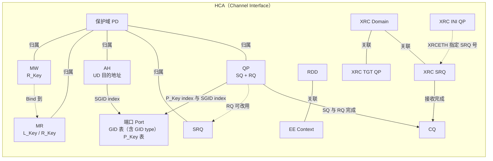

# HCA 资源模型（HCA Resource Model）

> **摘要**：RoCEv2 原样沿用 IBA 软件传输接口（Software Transport Interface）的资源模型——PD、QP、CQ、SRQ、AH、MR、MW、XRC 与 RD 相关对象。本文梳理各资源的定义、作用与相互关系，给出 Query HCA 能力属性与 libibverbs 字段的对照、RoCEv2 对端口属性与 P_Key/Q_Key 的改动，并讨论 RNIC 中“上下文表”的组织与容量估算。
>
> **规范出处**：Vol1 §10.1–§10.2（p.460–483）；§10.9（p.556–562）；§11.2.1–§11.2.10（p.587–661）；§9.6.1.5.1（p.301）；§A17.4.2–§A17.4.3（p.1937–1938）；§A17.4.6–§A17.4.7（p.1939–1940）；§A17.5.1–§A17.5.2（p.1940–1941）；§A17.7.1（p.1944）
>
> **前置阅读**：[RDMA 基础与技术对比](../00-overview/01-rdma-fundamentals.md)、[RoCEv2 寻址](../00-overview/04-addressing.md)、[传输服务类型](../02-transport/01-service-types.md)
>
> **关键词**：Channel Interface, Verbs, PD, QP, CQ, SRQ, AH, MR, MW, XRC, EE Context, Query HCA, P_Key, Q_Key, QPC, MPT, MTT

## 1. 概述：Channel Interface 与 Verbs

规范把消费者看到的 RDMA 设备抽象为**通道接口（Channel Interface, CI）**：由 HCA 硬件、固件与主机软件共同实现；**Verbs** 是对 CI 能力与行为的语义描述，具体 API 不在规范范围内〔Vol1 §10.1, p.460〕。Linux 的 libibverbs（rdma-core）是事实上的用户态 Verbs API〔业界实践: Linux rdma-core〕。

几条贯穿全章的原则：

- **资源归属于单个 HCA 实例**：QP、CQ 等资源不能跨 HCA 共享，即便由同一个驱动管理〔Vol1 §10.2.1, p.461〕。
- **内核旁路（kernel bypass）是架构意图**：规范明确希望 WR 与完成状态可以在用户态进程与 HCA 之间传递而无需内核介入〔Vol1 §10.2.1, p.461〕；控制面操作（创建/修改/注册）仍走特权路径（例如注册内存由 OS 中的特权代码完成，§10.6.7）。
- **RoCEv2 不新增资源类型**：Annex A17 只对部分 Verbs 的输入/输出修饰符做修改（CA17-30，§A17.5），因此本文的资源模型对 RoCEv2 完全适用；差异集中在寻址（AV 与端口 GID 表）、端口属性、P_Key 表加载、特殊 QP 与 Raw 服务。RoCEv2 对各 Verb 的逐条修改见 [05-verbs-roce-specifics-and-programming.md](05-verbs-roce-specifics-and-programming.md)。

### 1.1 资源一览

| 资源 | 规范章节 | 作用 | 关键属性 | libibverbs 对象 / 创建函数〔业界实践: rdma-core〕 | RoCEv2 差异 |
|---|---|---|---|---|---|
| HCA | §10.2.1、§11.2.1 | 设备实例；查询/修改设备与端口属性 | 能力上限、每端口属性列表 | `struct ibv_context` / `ibv_open_device()` | 部分端口属性无效（§A17.5.1） |
| 端口 GID 表 | §10.2.2.1、§A17.4.3 | 源 L3 地址表，AV 以 SGID index 引用 | GID、GID type | `ibv_query_gid()`、`ibv_query_gid_ex()` | 表项带 GID type（CA17-26），由软件栈跟随 OS 的 IP 地址维护 |
| P_Key 表 | §10.9.2 | 分区键表，QP 以 P_Key index 引用 | 16 bit P_Key | `ibv_query_pkey()` | 加载方法不在规范内，至少含默认 P_Key（§A17.4.7） |
| 保护域 PD | §10.2.3 | 把 QP/SRQ/AH 与 MR/MW 归组，控制 HCA 对主机内存的访问 | 无架构属性 | `ibv_alloc_pd()` | 无 |
| 队列对 QP | §10.2.4 | 发送队列 SQ + 接收队列 RQ，通信端点 | QPN、服务类型、状态、AV… | `ibv_create_qp()` | 无 QP0、无 IB Raw QP（CA17-33、CA17-28） |
| 完成队列 CQ | §10.2.6 | 完成通知，可被多个 WQ 共享 | 容量 | `ibv_create_cq()` | 无 |
| 共享接收队列 SRQ | §10.2.9 | 多个 QP 共享接收 WQE 与缓冲 | 最大 WR/SGE、SRQ Limit | `ibv_create_srq()` | 无 |
| 地址句柄 AH | §10.2.2.2、§11.2.2 | UD 目的地址（封装 AV） | AV、PD、端口 | `ibv_create_ah()` | AV 按 §A17.4.2 修改 |
| 内存区 MR | §10.6、§11.2.10 | 注册内存，产生 L_Key/R_Key | VA、长度、权限、PD | `ibv_reg_mr()` | 无 |
| 内存窗口 MW | §10.6.7.2.2 | 在 MR 之上动态授予/撤销远程访问 | Type 1 / 2A / 2B、R_Key | `ibv_alloc_mw()` | 无 |
| XRC Domain / XRC SRQ / XRC TGT QP | §10.2.10、§11.2.1.9、§11.2.4、§11.2.7 | 扩展可靠连接，接收端按 SRQ 共享 | XRCD、XRC SRQ 号 | `ibv_open_xrcd()`、`ibv_create_srq_ex()`、`ibv_create_qp_ex()` | 无 |
| EE Context / RDD | §10.2.7–§10.2.8 | RD 服务的端到端上下文与域 | EECN、RDD | 无（Linux 未实现 RD）〔业界实践〕 | Modify/Query EEC 的 AV 按 §A17.4.2 修改（§A17.5.5） |

## 2. 资源关系图



要点：

1. **PD 是访问控制的枢纽**：每个 QP、SRQ、MR、未绑定的 MW、AH 都只属于一个 PD；同一 PD 可以关联多个对象（C10-7、o10-2.2.1、C10-8）〔Vol1 §10.2.3, p.465–466〕。
2. **QP 访问 MR 的 PD 规则**（C10-9.2.1、o10-2.2.2）〔Vol1 §10.2.3, p.466〕：
   - QP 未关联 SRQ：访问 MR 时要求 QP 的 PD = MR 的 PD；
   - QP 关联 SRQ：入站 SEND 用 **SRQ 的 PD** 检查；入站 RDMA/Atomic 用 **QP 的 PD** 检查；访问物理 MR（PMR）的入站 RDMA/Atomic/Invalidate 也用 QP 的 PD。注意 SRQ 可以与其关联的 QP 属于不同 PD。
3. **UD 与 AH**：UD QP 只能使用与自己同 PD 的 AH，否则返回 Invalid Address Handle（立即错误）或 Local QP Operation Error（完成错误）（C10-10）〔Vol1 §10.2.3, p.466〕。
4. **MW 的绑定关联**：Type 1 MW 以 PD 关联 QP；Type 2A 以 QPN 关联；Type 2B 以 PD+QPN 关联〔Vol1 §10.2.3, p.465〕。详见 [03-memory-management.md](03-memory-management.md)。
5. **释放顺序**：PD 仍被 QP/MR/MW/AH/SRQ 引用时不能释放（C10-11.2.1/C10-11.2.2，立即错误）；CQ 仍关联 WQ 时不能销毁（C10-18）；SRQ 仍关联 QP 时不能销毁（o10-10.2.3）〔Vol1 §10.2.3.2, p.467；§10.2.6.4, p.472；§10.2.9.4, p.477〕。因此清理顺序一般是 **QP → MR/MW/AH → SRQ → CQ → PD → 关闭设备**。

## 3. 逐项资源说明

### 3.1 HCA 与端口

- **Open/Query/Modify/Close HCA**〔Vol1 §10.2.1, p.461–462；§11.2.1, p.587–595〕：Open 返回 HCA 句柄；Query 返回设备特性（见第 4 节）；Modify 只允许修改少量属性（主要是计数器复位与部分 CapabilityMask 位），多数属性固定或经管理接口设置；Close 释放 Open 期间分配的资源。
- **GID 表**：CI 必须为每个端口维护源 GID 表（C10-1），第 0 项是只读的不变值（C10-2）〔Vol1 §10.2.2.1, p.462〕。在 RoCEv2 中 GID 就是 IPv6 地址或 IPv4 映射地址 `::ffff:a.b.c.d`，表项新增 **GID type** 属性（IPv4 / IPv6 / IB GID，CA17-26），出站协议由所选表项的 GID type 决定〔Vol1 §A17.4.3, p.1938〕。表的增删由软件栈跟随 OS 的 IP 地址变化维护（规范举例：订阅 OS 的回调/事件）。
  > [!NOTE]
  > 〔业界实践: Linux〕同一 IP 地址在支持 RoCE v1 的设备上通常对应两个 GID 表项（一个 RoCE v1、一个 RoCE v2）；第 0/1 项一般是由 MAC 生成的链路本地地址 `fe80::/64`。可用 `ibv_query_gid_ex()` 或 sysfs `/sys/class/infiniband/<dev>/ports/<port>/gid_attrs/types/<index>` 查看类型（以所用内核/rdma-core 版本为准）。
- **回环（Loopback）**：CI 必须支持发往同一端口上其它 QP/EE 的报文，且这类报文不出 HCA（C10-6），寻址方式与访问远端完全相同〔Vol1 §10.2.2.2, p.464〕。

### 3.2 保护域（Protection Domain, PD）

PD 没有任何架构属性，只是一个“归组标签”〔Vol1 §10.2.3.1, p.467〕。创建 QP、注册 MR、分配 MW、创建 AH 都必须指定 PD；OS 通常强制每个进程使用自己分配的 PD，从而保证进程之间的隔离。硬件上 PD 一般实现为 QPC/MPT/AH 中的一个整数字段，访问时做相等比较（见第 7 节）。

### 3.3 队列对（Queue Pair, QP）

- **构成**：SQ 与 RQ 合称 QP；QP 是 CI 的组成部分，消费者只能通过 Verbs 操作它〔Vol1 §10.2.4, p.467〕。WR 被转换成 **WQE（Work Queue Element）** 放入工作队列，详见 [04-work-requests-and-completions.md](04-work-requests-and-completions.md)。
- **创建时必须给出的属性**〔Vol1 §11.2.5.1, p.608–610〕：SQ 关联的 CQ、RQ 关联的 CQ、SQ/RQ 最大未完成 WR 数、SQ/RQ 每 WR 最大 SGE 数、PD、服务类型（RC/RD/UC/UD/XRC INI）、可选的 SRQ 句柄、RD 的 RDD、SQ 的**信令类型**（Non-selectable：每个 WR 都产生 CQE；Selectable：由每个 WR 决定成功时是否产生 CQE）、是否允许 Fast Register PMR 与 Reserved L_Key。
- **返回**：QP 句柄、**QP 号（QPN，24 bit）**、实际 WR/SGE 上限（保证 ≥ 请求值）。
- **WR 容量的含义**：最大未完成 WR 数必须覆盖“尚未完成的 WR + 已完成但尚未从 CQ 取走的 WR”；对 unsignaled WR，只有在后续 WR 的完成被取走后才算完成〔Vol1 §10.2.4.1, p.467–468；§10.8.6, p.554〕。
- **销毁**：销毁后未完成 WR 不再属于 CI 管辖，也不保证还能从 CQ 取回其 CQE；推荐先 Modify 到 Error、取完 CQE 再销毁〔Vol1 §10.2.4.4, p.469〕。仍有 Type 2A MW 绑定时销毁 QP 必须报错，Type 2B 则允许（o10-2.2.4/o10-2.2.5）。
- **特殊 QP**：IB 中为 QP0（SMI）、QP1（GSI）、Raw IPv6、Raw Ethertype〔Vol1 §10.2.4.5, p.470〕。RoCEv2 端口**没有 QP0**，目的 QP 为 0 的报文静默丢弃（CA17-33）；**不支持 IB Raw 数据报**（CA17-28）；Get Special QP 只适用于 QP1〔Vol1 §A17.4.6, p.1939；§A17.5.8, p.1942；§A17.6, p.1943〕。QP1 上的 MAD（如 CM 报文）见 [MAD 与 GSI](../04-connection-management/03-mad-and-gsi.md)。
  > [!NOTE]
  > libibverbs 的 `IBV_QPT_RAW_PACKET` 是厂商扩展的“原始以太网 QP”，用于收发任意以太网帧，与 IBA 的 Raw IPv6/Raw Ethertype 数据报不是一回事〔业界实践: rdma-core〕。

### 3.4 完成队列（Completion Queue, CQ）

- 一个 CQ 可服务零个或多个 SQ/RQ，且可来自不同 QP（C10-16）〔Vol1 §10.2.6, p.471〕。
- 创建时指定最小容量，返回实际容量；唯一的 CQ 属性就是容量。必须支持在有未完成 WC/WR 时调整容量且不丢失完成（C11-16），调整本身不得直接引起完成错误或异步错误〔Vol1 §10.2.6.1–§10.2.6.3, p.471–472；§11.2.8, p.633–635〕。
- **溢出**：CQE 数达到容量后再加入即溢出，CI 必须在下一次取 WC 之前检测并以**关联异步错误（Affiliated Asynchronous Error）**上报（C10-17）。溢出后的恢复见 [04-work-requests-and-completions.md](04-work-requests-and-completions.md)。
- **规模规划**：CQ 容量 ≥ 所有关联 WQ 可能同时挂起的 CQE 总数，例如 N 个 QP 共享一个 CQ 时，容量 ≥ Σ(SQ 深度 + RQ 深度)（对 SQ，若使用 unsignaled 可以按信令比例折算，但错误时每个 WR 都会产生 CQE——保守起见按全量计算）。

### 3.5 共享接收队列（Shared Receive Queue, SRQ）

- **动机**：不用 SRQ 时，每个 QP 都要按峰值速率预投递接收 WR，空闲连接上的 WQE 与缓冲被浪费；SRQ 让多个 QP 共享接收 WQE 及其数据段〔Vol1 §10.2.9.1, p.475〕。RC、UC、UD QP 都可关联 SRQ（UC 为可选能力）。
- **语义**：消息到达任一关联 QP 时，HCA 取 SRQ 中**下一个可用 WQE**；完成写入**接收该消息的 QP 的接收 CQ**（o10-53.2.2）〔Vol1 §10.8.3.2, p.547–548〕。因此 SRQ 的接收完成可能与投递顺序不同。
- **SRQ Limit**：Modify SRQ 设置 Limit > 0 即“上膛”；WQE 数低于 Limit 时产生 **SRQ Limit Reached** 关联异步事件，并由 CI 把 Limit 清零（一次性）〔Vol1 §10.2.9.3, p.476〕。
- **状态**：只有 Non-Error 与 Error 两种；发生 SRQ Catastrophic Error 后进入 Error，唯一出口是销毁〔Vol1 §10.2.9.5, p.478〕。
- **拆除关联 SRQ 的 QP**：先 Modify 到 Error → 等 **Last WQE Reached** 事件 → 排空 CQ → 再销毁或 Reset，否则可能泄漏 WQE〔Vol1 §10.3.1, p.485〕。

### 3.6 地址句柄（Address Handle, AH）与地址向量（Address Vector, AV）

- 目的地址的存放位置取决于服务类型：连接型 QP 存在 **QP 上下文**中，只能用 Modify QP 修改（C10-4）；UD 每个 WR 引用一个 AH（C10-5）；RD 存在 EE Context 中（o10-1）〔Vol1 §10.2.2.2, p.463〕。
- AH 是对消费者不透明的对象，属于某个 PD。AH 被修改/销毁时若仍有引用它的 WR 未完成，CI 必须照常处理这些 WR：成功则发包（目的地址可能不确定），失败则不发包并报 Local QP Operation Error（C10-5.2.1）〔Vol1 §10.2.2.2, p.464〕。
- **RoCEv2 的 AV**〔Vol1 §A17.4.2, p.1937–1938〕：GRH 标志恒为 TRUE；源地址通过 SGID index 引用端口 GID 表；DLID 泛化为“Destination L2 Address”（可携带已解析的 DMAC，取 0xFFFFFFFFFFFF 则由 Verbs 实现自行做 L3→L2 解析）；Source Path Bits 不适用；SL 0–7 映射为以太网优先级 0–7，SL 8–15 保留。AV 的字段级细节见 [RoCEv2 寻址](../00-overview/04-addressing.md)，Modify QP 中各 AV 分量的含义见 [02-qp-state-machine.md](02-qp-state-machine.md)。

### 3.7 MR 与 MW

注册内存区（Memory Region, MR）把一段虚拟连续（或物理）内存交给 HCA，并产生本地键 L_Key 与（可选的）远程键 R_Key；内存窗口（Memory Window, MW）在已注册的 MR 上以更低开销动态授予/撤销远程访问。两者的完整语义（Key 格式、访问检查、地址转换、失效与注销）见 [03-memory-management.md](03-memory-management.md)。

### 3.8 XRC：XRC Domain、XRC SRQ、XRC INI/TGT QP

〔Vol1 §10.2.10, p.478–479；§11.2.1.9, p.597〕

- **XRC INI QP**（请求端，只有发送侧）连接到对端的 **XRC TGT QP**（响应端，只有接收侧）。INI/TGT QP 都计入 HCA 的 QP 总数。
- 每条 XRC 消息在 **XRCETH** 中携带目标 **XRC SRQ 号**，由 Post Send 的新输入修饰符逐 WR 指定；接收 WR 投递到 XRC SRQ，完成写入该 XRC SRQ 关联的 CQ。
- **XRC Domain** 把 XRC SRQ 与 XRC TGT QP 关联起来（概念上等同 RD 的 RDD）：只有 TGT QP 与目标 XRC SRQ 属于同一 XRC Domain 时请求才会被处理。入站 XRC 请求一律使用**目标 XRC SRQ 的 PD**（包括不消耗接收 WQE 的 RDMA）。
- XRC INI/TGT QP 使用与 RC 相同的状态机；TGT QP 虽然不发请求，仍要进入 RTS（为路径迁移）。经同一 TGT QP 发往不同 XRC SRQ 的消息之间没有顺序保证。XRC SRQ 不支持 Type 2 MW。
- RoCEv2 对 XRC 没有额外修改，仅 Modify/Query XRC TGT QP 的 AV 按 §A17.4.2 调整（§A17.5.4）。XRC 的报文与服务语义见 [传输服务类型](../02-transport/01-service-types.md)。

### 3.9 RD：EE Context 与 RDD

- **EE Context（End-to-End Context）**为 RD 服务跟踪两个 HCA 之间的消息传输，每个本地 EEC 只连接一个远端 EEC；RD WR 通过 **EEC 号**（不是句柄）指定使用哪个 EEC〔Vol1 §10.2.7, p.472–473〕。
- **RDD（Reliable Datagram Domain）**把 RD QP 与 EEC 关联：WR 指定的 EEC 与 QP 的 RDD 不同则以 Local RDD Violation 完成（o10-8）；支持 RD 的 CI 至少提供两个 RDD，以便隔离用户态与内核 RD 流量（o10-9）〔Vol1 §10.2.8, p.474〕。
- **RoCEv2 中的处境**：A17 没有排除 RD，反而修改了 Modify/Query EE Context 的 AV（§A17.5.5），因此规范上 RD 可运行于 RoCEv2；但业界主流 RNIC 与 Linux Verbs 均不实现 RD（libibverbs 没有 RD QP 类型），`max_ee`/`max_rdd` 通常为 0〔业界实践〕。

### 3.10 Q_Key

Q_Key（Queue Key）用于数据报服务（UD/RD）校验远端发送者是否有权访问本地接收队列〔Vol1 §10.2.5, p.470–471〕：

- 在 QP 上下文中设置（Modify QP），且必须在投递接收描述符之前设定；Q_Key 同时也是 Post Send 的修饰符。
- **入站检查**：UD QP（QP0/QP1 除外）用 QP 上下文中的 Q_Key 校验入站报文，不匹配则**静默丢弃**（C10-14）；RD 不匹配则回 NAK，导致远端 SQ 进入错误态（o10-3）。
- **出站选择（C10-15）**：若 WR 中 Q_Key 的**最高位为 1**，报文携带 **QP 上下文中的 Q_Key**；否则携带 WR 中的 Q_Key。
- **QP1** 的入站 Q_Key 与知名值 **0x80010000** 比较（C9-49）〔Vol1 §9.6.1.5.1, p.301〕。
- RoCEv2 对 Q_Key 无任何修改：DETH 仍随 BTH 之后传输，参见 [扩展传输头](../01-packet-format/04-extended-transport-headers.md)。

### 3.11 报文字段从哪个资源取值

规范 Table 67 列出了每个报文头字段在不同服务类型下的来源〔Vol1 §10.2.11, p.479–483〕。把其中 GRH 字段换成 RoCEv2 的 IP 头字段（对应关系见 CA17-4…CA17-19），可得到下表（只列 RC/UC/UD；LRH 字段在 RoCEv2 中全部不适用，§A17.4.1.2）：

| 报文字段（RoCEv2） | RC / UC / XRC | UD | 说明 |
|---|---|---|---|
| IP DSCP（Traffic Class） | QP（AV） | AH（AV） | CA17-4 / CA17-13 |
| IPv6 Flow Label | QP（AV） | AH（AV） | 仅 IPv6 |
| TTL / Hop Limit | QP（AV） | AH（AV） | CA17-9 / CA17-17 |
| 源 IP（SGID） | 端口 GID 表 + QP 中的 SGID index | 端口 GID 表 + AH 中的 SGID index | CA17-11 / CA17-18 |
| 目的 IP（DGID） | QP（AV） | AH（AV） | CA17-12 / CA17-19 |
| 以太网优先级（PCP） | QP（AV 的 SL） | AH（AV 的 SL） | §A17.4.2 |
| BTH OpCode / SE / 立即数 | WR | WR | |
| BTH P_Key | QP（P_Key index → 端口 P_Key 表） | QP | UD 也取 QP 的 P_Key |
| BTH DestQP | QP | WR | |
| BTH PSN | QP 状态计算 | QP 状态计算 | |
| DETH Q_Key / 源 QP | — | WR 或 QP（C10-15）/ QP | |
| RETH / AtomicETH / IETH | WR | — | |
| PMTU、Local ACK Timeout、重试计数 | QP | —（UD 无 ACK；PMTU 取端口 MTU） | Table 67 中 PMTU 对 UD 为 N/A |

## 4. Query HCA：能力属性与 libibverbs 对照

Query HCA 返回的最大值是“保证不超过”的值；若实现让多种资源从同一个池中分配，这些最大值**不保证同时达到**〔Vol1 §11.2.1.2, p.588〕。libibverbs 把规范的输出拆成 `ibv_query_device()`（设备级 `struct ibv_device_attr`）、`ibv_query_port()`（端口级 `struct ibv_port_attr`）、`ibv_query_gid()/ibv_query_gid_ex()`、`ibv_query_pkey()`，以及扩展的 `ibv_query_device_ex()`〔业界实践: rdma-core `verbs.h`，字段以所用版本为准〕。

### 4.1 设备级属性

| 规范属性〔Vol1 §11.2.1.2, p.588–594〕 | `ibv_device_attr` 字段 / 标志 | 备注 |
|---|---|---|
| Vendor ID / Part ID / 硬件版本 | `vendor_id` / `vendor_part_id` / `hw_ver` | 对应 NodeInfo 字段 |
| 最大 QP 数 | `max_qp` | XRC INI/TGT QP 也从中分配 |
| 任一 WQ 的最大未完成 WR 数 | `max_qp_wr` | |
| 每 WR 最大 SGE（RD RQ 之外） | `max_sge` | rdma-core 另有 `max_sge_rd`（RDMA READ 的 SGE 上限，业界扩展） |
| RD RQ 每 WR 最大 SGE | 无 | 不支持 RD |
| 最大 CQ 数 / 每 CQ 最大 CQE | `max_cq` / `max_cqe` | |
| 最大 MR 数 / 最大可注册连续块 | `max_mr` / `max_mr_size` | |
| 最大 PD 数 | `max_pd` | |
| 支持的页大小 | `page_size_cap` | 位图 |
| AH 端口号检查能力 | `IBV_DEVICE_UD_AV_PORT_ENFORCE` | o10-2.1.1 |
| 物理端口数 | `phys_port_cnt` | libibverbs 端口号从 1 开始 |
| 最大分区数（≥1） | `max_pkeys` | |
| Node GUID / System Image GUID | `node_guid` / `sys_image_guid` | |
| RC 支持生成 RNR NAK | `IBV_DEVICE_RC_RNR_NAK_GEN` | |
| Local CA ACK Delay | `local_ca_ack_delay` | 时间 = 4.096 µs × 2^值，用于计算 CM 中的 Local ACK Timeout |
| 每 QP 最大 Responder Resources | `max_qp_rd_atom` | 作为目标端可同时挂起的 RDMA READ/Atomic 数 |
| 每 EEC Responder Resources | `max_ee_rd_atom` | 规范当前版本为 1 |
| 每 HCA Responder Resources 总量 | `max_res_rd_atom` | |
| 每 QP 最大 Initiator Depth | `max_qp_init_rd_atom` | 作为发起端可同时挂起的 RDMA READ/Atomic 数 |
| 每 EEC Initiator Depth | `max_ee_init_rd_atom` | |
| 原子能力（不支持 / 仅本 HCA 内 / 全局） | `atomic_cap` = `IBV_ATOMIC_NONE` / `IBV_ATOMIC_HCA` / `IBV_ATOMIC_GLOB` | |
| 最大 EEC / RDD 数 | `max_ee` / `max_rdd` | RoCE 设备通常为 0〔业界实践〕 |
| 最大 MW 数 | `max_mw` | |
| Raw IPv6 / Raw Ethertype QP 数 | `max_raw_ipv6_qp` / `max_raw_ethy_qp` | RoCEv2 端口不支持（CA17-28） |
| 可修改 QP 最大 WR 数 | `IBV_DEVICE_RESIZE_MAX_WR` | |
| 多播组数 / 可附着 QP 总数 / 每组 QP 数 | `max_mcast_grp` / `max_total_mcast_qp_attach` / `max_mcast_qp_attach` | |
| Raw 多播 | `IBV_DEVICE_RAW_MULTI` | |
| 自动路径迁移 APM | `IBV_DEVICE_AUTO_PATH_MIG` | |
| 最大 AH 数 | `max_ah` | |
| SQD→SQD 可更换主端口 | `IBV_DEVICE_CHANGE_PHY_PORT` | |
| 支持 Current QP State 修饰符 | `IBV_DEVICE_CURR_QP_STATE_MOD` | |
| Base Memory Management Extensions | `IBV_DEVICE_MEM_MGT_EXTENSIONS` | Fast Register、Local Invalidate 等 |
| MW 与 Type 2A/2B | `IBV_DEVICE_MEM_WINDOW`、`IBV_DEVICE_MEM_WINDOW_TYPE_2A/_2B` | |
| SRQ：数量 / 每 SRQ WR / 每 WR SGE / 可调整大小 | `max_srq` / `max_srq_wr` / `max_srq_sge` / `IBV_DEVICE_SRQ_RESIZE` | |
| XRC 支持 | `IBV_DEVICE_XRC` | XRC Domain 数等见扩展接口 |
| Shutdown Port / InitType / Port Active 事件 / SysImageGUID 支持 | `IBV_DEVICE_SHUTDOWN_PORT` / `IBV_DEVICE_INIT_TYPE` / `IBV_DEVICE_PORT_ACTIVE_EVENT` / `IBV_DEVICE_SYS_IMAGE_GUID` | |
| Bad P_Key / Q_Key Violation 计数器支持 | `IBV_DEVICE_BAD_PKEY_CNTR` / `IBV_DEVICE_BAD_QKEY_CNTR` | |

### 4.2 端口级属性与 RoCEv2 的变化

| 规范端口属性〔Vol1 §11.2.1.2, p.589–590〕 | `ibv_port_attr` 字段 | RoCEv2 端口〔Vol1 §A17.5.1, p.1940–1941〕 | Linux 常见表现〔业界实践，以驱动为准〕 |
|---|---|---|---|
| MTU 能力与消息大小 | `max_mtu`、`active_mtu`、`max_msg_sz` | 有效 | `active_mtu` 由网卡 netdev MTU 推导（见下方 TIP） |
| Base LID 与 LMC | `lid`、`lmc` | **未使用，应忽略** | 一般为 0 |
| 源 GID 表内容与长度 | `gid_tbl_len` + `ibv_query_gid(_ex)` | 有效，表项带 GID type | |
| PortState | `state` | 有效 | 跟随以太网链路状态 |
| P_Key 表内容与长度 | `pkey_tbl_len` + `ibv_query_pkey` | 有效，加载方式实现自定 | 通常只有 0xFFFF |
| 最大 VL 数 | `max_vl_num` | **未使用，应忽略** | |
| Bad P_Key / Q_Key Violation 计数 | `bad_pkey_cntr` / `qkey_viol_cntr` | 有效 | |
| InitTypeReply | `init_type_reply` | **未使用，应忽略** | |
| Subnet Manager 地址信息 | `sm_lid`、`sm_sl` | **未使用，应忽略** | 一般为 0 |
| CapabilityMask：IsSM、IsSMDisabled、IsSNMPTunnelingSupported、IsClientReregistrationSupported | `port_cap_flags`（`IBV_PORT_SM`、`IBV_PORT_SNMP_TUNNEL_SUP`、`IBV_PORT_CLIENT_REG_SUP` 等） | **未使用，应忽略**；Modify HCA 中 IsSM、IsSNMPTunnelingSupported 为保留（§A17.5.2） | |
| 端口类型（新增值 “RoCEv2”） | 无同名字段；`link_layer = IBV_LINK_LAYER_ETHERNET` | **必须新增** | 协议由每个 GID 表项的 `gid_type`（`IBV_GID_TYPE_ROCE_V1/V2`）区分 |
| “RoCE Supported” 能力位（新增） | 无同名字段 | 仅对 RoCEv2 类型端口有意义：置位表示可同时工作于 RoCE 与 RoCEv2 | 可由 GID 表中是否同时存在 v1、v2 两类表项判断 |

> [!TIP]
> 〔业界实践: Linux `include/rdma/ib_addr.h` 中 `iboe_get_mtu()`〕Linux 把 netdev MTU 减去 96 字节（GRH 40 + UDP 8 + BTH 12 + XRC 4 + AtomicETH 28 + ICRC 4）后，取不超过该值的最大 IB MTU 作为 `active_mtu`。例如以太网 MTU 1500 → 1024；要得到 4096 至少需要 netdev MTU ≥ 4192（常用 9000）。帧开销的精确计算见 [帧布局与 MTU](../01-packet-format/01-frame-layout.md)。

另外，RoCEv2 端口**不支持** Client Reregistration（CA17-31）与可选的 Port Change Event（CA17-32）〔Vol1 §A17.5.10, p.1942〕。Linux 另行定义了非 IBA 的异步事件 `IBV_EVENT_GID_CHANGE` 来通知 GID 表变化〔业界实践: rdma-core〕。

## 5. P_Key 表与分区（Partitioning）

### 5.1 基础规则（§10.9）

〔Vol1 §10.9, p.556–562〕

- **P_Key 结构**：16 bit；最高位表示成员类型（0 = Limited，1 = Full），低 15 位是分区号。两个 Limited 成员之间不能通信，其它组合均可（§10.9.1.1）。
- **特殊值**：0xFFFF 为**默认分区键**（Full 成员，C10-115）；低 15 位全 0 的 P_Key 无效，CI 用无效值标记无效表项（C10-116）。
- **表**：每个 HCA 端口一张 P_Key 表，大小 1…65535（C10-120、C10-121）；Verbs 只能**读**表，不能写（C10-122，IB 中只能由 SM 通过 SMP 写入）；若无 PM 且无非易失存储，表在初始化前表现为仅第 0 项有效且为默认键（C10-123）。
- **QP 关联**：除 QP0、RD QP、Raw QP 外，QP 使用前必须通过 P_Key index 关联一个 P_Key（C10-125，即 Reset→Init 的必需属性）；发出的报文携带 QP 的 P_Key（C10-126）；入站报文与 QP 的 P_Key 比较（C10-127）；QP1 接受与端口表中**任一**有效 P_Key 匹配的报文（C10-132）。
- **匹配算法**（§10.9.3）：

```c
/* M = 报文中的 P_Key，E = 本端 P_Key；返回 1 表示匹配 */
static int pkey_match(uint16_t m, uint16_t e)
{
    if ((m & 0x7FFF) == 0 || (e & 0x7FFF) == 0)   /* 任一无效 */
        return 0;
    if ((m & 0x7FFF) != (e & 0x7FFF))             /* 分区号不同 */
        return 0;
    if (((m | e) & 0x8000) == 0)                  /* 双方都是 Limited 成员 */
        return 0;
    return 1;
}
```

不匹配时报文按“发往不存在设备”处理：不回 ACK，可选地递增 P_Key Violations 计数器（并在 IB 中发 Trap），对目标端无其它影响（§10.9.3–§10.9.4）。

### 5.2 RoCEv2 中的 P_Key

- RoCEv2 端口不运行 IB 子网管理，C17-7（SM 设置 P_Key 表）不适用；P_Key 表的**填充方法不在规范范围内**，但要求上电时至少初始化好默认 P_Key〔Vol1 §A17.4.7, p.1940；§A17.7.1, p.1944〕。
- 入站报文 BTH 中的 P_Key **仍按第 9 章校验**〔Vol1 §A17.4.7, p.1940〕。
- 〔业界实践〕常见 RoCE 实现的 P_Key 表只有一项 0xFFFF，所有 QP 使用 `pkey_index = 0`；网络隔离通常依赖 VLAN/VRF/ACL 等以太网/IP 手段。BTH.P_Key 字段格式见 [BTH 详解](../01-packet-format/03-bth.md)。

## 6. 资源规模与 Verbs 返回值的工程含义

1. **实际值 ≥ 请求值**：Create QP/CQ/SRQ 返回的实际深度可能被上取整（常见为 2 的幂），应用应以返回值为准做流控。
2. **“最大值”是上限而非承诺**：例如 `max_qp` 与 `max_cq` 可能共享片上/主机内存池（§11.2.1.2）。容量规划应以压力测试为准。
3. **Responder Resources 与 Initiator Depth 是成对资源**：本端 `max_rd_atomic`（Initiator Depth）不应超过对端 `max_dest_rd_atomic`（Responder Resources）；CM 协商规则见 §12.7.29–§12.7.30〔Vol1 p.736–737〕，Modify QP 中的设置见 [02-qp-state-machine.md](02-qp-state-machine.md)。

## 7. 「硬件实现要点」：上下文表与容量估算

规范只定义语义，不规定数据结构。RNIC 的通行做法是：每类资源对应一张**上下文表（context table）**，以资源号为索引；表体放在主机内存（驱动在初始化时分配并交给设备）或片上 SRAM，片上再配一层缓存〔业界实践〕。例如 Linux mlx4 驱动的设备初始化参数中可以看到 `qpc_base`、`rdmarc_base`、`auxc_base`、`altc_base`、`srqc_base`、`cqc_base`、`eqc_base`、`dmpt_base`、`cmpt_base`、`mtt_base` 等区域基址〔业界实践: Linux `drivers/net/ethernet/mellanox/mlx4/fw.h`，公开源码〕。下表是通用的映射关系（名称为业界常见叫法，非规范术语）：

| 规范资源 | 典型上下文表 | 索引 | 典型内容（示例） |
|---|---|---|---|
| QP | QPC（QP Context） | QPN（24 bit） | 状态、服务类型、PD、SQ/RQ CQN、SRQN、PMTU、Dest QPN、AV（SGID index、DGID、DMAC、TC、Hop Limit、Flow Label/UDP 源端口）、SQ/RQ 环基址与大小、生产/消费索引、SQ PSN、ePSN、MSN、重试计数器、ACK 定时器、信用、访问使能位、P_Key、Q_Key |
| Responder Resources | 读/原子响应上下文（如 mlx4 的 RDMARC） | QPN × `max_dest_rd_atomic` | 每条入站 RDMA READ/Atomic 的 PSN 范围、VA、R_Key、长度、原子结果（用于重复请求重放） |
| CQ | CQC | CQN | 环基址、大小、生产/消费索引、上膛（arm）状态与类型、关联 EQ、溢出标志 |
| SRQ / XRC SRQ | SRQC | SRQN | 环基址、大小、索引、PD、SRQ Limit、（XRC）XRCD、CQN |
| MR / MW | MPT（Memory Protection Table） | Key 的 24 bit index | 状态、8 bit key、PD、权限、VA 基址、长度、页大小、MTT 指针、MW 绑定信息 |
| 地址翻译 | MTT（Memory Translation Table） | MPT 中的指针 + 页号 | 物理页地址列表 |
| AH | AH 表或嵌入 UD WQE 的 AV | AH 号 | SGID index、DGID、DMAC、TC、Hop Limit、SL/PCP、VLAN |
| 端口 GID 表 | SGID 表 | 端口 + GID index | GID、GID type、VLAN、源 MAC |
| 端口 P_Key 表 | P_Key 表 | 端口 + P_Key index | 16 bit P_Key |
| 完成/异步事件 | EQC（Event Queue，业界扩展） | EQN | 事件队列环、中断向量 |

**容量估算示例**（各条目字节数为假设值，仅用于量级判断）：

| 项目 | 规模假设 | 单项大小 | 总量 |
|---|---|---|---|
| QPC | 8K QP | 256 B | 2 MB |
| 读/原子响应上下文 | 8K QP × 16 | 32 B | 4 MB |
| CQC | 8K CQ | 64 B | 512 KB |
| SRQC | 1K SRQ | 64 B | 64 KB |
| MPT | 64K MR/MW | 64 B | 4 MB |
| MTT（4 KB 页） | 共注册 16 GB → 4M 页 | 8 B | 32 MB |
| MTT（2 MB 大页） | 共注册 16 GB → 8K 页 | 8 B | 64 KB |
| GID 表 | 1 端口 × 256 项 | 32 B | 8 KB |

结论与设计建议：

- **大规模 ASIC**：上下文表放主机内存，片上用按需缓存（类似 TLB）。缓存命中率主导小消息性能，QP 数增大导致的 QPC 缓存抖动是业界公认的扩展性瓶颈之一；XRC、SRQ、DC 类方案（厂商扩展）的动机之一就是减少活跃上下文数量。
- **FPGA / 小规模实现**：可把 QPC、CQC、MPT 全部放在片上 BRAM/URAM（如 1K QP × 128 B = 128 KB），只把 MTT 放到 DDR 或采用“大页 + 物理连续缓冲”简化翻译；参见 [FPGA 实现要点](../06-hardware-implementation/05-fpga-implementation-notes.md)。
- **资源号分配**：QPN 0/1 保留给特殊 QP（RoCEv2 中 QP0 不存在但号码仍不可分配给普通 QP，收到 DestQP=0 的报文直接丢弃，CA17-33）；L_Key/R_Key 的高 24 bit 即 MPT 索引（详见 [03-memory-management.md](03-memory-management.md)）。
- **共享池**：若 MR 与 MW 共用 MPT、RC 与 XRC 共用 QPC，Query HCA 报告的各自最大值就不能同时达到（与 §11.2.1.2 的表述一致）。

整体架构、上下文缓存与 DMA 引擎的关系见 [RNIC 总体架构](../06-hardware-implementation/01-rnic-architecture.md)。

## 8. 要点回顾

- Verbs 是语义规范，libibverbs 是事实 API；RoCEv2 没有新增资源类型，只修改了部分 Verbs（CA17-30）。
- PD 是访问控制枢纽：QP/SRQ/AH/MR/MW 各属一个 PD；关联 SRQ 时，入站 SEND 用 SRQ 的 PD，入站 RDMA/Atomic 用 QP 的 PD。
- QP 由 SQ+RQ 组成，创建时确定 CQ、深度、SGE、PD、服务类型、信令类型；返回 24 bit QPN 与实际容量。
- CQ 可被多个 WQ 共享，溢出以关联异步错误上报；SRQ 让多个 QP 共享接收 WQE，完成进入接收 QP 的 CQ。
- RoCEv2 端口的 GID 表项带 GID type（CA17-26），它决定出站协议；LID/LMC/VL/SM 信息与若干 CapabilityMask 位无效；端口类型新增 “RoCEv2”，并新增 “RoCE Supported” 能力位。
- RoCEv2 端口无 QP0、无 IB Raw；P_Key 表填充方法实现自定但必须有默认 P_Key，BTH.P_Key 仍须校验。
- UD 的 Q_Key 不匹配静默丢弃；WR 中 Q_Key 最高位为 1 时改用 QP 上下文的 Q_Key。
- 硬件上每类资源对应一张以资源号为索引的上下文表（QPC/CQC/SRQC/MPT/MTT…），大规模实现放主机内存并在片上缓存。

## 自测

<details><summary>Q1：Query HCA 报告 max_qp = 256K、max_cq = 256K，能否保证同时创建 256K 个 QP 和 256K 个 CQ？</summary>

答：不能。§11.2.1.2 明确这些是“保证不超过”的值，若实现从同一资源空间分配多种资源，最大值不保证同时达到。容量规划要以实测为准。
</details>

<details><summary>Q2：一个 RC QP 关联了 SRQ，且 QP 与 SRQ 属于不同 PD。入站 SEND 和入站 RDMA WRITE 分别用哪个 PD 做 MR 检查？</summary>

答：入站 SEND 访问的是 SRQ 中 WQE 指定的缓冲，用 **SRQ 的 PD**；入站 RDMA WRITE/READ/Atomic 访问 R_Key 指定的 MR，用 **QP 的 PD**（o10-2.2.2）。
</details>

<details><summary>Q3：RoCEv2 网络中没有 Subnet Manager，P_Key 表由谁填充？若什么都不配置，QP 应使用哪个 P_Key？</summary>

答：规范不定义填充方法（§A17.4.7、§A17.7.1），只要求上电时至少有默认 P_Key。按 C10-123 的思路，表表现为第 0 项为默认键 0xFFFF，因此 QP 通常设 `pkey_index = 0`，报文 BTH.P_Key = 0xFFFF。
</details>

<details><summary>Q4：UD 发送 WR 中 remote_qkey = 0x80000011，报文 DETH.Q_Key 是多少？</summary>

答：最高位为 1，按 C10-15 使用发送 QP 上下文中的 Q_Key（由 Modify QP 设置的值），而不是 0x80000011。
</details>

<details><summary>Q5：设计一个支持 8K QP、每 QP responder resources = 16、每条读响应上下文 32 B 的 RNIC，这部分上下文需要多少存储？若改为片上存储是否现实？</summary>

答：8192 × 16 × 32 B = 4 MB。对 FPGA 片上存储偏大，通常放主机内存或板载 DRAM，并只缓存活跃 QP 的条目；或者限制 `max_qp_rd_atom` 以压缩表项。
</details>

## 参考

- 规范：IBTA Vol1 Rel 1.4 §10.1–§10.2（p.460–483）、§10.9（p.556–562）、§11.2.1–§11.2.10（p.587–661）、§9.6.1.5.1（p.301）、§12.7.29–§12.7.30（p.736–737）、Annex A17 §A17.4–§A17.5、§A17.7.1（p.1936–1944）。
- 外部：rdma-core `libibverbs/verbs.h` 与 man pages（`ibv_query_device(3)`、`ibv_query_port(3)`、`ibv_query_gid_ex(3)`）〔业界实践: Linux rdma-core〕。
- 外部：Linux 内核 `include/rdma/ib_addr.h`（`iboe_get_mtu()`）、`drivers/net/ethernet/mellanox/mlx4/fw.h`（上下文表区域划分）〔业界实践: Linux kernel〕。
- 相关文件：[02-qp-state-machine.md](02-qp-state-machine.md)、[03-memory-management.md](03-memory-management.md)、[04-work-requests-and-completions.md](04-work-requests-and-completions.md)、[RNIC 总体架构](../06-hardware-implementation/01-rnic-architecture.md)。
