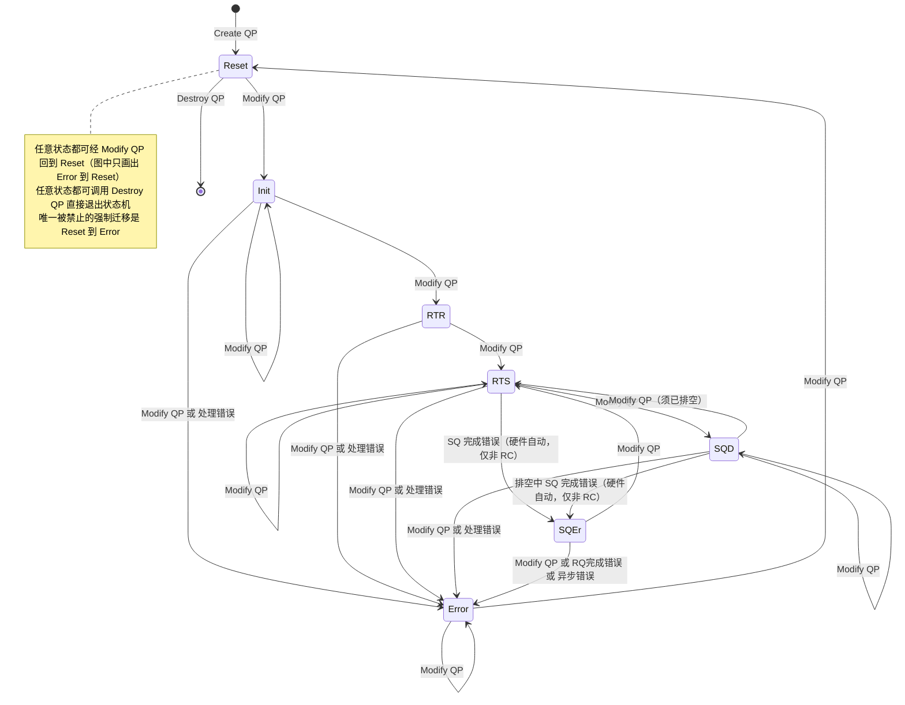
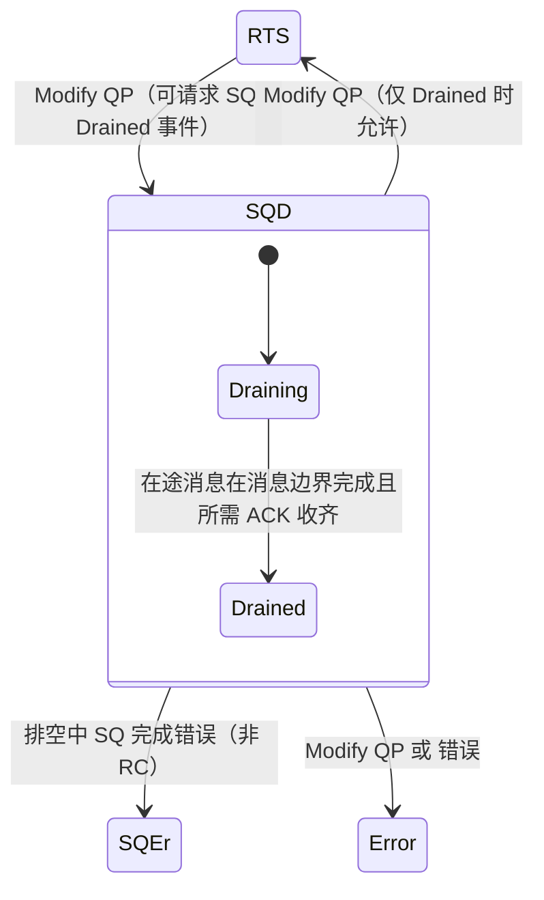
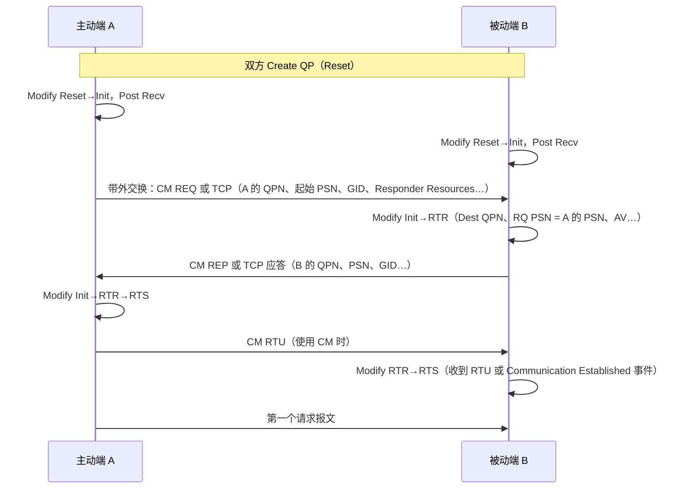
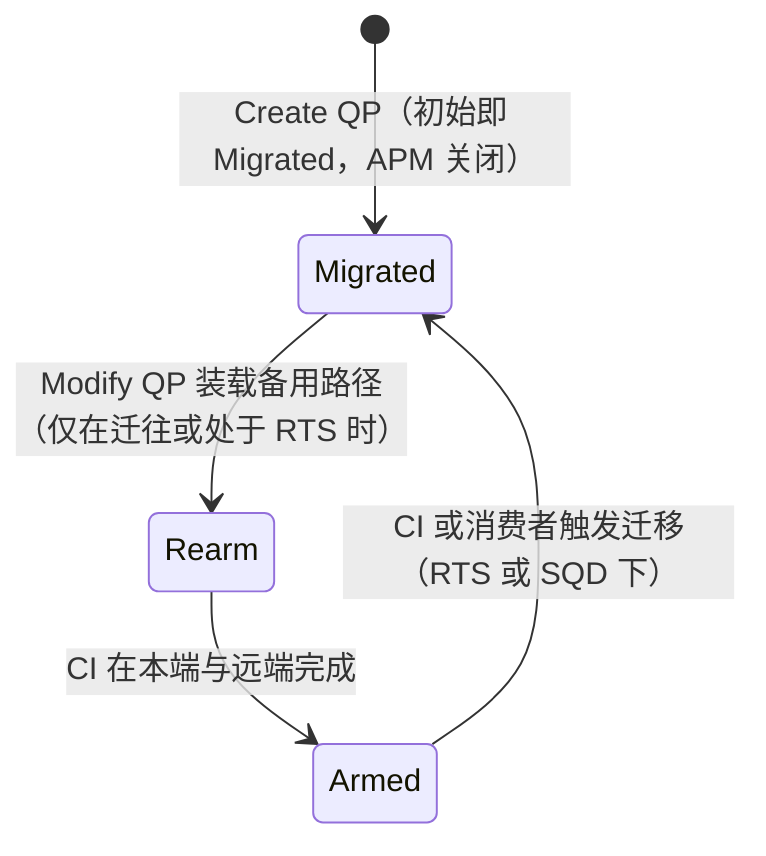

# QP 状态机与 Modify QP（QP State Machine and Modify QP）

> **摘要**：QP 的生命周期由 7 个状态组成，Modify QP 是推动状态迁移、装载连接参数（地址向量、PSN、超时与重试、读/原子资源）的唯一入口。本文给出完整状态图、各状态下 Post 与入站报文的行为、规范 Table 96 的迁移属性（区分 RC/UC/UD）、每个属性在 RoCEv2 下的确切含义与 libibverbs `attr_mask` 对照，以及错误恢复与 APM 的处境。
>
> **规范出处**：Vol1 §10.3.1（p.483–493）；§10.4（p.493–497）；§10.8.2（p.544–545）；§10.10.3（p.564–574）；§11.2.5.2–§11.2.5.3（p.611–621）；§11.2.7.2（p.625–630）；§11.4.1.1（p.673）；§11.6.3（p.690–695）；§9.7.5.2.8 Table 48（p.354–355）；§9.7.6（p.359–364）；§9.9.3 Table 61（p.436–437）；§12.7.28–§12.7.39（p.736–738）；§A17.3.1（p.1931–1934）；§A17.4.2（p.1937–1938）；§A17.5.4（p.1941）
>
> **前置阅读**：[01-resource-model.md](01-resource-model.md)、[RoCEv2 寻址](../00-overview/04-addressing.md)、[PSN 模型与 ACK/NAK 协议](../02-transport/05-psn-and-ack-nak.md)
>
> **关键词**：Reset, Init, RTR, RTS, SQD, SQEr, Error, Modify QP, attr_mask, Address Vector, Path MTU, PSN, Local ACK Timeout, Retry Count, RNR, Responder Resources, Initiator Depth, APM

## 1. 七个状态

QP 与 EE Context 共用同一张状态图（Figure 127）；即使某些服务类型并不需要这么多状态，也必须按规定顺序迁移，这样状态定义与错误语义保持统一，顺序以 RC 的建链需求为准〔Vol1 §10.3.1, p.483–484〕。

| 状态 | 英文全称 | 含义 | 关键条款 |
|---|---|---|---|
| Reset | Reset | 新建 QP 的初始状态；属性为创建时的默认值；WQ 为空，所有处理关闭 | C10-20、C10-21、C10-22、C10-23 |
| Init | Initialized | 基本属性已配置；可以向 RQ 投递 WR，但不处理入站报文 | C10-24、C10-25、C10-26 |
| RTR | Ready to Receive | 接收处理已激活，可以回 ACK；发送侧仍关闭 | C10-27、C10-28、C10-29 |
| RTS | Ready to Send | 正常收发 | C10-30、C10-31、C10-32 |
| SQD | Send Queue Drain | 发送侧不再开始新消息，完成在途消息后进入“已排空”（drained）；接收正常 | C10-33…C10-37 |
| SQEr | Send Queue Error | 非 RC QP 的 SQ 发生完成错误；RQ 继续正常工作 | C10-38、C10-39、C10-40 |
| Error | Error | 正常处理停止；未完成 WR 以 Flush 错误完成；入站报文丢弃 | C10-41、C10-41.2.1、C10-42 |

C10-19 要求 CI 为每个 QP 实现以上 7 个状态，但 **RC QP 不得实现 SQEr**，且迁移必须限定在 Figure 127 所示范围内；RD 的 EE Context 实现除 SQEr 外的 6 个状态（o10-11）〔Vol1 §10.3.1, p.485〕。libibverbs 的 `enum ibv_qp_state` 与之一一对应：`IBV_QPS_RESET/INIT/RTR/RTS/SQD/SQE/ERR`〔业界实践: rdma-core〕。

## 2. 状态迁移图



依据〔Vol1 §10.3.1, Figure 127, p.484；§10.3.1.4, p.488；§10.3.1.6, p.491–492〕：Figure 127 中绿色实线为 Modify QP/EE 驱动的迁移（Reset→Init→RTR→RTS、Init/RTS/SQD 的自环、RTS↔SQD、SQEr→RTS、Error→Reset）；红色虚线为错误引起的自动迁移——“Processing Error（取决于 QP 类型）”由 Init、RTR、RTS、SQD 指向 Error，“QP: Send WR Completion Error”由 **RTS 与 SQ Drain** 指向 SQ Error，“Receive WR Completion Error or Async Error”由 SQ Error 指向 Error。图注说明：可从任意状态经 Modify QP/EE 迁移到 Error 或 Reset（Reset→Error 除外）；除 Reset 外任意状态都可被强制进入 Error；任意状态都可调用 Destroy 退出。进入 RTS 只能来自 RTR、SQD 以及 SQEr 的恢复迁移。

### 2.1 软件迁移与硬件自动迁移

| 类别 | 迁移 | 触发 | 规范 |
|---|---|---|---|
| 软件（Modify QP） | Reset→Init→RTR→RTS、Init→Init、RTS→RTS、RTS→SQD、SQD→SQD、SQD→RTS、SQEr→RTS、任意→Reset、任意（Reset 除外）→Error | 消费者调用 Verb | Table 96 |
| 硬件自动 | RTS→SQEr、SQD→SQEr | UC/UD（及 RD）QP 的 SQ 出现完成错误（含 SQD 排空期间） | C10-147、C10-152；Figure 127 |
| 硬件自动 | 任意→Error | RC 的 SQ 完成错误；任意服务类型的 RQ 完成错误；关联异步错误 | C10-142、C10-143、C10-148、C10-153、C11-33 |
| 硬件自动 | SQD 子状态 Draining→Drained | 在途消息完成且所需 ACK 收齐 | C10-35、C10-36 |
| 不改变状态的事件 | RTR 下首包到达 → Communication Established 事件 | RC/UC 首包无错处理完 | C11-34、C11-35 |

> [!NOTE]
> §10.3.1.6 的正文写的是“SQEr 只能由 RTS 下处理 SQ WR 时的完成错误进入”，但 Figure 127 同时画出了 SQ Drain→SQ Error 的 “QP: Send WR Completion Error” 箭头；§11.6.3.1 也说明“若进入 SQD 的过程被迁往 SQError、Error 或 Reset 打断，同样产生 Send Queue Drained 事件”〔Vol1 §11.6.3.1, p.691–692〕。两处合起来理解：SQD 排空期间在途 WR 出现完成错误时，非 RC QP 进入 SQEr，RC QP 进入 Error。实现时以 Figure 127 的完整迁移集合为准。

## 3. 各状态下的行为

| 状态 | Post Send | Post Receive（未关联 SRQ） | 入站报文 | SQ 处理 | 规范 |
|---|---|---|---|---|---|
| Reset | 立即错误 | 立即错误 | 静默丢弃 | 关闭 | C10-22、C10-23、C10-96、C10-97.2.1 |
| Init | 立即错误 | 接受，但不处理入站 | 静默丢弃 | 关闭 | C10-24、C10-25、C10-26 |
| RTR | 立即错误 | 接受并处理 | 正常处理（可回 ACK/NAK、读响应） | 关闭 | C10-27、C10-28、C10-29 |
| RTS | 接受并处理 | 接受并处理 | 正常处理 | 开启 | C10-30、C10-31、C10-32 |
| SQD | 接受、入队但**不处理** | 接受并处理 | 正常处理 | 仅完成在途消息 | C10-33、C10-34、C10-35、C10-37 |
| SQEr | 以 Flush 错误完成 | 接受并处理 | 正常处理 | 停止 | C10-38、C10-40、C10-96 |
| Error | 以 Flush 错误完成 | 以 Flush 错误完成 | 静默丢弃 | 停止 | C10-41.2.1、C10-42、C10-97.2.1 |

补充规则：

- **Post Send 的错误码**：只有 Reset/Init/RTR 下返回 “Invalid QP state”；在 Error 与 SQEr 下**不**返回该立即错误（避免竞态带来的不确定行为），而是以 Flush 错误完成〔Vol1 §11.4.1.1, p.673〕。libibverbs 中 `ibv_post_send()` 在这些状态下的返回值依驱动实现而定〔业界实践〕。
- **关联 SRQ 的 QP**：SRQ 本身在任何状态都接受 Post Receive（超出容量才立即错误）；只有当 QP 处于 RTR/RTS/SQD/SQEr 且 SRQ 不在 Error 时才从 SRQ 取 WQE；QP 在 Reset/Init/Error 时不取（o10-51.2.1）；直接向关联了 SRQ 的 QP 投递接收 WR 返回立即错误（o10-51.2.2）〔Vol1 §10.8.2, p.545〕。
- **Reset 时的属性**：迁入 Reset 时所有属性恢复为创建时的默认值（C10-21），未完成 WR 被移出队列且**不通知**消费者（Table 96 “Any state to Reset”）。
- **进入 RTS 的前提**：QP/EE 的通信建立协议必须已完成〔Vol1 §10.3.1.4, p.488〕。

## 4. SQD（Send Queue Drain）详解



- **进入**：RTS→SQD 没有必需/可选属性，只有一个修饰符“使能 Send Queue Drained 关联异步事件通知”（libibverbs `en_sqd_async_notify` + `IBV_QP_EN_SQD_ASYNC_NOTIFY`）〔Vol1 §11.2.5.2, p.614〕。
- **排空语义**（C10-35）：发送逻辑停止处理新消息，在**消息边界**完成在途消息，并继续处理入站 ACK；迁移发生时尚未开始执行的消息不得开始。
- **排空完成**（C10-36）：所有预期 ACK 收齐且 SQ 处理已停止时，如请求过通知则产生关联异步事件（libibverbs `IBV_EVENT_SQ_DRAINED`）。Query QP 在 SQD 下可返回 “Send Queue Draining / Drained”（libibverbs `ibv_qp_attr.sq_draining`）〔Vol1 §11.2.5.3, p.619〕。
- **SQD→SQD**：排空中或排空后都可执行，但 Table 96 中带脚注 b 的属性（AV、读/原子资源、P_Key index、Local ACK Timeout、重试计数、主端口等）**只有排空后才能修改**，否则立即错误；改 AV 时不得同时改 Path MTU（脚注 c）〔Vol1 §10.3.1.5, p.490–491〕。
- **SQD→RTS**：未排空时执行返回立即错误。规范还提醒：两端都收到 SQ Drained 事件后再修改属性才安全〔Vol1 §10.3.1.5, p.490〕。
- **用途**：在不拆连接的情况下调整超时/重试参数、更换主端口（o10-19.a1，需 HCA 能力 `IBV_DEVICE_CHANGE_PHY_PORT`）、更新 AV 等。实际产品中对 SQD 的支持程度差异较大（以设备文档为准）〔业界实践〕。

## 5. Modify QP 迁移属性（Table 96）

C11-8：Modify QP 先修改属性再迁移到指定状态；C11-9：任一属性非法或迁移非法时，**所有属性都不修改**，返回立即错误且状态不变〔Vol1 §11.2.5.2, p.611〕。可在有未完成 WR 时修改部分属性：RQ 上的 WR 可在 Init/RTR/RTS/SQD/SQEr 下未完成，SQ 上的 WR 可在 RTS/SQD 下未完成；修改后这些 WR 可能不按预期执行（例如关闭 RDMA READ 后，已在途的 READ 可能完成而挂起的会失败）。

| 迁移 | 必需属性 | 可选属性 | 动作 |
|---|---|---|---|
| Reset→Init | 远程 RDMA/Atomic 使能ᵃ；P_Key index；主物理端口；Q_Key（仅无连接服务） | 无 | 允许向 RQ 投递 |
| Init→Init | 无 | 远程 RDMA/Atomic 使能ᵃ；P_Key index；主物理端口；Q_Key（无连接服务） | 不迁移 |
| Init→RTR | 远端 AV（仅连接型，含 Path MTU）；Loopback Indicatorᵈ；Dest QPN（RC/UC）；RQ PSN；Responder Resources；Min RNR NAK Timer（RC/RD） | 备用路径（RC/UC）；RDMA/Atomic 使能ᵃ；P_Key index；Q_Key；WQE 数 | 激活接收处理 |
| RTR→RTS | Local ACK Timeout（RC）；Retry Count（RC）；RNR Retry Count（RC）；SQ PSN；Initiator Depth（对端未完成 READ/Atomic 数） | RDMA/Atomic 使能ᵃ；Q_Key；备用路径（RC/UC）；路径迁移状态；WQE 数；Current QP State；Min RNR NAK Timer（RC/RD） | 激活发送处理 |
| RTS→RTS | 无 | RDMA/Atomic 使能ᵃ；Q_Key；备用路径；路径迁移状态；WQE 数；Current QP State；Min RNR NAK Timer | 不迁移 |
| SQEr→RTS | 无 | RDMA/Atomic 使能ᵃ；Q_Key；WQE 数；Current QP State；Min RNR NAK Timer（仅 RD） | 激活发送处理 |
| RTS→SQD | 无 | 无（另有 SQ Drained 事件使能修饰符） | 停止发送处理 |
| SQD→SQD | 无 | RDMA/Atomic 使能ᵃ；远端 AVᵇᶜ；Loopback Indicatorᵈ；备用路径；路径迁移状态；Initiator Depthᵇ；Responder Resourcesᵇ；Q_Key；P_Key indexᵇ；Local ACK Timeoutᵇ；Retry Countᵇ；RNR Retry Countᵇ；WQE 数；主物理端口ᵇ（需 HCA 支持）；Min RNR NAK Timer | 修改属性 |
| SQD→RTS | 无 | RDMA/Atomic 使能ᵃ；Q_Key；备用路径；路径迁移状态；WQE 数；Current QP State；Min RNR NAK Timer | 激活发送处理 |
| 任意（Reset 除外）→Error | 无 | 不允许 | 停止队列处理；挂起/在途 WR 尽可能以错误完成 |
| 任意→Reset | 无 | 不允许 | 属性恢复为创建时的值；未完成 WR 移出队列且不通知消费者 |

脚注〔Vol1 §11.2.5.2 Table 96, p.611–614〕：

- ᵃ 若关闭 RDMA 时仍有入站 RDMA 在处理，何时生效不确定，需消费者与远端协调。
- ᵇ 只能在 SQ 已排空时修改。
- ᶜ 在 SQD→SQD 中修改远端 AV 时不能修改 Path MTU。
- ᵈ 需 Query HCA 表明支持；AV 中 DLID 与 Loopback Indicator 互斥（RoCEv2 中 DLID 本身不使用）。

属性适用范围（摘自 Modify QP 输入修饰符列表）〔Vol1 §11.2.5.2, p.614–617〕：Q_Key 只适用于 UD/RD；SQ PSN 适用于 RC/UC/UD；RQ PSN、Dest QPN 只适用于 RC/UC；Initiator Depth、Local ACK Timeout、Retry/RNR Retry 只适用于 RC；Responder Resources 只适用于 RC（不含 XRC INI）；Min RNR NAK Timer 适用于 RC/RD（不含 XRC INI），且取值必须是 Table 48 中的编码，否则立即错误；远程 READ/Atomic 使能不适用于不可靠服务，远程 WRITE 使能不适用于 UD；Current QP State 只在迁往 RTS 时有效；备用路径的 Path MTU 必须与主路径相同。

按服务类型整理出的**最小必需集合**：

| 迁移 | RC | UC | UD |
|---|---|---|---|
| Reset→Init | 访问使能、P_Key index、端口 | 访问使能、P_Key index、端口 | P_Key index、端口、Q_Key |
| Init→RTR | AV（含 Path MTU）、Dest QPN、RQ PSN、Responder Resources、Min RNR Timer | AV（含 Path MTU）、Dest QPN、RQ PSN | 无 |
| RTR→RTS | Local ACK Timeout、Retry Count、RNR Retry、SQ PSN、Initiator Depth | SQ PSN | SQ PSN |

XRC TGT QP 的 Table 97 与 RC 类似，差别在于：Reset→Init 不需要 Q_Key；RTR→RTS 只需要 Local ACK Timeout 与 SQ PSN（TGT QP 不发请求，没有重试计数与 Initiator Depth）〔Vol1 §11.2.7.2, p.625–627〕。

## 6. RoCEv2 下各属性的确切含义

| 属性（规范） | libibverbs 字段（`attr_mask`）〔业界实践〕 | 宽度 / 取值 | RoCEv2 含义 | 依据 |
|---|---|---|---|---|
| 主物理端口 | `port_num`（`IBV_QP_PORT`） | 1…`phys_port_cnt` | 选定 GID 表与 P_Key 表 | §11.2.5.2 |
| P_Key index | `pkey_index`（`IBV_QP_PKEY_INDEX`） | 表索引 | 取表项填入出站 BTH.P_Key 并用于入站校验；RoCE 常为 0（0xFFFF） | C10-125…127、§A17.4.7 |
| Q_Key | `qkey`（`IBV_QP_QKEY`） | 32 bit | UD 入站 DETH.Q_Key 校验；WR Q_Key 最高位为 1 时出站使用 | C10-14、C10-15 |
| 远程访问使能 | `qp_access_flags`（`IBV_QP_ACCESS_FLAGS`） | `IBV_ACCESS_REMOTE_WRITE/READ/ATOMIC` | QP 级入站 RDMA/Atomic 开关，与 MR/MW 权限同时生效；未使能的操作按 “Unsupported OpCode” 处理，RC 回 NAK-Invalid Request | C10-88、Table 61 |
| GRH 标志 | `ah_attr.is_global`（随 `IBV_QP_AV`） | 必须为 1 | RoCE/RoCEv2 中恒为 TRUE | §A17.4.2 |
| SGID index | `ah_attr.grh.sgid_index` | 表索引 | 源 IP = 该 GID 表项；表项 GID type 决定 RoCE v1 / RoCEv2-IPv4 / RoCEv2-IPv6；源 MAC（及 VLAN）由该表项隐含 | CA17-11、CA17-18、CA17-40、§A17.4.3 |
| DGID | `ah_attr.grh.dgid` | 128 bit | 目的 IP；IPv4 写成 `::ffff:a.b.c.d` | CA17-12、CA17-19、§A17.4.1.1 |
| Hop Limit | `ah_attr.grh.hop_limit` | 8 bit | IPv4 TTL / IPv6 Hop Limit | CA17-9、CA17-17 |
| Traffic Class | `ah_attr.grh.traffic_class` | 8 bit | 规范：IP 头 DSCP 取 AV 的 Traffic Class | CA17-4、CA17-13 |
| Flow Label | `ah_attr.grh.flow_label` | 20 bit | IPv6 Flow Label；IPv4 无对应字段 | §A17.3.1.2 |
| SL | `ah_attr.sl` | 0–7；8–15 保留 | 以太网优先级 0–7（802.1Q PCP）；用保留值返回 Invalid Address Vector | §A17.4.2、§A17.5.4 |
| Destination L2 Address（原 DLID） | `ah_attr.dlid` 不使用；用户态无 DMAC 字段 | 48 bit | DMAC；取 0xFFFFFFFFFFFF 表示由 Verbs 实现做 L3→L2 解析 | §A17.4.2 |
| Source Path Bits | `ah_attr.src_path_bits` | — | 不适用 | §A17.4.2 |
| Max Static Rate | `ah_attr.static_rate` | `IBV_RATE_*` | A17 未作修改；RoCE 设备上的效果实现相关（以文档为准） | §11.2.5.2 |
| Path MTU | `path_mtu`（`IBV_QP_PATH_MTU`） | 1–5 = 256…4096 B | 单个报文的最大负载；超过端口 MTU 能力时返回 “MTUCap of HCA port exceeded”，实践中应 ≤ 端口 `active_mtu`；两端应设为相同值 | §11.2.5.2、§12.7.28、C9-92 |
| Dest QPN | `dest_qp_num`（`IBV_QP_DEST_QPN`） | 24 bit | 出站 BTH.DestQP | Table 67 |
| RQ PSN | `rq_psn`（`IBV_QP_RQ_PSN`） | 24 bit | 响应方初始 ePSN，应等于对端的 SQ PSN | §12.7.31 |
| SQ PSN | `sq_psn`（`IBV_QP_SQ_PSN`） | 24 bit | 本端发出的第一个请求的 PSN | §11.2.5.2 |
| Local ACK Timeout | `timeout`（`IBV_QP_TIMEOUT`） | 5 bit；0 = 禁用 | Ttr = 4.096 µs × 2^timeout | C9-140、C9-141 |
| Retry Count | `retry_cnt`（`IBV_QP_RETRY_CNT`） | 3 bit | 超时与 NAK-Sequence 的重试次数 | C9-137、C9-142 |
| RNR Retry Count | `rnr_retry`（`IBV_QP_RNR_RETRY`） | 3 bit；7 = 无限 | 收到 RNR NAK 后的重试次数 | C9-132 |
| Min RNR NAK Timer | `min_rnr_timer`（`IBV_QP_MIN_RNR_TIMER`） | 5 bit 编码 | 本端作为响应方因无接收 WQE 回 RNR NAK 时，AETH 中填写的最小等待时间 | §11.2.5.2、Table 48 |
| Responder Resources | `max_dest_rd_atomic`（`IBV_QP_MAX_DEST_RD_ATOMIC`） | ≤ `max_qp_rd_atom` | 本端可同时容纳的入站 RDMA READ/Atomic 数（可被上取整） | §11.2.5.2、§12.7.29 |
| Initiator Depth | `max_rd_atomic`（`IBV_QP_MAX_QP_RD_ATOMIC`） | ≤ `max_qp_init_rd_atom` | 本端可同时挂起的出站 RDMA READ/Atomic 数，不应超过对端 Responder Resources | §11.2.5.2、§12.7.30 |
| Current QP State | `cur_qp_state`（`IBV_QP_CUR_STATE`） | — | 仅在迁往 RTS 时有效 | §11.2.5.2 |
| 路径迁移状态 | `path_mig_state`（`IBV_QP_PATH_MIG_STATE`） | Migrated / Rearm | APM，见第 10 节 | §10.4 |
| 备用路径 | `alt_ah_attr`、`alt_pkey_index`、`alt_port_num`、`alt_timeout`（`IBV_QP_ALT_PATH`） | — | APM 备用路径 | §11.2.5.2 |
| WQE 数 | `cap`（`IBV_QP_CAP`） | — | 调整 WQ 深度（需 HCA 支持） | §10.2.4.3 |
| — | `rate_limit`（`IBV_QP_RATE_LIMIT`） | kbps | 业界扩展的 packet pacing，非 IBA 定义 | 〔业界实践〕 |

> [!WARNING]
> 〔业界实践: Linux kernel / rdma-core，以所用版本为准〕以下行为与规范字面略有出入，编程时需留意：
> - **Traffic Class**：Linux 把 `traffic_class` 当作完整的 8 bit TOS/Traffic Class 字节写入 IP 头（DSCP 在高 6 位、ECN 在低 2 位），因此要得到 DSCP 26 应设置 `26 << 2 = 104`（不少资料写作 106，即同时把低 2 位置为 ECT(0) 的 `10`）；ECN 位通常由硬件按拥塞控制配置改写。
> - **Hop Limit**：用户态对 RoCE 连接型 QP 做 `IBV_QP_AV` 时，内核调用 `ib_resolve_eth_dmac()` 解析 DMAC，并用路由查询得到的 hop limit 覆盖 `grh.hop_limit`。
> - **Flow Label 与 UDP 源端口**：内核提供 `rdma_flow_label_to_udp_sport()`，把 20 bit Flow Label 折叠为 0xC000–0xFFFF 的 UDP 源端口；Flow Label 为 0 时可用 `rdma_calc_flow_label()` 由本端/对端 QPN 对称地算出。这对应规范“有序报文用固定源端口”的建议，ECMP 的讨论见 [ECMP 与负载均衡](../05-congestion-control-and-qos/06-ecmp-and-load-balancing.md)。
> - **GRH 必须存在**：内核 `rdma_check_ah_attr()` 对 RoCE 类型的 AV 若未置 GRH 标志直接返回 `-EINVAL`。

### 6.1 Local ACK Timeout 与重试计数

Ttr = 4.096 µs × 2^`timeout`；`timeout` = 0 表示禁用传输定时器（C9-140）；实现应在 Ttr 到 4·Ttr 之间检测超时（C9-141）〔Vol1 §9.7.6, p.364〕。

| `timeout` | Ttr | 检测窗口（Ttr ~ 4·Ttr） | `retry_cnt` = 7 时判定失败的大致上限 ≈ 8 × 4·Ttr |
|---|---|---|---|
| 8 | 1.05 ms | 1.05 – 4.19 ms | ≈ 34 ms |
| 12 | 16.8 ms | 16.8 – 67.1 ms | ≈ 0.54 s |
| 14 | 67.1 ms | 67.1 – 268 ms | ≈ 2.1 s |
| 18 | 1.07 s | 1.07 – 4.29 s | ≈ 34 s |
| 31 | ≈ 8796 s | — | 实际等于不超时 |

- Retry Count 是 3 bit 计数器：每次针对同一请求包超时或收到 NAK-Sequence 时递减，该请求被确认后重新装载；耗尽后报 **Transport Retry Counter Exceeded**（`IBV_WC_RETRY_EXC_ERR`）〔Vol1 §9.7.6.1.2–§9.7.6.1.3, p.360–364, C9-137、C9-142〕。
- CM 中 Local ACK Timeout 由 REQ 发送方按 “2 × PacketLifeTime + 本端 CA ACK Delay” 计算〔Vol1 §12.7.34, p.737〕。RoCEv2 没有 SA PathRecord，PacketLifeTime 只能由实现或配置给定。取值过小会在 PFC 反压、拥塞时产生大量假超时重传，过大则让真实丢包的恢复变慢（规范同样提醒了这一取舍）。重传机制详见 [请求方行为](../02-transport/06-requester.md)。

### 6.2 RNR：Min RNR NAK Timer 与 RNR Retry

响应方无可用接收 WQE 时可回 RNR NAK，AETH 低 5 bit 携带“请求方至少等待多久再重试”的编码；`min_rnr_timer` 是本端作为响应方填写的最小值〔Vol1 §11.2.5.2, p.615–616〕。编码（Table 48）〔Vol1 §9.7.5.2.8, p.354–355〕：

| 编码 | 延迟 (ms) | 编码 | 延迟 (ms) | 编码 | 延迟 (ms) | 编码 | 延迟 (ms) |
|---|---|---|---|---|---|---|---|
| 0 | 655.36 | 8 | 0.16 | 16 | 2.56 | 24 | 40.96 |
| 1 | 0.01 | 9 | 0.24 | 17 | 3.84 | 25 | 61.44 |
| 2 | 0.02 | 10 | 0.32 | 18 | 5.12 | 26 | 81.92 |
| 3 | 0.03 | 11 | 0.48 | 19 | 7.68 | 27 | 122.88 |
| 4 | 0.04 | 12 | 0.64 | 20 | 10.24 | 28 | 163.84 |
| 5 | 0.06 | 13 | 0.96 | 21 | 15.36 | 29 | 245.76 |
| 6 | 0.08 | 14 | 1.28 | 22 | 20.48 | 30 | 327.68 |
| 7 | 0.12 | 15 | 1.92 | 23 | 30.72 | 31 | 491.52 |

注意编码 0 表示**最长**的 655.36 ms，而不是 0。请求方的 RNR 重试计数也是 3 bit，**值为 7 表示无限重试且不递减**（C9-132）〔Vol1 §9.7.5.2.8, p.354〕；耗尽报 **RNR Retry Counter Exceeded**（`IBV_WC_RNR_RETRY_EXC_ERR`）。

### 6.3 RDMA READ / Atomic 资源

- **Responder Resources**（`max_dest_rd_atomic`）：本端作为目标可同时挂起的入站 READ/Atomic 数，决定响应侧需要多少条“读响应上下文”来重放重复请求。
- **Initiator Depth**（`max_rd_atomic`）：本端作为发起方可同时在途的 READ/Atomic 数。
- CM 规则：REQ 接收方选择的本地 Initiator Depth 不得超过 REQ 提供的 Responder Resources，否则应 REJ；REP 接收方也要确认对端 Responder Resources 足以支撑自己想用的 Initiator Depth〔Vol1 §12.7.29–§12.7.30, p.736–737〕。
- 违反时的后果：响应方收到超过允许数量的未确认 READ/Atomic，RC 回 **NAK-Invalid Request**（Table 61 “Too many RDMA READ or ATOMIC Requests”），并产生 Local Access Violation Work Queue Error 关联异步错误，响应方 QP 进入 Error（C11-39.1.2）〔Vol1 §9.9.3, p.436；§11.6.3.2, p.693〕；请求方以 Remote Invalid Request Error（`IBV_WC_REM_INV_REQ_ERR`）完成。

## 7. libibverbs `attr_mask` 对照（Linux 内核校验表）

libibverbs 的 `ibv_modify_qp(qp, &attr, attr_mask)` 用掩码指出哪些字段有效。Linux 内核在 `drivers/infiniband/core/verbs.c` 的 `qp_state_table` / `ib_modify_qp_is_ok()` 中实现了与 Table 96 对应的检查：必需位缺一不可，出现必需与可选之外的位即判非法（`IBV_QP_STATE` 与 `IBV_QP_RATE_LIMIT` 恒允许；`IBV_QP_CUR_STATE` 仅当前状态为 RTR/RTS/SQD/SQE 时允许）〔业界实践: Linux kernel，以版本为准〕。

| 迁移 | RC 必需 | RC 可选 | UC 必需 | UD 必需 | UD 可选 |
|---|---|---|---|---|---|
| RESET→INIT | `PKEY_INDEX`、`PORT`、`ACCESS_FLAGS` | — | 同 RC | `PKEY_INDEX`、`PORT`、`QKEY` | — |
| INIT→INIT | — | `PKEY_INDEX`、`PORT`、`ACCESS_FLAGS` | — | — | `PKEY_INDEX`、`PORT`、`QKEY` |
| INIT→RTR | `AV`、`PATH_MTU`、`DEST_QPN`、`RQ_PSN`、`MAX_DEST_RD_ATOMIC`、`MIN_RNR_TIMER` | `ALT_PATH`、`ACCESS_FLAGS`、`PKEY_INDEX` | `AV`、`PATH_MTU`、`DEST_QPN`、`RQ_PSN` | — | `PKEY_INDEX`、`QKEY` |
| RTR→RTS | `TIMEOUT`、`RETRY_CNT`、`RNR_RETRY`、`SQ_PSN`、`MAX_QP_RD_ATOMIC` | `CUR_STATE`、`ALT_PATH`、`ACCESS_FLAGS`、`MIN_RNR_TIMER`、`PATH_MIG_STATE` | `SQ_PSN` | `SQ_PSN` | `CUR_STATE`、`QKEY` |
| RTS→RTS | — | `CUR_STATE`、`ACCESS_FLAGS`、`ALT_PATH`、`PATH_MIG_STATE`、`MIN_RNR_TIMER` | — | — | `CUR_STATE`、`QKEY` |
| RTS→SQD | — | `EN_SQD_ASYNC_NOTIFY` | — | — | `EN_SQD_ASYNC_NOTIFY` |
| SQD→SQD | — | `PORT`、`AV`、`TIMEOUT`、`RETRY_CNT`、`RNR_RETRY`、`MAX_QP_RD_ATOMIC`、`MAX_DEST_RD_ATOMIC`、`ALT_PATH`、`ACCESS_FLAGS`、`PKEY_INDEX`、`MIN_RNR_TIMER`、`PATH_MIG_STATE` | — | — | `PKEY_INDEX`、`QKEY` |
| SQD→RTS | — | `CUR_STATE`、`ALT_PATH`、`ACCESS_FLAGS`、`MIN_RNR_TIMER`、`PATH_MIG_STATE` | — | — | `CUR_STATE`、`QKEY` |
| SQE→RTS | （RC 无 SQE） | — | — | — | `CUR_STATE`、`QKEY`（UC 可选 `CUR_STATE`、`ACCESS_FLAGS`） |
| 任意→RESET / ERR | — | — | — | — | — |

（表中省略了 `IBV_QP_` 前缀；Linux 的表不允许 RESET→ERR，与规范一致。）

## 8. 典型 RC 建链时序



- 响应方必须先进入 RTR，请求方才能发包；否则对端处于 Init/Reset 时报文被静默丢弃（C10-23、C10-26），请求方只能靠超时重传。
- 被动端若在 RTR 时就收到首包，CI 产生 **Communication Established** 关联异步事件（C11-35，RC/UC），CM 可据此把 QP 推进到 RTS〔Vol1 §11.6.3.1, p.691〕。使用 RoCEv2 时，CM 报文本身就是 QP1 上的 RoCEv2 报文（§A17.6.1），详见 [IB CM 协议在 RoCEv2 上的应用](../04-connection-management/01-cm-protocol.md)。
- 起始 PSN 应随机选取，以降低旧连接的残留报文落入新连接有效 PSN 窗口的概率〔Vol1 §12.7.31, p.737〕。

## 9. 错误态与恢复

### 9.1 进入 Error / SQEr 的原因与远端影响

| 事件 | RC | UC | UD | 规范 |
|---|---|---|---|---|
| SQ 完成错误（本地检查或处理错误） | QP→Error，后续 WR 全部错误完成 | QP→SQEr | QP→SQEr | C10-142、C10-147、C10-152 |
| RQ 完成错误 | QP→Error | QP→Error | QP→Error | C10-143、C10-148、C10-153 |
| 关联异步错误（CQ 错误、WQ 灾难性错误、Invalid Request/Access Violation WQ 错误等） | QP→Error | QP→Error | QP→Error | C10-144、C10-150、C10-155、C11-33 |
| 立即错误 | 无影响（WR 没有入队） | 无影响 | 无影响 | C10-141、C10-146、C10-151 |

RC 发送端出错对远端的影响（Table 81）：Remote Invalid Request、Remote Access、Remote Operation 三类错误中，远端 QP 同样进入 Error；Local Length/Protection/QP Operation、RNR Retry Exceeded、Transport Retry Exceeded 不影响远端状态〔Vol1 §10.10.3.1, p.565–566〕。本地 QP 进入错误态**不会**自动发送任何报文去拆除连接〔Vol1 §10.10.3, p.564〕。

### 9.2 Flush 语义

- 导致进入 Error 的那个 WR 必须报告正确的错误码（C10-41）；其后的 WR，包括进入 Error 之后才投递的，都以 **Work Request Flushed Error**（`IBV_WC_WR_FLUSH_ERR`）完成（C10-42）。
- SQEr 中只有 SQ 上的后续 WR 被 Flush（C10-40），RQ 不受影响（C10-38）。
- 出错 WR 可能已部分或全部执行：SEND 可能已在远端产生 CQE；RDMA WRITE/READ 的目标或本地缓冲内容不确定；Atomic 可能执行也可能未执行〔Vol1 §10.3.1.6–§10.3.1.7, p.491–493〕。因此恢复后应用层通常需要重放或校验。

### 9.3 从 Error 恢复

规范中离开 Error 只有两条路：Modify 到 Reset，或 Destroy〔Vol1 §10.3.1.7, p.493〕。连接型 QP 的恢复等同于**重新建链**：

```c
/* 把出错的 RC QP 恢复为可重新建链的状态；两端都要执行并重新交换参数 */
static int rc_qp_recover(struct ibv_qp *qp, struct ibv_cq *cq)
{
    struct ibv_qp_attr attr = { .qp_state = IBV_QPS_ERR };
    struct ibv_wc wc[16];
    int n;

    if (ibv_modify_qp(qp, &attr, IBV_QP_STATE))   /* 已在 Error 时也允许 */
        return -1;
    /* 示意：Flush 完成是异步产生的，实际应持续轮询，直到收回所有未完成 WR 对应的 WC */
    do {
        n = ibv_poll_cq(cq, 16, wc);
    } while (n > 0);
    attr.qp_state = IBV_QPS_RESET;
    if (ibv_modify_qp(qp, &attr, IBV_QP_STATE))
        return -1;
    /* 之后与新建 QP 相同：INIT → 预投递接收 → 交换新的随机 PSN → RTR → RTS */
    return 0;
}
```

> [!TIP]
> 实践中更常见的做法是销毁 QP 并通过 CM（`rdma_cm`）重新建立连接：对端 QP 往往也已因 NAK 或重试耗尽进入 Error，且两端都必须换用新的 PSN。处理错误通知时，消费者要确保所有错误处理完成后再把 QP 强制 Reset〔Vol1 §10.3.1.7, p.493〕。

- **UC/UD 的 SQEr 恢复**：Modify SQEr→RTS 即可继续发送（可同时调整 Q_Key 等可选属性），出错 WR 之后的 SQ WR 已被 Flush，需要应用重发。
- **关联 SRQ 的 QP**：先 Modify 到 Error，等待 Last WQE Reached 事件（`IBV_EVENT_QP_LAST_WQE_REACHED`），排空 CQ，再 Destroy 或 Reset，避免 WQE 泄漏〔Vol1 §10.3.1, p.485〕。
- **销毁前**：规范建议先 Modify 到 Error 并取回相关 CQE〔Vol1 §10.2.4.4, p.469〕；若 QP 仍附着在多播组上则不能销毁（o10-2.2.3）。

## 10. APM 在 RoCEv2 中的处境

**自动路径迁移（Automatic Path Migration, APM）** 是 RC/UC/XRC QP 与 RD EEC 的可选能力：Modify QP 装载备用路径并把路径迁移状态设为 Rearm，两端完成握手后进入 Armed，故障时由 CI 或消费者把状态切到 Migrated〔Vol1 §10.4, p.493–497〕。



- 初始状态为 Migrated（o10-26）；Migrated→Rearm 只能在迁往/处于 RTS 时进行（o10-24）；Armed→Migrated 只能在 RTS/SQD 下进行（o10-25）。
- **RoCEv2**：§A17.5.4 只要求备用路径中的 AV 也按 §A17.4.2 修改（GRH 恒置位、SGID index、DGID 等），CM 的 LAP/APR 消息去掉 LID 相关字段（CA17-36、CA17-37）〔Vol1 §A17.6.1.3–§A17.6.1.4, p.1944〕——即规范层面仍允许 APM。
- **业界现状**〔业界实践: Linux kernel `_ib_modify_qp()`，以版本为准〕：Linux 内核核心层注释写明“目前只能处理 IB 的备用路径与 APM，在 RoCE 模式下禁止”，对 RoCE 端口的 `IBV_QP_ALT_PATH` 直接返回 `-EINVAL`。IP 网络中的路径冗余通常交给 ECMP/路由收敛与主机侧链路聚合（bonding/LAG）来完成。

## 11. 「硬件实现要点」

1. **状态字段与门控**：QPC 中保存 3 bit 状态。发送调度器与接收流水线按状态门控：

   | QPC.state | 入站请求（本端为响应方） | 入站响应/ACK（本端为请求方） | 发送调度 |
   |---|---|---|---|
   | Reset、Init | 丢弃 | 丢弃 | 不调度 |
   | RTR | 处理（可回 ACK/NAK/读响应） | 无在途请求，丢弃 | 只发响应类报文 |
   | RTS | 处理 | 处理 | 正常调度 |
   | SQD | 处理 | 处理（继续收 ACK） | 只推进已开始的消息 |
   | SQEr（UC/UD） | 处理 | — | 停止，SQ WQE 走 Flush |
   | Error | 丢弃 | 丢弃 | 停止，SQ/RQ WQE 走 Flush |

2. **Modify QP 是“命令”**：通常由驱动/固件执行“校验（类似内核 `qp_state_table` 的必需/可选掩码检查）→ 原子写 QPC → 让 QPC 缓存失效”。C11-9 要求全有或全无，因此校验必须在任何写入之前完成；写 QPC 时要与数据通路互斥（锁定该 QPN 或使用版本号）。
3. **迁移时的初始化**：Init→RTR 装载 ePSN = `rq_psn`、清空 MSN 与重复请求表；RTR→RTS 装载下一个请求 PSN = `sq_psn`、装载重试计数器与定时器参数；→Reset 回收在途读响应上下文、定时器与生产/消费索引。
4. **SQD 排空检测**：维护“已开始但未完成的消息数”与“未确认 PSN 区间”；两者归零且调度器不再取新 WQE 时置 drained 标志，并在使能时生成异步事件（EQ 条目）。
5. **Flush 引擎**：进入 Error/SQEr 时按 WQE 顺序为每个未完成 WQE 生成 Flush 状态的 CQE（由硬件、固件还是驱动生成属于实现选择）；还要处理已发出 DMA 读但尚未返回的 WQE，避免向已 Flush 的缓冲写入。
6. **Communication Established**：RX 流水线在 QP 处于 RTR 且首个报文至少通过 “PSN = ePSN?” 检查后产生该事件（C11-35），事件不改变状态。

相关设计见 [可靠性引擎](../06-hardware-implementation/04-reliability-engine.md) 与 [接收数据通路](../06-hardware-implementation/03-rx-datapath.md)。

## 12. 要点回顾

- 7 个状态：Reset、Init、RTR、RTS、SQD、SQEr、Error；RC 没有 SQEr（C10-19）。
- 正常建链路径 Reset→Init→RTR→RTS，全部由 Modify QP 推动；SQEr 与“出错进入 Error”由硬件自动完成。
- Init 可投递接收但不处理入站；RTR 处理入站但不能发送；SQD 接受投递但不处理新的发送 WR。
- Modify QP 全有或全无（C11-9）；RC 的最小必需集合：Init 需访问使能/P_Key index/端口，RTR 需 AV/Path MTU/Dest QPN/RQ PSN/Responder Resources/Min RNR Timer，RTS 需 Timeout/Retry/RNR Retry/SQ PSN/Initiator Depth。
- RoCEv2 中 AV 的 GRH 标志恒为真，SGID index 决定源 IP 与协议类型，SL 0–7 映射以太网优先级，8–15 返回 Invalid Address Vector。
- Ttr = 4.096 µs × 2^timeout（0 = 禁用）；Retry Count 与 RNR Retry 都是 3 bit，RNR Retry = 7 表示无限；Min RNR Timer 编码 0 表示 655.36 ms。
- Initiator Depth 不得超过对端 Responder Resources，否则对端回 NAK-Invalid Request 并进入 Error。
- 从 Error 只能 Reset 或 Destroy；连接型 QP 的恢复等同重新建链；Linux 在 RoCE 上禁止 APM 备用路径。

## 自测

<details><summary>Q1：UD QP 从 Init 迁移到 RTR 需要哪些必需属性？为什么与 RC 差别这么大？</summary>

答：UD 的 Init→RTR 没有必需属性（libibverbs 只需 `IBV_QP_STATE`）。UD 不维护连接，目的地址由每个 WR 的 AH 给出，也没有 RQ PSN、Responder Resources、RNR 等可靠连接状态；Q_Key、P_Key index、端口在 Reset→Init 已设置。
</details>

<details><summary>Q2：RC QP 设置 timeout = 14、retry_cnt = 7，链路突然中断，大约多久后应用会看到错误？看到的是什么状态码？</summary>

答：Ttr ≈ 67.1 ms，每次超时检测发生在 Ttr~4·Ttr 之间，共 1 次原始发送 + 7 次重试，最坏约 8 × 268 ms ≈ 2.1 s（最快约 0.54 s）。完成状态为 Transport Retry Counter Exceeded（`IBV_WC_RETRY_EXC_ERR`），QP 进入 Error，后续 WR 以 `IBV_WC_WR_FLUSH_ERR` 完成。
</details>

<details><summary>Q3：本端 max_rd_atomic = 16，对端 max_dest_rd_atomic = 4，会发生什么？</summary>

答：本端可能同时发出超过 4 个未确认的 READ/Atomic。对端按 Table 61 “Too many RDMA READ or ATOMIC Requests” 回 NAK-Invalid Request，并以 Local Access Violation Work Queue Error 把自己的 QP 置为 Error；本端以 Remote Invalid Request Error 完成并进入 Error。正确做法是让 Initiator Depth ≤ 对端 Responder Resources（§12.7.29–§12.7.30）。
</details>

<details><summary>Q4：为什么 min_rnr_timer 设为 0 往往是个错误？</summary>

答：Table 48 中编码 0 表示 655.36 ms（最长），而不是“立即重试”。若接收端偶尔缺 WQE，请求方每次 RNR 都要等待 0.65 s，表现为严重的延迟毛刺。常用值如 12（0.64 ms）。
</details>

<details><summary>Q5：一个 UC QP 在 RTS 下发送时出现 Local Protection Error，QP 处于什么状态？如何恢复？RQ 上的接收是否受影响？</summary>

答：UC 没有使用 Error 而是进入 SQEr（C10-147）；出错 WR 报 Local Protection Error，SQ 上后续 WR 以 Flush 完成（C10-40）；RQ 继续正常处理（C10-38）。修复原因后 Modify SQEr→RTS 即可恢复发送，被 Flush 的 WR 需要重新投递。
</details>

## 参考

- 规范：IBTA Vol1 Rel 1.4 §10.3.1（p.483–493）、§10.4（p.493–497）、§10.8.2（p.544–545）、§10.10.3（p.564–574）、§11.2.5.2–§11.2.5.3（p.611–621）、§11.2.7.2（p.625–630）、§11.6.3（p.690–695）、§9.7.5.2.8（p.354–355）、§9.7.6（p.364）、§9.9.3（p.436–437）、§12.7.28–§12.7.39（p.736–738）、Annex A17 §A17.3.1、§A17.4.2、§A17.5.4、§A17.6.1（p.1931–1944）。
- 外部：rdma-core `ibv_modify_qp(3)` man page（各 QP 类型最小必需属性表）〔业界实践: Linux rdma-core〕。
- 外部：Linux 内核 `drivers/infiniband/core/verbs.c`（`qp_state_table`、`ib_modify_qp_is_ok()`、`_ib_modify_qp()`、`ib_resolve_eth_dmac()`、`rdma_check_ah_attr()`）、`include/rdma/ib_verbs.h`（`rdma_flow_label_to_udp_sport()`）〔业界实践: Linux kernel〕。
- 相关文件：[01-resource-model.md](01-resource-model.md)、[04-work-requests-and-completions.md](04-work-requests-and-completions.md)、[05-verbs-roce-specifics-and-programming.md](05-verbs-roce-specifics-and-programming.md)、[错误检测与处理](../02-transport/08-error-handling.md)、[IP CM 与 rdma_cm](../04-connection-management/02-ip-cm-and-rdma-cm.md)。
