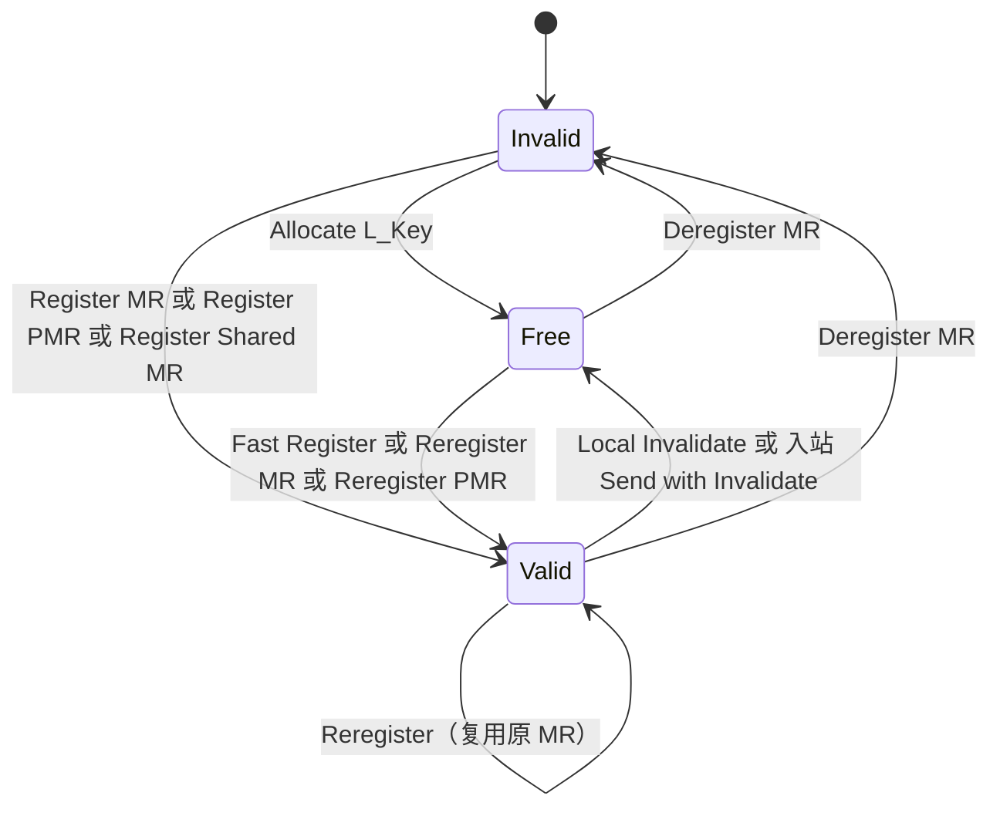
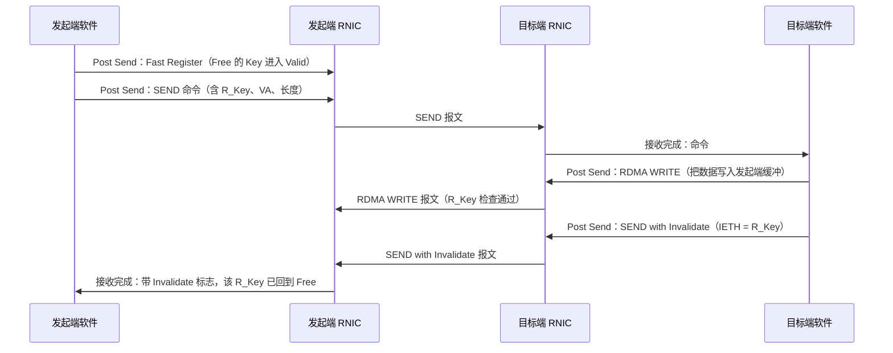

# 内存注册与保护（Memory Registration and Protection）

> **摘要**：RDMA 的“零拷贝 + 远程直接访问”建立在内存注册之上：消费者把一段内存注册为 MR，得到 L_Key/R_Key，HCA 据此完成地址翻译与访问检查。本文按规范整理注册的输入输出、Key 的格式与状态、本地/远程访问检查步骤与失败后果、VA 与 ZBVA 地址翻译、Memory Window、Fast Register/Invalidate、注销规则，并给出 MPT/MTT 的硬件设计要点与工程建议。
>
> **规范出处**：Vol1 §10.6（p.501–536）；§10.2.3（p.465–466）；§10.7.2.4–§10.7.2.6（p.541–542）；§10.8.3.3（p.548–551）；§11.2.10（p.644–661）；§11.4.1.1（p.663–673）；§11.6.2（p.687–690）；§9.7.4.1.5（p.329）；§9.7.5.2.4–§9.7.5.2.5（p.350–351）；§9.7.5.2.8（p.355）；§9.9.3 Table 61（p.436–437）
>
> **前置阅读**：[01-resource-model.md](01-resource-model.md)、[扩展传输头 RETH/AETH/AtomicETH/IETH](../01-packet-format/04-extended-transport-headers.md)
>
> **关键词**：Memory Region, L_Key, R_Key, Protection Domain, Access Rights, VA, ZBVA, PBL, Memory Window, Fast Register, Local Invalidate, Send with Invalidate, MPT, MTT, ODP

## 1. 为什么要注册内存

HCA 像普通 I/O 桥一样用**物理地址**访问主机内存，而一个跨页的逻辑缓冲在物理上通常不连续。**内存注册（Memory Registration）**把一组虚拟连续（或物理连续）的内存位置描述给 CI，使 HCA 能以虚拟地址把它们当作一个连续缓冲访问〔Vol1 §10.6.2, p.501〕。

- 所有消费者在 HCA 访问其缓冲之前都必须显式注册；访问未注册（或处于 Invalid/Free 状态）的内存时 CI 不得执行访问并须报错（C10-44.2.1、o10-36.2.1）。
- 注册要么完全成功、要么失败（C10-45）；资源不足时整体失败，不注册任何内存。
- 注册的产物〔Vol1 §10.6.2.1, p.502–503〕：
  - **MR 句柄（MemoryRegionHandle）**：供内存管理 Verbs 识别该 MR；
  - **L_Key**：与 MR 内的虚拟地址一起出现在 WR 的数据段（SGE）中，标识本地访问；
  - **R_Key**（按需产生）：与虚拟地址一起用于 RDMA/Atomic，标识远程访问；
  - **VA 或 ZBVA**：MR 第一个字节对应的虚拟地址（VA 型）或 0（零基型）。
- **驻留（pinning）**：通过 Register MR / Reregister MR 注册时，CI 必须把 MR 内每个物理缓冲钉住在内存中，保证不被换出且虚实映射不变（C10-52.2.1）；OS 负责对重复的 pin/unpin 做引用计数〔Vol1 §10.6.4.3.4, p.514–515〕。

```text
  WR 中的 SGE / 报文中的 RETH
  ┌──────────┬────────┬────────┐
  │ VA (64b) │ Key    │ Length │
  └────┬─────┴───┬────┴────────┘
       │         │ Key 的高 24 bit = 表索引
       │         ▼
       │   ┌──────────────┐  校验: 状态/Key 字节/PD/权限/边界
       │   │  MPT 表项     │──────────────────────────────┐
       │   └──────┬───────┘                              │
       │          │ MTT 指针、页大小、起始 VA              │
       ▼          ▼                                      ▼
   页号/页内偏移 ──► MTT[页号] = 物理页地址 ──► PA ──► PCIe DMA 读/写
```

（MPT/MTT 为业界常用叫法，规范只定义语义，见第 9 节。）

## 2. 注册 Verb：输入、输出与访问权限

### 2.1 Register Memory Region

| 方向 | 规范修饰符〔Vol1 §11.2.10.2, p.645–646〕 | libibverbs〔业界实践: rdma-core〕 |
|---|---|---|
| 输入 | HCA 句柄 | `pd->context` |
| 输入 | 虚拟地址（区域第一个字节，最大 64 bit） | `addr` |
| 输入 | 长度（字节） | `length` |
| 输入 | 分配给该区域的 PD | `pd` |
| 输入 | 访问控制（见 2.2） | `access`（`IBV_ACCESS_*`） |
| 输入 | VA 类型：VA / ZBVA | 默认 VA；`IBV_ACCESS_ZERO_BASED` 或 `ibv_reg_mr_iova()` 指定 IOVA |
| 输出 | MR 句柄 | `struct ibv_mr *` |
| 输出 | L_Key | `mr->lkey` |
| 输出 | R_Key（仅请求了远程访问时） | `mr->rkey` |
| 错误 | Insufficient resources / Invalid VA / Invalid Length / Invalid PD / Invalid Access Control specifier / HCA doesn't support ZBVA | 返回 NULL 并设置 `errno` |

该 Verb 依赖 OS 提供的函数完成页钉住与虚实翻译；返回的 L_Key/R_Key 的 key 部分由 **CI 拥有**（见第 3 节）。

### 2.2 访问权限及其约束

| 权限 | 含义 | 规则 | libibverbs |
|---|---|---|---|
| Local Read | HCA 可读本地缓冲（发送、RDMA WRITE 的 gather） | 每个 MR 自动包含（C10-47） | 隐含 |
| Local Write | HCA 可写本地缓冲（接收、RDMA READ 的 scatter、Atomic 返回值） | 消费者可选 | `IBV_ACCESS_LOCAL_WRITE` |
| Remote Read | 远端可对其执行 RDMA READ | 可选 | `IBV_ACCESS_REMOTE_READ` |
| Remote Write | 远端可对其执行 RDMA WRITE | **要求同时有 Local Write**（C10-48） | `IBV_ACCESS_REMOTE_WRITE` |
| Remote Atomic | 远端可对其执行 Atomic | 支持 Atomic 的 CI 必须支持（o10-37）；**要求 Local Write**（C10-48） | `IBV_ACCESS_REMOTE_ATOMIC` |
| MW Binding | 允许在该 MR 上绑定 MW | 可选 | `IBV_ACCESS_MW_BIND` |

〔Vol1 §10.6.3, p.506–507；§10.6.7.1–§10.6.7.2.1, p.522–524〕

> [!IMPORTANT]
> C10-48：注册时指定了 Remote Write 或 Remote Atomic 却没有 Local Write，CI 必须返回**立即错误**。道理是：消费者不能把自己都没有的“写”能力授予远端。绑定 MW 时同理（C10-62，见第 6 节）。

几条容易忽略的规则：

- **本地操作所需权限**：Send 缓冲与 RDMA WRITE 的源缓冲只需 Local Read；**接收缓冲、RDMA READ 的目的缓冲、Atomic 结果缓冲需要 Local Write**〔Vol1 §10.6.7.1, p.523〕。最常见的编程错误之一就是为 RDMA READ 的本地落地缓冲注册时漏了 `IBV_ACCESS_LOCAL_WRITE`，结果以 Local Protection Error 完成。
- **只给 Atomic 不给 Write 是合理的**：架构不要求 Atomic 与 RDMA WRITE 之间互相原子，若一块内存用作锁，所有访问都应使用 Atomic〔Vol1 §10.6.7.2, p.523；§10.7.2.3, p.540〕。
- **QP 级开关**：RDMA 数据只有在目标 **QP** 也使能了该操作时才能写入目标内存（C10-88），即 QP 的 `qp_access_flags` 与 MR/MW 的权限同时生效〔Vol1 §10.7.2.2, p.538〕。
- **OS 策略**：注册类 Verb 的直接调用者是 OS 中的特权代码；OS 通常保证用户进程不能让 HCA 读/写自己无权读/写的内存〔Vol1 §10.6.7, p.522〕。

### 2.3 其它内存管理 Verb 一览

| 规范 Verb〔Vol1 §11.2.10, p.644–661〕 | 作用 | libibverbs / Linux 内核对应〔业界实践〕 |
|---|---|---|
| Allocate L_Key | 预留 PBL 资源，返回处于 Free 状态的 L_Key（及可选 R_Key），key 部分由消费者拥有 | 内核 `ib_alloc_mr()`（用户态无对应） |
| Register Memory Region | 注册虚拟地址区域 | `ibv_reg_mr()`、`ibv_reg_mr_iova()` |
| Register Physical Memory Region | 特权消费者用物理缓冲列表注册 | 无直接对应；内核 ULP 多用 Fast Register |
| Query Memory Region | 返回 Key、状态、所有权、共享属性、实际保护边界、PD、权限等 | 无通用对应（`ibv_mr` 结构体含 lkey/rkey/addr/length） |
| Deregister Memory Region | 注销并解除钉住 | `ibv_dereg_mr()` |
| Reregister (Physical) Memory Region | 修改翻译、PD 或权限 | `ibv_rereg_mr()`（`IBV_REREG_MR_CHANGE_TRANSLATION/PD/ACCESS`） |
| Register Shared Memory Region | 让新 MR 共享已有 MR 的 PBL | 无 |
| Fast Register Physical MR（WR） | 通过 SQ 把 Free 状态的 Key 关联到一组物理缓冲 | 内核 `ib_map_mr_sg()` + `IB_WR_REG_MR` |
| Local Invalidate（WR） | 通过 SQ 使 MR 或 Type 2 MW 失效 | `IBV_WR_LOCAL_INV` / `IB_WR_LOCAL_INV` |
| Send with Invalidate | 发送并使对端某个 R_Key 失效 | `IBV_WR_SEND_WITH_INV` |
| Allocate / Query / Deallocate MW | MW 生命周期 | `ibv_alloc_mw()` / — / `ibv_dealloc_mw()` |
| Bind MW（Type 1）/ Post Send Bind MW（Type 2） | 绑定 MW | `ibv_bind_mw()` / `IBV_WR_BIND_MW` |

## 3. L_Key / R_Key

### 3.1 格式与所有权

支持 **Base Memory Management Extensions** 的 CI，其 L_Key 与 R_Key 都必须由“高 24 bit 索引 + 低 8 bit key”组成（o10-37.2.1、o10-37.2.3）〔Vol1 §10.6.3.3–§10.6.3.4, p.507–509〕：

```text
 31                                                    8 7             0
+-------------------------------------------------------+---------------+
|                Index（24 bit，始终由 CI 拥有）           |  Key（8 bit）  |
+-------------------------------------------------------+---------------+
```

| 创建方式 | key 部分归属 | 规范 |
|---|---|---|
| Allocate L_Key | 消费者 | o10-37.2.2、o10-37.2.4 |
| Register MR / Reregister MR / Register Shared MR | CI | 同上 |
| Register Physical MR / Reregister Physical MR | 由消费者选择：消费者或 CI | 同上 |
| Type 1 MW 的 R_Key | CI（每次绑定返回与上一次不同的值，C10-66.2.2） | §10.6.7.2.3 |
| Type 2 MW 的 R_Key | 索引归 CI，key 归消费者（o10-37.2.32） | §10.6.7.2.4 |

- 若 L_Key 带有 R_Key 且 key 部分由消费者拥有，则二者的 key 部分必须相同；所有权不能混用〔Vol1 §10.6.3.4, p.509〕。
- **key 字节的作用**相当于“代数/世代号”：同一索引的资源被重新注册或重新绑定后换一个 key，持有旧 Key 的一方访问会因 key 不匹配而失败。规范在 Type 1 MW 的实现说明中正是建议这种“索引 + 变化的 key 字段 + 随机数”做法，以防持有失效 R_Key 的一方继续访问〔Vol1 §10.6.7.2.3, p.527–528〕。
- 〔业界实践〕rdma-core 提供 `ibv_inc_rkey()`，只递增 R_Key 的低 8 bit（用于 Type 2 MW 绑定时生成新 key）；Linux mlx4 驱动中 `hw_index_to_key()` 把硬件表索引旋转到 Key 的高 24 bit，正好对应上述格式。
- **作用域**：Key 只对注册它的 HCA 有效，不授予其它本地 HCA 访问权；规范不要求在别的 HCA 上使用时一定报错〔Vol1 §10.6.3.6, p.510〕。

### 3.2 Key 的三种状态

每个 MR 的 L_Key/R_Key 处于 Invalid、Free、Valid 之一〔Vol1 §10.6.2.3, p.504–506, Table 69/70〕：



| 性质 / 操作 | Invalid | Free | Valid |
|---|---|---|---|
| 已分配资源 | 否 | 是（PBL 与 PD 已关联） | 是 |
| 零长度访问 | 允许 | 允许 | 允许 |
| 访问主机内存 | 禁止 | 禁止 | 允许 |
| 远程失效（Send with Invalidate） | 禁止 | 允许 | 允许 |
| Fast Register | 禁止 | 允许 | 禁止 |
| Local Invalidate | 禁止 | 允许 | 允许 |

失效成功后 L_Key 与 R_Key（如有）都进入 Free；Reregister 可能返回原 MR（进入 Valid）或新 MR（原 MR 进入 Invalid）。

### 3.3 Reserved L_Key

支持 Base Memory Management Extensions 时，特权消费者可用 **Reserved L_Key** 直接以**物理地址**描述 SGE；它只能本地使用，不能用于远程访问；QP 创建时要声明是否允许 Fast Register 与 Reserved L_Key；不能对它绑定 MW、失效、销毁或用它做任何注册（o10-37.2.7、o10-37.2.8）〔Vol1 §10.6.4.3.2, p.513–514〕。〔业界实践〕Linux 内核中对应 `pd->local_dma_lkey`，供内核 ULP 使用 DMA 地址。

## 4. 访问检查

### 4.1 本地访问检查

〔Vol1 §10.6.4.5.1, p.517–518；§10.6.7.1, p.522–523〕

1. **PD 一致**：SGE 用 L_Key 引用的内存必须位于与处理该 WR 的 QP **同 PD** 的 MR 的物理缓冲内（C10-54.2.1）；QP 关联 SRQ 时，RQ 的 WQE 用 **SRQ 的 PD** 检查（o10-37.2.12）。
2. **本地权限**：MR 的本地访问权限必须允许所请求的访问类型（C10-55）。
3. **Reserved L_Key**：必须在该 QP 上已使能（o10-37.2.11）。
4. **零长度例外**：零长度数据段不做任何保护检查（C10-54.1.1）；收到零长度消息时，RC/UC/RD 及不含 GRH 的 UD 消息不对 WR 的数据段做本地保护检查；**带 GRH 的 UD 消息仍要检查**（因为要写入 40 字节 GRH 区），检查失败报完成错误（C10-54.1.2）。RoCEv2 的 UD 报文总带 L3 头，接收时 IP 头写入这 40 字节区域（§A17.4.5.2）。
5. **边界**：强烈建议检查 VA 落在该 L_Key 对应 MR 内并在访问时报告越界，但不强制；支持 Base Memory Management Extensions 时必须做到**字节粒度**（否则允许到物理缓冲粒度）〔Vol1 §10.6.4.3.3, p.514〕。

### 4.2 远程访问检查

〔Vol1 §10.6.4.5.2, p.518；§10.6.7.2, p.523–524；§9.7.4.1.5, p.329〕

- **PD 一致**：VA + R_Key 引用的内存必须在与处理该远程操作的 QP 同 PD 的 MR 内，检查粒度不超过 4096 字节（C10-56）；对 MW 必须字节粒度（C10-61）。
- **远程权限**：MR 的远程权限必须允许所请求的操作（C10-57）。
- **R_Key 违例**的完整定义（RDMA READ/WRITE/Atomic）：RETH/AtomicETH 中的 R_Key 无效；VA 与长度或访问类型超出该 R_Key 的范围——**RDMA WRITE 按每个报文的长度检查，RDMA READ 按 RETH 的 DMA Length 检查**；对 HCA 还包括 PD 违例〔Vol1 §9.7.4.1.5, p.329〕。
- **零长度 RDMA READ/WRITE 不校验 R_Key**，即使带立即数（C9-88）。

### 4.3 入站 RDMA/Atomic 检查步骤（硬件实现参考）

| 步骤 | 检查 | 失败时（RC 响应方） | 依据 |
|---|---|---|---|
| 1 | QP 状态允许处理入站请求（RTR/RTS/SQD/SQEr） | 静默丢弃 | §10.3.1 |
| 2 | OpCode 受支持且 QP 已使能对应远程操作（`qp_access_flags`） | NAK-Invalid Request | C10-88；Table 61 “Unsupported or Reserved OpCode” |
| 3 | 长度合法：RDMA 请求长度 ≤ 2³¹；报文负载与 OpCode/PMTU 相符 | NAK-Invalid Request | §11.6.2；C9-92 |
| 4 | 零长度请求 → 跳过 R_Key 检查 | — | C9-88 |
| 5 | 以 R_Key 高 24 bit 查表；表项须为 Valid 且 key 字节相等 | NAK-Remote Access Error | C9-89 |
| 6 | 对象类型分支：MR / Type 1 MW 比较 PD；Type 2A 比较绑定 QPN；Type 2B 比较 QPN 与 PD | NAK-Remote Access Error | C10-56、C10-76.2.1、o10-37.2.42/43 |
| 7 | 权限位：WRITE 需 Remote Write、READ 需 Remote Read、Atomic 需 Remote Atomic | NAK-Remote Access Error | C10-57、C10-77 |
| 8 | 边界：[VA, VA+len) ⊆ 区域（WRITE 按报文、READ 按 DMA Length） | NAK-Remote Access Error | §9.7.4.1.5 |
| 9 | Atomic 地址 8 字节自然对齐 | NAK-Invalid Request（Misaligned ATOMIC） | o10-43；Table 61 |
| 10 | 地址翻译（MTT）后发起 DMA | 内部错误 → NAK-Remote Operational Error | Table 61 “Local QP Error” |

步骤 2、3 与 5–9 的先后顺序规范未规定，表中顺序仅为一种合理实现。

**失败后果**〔Vol1 §9.7.4.1.5, p.329；§9.7.5.2.4, p.350–351；§9.9.3 Table 61, p.436–437；§11.6.3.2, p.693〕：

- **RC 响应方**：先执行完该错误报文之前收到的所有请求（C9-90），再回 **NAK-Remote Access Error**，BTH 中携带出错请求报文的 PSN（C9-89、C9-124）；同时产生 **Local Access Violation Work Queue Error** 关联异步错误，响应方 QP 进入 Error（C11-39.1.2）。
- **RC 请求方**：WR 以 **Remote Access Error**（`IBV_WC_REM_ACCESS_ERR`）完成，QP 进入 Error，远端 QP 同样进入 Error（Table 81）。
- **UC**：没有 ACK/NAK，R_Key 违例时未关联 SRQ 的 QP 按 Class D 处理（丢弃报文、不消耗接收 WQE、状态不变），关联 SRQ 的按 Class E 处理（可能以错误完成接收 WQE，状态不变）〔Vol1 §9.9.3 Table 61–62, p.437–439〕。
- **本地侧错误**：发送 WR 的 SGE 非法 → **Local Protection Error**（`IBV_WC_LOC_PROT_ERR`）；接收 WQE 的 SGE 非法 → 接收侧 Local Protection Error，RC 向请求方回 NAK-Remote Operational Error（Table 102），请求方得到 **Remote Operation Error**（`IBV_WC_REM_OP_ERR`）。完成状态码全集见 [04-work-requests-and-completions.md](04-work-requests-and-completions.md)，错误分类见 [错误检测与处理](../02-transport/08-error-handling.md)。

### 4.4 PD 规则汇总

| 场景 | 用哪个 PD 比较 | 规范 |
|---|---|---|
| 本地 SGE（SQ WR，或未关联 SRQ 的 RQ WR） | QP 的 PD | C10-54.2.1、o10-37.2.12 |
| 关联 SRQ 的 RQ WR 的 SGE、入站 SEND 落地 | SRQ 的 PD | o10-37.2.12、o10-2.2.2 |
| 入站 RDMA/Atomic 访问 MR | QP 的 PD | C10-56、o10-2.2.2 |
| 入站 RDMA/Atomic 访问 Type 1 MW | QP 的 PD = MW 的 PD | C10-76.2.1 |
| 入站访问 Type 2A / 2B MW | 2A：绑定的 QPN；2B：QPN 与 PD | o10-37.2.42、o10-37.2.43 |
| XRC 入站请求 | 目标 XRC SRQ 的 PD | §10.2.10 |
| MW 绑定 | MW、QP、MR 同 PD | C10-72、C10-75 |

## 5. 地址转换

### 5.1 VA 型区域

虚拟连续区域由“首字节 VA + 长度”描述；对 VA 型 MR，首字节 VA 对第一个物理缓冲大小取模必须等于首字节在该缓冲内的偏移（first byte offset）〔Vol1 §10.6.2.1, p.502；§10.6.4.3, p.513〕。规范 Figure 129 的例子（4 KB 页）〔Vol1 §10.6.4.2, p.512〕：

| 区域内偏移 | 虚拟地址 | 物理页 | 物理地址 |
|---|---|---|---|
| 0（首字节） | 0x141200 | 0x61000 | 0x61200 |
| 3583 | 0x141FFF | 0x61000 | 0x61FFF |
| 3584 | 0x142000 | 0x74000 | 0x74000 |
| 7679 | 0x142FFF | 0x74000 | 0x74FFF |
| 7680 | 0x143000 | 0x8B000 | 0x8B000 |
| 9999（末字节） | 0x14390F | 0x8B000 | 0x8B90F |

区域长 10000 字节，由 3 个物理页承载（3584 + 4096 + 2320 字节）。统一的翻译公式（ps = 页大小，fbo = 首字节页内偏移，此例 fbo = 0x200）：

```text
off = VA − start_VA                      （VA 型；ZBVA 型时 off 就是报文/WR 中给出的地址）
x   = off + fbo
PA  = MTT[x >> log2(ps)] + (x & (ps − 1))
```

例：VA = 0x14390F → off = 0x270F → x = 0x290F → MTT[2] + 0x90F = 0x8B000 + 0x90F = 0x8B90F，与上表一致。

> [!NOTE]
> 访问控制以“每个完整物理缓冲”为单位生效：此例中 0x141000–0x1411FF 虽在请求注册的范围之前，也**可能**被允许访问〔Vol1 §10.6.4.3, p.513；§10.6.4.3.3, p.514〕。支持 Base Memory Management Extensions 的 CI 则必须字节粒度检查。远程访问的 MR 检查粒度不超过 4096 字节（C10-56），并强烈建议字节粒度；Query Memory Region 可返回实际执行的保护边界。

### 5.2 零基虚拟地址（ZBVA）

- ZBVA MR 的第一个字节被赋予虚拟地址 0，区域用“相对 0 的偏移 + 长度”描述，这些地址不具有任何处理器上下文〔Vol1 §10.6.4.3.1, p.513〕。
- ZBVA 是可选能力（Query HCA “Ability to support Zero Based Virtual Addresses”）。支持时：VA 型 MW 与 ZBVA 型 MW 都可以绑定到 **VA 型 MR**，但**不能把 MW 绑定到 ZBVA 型 MR**（o10-36.2.2）〔Vol1 §10.6.2.1, p.503〕。Type 1 MW 只能用 VA 寻址，Type 2 MW 可用 VA 或 ZBVA〔Vol1 §10.6.7.2.2, p.525〕。
- 用途：远端只需知道偏移而不需知道本端进程的虚拟地址，便于隐藏地址布局、在多个缓冲间复用同一套远程寻址。
- libibverbs：`IBV_ACCESS_ZERO_BASED`（“用 MR 起点的字节偏移代替指针访问”），或用 `ibv_reg_mr_iova()` 自选 IOVA〔业界实践: rdma-core `ibv_reg_mr(3)`〕。

### 5.3 物理寻址区域与物理缓冲列表（PBL）

〔Vol1 §10.6.4.4, p.515–516〕

- 特权消费者可用**物理缓冲列表**注册：再给出首字节在第一个缓冲内的偏移与区域长度；末字节必须落在最后一个缓冲内。
- 两种列表：**页列表**——每个元素起止于 CI 支持的页边界，否则报错（C10-53.2.1）；**块列表**——元素可以任意字节对齐但大小必须相同（o10-37.2.9）。
- 两种 IOVA：VA 型（消费者请求一个 I/O 虚拟地址对应首字节；支持 Base MM Extensions 的 CI 必须采用请求值，页模式下要检查 IOVA 对首缓冲大小取模等于首字节偏移）与零基型。IOVA 最大 64 bit。
- PBL 中的物理缓冲在区域被失效或注销之前必须一直可被 CI 访问；钉住与解除钉住由消费者负责。

其它规则：远程地址（RETH/AtomicETH 中的 VA）固定 64 bit，本地 VA 宽度实现相关〔Vol1 §10.6.4.1, p.512〕；注册区域可任意字节对齐、任意长度（不超过 HCA 上限，C10-50、C10-51）；同一组内存可以被多次注册为相互独立的 MR，可部分或完全重叠（C10-49）〔Vol1 §10.6.3.8, p.511〕。

## 6. Memory Window

### 6.1 动机与基本规则

MW 用于以比“注销/重新注册”低得多的开销动态授予与撤销远程访问，或对同一 MR 的不同子区间、不同远端授予不同权限〔Vol1 §10.6.7.2.2, p.524–525〕：

- 先 Allocate MW（指定 PD 与类型，得到一个未绑定的 R_Key），再把它 **Bind** 到同 PD 中某个**允许 MW 绑定**的 MR 的整个或部分连续区间。分配/释放需要进内核，而绑定是投递到 SQ 的 WR，开销小得多。
- 绑定时可申请任意远程权限组合（可以超出 MR 注册时的远程权限），但若 MR 没有 Local Write，申请 Remote Write/Atomic 必须报错（C10-62）。
- MW 的远程访问控制必须字节粒度（C10-61）。

### 6.2 Type 1 与 Type 2 对比

| 项目 | Type 1 | Type 2（2A / 2B） |
|---|---|---|
| 支持要求 | 所有 HCA 必须支持（C10-66.2.1） | 支持 Base MM Extensions 时必须支持（o10-37.2.28），且 2A 与 2B 二选一（o10-37.2.31） |
| 绑定方式 | Bind Memory Window **Verb**（内部仍是投递到 SQ 的 WR） | Post Send **Bind MW WR**（`IBV_WR_BIND_MW`） |
| R_Key 归属 | CI；每次绑定返回与上次不同的 R_Key，绑定后旧 R_Key 必须失效（C10-66.2.2） | 索引归 CI，8 bit key 由消费者在绑定 WR 中指定（o10-37.2.33）；CI 不返回 R_Key |
| R_Key 何时可知 | Verb 投递后立即返回（实际绑定尚未执行） | 消费者自行组合“索引 + 新 key” |
| 与 QP 的关联 | 通过 PD（不绑定到 QP） | 2A：绑定到执行 Bind 的 QPN；2B：QPN + PD |
| 寻址 | 仅 VA | VA 或 ZBVA |
| 重新绑定 | 可直接对已绑定的 MW 再绑定（旧绑定自动失效） | 必须先经 Local Invalidate 或远程 Send with Invalidate 回到 Free |
| 失效 | 零长度 Bind（C10-66.2.4）；不允许 Local Invalidate（o10-37.2.26）；入站 Send with Invalidate 指向 Type 1 → Memory Management Operation 错误且 QP 进 Error（o10-37.2.27） | Local Invalidate / Send with Invalidate；零长度 Bind 必须报错（o10-37.2.40） |
| 对 QP 销毁/Reset 的影响 | 无 | 2A：仍有绑定时禁止销毁或 Reset QP；2B：允许（o10-2.2.4/5、o10-10.2.6/7） |

〔Vol1 §10.6.7.2.3–§10.6.7.2.4, p.527–534；Table 72–78, p.526–534〕

### 6.3 绑定的顺序规则与 R_Key 的安全传递

- **独特的顺序规则**：在 Bind 之后投递到同一 SQ 的任何 WR，都要等 Bind 完成后才能开始执行（C10-66.2.3、o10-37.2.36），但 Bind 本身可以在之前的 WR 完成前开始；之后投递的 Local Invalidate、Fast Register 是例外〔Vol1 §10.8.3.3, p.549〕。
- **安全传递新 R_Key**：消费者必须保证远端在绑定完成之前不会使用新 R_Key。推荐做法：用**同一个 SQ** 发送携带新 R_Key 的消息——由上一条规则保证该消息一定在绑定之后才发出〔Vol1 §10.6.7.2.3, p.528〕。rdma-core 的 `ibv_bind_mw(3)` 也明确：除同 QP 上的后续 send 外，读到成功 CQE 前不得以其它方式把 R_Key 交给远端〔业界实践〕。
- 绑定出错时 HCA 把 QP 置为错误态；因为 R_Key 消息排在其后，远端不可能先收到新 R_Key。

### 6.4 绑定、访问与失效时的检查

- **绑定时**（Verb 执行时或 HCA 处理 WR 时）：MW 与 QP 同 PD（C10-72）；MR 允许绑定 MW（C10-73）；写权限规则（C10-74）；相对 MR 的地址边界与 PD 检查（C10-75）〔Vol1 §10.6.7.2.7, p.535〕。
- **访问时**：Type 1 检查 MW 与 QP 同 PD（C10-76.2.1）；Type 2A 检查处于 Valid 且绑定 QPN 相同（o10-37.2.42）；Type 2B 检查 Valid 且 QPN、PD 都相同（o10-37.2.43）；地址边界与权限（C10-77）；所访问每个物理缓冲的权限（C10-79.2.1）〔Vol1 §10.6.7.2.8, p.535–536〕。
- **入站 Send with Invalidate 指向 MW 时**：必须是 Type 2；Free 状态时比较 PD（此时失效视为空操作）；Valid 状态时 2A 比较 QPN、2B 比较 QPN 与 PD（o10-37.2.44）〔Vol1 §10.6.7.2.9, p.536〕。
- **改绑或释放仍在使用的 MW**：正在使用它的远程操作必须以保护违例失败（C10-67、C10-69）；绑定完成（或 Deallocate 完成）报告给消费者后，不得再有任何经旧绑定的访问（C10-68、C10-70）〔Vol1 §10.6.7.2.5, p.534〕。

### 6.5 libibverbs 示例：Type 2 MW

```c
/* MR 注册时需带 IBV_ACCESS_MW_BIND；QP 为 RC/UC/XRC_SEND */
struct ibv_mw *mw = ibv_alloc_mw(pd, IBV_MW_TYPE_2);
uint32_t new_rkey = ibv_inc_rkey(mw->rkey);        /* 只改低 8 bit key */

struct ibv_send_wr wr = {0}, *bad = NULL;
wr.wr_id      = 42;
wr.opcode     = IBV_WR_BIND_MW;
wr.send_flags = IBV_SEND_SIGNALED;
wr.bind_mw.mw   = mw;
wr.bind_mw.rkey = new_rkey;                        /* 期望的新 R_Key */
wr.bind_mw.bind_info.mr     = mr;
wr.bind_mw.bind_info.addr   = (uintptr_t)buf;      /* MR 内的子区间 */
wr.bind_mw.bind_info.length = 4096;
wr.bind_mw.bind_info.mw_access_flags = IBV_ACCESS_REMOTE_READ;
if (ibv_post_send(qp, &wr, &bad))
    perror("bind mw");
/* 紧接着在同一 QP 上 SEND 出 new_rkey 是安全的；用完后对端可用
 * IBV_WR_SEND_WITH_INV（invalidate_rkey = new_rkey）或本端 IBV_WR_LOCAL_INV 使其失效 */
```

〔业界实践: rdma-core `ibv_alloc_mw(3)`、`ibv_bind_mw(3)`、`ibv_post_send(3)`；能力位见 `IBV_DEVICE_MEM_WINDOW_TYPE_2A/_2B`〕

## 7. Fast Register、Local Invalidate 与 Send with Invalidate

### 7.1 Fast Register Physical MR

〔Vol1 §10.6.3.7, p.510–511；§10.7.2.6, p.541–542〕

- QP 创建时由特权消费者使能；未使能时执行 Fast Register 报 **Memory Management Operation Error**。
- 它把一个 **Free 状态**的 L_Key（以及配套 R_Key，若请求远程权限）关联到一组物理缓冲；只适用于 key 部分由消费者拥有的非共享物理 MR（RC/RD/UC/XRC）。
- 必须报错的情形（o10-37.2.5）：内存位置数超过创建该 L_Key 时预留的 PBL；L_Key 的 PD 与执行 QP 的 PD 不同；QP 未使能 Fast Register；L_Key 处于 Invalid 或 Valid；请求远程权限但没有 R_Key。
- **顺序**：Fast Register 必须在同一 SQ 上后续 WR 开始前完成（o10-37.2.6）；投递成功后若执行失败，QP 进入 Error，后续 WQE 被 Flush；失败时 Key 状态不变。
- 〔业界实践〕Linux 内核存储/文件类 ULP（iSER、NVMe over RDMA、NFS over RDMA 等）普遍使用 FRWR（Fast Registration Work Request）：`ib_alloc_mr()` 预分配 → 每次 I/O `ib_map_mr_sg()` 填 PBL 并投递 `IB_WR_REG_MR` → 用完由对端 Send with Invalidate 或本端 Local Invalidate 回收。

### 7.2 失效（Invalidation）

〔Vol1 §10.6.5, p.518–521〕

- 消费者不再需要访问某个物理 MR、但想保留 L_Key/R_Key 以便复用时，可用本地 **Local Invalidate WR** 或远端发来的 **Send with Invalidate**（IETH 携带 R_Key）使其失效；成功后 L_Key 与 R_Key 都进入 Free（仍保留 PBL 资源）。
- 本地失效需提供 L_Key、R_Key 与 MR 句柄，CI 可任选其一执行，不做一致性检查；出站 Send with Invalidate 只需提供远端 R_Key。
- 允许范围（Table 71）：

| Key 所有权 | 创建方式 | 本地/远程失效 | Fast Register |
|---|---|---|---|
| CI | Register MR、Reregister MR | 不允许 | 不允许 |
| 消费者 | Allocate L_Key、Register PMR、Reregister PMR | 允许 | 允许 |
| CI | Register PMR、Reregister PMR | 允许 | 不允许 |

- 其它限制（o10-37.2.13…o10-37.2.18）：Register MR / Reregister MR / Register Shared MR 创建的 MR 以及作为 Register Shared MR 输入的 MR 不可失效；仍有 MW 绑定的 MR 不可失效；失效 Shared MR 的 WR 以 Memory Management Operation Error 失败；正在访问被失效区域的 WR 或远程操作必须以**保护违例**失败，失效后的访问同样失败。
- **失效的顺序**（§10.6.5.1，o10-37.2.19…o10-37.2.21）：
  - **宽松序**：失效可在投递后任意时刻发生，但必须在产生完成之前、且在任何后续 WQE 开始执行之前完成；
  - **强序**（需支持 Local Invalidate Fencing，WR 置 Local Invalidate Fence）：必须在同一 SQ 上所有先前 WQE 完成之后、紧随其后的 WQE 开始之前执行；
  - **入站 Send with Invalidate**：在收到消息与完成消息之间任意时刻执行，但必须在所有先前的非 RDMA READ 消息处理完之后；与同一连接上的后续消息无顺序约束。
- 出站 Send with Invalidate 在本地完成并不保证远端失效成功；但远端以 Send Data Received 完成一条 Send with Invalidate 时，失效一定已经完成。远端 R_Key 检查失败时：R_Key 不失效、该 Send with Invalidate 以完成错误结束、远端 QP 进入 Error（o10-37.2.24）。
- Send with Invalidate 只用于 RC（以及 XRC）（Table 100；o10-38.2.1）。由于 Register MR 创建的 MR 不允许失效，用户态程序的 Send with Invalidate/Local Invalidate 主要配合 Type 2 MW 使用〔业界实践〕。

### 7.3 典型流程：一次性 R_Key（存储类 ULP）



R_Key 只在一次 I/O 期间有效，降低了 R_Key 泄漏或被误用的风险；对端的 Send with Invalidate 省去了发起端额外的 Local Invalidate WR。

## 8. 注销与重新注册

〔Vol1 §10.6.6, p.521–522；§10.6.7.2.6, p.534–535；§11.2.10.5–§11.2.10.6, p.650–653〕

- 注销撤销 HCA 对该 MR 的全部访问权；重叠的多个 MR 可以相互独立地注销（C10-58）。
- 正在访问被注销区域的 WR/远程操作必须以保护违例失败（C10-59）；注销后的访问同样失败（C10-60）。
- 注销 Verb 应请求 OS 解除注册时所做的钉住（与其它注册无关，CI 可做减少 OS 调用次数的优化）。
- **仍有 MW 绑定**的 MR 不应注销或重新注册（会产生“孤儿窗口”）：CI 可以直接拒绝（“Operation denied; Region still has bound Window(s)”）；若允许产生孤儿窗口，则经孤儿窗口的访问必须按访问时检查执行，至少保证所访问的物理缓冲属于与 MW 同 PD 的某个 MR（C10-71、C10-79.2.2）。
- Reregister 可修改翻译、PD 或权限，可能返回原 MR 或新 MR（Table 70 注）。〔业界实践〕`ibv_rereg_mr()` 用 `IBV_REREG_MR_CHANGE_TRANSLATION/PD/ACCESS` 选择要改的内容。

## 9. 「硬件实现要点」：MPT 与 MTT

以下为业界通行的参考设计（名称取自 Linux mthca/mlx4 等公开驱动中的 MPT/MTT 叫法），不代表任何厂商的私有格式。

### 9.1 MPT 表项建议字段

| 字段 | 建议宽度 | 用途 |
|---|---|---|
| state | 2 bit | Invalid / Free / Valid |
| obj_type | 2 bit | MR / MW Type 1 / MW Type 2A / MW Type 2B |
| key | 8 bit | 当前有效的 key 字节（与 Key 低 8 bit 比较） |
| pd | 16–24 bit | 保护域号 |
| access | 5 bit | Local Write、Remote Read、Remote Write、Remote Atomic、MW Bind（Local Read 隐含） |
| va_type | 1 bit | VA / ZBVA |
| key_owner、shared | 各 1 bit | 决定能否 Fast Register / 失效（Table 71） |
| start_va | 64 bit | 区域起始 VA（ZBVA 为 0） |
| length | 64 bit | 区域长度（字节） |
| fbo | ≤ 21 bit | 首字节在首页内的偏移 |
| log_page_size | 5–6 bit | 12 = 4 KB，21 = 2 MB，30 = 1 GB |
| mtt_ptr、mtt_levels | 32–40 bit、2 bit | MTT（或一级目录）基址与层数 |
| bound_qpn | 24 bit | Type 2A/2B MW 绑定的 QPN |
| parent_mr | 24 bit | MW 所绑定 MR 的索引 |
| mw_bind_cnt | 16 bit | MR 上绑定的 MW 数，非 0 时拒绝注销/失效（o10-37.2.17） |
| inflight | 8–16 bit | 在途 DMA 引用计数，用于失效/注销握手 |

合计约 32–64 字节，与第 [01-resource-model.md](01-resource-model.md) 中的容量估算一致。

### 9.2 MTT 组织

- **扁平**：每个 MR 占用一段连续 MTT 条目（每条 8 字节物理页地址），翻译只需一次访存；缺点是大 MR 需要大块连续 MTT 空间。
- **多级**：类似 CPU 页表的目录 + 叶子结构，适合超大区域与碎片化分配，代价是多一次访存（可用缓存弥补）。
- **大页**：2 MB 页使条目数减少到 1/512（见 01 文件的估算），并显著提高 MTT 缓存命中率。支持“每 MR 多种页大小”属于可选能力（Query HCA）。
- **块列表**：块大小相同但起点任意，翻译时用乘除而非移位（建议限定为 2 的幂以简化硬件）。

### 9.3 查找与检查流水线（伪代码）

```c
/* 单个入站 RDMA 报文的 R_Key 检查与翻译；返回 0 表示通过 */
int rkey_check_translate(const qpc_t *qp, uint32_t rkey, uint64_t va,
                         uint32_t len, int op, uint64_t *pa)
{
    if (len == 0)
        return 0;                                    /* C9-88 */
    const mpt_t *m = mpt_lookup(rkey >> 8);          /* 先查 MPT 缓存 */
    if (m->state != VALID || m->key != (rkey & 0xFF))
        return ERR_RKEY;                             /* NAK-Remote Access Error */
    switch (m->obj_type) {
    case OBJ_MR:
    case OBJ_MW1:  if (m->pd != qp->pd) return ERR_RKEY; break;
    case OBJ_MW2A: if (m->bound_qpn != qp->qpn) return ERR_RKEY; break;
    case OBJ_MW2B: if (m->bound_qpn != qp->qpn || m->pd != qp->pd) return ERR_RKEY; break;
    }
    if ((m->access & required_right(op)) == 0)
        return ERR_RKEY;
    uint64_t off;
    if (m->va_type == VA_ZERO_BASED) {
        off = va;
    } else {
        if (va < m->start_va)
            return ERR_RKEY;
        off = va - m->start_va;
    }
    if (off >= m->length || len > m->length - off)   /* 无溢出的边界判断 */
        return ERR_RKEY;
    if (op == OP_ATOMIC && (va & 7))
        return ERR_INVALID_REQ;                      /* Misaligned ATOMIC */
    uint64_t x = off + m->fbo;
    *pa = mtt_lookup(m, x >> m->log_page_size) + (x & ((1ULL << m->log_page_size) - 1));
    return 0;
}
```

实现提示：

- 边界判断要避免 `va + len` 的 64 bit 溢出（上面用 “off ≥ length 或 len > length − off” 的写法）。
- **跨页**：一个报文的负载（≤ PMTU）可能跨越物理页，DMA 引擎需按页拆分，并对每一页做翻译。
- **RDMA WRITE 逐包检查，RDMA READ 一次性检查 DMA Length**（§9.7.4.1.5），但 READ 的响应数据仍需逐包翻译。

### 9.4 缓存与 TLB

- MPT 缓存以 24 bit 索引为键；MTT 缓存（类似 TLB）以（MPT 索引, 页号）为键，并对顺序访问做预取。
- key 字节天然防止“索引复用后命中旧条目”：新注册换了 key，持旧 Key 的请求必然失配；但**不能**防止同一 Key 被失效后再访问——这需要显式失效缓存。

### 9.5 失效、注销与并发

规范要求：正在进行中的访问要以保护违例失败，且失效/注销/改绑报告完成之后不得再有经旧映射的访问（o10-37.2.14、o10-37.2.18、C10-59、C10-60、C10-68、C10-70）。参考握手流程：

1. 把内存中的 MPT 表项置为 Invalid/Free（或递增其世代号）；
2. 失效 MPT 缓存与相关 MTT 缓存条目；
3. 等待该表项的在途引用（`inflight` 计数）归零，或等待一个覆盖所有在途 DMA 的“栅栏”；
4. 再向软件报告完成（CQE 或命令完成）。

多包 RDMA WRITE 的中间报文同样要重新检查（或在首包记录世代号、后续包比较），否则失效后到达的中间包会被错误地写入。Local Invalidate 作为 SQ 中的 WQE，还要满足第 7.2 节的宽松序/强序要求。接收方向的整体设计见 [接收数据通路](../06-hardware-implementation/03-rx-datapath.md) 与 [RNIC 总体架构](../06-hardware-implementation/01-rnic-architecture.md)。

## 10. 「工程提示」

> [!TIP]
> 以下内容为业界实践，参数与行为以所用 OS、驱动与 rdma-core 版本的文档为准。

- **钉住与 memlock 限制**：普通用户注册大内存前要提高 `RLIMIT_MEMLOCK`（`ulimit -l`），否则 `ibv_reg_mr()` 以 `ENOMEM`/`EPERM` 失败〔业界实践: Linux〕。
- **注册开销**：注册 = 系统调用 + 逐页钉住 + 写 MTT，成本与页数成正比（毫秒级的大区域注册很常见），切忌在数据路径上按次注册。常见对策：启动时预注册大块缓冲池；MPI/UCX 等通信库使用**注册缓存（registration cache）**，并借助内存钩子或 MMU notifier 处理应用释放内存后映射失效的问题〔业界实践〕。
- **大页（hugepage）**：减少 MTT 条目与 IOTLB/MTT 缓存缺失，对大缓冲的随机访问效果明显；rdma-core 提供 `IBV_ACCESS_HUGETLB` 提示（仅用于显式 ODP）。
- **ODP（On-Demand Paging）**：`IBV_ACCESS_ON_DEMAND` 注册时不钉住页面，设备访问到不在内存的页时由驱动处理缺页；`addr = 0, length = SIZE_MAX` 可建立“隐式 ODP”覆盖整个地址空间；能力由 `ibv_query_device_ex()` 的 `odp_caps` 报告〔业界实践: rdma-core，NVIDIA/Mellanox mlx5 等，以文档为准〕。规范本身允许把 RNR NAK 用于“内存页不在”这类不影响整条消息的临时问题〔Vol1 §9.7.5.2.8, p.355〕，ODP 缺页时的具体处理方式由实现决定。ODP 用缺页延迟换取免注册的便利，对尾延迟敏感的应用需权衡。
- **fork()**：注册内存后再 `fork()` 可能因写时复制导致设备与进程看到不同物理页。旧版本要求在注册前调用 `ibv_fork_init()`（或设置环境变量 `RDMAV_FORK_SAFE`），新内核与 rdma-core 是否仍需要可用 `ibv_is_fork_initialized()` 判断〔业界实践: rdma-core〕。
- **GPUDirect RDMA**：让 RNIC 直接读写 GPU 显存，可通过厂商的 peer-memory 模块或基于 dma-buf 的 `ibv_reg_dmabuf_mr()` 注册〔外部: NVIDIA GPUDirect RDMA 文档；业界实践: rdma-core〕。
- **排障速查**：`IBV_WC_LOC_PROT_ERR` → 检查 lkey、SGE 是否越出 MR、接收/READ 缓冲是否缺 `LOCAL_WRITE`；`IBV_WC_REM_ACCESS_ERR` → 检查 rkey 是否过期、远端 addr/len 是否越界、MR 是否带对应远程权限、对端 QP 是否使能了远程访问（未使能通常表现为 `IBV_WC_REM_INV_REQ_ERR`）。

## 11. 要点回顾

- 注册产生 MR 句柄、L_Key、（可选）R_Key 与 VA/ZBVA；注册原子化，Register MR 必须钉住内存。
- Local Read 总是隐含；Remote Write / Remote Atomic 必须同时有 Local Write（C10-48），否则立即错误；接收、RDMA READ 目的缓冲与 Atomic 结果缓冲需要 Local Write。
- 支持 Base MM Extensions 时 Key = 24 bit 索引 + 8 bit key；Register MR 的 key 由 CI 拥有，Allocate L_Key 的由消费者拥有。
- Key 有 Invalid / Free / Valid 三态；只有 Valid 能访问内存；失效使 L_Key 与 R_Key 回到 Free。
- 远程检查 = Key 有效 + PD（或 QPN）匹配 + 权限 + 边界（WRITE 逐包，READ 按 DMA Length）；零长度不查 R_Key；失败时 RC 回 NAK-Remote Access Error，双方 QP 进入 Error。
- VA 型翻译：x = (VA − start_VA) + fbo，PA = MTT[x >> log2(ps)] + (x mod ps)；ZBVA 直接用偏移；MW 不能绑定到 ZBVA MR。
- Type 1 MW 由 CI 管 R_Key、可直接改绑、不可失效；Type 2 MW 由消费者选 key、须先失效再改绑、按 QPN（2A）或 QPN+PD（2B）关联。
- Bind 之后同一 SQ 上的 WR 要等 Bind 完成；通过同一 SQ 发送新 R_Key 是安全的。
- 注销/失效报告完成后不得再有经旧映射的访问——硬件需要“置无效 → 清缓存 → 等在途归零 → 报完成”的握手。

## 自测

<details><summary>Q1：注册时只给了 IBV_ACCESS_REMOTE_WRITE，会发生什么？为什么规范这样要求？</summary>

答：按 C10-48，指定 Remote Write（或 Remote Atomic）却没有 Local Write，CI 必须返回立即错误（libibverbs 中 `ibv_reg_mr()` 失败）。消费者不能授予远端自己都没有的写能力，因此远程写/原子以本地写为前提。
</details>

<details><summary>Q2：客户端用 RDMA READ 把远端数据读到本地缓冲，结果以 IBV_WC_LOC_PROT_ERR 完成，最可能的原因是什么？</summary>

答：本地落地缓冲所在 MR 没有 Local Write 权限（RDMA READ 的 scatter 缓冲需要 Local Write，§10.6.7.1），或 SGE 的 lkey/地址/长度越出 MR。远端 R_Key 问题会表现为 Remote Access Error 而不是本地保护错误。
</details>

<details><summary>Q3：MR 的起始 VA 为 0x7f00_0000_1200、页大小 4 KB、MTT = {0x1_0000_0000, 0x2_0000_0000, 0x3_0000_0000}。远端访问 VA 0x7f00_0000_2345，物理地址是多少？</summary>

答：off = 0x2345 − 0x1200 = 0x1145；fbo = 0x200；x = 0x1345；页号 = 1，页内偏移 0x345；PA = 0x2_0000_0000 + 0x345 = 0x2_0000_0345。
</details>

<details><summary>Q4：Type 1 与 Type 2 MW 在“撤销对端访问权限”上分别怎么做？</summary>

答：Type 1：对它做零长度 Bind（C10-66.2.4），或重新绑定（旧 R_Key 随即失效）；不允许 Local Invalidate，对端发来的 Send with Invalidate 指向 Type 1 会导致错误。Type 2：用 Local Invalidate WR 或由对端发 Send with Invalidate，使其回到 Free；零长度 Bind 对 Type 2 是错误。
</details>

<details><summary>Q5：硬件收到一个多包 RDMA WRITE，第 1 个包通过了 R_Key 检查，此时软件对该 MR 执行了注销。后续中间包应如何处理？</summary>

答：按 C10-59 / o10-37.2.14，正在访问被注销（或失效）区域的远程操作必须以保护违例失败，因此后续包必须重新检查（或比较首包记录的世代号）而不能沿用首包结论；RC 响应方回 NAK-Remote Access Error。注销命令要等在途引用归零后才能向软件报告完成。
</details>

## 参考

- 规范：IBTA Vol1 Rel 1.4 §10.6（p.501–536）、§10.2.3（p.465–466）、§10.7.2（p.537–542）、§10.8.3.3（p.548–551）、§11.2.10（p.644–661）、§11.4.1.1（p.663–673）、§11.6.2（p.687–690）、§9.7.4.1.5（p.329）、§9.7.5.2.4–§9.7.5.2.5（p.350–351）、§9.7.5.2.8（p.355）、§9.9.3（p.436–437）。
- 外部：rdma-core man pages `ibv_reg_mr(3)`、`ibv_alloc_mw(3)`、`ibv_bind_mw(3)`、`ibv_post_send(3)` 与 `verbs.h`（`ibv_inc_rkey()`）〔业界实践: Linux rdma-core〕。
- 外部：Linux 内核 `drivers/net/ethernet/mellanox/mlx4/mr.c`（MPT/MTT 与 Key 索引映射）〔业界实践: Linux kernel〕。
- 外部：NVIDIA GPUDirect RDMA 文档〔外部〕。
- 相关文件：[01-resource-model.md](01-resource-model.md)、[04-work-requests-and-completions.md](04-work-requests-and-completions.md)、[响应方行为](../02-transport/07-responder.md)、[RNIC 总体架构](../06-hardware-implementation/01-rnic-architecture.md)。
