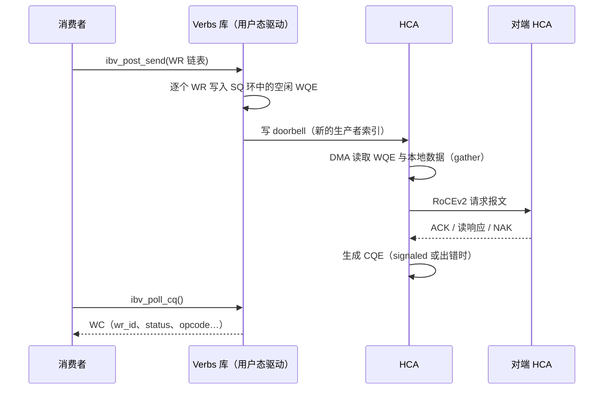

# 工作请求与完成（Work Requests, WQEs and Completions）

> **摘要**：工作请求（WR）是消费者向 CI 提交工作的唯一方式，完成（WC/CQE）是结果返回的唯一方式。本文整理 WR 的类型与内容、“提交—处理—完成—取回”的处理模型、发送队列排序与 Fence、Unsignaled 完成的约束、CQ 事件通知、完成状态码与 `ibv_wc_status` 对照、CQE 中的信息（含 RoCEv2 UD 的远端地址与 40 字节 L3 头区），并介绍 doorbell、环形队列、owner bit 等通用硬件做法。
>
> **规范出处**：Vol1 §10.7（p.536–543）；§10.8（p.543–555）；§10.10.1–§10.10.2（p.563–564）；§11.4.1–§11.4.2（p.663–683）；§11.6.1–§11.6.3（p.684–695）；§A17.4.5（p.1939）；§A17.5.7、§A17.5.9（p.1942）
>
> **前置阅读**：[01-resource-model.md](01-resource-model.md)、[02-qp-state-machine.md](02-qp-state-machine.md)、[操作与报文序列](../02-transport/02-operations.md)
>
> **关键词**：WR, WQE, CQE, WC, SGE, Immediate Data, Signaled/Unsignaled, Solicited Event, Fence, Inline, Doorbell, Producer/Consumer Index, Owner bit, ibv_wc_status

## 1. 术语：WR、WQE、CQE、WC

| 术语 | 英文 | 含义 | 规范 |
|---|---|---|---|
| WR | Work Request | 消费者经 Verbs 提交的工作描述，只用于把操作从消费者传给 CI | §10.7.1 |
| WQE | Work Queue Element | WR 在工作队列中的实例；对消费者是抽象的、不可直接访问 | §10.8.2 |
| CQE | Completion Queue Entry | Work Completion 在 CQ 中的内部表示 | §10.8.4 |
| WC | Work Completion | Poll for Completion 返回给消费者的结果 | §11.4.2.1 |

规范把 WQE/CQE 定义为“抽象的”，是指消费者只能经 Verbs 操作它们；在真实实现中，用户态驱动库（libibverbs 的 provider）属于 CI 的一部分，它直接按硬件格式在主机内存中写 WQE、读 CQE，这正是“内核旁路”的实现方式〔Vol1 §10.8.2, p.544；业界实践〕。

## 2. WR 类型

### 2.1 操作与适用服务

| 操作 | 投递队列 | RC | UC | UD | XRC INI | 线上报文 | 对端 RQ WQE | libibverbs〔业界实践〕 |
|---|---|---|---|---|---|---|---|---|
| Send（含 with Immediate） | SQ | ✓ | ✓ | ✓ | ✓ | SEND First/Middle/Last/Only | 消耗 1 个（C10-81） | `IBV_WR_SEND`、`IBV_WR_SEND_WITH_IMM` |
| Send with Invalidate | SQ | ✓ | — | — | ✓ | SEND …with Invalidate（IETH） | 消耗 1 个 | `IBV_WR_SEND_WITH_INV` |
| RDMA Write（含 with Immediate） | SQ | ✓ | ✓ | — | ✓ | RDMA WRITE（RETH） | 仅带立即数且成功时消耗（C10-86、C10-87） | `IBV_WR_RDMA_WRITE`、`IBV_WR_RDMA_WRITE_WITH_IMM` |
| RDMA Read | SQ | ✓ | — | — | ✓ | RDMA READ Request / Response | 不消耗（C10-85） | `IBV_WR_RDMA_READ` |
| Atomic（Compare & Swap、Fetch & Add） | SQ | 可选 | — | — | 可选 | ATOMIC（AtomicETH / AtomicAckETH） | 不消耗 | `IBV_WR_ATOMIC_CMP_AND_SWP`、`IBV_WR_ATOMIC_FETCH_AND_ADD` |
| Bind MW（Type 2 为 WR；Type 1 为 Verb） | SQ | ✓ | ✓ | — | ✓ | 无 | — | `IBV_WR_BIND_MW` / `ibv_bind_mw()` |
| Local Invalidate | SQ | ✓ | ✓ | — | ✓ | 无 | — | `IBV_WR_LOCAL_INV` |
| Fast Register Physical MR | SQ | ✓ | ✓ | — | ✓ | 无 | — | 用户态无；内核 `IB_WR_REG_MR` |
| Receive | RQ / SRQ | ✓ | ✓ | ✓ | （XRC SRQ） | — | — | `ibv_post_recv()` / `ibv_post_srq_recv()` |

〔Vol1 §10.7.2, p.537–542；§11.4.1.1 Table 99, p.664–665〕。RD 一列省略（与 RC 相同，另需 EEC）。Type 2 MW Bind、Local Invalidate、Fast Register 需要 HCA 支持 Base Memory Management Extensions。**RoCEv2 删除了 Table 99 中 Raw 服务的整行**（§A17.5.9）。

各操作的要点：

- **Send/Receive**：所有服务类型都必须支持（C10-80）；RC、UC 必须提供分段与重组（C10-82）。
- **RDMA**：READ 只在可靠服务（RC、XRC、RD）上；WRITE 在可靠服务及 UC 上；RDMA 的属性在目标端检查，发起端不检查（§10.7.2.2）。
- **Atomic**（可选）：操作数 64 bit；Fetch & Add 为不保存进位的二进制补码加法（o10-42）；远端地址必须 8 字节对齐（o10-43）；结果写回本地数据段（o10-47）；同一 HCA 上对同一物理内存的原子操作表现为串行（o10-48），但与 RDMA、CPU 访问之间不保证原子性，除非系统提供全局原子性（`IBV_ATOMIC_GLOB`）；只能用于 RC、XRC、RD（o10-46）〔Vol1 §10.7.2.3, p.539–541〕。
- **Bind / Local Invalidate / Fast Register** 只修改本地 HCA 的内存映射资源，不产生任何线上报文〔Vol1 §10.7.2.4–§10.7.2.6, p.541–542〕。

> [!NOTE]
> rdma-core 中的 `IBV_WR_TSO`、`IBV_WR_ATOMIC_WRITE`、`IBV_WR_FLUSH` 等不在 IBA Vol1 Rel 1.4 的 WR 类型中（属于业界扩展或更新版本的规范内容），本文不展开。

### 2.2 WR 的内容

| 修饰符〔Vol1 §11.4.1.1, p.666–672〕 | 适用操作 | 说明 | `struct ibv_send_wr` / `ibv_sge`〔业界实践〕 |
|---|---|---|---|
| Work Request ID | 全部 | 64 bit，由消费者定义，原样出现在 WC 中 | `wr_id` |
| 完成通知指示 | 全部（SQ 为 Selectable 时必填） | 成功时是否产生 CQE | `send_flags & IBV_SEND_SIGNALED`（QP 创建时 `sq_sig_all = 0`） |
| Scatter/Gather 列表与数据段个数 | Send、RDMA Read/Write | 每个数据段 = VA + L_Key + 长度；允许 0 个 | `sg_list`、`num_sge`；`{addr, length, lkey}` |
| 立即数指示与 4 字节立即数 | Send、RDMA Write | 随报文的 ImmDt 头传给对端 | `*_WITH_IMM` + `imm_data`（网络字节序） |
| Fence 指示 | 可靠服务 | 见第 4.4 节 | `IBV_SEND_FENCE` |
| 远端节点地址（AH） | UD | 目的 AH | `wr.ud.ah` |
| 远端 QPN 与 Q_Key | UD | 多播用 QPN 0xFFFFFF；Q_Key 最高位规则见 C10-15 | `wr.ud.remote_qpn`、`wr.ud.remote_qkey` |
| 远端地址 + R_Key | RDMA、Atomic | Atomic 地址须 64 bit 对齐 | `wr.rdma.*`、`wr.atomic.remote_addr/rkey` |
| Atomic 操作数 | Atomic | Compare/Swap 或 Add，各 64 bit；结果写入本地数据段 | `wr.atomic.compare_add`、`wr.atomic.swap` |
| Solicited Event 指示 | Send、RDMA Write with Immediate | 置 BTH.SE，影响对端 CQ 事件 | `IBV_SEND_SOLICITED` |
| （远程）Invalidate 指示与 R_Key | Send（RC） | Send with Invalidate | `invalidate_rkey` |
| 远端 XRC SRQ 号 | XRC INI 的 Send/RDMA/Atomic | 写入 XRCETH | `qp_type.xrc.remote_srqn` |
| Bind / Fast Register / Local Invalidate 专用修饰符 | 对应操作 | 见 [03-memory-management.md](03-memory-management.md) | `bind_mw.*` 等 |
| —（业界扩展） | Send、RDMA Write | **Inline**：把数据直接拷入 WQE | `IBV_SEND_INLINE`，上限 `cap.max_inline_data` |

规则：

- 对某操作无效的修饰符必须被忽略（C11-26.2.1）；Post Send 返回后 CI 不再访问 WR 本身（C11-24），但 Fast Register 的 PBL 在完成前仍在 CI 的作用域内。
- WR 引用的缓冲从投递起直到完成被确认之前都属于 CI 的作用域，消费者不得修改或释放〔Vol1 §10.7.3.2, p.543〕。
- RC/UC 的数据段总长超过最大消息长度时必须报错（C10-93）；**UD 消息总长超过端口 MTU 时，CI 不发出任何报文，也不报错**（C10-93.1.1）。RDMA 请求长度超过 2³¹ 字节在对端表现为 Remote Invalid Request〔Vol1 §11.6.2, p.689〕。
- 接收与 RDMA READ 支持 scatter（C10-94），发送与 RDMA WRITE 支持 gather（C10-95）；CI 访问 SGL 的顺序未定义，scatter 列表中的数据段若相互重叠，完成后重叠区内容未定义。
- **Inline**〔业界实践: rdma-core `ibv_post_send(3)`〕：数据在投递时就被复制进 WQE，因此缓冲可以立即重用、无需 L_Key；它省去了一次 DMA 读，常用于小消息降延迟，但会占用更大的 WQE 并消耗 CPU 拷贝。

## 3. 处理模型概览



## 4. 提交、处理与完成的规则

### 4.1 提交

- QP 各状态下 Post Send/Receive 的行为见 [02-qp-state-machine.md](02-qp-state-machine.md) 第 3 节（C10-96、C10-97.2.1、o10-51.2.1）。
- WR 的修饰符被实例化到工作队列中下一个空闲 WQE，然后通知 CI 有新 WQE〔Vol1 §10.8.2, p.545〕。
- **列表提交**（Base Queue Management Extensions，§10.8.2.1）：一个 WR 消耗一个 WQE，顺序与列表一致；列表超过空闲 WQE 数返回立即错误；若第 k 个 WR 出现立即错误，则前 k−1 个已入队、第 k 个及之后的都不入队，返回首个错误与成功入队的数量〔Vol1 §10.8.2.1, p.545–546〕。libibverbs 用 `bad_wr` 指针指出第一个失败的 WR。
- 投递 Verb 返回立即错误时，CI 必须保证该 WR 没有入队（C10-136），且 QP 状态不受影响〔Vol1 §10.10.2.1, p.563；§11.4.1.1, p.668〕。

### 4.2 处理顺序

〔Vol1 §10.8.3, p.546–547〕

- Send、RDMA Read、RDMA Write、Atomic 在同一 SQ 上**按投递顺序开始执行**（C10-98.2.1）；Bind 之后的 WR 要等 Bind 完成才能开始，但 Bind 自身可以在之前的 WR 完成前开始。
- 同一 RQ 上的 WR 按投递顺序完成（C10-99.2.1），例外：RD 的 RQ、关联 SRQ 的 RQ、XRC SRQ。
- SQ 与 RQ 之间、不同 WQ 之间没有顺序关系。

### 4.3 完成与取回

〔Vol1 §10.8.4–§10.8.5, p.551–553〕

- 完成的 WR 若需要产生 WC，CI 把它放到该 WQ 关联的 CQ 上（C10-102）。
- 同一 WQ 的 WC 按投递顺序返回（RD RQ 与 SRQ 例外）；同一 CQ 上来自多个 WQ 的 WC 之间顺序不作规定。
- 每个 WC 只能被取回一次（C10-103）；WC 被取回后 CI 不再访问该 WR 的缓冲（C10-107）。
- 必须返回 WC 的情形：signaled 的 WR（C10-104）；SQ 上以错误完成的 WR（C10-105）；未关联 SRQ 的 RQ 上完成的 WR（C10-106.2.1）；SRQ 的 WR 在接收 QP 的接收 CQ 上返回（o10-53.2.5、o10-53.2.6）。

### 4.4 发送队列排序与 Fence

某些操作可以在之前的操作仍在进行时开始处理，因此可能出现乱序语义；对需要的场景可对后一个 WR 置 **Fence**：**带 Fence 的 WR 要等同一 SQ 上所有先前的 RDMA READ 与 Atomic 完成后才能开始处理**（C10-100）〔Vol1 §10.8.3.3, p.548–551〕。Table 79 的排序规则（行 = 先投递的操作，列 = 后投递的操作）：

| 先 \ 后 | Send | Bind MW | RDMA Write | RDMA Read | Atomic | Fast Register | Local Invalidate |
|---|---|---|---|---|---|---|---|
| Send | # | # | # | # | # | NR | L |
| Bind MW | # | # | # | # | # | NR | L |
| RDMA Write | # | # | # | # | # | NR | L |
| RDMA Read | F | F | F | # | F | NR | L |
| Atomic | F | F | F | # | F | NR | L |
| Fast Register | # | # | # | # | # | # | L |
| Local Invalidate | # | # | # | # | # | # | # |

图例（Table 80）：**#** 始终保序；**F** 仅当后一个操作置了 Fence 时保序；**NR** Fast Register 与之前的操作之间不要求保序；**L** 仅当 Local Invalidate 置了 Local Invalidate Fence 时保序。

需要 Fence 的典型场景：

1. RDMA READ 之后紧跟 SEND/WRITE/Atomic：若不加 Fence，后者可能先被目标观察到，目标据此修改了 READ 要读的数据，READ 可能读到新值。
2. 后续操作会修改 READ 正在返回的那块内存。
3. READ/Atomic 因 ACK 丢失最终出错时，后续操作可能已被目标观察到并触发不期望的动作；加 Fence 则只有前面的 READ/Atomic 在发起侧成功完成后，后续操作才可能被目标看到。
4. READ 之后的 Send with Invalidate 可能先使目标端 R_Key 失效，导致 READ 失败。

Fence 只对可靠服务有效（RC、RD）；Atomic 的排序与 Fence 规则与 RDMA READ 相同（C11-25.2.2）。rdma-core 文档注明 `IBV_SEND_FENCE` 只对 RC 有效〔业界实践〕。

> [!TIP]
> Fence 会让 SQ 停下来等待 READ/Atomic 的往返时间，代价可达一个 RTT。只在确有依赖时使用，或把相互依赖的操作放到不同 QP 并在应用层同步。

### 4.5 Signaled 与 Unsignaled 完成

〔Vol1 §10.7.3.1, p.542–543；§10.8.6, p.554〕

- 默认每个 WR 都产生 WC（Signaled）。QP 创建时 SQ 被配置为 Selectable 后，WR 可以请求 Unsignaled；RQ 上的 WR 永远产生 WC。
- **出错时总会产生 WC**，即使请求了 Unsignaled（C10-91）。
- 只有同时满足“SQ 支持 Unsignaled + WR 请求 Unsignaled + WR 成功完成”时才不产生 CQE（C10-92）。
- **确认规则**：一个成功完成的 Unsignaled WR，在“从同一 CQ 取回了同一 SQ 上**后续** WR 的 WC”之后才算确认完成；此后 CI 不再访问其缓冲（C10-108）。

> [!WARNING]
> SQ 槽位的回收也依赖这条规则：若长时间只投递 Unsignaled WR，软件无从得知哪些槽位已空，最终 `ibv_post_send()` 因队列满而失败。常见做法是每 N 个 WR（N < SQ 深度）置一次 `IBV_SEND_SIGNALED`，并在取到它的 WC 时一次性回收它及之前的所有槽位〔业界实践〕。

### 4.6 CQ 错误

CQ 可能溢出（产生 CQE 时 CQ 已满）或变得不可访问（实现相关）。这两类错误以关联异步错误上报（`IBV_EVENT_CQ_ERR`）；之后消费者仍可取回出错时已在 CQ 中的完成，取完后 CQ 显示为空，损坏的 CQE 不会返回；对出错的 CQ 做 Query 或 Resize 报立即错误，也不会再产生完成事件。要重新使用：**销毁所有关联 QP → 销毁 CQ → 重新创建**〔Vol1 §10.8.5.2, p.553–554〕。关联 WQ 此后尝试使用该 CQ 时会产生 Local Work Queue Catastrophic Error（C11-38）。

### 4.7 完成事件通知

〔Vol1 §10.8.7, p.554–555；§11.4.2.2, p.680–682〕

- **Request Completion Notification** 以 CQ 为单位、**一次性（one-shot）**：每次调用至多产生一次事件；已在 CQ 中的条目不会触发事件（C10-113）；一个 CQ 至多一个未决通知请求（C10-111）。
- 两种类型：**下一个完成**（任何 WC）或**仅 Solicited**。Solicited 完成事件指：带 SE 位的入站 Send 或 RDMA Write with Immediate 产生了成功的接收 WC，**或任何不成功的 WC** 被加入 CQ（C11-29.1.1）；其余成功的接收 WC 与所有成功的发送 WC 属于 Unsolicited。
- 未决的“仅 Solicited”请求可被后来的“下一个完成”请求升级（C11-30），反之不降级（C11-31）。
- 推荐顺序，避免漏掉事件：**Poll 取空 → Request Notification → 再 Poll 一次**（取回两次调用之间到达的 WC）。

```c
/* 事件驱动的完成处理（libibverbs）〔业界实践: rdma-core ibv_req_notify_cq(3)〕 */
struct ibv_comp_channel *ch = ibv_create_comp_channel(ctx);
struct ibv_cq *cq = ibv_create_cq(ctx, depth, NULL, ch, 0);
ibv_req_notify_cq(cq, 0);                         /* 0 = 下一个完成；1 = 仅 solicited */
for (;;) {
    struct ibv_cq *ev_cq;
    void *ev_ctx;
    if (ibv_get_cq_event(ch, &ev_cq, &ev_ctx))    /* 阻塞等待事件 */
        break;
    ibv_ack_cq_events(ev_cq, 1);                  /* 可批量确认以减少锁开销 */
    ibv_req_notify_cq(ev_cq, 0);                  /* 先重新上膛…… */
    struct ibv_wc wc[16];
    int n;
    while ((n = ibv_poll_cq(ev_cq, 16, wc)) > 0)  /* ……再取空，避免竞态漏事件 */
        handle_completions(wc, n);
}
```

（`handle_completions()` 为示意的应用函数。）

## 5. 完成状态码

### 5.1 规范名称与 `ibv_wc_status` 对照

| 规范名称〔Vol1 §11.6.2, p.687–690〕 | `ibv_wc_status`〔业界实践〕 | 适用 | 典型原因 |
|---|---|---|---|
| Success | `IBV_WC_SUCCESS` | 全部 | — |
| Local Length Error | `IBV_WC_LOC_LEN_ERR` | 全部 | 发送：数据段总长超过端口消息长度；接收：缓冲太小或入站消息超过端口最大消息长度 |
| Local QP Operation Error | `IBV_WC_LOC_QP_OP_ERR` | 全部 | QP 内部一致性错误；UD 引用已改/已毁的 AH 出错（C10-5.2.1） |
| Local EE Context Operation Error | `IBV_WC_LOC_EEC_OP_ERR` | RD | EEC 内部一致性错误 |
| Local Protection Error | `IBV_WC_LOC_PROT_ERR` | 全部 | 本地数据段引用的 MR 对该操作无效（L_Key、PD、权限、越界；Reserved L_Key 未使能） |
| Work Request Flushed Error | `IBV_WC_WR_FLUSH_ERR` | 全部 | QP 进入 Error（或 SQEr）时在途或未处理的 WR |
| Memory Management Operation Error | 无同名项（实现可能映射到 `IBV_WC_MW_BIND_ERR` 等，以驱动为准） | 全部 | Fast Register / MW / Invalidate 的权限或状态违规 |
| Memory Window Bind Error | `IBV_WC_MW_BIND_ERR` | Bind MW Verb（Type 1） | 绑定失败；该 Verb 的 WR 只能以 Success、MW Bind Error、Local QP Operation Error、WR Flushed 完成 |
| Bad Response Error | `IBV_WC_BAD_RESP_ERR` | 可靠服务 | 响应方返回了意外的传输层 OpCode |
| Local Access Error | `IBV_WC_LOC_ACCESS_ERR` | 可靠服务（接收侧） | 处理对端 RDMA Write with Immediate 时本地数据缓冲保护错误 |
| Remote Invalid Request Error | `IBV_WC_REM_INV_REQ_ERR` | 可靠服务 | 对端：不支持该操作、无足够资源接收新的 RDMA/Atomic、RDMA 长度 > 2³¹、接收缓冲不足等（收到 NAK-Invalid Request） |
| Remote Access Error | `IBV_WC_REM_ACCESS_ERR` | 可靠服务 | 对端 R_Key 违例（NAK-Remote Access Error），仅用于 RDMA 与 Atomic |
| Remote Operation Error | `IBV_WC_REM_OP_ERR` | 可靠服务 | 对端 QP 相关错误或接收 WQE 畸形（NAK-Remote Operational Error） |
| Transport Retry Counter Exceeded | `IBV_WC_RETRY_EXC_ERR` | 可靠服务 | 超时或 NAK-Sequence 重试耗尽 |
| RNR Retry Counter Exceeded | `IBV_WC_RNR_RETRY_EXC_ERR` | 可靠服务 | RNR NAK 重试耗尽 |
| Local RDD Violation Error | `IBV_WC_LOC_RDD_VIOL_ERR` | RD | QP 与 EEC 的 RDD 不符 |
| Remote Invalid RD Request | `IBV_WC_REM_INV_RD_REQ_ERR` | RD | 对端检测到 Q_Key 或 RDD 违例 |
| Aborted Error | 名称最接近的是 `IBV_WC_REM_ABORT_ERR`（语义以驱动为准） | RD；关联 SRQ 的 UD/UC | RD：请求方中止；UD/UC + SRQ：响应方中止 |
| Invalid EE Context Number / State | `IBV_WC_INV_EECN_ERR` / `IBV_WC_INV_EEC_STATE_ERR` | RD | EEC 号无效或状态不合法 |
| XRC Violation Error | 无同名项 | XRC | 对端 XRC Domain 违例（NAK-Invalid RD Request） |
| —（业界扩展） | `IBV_WC_FATAL_ERR`、`IBV_WC_RESP_TIMEOUT_ERR`、`IBV_WC_GENERAL_ERR`、`IBV_WC_TM_*` | — | 非 IBA 定义，含义以驱动文档为准 |

### 5.2 NAK 与完成错误的对应

发送侧（Table 101）〔Vol1 §11.4.2.1, p.676–677〕：

| 对端返回（RC） | 本端 SQ 完成错误 |
|---|---|
| NAK-Remote Access Error | Remote Access Error |
| NAK-Invalid Request | Remote Invalid Request Error |
| NAK-Remote Operational Error | Remote Operation Error |
| （可能伴随 NAK-Sequence 的）重试耗尽 | Transport Retry Counter Exceeded |
| RNR NAK 重试耗尽 | RNR Retry Counter Exceeded |
| XRC：NAK-Invalid RD Request | XRC Violation Error |

接收侧（Table 102）〔Vol1 §11.4.2.1, p.677–678〕：本端 RQ/SRQ 以下列错误完成时，RC 向请求方发送的 NAK——Local Access → NAK-Remote Access；Local Length、Local Protection、Local QP Operation → NAK-Remote Operational Error；Remote Invalid Request → NAK-Invalid Request；WR Flushed → 无。

> [!NOTE]
> Table 102 把接收侧 Local Length 对应到 NAK-Remote Operational Error，而 C9-91 规定“接收 WQE 的缓冲不足以容纳入站 SEND 时返回 NAK-Invalid Request”〔Vol1 §9.7.4.1.6, p.330〕，Table 61 的 Length errors 一行也写作 NAK-Invalid Request。实现与互通测试时以第 9 章的报文行为为准（两处表述的差异待核实），线上 NAK 码详见 [PSN 与 ACK/NAK](../02-transport/05-psn-and-ack-nak.md)。

### 5.3 三类错误的报告途径

〔Vol1 §10.10.1–§10.10.2, p.563–564〕

- **立即错误**：Verb 返回时报告（C10-135），对投递类 Verb 保证 WR 未入队（C10-136）。
- **完成错误**：在 WC 的状态中报告（C10-137），分为“接口检查”（上线前检测到的、消费者提供的信息错误）与“处理错误”（执行过程中遇到的错误）。
- **异步错误**：通过事件处理器报告（C10-138，注册前发生的会丢失）；关联异步错误使 QP/EE 进入 Error，非关联异步错误与具体资源无关。事件列表见 [05-verbs-roce-specifics-and-programming.md](05-verbs-roce-specifics-and-programming.md)。

## 6. WC 中的信息

| 内容〔Vol1 §11.4.2.1, p.678–680〕 | 有效条件 | `struct ibv_wc`〔业界实践〕 |
|---|---|---|
| 64 bit WR ID | 始终有效 | `wr_id` |
| 状态 | 始终有效 | `status`（另有 `vendor_err` 厂商诊断码） |
| 操作类型：Send、RDMA Write、RDMA Read、Compare & Swap、Fetch & Add、Fast Register、Local Invalidate、MW Bind、Send Data Received、RDMA with Immediate Data Received | 成功时 | `opcode`：`IBV_WC_SEND`、`IBV_WC_RDMA_WRITE`、`IBV_WC_RDMA_READ`、`IBV_WC_COMP_SWAP`、`IBV_WC_FETCH_ADD`、`IBV_WC_LOCAL_INV`、`IBV_WC_BIND_MW`、`IBV_WC_RECV`、`IBV_WC_RECV_RDMA_WITH_IMM` |
| 传输字节数 | 接收（Send、RDMA Write with Immediate，**不含**立即数）；发送侧的 RDMA Read 与 Atomic；UD 接收**总是包含 40 字节 GRH 区** | `byte_len` |
| R_Key 已失效指示 + 被失效的 R_Key | 入站 Send with Invalidate 成功 | `wc_flags & IBV_WC_WITH_INV`、`invalidated_rkey` |
| 本地 QP 号 | 支持 Base Queue Management 或 SRQ 扩展时 | `qp_num` |
| 立即数指示 + 4 字节立即数 | 接收侧 | `wc_flags & IBV_WC_WITH_IMM`、`imm_data`（网络字节序） |
| 远端地址与 QP（仅数据报） | UD、RD | `src_qp`；IB 中另有 `slid`、`sl`、`dlid_path_bits`（RoCEv2 中无意义） |
| GRH 存在指示 | UD 的 RQ | `wc_flags & IBV_WC_GRH` |
| P_Key index | 仅 GSI（QP1）的接收 | `pkey_index` |
| Freed Resource Count | RD 的 RQ | 无 |
| 本地 XRC TGT QPN、XRC SRQ 号 | XRC SRQ 的完成 | 无（扩展 CQ 接口中提供，以版本为准） |

非成功状态时，规范规定除注明项外 WC 内容未定义（WR ID 与状态始终有效）；rdma-core 文档说明此时只有 `wr_id`、`status`、`qp_num`、`vendor_err` 有效〔业界实践: `ibv_poll_cq(3)`〕。

**RoCEv2 对数据报远端地址的修改**（§A17.4.5.1、§A17.5.7）：IB 中 UD/RD 的远端地址信息是 16 bit SLID、4 bit SL、24 bit 源 QP 与 DLID Path Bits（Table 103）；RoCEv2 中改为**源 L2 地址（SMAC）**加一个指示收到的是 **IPv4、IPv6 还是 RoCE（v1）** 报文的标志〔Vol1 §A17.4.5.1, p.1939；§A17.5.7, p.1942〕。〔业界实践〕Linux 内核的 `struct ib_wc` 提供 `smac[]`、`vlan_id`、`network_hdr_type`（`RDMA_NETWORK_IPV4/IPV6/ROCE_V1`）及标志 `IB_WC_WITH_SMAC/VLAN/NETWORK_HDR_TYPE`；用户态 `struct ibv_wc` 没有这些字段，应用通常调用 `ibv_create_ah_from_wc()` 或 `ibv_init_ah_from_wc()`，由库解析接收缓冲中的 L3 头来构造回复用的 AH。

## 7. UD 接收缓冲与 RoCEv2 的 L3 头区

UD QP 的接收缓冲前 40 字节保留给入站报文的 GRH，WC 中的 GRH 存在指示表明其内容是否有效，负载从第 40 字节开始〔Vol1 §11.4.1.2, p.675；§11.4.2.1, p.680〕。RoCEv2 中这 40 字节填入 **IP 头**：IPv6 头占满 40 字节；IPv4 头只占后 20 字节（偏移 20 起），前 20 字节内容未定义〔Vol1 §A17.4.5.2, p.1939〕。

```text
接收缓冲偏移   0                  20                 40
              +------------------+------------------+---------------------------
  RoCEv2/IPv6 |        IPv6 头（40 字节）            |  UD 负载（≤ PMTU）...
              +------------------+------------------+---------------------------
  RoCEv2/IPv4 |   未定义（20 B）  |  IPv4 头（20 B）  |  UD 负载（≤ PMTU）...
              +------------------+------------------+---------------------------
  byte_len = 40 + 负载长度（无论是否带 GRH，UD 接收都计入 40 字节）
```

由于 IPv4 情况下前 20 字节未定义，仅看偏移 0 处的版本号可能误判。rdma-core 的做法是〔业界实践: rdma-core `libibverbs/verbs.c` 中的 `get_grh_header_version()`〕：偏移 0 的版本号不是 6 时，看偏移 20 的版本号是否为 4；若偏移 0 恰为 6，则再检查偏移 20 处 IHL 是否为 5 且 IPv4 头校验和正确，满足才判为 IPv4，否则为 IPv6。等价的 C 逻辑：

```c
#include <stdint.h>
#include <string.h>

/* 计算 IPv4 头校验和（20 字节，checksum 字段视为 0） */
static uint16_t ipv4_hdr_csum(const uint8_t *h)
{
    uint32_t sum = 0;
    for (int i = 0; i < 20; i += 2) {
        if (i == 10)
            continue;                             /* 跳过 checksum 字段 */
        sum += (uint32_t)(h[i] << 8 | h[i + 1]);
    }
    while (sum >> 16)
        sum = (sum & 0xFFFF) + (sum >> 16);
    return (uint16_t)~sum;
}

/* 返回 4 或 6；-1 表示无法识别。buf 指向 UD 接收缓冲起始处 */
static int rocev2_ud_l3_version(const uint8_t *buf)
{
    const uint8_t *v4 = buf + 20;
    if ((buf[0] >> 4) != 6)
        return (v4[0] >> 4) == 4 ? 4 : -1;
    if ((v4[0] & 0x0F) != 5)                      /* RoCEv2 的 IPv4 IHL 必为 5（CA17-3） */
        return 6;
    return ipv4_hdr_csum(v4) == (uint16_t)(v4[10] << 8 | v4[11]) ? 4 : 6;
}
```

拿到 IP 头后，源 IP 即对端 GID（IPv4 时写成 `::ffff:a.b.c.d`），可与 WC 的 `src_qp` 一起构造回复用的 AH；完整 UD 编程示例见 [05-verbs-roce-specifics-and-programming.md](05-verbs-roce-specifics-and-programming.md)。

## 8. 「硬件实现要点」：Doorbell、环形队列与 CQE

以下是业界通用做法，仅作参考，具体格式因厂商而异，此处不描述任何私有格式。

### 8.1 队列在主机内存中的组织

```text
             软件写（生产者）                      硬件读（消费者）
 SQ 环:  [WQE0][WQE1][WQE2][WQE3] ... [WQEn-1]
                       ^PI(软件)          ^CI(硬件内部)
 RQ 环:  同上，软件投递接收 WQE，硬件在报文到达时按序消费
 CQ 环:  [CQE0][CQE1][CQE2] ... [CQEm-1]   硬件写（生产者），软件读（消费者）
                       ^PI(硬件内部)    ^CI(软件)
 Doorbell 记录（主机内存）: SQ/RQ PI、CQ CI 与上膛信息
 Doorbell 寄存器（MMIO 页，按进程映射）: 通知硬件“某 QP 的 PI 更新到 x”
```

- **环形队列**：深度取 2 的幂，索引用自由运行计数器，`slot = index & (N − 1)`；生产者与消费者索引之差即占用数。WQE 常按固定步长（如 64 B 的倍数）存放，一个 WQE 可占多个基本块（控制段 + 地址/数据报段 + 若干数据段或 inline 数据）。
- **SQ doorbell**：软件写好 WQE 后执行写内存屏障，再把新的 PI（与 QPN）写入 doorbell。硬件据此用 DMA 读取 WQE。为降低小消息延迟，部分实现允许把整个小 WQE 直接经写合并（write-combining）MMIO 写入设备，省去一次 DMA 读（如 mlx 系列驱动中称为 BlueFlame）〔业界实践〕。
- **RQ**：报文到达时硬件才需要 WQE，因此很多设计只更新主机内存中的 doorbell 记录，由硬件在需要时读取，无需 MMIO。
- **按进程映射的 doorbell 页**：每个进程/上下文得到独立的 MMIO doorbell 页（如 mlx 系列的 UAR），以实现内核旁路并防止进程间互相伪造 doorbell〔业界实践〕。
- **wr_id 不必进硬件**：软件保留一个按槽位索引的影子数组保存 `wr_id`；CQE 只需报告 WQE 索引（计数器），库再查回 `wr_id`。

### 8.2 CQE 与 owner bit

- 硬件按顺序把 CQE 写到 `PI & (M − 1)`，并在每次绕回时翻转写入的 **owner（phase/valid）位**；软件比较 CQE 中的 owner 位与“当前圈数的期望值”，相同即为新条目，无需读取硬件寄存器。
- 硬件必须保证 CQE 的其它字段先于 owner 位（或与之在同一次原子写中）对 CPU 可见，常用做法是 CQE 对齐到 64 B 并作为单个 PCIe 写事务写入；软件读到有效 owner 位后要加读屏障再读其它字段。
- 软件周期性地把 CI 写回 doorbell 记录；硬件据此判断剩余空间，若写入时 `PI − CI == M` 即为**溢出**，按 C10-17 以关联异步错误上报。
- **SQ 完成按序**：收到报告 WQE 索引 k 的发送 CQE，即可回收 k 及之前所有槽位（对应 §10.8.6 的 unsignaled 确认规则）。
- **事件与中断**：软件“上膛”时把当前 CI 与类型（下一个 / 仅 solicited）写入 CQ 的 arm doorbell；硬件写入满足条件的 CQE 后向事件队列（EQ）写一个事件条目并触发 MSI-X 中断，然后清除上膛状态（one-shot）。中断合并（每 N 个 CQE 或每 T 微秒）是常见的业界扩展（rdma-core `ibv_modify_cq()`）。
- **典型 CQE 字段**：WQE 索引、QPN、状态/错误码、操作码、字节数、立即数或被失效的 R_Key、源 QP、标志（带 GRH、IP 版本、带立即数/失效）、源 MAC、VLAN、可选时间戳、owner 位。

```c
/* 软件轮询 CQ 的骨架（示意，非任何厂商的真实格式） */
struct cqe { uint32_t qpn_flags; uint16_t wqe_idx; uint8_t opcode, status;
             uint32_t byte_len, imm; uint8_t rsvd[47]; uint8_t owner; }; /* 64 B */

int poll_one(struct cq *cq, struct wc *out)
{
    struct cqe *e = &cq->ring[cq->ci & (cq->depth - 1)];
    uint8_t expect = (cq->ci / cq->depth) & 1;     /* 每绕一圈期望值翻转 */
    if ((e->owner & 1) != expect)
        return 0;                                   /* 尚无新 CQE */
    rmb();                                          /* 先确认 owner，再读其它字段 */
    out->wr_id   = lookup_wrid(cq, e->qpn_flags, e->wqe_idx);
    out->status  = e->status;
    out->opcode  = e->opcode;
    out->byte_len = e->byte_len;
    cq->ci++;
    if ((cq->ci & 63) == 0)
        update_cq_ci_doorbell_record(cq);           /* 批量回写 CI，告知硬件可用空间 */
    return 1;
}
```

（`rmb()`、`lookup_wrid()`、`update_cq_ci_doorbell_record()` 为示意函数。）

发送与接收数据通路如何消费这些队列，见 [发送数据通路](../06-hardware-implementation/02-tx-datapath.md)、[接收数据通路](../06-hardware-implementation/03-rx-datapath.md) 与 [RNIC 总体架构](../06-hardware-implementation/01-rnic-architecture.md)。

## 9. 要点回顾

- WR → WQE（工作队列中）→ 处理 → CQE → 通过 Poll 取回为 WC；WR 引用的缓冲在完成确认前属于 CI。
- 同一 SQ 上的 WR 按序开始、按序完成；RQ 按序完成（RD、SRQ 例外）；跨 WQ 无序。
- Fence 让 WR 等待之前所有 RDMA READ/Atomic 完成；Table 79 中只有“READ/Atomic 之后的非 READ 操作”需要 Fence 才保序。
- Bind 之后的 WR 等待 Bind 完成；Bind/Local Invalidate/Fast Register 不产生线上报文。
- 出错一定产生 WC；Unsignaled WR 在同一 SQ 后续 WR 的 WC 被取回时才算确认，需定期 signaled 以回收槽位。
- UD 消息超过端口 MTU 时规范要求不发包也不报错；RC/UC 超过最大消息长度必须报错。
- CQ 通知是一次性的，推荐“Poll → Arm → Poll”；不成功的 WC 也算 solicited。
- 对端 NAK 映射为本端完成错误：Remote Access / Remote Invalid Request / Remote Operation；重试耗尽为 Retry/RNR Retry Exceeded。
- RoCEv2 UD 的 WC 远端信息为 SMAC + IPv4/IPv6/RoCE 标志；接收缓冲前 40 字节放 IP 头，IPv4 位于偏移 20。

## 自测

<details><summary>Q1：在同一个 RC QP 上依次投递 RDMA READ（读远端 A 区）和 SEND（通知对端“可以覆盖 A 区”），不加任何标志，可能出什么问题？如何解决？</summary>

答：按 Table 79，READ 之后的 SEND 只有置 Fence 才保序。SEND 可能先被对端处理，对端随即覆盖 A 区，READ 读到新数据。解决：对 SEND 置 Fence（`IBV_SEND_FENCE`），或等 READ 的 WC 到达后再投递 SEND。
</details>

<details><summary>Q2：SQ 深度 128，应用每次投递都设为 unsignaled，第 129 次投递失败。为什么？</summary>

答：成功的 unsignaled WR 不产生 CQE，软件无法确认它们何时完成（§10.8.6），因此不能回收槽位，SQ 被占满。应每隔若干个 WR 置一次 signaled，取回其 WC 后回收它及之前的所有槽位。
</details>

<details><summary>Q3：UD QP 接收到一个 100 字节负载的 RoCEv2/IPv4 报文，WC 的 byte_len 是多少？负载与 IPv4 头分别在缓冲的什么位置？</summary>

答：byte_len = 40 + 100 = 140；IPv4 头位于偏移 20–39，负载从偏移 40 开始；偏移 0–19 内容未定义（§A17.4.5.2、§11.4.2.1）。
</details>

<details><summary>Q4：服务端调用 ibv_req_notify_cq(cq, 1) 只等待 solicited 事件，客户端发送的 SEND 未置 SE 位但对端 QP 因错误产生了 Flush WC。服务端会被唤醒吗？</summary>

答：会。按 C11-29.1.1，不成功的 WC 加入 CQ 也会触发“仅 solicited”类型的通知。
</details>

<details><summary>Q5：CQE 使用 owner 位而不是让软件读取硬件的生产者索引寄存器，有什么好处？硬件写 CQE 时要注意什么？</summary>

答：软件只需读主机内存中的 CQE 就能判断是否有新条目，避免了昂贵的 MMIO 读和额外的 DMA 写索引；绕回时 owner 位翻转，使“旧圈遗留的条目”不会被误认。硬件必须保证 CQE 其它字段先于 owner 位（或同一原子写）对 CPU 可见，软件读到有效 owner 后需加读屏障。
</details>

## 参考

- 规范：IBTA Vol1 Rel 1.4 §10.7（p.536–543）、§10.8（p.543–555）、§10.10.1–§10.10.2（p.563–564）、§11.4.1–§11.4.2（p.663–683）、§11.6.1–§11.6.3（p.684–695）、§9.7.4.1.6（p.330）、Annex A17 §A17.4.5、§A17.5.7、§A17.5.9（p.1939–1942）。
- 外部：rdma-core man pages `ibv_post_send(3)`、`ibv_poll_cq(3)`、`ibv_req_notify_cq(3)` 与 `libibverbs/verbs.c`（`get_grh_header_version()`、`ibv_init_ah_from_wc()`）〔业界实践: Linux rdma-core〕。
- 外部：Linux 内核 `include/rdma/ib_verbs.h`（`struct ib_wc`）〔业界实践: Linux kernel〕。
- 相关文件：[02-qp-state-machine.md](02-qp-state-machine.md)、[03-memory-management.md](03-memory-management.md)、[05-verbs-roce-specifics-and-programming.md](05-verbs-roce-specifics-and-programming.md)、[事务排序与报文校验](../02-transport/03-ordering-and-validation.md)、[错误检测与处理](../02-transport/08-error-handling.md)。
