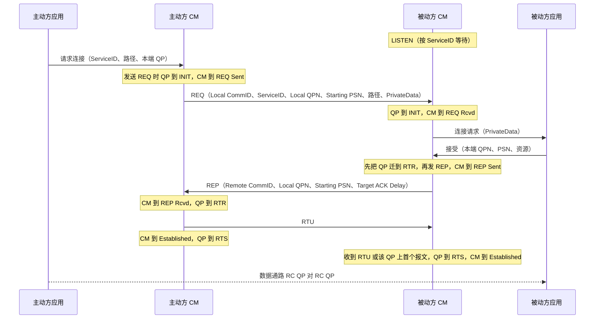
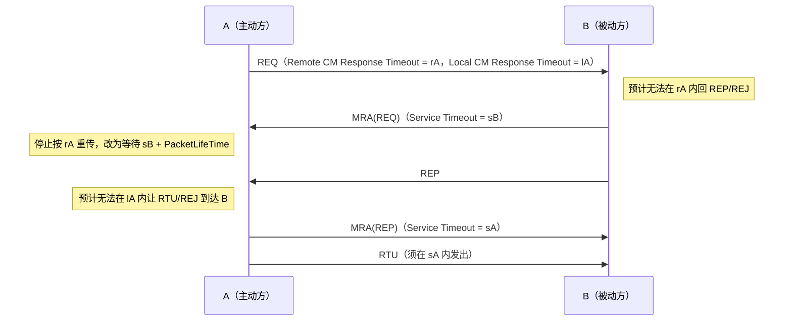
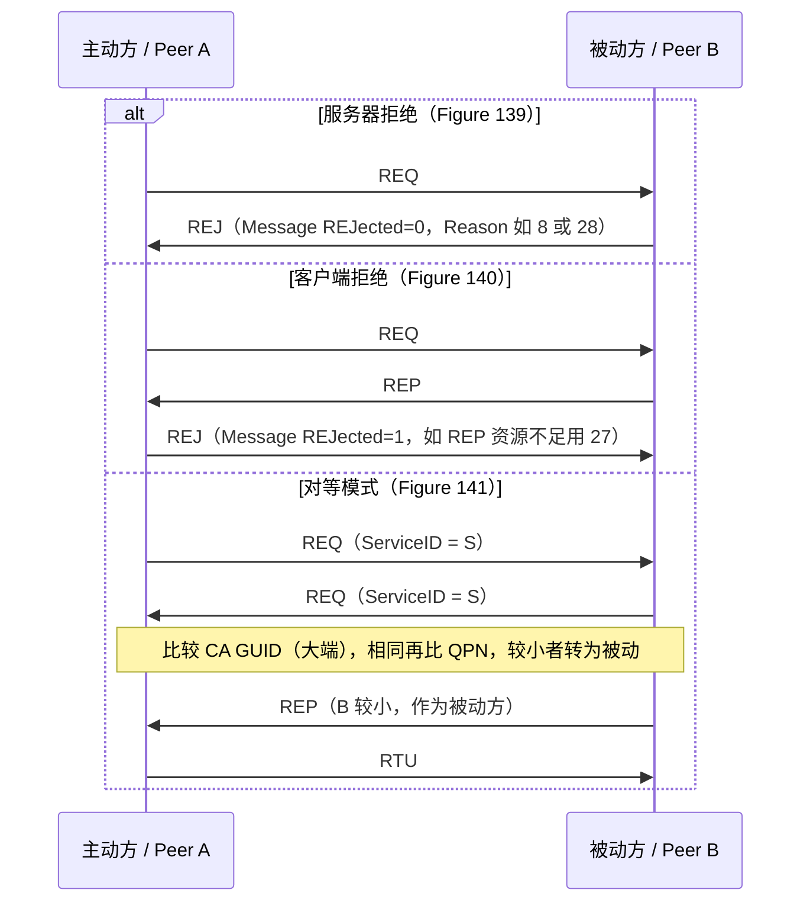
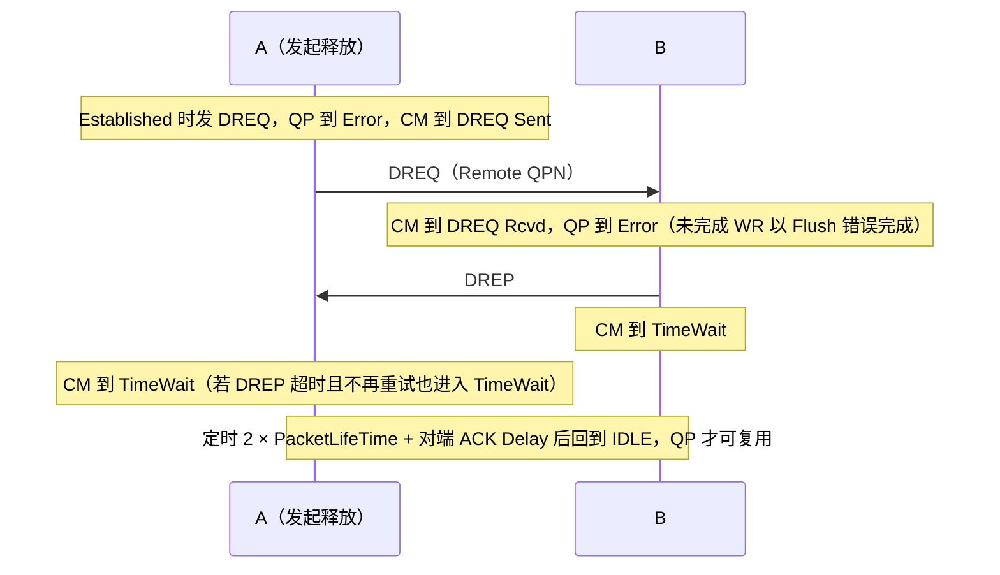
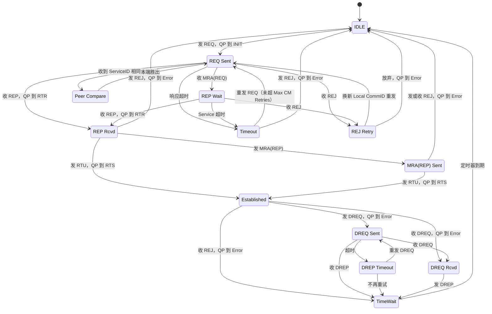
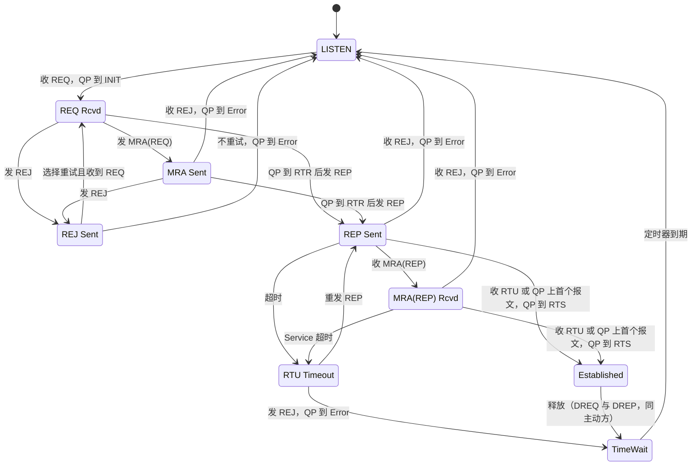

# IB CM 协议在 RoCEv2 上的应用（InfiniBand Communication Management over RoCEv2）

> **摘要**：RoCEv2 没有自己的建链协议，而是原样沿用 IBA 第 12 章的通信管理（Communication Management, CM）协议：两端 CM 通过 QP1 上的管理数据报（MAD）交换 REQ/REP/RTU 等消息，协商 QPN、起始 PSN、路径与超时参数，并驱动两端 QP 依次进入 INIT→RTR→RTS。本文按"模型 → 消息集 → 字段 → 与 Modify QP 的映射 → RoCEv2 修改 → 梯形图 → 状态机"逐层拆解，是实现软件 CM 或在 FPGA/ASIC 上配合 CM 做 QP 状态管理的基础。
>
> **规范出处**：Vol1 §12.1–12.11（p.707–771）；Vol1 §16.7（p.1182–1186，CM 类 AttributeID）；Vol1 §A17.6.1（p.1943–1944）；Vol1 §A16.5.2（p.1916–1917）；Vol1 §11.2.5.2 Table 96（p.611–617）
>
> **前置阅读**：[RoCEv2 寻址](../00-overview/04-addressing.md)、[QP 状态机与 Modify QP 属性](../03-verbs-and-resources/02-qp-state-machine.md)、[MAD 格式与 GSI/QP1](./03-mad-and-gsi.md)
>
> **关键词**：CM, REQ, MRA, REJ, REP, RTU, DREQ, DREP, LAP, APR, SAP, SPR, SIDR, ServiceID, Communication ID, Starting PSN, TimeWait, CA17-34…CA17-38

---

## 1. CM 的定位：RoCEv2 为什么仍需要 CM

- **作用范围**：CM 负责建立、维护、释放 RC、UC、RD（以及 XRC）通道；UD 不需要连接，但可用"服务 ID 解析"（Service ID Resolution, SIDR）找到目标 QP〔Vol1 §12.1, p.707；§12.5, p.711–712〕。Raw QP 不使用也不被 CM 支持〔§12.1, p.708〕。
- **带外交换**：连接用的 QP 刚创建时不能通信，必须用 Modify QP 设置对端 QPN、PSN、路径等属性〔§12.1, p.707〕。这些参数由两端 CM 在**另一对 QP**（通常是通用服务接口 GSI，即 QP1）上用 MAD 交换——CM 本质上是"为 Modify QP 收集参数并协调两端迁移时机"的协议。
- **规范只定义外部行为**：CM 与应用之间的接口、内部实现都不在规范范围内〔§12.1, p.707；§12.2, p.709〕。
- **校验与版本**：未通过 GMP 校验的 CM MAD 静默丢弃〔§12.1, p.708〕。本版本 CM 消息的 MAD ClassVersion 必须为 **2**（C12-0.1.1、C16-15.1.1）；1.0a 版为 1，可通过 Get(ClassPortInfo) 探测对端支持的版本〔§12.1, p.708–709；§16.7.1, p.1183〕。
- **RoCEv2**：RoCEv2 直接采用第 12 章 CM；CM 报文就是与目标连接**同类型（IPv4 或 IPv6）**的普通 RoCEv2 报文；若端口同时支持 RoCE（v1）且要建立的是 RoCE 连接，则 CM 报文是 RoCE 报文〔§A17.6.1, p.1943〕。

```text
  Host A                                                       Host B
 +---------+   private API    +--------+        +--------+   private API    +---------+
 |  App A  |<---------------->|  CM A  |        |  CM B  |<---------------->|  App B  |
 +---------+                  +---+----+        +---+----+                  +---------+
      |  data QP                  | GSI QP1         | GSI QP1           data QP  |
      |                           +-----------------+                            |
      |                   MADs (UD, UDP dport 4791)                              |
      +================= connection: QP a <-> QP b (RoCEv2 RC) ==================+
```

## 2. 模型与基本概念

### 2.1 主动/被动、客户端/服务器与对等模式

- **Active/Passive（Client/Server）**：被动方 CM 代表服务器按 ServiceID 等待请求；主动方 CM 在 REQ 中填入 ServiceID，被动方据此找到服务实体，接受则在 REP 中返回 QPN（RD 时还有 EECN）〔§12.2, p.709〕。
- **Active/Active（Peer to Peer）**：两端都发 REQ（ServiceID 相同），最终一方转为被动。比较规则：把双方 **CA GUID 按大端整数比较，较小者转为被动**；GUID 相同（同一 CA 上的两个进程）则比较 REQ 中的 Local QPN（RD 比较 EECN），较小者被动〔§12.10.4, p.764–765；§12.9.7.1 Peer Compare, p.751〕。ServiceID 隐含是 C/S 还是对等模式，但服务端必须告知其 CM〔§12.9.4, p.748〕。
- **发起方负担更重**：路径等多数信息由主动方收集/计算（IB 中来自 SA 的 PathRecord）〔§12.1, p.708〕。RoCEv2 没有 SA，这部分由主机 IP 栈和 rdma_cm 承担，见 [02-ip-cm-and-rdma-cm.md](./02-ip-cm-and-rdma-cm.md)。
- **重定向（Redirector）**：CM 可代表其他端口上的实体处理请求，用 REJ 码 24（端口+CM 重定向）或 25（端口重定向）让客户端用新的 Local Communication ID 重发 REQ〔§12.10.7, p.767〕。
- **回环**：同一 CA 上不同 QP 间的回环连接是允许的；但 **CM 不得把一个 QP 的 SQ 连接到它自己的 RQ**〔§12.2, p.710；§12.7.12, p.734；§12.10.4, p.765〕。

### 2.2 ServiceID 与 Communication ID

| 概念 | 规则 | 出处 |
|---|---|---|
| ServiceID（64 bit） | 标识被请求的服务；与服务之间的映射不由 CM 规定。RDMA IP CM 用"前缀 + IP 协议号 + 端口"编码，见 [02 文件](./02-ip-cm-and-rdma-cm.md) | §12.7.3, p.733 |
| Local Communication ID | 发送方视角的连接唯一标识；建链/释放各阶段必须一致；连接存续期间及相关报文仍可能在网络中时**不得重用** | §12.7.1, p.732 |
| Remote Communication ID | 接收方视角的标识，即对端的 Local Communication ID（例如 REP 中填 REQ 的 Local ID） | §12.7.2, p.732 |
| (Local, Remote) 对 | 在建链、故障切换管理、释放中引用连接；ID 无效的 CM 消息不得处理并按 REJ 规则拒绝 | §12.7.2, p.733 |
| Remote QPN/EECN | DREQ/LAP/SAP 中携带，作为 ID 对指向正确资源的附加校验 | §12.7.37, p.738 |
| TransactionID | 同一消息序列（如 REQ/MRA/REP/RTU/REJ）的所有 MAD 使用相同 TID | C12-5.1.2, p.715 |

### 2.3 Quiet Time、Stale Connection 与 TimeWait

- **Quiet Time**：CM 初始化（通常是重启）后，应等待旧连接的报文从网络中消失再建新连接，否则旧连接的报文可能被新连接成功接收，造成**无报告的数据损坏**。最坏情况报文存活时间为 `2 × PortInfo:SubnetTimeout + Target ACK Delay`，这就是最小安全 quiet time；实现方式（可调参数、把历史最大值存入非易失存储等）不在规范范围〔§12.2.1, p.710〕。
- **Stale Connection**：只有一端还持有连接信息（如对端发了 DREQ 但丢失，或对端崩溃重启）〔§12.4.1, p.711〕。CM 必须保留足够状态来识别"对端 QP 仍与本地 QP 相连或处于 TimeWait"的新 REQ〔§12.4, p.711〕。收到这种 REQ/REP 时：回 **REJ（码 10 Stale connection）**，再以对端 QPN 发 DREQ 直到收到 DREP 或超过重试次数，并把本地 QP 置于 TimeWait；若 Local/Remote Communication ID 与现有连接相同且落在合法重传窗口内，则视为重传而非 stale〔§12.9.8.3.1, p.757〕。
- **TimeWait**：连接释放后 CM 必须把 QP 置于 TimeWait；计时器 = **2 × PathRecord:PacketLifeTime + 对端 ACK Delay**，期间收到 DREQ 不影响计时，结束后才能回收 QP〔§12.4, p.711；§12.9.8.4, p.757–758〕。

> [!WARNING]
> RoCEv2 没有子网管理器，也就没有 PortInfo:SubnetTimeout 和 PathRecord:PacketLifeTime 的权威来源。Annex A17 未给默认值；RoCE v1 附录曾规定默认 RespTimeValue=19、SubnetTimeout=18（CA16-9, p.1915），可作为估算参考。实现应提供可配置的 PacketLifeTime / quiet time，并在 TimeWait 结束前**不要复用 QPN**——否则迟到报文可能落入新连接的 PSN 窗口（Starting PSN 应选得使这种概率最小，§12.7.31, p.737；实践中通常随机选取）。

### 2.4 CM 必须为每条连接保存的状态

Local/Remote Communication ID、Local/Remote CM Response Timeout、Local QPN/EECN、Remote QPN/EECN、Remote CA GUID、Remote CM LID/GID、Max CM Retries，以及（支持多版本时）ClassVersion〔§12.9.9, p.760〕。RoCE v1 附录明确 Remote CM LID 可不保存〔§A16.5.2, p.1916〕，RoCEv2 中 LID 字段整体保留（见 §6），实际只保存 GID（即 IP）。

## 3. 消息集

### 3.1 消息一览

CM 的全部消息都是 MgmtClass=0x07（ComMgt）的 MAD，用 `ComMgtSend()`（Method 0x03）发送，AttributeID 区分消息类型〔§16.7.2–16.7.3, p.1183–1185〕。MAD 数据区 232 字节，扣除定长字段后剩余部分为 PrivateData。

| 消息 | AttributeID | 方向 | 用途 | 支持要求 | PrivateData |
|---|---|---|---|---|---|
| REQ（ConnectRequest） | 0x0010 | 主动→被动 | 发起建链，携带本端 QPN/PSN、ServiceID、主/备路径 | 必需 | 92 B |
| MRA（MsgRcptAck） | 0x0011 | 双向 | 告知"已收到 REQ/REP/LAP，但需更久才能答复" | 必需接收；发送可选 | 222 B |
| REJ（ConnectReject） | 0x0012 | 双向 | 拒绝/终止建链并给出原因码 | 必需 | 148 B |
| REP（ConnectReply） | 0x0013 | 被动→主动 | 接受 REQ，返回本端 QPN/PSN 等 | 必需 | 196 B |
| RTU（ReadyToUse） | 0x0014 | 主动→被动 | 连接建立，接收方可开始发送 | 必需 | 224 B |
| DREQ（DisconnectRequest） | 0x0015 | 双向 | 发起释放（仅 RC/UC/XRC QP 或 EE 上下文） | 必需 | 220 B |
| DREP（DisconnectReply） | 0x0016 | 双向 | 确认收到 DREQ | 必需 | 224 B |
| SIDR_REQ（ServiceIDResReq） | 0x0017 | 请求方→目标 | UD：按 ServiceID 查询目标 QPN/Q_Key | 条件必需 | 216 B |
| SIDR_REP（ServiceIDResReqResp） | 0x0018 | 目标→请求方 | 返回 QPN、Q_Key 与状态 | 条件必需 | 136 B |
| LAP（LoadAlternatePath） | 0x0019 | 主动→被动 | 加载新的备用路径（APM） | 可选 | 168 B |
| APR（AlternatePathResponse） | 0x001A | 被动→主动 | 对 LAP 的应答状态 | 可选 | 148 B |
| SAP（SuggestAlternatePath） | 0x001B | 被动→主动 | 被动方建议备用路径 | 可选 | 168 B |
| SPR（SuggestPathResponse） | 0x001C | 主动→被动 | 对 SAP 的应答 | 可选 | 148 B |

AttributeID 来自 Table 372〔§16.7.3, p.1184–1185〕；ClassPortInfo（0x0001）用 Get 访问。PrivateData 长度由各消息表中 PrivateData 的位宽换算〔Table 106–120, p.717–771〕。

### 3.2 支持要求（§12.6.1–12.6.3）

- **必需消息**：支持 RC/XRC/UC/RD 的主机与目标必须支持 REQ、MRA（必须能接收并处理，发送可选）、REJ、REP、RTU、DREQ、DREP（C12-1）；须遵守 §12.9.7/12.9.8 的状态机（C12-2）与 §12.7 的字段定义（C12-3）；必须能收发 REJ（C12-4）；收到 MRA 须按 §12.9.8.5 行事（C12-5）〔p.713〕。
- **按角色**：主动角色须能发 REQ/REJ/RTU/DREQ/DREP 并处理 REP/REJ/DREQ/DREP（o12-7）；被动角色须能处理 REQ/REJ/RTU/DREQ 并发送 REP/REJ/DREP（o12-8）〔p.714〕。
- **条件必需**：若 CA 在**非固定 QPN** 上用 UD 提供非管理类服务，其 CM 必须支持 SIDR_REQ/SIDR_REP（o12-12）〔§12.6.2, p.714〕。
- **可选**：LAP/APR/SAP/SPR。接受 REQ 并同意 APM 的 CM 须支持 LAP（o12-13）；发送带备用路径的 REQ 的 CM 须能发 LAP、收 APR（o12-14）；支持路径建议则在 REQ 中置 SAP Supported 并支持 SAP/SPR（o12-14.1.1）〔§12.6.3, p.714–715〕。

### 3.3 消息序列与"最后一条消息不可靠"

五个序列：建链（REQ、REP、MRA、REJ、RTU）、加载备用路径（LAP、MRA、APR）、释放（DREQ、DREP）、服务 ID 解析（SIDR_REQ、SIDR_REP）、路径建议（SAP、SPR）〔§12.6.4, p.715–716〕。除 REQ、LAP、DREQ、SIDR_REQ、SAP 以及"主动方因超时发出的 REJ"外，其余都按"响应"处理，须遵循 §13.5.4 的响应生成规则（C12-5.1.3）。除特别说明外 MAD Status 字段一律置 0（C12-5.1.1）〔p.715–716〕。

> [!NOTE]
> CM 跑在 UD 上，**序列中的最后一条消息（REJ、RTU、APR、DREP、SIDR_REP、SPR）无法保证送达**，应用不能依赖其 PrivateData 传递关键信息〔§12.6.4, p.716〕。RTU 丢失时，被动方可以凭"该 QP 上收到首个报文"进入 Established（见 §8）。

## 4. 关键字段解析（§12.6–12.7）

### 4.1 REQ 布局

偏移相对于 MAD Data 区起点（MAD 第 24 字节）；`Byte[Bit]` 中的 bit 从字节最高位起算（规范记法），下图按 32 bit 一行、左侧为 bit 31。

```text
 Off  31                             16 15                              0
     +-------------------------------+--------------------------------+
   0 |                   Local Communication ID                       |
   4 |   Reserved    |                 VendorID (24)                  |
   8 |                     ServiceID (64)                             |
  12 |                                                                |
  16 |                   Local CA GUID (64)                           |
  20 |                                                                |
  24 |                        Reserved (32)                           |
  28 |                   Local Q_Key (RD only)                        |
     +------------------------------------------------+---------------+
  32 |                 Local QPN (24)                 | Resp.Resources|
  36 |                 Local EECN (24)                | Init. Depth   |
  40 |                 Remote EECN (24)               |RmtCMTO  |TST|E|
  44 |                 Starting PSN (24)              |LclCMTO  |Retry|
     +-------------------------------+-------+-+-----+--------+-+-----+
  48 |        Partition Key          |PathMTU|D| RNR |MaxCMRt |S|ExtTT|
     +-------------------------------+-------+-+-----+--------+-+-----+
  52 |  Primary Local Port LID       |  Primary Remote Port LID       |
  56 |              Primary Local Port GID (128)                      |
  72 |              Primary Remote Port GID (128)                     |
     +---------------------------------------+-----------+------------+
  88 |      Primary Flow Label (20)          | Rsvd (6)  | PktRate (6)|
     +---------------+---------------+-------+-+-----+---------+------+
  92 | Primary TClass| Primary HopLmt|  SL   |L|Rsvd |LclACKTO |Rsvd  |
     +---------------+---------------+-------+-+-----+---------+------+
  96 |  Alternate Local Port LID     |  Alternate Remote Port LID     |
 100 |              Alternate Local Port GID (128)                    |
 116 |              Alternate Remote Port GID (128)                   |
 132 |      Alternate Flow Label (20)        | Rsvd (6)  | PktRate (6)|
 136 |  Alt TClass   |  Alt HopLmt   |Alt SL |L|Rsvd |LclACKTO |P|Rsv |
     +---------------+---------------+-------+-+-----+---------+-+----+
 140 |              PrivateData (92 bytes, to byte 231)               |
     +----------------------------------------------------------------+
 RmtCMTO/LclCMTO = Remote/Local CM Response Timeout (5)   TST = Transport Service Type (2)
 E = End-to-End Flow Control   D = RDC Exists   S = SRQ   L = Subnet Local   P = SAP Supported
```

| 字节[位] | 宽度 | 字段 | 含义 | RoCEv2 备注 |
|---|---|---|---|---|
| 0 | 32 | Local Communication ID | 本端连接标识 | — |
| 5 | 24 | VendorID | 与 AttributeModifier 一起表示厂商连接选项（需 ClassPortInfo 的 IsVendorECECapable=1） | — |
| 8 | 64 | ServiceID | 请求的服务 | IP CM 范围见 02 文件 |
| 16 | 64 | Local CA GUID | 发送方 Node GUID；对等比较、REJ(Timeout) 识别 | — |
| 28 | 32 | Local Q_Key | 仅 RD | RC 置 0 |
| 32 | 24 | Local QPN | 主动方 QPN | → 被动方 DestQP |
| 35 | 8 | Responder Resources | 主动方愿意承接的对端未完成 READ/Atomic 数 | RDC Exists/XRC 时为 0 |
| 36 / 40 | 24 | Local / Remote EECN | RD 用；XRC RDC Exists 时 Remote EECN 放 XRC Target QPN | RC 置 0 |
| 39 | 8 | Initiator Depth | 主动方将发起的未完成 READ/Atomic 上限 | — |
| 43 | 5 | Remote CM Response Timeout | 要求对端在 4.096 µs×2^n 内回应（否则先回 MRA） | — |
| 43[5] | 2 | Transport Service Type | 0 RC、1 UC、2 RD、3 见 Extended Transport Type | — |
| 43[7] | 1 | End-to-End Flow Control | 1=实际实现端到端信用；HCA 上无 SRQ 的 RC 必须为 1，有 SRQ 必须为 0 | — |
| 44 | 24 | Starting PSN | **接收方**开始发送时使用的 PSN（见 §5） | → 被动方 SQ PSN |
| 47 | 5 | Local CM Response Timeout | 对端等待本端响应的时长（含往返飞行时间） | — |
| 47[5] | 3 | Retry Count | 希望接收方对超时/序号错误重试的次数 | — |
| 48 | 16 | Partition Key | 通道使用的 P_Key（主动方发送时即用此值） | 通常 0xFFFF |
| 50 | 4 | Path Packet Payload MTU | 256/512/1024/2048/4096（PathRecord:Mtu 编码 1–5，§15.2.5.16, p.1040），主备路径相同 | 受以太网 MTU 约束 |
| 50[4] | 1 | RDC Exists | RD/XRC 复用已有通道 | RC 置 0 |
| 50[5] | 3 | RNR Retry Count | 希望接收方重试 RNR NAK 的次数，7 表示无限〔§9.9.2.1.1, p.425〕 | — |
| 51 | 4 | Max CM Retries | REQ/REP/DREQ 最大重发次数 | — |
| 51[4] / 51[5] | 1 / 3 | SRQ / Extended Transport Type | SRQ 标志；扩展类型 1=XRC | — |
| 52 / 54 | 16 / 16 | Primary Local / Remote Port LID | IB：本端/对端端口 LID | **保留，接收时忽略（CA17-34）** |
| 56 / 72 | 128 / 128 | Primary Local / Remote Port GID | 本端/对端端口 GID，无论是否同子网都必须有效 | IPv4-mapped 或 IPv6 地址 |
| 88 / 91[2] | 20 / 6 | Primary Flow Label / Packet Rate | 流标签；PathRecord:Rate 编码的最大速率 | IPv6 Flow Label |
| 92 / 93 | 8 / 8 | Primary Traffic Class / Hop Limit | 全局路由报文的 TClass、跳数上限 | → DSCP、TTL/Hop Limit |
| 94 / 94[4] | 4 / 1 | Primary SL / Subnet Local | 希望**接收方**使用的 SL；是否同子网 | SL 0–7 → 以太网优先级 |
| 95 | 5 | Primary Local ACK Timeout | 给接收方用的传输 ACK 超时，按 2×PacketLifeTime+本端 ACK 延迟算出 | — |
| 96–139 | — | Alternate 路径字段 | 与 Primary 同构；不指定备用路径时 GID/LID 置 0 | 备用 LID 同样保留 |
| 139[5] | 1 | SAP Supported | 本 CM 处理 SAP 报文 | CA17-38 |
| 140 | 736 | PrivateData | 92 字节，对 CM 不透明 | IP CM 占前 36 字节 |

〔Table 106, p.717–719；§12.7, p.729–739〕

### 4.2 REP 布局

```text
 Off  31                             16 15                              0
     +----------------------------------------------------------------+
   0 |                   Local Communication ID                       |
   4 |                   Remote Communication ID                      |
   8 |                   Local Q_Key (RD only)                        |
     +------------------------------------------------+---------------+
  12 |                 Local QPN (24)                 |VendorID[23:16]|
  16 |                 Local EECN (24)                | VendorID[15:8]|
  20 |                 Starting PSN (24)              | VendorID[7:0] |
     +---------------+---------------+---------+---+-+-----+-+--------+
  24 | Resp.Resources|  Init. Depth  |TgtACKDly|FoA|E| RNR |S| Rsvd   |
     +---------------+---------------+---------+---+-+-----+-+--------+
  28 |                    Local CA GUID (64)                          |
  32 |                                                                |
  36 |              PrivateData (196 bytes, to byte 231)              |
     +----------------------------------------------------------------+
 TgtACKDly = Target ACK Delay (5)   FoA = Failover Accepted (2)   E = End-to-End Flow Control   S = SRQ
```

要点：REP 的 Remote Communication ID 填 REQ 的 Local ID；Local QPN（XRC 时为 XRC SRQ 号）与 Starting PSN 给主动方用；**Target ACK Delay** 表示被动方从收到报文到发出 ACK/NAK 的最大时延（4.096 µs×2^n），主动方据此计算自己的 ACK 超时；Failover Accepted：0 接受备用路径（或 RDC 已存在）、1 不支持故障切换、2 支持但拒绝该备用端口〔Table 110, p.727–728；§12.7.33, p.737；§12.7.36, p.738〕。

> [!NOTE]
> Table 110 把字节 27 的保留位写作 "27[2], 4 bit"，按 RNR Retry Count（27[0], 3 bit）与 SRQ（27[3], 1 bit）推算应为 27[4] 起的 4 bit（待核实，不影响有效字段位置）。

### 4.3 其它建链/释放消息

| 消息 | 定长字段（Data 内偏移） | 说明 |
|---|---|---|
| MRA | 0 Local ID；4 Remote ID；8 Message MRAed(2 bit：0=REQ、1=REP、2=LAP)；9 Service Timeout(5 bit) | Service Timeout：发送方完成处理并发出 REP/RTU/APR/REJ 所需的最长时间，从 MRA 投递到发送队列起算〔Table 107, p.720；§12.7.32, p.737〕 |
| REJ | 0/4 ID；8 Message REJected(2 bit：0=REQ、1=REP、2=无消息/超时)；9 Reject Info Length(7 bit)；10 Reason(16)；12 ARI(72 B) | 因 REQ 被拒且未发过 MRA 时 Local ID 填 0；**REJ 只回应 REQ、REP 或超时，绝不回应 MRA/RTU**〔Table 108, p.721–722〕 |
| RTU | 0/4 ID | — 〔Table 111, p.728〕 |
| DREQ | 0/4 ID；8 Remote QPN/EECN(24) | ID 用建链时的值〔Table 112, p.728〕 |
| DREP | 0/4 ID | 〔Table 113, p.729〕 |
| SIDR_REQ | 0 RequestID；4 Partition Key；8 ServiceID | 重发须用相同 RequestID；接收方用源 GID 区分请求者〔Table 119, p.769〕 |
| SIDR_REP | 0 RequestID；4 Status(8)；5 Add. Info Length；8 QPN(24)；12 ServiceID；20 Q_Key；24 Add. Info(72 B) | Status：0 有效、1 ServiceID 不支持、2 被服务方拒绝、3 无 QP、4 重定向、5 ClassVersion 不支持、6 P_Key 无效〔Table 120, p.770–771〕 |

### 4.4 时间类字段的统一编码

Remote/Local CM Response Timeout、Service Timeout、Target ACK Delay、Local ACK Timeout 都是 5 bit 无符号数 n，表示 **4.096 µs × 2^n**；PathRecord:PacketLifeTime 用同一编码〔§12.7.4–12.7.5, p.733；§12.7.32–12.7.34, p.737；§15.2.5.16, p.1043〕。

| n | 时长 | n | 时长 | n | 时长 |
|---|---|---|---|---|---|
| 0 | 4.096 µs | 16 | 268.4 ms | 20 | 4.295 s |
| 8 | 1.049 ms | 17 | 536.9 ms | 21 | 8.590 s |
| 12 | 16.78 ms | 18 | 1.074 s | 22 | 17.18 s |
| 14 | 67.11 ms | 19 | 2.147 s | 24 | 68.72 s |

### 4.5 REJ 原因码（§12.6.7.2）

| 码 | 原因 | 码 | 原因 |
|---|---|---|---|
| 1 / 2 / 3 | 无可用 QP / EEC（含 XRC Target QP）/ 其它资源 | 18 / 19 | 备用路径对端 GID / **LID** 被拒 |
| 4 | Timeout（ARI 可带 Local CA GUID） | 20–23 | 备用路径 SL / TClass / Hop Limit / Packet Rate 无效 |
| 5 | 不支持的请求 | 24 | 端口与 CM 重定向（ARI 为 ClassPortInfo） |
| 6 / 7 | Communication ID 无效 / 通信实例无效 | 25 | 端口重定向（ARI 为建议的端口 GID） |
| 8 | **Invalid Service ID**（无此服务/无监听者） | 26 | Path MTU 无效（ARI 为可接受的最大负载） |
| 9 | 传输服务类型无效 | 27 | REP 中 Responder Resources 不足 |
| 10 | **Stale connection**（收方须把 QP 置 TimeWait） | 28 | **Consumer Reject**（ARI/PrivateData 由用户定义） |
| 11 | RDC 不存在 | 29 | 拒绝 RNR Retry Count |
| 12 / 13 | 主路径对端 GID / **LID** 被拒 | 30 | 重复的 Local Communication ID |
| 14 / 15 / 16 / 17 | 主路径 SL / TClass / Hop Limit / Packet Rate 无效 | 31 | 不支持的 ClassVersion（MAD Status 的 invalid-field 码宜置 1） |
| 32 / 33 / 34 / 35 | 主/备 Flow Label 无效、P_Key 无效、必需厂商选项不支持 | 36–65535 | 保留 |

〔p.723–726〕RoCEv2 中**码 13、19 不得发送**（CA17-35）。

## 5. 字段如何落到 Modify QP 属性

CM 交换的字段最终用于两端的 Modify QP（Table 96 列出了 RESET→INIT、INIT→RTR、RTR→RTS 各自的必需属性，详见 [QP 状态机](../03-verbs-and-resources/02-qp-state-machine.md)）〔§11.2.5.2, p.611–617〕。括号中为 libibverbs `struct ibv_qp_attr` 的对应成员〔业界实践: Linux rdma-core〕。

| CM 字段 | 被谁使用、用作什么 | Modify QP 阶段 | RoCEv2 落点 |
|---|---|---|---|
| REQ.Local QPN / REP.Local QPN | 对端 QP 的 Destination QP Number（`dest_qp_num`） | INIT→RTR（必需） | BTH.DestQP |
| REQ.Starting PSN | 主动方自身期望接收 PSN（`rq_psn`）＝被动方发送起始 PSN（`sq_psn`） | 主动 INIT→RTR；被动 RTR→RTS | BTH.PSN 初值 |
| REP.Starting PSN | 被动方自身 `rq_psn`＝主动方 `sq_psn` | 被动 INIT→RTR；主动 RTR→RTS | 同上 |
| REQ/REP.Responder Resources | 发送方自身"响应方资源"（`max_dest_rd_atomic`） | INIT→RTR（必需） | 并发 READ/Atomic 上限 |
| REQ/REP.Initiator Depth | 发送方自身"目的端未完成 READ/Atomic 数"（`max_rd_atomic`） | RTR→RTS（必需） | — |
| REQ.Path MTU | 两端 AV 的 Path MTU（`path_mtu`） | INIT→RTR | 负载 ≤ PMTU |
| REQ.Partition Key | 两端 P_Key index 指向含该 P_Key 的表项（`pkey_index`） | RESET→INIT | BTH.P_Key |
| REQ.Primary Local ACK Timeout | 被动方 Local ACK Timeout（`timeout`，"强烈建议"采用） | RTR→RTS | Ttr=4.096 µs×2^n |
| REP.Target ACK Delay | 主动方结合传播时延计算自己的 `timeout` | RTR→RTS | 同上 |
| REQ.Retry Count | 被动方 Retry count（`retry_cnt`） | RTR→RTS | — |
| REQ.RNR Retry / REP.RNR Retry | 被动方 / 主动方 RNR retry（`rnr_retry`） | RTR→RTS | — |
| REQ.Primary SL / TClass / Hop Limit / Flow Label / Rate | 被动方 AV（`ah_attr.sl`、`grh.traffic_class`、`grh.hop_limit`、`grh.flow_label`、`static_rate`） | INIT→RTR | PCP、DSCP（CA17-4/13）、TTL/Hop Limit（CA17-9/17）、IPv6 Flow Label |
| REQ.Primary Local Port GID | 被动方 AV 的 DGID（`grh.dgid`） | INIT→RTR | IP DIP |
| REQ.Primary Remote Port GID | 被动方在本端 GID 表中找到该 GID 的索引（`grh.sgid_index`） | INIT→RTR | IP SIP；GID type 决定 IPv4/IPv6/RoCE（CA17-26/40） |

> [!IMPORTANT]
> **Starting PSN 的方向最容易搞反**：规范定义它是"**接收该消息的一方**（相对发送者的 remote node）在新通道上开始发送所用的 PSN"〔§12.7.31, p.737〕。因此 REQ 中的 Starting PSN 既是被动方的 SQ PSN，也是主动方自己 RQ 的期望 PSN；反之亦然。取值应使旧连接报文落入有效 PSN 窗口的概率最小（实践中随机选取）。

> [!IMPORTANT]
> **READ/Atomic 资源协商**是"shall"级规则：REQ 接收方选择的 Initiator Depth **不得超过** REQ 中的 Responder Resources，做不到就发 REJ；REQ 接收方的 Responder Resources **应**不小于 REQ 的 Initiator Depth（做不到可以给更小值）；REP 接收方若认为 REP 中的 Responder Resources 不够用，必须发 REJ（码 27）〔§12.7.29–12.7.30, p.736–737〕。

几点补充：

- **CM 不传 MAC 地址**。RoCEv2 中 LID 字段保留，DMAC 由每一端自己根据对端 IP 经 ARP/ND 解析，规范视之为范围外，AV 中的 DLID 泛化为"Destination L2 Address"〔§A17.4.2, p.1937〕。被动方也必须自行解析主动方 IP 的 DMAC。
- **Min RNR NAK Timer** 是 INIT→RTR 的必需属性（RC），但 CM 不携带它，由本地策略决定〔Table 96, p.612〕。
- **主动方自己的 Retry Count** 不在 REP 中协商，由本地决定（Linux ib_cm 中主动方通常沿用自己填入 REQ 的值，以源码为准）〔业界实践: Linux ib_cm〕。
- IB 中只要 Hop Limit 非 0，对应 QP 就应设置 Send GRH 标志〔§12.7.19, p.735〕；RoCEv2 的 AV 中 GRH 标志恒为真，Hop Limit 直接成为 TTL/Hop Limit，跨三层时必须足够大。

## 6. RoCEv2 对 CM 的修改（§A17.6.1）及与 RoCE v1 对照

| 条目 | RoCE v1（Annex A16） | RoCEv2（Annex A17） |
|---|---|---|
| CM 报文封装 | RoCE 报文（Ethertype 0x8915 + GRH） | 与目标连接同类型（IPv4/IPv6）的普通 RoCEv2 报文；若建 RoCE 连接则用 RoCE 报文〔p.1943〕 |
| REQ 中主/备 Local/Remote Port LID | 保留并忽略，不检查（CA16-10） | 保留，接收时忽略，不检查不校验（**CA17-34**） |
| REJ 原因码 | 不得发码 13、19（CA16-11） | 不得发码 13（主路径对端 LID 被拒）、19（备用路径对端 LID 被拒）（**CA17-35**） |
| LAP 中备用 Local/Remote Port LID | 保留并忽略（CA16-12） | 保留，接收时忽略（**CA17-36**） |
| APR 状态码 | 不得发码 7（CA16-13） | 不得发码 7（备用路径对端 LID 被拒）（**CA17-37**） |
| SAP 中 Alternate Local Port LID | （A16 未涉及） | 保留，接收时忽略（**CA17-38**） |
| Remote CM LID | 可不保存〔§A16.5.2, p.1916〕 | 无对应条文（LID 已整体不适用） |
| 管理报文默认定时值 | RespTimeValue=19、SubnetTimeout=18（CA16-9） | 无对应条文 |

> [!IMPORTANT]
> 合规实现（CA17-34…CA17-38）：RoCEv2 端口间建链时，接收方**不得**因为 LID 字段的取值拒绝 REQ/LAP/SAP；发送方**不得**发出与 LID 相关的拒绝码（REJ 13/19、APR 7）。发送端按 MAD 通则把保留字段填 0〔C13-2, p.780–781〕。GID 字段承载 IP 地址：IPv4 用 `::ffff:a.b.c.d`〔§A17.4.1.1, p.1936〕。

## 7. 连接建立与释放梯形图（§12.10）

### 7.1 正常建链：REQ → REP → RTU（标注 QP 迁移时机）

QP（规范称 CEP）的迁移时机取自状态转移表〔§12.9.7.1–12.9.7.2, p.751–756〕。



### 7.2 带 MRA 的建链（Figure 137）



收到 MRA 后，在"Service Timeout + PacketLifeTime"之前不得重发被确认的消息〔§12.9.8.5, p.758–759〕。

### 7.3 拒绝与对等建链



### 7.4 释放：DREQ → DREP → TimeWait（Figure 145）



规范描述的释放是"非优雅"的：收到 DREQ 即把 QP 置为 Error，正在进行的操作结果不可预测；需要优雅关闭时，应用应先用自己的协议排空业务，再执行 DREQ/DREP〔§12.10.8, p.768〕。

## 8. CM 状态机（§12.9）

### 8.1 主动方（Figure 135 简化）



Peer Compare 中若本端落败，则转入**被动方**的 REQ Rcvd 状态继续〔§12.9.7.1, p.751〕。

### 8.2 被动方（Figure 136 简化）



### 8.3 处理规则

- **表优先于图**：状态与转移以 §12.9.7 的表格为准〔p.751〕。
- **瞬态（ephemeral）状态**：Peer Compare、Timeout、REJ Retry、REP Rcvd、DREQ Rcvd、DREP Timeout、REQ Rcvd、REJ Sent、RTU Timeout 的出口只取决于本地决策；在瞬态中收到的消息**挂起**到进入非瞬态再处理；非瞬态中收到不合法的消息则**忽略**〔§12.9.2, p.747–748〕。
- 所有 REJ（无论收发）都使状态回到 IDLE（主动）或 LISTEN（被动），可能先经 TimeWait〔§12.9.4, p.748〕。
- 在 IDLE、LISTEN、TimeWait 中，QP 可处于 Error、Reset 或 Init 任一状态；CM 应先让应用取走 Error 状态下的完成项，再把 QP 迁到 Reset〔§12.9.4, p.748〕。
- 被动方处于 REP Sent/MRA(REP) Rcvd 时若收到 LAP，说明主动方认为连接已建立，超时后应选择"重发 REP"，促使对方重发 RTU〔§12.9.8.9, p.760〕。

### 8.4 超时与重试

| 场景 | 等待时长 | 出处 |
|---|---|---|
| REQ 发送方判定 REQ（或其响应）丢失 | 2 × PacketLifeTime + Remote CM Response Timeout | §12.9.8.6, p.759 |
| REQ 接收方必须回 REP/REJ/MRA 的期限 | Remote CM Response Timeout（每收到一次重复 REQ 就重新计时） | §12.9.8.6, p.759 |
| REP 发送方等待 MRA/REJ/RTU | Local CM Response Timeout（已含往返飞行时间） | §12.7.5, p.733；§12.9.8.6, p.759 |
| 收到 MRA 后等待最终响应 | Service Timeout + PacketLifeTime | §12.9.8.5, p.758–759 |
| DREQ 的响应超时 | 原 REQ 中的 Local CM Response Timeout | §12.9.8.6, p.759 |

- REQ、REP、DREQ 的重发次数**不得超过 REQ:Max CM Retries**（4 bit，0–15）；重发是推荐而非正确性要求；**重发内容不得修改**〔§12.9.2–12.9.3, p.748；§12.7.27, p.736〕。超过次数仍无响应，应发 REJ（码 4 Timeout）终止〔§12.7.27, p.736〕。
- 收到 REJ 后的主动方重试必须换用**新的 Local Communication ID**〔§12.9.8.7, p.759–760〕。
- 被动方发 REJ 后若不打算重试，就把 QP 置为 Error——这会 flush 掉已投递的接收 WR；想保留接收 WR 可停留在 REJ Sent 等待新的 REQ〔§12.9.8.8, p.760〕。

**算例**：PacketLifeTime 取 n=18（1.074 s），Remote CM Response Timeout 取 n=20（4.295 s），则主动方每次 REQ 至少等 2×1.074+4.295≈6.44 s 才重发；Max CM Retries=15 时，最坏要约 16×6.44≈103 s 才放弃。这就是"REQ 发出后始终收不到任何应答（对端 CM 不响应或 MAD 在网络中被丢）时，建链要很久才报超时"的根源，参见 [02 文件](./02-ip-cm-and-rdma-cm.md)。

## 9. 硬件实现要点与工程提示

### 9.1 硬件实现要点

- CM 状态机几乎总在软件（驱动/内核或嵌入式固件）中实现；RNIC 需要提供的是：**QP1 的 UD 收发通路**（见 [03-mad-and-gsi.md](./03-mad-and-gsi.md)）、可由 Modify QP 驱动的 QP 状态机、RESET/INIT 状态下对入站报文的静默丢弃（C10-23、C10-26, p.486–487），以及 PSN/QPN/定时器等由 CM 写入的上下文字段。
- **Communication Established 事件**：RC/UC QP 在 RTR 状态收到首个无错报文时，CI 必须产生该关联异步事件（C11-35），被动方 CM 靠它在 RTU 丢失时进入 Established〔§11.6.3.1, p.691〕。硬件需在 RTR 状态的接收路径上检测"首包"并上报。
- 字段位宽是现成的寄存器规格：PSN/QPN 24 bit，各类定时 5 bit 指数，Retry/RNR Retry 3 bit，Max CM Retries 4 bit；Local ACK Timeout 直接进入请求方定时器 Ttr=4.096 µs×2^n（见 [请求方行为](../02-transport/06-requester.md)）。

### 9.2 工程提示

> [!TIP]
> - 抓包：在 UDP 4791 上，Wireshark 的 InfiniBand 解析器可解出 BTH/DETH/MAD 与 CM 消息〔业界实践: Wireshark〕；排查建链问题时先看 REQ 是否发出、是否收到 REP/REJ/MRA，再看 REJ Reason。
> - **REJ 8**（Invalid Service ID）通常意味着对端没有在该端口监听；**REJ 28** 是应用层拒绝，原因在 PrivateData/ARI 中；没有任何应答则查 IP 连通性、ARP/ND、PFC 与 GID 选择（IPv4/IPv6、RoCE v1/v2 类型）。
> - 频繁重连的应用要留意 TimeWait 与 QPN 复用，以及随机 Starting PSN，避免旧报文串入新连接。

## 10. 要点回顾

- RoCEv2 完整沿用第 12 章 CM：CM 消息是 QP1 上的 MAD（MgmtClass 0x07、ClassVersion 2、Method Send），以与目标连接同类型的 RoCEv2 报文承载。
- 必需消息：REQ、MRA（必须能收）、REJ、REP、RTU、DREQ、DREP；SIDR 条件必需；LAP/APR/SAP/SPR 可选。AttributeID 从 0x0010（REQ）到 0x001C（SPR）。
- 建链三步：REQ（主动方发出时 QP→INIT）→ REP（被动方先 QP→RTR 再发）→ RTU（主动方收到 REP 时 QP→RTR，发 RTU 时→RTS），被动方收到 RTU 或首个数据包后进入 RTS。
- Starting PSN 表示"接收方开始发送的 PSN"；READ/Atomic 资源按 Responder Resources ≥ 对端 Initiator Depth 协商，不满足发 REJ。
- RoCEv2 对 CM 的实质修改只有去掉 LID：REQ/LAP/SAP 的 LID 字段保留并忽略，REJ 13/19 与 APR 7 不得发送（CA17-34…38）。DMAC 不在 CM 中传递。
- 所有时间字段都是 4.096 µs×2^n；REQ 重发间隔至少 2×PacketLifeTime+Remote CM Response Timeout，次数受 Max CM Retries 限制。
- 释放用 DREQ/DREP，QP 进入 Error 后经 TimeWait（2×PacketLifeTime+ACK Delay）才能复用；Quiet Time 防止重启后旧报文污染新连接。

## 自测

<details><summary>Q1：REQ 中 Starting PSN=0x123456，REP 中 Starting PSN=0xABCDEF。主动方 QP 的 sq_psn 和 rq_psn 各应是多少？</summary>

答：Starting PSN 是"消息接收方开始发送所用的 PSN"。主动方是 REP 的接收方，所以主动方 sq_psn=0xABCDEF；主动方自己在 REQ 中通告的值就是它期望收到的 PSN，所以 rq_psn=0x123456。被动方正好相反。
</details>

<details><summary>Q2：RoCEv2 被动方收到一个 REQ，其 Primary Remote Port LID 与本端无关（例如 0xFFFF），能否回 REJ 码 13？</summary>

答：不能。CA17-34 规定 RoCEv2 端口间的 REQ 中四个 LID 字段保留、接收时忽略且不得校验；CA17-35 进一步禁止发送 REJ 码 13 与 19。
</details>

<details><summary>Q3：被动方发出 REP 后 RTU 丢失，但随后在该 RC QP 上收到了主动方的 SEND，被动方应怎么处理？</summary>

答：按被动方状态表，在 REP Sent 或 MRA(REP) Rcvd 状态下"在该 CEP 上收到报文"等同于收到 RTU：CM 进入 Established，QP 迁到 RTS。硬件通过 Communication Established 异步事件（C11-35）通知 CM。
</details>

<details><summary>Q4：主动方 REQ 中 Responder Resources=4、Initiator Depth=16，被动方 HCA 每 QP 最多支持 8 个响应方资源，它应如何填写 REP？</summary>

答：被动方 Initiator Depth 不得超过 4（REQ 的 Responder Resources），否则必须 REJ；其 Responder Resources 应尽量 ≥16，但只能给 8，规范允许给出较小值。主动方收到 REP 后若认为 8 不足以支持其 Initiator Depth=16，必须发 REJ（码 27），也可以把自己的 Initiator Depth 降到 8 后继续。
</details>

<details><summary>Q5：Remote CM Response Timeout=20，PacketLifeTime=16 时，主动方至少多久后才可重发 REQ？若中途收到 Service Timeout=22 的 MRA 呢？</summary>

答：2×268.4 ms+4.295 s≈4.83 s。收到 MRA 后，至少等待 Service Timeout+PacketLifeTime≈17.18 s+0.268 s≈17.45 s 才可重发。
</details>

## 参考

- 规范：IBTA Vol1 Rel 1.4 §12（p.707–771）；§16.7（p.1182–1186）；§11.2.5.2 Table 96（p.611–617）；§11.6.3.1（p.691）；§9.9.2.1.1（p.425）；§A16.4.4、§A16.5.2（p.1915–1917）；§A17.4.2、§A17.6.1（p.1937–1938、p.1943–1944）
- 相关文件：[02-ip-cm-and-rdma-cm.md](./02-ip-cm-and-rdma-cm.md)、[03-mad-and-gsi.md](./03-mad-and-gsi.md)、[02-qp-state-machine.md](../03-verbs-and-resources/02-qp-state-machine.md)、[05-psn-and-ack-nak.md](../02-transport/05-psn-and-ack-nak.md)、[03-compliance-checklist.md](../08-reference/03-compliance-checklist.md)
- 外部：〔业界实践: Linux 内核 drivers/infiniband/core/cm.c、include/rdma/ib_cm.h〕；〔业界实践: rdma-core libibverbs `struct ibv_qp_attr`〕
