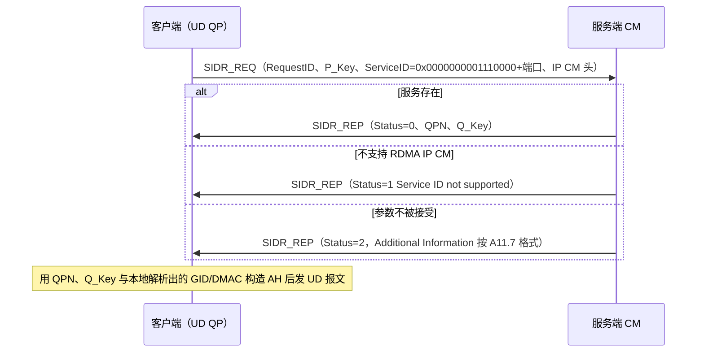
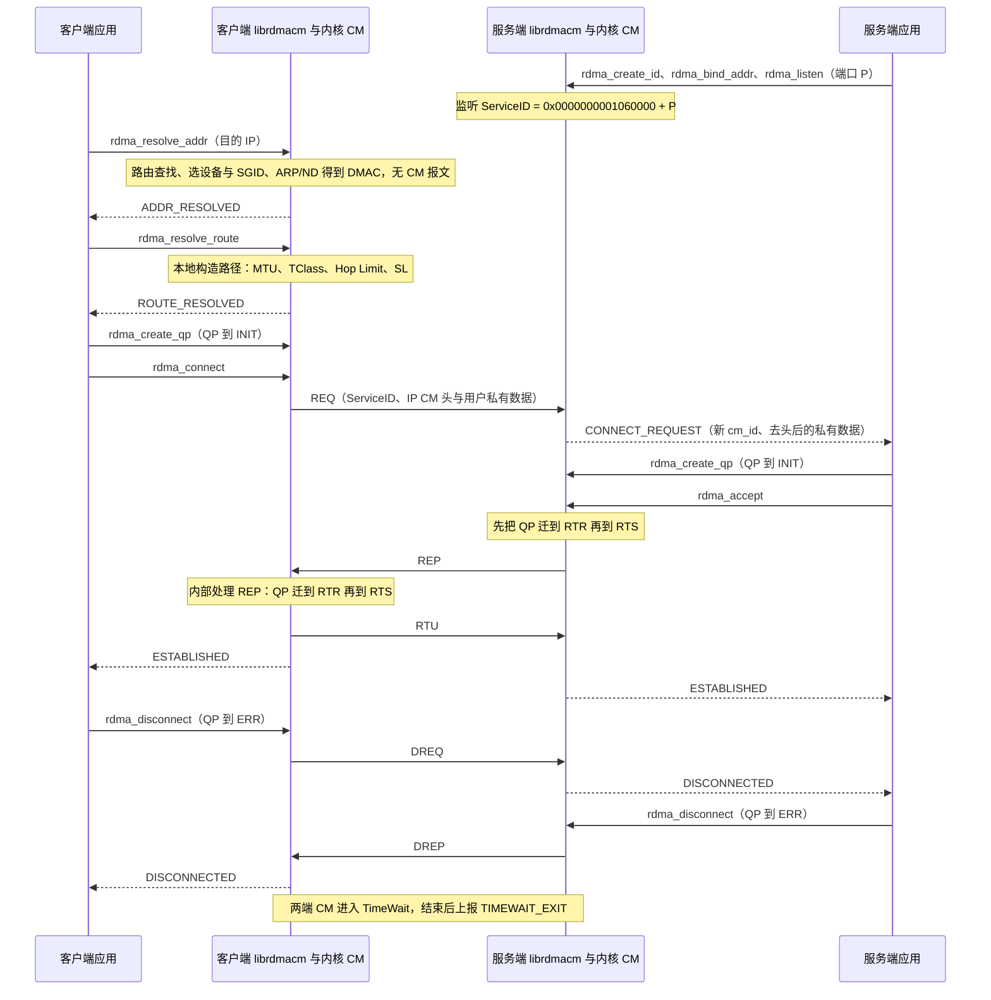

# RDMA IP CM Service（Annex A11）与 rdma_cm（RDMA IP CM Service and Linux rdma_cm）

> **摘要**：应用习惯用"IP 地址 + 端口"建立连接，而 IB CM 用 ServiceID + GID 寻址。Annex A11 规定了把 socket 五元组编码进 CM REQ/SIDR_REQ 的统一格式：目的端口和协议号编进 ServiceID，源端口与源/目的 IP 放在 PrivateData 前 36 字节。Linux librdmacm（rdma_cm）是这一方案的事实实现，也是 RoCEv2 上最常用的建链方式。本文给出 A11 的字节级格式与错误处理，把 rdma_cm 的 API/事件与线上 CM 报文逐一对应，最后与"TCP 带外交换"方案对比。
>
> **规范出处**：Vol1 Annex A11（p.1848–1856）；Vol1 §12.6.5、§12.11（p.717–719、p.768–771）；Vol1 §A17.4.1–A17.4.2（p.1936–1938）；Vol1 §A17.2.4 脚注 59（p.1930）
>
> **前置阅读**：[IB CM 协议在 RoCEv2 上的应用](./01-cm-protocol.md)、[RoCEv2 寻址](../00-overview/04-addressing.md)
>
> **关键词**：RDMA IP CM Service, ServiceID, Port Space, IP CM 头, librdmacm, rdma_cm_id, RDMA_CM_EVENT_*, ARP/ND, default_roce_mode, TOS, 带外交换（OOB）

---

## 1. 为什么需要 RDMA IP CM Service

- **目标**：为 RDMA-aware ULP 提供类似 socket 的连接模型，用与 socket 相同的五元组（源/目的 IP、源/目的端口、协议号）建立 IB 连接，且编码方式与具体 ULP 无关〔Vol1 §A11.1, p.1848〕。
- **两件事**：① 在 CM REQ 与 SIDR_REQ 的 PrivateData 中编码客户端 IP、端口和目的 IP，并尽量给 ULP 留下更多私有数据；② 定义一段 ServiceID 范围，把目的端口和 IP 协议号映射为 ServiceID——服务端"监听端口"就是"监听 ServiceID"〔p.1848〕。
- **实现位置不限**：可以增强 IBTA CM 本身，可以做成 CM 之上的一层，也可以并入 ULP 自己的 CM 服务；iSER 附录是使用示例〔p.1848〕。
- **对 RoCEv2 的意义**：A17 指出主流 RDMA API 都基于 IP〔§A17.2.4 脚注 59, p.1930〕；RoCEv2 的 GID 本身就是 IP 地址（IPv4 编为 `::ffff:a.b.c.d`）〔§A17.4.1.1, p.1936〕。

| 五元组元素 | 承载位置 | 说明 |
|---|---|---|
| 目的端口 | ServiceID 字节 6–7 | 服务端据此匹配监听者 |
| IP 协议号 | ServiceID 字节 5 | 如 TCP=6、UDP=17、SCTP=132（IANA） |
| 源端口 | IP CM 头 Source Port | 客户端本地端口 |
| 源 IP / 目的 IP | IP CM 头 Source/Destination IP | 128 bit 字段，可放 IPv4 或 IPv6 |

> [!NOTE]
> 在 InfiniBand 上，IP（IPoIB 地址）与端口 GID 是两套地址，所以必须在 PrivateData 里另带 IP；在 RoCEv2 上二者通常相同，但 IP CM 头**仍须填写**，服务端按其中的 IP 做监听匹配和合法性检查（A11.7 的码 0x06 "Unknown IP Address"）。

## 2. IP CM 头格式（Table 596）

A11 使用 IBTA 的位序约定（bit 31 为字中最高位），而不是 IETF 的"bit 0 为最高位"约定〔§A11.3, p.1849〕。

```text
 PD byte  31   28 27   24 23   20 19   16 15                              0
         +-------+-------+-------+-------+--------------------------------+
     0   | MajV  | MinV  |  IPV  |  Res  |          Source Port           |
         +-------+-------+-------+-------+--------------------------------+
     4   |                 Source IP Address [127:96]                     |
     8   |                 Source IP Address [95:64]                      |
    12   |                 Source IP Address [63:32]                      |
    16   |                 Source IP Address [31:0]                       |
    20   |              Destination IP Address [127:96]                   |
    24   |              Destination IP Address [95:64]                    |
    28   |              Destination IP Address [63:32]                    |
    32   |              Destination IP Address [31:0]                     |
         +----------------------------------------------------------------+
    36   | Consumer Private Data (REQ: 56 B to 91; SIDR_REQ: 180 B to 215)|
         +----------------------------------------------------------------+
```

| PD 字节[位] | 宽度 | 字段 | 规则 | 合规条款 |
|---|---|---|---|---|
| 0[7:4] | 4 | MajV | 当前版本为 0；服务端不支持该主版本则拒绝 | CA11-2 |
| 0[3:0] | 4 | MinV | 当前为 0；次版本向下兼容；高于服务端支持的次版本则拒绝；须支持不高于自身的次版本 | CA11-3、CA11-3.1.1、CA11-3.1.2 |
| 1[7:4] | 4 | IPV | 0x4=IPv4、0x6=IPv6，其余保留；服务端不支持则拒绝 | CA11-4 |
| 1[3:0] | 4 | Res | 发送置 0，接收忽略 | — |
| 2–3 | 16 | Source Port | 客户端本地端口；其协议号编码在 ServiceID 中 | — |
| 4–19 | 128 | Source IP Address | IPv4 时只用 [31:0]（PD 字节 16–19），[127:32] 置 0 | CA11-5 |
| 20–35 | 128 | Destination IP Address | IPv4 时只用 [31:0]（PD 字节 32–35），[127:32] 置 0 | CA11-5 |
| 36– | — | Consumer Private Data | REQ：字节 36–91（56 B）；SIDR_REQ：字节 36–215（180 B） | CA11-1、CA11-5.1.1 |

〔§A11.4–A11.4.7, p.1849–1852〕

> [!WARNING]
> **IPv4 的两种 128 bit 编码不要混用**：IP CM 头里的 IPv4 地址是"高 96 位补 0"（CA11-5），而 RoCEv2 GID 里的 IPv4 地址是 IPv4-mapped 形式 `::ffff:a.b.c.d`（§A17.4.1.1）。同一个 REQ 中，Primary Local/Remote Port GID 用后者，IP CM 头用前者。

**在报文中的位置**：REQ 的 PrivateData 从 REQ 数据区第 140 字节开始，即 MAD 第 164 字节；IP CM 头占 MAD 第 164–199 字节，用户私有数据占 200–255 字节。对一个无 VLAN 的 IPv4 RoCEv2 帧，MAD 从帧偏移 62 开始，因此 IP CM 头位于帧偏移 226–261。下例为 `192.168.1.10:51234 → 192.168.1.20`、TCP 端口 4420 的 REQ 片段（完整帧见 [03-mad-and-gsi.md](./03-mad-and-gsi.md)）：

```text
MAD 0x20-0x27  REQ ServiceID           : 00 00 00 00 01 06 11 44  -> proto 0x06 (TCP), port 0x1144 = 4420
MAD 0xA4-0xA7  MajV|MinV|IPV|Res|SPort : 00 40 c8 22              -> MajV=0 MinV=0 IPV=4 Res=0 SrcPort=51234
MAD 0xA8-0xB3  Source IP [127:32]      : 00 (x12)                 -> zero padding (CA11-5)
MAD 0xB4-0xB7  Source IP [31:0]        : c0 a8 01 0a              -> 192.168.1.10
MAD 0xB8-0xC3  Destination IP [127:32] : 00 (x12)                 -> zero padding
MAD 0xC4-0xC7  Destination IP [31:0]   : c0 a8 01 14              -> 192.168.1.20
MAD 0xC8-0xFF  Consumer Private Data   : 56 bytes
```

```python
import ipaddress, struct

def ipcm_header(src_ip: str, src_port: int, dst_ip: str) -> bytes:
    """Annex A11 Table 596：36 字节 IP CM 头（MajV=MinV=0）"""
    s, d = ipaddress.ip_address(src_ip), ipaddress.ip_address(dst_ip)
    assert s.version == d.version
    pad = lambda a: a.packed.rjust(16, b"\x00")   # IPv4：高 96 位补 0（CA11-5）
    return struct.pack("!BBH", 0x00, s.version << 4, src_port) + pad(s) + pad(d)

hdr = ipcm_header("192.168.1.10", 51234, "192.168.1.20")
assert len(hdr) == 36 and hdr[:4] == bytes.fromhex("0040c822")
```

## 3. IP 端口到 ServiceID 的映射（§A11.5, Table 597）

```text
 SID byte:   0       1       2       3       4        5          6       7
          +-------+-------+-------+-------+-------+----------+---------------+
          | 0x00  | 0x00  | 0x00  | 0x00  | 0x01  | IP Proto | Dest Port     |
          +-------+-------+-------+-------+-------+----------+---------------+
           IBTA     prefix of RDMA-aware   range    (IANA)     ULP port,
           AGN      Service ID range       0x01                big-endian
```

- ServiceID 必须带前缀 `0x0000000001`；客户端必须使用该范围内的 ServiceID（CA11-6）〔p.1852〕。
- 规范示例：SCTP 上 NFSv4-RDMA 默认端口 2049 → `0x0000000001840801`；TCP 上 iSCSI/iSER 端口 860 → `0x000000000106035C`〔p.1852〕。按同一规则，TCP 端口 4420（NVMe-oF 常用端口）→ `0x0000000001061144`。

```python
def ipcm_service_id(port: int, proto: int = 6) -> int:
    """Table 597：00 00 00 00 | 01 | proto | port"""
    assert 0 <= port <= 0xFFFF and 0 <= proto <= 0xFF
    return (0x01 << 24) | (proto << 16) | port

def parse_service_id(sid: int):
    """不在 RDMA IP CM 范围内则返回 None，否则返回 (协议号, 端口)"""
    if sid >> 24 != 0x01:          # 高 40 bit 必须为 0x0000000001
        return None
    return (sid >> 16) & 0xFF, sid & 0xFFFF

assert ipcm_service_id(860) == 0x000000000106035C          # 规范示例：TCP iSER
assert ipcm_service_id(2049, 132) == 0x0000000001840801    # 规范示例：SCTP NFSv4-RDMA
assert parse_service_id(0x0000000001061144) == (6, 4420)
```

**Linux 的端口空间（port space）**〔业界实践: Linux rdma-core `rdma_cma.h`〕：`rdma_create_id()` 的 `ps` 参数决定 ServiceID 的高位，内核按 `ServiceID = (ps << 16) + port` 生成——

| 端口空间 | 值 | 对应 ServiceID 前缀 | 用途 |
|---|---|---|---|
| `RDMA_PS_TCP` | 0x0106 | `00 00 00 00 01 06` | RC/UC 连接（"TCP"只是端口空间名，线上没有 TCP 报文） |
| `RDMA_PS_UDP` | 0x0111 | `00 00 00 00 01 11` | UD，经 SIDR 解析 |
| `RDMA_PS_IB` | 0x013F | `00 00 00 00 01 3F` | 原生 IB 寻址（AF_IB），不带 IP CM 头 |
| `RDMA_PS_IPOIB` | 0x0002 | — | IPoIB 专用 |

## 4. 用 SIDR 做 IP 服务解析（§A11.4.7、§A11.6.1）

- SIDR_REQ 的 PrivateData 使用同一格式，但用户私有数据占字节 36–215（CA11-5.1.1）；A11.4.1–A11.4.6 的版本/IP 规则同样适用于 SIDR_REQ（CA11-5.1.2）〔p.1851–1852〕。
- 服务端若 ServiceID 落在该范围内，就按 A11 格式解析 SIDR_REQ 私有数据（CA11-8.1.1）；不支持 RDMA IP CM 时应返回 SIDR_REP Status=1 "Service ID not supported"（CA11-8.1.2）〔p.1853〕。
- 成功时 SIDR_REP 返回目标 UD QP 的 QPN 与 Q_Key；返回的 QPN 必须属于 SIDR_REQ 头部 P_Key 所指的分区〔§12.11, p.769〕。SIDR_REP 本身不足以构造 AH，路径 MTU、速率等还需另行获得〔§12.11.3, p.771〕——RoCEv2 中由 rdma_cm 的地址/路由解析提供。
- 〔业界实践: Linux librdmacm〕 `RDMA_PS_UDP` 的 cm_id 上调用 `rdma_connect()` 即发 SIDR_REQ，被动方 `rdma_accept()` 回 SIDR_REP；主动方收到 `RDMA_CM_EVENT_ESTABLISHED`，`event->param.ud` 中给出 AH 属性、远端 QPN 与 Q_Key（rdma_cm 约定的 UD Q_Key 为 `RDMA_UDP_QKEY` = 0x01234567）。



## 5. 错误处理与 REJ 原因（§A11.6–A11.7）

- ServiceID 属于 A11 范围时，服务端**必须**把 REQ 私有数据按 Table 596 解释（CA11-7）；IBTA CM 本身可能不认识 A11，因此不要求 CM 校验私有数据格式〔p.1852–1853〕。
- 服务端不支持 RDMA IP CM 时，**应**回 REJ 原因 8 "Invalid Service ID"（CA11-8）〔p.1853〕。
- 服务端支持但不接受 IP CM 头中的参数时，**必须**回 REJ 原因 28 "Consumer Reject"，ARI 按 A11.7 填写（oA11-1）〔p.1853〕。服务端也可以返回"层 0x00 + IP CM ARI 0x00（未指明）"的通用拒绝，但这**不**代表对端支持 A11 或在该 ServiceID 上有监听者〔p.1853〕。

REJ 的 ARI（72 字节）在两层之间划分（Table 598），当拒绝层为 RDMA IP CM 时格式见 Table 599〔p.1854〕：

```text
 ARI byte:     0              1                 2                 3          4 .. 71
          +-------------+---------------+-----------------+-----------+------------------+
          | Rejection   | IP CM layer   | Suggested Value | alignment | Suggested Value  |
          | Layer       | ARI code      | Length (bytes)  | filler    | for the rejected |
          | 0x00 IP CM  | (Table 600)   | 0x00 = none     | reserved  | field (x bytes)  |
          +-------------+---------------+-----------------+-----------+------------------+
          Layer 0x01 (RDMA-aware ULP): bytes 1..71 are defined by the ULP
```

| IP CM 层 ARI | 名称 | 含义 |
|---|---|---|
| 0x00 | Unspecified | 未说明原因（不得附带建议值，CA11-10） |
| 0x01 | Major Version | 不支持 REQ 中的主版本 |
| 0x02 | Minor Version | 不支持 REQ 中的次版本 |
| 0x03 | IPV | 不支持该 IP 版本 |
| 0x04 | Source IP Address | 源 IP 格式与 IPV 不一致 |
| 0x05 | Destination IP Address | 目的 IP 格式与 IPV 不一致 |
| 0x06 | Unknown IP Address | 目的 IP 与服务端 IP 不符 |

〔Table 600, p.1855〕相关规则：IP CM 层 ARI 码必须放在 ARI 第 1 字节（CA11-9）；可附带被拒字段的建议值（oA11-2）；**必须先校验主/次版本**（CA11-11）；多个错误同时存在时除版本外可任选一个上报；出于安全考虑可只返回 0x00〔p.1854–1855〕。SIDR 情形下同样的 ARI 结构放进 SIDR_REP 的 Additional Information，Status 取 2 "Rejected by Service Provider"（oA11-1.1.1、CA11-12、oA11-3）〔p.1854–1856〕。

> [!TIP]
> 〔业界实践: Linux rdma_cm〕 用户态收到 `RDMA_CM_EVENT_REJECTED` 时，`event->status` 在 IB/RoCE 上就是 REJ 的 Reason 码：**status 8** 几乎总是"对端该端口没有监听者/端口空间不符"；**status 28** 是对端应用调用 `rdma_reject()` 主动拒绝，原因在 REJ 的 PrivateData 中。

## 6. rdma_cm（librdmacm）编程模型 〔业界实践: Linux rdma-core librdmacm〕

### 6.1 对象与调用骨架

`rdma_event_channel`（一个可 poll 的 fd，承载异步事件）+ `rdma_cm_id`（类似 socket，绑定到一个 RDMA 设备端口与一个 QP）+ `rdma_cm_event`。以下为主动端与被动端的最小骨架（省略错误处理与数据收发）：

```c
#include <stdio.h>
#include <stdint.h>
#include <stdlib.h>
#include <netdb.h>
#include <arpa/inet.h>
#include <rdma/rdma_cma.h>

static struct rdma_cm_event *expect(struct rdma_event_channel *ch,
                                    enum rdma_cm_event_type want)
{
    struct rdma_cm_event *ev = NULL;
    if (rdma_get_cm_event(ch, &ev) == 0 && ev->event != want)
        fprintf(stderr, "got %s, status %d\n", rdma_event_str(ev->event), ev->status);
    return ev;                  /* 调用者用完后必须 rdma_ack_cm_event(ev) */
}

static struct ibv_qp_init_attr qp_attr(struct ibv_cq *cq)
{
    struct ibv_qp_init_attr qa = { .send_cq = cq, .recv_cq = cq, .qp_type = IBV_QPT_RC,
        .cap = { .max_send_wr = 64, .max_recv_wr = 64, .max_send_sge = 1, .max_recv_sge = 1 } };
    return qa;
}

int client(const char *ip, const char *port)
{
    struct rdma_event_channel *ch = rdma_create_event_channel();
    struct rdma_cm_id *id;
    struct addrinfo *res;
    struct rdma_conn_param cp = { .responder_resources = 4, .initiator_depth = 4,
                                  .retry_count = 7, .rnr_retry_count = 7 };
    uint8_t tos = 26 << 2;                                  /* DSCP 26 */

    rdma_create_id(ch, &id, NULL, RDMA_PS_TCP);
    getaddrinfo(ip, port, NULL, &res);
    rdma_resolve_addr(id, NULL, res->ai_addr, 2000);        /* 选设备/SGID，ARP/ND */
    rdma_ack_cm_event(expect(ch, RDMA_CM_EVENT_ADDR_RESOLVED));
    rdma_set_option(id, RDMA_OPTION_ID, RDMA_OPTION_ID_TOS, &tos, sizeof(tos));
    rdma_resolve_route(id, 2000);                           /* RoCE：本地构造路径 */
    rdma_ack_cm_event(expect(ch, RDMA_CM_EVENT_ROUTE_RESOLVED));
    struct ibv_pd *pd = ibv_alloc_pd(id->verbs);
    struct ibv_qp_init_attr qa = qp_attr(ibv_create_cq(id->verbs, 128, NULL, NULL, 0));
    rdma_create_qp(id, pd, &qa);                            /* QP: RESET -> INIT */
    /* 此处先 ibv_post_recv() 预投接收 WR */
    rdma_connect(id, &cp);                                  /* 线上：REQ */
    rdma_ack_cm_event(expect(ch, RDMA_CM_EVENT_ESTABLISHED)); /* REP 已处理，RTU 已发 */
    /* ... 数据传输 ... */
    rdma_disconnect(id);                                    /* QP -> ERR，线上：DREQ */
    rdma_ack_cm_event(expect(ch, RDMA_CM_EVENT_DISCONNECTED));
    rdma_destroy_qp(id);
    rdma_destroy_id(id);
    rdma_destroy_event_channel(ch);
    freeaddrinfo(res);
    return 0;
}

int server(uint16_t port)
{
    struct rdma_event_channel *ch = rdma_create_event_channel();
    struct rdma_cm_id *lid, *id;
    struct rdma_cm_event *ev;
    struct sockaddr_in sin = { .sin_family = AF_INET, .sin_port = htons(port) };
    struct rdma_conn_param cp = { .responder_resources = 4, .initiator_depth = 4,
                                  .rnr_retry_count = 7 };

    rdma_create_id(ch, &lid, NULL, RDMA_PS_TCP);
    rdma_bind_addr(lid, (struct sockaddr *)&sin);           /* INADDR_ANY:port */
    rdma_listen(lid, 16);                                   /* 监听 ServiceID 0x...0106<port> */
    ev = expect(ch, RDMA_CM_EVENT_CONNECT_REQUEST);         /* 线上：收到 REQ */
    id = ev->id;                                            /* 新连接自己的 cm_id */
    /* ev->param.conn.private_data：去掉 36 B IP CM 头后的用户数据，须在 ack 前读取 */
    rdma_ack_cm_event(ev);
    struct ibv_pd *pd = ibv_alloc_pd(id->verbs);
    struct ibv_qp_init_attr qa = qp_attr(ibv_create_cq(id->verbs, 128, NULL, NULL, 0));
    rdma_create_qp(id, pd, &qa);                            /* QP: RESET -> INIT */
    rdma_accept(id, &cp);                                   /* QP -> RTR -> RTS，线上：REP */
    rdma_ack_cm_event(expect(ch, RDMA_CM_EVENT_ESTABLISHED)); /* 线上：收到 RTU */
    /* ... 数据传输；收到 DISCONNECTED 后调用 rdma_disconnect() 回 DREP ... */
    return 0;
}
```

### 6.2 rdma_conn_param 与 CM 字段的对应

| `rdma_conn_param` 成员 | `rdma_connect()` → REQ | `rdma_accept()` → REP | 备注 |
|---|---|---|---|
| `private_data` / `private_data_len` | REQ PrivateData（IP CM 头之后，最多 56 B） | REP PrivateData（最多 196 B） | CM 私有数据区定长、不带长度字段，接收方拿到整块，ULP 需自带长度 |
| `responder_resources` | REQ.Responder Resources | REP.Responder Resources | 本端 `max_dest_rd_atomic` |
| `initiator_depth` | REQ.Initiator Depth | REP.Initiator Depth | 本端 `max_rd_atomic` |
| `flow_control` | REQ.End-to-End Flow Control | REP.End-to-End Flow Control | — |
| `retry_count` | REQ.Retry Count（3 bit） | 忽略 | 被动方使用 REQ 中的值 |
| `rnr_retry_count` | REQ.RNR Retry Count | REP.RNR Retry Count | 7 = 无限重试 |
| `srq` / `qp_num` | 仅当 QP 不由 rdma_cm 创建时使用 | 同左 | — |

Linux 内核 rdma_cm 用固定参数填写 REQ 的 CM 定时字段：`CMA_CM_RESPONSE_TIMEOUT`（长期为 20，即约 4.3 s）用于 Remote/Local CM Response Timeout，`CMA_MAX_CM_RETRIES`（15）用于 Max CM Retries（以所用内核源码为准）。结合 [01 文件 §8.4](./01-cm-protocol.md) 的公式，对端始终无应答时，`RDMA_CM_EVENT_UNREACHABLE` 可能要数十秒到一分钟以上才出现。

### 6.3 事件与线上报文

| 事件 | 产生时机 | 线上报文 / 本地动作 | 应用应做什么 |
|---|---|---|---|
| `ADDR_RESOLVED` / `ADDR_ERROR` | `rdma_resolve_addr()` 完成 | 无 CM 报文；路由查找、绑定 RDMA 设备端口、选 SGID、ARP/ND 解析 DMAC | 继续解析路由 / 检查路由、邻居与 GID |
| `ROUTE_RESOLVED` / `ROUTE_ERROR` | `rdma_resolve_route()` 完成 | RoCE 无 SA 查询，本地构造路径参数 | 创建 QP |
| `CONNECT_REQUEST` | 被动方收到 REQ | REQ | 建 QP 后 `rdma_accept()` 或 `rdma_reject()` |
| `CONNECT_RESPONSE` | 主动方收到 REP，且 cm_id 上没有由 rdma_cm 管理的 QP | REP | 应用自行迁移 QP 并确认（少见用法） |
| `ESTABLISHED` | 主动方：处理 REP 并发出 RTU；被动方：收到 RTU（或 QP 首包触发的通信建立事件） | REP→RTU / RTU | 开始收发 |
| `REJECTED` | 收到 REJ（UD 时可能是 SIDR_REP 状态） | REJ | 按 `status`（Reason 码）处理 |
| `UNREACHABLE` | REQ/REP 重试耗尽或 MAD 发送失败（status 常为 -ETIMEDOUT） | 无应答 | 检查对端 CM、网络、QP1 通路 |
| `CONNECT_ERROR` | 建链过程中出错（如 QP 迁移失败） | — | 清理 |
| `DISCONNECTED` | 收到 DREQ 或 DREP（或 DREQ 超时） | DREQ / DREP | 调用 `rdma_disconnect()`（若是对端先发 DREQ，此时才发 DREP） |
| `TIMEWAIT_EXIT` | CM 的 TimeWait 结束 | — | 此后 QP 可安全复用 |
| `ADDR_CHANGE` / `DEVICE_REMOVAL` | 绑定网卡 MAC 变化（如 bonding 切换）/ 设备移除 | — | 视情况重连 / 释放资源 |

### 6.4 rdma_cm 调用与线上 CM 报文时序



> [!WARNING]
> **与规范状态表的差异**：规范中被动方"发 REP 前只到 RTR，收到 RTU 才到 RTS"（见 [01 文件 §7.1](./01-cm-protocol.md)），而 librdmacm 的 `rdma_accept()` 在发 REP **之前**就把 QP 迁到 RTS。若被动方应用在 `ESTABLISHED` 之前就投递发送 WR，报文可能先于主动方进入 RTR 到达，被对端 INIT 状态的 QP 静默丢弃（C10-26, p.487），只能靠 Local ACK Timeout 重传恢复。**建议两端都在收到 `ESTABLISHED` 后再发数据**。

另外两点〔业界实践: Linux 内核 cma.c / ib_cm〕：
- 被动方应用迟迟不 `rdma_accept()` 时，内核 CM 采用"延迟 MRA"——仅在收到重传的 REQ 时才回 MRA，以延长主动方的等待（以内核源码为准）。
- 释放时 `rdma_disconnect()` 先把 QP 置 ERR（未完成 WR 以 flush 错误完成），再视 CM 状态发送 DREQ 或回应 DREP。

## 7. 地址解析：IP → GID → DMAC

- **规范立场**：RoCEv2 的 L3 地址就是 GID；L3→L2 地址解析（ARP/ND）不在规范范围内，由 OS 完成；AV 中的 DLID 泛化为"Destination L2 Address"，可携带已解析好的 DMAC 经 Create AH/Modify QP 传入，也可置 `0xFFFFFFFFFFFF` 让 verbs 实现自己解析；脚注 62 明确说这种"先解析再生成 AV"的方式正是 Linux RDMA CM 的做法〔§A17.4.2, p.1937–1938〕。源 MAC 由所选 SGID 隐含〔p.1938〕。
- **`rdma_resolve_addr()` 做了什么**〔业界实践: Linux〕：按内核路由表确定出口网络设备（含 VLAN/bond 子接口）→ 找到其下的 RDMA 设备与端口 → 在端口 GID 表中选出"GID 等于源 IP 且 GID 类型符合所选 RoCE 模式"的表项作为 SGID index → 通过邻居表（ARP/ND，必要时发出请求）得到 DMAC。
- **`rdma_resolve_route()`**：RoCE 没有 SA，内核在本地构造路径：MTU 由网卡 MTU 扣除 RoCE 头开销后向下取到 256…4096 的最大可用值，Hop Limit 来自路由，Traffic Class 来自 TOS，SL/优先级由 TOS 经网络设备的优先级映射得出，PacketLifeTime 取内核常量（具体常量与算法以内核版本为准）。
- **被动方**：REQ 中没有 MAC 地址，被动方必须自行得到主动方的 DMAC——可取自 GSI 接收 CQE 中携带的源 L2 地址（§A17.4.5.1, p.1939 规定 UD CQE 含源 L2 地址与 IPv4/IPv6/RoCE 标志），或按 IP 再做一次路由/邻居解析；Linux 不同版本做法不同，以所用内核为准。

> [!TIP]
> - 以太网 MTU 1500 时 RoCE 路径 MTU 只能协商到 1024；想用 4096 需把接口 MTU 调到约 4200 以上（以内核计算为准）。两端/交换机 MTU 不一致会导致大包丢弃而小包（含 CM MAD）正常——典型症状是"能建链、传大消息就超时"。
> - 默认 GID index 0 往往是由 MAC 派生的 IPv6 链路本地地址（fe80::），不可路由；跨子网的 RoCEv2 必须使用可路由的 IPv4/IPv6 GID。查看：`/sys/class/infiniband/<dev>/ports/<p>/gids/<i>` 与 `gid_attrs/types/<i>`〔业界实践: Linux sysfs〕。

## 8. RoCE 模式选择与 TOS 设置 〔业界实践: Linux，以所用版本为准〕

一个 IP 地址通常在 GID 表中对应两项（RoCE v1 与 RoCE v2 类型）。rdma_cm 选择哪种类型由 configfs 中的每端口参数控制：

```shell
mount -t configfs none /sys/kernel/config 2>/dev/null   # 多数发行版已挂载
mkdir -p /sys/kernel/config/rdma_cm/mlx5_0              # 设备名按实际替换
cat  /sys/kernel/config/rdma_cm/mlx5_0/ports/1/default_roce_mode
echo "RoCE v2" > /sys/kernel/config/rdma_cm/mlx5_0/ports/1/default_roce_mode   # 或 "IB/RoCE v1"
echo 104 > /sys/kernel/config/rdma_cm/mlx5_0/ports/1/default_roce_tos         # TOS 104 = DSCP 26
```

- **按连接设置 TOS**：`rdma_set_option(id, RDMA_OPTION_ID, RDMA_OPTION_ID_TOS, &tos, 1)`，须在 `rdma_resolve_route()` 之前调用；TOS 是 8 bit 的 IP TOS 字节，DSCP = TOS >> 2，经 AV 的 Traffic Class 进入 IPv4 DSCP / IPv6 Traffic Class（CA17-4/CA17-13）。低 2 位对应 ECN，是否被硬件改写为 ECT 取决于实现与拥塞控制配置（以厂商文档为准）。DSCP/PCP 规划见 [QoS：DSCP/PCP/ETS](../05-congestion-control-and-qos/02-qos-dscp-pcp-ets.md)。
- 其它选项：`RDMA_OPTION_ID_REUSEADDR`、`RDMA_OPTION_ID_AFONLY`、`RDMA_OPTION_ID_ACK_TIMEOUT`（设置 QP 的 Local ACK Timeout 指数）。
- 厂商工具（如 NVIDIA MLNX_OFED 的 `cma_roce_mode`、`cma_roce_tos`）封装了上述 configfs 操作，属厂商相关，以其文档为准。
- 较新的 rdma-core/内核还支持 ECE（Enhanced Connection Establishment，`rdma_set_local_ece()`/`rdma_get_remote_ece()`），借 REQ/REP 的 VendorID 与 MAD AttributeModifier 协商厂商可选特性，对应 CM ClassPortInfo 的 IsVendorECECapable 位〔§12.7.42, p.739；§16.7.3, p.1185–1186〕。

## 9. 替代方案：不用 CM，用 TCP 带外交换

很多程序不走 CM，而是先建一条普通 TCP 连接交换 QP 参数，再各自用 `ibv_modify_qp()` 完成迁移。这正是 [01 文件 §5](./01-cm-protocol.md) 那张映射表的"手工版"。

| 步骤 | 内容 |
|---|---|
| 1 | 各自创建 QP 并迁到 INIT；选定本地 GID index（必须是 RoCEv2 类型、可路由的 GID） |
| 2 | 经 TCP 交换：QPN、初始 PSN（随机）、GID；需要单边操作时再交换 rkey 与虚拟地址；可选协商 MTU、READ/Atomic 深度 |
| 3 | INIT→RTR：`dest_qp_num`、`rq_psn`、`path_mtu`、`max_dest_rd_atomic`、`min_rnr_timer`、`ah_attr.is_global=1`、`grh.dgid`/`sgid_index`/`hop_limit`/`traffic_class` |
| 4 | RTR→RTS：`sq_psn`、`timeout`、`retry_cnt`、`rnr_retry`、`max_rd_atomic` |
| 5 | 再经 TCP 做一次同步（确认对端已到 RTR/RTS），然后开始 RDMA 传输；断开也要经 TCP 通知 |

〔业界实践〕DMAC 不需要交换：Linux 内核在 Modify QP 时根据 DGID 经邻居表解析 DMAC，相当于规范中"Destination L2 Address=0xFFFFFFFFFFFF 由 verbs 实现解析"的模式〔§A17.4.2, p.1937〕。perftest 默认就用 TCP 带外交换（默认端口 18515，`-x` 选 GID index），加 `-R` 才改用 rdma_cm；rdma-core 自带的 `ibv_rc_pingpong` 以"LID:QPN:PSN:GID"文本格式经 TCP 交换（`-g` 选 GID index）；NCCL、MPI/UCX 等通常有自己的引导（bootstrap）通道。详见 [工具与测试](../07-engineering-practice/04-tools-and-testing.md)。

| 维度 | IB CM / rdma_cm | TCP 带外交换 |
|---|---|---|
| 依赖 | 两端 CM（Linux 内核 ib_cm）与 QP1 通路 | 一条可用的 TCP/IP 通道（可走管理网） |
| 寻址 | IP:port → ServiceID，自动选设备、SGID、DMAC、MTU | 应用自己选设备、GID index、MTU，易出错 |
| 参数协商 | 规范化：资源、重试、超时、PSN、REJ 原因码 | 自定义格式，容易漏项（如 READ 深度、PSN） |
| 断链感知 | DREQ/DREP 与 `DISCONNECTED` 事件 | 依赖 TCP 关闭/心跳；对端崩溃只能靠超时 |
| 互通性 | 与任何遵循 CM 的实现互通（存储 target、硬件 target 等） | 只与同一应用互通 |
| 规模与时延 | 每连接若干 MAD，内核 CM 处理有一定开销 | 可批量/集中式交换，大规模集合通信常用 |
| 调试 | Wireshark 可直接解析 CM 报文 | 依赖应用日志 |
| 典型用户 | Linux 内核 ULP（nvme-rdma、iSER、NFS/RDMA）、rping | perftest 默认模式、ibv_*_pingpong、NCCL、MPI |

## 10. 硬件实现要点与工程提示

### 10.1 硬件实现要点

- A11 完全是软件约定，RNIC 数据通路无需感知；但若在 FPGA/智能网卡上做**不依赖主机 CPU 的 RoCEv2 端点**（如硬件 NVMe-oF target），就必须在片上软核或固件里实现：QP1 收发、CM 被动方状态机（至少 REQ→REP→RTU、REJ、DREQ/DREP、MRA 接收）、A11 ServiceID 匹配与 IP CM 头解析（先校验版本，CA11-11）、无监听时回 REJ 8、TimeWait 管理，以及 ARP/ND（为对端 IP 解析 DMAC、应答对本端 IP 的请求）。
- 字段解析全部是固定偏移：ServiceID 在 MAD 第 32–39 字节，IP CM 头在 MAD 第 164–199 字节，适合用简单的字节比较器实现监听表匹配。

### 10.2 工程提示

> [!TIP]
> 建链失败的排查顺序：`ADDR_ERROR`（路由、邻居、IP 所在网卡是否有 RDMA 设备、GID 是否存在）→ `ROUTE_ERROR`（TOS/MTU/设备状态）→ `UNREACHABLE`（REQ 无应答：对端 CM 是否在运行、交换机 ACL 是否放行 UDP 4791、PFC/拥塞是否导致 MAD 丢失）→ `REJECTED` 8（对端未监听该端口/端口空间不符）或 28（对端应用拒绝）→ `CONNECT_ERROR`（本地 QP 迁移失败，如资源不足、GID 类型不符）。更多见 [排障指南](../07-engineering-practice/05-troubleshooting.md)。

## 11. 要点回顾

- Annex A11 把 socket 五元组编码进 CM：目的端口与协议号进 ServiceID（`00 00 00 00 01 | proto | port`），源端口与源/目的 IP 进 REQ/SIDR_REQ PrivateData 的前 36 字节。
- IP CM 头中 IPv4 地址是"高 96 位补 0"，与 GID 的 `::ffff:` 形式不同；REQ 去头后用户私有数据只剩 56 字节，SIDR_REQ 为 180 字节。
- 服务端须先校验 MajV/MinV；不支持 A11 时回 REJ 8，参数不接受时回 REJ 28 并按 Table 598–600 填 ARI；SIDR 用 SIDR_REP Status 1/2 对应。
- rdma_cm 就是 A11 + IB CM 的实现：`resolve_addr`（选设备/SGID/DMAC）、`resolve_route`（RoCE 本地构造路径）、`connect`/`accept`（REQ/REP/RTU）、`disconnect`（DREQ/DREP）。
- librdmacm 的被动方在发 REP 前就把 QP 迁到 RTS，与规范状态表不同；应用应等 `ESTABLISHED` 再发数据。
- RoCE 模式（v1/v2）与默认 TOS 可经 configfs 按端口设置，也可用 `RDMA_OPTION_ID_TOS` 按连接设置。
- 不用 CM 时可经 TCP 带外交换 QPN/PSN/GID 等参数，灵活但要自己处理协商、同步与断链感知。

## 自测

<details><summary>Q1：客户端连接 TCP 端口 4791 上的服务（端口空间 RDMA_PS_TCP），REQ 的 ServiceID 是多少？</summary>

答：`0x0000000001060000 + 4791 = 0x00000000010612B7`（字节 4=0x01，字节 5=协议号 0x06，字节 6–7=端口 0x12B7）。注意这里的 4791 只是 ULP 端口号，与 RoCEv2 的 UDP 目的端口 4791 无关。
</details>

<details><summary>Q2：IPv4 客户端 10.0.0.1:40000 连接 10.0.0.2，IP CM 头的前 4 字节和 Source IP 字段的 16 字节分别是什么？</summary>

答：前 4 字节为 `00 40 9C 40`（MajV=MinV=0，IPV=4，Source Port=40000=0x9C40）；Source IP 字段为 12 个 `00` 后接 `0A 00 00 01`——高 96 位补 0，不是 `::ffff:` 映射形式（CA11-5）。
</details>

<details><summary>Q3：服务端支持 A11，但收到 MajV=1 的 REQ，应如何回应？</summary>

答：必须先检查版本（CA11-11），因主版本不符应拒绝（CA11-2）：回 REJ，Reason=28（Consumer Reject），ARI 字节 0=0x00（RDMA IP CM 层）、字节 1=0x01（Major Version），可在字节 2 起给出建议值长度与建议值（如支持的主版本 0）。
</details>

<details><summary>Q4：为什么用户态 rdma_cm 程序在收到 CONNECT_REQUEST 时，private_data_len 总是 56？</summary>

答：CM 的 PrivateData 是定长字段且不带有效长度，REQ 的 92 字节中前 36 字节被 IP CM 头占用，rdma_cm 把剩余的整块 56 字节交给应用。应用协议需要自己在私有数据中编码长度或版本。
</details>

<details><summary>Q5：不用 CM 而用 TCP 交换参数时，为什么不必交换对端 MAC 地址？两端最少要交换哪些参数？</summary>

答：RoCEv2 中 DMAC 由本地根据对端 IP（GID）经 ARP/ND 解析（规范视为范围外，§A17.4.2；Linux 在 Modify QP 时自动解析）。RC 连接最少交换 QPN、初始 PSN、GID；做 RDMA READ/WRITE 还需 rkey 与地址；MTU、READ/Atomic 深度应双方一致或协商。
</details>

## 参考

- 规范：IBTA Vol1 Rel 1.4 Annex A11（p.1848–1856）；§12.6.5（p.717–719）；§12.11（p.768–771）；§A17.2.4（p.1930）；§A17.4.1–A17.4.2、§A17.4.5.1（p.1936–1939）；§10.3.1.2 C10-26（p.487）
- 相关文件：[01-cm-protocol.md](./01-cm-protocol.md)、[03-mad-and-gsi.md](./03-mad-and-gsi.md)、[Linux RDMA 软件栈](../07-engineering-practice/01-linux-rdma-stack.md)、[RoCEv2 对 Verbs 的修改与编程实践](../03-verbs-and-resources/05-verbs-roce-specifics-and-programming.md)、[ECMP 与 UDP 源端口](../05-congestion-control-and-qos/06-ecmp-and-load-balancing.md)
- 外部：〔业界实践: rdma-core librdmacm（`rdma_cma.h`、man rdma_cm(7)、rdma_get_cm_event(3)）〕；〔业界实践: Linux 内核 drivers/infiniband/core/cma.c、cma_configfs.c〕；〔业界实践: linux-rdma/perftest〕；〔外部: IANA Protocol Numbers / Service Name and Transport Protocol Port Number Registry〕
