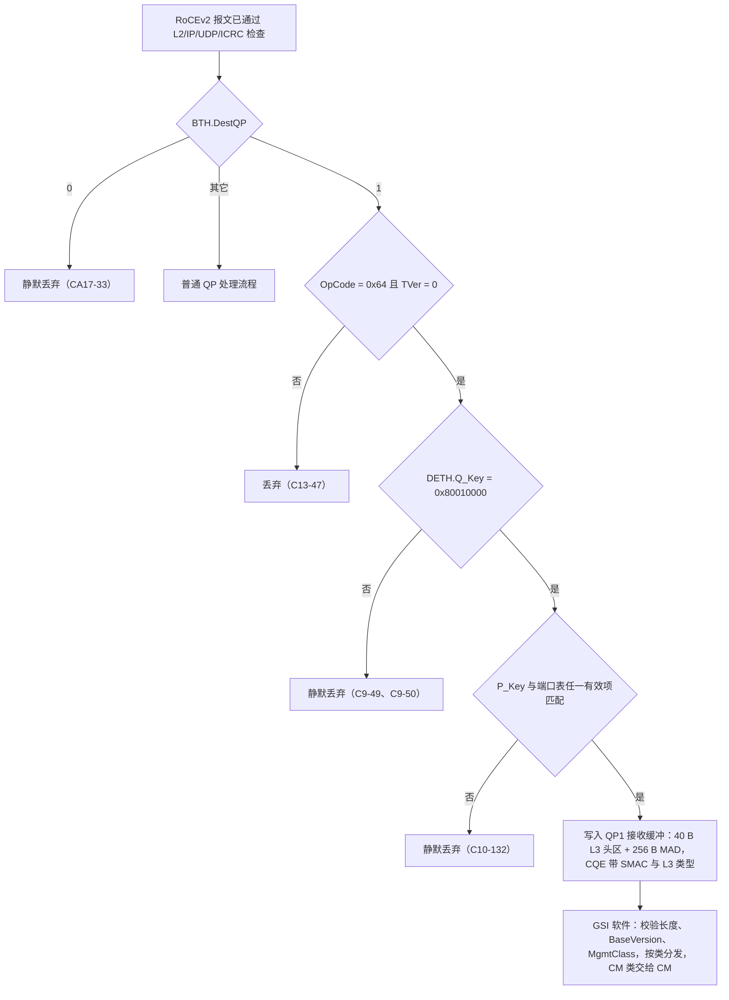

# MAD 格式、GSI/QP1 与 RoCEv2 管理差异（MAD Format, GSI/QP1 and RoCEv2 Management Differences）

> **摘要**：RoCEv2 只保留了 IB 管理体系中的通信管理（CM）一类，CM 消息以管理数据报（Management Datagram, MAD）的形式经通用服务接口（GSI，即 QP1）收发。本文给出 MAD 通用头的字段级布局、Method/Status/MgmtClass 编码与 CM 类属性，解释 SMP/GMP、QP0/QP1、Q_Key 0x80010000 与 P_Key 规则，梳理 RoCEv2 对管理部分的裁剪，最后逐字节拆解一个 CM REQ 在 RoCEv2 线上的完整封装——这是实现 RNIC 的 QP1 通路和做互通抓包分析的直接依据。
>
> **规范出处**：Vol1 §13.4（p.780–817）；Vol1 §13.5.1–13.5.4（p.818–841）；Vol1 §16.7（p.1182–1186）；Vol1 §9.6.1.5.1（p.301）、§9.8.3（p.419）；Vol1 §10.2.4.5–10.2.5（p.470–471）、§10.9.8（p.562）；Vol1 §11.2.6（p.622–623）；Vol1 §A16.4（p.1913–1916）；Vol1 §A17.4.5、§A17.4.7、§A17.5.8、§A17.6（p.1939–1943）
>
> **前置阅读**：[IB CM 协议](./01-cm-protocol.md)、[扩展传输头（DETH）](../01-packet-format/04-extended-transport-headers.md)、[UC/UD/多播](../02-transport/04-unreliable-services.md)
>
> **关键词**：MAD, SMP, GMP, SMI, GSI, QP0, QP1, Q_Key 0x80010000, P_Key, MgmtClass, Method, Status, AttributeID, ClassPortInfo, CA17-33

---

## 1. MAD 概述

- MAD 是 IBA 管理通信的基本单元，按"管理类"（management class）划分，每类 MAD 都有规定的格式、用途和行为〔Vol1 §13.4, p.780〕。
- **长度固定**：所有 MAD 的数据负载（即第 9 章意义上的传输层 payload）**必须恰好 256 字节**（C13-3），且只包含 MAD 基本格式定义的内容（C13-4.2-1.1）〔§13.4.2, p.781〕。
- **总是 UD SEND Only**：MAD 是最小 MTU（256 B）的不可靠数据报；SMI/GSI 都要求 `BTH:OpCode = Send only UD`（`011_00100` = **0x64**）〔C13-45.1.1、C13-47, p.825–827；Figure 160, p.830〕。超过一个 MAD 的数据需用可靠多包协议 RMPP〔§13.6, p.841〕，CM 不需要。
- **SMP 与 GMP**：子网管理类（MgmtClass 0x01/0x81）的 MAD 称为 SMP，只能经 QP0/SMI 收发；其余所有类的 MAD 称为 GMP，经 QP1/GSI 收发〔§3.9.1, p.151–152；§13.5.1, p.819–822〕。
- **编码约定**（C13-2）：位序遵循 §1.5；定长位置中的变长字段放在高位、其余补 0；保留字段发送方置 0、接收方忽略；构造响应时可以原样带回请求中的保留字段〔§13.4.1, p.780–781〕。

## 2. MAD 通用头（Common MAD Header）

```text
 byte  31            24 23            16 15             8 7 6           0
      +----------------+----------------+----------------+-+-------------+
    0 |  BaseVersion   |   MgmtClass    |  ClassVersion  |R|   Method    |
      +----------------+----------------+----------------+-+-------------+
    4 |             Status              |          ClassSpecific         |
      +---------------------------------+--------------------------------+
    8 |                       TransactionID (64)                         |
   12 |                                                                  |
      +---------------------------------+--------------------------------+
   16 |           AttributeID           |        AdditionalStatus        |
      +---------------------------------+--------------------------------+
   20 |                        AttributeModifier                         |
      +------------------------------------------------------------------+
   24 |                     Data (232 bytes, to 255)                     |
      +------------------------------------------------------------------+
```

| 字节 | 位 | 宽度 | 字段 | 含义 | CM 消息取值 |
|---|---|---|---|---|---|
| 0 | 31:24 | 8 | BaseVersion | MAD 基本格式版本，必须为 1 | 0x01 |
| 1 | 23:16 | 8 | MgmtClass | 管理类（见 §3） | 0x07 |
| 2 | 15:8 | 8 | ClassVersion | 类格式版本，默认 1，类可另行规定 | **2**（C16-15.1.1） |
| 3 | 7 | 1 | R | 响应位（见 §4） | 0 |
| 3 | 6:0 | 7 | Method | 操作 | 0x03（ComMgtSend） |
| 4–5 | — | 16 | Status | 处理状态（见 §5） | 0（C12-5.1.1） |
| 6–7 | — | 16 | ClassSpecific | 类未定义时保留（SM 有向路由、Vendor 类有定义） | 0 |
| 8–15 | — | 64 | TransactionID | 事务标识；类不使用时置 0 | 同一消息序列相同（C12-5.1.2） |
| 16–17 | — | 16 | AttributeID | 被操作对象；不使用时置 0 | 消息类型，如 REQ=0x0010 |
| 18–19 | — | 16 | AdditionalStatus | 可选附加状态（Linux `struct ib_mad_hdr` 中该位置的成员名为 `resv`，沿用早期规范的"保留"定义〔业界实践: Linux include/rdma/ib_mad.h〕） | 0 |
| 20–23 | — | 32 | AttributeModifier | 属性的进一步限定；不使用时置 0（C13-26） | 0（ECE 时见 §6） |
| 24–255 | — | 1856 | Data | 由管理类定义 | CM 消息体，232 B |

〔Figure 149、Table 121, p.782–783；§16.7.1, p.1183〕规范表格中的 bit 偏移从字节 0 的最高位起算（R 位于偏移 24，即字节 3 的最高位）。

**TransactionID 规则**：发起新操作时，TID、SGID（无 GRH 时为 SLID）与 MgmtClass 的组合必须与其它正在进行的操作不同（C13-18.1.1）；接收方必须用这三者的组合而非单独的 TID 关联消息（C13-19.1.1）；响应必须原样带回请求的 TID（C13-21）〔§13.4.6.4, p.794〕。RoCEv2 中 SGID 就是发送方的 IP 地址（GID 形式）。

## 3. 管理类（MgmtClass）及其在 RoCEv2 中的适用性

| 管理类 | 值 | IB 中的支持要求 | RoCEv2 端口 |
|---|---|---|---|
| Subnet Management（LID 路由） | 0x01 | 所有 CA、交换机、路由器 | 不适用（无 SM、无 QP0） |
| Subnet Management（有向路由） | 0x81 | 同上 | 不适用 |
| Subnet Administration | 0x03 | 承载 SM 的节点 | 不适用 |
| Performance Management | 0x04 | 所有 CA、交换机、路由器 | 不适用 |
| Baseboard Management | 0x05 | 所有 CA、交换机、路由器 | 不适用 |
| Device Management | 0x06 | 可选 | 不适用 |
| **Communication Management** | **0x07** | 支持 RC/UC/XRC/RD 的所有 CA | **适用（唯一保留）** |
| SNMP Tunneling | 0x08 | 可选 | 不适用 |
| Vendor Specific | 0x09–0x0F、0x30–0x4F | 可选 | 不适用 |
| Application Specific | 0x10–0x2F | 可选（如拥塞控制类 0x21，Annex A10） | 不适用 |
| 保留 | 0x00、0x02、0x50–0x80、0x82–0xFF | — | — |

〔Table 122, p.784；§A10.4.1, p.1816；§A17.6, p.1942–1943〕A17.6 列出的不适用类还包括 Boot Management 与 BIS。MgmtClass 必须取表中非保留值（C13-5）。

## 4. Method 与 R 位

Method 字段最高位是响应位 R，据此分三种消息〔§13.4.5, p.785〕：**Message**（无响应，R=0，对应 R=1 的值保留）、**Request**（R=0，可能有响应）、**Response**（R=1，对应某个 Request）。

| Method | 类型 | 值（含 R 位） | 说明 |
|---|---|---|---|
| Get() | Request | 0x01 | 读属性 |
| Set() | Request | 0x02 | 写属性，响应为 GetResp |
| GetResp() | Response | 0x81 | Get/Set 的响应 |
| Send() | Message | 0x03 | 发送数据报，无需响应 |
| Trap() | Message | 0x05 | 主动上报事件 |
| Report() / ReportResp() | Request / Response | 0x06 / 0x86 | 事件转发 |
| TrapRepress() | Message | 0x07 | 让 Trap 发送方停止重复上报 |
| 保留 | — | 0x00、0x04、0x08–0x0F、0x80、0x82–0x85、0x87–0x8F | — |
| 类自定义 | — | 0x10–0x7F、0x90–0xFF | — |

〔Table 123, p.786〕CM 类只支持 ComMgtGet 0x01、ComMgtSet 0x02、ComMgtGetResp 0x81、ComMgtSend 0x03（C16-15.1.2, Table 371, p.1184）。**所有 CM 协议消息都是 Send()**，可靠性由第 12 章的超时重传自行保证；只有 ClassPortInfo 用 Get()/GetResp() 访问。注意 CM 的特殊约定：携带重定向信息（ClassPortInfo）的 CM 响应（REJ、APR、SPR、SIDR_REP）也用 Send() 而不是 GetResp()〔§12.1, p.708〕。

通用请求/响应规则：重发同一请求（同一 TID）的最小间隔不得小于应答时间，收到匹配响应即停止（C13-8.1.1）；响应方不得合并响应（C13-9）〔§13.4.6.1, p.787〕。

## 5. Status 字段

```text
 Status (16 bit, MAD bytes 4-5)
   15                      8   7   6   5   4   3   2   1   0
 +---------------------------+-----------+-----------+---+---+
 |   class specific (8)      | reserved  | invalid-  | R | B |
 |                           |  (3 bit)  | field code|   |   |
 +---------------------------+-----------+-----------+---+---+
   B = Busy   R = RedirectionRequired
```

| 位 | 名称 | 含义 |
|---|---|---|
| 0 | Busy | 暂时忙，MAD 被丢弃，不算错误 |
| 1 | RedirectionRequired | 需要重定向（响应中带 ClassPortInfo），不算错误 |
| 2–4 | Code for invalid field | 0 无；1 版本或管理类不支持；2 Method 不支持；3 Method/属性组合不支持；4–6 保留；**7 属性或属性修饰符中有字段取值无效（含保留值、超出架构上限）** |
| 5–7 | — | 保留 |
| 8–15 | Class Specific | 类自定义（CM 类未定义任何类专用位，Table 370） |

〔Table 124, p.795；§16.7.1.1, p.1183〕对 Response 类型消息，低 8 位必须按上表设置（C13-24）。因此 code 7 在线上表现为 Status = **0x001C**（7<<2）；Busy=0x0001，Redirect=0x0002，"版本/类不支持"=0x0004（Table 127 的 MAD Status 列与此一致，p.796–797）。AdditionalStatus 按范围划分：0 无、1–4095 IBA 标准错误、4096 起为厂商错误〔Table 125–127, p.796–797〕。

CM 中的用法：REJ 原因 31（不支持的 ClassVersion）与 SIDR_REP 状态 5 时，MAD 头的 "Code for invalid field" 应置 1〔§12.6.7.2, p.726；§12.11.2.1, p.771〕。

> [!NOTE]
> **RoCEv2**：IB 管理域与以太网管理域之间预期没有管理通信，因此任何"指向 RoCE 端口"的 IB Method/属性组合，都**可以**返回 Status 中 code 7（即 0x001C）〔§A17.6, p.1943〕。RoCE v1 附录有完全相同的表述〔§A16.4, p.1914〕。

## 6. CM 类的属性与 ClassPortInfo

| 属性 | AttributeID | Method | AttributeModifier |
|---|---|---|---|
| ClassPortInfo | 0x0001 | Get / GetResp | 0 |
| ConnectRequest（REQ）、ConnectReply（REP）、ServiceIDResReqResp（SIDR_REP） | 0x0010、0x0013、0x0018 | Send | ClassPortInfo 的 IsVendorECECapable=0 时为 0；为 1 时携带厂商 CM 选项 |
| MsgRcptAck、ConnectReject、ReadyToUse、DisconnectRequest、DisconnectReply | 0x0011、0x0012、0x0014、0x0015、0x0016 | Send | 0 |
| ServiceIDResReq、LoadAlternatePath、AlternatePathResponse、SuggestAlternatePath、SuggestPathResponse | 0x0017、0x0019、0x001A、0x001B、0x001C | Send | 0 |

〔Table 372–373, p.1184–1185〕表中未列出的 AttributeID 均为保留（C16-15.1.3）；小于 0x10 的 AttributeID 用于跨类通用属性（ClassPortInfo 0x0001、Notice 0x0002、InformInfo 0x0003、KeyInfo 0x000F）〔Table 128, p.798–799〕。消息字段的逐位布局见 [01 文件 §4](./01-cm-protocol.md)。

CM 的 ClassPortInfo:CapabilityMask 定义了第 8–15 位〔Table 374, p.1186〕：

| 位 | 名称 | 含义 |
|---|---|---|
| 9 | IsReliableConnectionCapable | 支持 RC 连接的建立与释放 |
| 10 | IsReliableDatagramCapable | 支持 RD 通道（EE 上下文） |
| 11 | IsVendorECECapable | 支持厂商端到端连接选项（ECE）协商 |
| 12 | IsUnreliableConnectionCapable | 支持 UC 连接 |
| 13 | IsSIDRCapable | 响应 SIDR 请求；不支持 SIDR 的 CM 必须清零此位〔§12.11, p.769〕 |
| 14 | IsXRCCapable | 支持 XRC |
| 8、15 | — | 保留 |

ClassPortInfo 还包含 RespTimeValue（5 bit，4.096 µs×2^n）与一组 Redirect 字段（GID、TC、SL、FL、LID、P_Key、QP、Q_Key，其中 RedirectQ_Key 必须是知名 Q_Key）〔Table 129, p.800–801〕。在 RoCEv2 中 RedirectLID 等 LID 类字段没有意义。

## 7. SMI/GSI 与 QP0/QP1

### 7.1 两个管理接口

| 属性 | 子网管理接口 SMI | 通用服务接口 GSI | RoCEv2 端口 |
|---|---|---|---|
| 队列对 | QP0 | QP1（重定向前的目的 QP） | **只有 QP1**；DestQP=0 静默丢弃（CA17-33） |
| VL | VL15 | 非 VL15 | 无 VL；以 SL→以太网优先级 + DSCP 区分 |
| 分区（P_Key） | 不检查 | 检查 | 检查（见 §7.3） |
| Q_Key | 不检查 | 检查，必须为 0x8001_0000 | 同 GSI |
| 范围 | 仅子网内 | 可跨子网路由 | 可经 IP 路由 |
| 类密钥 | M_Key | 由类决定 | — |

〔Table 139, p.823；§A17.6, p.1943〕

- GSI 是一个按 `MgmtClass` 分发的解复用器，把发往 QP1 的 GMP 交给各类代理或管理者；QP1 在每个端口上"虚拟化"一份〔§13.5.1–13.5.1.2, p.819–822〕。除非重定向，发往某端口代理的 SA/GS MAD 必须以 QP1 为目的（C13-34）〔p.820〕。
- 管理者发送 GMP 不一定要用 QP1 作源 QP（QP0 除外）；QP1 的主要意义是"一个众所周知的初始联络点"〔§13.5.1, p.820〕。因此 CM REQ 的 DETH.SrcQP 通常是 1，但规范并不强制。
- **重定向**：某类可把后续交互迁到另一个普通 QP。发往 QP1 的请求若属已重定向的类，必须返回该类的 ClassPortInfo，并置 Status 的 RedirectionRequired 位（C13-42、C13-43）；经重定向到达的 MAD 与 QP1 按相同规则校验（C13-40、C13-48.1.1）〔§13.5.2–13.5.3.2.2, p.823–828〕。

### 7.2 GSI 入站校验

到达 GSI（QP1）的负载须满足以下条件，否则丢弃（仅对 Get()/Set() 可选择回 GetResp）（C13-47）〔§13.5.3.2.1, p.827〕：负载长度 256 字节；`LRH:VL≠15`（RoCEv2 无 LRH，不适用）；`BTH:DestQP=1`；`BTH:OpCode=Send only UD`；`BaseVersion=1`；`MgmtClass` 为本节点支持的类。随后各代理再检查 Method 是否被该类支持、Method/AttributeID 组合是否有效（C13-49.1.1、C13-50）〔p.828–829〕。

### 7.3 Q_Key 与 P_Key 规则

- **知名 Q_Key**：目的为 QP1 的报文，DETH.Q_Key 只有等于 **0x80010000** 才视为有效（C9-49）；目的为 QP0 的报文不校验 Q_Key（C9-48）〔§9.6.1.5.1, p.301〕；UD 报文 Q_Key 不符则静默丢弃（C9-50）。对 GSI 收到或经重定向收到的 GMP，响应的 DETH 必须使用知名 Q_Key（C13-51.1.1、C13-52.1.1）〔p.841〕。使用知名 Q_Key 的 QP 可以假定其收到的所有 UD 都是 GMP〔§13.5.1.2, p.823〕。
- **特权 Q_Key**：最高位为 1 的 Q_Key 是特权 Q_Key。Post Send 时若 WR 中 Q_Key 的最高位为 1，CI 发出的报文改用 QP 上下文中的 Q_Key（C10-15）；也就是说普通用户无法在 WR 里"伪造"0x80010000，必须由特权方把它配置进 QP 上下文〔§3.9, p.151；§10.2.5, p.471〕。
- **P_Key**：发往 QP1 的报文，只要其 P_Key 与到达端口 P_Key 表中**任一有效项**匹配即接受（C10-132）——不同于普通 QP 只与自身 P_Key 比较（C10-127）；QP1 发出的报文携带与该 QP 关联的 P_Key（C10-133）；发往 QP0 的报文无论 P_Key 都接受（C10-131）〔§10.9.5、§10.9.8, p.560–562〕。默认 P_Key 为 0xFFFF（C10-115, p.557）。RoCEv2 未规定 P_Key 表如何填充，但上电时至少要有默认 P_Key，入站报文的 P_Key 仍按第 9 章校验〔§A17.4.7, p.1940；§A17.7.1, p.1944〕。

### 7.4 Verbs 层：Get Special QP

- `Get Special QP` 返回指定端口的 SMI QP（QP0）、GSI QP（QP1）或 Raw QP 句柄（C11-13 要求支持 QP0 与 QP1）；SMI/GSI 句柄每端口只能发放一次（C11-14）；SMI/GSI QP 不得与非 SMI/GSI QP 共享 CQ（C11-15）〔§11.2.6, p.622–623〕。只有特权模式的使用者可以直接访问 SMI/GSI QP（C10-13）；在 verbs 之下被代理消费的 MAD 不得扰动使用者的 WQE/CQE（C10-12）〔§10.2.4.5, p.470〕。
- 被 verbs 之下代理处理的 GMP 对上层不可见（C13-38）；其余 GMP 对上层可见并消耗接收 WR（C13-39.1.1）〔§13.5.1.2, p.822〕。
- **RoCEv2**：由于没有 QP0 也没有 Raw 数据报，`Get Special QP` 只适用于 GSI（QP1）；对 C11-13 中 QP0 的要求与 o11-1 均不适用；请求 QP1 以外的类型必须返回 "Invalid Special QP Type" 错误〔§A17.5.8, p.1942〕。

### 7.5 响应的构造：可逆路径

需要响应的请求 MAD 必须经"可逆路径"发送（C13-50.1.1），响应方只用请求报文头中的信息构造回包：源 QP 作为目的 QP、沿用 SL、用本端匹配到的 P_Key；带 GRH 时 DGID 取请求的 SGID、FlowLabel/TClass 照抄、HopLimit 置 0xFF；未知时 MTU 按 256 字节、速率按 2.5 Gb/s〔§13.5.4, p.839–841〕。RoCE v1 附录给出了以太网版本（MAC 头按以太网方法生成、互换 SGID/DGID 等）〔§A16.4.4, p.1915–1916〕；Annex A17 没有对应条文，实践中按同样思路把请求的源 IP 作为响应的目的 IP（推论）。为此 RoCEv2 的 UD 接收完成项包含源 L2 地址（SMAC）和"IPv4/IPv6/RoCE"标志，UD 接收缓冲前 40 字节存放 L3 头（IPv6 占满 40 字节，IPv4 头放在偏移 20 处）〔§A17.4.5.1–A17.4.5.2, p.1939〕——GSI 的接收缓冲因此至少需要 40+256=296 字节。

## 8. RoCEv2 对管理部分的裁剪

| IB 管理功能 | IB 中的机制 | RoCEv2 中的处理 |
|---|---|---|
| LID 分配、拓扑发现、转发表下发 | SM/SMA（SMP，QP0） | 不适用；以太网/IP 的常规管理实践（MAC、IP 配置、路由协议）〔§A17.6, p.1942–1943〕 |
| 路径查询（PathRecord） | SA（0x03） | 不适用；rdma_cm 用本机路由与 ARP/ND 构造路径，见 [02 文件](./02-ip-cm-and-rdma-cm.md) |
| P_Key 表配置 | SM 写 P_Key 表 | C17-7 不适用；方法不在规范内，至少有默认 P_Key〔§A17.7.1, p.1944〕 |
| 性能计数器 | PM（0x04） | 不适用；由网卡驱动/厂商工具提供〔业界实践〕 |
| 拥塞控制配置 | CC 类（Annex A10） | 不适用；RoCEv2 用 ECN/CNP（RCM），见 [ECN 与 CNP](../05-congestion-control-and-qos/03-ecn-and-cnp.md) |
| QoS（SL→VL、VL 仲裁） | SM 配置 | 不适用（A13 不适用）；用 DSCP/PCP 与 DCB，见 [QoS](../05-congestion-control-and-qos/02-qos-dscp-pcp-ets.md) |
| QP0 | SMI | 无；DestQP=0 静默丢弃（**CA17-33**）；C17-24 不适用〔§A17.7.5, p.1945〕 |
| 端口事件 | Client Reregistration、Port Change Event | 不支持（CA17-31、CA17-32） |
| 连接管理 | CM（0x07，QP1） | **保留**，见 [01 文件](./01-cm-protocol.md) |

Query HCA 中与 SM 有关的输出（SM 地址、IsSM、IsSMDisabled、IsSNMPTunnelingSupported、IsClientReregistrationSupported 等能力位）对 RoCEv2 端口均无意义〔§A17.5.1, p.1940–1941〕。对比 RoCE v1：A16 同样只保留 CM，不要求每个子网有 SM（CA16-5）、不要求 SMA（CA16-6）、不要求 SA（CA16-7）、QP0 报文静默丢弃（CA16-8），并给出默认 RespTimeValue=19、SubnetTimeout=18（CA16-9）〔§A16.4, p.1913–1915〕。

> [!NOTE]
> Vol2 的 Annex A3"面向 RoCE 的管理接口修改"讲的是 QSFP/CXP 线缆与光模块管理存储区（memory map）在 IB 与以太网之间的差异，与 MAD 无关，详见 [IB 物理层与以太网 PHY 对比](../08-reference/04-ib-physical-layer-vs-ethernet.md)〔Vol2 §A3.1–A3.3, p.688–690〕。

## 9. 一个 CM REQ 在 RoCEv2 线上的完整封装

示例：`192.168.1.10`（主动方，QPN 0x000123）向 `192.168.1.20` 的 TCP 端口 4420 服务发起 RC 连接；IPv4、无 VLAN 标签；DSCP 26、TTL 64；CM REQ 从 QP1 发往 QP1。

```text
0       14         34      42        54      62         86                             318     322    326
+-------+----------+-------+---------+-------+----------+------------------------------+-------+------+
|  Eth  |   IPv4   |  UDP  |   BTH   |  DETH | MAD hdr  |     REQ body (MAD data)      |  ICRC | FCS  |
|  14 B |   20 B   |  8 B  |   12 B  |  8 B  |   24 B   |            232 B             |  4 B  | 4 B  |
+-------+----------+-------+---------+-------+----------+------------------------------+-------+------+
        |<------------------------- IPv4 Total Length = 308 (CA17-6) ------------------------->|
                   |<---------------------- UDP Length = 288 (CA17-21) ----------------------->|
                                             |<---------- MAD 256 B (C13-3) ---------->|
```

| 层 | 帧偏移 | 长度 | 关键字段（示例值） | 规则 |
|---|---|---|---|---|
| Ethernet | 0–13 | 14 | DMAC、SMAC、EtherType 0x0800 | DMAC 由 ARP 解析；带 802.1Q 时 PCP=SL（+4 B） |
| IPv4 | 14–33 | 20 | Ver 4、IHL 5、TOS 0x68（DSCP 26、ECN 00）、Total Length 308、DF=1、TTL 64、Protocol 17、SIP/DIP | CA17-3…CA17-12 |
| UDP | 34–41 | 8 | 源端口由实现决定、目的端口 4791、Length 288、Checksum 0 | CA17-20、CA17-21、§A17.3.2.4 |
| BTH | 42–53 | 12 | OpCode 0x64、SE/M/PadCnt/TVer=0、P_Key 0xFFFF、DestQP 0x000001、A=0、PSN | PadCnt=0（256 是 4 的倍数）；QP1 不要求 PSN 递增（C9-204），UD 接收方可忽略 PSN（o9-144） |
| DETH | 54–61 | 8 | Q_Key 0x80010000、保留 0、SrcQP 0x000001 | C9-49 |
| MAD 头 | 62–85 | 24 | 01 07 02 03、Status 0、TID、AttributeID 0x0010 | §2 |
| REQ 消息体 | 86–317 | 232 | ServiceID、QPN、PSN、路径、PrivateData（IP CM 头位于帧偏移 226） | [01](./01-cm-protocol.md)、[02](./02-ip-cm-and-rdma-cm.md) |
| ICRC | 318–321 | 4 | 覆盖 IP 头起至负载末尾（可变字段屏蔽为全 1） | CA17-22，见 [ICRC](../01-packet-format/06-icrc.md) |
| FCS | 322–325 | 4 | 以太网 CRC | IEEE 802.3 |

前 86 字节（以太网头至 MAD 头）的十六进制，IPv4 头校验和已按 RFC 791 计算：

```text
0000  02 00 00 00 00 14 02 00 00 00 00 0a 08 00 45 68   DMAC | SMAC | 0x0800 | Ver/IHL | TOS
0010  01 34 00 00 40 00 40 11 b5 e2 c0 a8 01 0a c0 a8   TotLen 308 | ID | DF | TTL | UDP | csum | SIP | DIP..
0020  01 14 c5 a3 12 b7 01 20 00 00 64 00 ff ff 00 00   ..DIP | sport | dport 4791 | len 288 | csum 0 | BTH..
0030  00 01 00 00 00 2a 80 01 00 00 00 00 00 01 01 07   DestQP=1 | A,PSN | Q_Key | rsvd,SrcQP=1 | MAD: 01 07
0040  02 03 00 00 00 00 00 00 00 00 5a 5a 00 01 00 10   02 03 | Status | ClassSpecific | TID | AttrID 0x0010
0050  00 00 00 00 00 00                                 AdditionalStatus | AttributeModifier
```

REQ 消息体前 140 字节（左列为 MAD 内偏移；与 [01 文件 §4.1](./01-cm-protocol.md) 的布局对照）：

```text
0018  1a 2b 3c 4d 00 00 00 00 00 00 00 00 01 06 11 44   LocalCommID | rsvd,VendorID | ServiceID (TCP 4420)
0028  11 22 33 44 55 66 77 88 00 00 00 00 00 00 00 00   Local CA GUID | rsvd | Local Q_Key
0038  00 01 23 10 00 00 00 10 00 00 00 a1 ab cd ef a7   QPN 0x123,RespRes 16 | EECN,InitDepth 16 | 0xA1 | PSN,0xA7
0048  ff ff 57 f0 00 00 00 00 00 00 00 00 00 00 00 00   P_Key | MTU5,RNR7 | MaxCMRetries15 | LIDs=0 | GID..
0058  00 00 ff ff c0 a8 01 0a 00 00 00 00 00 00 00 00   ::ffff:192.168.1.10 | Remote GID..
0068  00 00 ff ff c0 a8 01 14 00 00 00 10 68 40 30 70   ::ffff:192.168.1.20 | FL0,Rate16 | TC,HL,SL3,ACKTO14
0078  00 ... 00 (MAD 0x78-0xA3: alternate path, all zero)
00a4  00 40 c8 22 ... (IP CM header, see 02 file)
```

字节解读：`0xA1` = RemoteCMRespTimeout 20、Transport Service Type 0（RC）、End-to-End Flow Control 1；`0xA7` = LocalCMRespTimeout 20、Retry Count 7；`0x57` = Path MTU 5（4096）、RDC Exists 0、RNR Retry 7；`0xF0` = Max CM Retries 15；`0x30` = SL 3、Subnet Local 0；`0x70` = Primary Local ACK Timeout 14（约 67 ms）；Packet Rate 16 按 PathRecord:Rate 编码表示 100 Gb/s〔§15.2.5.16, p.1041〕；两个 LID 字段为 0（RoCEv2 中保留并忽略，CA17-34）。

> [!NOTE]
> - 用 IPv6 承载时以太网头之后是 40 字节 IPv6 头，帧长 346 字节。IPv6 Payload Length 应等于 UDP Length（本例 288）：CA17-15 原文括注"从 IPv6 头之后第一个字节（即 BTH）"是规范笔误——按 RFC 8200，IPv6 头之后的第一个字节是 UDP 头，Linux rxe 等实现也按含 UDP 头的长度填写。详见 [以太网/IP/UDP 头字段规则](../01-packet-format/02-ethernet-ip-udp.md)。
> - CM 报文与目标连接同为 IPv4 或 IPv6〔§A17.6.1, p.1943〕，所以 IPv6 连接的 REQ 也是 IPv6 报文。

## 10. 硬件实现要点与工程提示

### 10.1 硬件实现要点

- **接收分类**：`DestQP==0` → 静默丢弃（CA17-33）；`DestQP==1` → GSI 通路，检查 OpCode=0x64、`DETH.Q_Key==0x80010000`（C9-49）、P_Key 与端口表**任一**有效项匹配（C10-132，查表逻辑与普通 QP 不同）、ICRC 正确，然后把"40 字节 L3 头区 + 256 字节 MAD"写入 QP1 的接收缓冲，CQE 中给出 SMAC、L3 类型、源 QP、P_Key 索引（P_Key 索引只对 GSI 的接收完成项有效，§11.4.2.1, p.680）等（§A17.4.5）。MAD 内容（BaseVersion、MgmtClass、Method/AttributeID）的检查可交给固件/软件。
- **发送**：QP1 是 UD QP，每个 WR 自带地址向量（DGID=IP、SGID index、DMAC、TClass、Hop Limit、SL）；WR 中 Q_Key 最高位为 1 时改用 QP 上下文中的 Q_Key（C10-15）；QP1 不要求 PSN 递增（C9-204）。
- **资源约束**：每端口一个 QP1 句柄（C11-14），其 CQ 不得与普通 QP 共享（C11-15）。MAD 流量很小，FPGA/ASIC 方案通常把 QP1 做成一个"邮箱"式 UD 队列，交给片上软核或主机驱动处理 CM，线速数据通路只服务数据 QP。

入站管理报文的分类流程（硬件部分 + 软件部分）：



### 10.2 工程提示

> [!TIP]
> - 抓包时用 `udp.dstport == 4791` 过滤，再看 BTH.DestQP=1 的报文即可定位全部 CM 交互；MAD 头前 4 字节为 `01 07 02 03` 即 CM 消息，AttributeID 区分 REQ/REP/RTU/REJ 等〔业界实践: Wireshark InfiniBand 解析器〕。
> - CM MAD 使用哪个 DSCP/优先级取决于实现（常与连接的 TOS 一致或取默认值），若该优先级在交换机上的无损/有损配置与数据流量不同，可能出现"数据面正常但建链偶发超时"的现象——以厂商文档为准。
> - GSI 对 Q_Key、P_Key 的检查发生在硬件/驱动中，被丢弃的 MAD 不会到达 CM；建链无响应时要同时检查端口计数器中的丢包统计（见 [排障指南](../07-engineering-practice/05-troubleshooting.md)）。

## 11. 要点回顾

- MAD 固定 256 字节：24 字节通用头 + 232 字节数据，总是 UD SEND Only（OpCode 0x64）。
- 通用头关键字段：BaseVersion=1、MgmtClass、ClassVersion、R/Method、Status、TID、AttributeID、AdditionalStatus、AttributeModifier。
- CM 类：MgmtClass 0x07、ClassVersion 2、Method 全部用 Send（0x03），AttributeID 0x0010–0x001C 区分消息；ClassPortInfo 用 Get。
- Status 低 8 位：bit0 Busy、bit1 Redirect、bit2–4 invalid-field code；code 7 即 0x001C，RoCEv2 对指向 RoCE 端口的 IB 管理请求可返回它。
- GSI/QP1：Q_Key 必须是 0x80010000（特权 Q_Key，WR 不能直接指定）；P_Key 与端口表任一有效项匹配即可；响应走可逆路径并使用知名 Q_Key。
- RoCEv2 只保留 CM：无 QP0（CA17-33 丢弃）、Get Special QP 只能取 QP1、SM/SA/PM/CC 等类均不适用。
- 一个 IPv4 RoCEv2 CM REQ 帧共 326 字节：IP Total Length 308、UDP Length 288、MAD 位于帧偏移 62–317。

## 自测

<details><summary>Q1：抓到一个 RoCEv2 报文，MAD 头前 4 字节为 `01 07 02 03`、AttributeID 为 0x0012，这是什么消息？</summary>

答：BaseVersion 1、MgmtClass 0x07（CM）、ClassVersion 2、Method 0x03（Send），AttributeID 0x0012 = ConnectReject，即 REJ。接着看 REJ 消息体偏移 10 处的 16 bit Reason 码。
</details>

<details><summary>Q2：RoCEv2 端口收到 BTH.DestQP=0 的报文应如何处理？软件调用 Get Special QP 申请 SMI QP 又会怎样？</summary>

答：报文静默丢弃（CA17-33）。Get Special QP 在 RoCEv2 端口上只适用于 QP1，请求 QP0 返回 "Invalid Special QP Type" 错误（§A17.5.8）。
</details>

<details><summary>Q3：一个发往 QP1 的 MAD，DETH.Q_Key=0x00000000，P_Key=0xFFFF，GSI 会接收吗？</summary>

答：不会。QP1 只认知名 Q_Key 0x80010000（C9-49），Q_Key 不符的 UD 报文静默丢弃（C9-50）。P_Key 0xFFFF 本身没问题（与默认 P_Key 匹配）。
</details>

<details><summary>Q4：某 RoCEv2 HCA 收到一个 PerfMgt 类 Get(PortCounters)，可以怎样回应？对应的 Status 值是多少？</summary>

答：PerfMgt 类对 RoCEv2 端口不适用，规范允许对指向 RoCE 端口的 IB Method/属性返回 "Code for invalid field"=7，即 Status=0x001C（也可以按 C13-47/C13-50 直接丢弃，因为该类在此端口不受支持）。
</details>

<details><summary>Q5：为什么 GSI 的接收缓冲至少要 296 字节？若 CM 需要给 REQ 回包，目的 IP 从哪里来？</summary>

答：UD 接收缓冲前 40 字节保留给 L3 头（IPv6 占满，IPv4 放在偏移 20），其后才是 256 字节 MAD（§A17.4.5.2）。回包按可逆路径构造：目的 IP 取自该 L3 头中的源地址，目的 MAC 可用 CQE 中的 SMAC（§A17.4.5.1）或经 ARP/ND 解析。
</details>

## 参考

- 规范：IBTA Vol1 Rel 1.4 §3.9（p.151–152）；§9.6.1.5.1（p.301）；§9.8.3（p.419）；§10.2.4–10.2.5（p.470–471）；§10.9（p.556–562）；§11.2.6（p.622–623）；§13.4（p.780–817）；§13.5（p.818–841）；§16.7（p.1182–1186）；§A16.4（p.1913–1916）；§A17.4.5、§A17.4.7、§A17.5、§A17.6、§A17.7（p.1939–1945）；Vol2 Annex A3（p.688–691）
- 相关文件：[01-cm-protocol.md](./01-cm-protocol.md)、[02-ip-cm-and-rdma-cm.md](./02-ip-cm-and-rdma-cm.md)、[BTH](../01-packet-format/03-bth.md)、[RoCEv2 帧布局](../01-packet-format/01-frame-layout.md)、[合规条款清单](../08-reference/03-compliance-checklist.md)
- 外部：〔外部: RFC 791（IPv4 头校验和）、RFC 8200（IPv6）〕；〔业界实践: Linux 内核 `include/rdma/ib_mad.h`〕；〔业界实践: Wireshark InfiniBand 解析器〕
