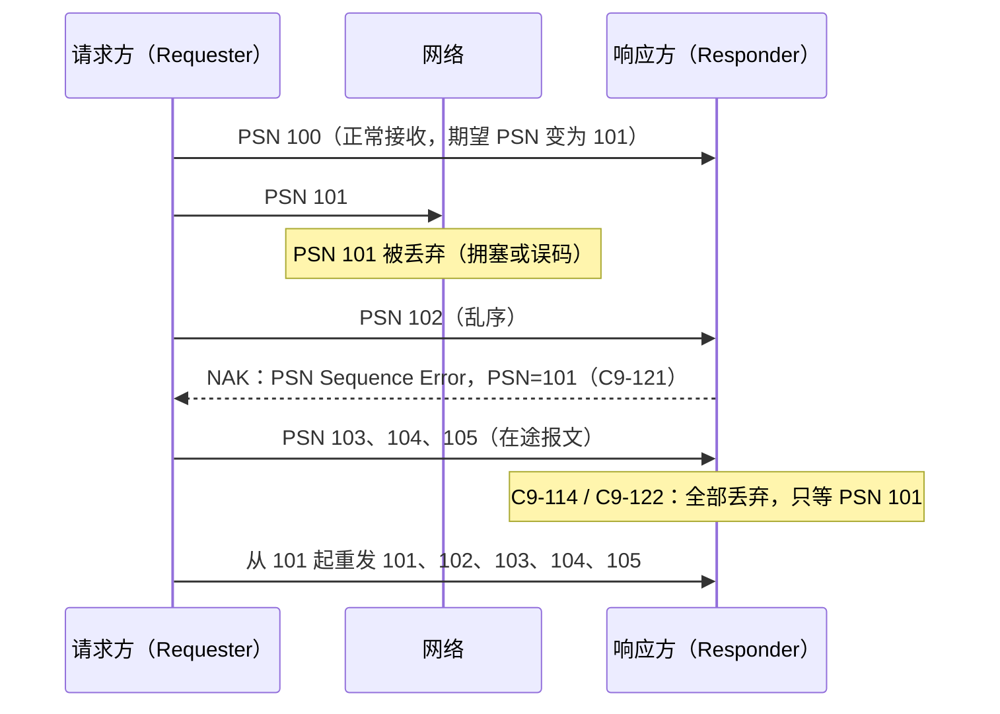
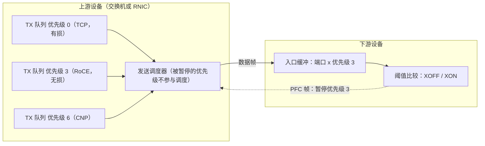
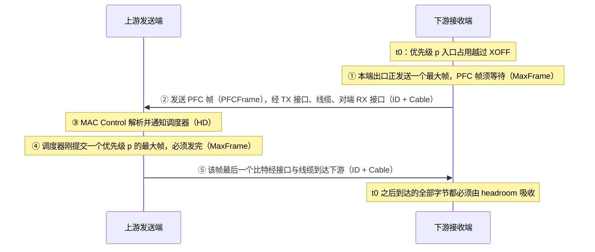
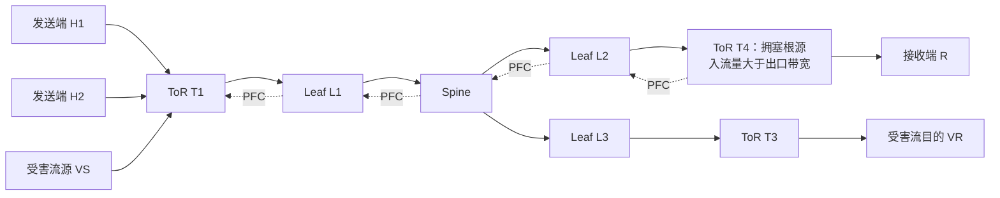
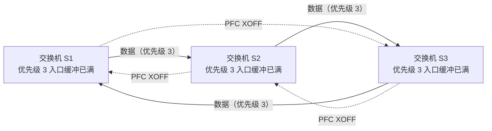

# 无损以太网与 PFC（Lossless Ethernet and Priority-based Flow Control）

> **摘要**：IBTA 规范建议把承载 RoCEv2 的网络配置为"无损"，最常用的手段是 IEEE 802.1Qbb 优先级流控（Priority-based Flow Control, PFC）。本文说明规范中"无损"的确切含义、RoCEv2 传输层（Go-back-N 式恢复）为何对丢包敏感，逐字段解析 PFC 帧，推导 XOFF/XON 阈值与 headroom（含 100GbE + 100 m 光纤算例），并梳理 PFC 的副作用（HOL 阻塞、拥塞扩散、PFC 风暴、PFC 死锁）及缓解手段。
>
> **规范出处**：Vol1 §A17.9.1（p.1946）；§A17.9.2（p.1946–1947）；§A17.4.2（p.1938）；§9.7.5.2.3（p.350）；§9.7.6.1.2（p.360）；C9-140/C9-141（§9.7.6.1.3, p.364）。PFC 本身由 IEEE 802.1Qbb 定义，不属于 IBTA 规范。
>
> **前置阅读**：[以太网/IP/UDP 头字段规则](../01-packet-format/02-ethernet-ip-udp.md)、[PSN 与 ACK/NAK](../02-transport/05-psn-and-ack-nak.md)、[请求方行为](../02-transport/06-requester.md)
>
> **关键词**：Lossless、PFC、802.1Qbb、802.3x PAUSE、pause quanta、XOFF/XON、Headroom、HOL、拥塞扩散、PFC 风暴、PFC 死锁、PFC Watchdog

---

## 1. 为什么 RoCEv2 需要（或偏好）无损网络

### 1.1 规范怎么说（§A17.9.1 意译）

| 要点 | 规范表述（意译） | 强度 |
|---|---|---|
| 网络应无损 | 与 RoCE（v1）一样，RoCEv2 的底层网络 *should* 配置为无损（lossless） | 建议 |
| "无损"的含义 | **不是**"报文绝对不会丢"；RoCEv2 传输层本身带有端到端可靠交付与重传逻辑，通常由硬件实现、无需软件介入 | 说明 |
| 无损的目的 | 防止 RoCEv2 报文因 fabric 中的**资源争用（contention）**而被丢弃 | 说明 |
| 实现手段 | 数据中心以太网通常靠链路层流控实现；IEEE 802.1Qbb 的按优先级流控"ideally suited"；也允许其它方法 | 建议 |
| 跨三层 | 跨越多个 L2 子网时，中间 L3 路由器 *should* 为 RoCEv2 报文生成一个"在即将注入的子网上已启用 802.1Qbb"的 L2 优先级，通常借助路由器常规的 CoS 映射配置完成 | 建议 |
| 共存流量 | 非 RoCEv2 流量（如 TCP）*should* 使用另一组可关闭链路层流控的优先级；设备通常按优先级分配独立队列与缓冲，从而把无损的 RoCEv2 与有损流量隔离 | 建议 |

〔Vol1 §A17.9.1, p.1946〕

> [!NOTE]
> §A17.9.1 与 §A17.9.2 中**没有任何 CA17-xx 合规条款**——"无损网络"是对网络部署的建议，而不是 HCA 的强制要求。HCA 侧与拥塞相关的强制条款只有 §A17.9.3 的 CA17-44…CA17-46，且仅在实现了可选的 RCM 时适用，见 [ECN 与 CNP](03-ecn-and-cnp.md)。

### 1.2 规范中的丢包恢复路径：等效于 Go-back-N

RoCEv2 完整沿用第 9 章 IB 传输层（CA17-25）。对 RC 而言，丢包后的规范行为是：

1. **响应方**发现 PSN 乱序（既不等于期望 PSN，也不在合法重复区间）时，返回 NAK（PSN Sequence Error），NAK 的 PSN 字段填入**自己期望的 PSN**（C9-121）〔Vol1 §9.7.5.2.3, p.350〕。
2. 此后响应方**丢弃所有不携带期望 PSN 的新请求**（合法重复请求除外），直到收到期望 PSN（C9-114, p.343；C9-122, p.350）。
3. **请求方**收到 NAK-Sequence Error 后，从 NAK 指示的 PSN 起"回退"并重发其后的全部请求；每次此类 NAK 使 3 bit 重试计数器减 1（C9-137）〔Vol1 §9.7.6.1.2, p.360〕。
4. 若丢失的是一串报文中的**最后一个**（后面没有报文来触发 NAK），只能等传输定时器超时：Ttr = 4.096 µs × 2^(Local ACK Timeout)（C9-140），实际检测时刻落在 Ttr～4·Ttr 之间（C9-141）〔Vol1 §9.7.6.1.3, p.364〕。



可见规范行为等价于经典的 **Go-back-N**：一次丢包会让"丢包点之后、NAK 返回之前"发出的所有报文全部作废重传。详见 [请求方行为](../02-transport/06-requester.md)、[响应方行为](../02-transport/07-responder.md) 与 [可靠性引擎](../06-hardware-implementation/04-reliability-engine.md)。

### 1.3 定量：Go-back-N 对丢包的放大效应

**(1) 在途窗口有多大？** 设链路 100 Gb/s、每包载荷约 4 KB，在途包数 W ≈ BDP / 包长：

| 往返时延 RTT | BDP（字节） | W（4 KB 报文数） |
|---|---|---|
| 5 µs（同机架） | 62,500 | ≈ 15 |
| 10 µs（跨 Spine） | 125,000 | ≈ 31 |
| 50 µs（含排队） | 625,000 | ≈ 153 |
| 100 µs（严重排队） | 1,250,000 | ≈ 305 |

**(2) 一阶模型**：每丢 1 个包约需重传 W 个包，有效吞吐 ≈ 1 / (1 + p·W)（p 为丢包率，忽略重传包再次丢失与超时）；选择性重传（Selective Repeat）约为 1 − p：

| W \ p | 1e-5 | 1e-4 | 1e-3 | 1e-2 |
|---|---|---|---|---|
| 16 | 100.0% | 99.8% | 98.4% | 86.2% |
| 64 | 99.9% | 99.4% | 94.0% | 61.0% |
| 256 | 99.7% | 97.5% | 79.6% | 28.1% |
| 选择性重传 | 100.0% | 99.99% | 99.90% | 99.00% |

注意拥塞丢包恰恰发生在排队严重、RTT 变大（W 变大）的时刻，放大效应会叠加。

**(3) 尾部丢包 → 超时**：不同 Local ACK Timeout 取值对应的 Ttr（按 C9-140 计算）：

| Local ACK Timeout | 10 | 12 | 14 | 16 | 18 | 20 |
|---|---|---|---|---|---|---|
| Ttr | 4.19 ms | 16.8 ms | 67.1 ms | 268 ms | 1.07 s | 4.29 s |

与微秒级的基础 RTT 相比，一次尾部丢包可把单个消息的完成时间放大 10³～10⁵ 倍。

**(4) 实测佐证**：DCQCN 论文在 ConnectX-3 Pro（go-back-N 恢复）上测得，丢包率超过 **0.1%** 后吞吐迅速下降，且消息越大影响越大〔论文: DCQCN, SIGCOMM 2015, §7〕。Guo 等在大规模部署中还报告过早期实现"从消息首包重传（go-back-0）"导致的活锁，后改为 go-back-N〔论文: Guo et al., RDMA over Commodity Ethernet at Scale, SIGCOMM 2016〕。

> [!TIP]
> 结论：RoCEv2 的硬件传输层是按"丢包罕见"设计的。无损网络的作用是消除**拥塞丢包**这一最主要的丢包来源；误码、链路抖动等非拥塞丢包仍会发生，仍要靠传输层重传兜底。若希望在有损网络上运行 RoCE，需要改进网卡的丢包恢复（如 IRN 的选择性重传），见 [其他拥塞控制与有损 RoCE](05-advanced-cc-and-lossy-roce.md)。

---

## 2. PFC 原理（IEEE 802.1Qbb）

### 2.1 基本思想

PFC 把以太网链路按 802.1Q 的 8 个优先级（Priority 0–7）划分为 8 条"虚拟通道"，**逐优先级、逐跳**地暂停发送〔外部: IEEE 802.1Qbb〕：

- 下游（接收端）按"入端口 × 优先级"统计缓冲占用；超过 XOFF 阈值时，向**直连上游**发送 PFC 帧，要求它暂停发送该优先级的帧；
- 上游只暂停被点名的优先级，其它优先级照常发送；
- PFC 帧是**链路本地**的 MAC Control 帧，使用保留组播地址，网桥不会转发它；
- 拥塞缓解（占用低于 XON 阈值）后，下游发送时间为 0 的 PFC 帧（俗称 XON）或等待暂停时间自然到期。



### 2.2 PFC 帧格式

PFC 帧是 EtherType 0x8808 的 MAC Control 帧，Opcode 为 0x0101，固定 64 字节（含 FCS），**不带 VLAN 标签**——被暂停的优先级由帧内的优先级使能向量指明，而不是由 PFC 帧自身的 PCP 指明〔外部: IEEE 802.1Qbb〕。

```text
      3   2                   1                   0
      1 0 9 8 7 6 5 4 3 2 1 0 9 8 7 6 5 4 3 2 1 0 9 8 7 6 5 4 3 2 1 0
     +-+-+-+-+-+-+-+-+-+-+-+-+-+-+-+-+-+-+-+-+-+-+-+-+-+-+-+-+-+-+-+-+
   0 |        Destination MAC = 01-80-C2-00-00-01 (bytes 0-3)        |
     +-+-+-+-+-+-+-+-+-+-+-+-+-+-+-+-+-+-+-+-+-+-+-+-+-+-+-+-+-+-+-+-+
   4 |     DA (bytes 4-5) = 00-01    |     Source MAC (bytes 0-1)    |
     +-+-+-+-+-+-+-+-+-+-+-+-+-+-+-+-+-+-+-+-+-+-+-+-+-+-+-+-+-+-+-+-+
   8 |                     Source MAC (bytes 2-5)                    |
     +-+-+-+-+-+-+-+-+-+-+-+-+-+-+-+-+-+-+-+-+-+-+-+-+-+-+-+-+-+-+-+-+
  12 |       EtherType = 0x8808      |        Opcode = 0x0101        |
     +-+-+-+-+-+-+-+-+-+-+-+-+-+-+-+-+-+-+-+-+-+-+-+-+-+-+-+-+-+-+-+-+
  16 |   Rsvd=0x00   |   e7 ... e0   |            time[0]            |
     +-+-+-+-+-+-+-+-+-+-+-+-+-+-+-+-+-+-+-+-+-+-+-+-+-+-+-+-+-+-+-+-+
  20 |            time[1]            |            time[2]            |
     +-+-+-+-+-+-+-+-+-+-+-+-+-+-+-+-+-+-+-+-+-+-+-+-+-+-+-+-+-+-+-+-+
  24 |            time[3]            |            time[4]            |
     +-+-+-+-+-+-+-+-+-+-+-+-+-+-+-+-+-+-+-+-+-+-+-+-+-+-+-+-+-+-+-+-+
  28 |            time[5]            |            time[6]            |
     +-+-+-+-+-+-+-+-+-+-+-+-+-+-+-+-+-+-+-+-+-+-+-+-+-+-+-+-+-+-+-+-+
  32 |            time[7]            |         Reserved / Pad        |
     +-+-+-+-+-+-+-+-+-+-+-+-+-+-+-+-+-+-+-+-+-+-+-+-+-+-+-+-+-+-+-+-+
  36 |              Reserved / Pad (bytes 36-59, all 0)              |
     +-+-+-+-+-+-+-+-+-+-+-+-+-+-+-+-+-+-+-+-+-+-+-+-+-+-+-+-+-+-+-+-+
  60 |                          FCS (CRC-32)                         |
     +-+-+-+-+-+-+-+-+-+-+-+-+-+-+-+-+-+-+-+-+-+-+-+-+-+-+-+-+-+-+-+-+
```

图中左侧数字为字节偏移；位号采用与 IBTA 规范一致的记法（每个 32 bit 字的最左位为 bit 31，即先发送字节的最高位），多字节字段按网络序（大端）排列。

| 字节偏移 | 宽度 | 字段 | 取值 / 含义 | 备注 |
|---|---|---|---|---|
| 0 | 6 B | Destination MAC | 01-80-C2-00-00-01 | 与 802.3x PAUSE 相同的保留组播地址，不被网桥转发 |
| 6 | 6 B | Source MAC | 发送端口 MAC | |
| 12 | 2 B | EtherType | 0x8808 | MAC Control |
| 14 | 2 B | Opcode | 0x0101 | PFC（802.3x PAUSE 为 0x0001） |
| 16 | 1 B | 保留 | 0x00 | 优先级使能向量的高字节 |
| 17 | 1 B | e[7:0] | bit n = 1 表示 time[n] 有效 | 最低位对应优先级 0 |
| 18 + 2n | 2 B ×8 | time[n] | 暂停时长，单位 pause quanta（512 bit 时间），0–65535 | e[n]=1 且 time[n]=0 即"立即恢复"（XON） |
| 34 | 26 B | 保留/填充 | 全 0 | 补齐最小帧长 |
| 60 | 4 B | FCS | 以太网 CRC-32 | |

帧长核算：6+6+2+2+2+16 = 34 B，加 26 B 填充与 4 B FCS 正好 64 B；在线路上再加 8 B 前导码/SFD 与 12 B 帧间隙，共占 84 B 的发送时间。

### 2.3 pause quanta 与最大暂停时间

1 quanta = 512 bit 时间，因此绝对时长随速率变化：

| 端口速率 | 1 quanta | 最大暂停（65535 quanta） |
|---|---|---|
| 10 Gb/s | 51.2 ns | 3.36 ms |
| 25 Gb/s | 20.48 ns | 1.34 ms |
| 40 Gb/s | 12.8 ns | 838.8 µs |
| 50 Gb/s | 10.24 ns | 671.1 µs |
| 100 Gb/s | 5.12 ns | 335.5 µs |
| 200 Gb/s | 2.56 ns | 167.8 µs |
| 400 Gb/s | 1.28 ns | 83.9 µs |
| 800 Gb/s | 0.64 ns | 41.9 µs |

〔业界实践〕许多设备在拥塞期间以最大 quanta 发送 XOFF、并在到期前周期性刷新，拥塞解除时再显式发送 time=0 的 XON；刷新周期与策略由实现决定，速率越高，最大暂停时间越短、刷新越频繁。

### 2.4 上游的反应

- 收到 e[n]=1 的 PFC 帧后，上游在 time[n] 个 quanta 内**不得开始发送**优先级 n 的新帧；已经开始发送的帧必须发完（以太网帧不可抢占）。
- 后续收到的 PFC 帧会**覆盖**该优先级的暂停计时（重新装载 time[n]；time[n]=0 则立即解除）。
- IEEE 802.3 的 MAC Control 附录（Annex 31B / 31D）对"收到 PAUSE/PFC 到停止发送"的最大反应时间按速率规定了上限〔外部: IEEE 802.3 Annex 31B/31D〕，这一时间是 headroom 计算中的一项（§3.2 的 HD/ID）。

### 2.5 PFC 与 802.3x 全局 PAUSE 对比

| 维度 | 802.3x PAUSE | 802.1Qbb PFC |
|---|---|---|
| 暂停粒度 | 整条链路（所有流量） | 8 个优先级独立 |
| Opcode | 0x0001 | 0x0101 |
| 时间字段 | 1 个 pause_time | 8 个 time[n] + 使能向量 |
| 目的 MAC / EtherType | 01-80-C2-00-00-01 / 0x8808 | 相同 |
| 对其它流量的影响 | 无差别阻塞（TCP 也被暂停） | 只阻塞同优先级流量 |
| 适用于 RoCEv2 | 不推荐（规范建议非 RoCE 流量走可关闭流控的优先级，全局 PAUSE 无法区分） | 规范点名推荐（§A17.9.1） |

> [!WARNING]
> 实践中同一端口不应同时启用 802.3x 全局 PAUSE 与 PFC（多数设备二者互斥）。主机侧常见陷阱是网卡默认开启了全局 PAUSE（例如 `ethtool -a` 显示 RX/TX pause on），而交换机配置的是 PFC，导致行为不可预期。

---

## 3. 缓冲区模型：XOFF / XON 阈值与 headroom

### 3.1 入口缓冲的三段式划分

PFC 的判决依据是**入口（ingress）**侧"端口 × 优先级（或优先级组 PG）"的缓冲占用：

```text
 Buffer occupancy (one ingress port, one lossless priority)             -->
 0                       XON              XOFF          XOFF+Headroom
 |-- normal queuing ------|- hysteresis ----|----- headroom ----------|
                          ^                 ^                         ^
                    below: XON        above: XOFF             beyond: drop
```

（图示：某入端口、某无损优先级的缓冲占用由左向右增长；normal queuing = 正常排队区，hysteresis = 滞回区，headroom = 余量区；低于 XON 发恢复、越过 XOFF 发暂停、超出 headroom 即丢包。）

- **XOFF**：越过即发送 PFC 暂停；
- **XON**：占用回落到此值以下才发送恢复（滞回避免振荡）；
- **Headroom**：XOFF 以上额外预留的空间，用来吸收"PFC 帧发出后、上游真正停发前"仍在途的数据。Headroom 不足时，"无损"优先级也会丢包。

### 3.2 Headroom 的构成（延迟模型）

IEEE 802.1 在制定 802.1Qbb 期间讨论的 PFC 延迟模型把所需保留缓冲（Delay Value, DV）表示为〔外部: IEEE 802.1 文稿 bb-gravel-pfc-delay-constraints-0109〕：

```text
DV = 2 × MaxFrame + PFCFrame + 2 × CableDelay + 2 × ID + HD
```

| 项 | 含义 |
|---|---|
| MaxFrame（第 1 个） | 下游决定发 PFC 时，其出口可能刚开始发送一个最大帧，PFC 帧只能排在其后 |
| PFCFrame | PFC 帧本身的发送时间（64 B + 前导码/IFG） |
| CableDelay ×2 | PFC 帧向上游传播一次；上游停发前最后一帧向下游传播一次 |
| ID ×2 | 接口时延（MAC Control、MAC/RS、PCS、PMA、PMD 等）；每站含收发两个方向，两站共两份 |
| HD | 上层时延：MAC Control 客户端到发送调度之间的实现相关流水线（缓存、MACsec 等） |
| MaxFrame（第 2 个） | 上游收到 PFC 时，调度器可能刚提交一个该优先级的最大帧，必须发完 |

整个过程中数据以线速持续到达，因此 headroom（字节）= 上述总时间 × 线速 / 8。



### 3.3 算例：100GbE、100 m 光纤

假设（**均为示例值**，实际以芯片、光模块与交换机手册为准）：最大帧 9216 B（巨帧）；光纤传播约 5 ns/m（纤芯折射率约 1.47，约 4.9 ns/m，取整）；每站接口时延 ID（收+发，含 RS-FEC）= 300 ns；上层时延 HD = 300 ns。100 Gb/s 下 1 ns = 12.5 B。

| 项 | 计算 | 时间 | 字节 |
|---|---|---|---|
| 2 × MaxFrame | 2 × (9216 + 20) B，20 B 为前导码/SFD + IFG | 2 × 738.9 ns | 18,472 |
| PFCFrame | 64 + 20 B | 6.72 ns | 84 |
| 2 × CableDelay | 2 × (100 m × 5 ns/m) | 1,000 ns | 12,500 |
| 2 × ID | 2 × 300 ns | 600 ns | 7,500 |
| HD | 300 ns | 300 ns | 3,750 |
| **合计** | | ≈ 3.38 µs | **42,306 B ≈ 41.3 KiB** |

对同一模型的几个变体（同样假设）：

| 场景 | Headroom |
|---|---|
| 正向最大帧改为 RoCE 4 KB 帧（4,198 B 含开销），反向仍为 9216 B 巨帧 | 37,268 B ≈ 36.4 KiB |
| 100GbE、3 m DAC 铜缆 | 30,181 B ≈ 29.5 KiB |
| 100GbE、2 km 光纤 | 279,806 B ≈ 273 KiB |
| 400GbE、100 m 光纤 | 113,556 B ≈ 111 KiB |

```python
def pfc_headroom_bytes(rate_gbps, cable_m, max_frame=9216, ns_per_m=5.0,
                       id_ns=300.0, hd_ns=300.0, fwd_frame=None):
    """按 2*MaxFrame + PFCFrame + 2*Cable + 2*ID + HD 估算 headroom（字节）。"""
    bytes_per_ns = rate_gbps / 8.0
    ovh = 20                                   # 前导码/SFD 8 B + IFG 12 B
    rev = max_frame + ovh                      # 阻塞 PFC 帧的反向最大帧
    fwd = (fwd_frame or max_frame) + ovh       # 上游必须发完的同优先级最大帧
    pfc = 64 + ovh
    t_ns = 2 * cable_m * ns_per_m + 2 * id_ns + hd_ns
    return rev + fwd + pfc + t_ns * bytes_per_ns

print(round(pfc_headroom_bytes(100, 100)))     # 42306
print(round(pfc_headroom_bytes(400, 100)))     # 113556
```

把它放大到整机：32 × 100G 端口、1 个无损优先级 ≈ 1.35 MB；2 个无损优先级 ≈ 2.7 MB；64 × 400G、1 个无损优先级 ≈ 7.3 MB。作为对照，DCQCN 论文中 40G、1500 B MTU 的 Trident II 交换机按厂商指南得到 t_flight = 22.4 KB/端口/优先级，整机 32 × 40G、12 MB 共享缓冲〔论文: DCQCN, SIGCOMM 2015, §4〕。

> [!TIP]
> - Headroom 与**线缆长度、速率、MTU、无损优先级数**成正比，这是"无损优先级不宜超过 1–2 个"的直接原因。
> - 〔业界实践〕许多交换机提供按端口速率与线缆长度自动计算 headroom 的功能，并支持"共享 headroom 池"（利用不是所有端口会同时暂停的统计复用）；具体能力以厂商文档为准。
> - 长距离（如跨楼、跨园区数 km）的无损链路 headroom 会急剧膨胀，通常不建议把 PFC 域延伸到长距链路。

### 3.4 XOFF 阈值：静态还是动态

DCQCN 论文给出了共享缓冲交换机上阈值选择的完整推导〔论文: DCQCN, SIGCOMM 2015, §4〕（B 为总缓冲，n 为端口数，按 8 个优先级都预留 headroom 的保守情形）：

- **静态 XOFF 上界**：t_PFC ≤ (B − 8n·t_flight) / (8n)；对 12 MB、32 端口得 24.47 KB；
- **动态 XOFF**：Trident II 允许 t_PFC = β·(B − 8n·t_flight − s) / 8，其中 s 为当前已占用的共享缓冲，β 越大越晚触发 PFC；
- **XON**：队列降到 t_PFC 以下"两个 MTU"时发送 RESUME。

动态阈值的一般原理（Dynamic Threshold, α 参数）见 [QoS：DSCP/PCP/ETS/DCBX](02-qos-dscp-pcp-ets.md) 第 6 节。

---

## 4. 跨三层的无损：基于 DSCP 的 PFC

### 4.1 规范建议的落地方式

§A17.9.1 建议（*should*）路由器把 RoCEv2 报文映射到"下一跳子网上启用了 PFC 的优先级"。经过三层转发后，原报文的以太网头（包括 VLAN 标签与 PCP）会被重写，PCP 无法端到端保留；而 IP 头中的 DSCP 端到端可见。因此业界普遍采用**基于 DSCP 的 PFC**（常被称为 L3 PFC）〔业界实践；论文: Guo et al., SIGCOMM 2016〕：

1. 每一跳设备"信任 DSCP"（trust DSCP），按 DSCP → 内部优先级 → 入口 PG / 出口队列分类；
2. PFC 帧仍是**逐链路**的 L2 帧，按"优先级"暂停；只要链路两端对同一 DSCP 映射出相同的优先级编号即可；
3. 服务器口与路由口都**不需要 VLAN 标签**。Guo 等在微软的部署中正是因为基于 VLAN 的 PFC 与 PXE 启动、三层化的服务器接入口配置冲突，才改用基于 DSCP 的 PFC。


### 4.2 主机侧同样要按 DSCP 分类

RNIC 既是 PFC 的**接收者**（被交换机暂停时要按优先级停发），也是 PFC 的**发送者**（自身接收缓冲将满时暂停 ToR）。因此网卡也必须工作在 DSCP trust 模式并配置一致的 DSCP→优先级映射，否则会出现"交换机暂停的是优先级 3，而网卡把 RoCE 放在优先级 0 发送"之类的错配。映射与 trust 配置见 [QoS：DSCP/PCP/ETS/DCBX](02-qos-dscp-pcp-ets.md)。

> [!WARNING]
> 只要路径上**任意一跳**把 RoCE 的 DSCP 映射到了有损队列（或重写了 DSCP），整条路径就不再无损——丢包会以 NAK/重传/超时的形式出现在端点上，排查时要逐跳核对映射。

---

## 5. PFC 的副作用

### 5.1 队头阻塞（HOL）与不公平

PFC 只认"端口 + 优先级"，不区分流。同一优先级上**与拥塞无关的流**也会被一起暂停。DCQCN 论文在 3 层 Clos（40G、Arista 7050QX32）上的测量〔论文: DCQCN, SIGCOMM 2015, §2.2〕：

- **不公平（parking lot）**：4 个发送端向同一接收端写数据，经由不同入端口汇聚；单独占一个入端口的 H4 可得到多达 20 Gb/s，其最小吞吐甚至高于其余发送端的最大吞吐；
- **受害流（victim flow）**：一条与拥塞点毫无共享链路的流，预期 20 Gb/s，实测只有 10 Gb/s；再增加两个发送端后进一步跌到 4.5 Gb/s——原因是 PAUSE 逐级向上游级联。

### 5.2 拥塞扩散（Congestion Spreading）



T4 的拥塞通过 PFC 逐跳反压到 T1；T1 上行口被暂停后，发往 VR 的受害流即使路径与 T4 无关，也会在同一优先级的队列里排队等待。IB 拥塞控制附录把这种现象称为"拥塞扩散"，并区分"根源（root）"与"受害者（victim）"，见 [IB 拥塞控制与 RoCEv2 对比](07-ib-cc-vs-rocev2-cc.md)。

### 5.3 PFC 风暴（PFC Storm）

网卡或交换机端口出现故障（例如接收流水线卡死）时，可能持续不断地发送 PAUSE。被暂停的上游缓冲逐渐填满，又向它的上游发 PAUSE，最终使大范围的无损流量停摆。Guo 等报告了网卡接收流水线故障引发的 PAUSE 风暴，并在网卡与交换机两侧都加入了看门狗〔论文: Guo et al., SIGCOMM 2016〕；DCQCN 论文也把"不停吐 PFC 的故障网卡/端口"列为需要防范的运维风险〔论文: DCQCN, SIGCOMM 2015, §7〕。

Guo 等还描述了一种"慢接收者症状（slow-receiver symptom）"：网卡因内存翻译表缓存不命中等原因处理变慢、持续向 ToR 发 PFC，并通过使用大页减少地址翻译表项来缓解。

### 5.4 PFC 死锁（Deadlock）

**必要条件**：无损流量之间形成**循环缓冲依赖（Cyclic Buffer Dependency, CBD）**——A 等 B 腾出缓冲、B 等 C、C 又等 A。一旦环上所有缓冲同时越过 XOFF 并互相暂停，即使所有主机停止发送，环内报文也永远无法前进〔论文: Hu et al., Deadlocks in Datacenter Networks, HotNets 2016〕。



典型诱因：

| 诱因 | 说明 |
|---|---|
| 路由环路 / 收敛过程中的瞬态环路 | 报文在环上来回，必然形成 CBD |
| 链路故障后的"绕行"路径 | Clos 中严格的 up-down 路由不存在 CBD，但故障后出现 down-up（谷形）路径时可能引入 CBD |
| 无损报文被泛洪 | Guo 等在 Clos 中遇到：ARP 表项存在而 MAC 表项缺失时，交换机泛洪无损报文，与 PFC 相互作用产生死锁；修复方法是对查不到 MAC 的无损报文直接丢弃而非泛洪 |

DCQCN 论文认为，在服务器只接 ToR、流量不穿越其它服务器的 Clos 中，若设备工作正常，不会出现 CBD〔论文: DCQCN, SIGCOMM 2015, §7〕——死锁通常源于**故障或误配置**。

### 5.5 缓解措施汇总

| 措施 | 原理 | 来源 |
|---|---|---|
| PFC Watchdog（交换机） | 检测某无损队列持续处于暂停状态超过 detection_time，就丢弃该队列报文（drop）或忽略 PFC（forward）；restoration_time 内不再收到 PFC 则恢复。两个时间都在"百毫秒"量级 | 〔业界实践: SONiC PFC Watchdog HLD〕 |
| 网卡侧看门狗 | 网卡接收流水线长时间停滞时停止发送 PFC，避免把风暴扩散到网络 | 〔论文: Guo et al., SIGCOMM 2016〕 |
| 无环路由 | Clos 坚持 up-down 路由，故障时避免谷形路径；控制面收敛期间防止瞬态环路 | 〔论文: Hu et al., HotNets 2016〕 |
| 死锁预防机制 | 例如 Tagger：按"异常路径"给报文打标签并切换到不同的无损优先级，打破 CBD | 〔论文: Tagger, CoNEXT 2017〕 |
| 不泛洪无损报文 | MAC 查表失败的无损报文直接丢弃 | 〔论文: Guo et al., SIGCOMM 2016〕 |
| 限制无损优先级数 | 1–2 个无损优先级即可；更多优先级成倍消耗 headroom | 〔业界实践〕 |
| **ECN 先于 PFC 触发** | 让端到端拥塞控制先起作用，PFC 只作为最后防线 | 〔论文: DCQCN, SIGCOMM 2015, §4〕 |
| 降低对 PFC 的依赖 | 端到端拥塞控制（DCQCN、HPCC 等）或有损 RoCE（IRN 类选择性重传） | 见 [04-dcqcn.md](04-dcqcn.md)、[05-advanced-cc-and-lossy-roce.md](05-advanced-cc-and-lossy-roce.md) |

**ECN 先于 PFC 的阈值原则**：ECN 在**出口队列**判决，PFC 在**入口**判决。最坏情形是所有出口队列的积压都来自同一个入口队列，此时必须保证该入口越过 XOFF 之前，出口已开始 ECN 标记。DCQCN 论文据此推导：在动态 XOFF（参数 β）下应满足

```text
t_ECN < β·(B − 8n·t_flight) / (8n·(β + 1))
```

在其 Trident II 测试床（β = 8）上得到 t_ECN < 21.75 KB；若改用静态 XOFF 上界（24.47 KB），则要求 t_ECN < 0.85 KB——小于一个 MTU，不可行〔论文: DCQCN, SIGCOMM 2015, §4〕。工程上的简化表述是：**ECN 的 Kmin 必须明显低于 PFC 的 XOFF（按同一队列口径折算）**，否则 PFC 会抢在 ECN 之前生效，端到端拥塞控制形同虚设。ECN 标记参数见 [ECN 与 CNP](03-ecn-and-cnp.md)。

---

## 6. 「硬件实现要点」：RNIC 侧的 PFC

RNIC 在 PFC 中扮演两个角色，FPGA/ASIC 实现时需要分别考虑：

**(a) 作为 PFC 接收者（TX 方向被暂停）**

- 每个优先级一个 16 bit 暂停计数器，以 quanta 为单位递减（100GbE 下每 5.12 ns 一个 quanta）；收到新的 PFC 帧时按 e[n] 重新装载 time[n]，time[n]=0 立即清零；
- 暂停只能在**帧边界**生效：调度器在挑选下一帧时屏蔽被暂停的优先级，正在发送的帧不受影响；
- 反应时延（PFC 帧最后一比特到调度器停发）计入对端的 headroom 预算，必须有确定的上界；
- RoCE 数据、ACK/NAK、CNP 若映射到不同优先级，应使用**独立的发送队列**，避免 CNP 被数据优先级的暂停卡住（否则拥塞控制环路本身会停摆）。

```verilog
// SystemVerilog 风格示意：8 个优先级的 PFC 暂停计时器
// quanta_tick：每 512 bit 时间产生一次的节拍（100GbE 下周期 5.12 ns）
logic [15:0] pause_cnt [8];
always_ff @(posedge clk) begin
  for (int p = 0; p < 8; p++) begin
    if (rx_pfc_valid && rx_pfc_cev[p])
      pause_cnt[p] <= rx_pfc_time[p];          // 新 PFC 帧覆盖计时；time=0 即 XON
    else if (quanta_tick && pause_cnt[p] != 16'd0)
      pause_cnt[p] <= pause_cnt[p] - 16'd1;
  end
end
// 送给发送调度器的暂停掩码：调度器只在帧边界采样
always_comb for (int p = 0; p < 8; p++) prio_paused[p] = (pause_cnt[p] != 16'd0);
```

**(b) 作为 PFC 发送者（RX 方向缓冲将满）**

- 按优先级统计接收缓冲（片上 RX FIFO / 包缓冲）占用，配置 XOFF/XON 与网卡侧 headroom（网卡到 ToR 的线缆短，但要计入 PCIe 写回的突发停顿）；
- 接收处理变慢的常见原因：PCIe 反压、地址翻译缓存不命中、接收 WQE 预取不及时——这些都会把主机侧的问题"放大"为网络里的 PFC；
- 必须有**看门狗**：接收流水线长时间不前进时停止发 PFC 并上报，避免 PFC 风暴；
- 计数器：每优先级收/发 PFC 帧数、累计暂停时长、"无损优先级上的丢包"——它们是排障的第一手依据。

**(c) MAC 层**

- 解析：EtherType 0x8808 且 Opcode 0x0101 → PFC；Opcode 0x0001 → 802.3x PAUSE（若启用 PFC 应忽略或按配置处理）；PFC 帧在 MAC Control 层终结，不应上送 RoCE 接收流水线；
- 生成：PFC 帧由 MAC Control 层插入在两帧之间，优先于普通数据帧；
- 〔业界实践〕商用高速以太网 MAC IP 通常内置 802.1Qbb 帧的生成与解析接口，FPGA 设计应优先复用，具体以所用 IP 手册为准。更多数据通路细节见 [发送数据通路](../06-hardware-implementation/02-tx-datapath.md)、[接收数据通路](../06-hardware-implementation/03-rx-datapath.md)。

---

## 7. 「工程提示」

- **端到端一致**：所有网卡与交换机端口在**同一个**优先级（例如 3）上启用 PFC，其余优先级关闭；DSCP→优先级映射逐跳一致。
- **主机命令示例**〔业界实践: Linux iproute2 `dcb`，以所用版本 man page 为准〕：
  ```bash
  dcb pfc set dev eth0 prio-pfc all:off 3:on     # 只在优先级 3 上启用 PFC
  dcb -s pfc show dev eth0                       # 查看 PFC 配置及收发 PFC 帧计数
  ethtool -a eth0                                # 确认 802.3x 全局 PAUSE 已关闭
  ```
- **headroom**：交换机上正确配置线缆长度与端口速率，让设备自动计算 headroom；变更 MTU 后重新核算。
- **监控**：持续采集每优先级 PFC 收发计数与暂停时长、无损队列丢包、Watchdog 触发事件；PFC 计数持续增长通常意味着端到端拥塞控制没有起作用或阈值配置错误。
- **Watchdog 必开**：并把触发事件接入告警。
- 完整配置流程见 [主机与交换机配置指南](../07-engineering-practice/02-configuration-guide.md)，排障见 [排障指南](../07-engineering-practice/05-troubleshooting.md)。

---

## 8. 要点回顾

- §A17.9.1 只是**建议**网络无损（无 CA17 条款）；"无损"指消除拥塞丢包，而非绝不丢包。
- RoCEv2 沿用 IB 传输层，丢包恢复等效于 Go-back-N：响应方丢弃乱序报文（C9-114/C9-122），请求方从 NAK 指示的 PSN 起全部重发；尾部丢包只能等 Ttr 超时（C9-140）。
- Go-back-N 的代价约为每次丢包重传一个在途窗口；丢包率超过约 0.1% 时吞吐迅速恶化（DCQCN 实测）。
- PFC 帧：DA 01-80-C2-00-00-01、EtherType 0x8808、Opcode 0x0101、8 bit 使能向量 + 8 个 16 bit 时间字段，单位 512 bit 时间，固定 64 B、不带 VLAN。
- Headroom ≈ 2·MaxFrame + PFCFrame + 2·线缆时延 + 2·接口时延 + 上层时延；100GbE/100 m 光纤示例约 41 KiB/端口/无损优先级。
- 跨三层用基于 DSCP 的 PFC：每跳 trust DSCP，PFC 帧仍逐链路按优先级生效。
- PFC 的副作用：HOL、拥塞扩散、PFC 风暴、死锁（CBD）；缓解靠 Watchdog、无环路由、少量无损优先级、ECN 先于 PFC。

---

## 自测

<details><summary>Q1：规范说 RoCEv2 网络应"无损"，是否意味着 RoCEv2 网卡可以不实现重传？</summary>

答：不可以。§A17.9.1 明确"无损不等于绝不丢包"，传输层本身包含端到端可靠交付与重传逻辑；无损网络只是为了防止**拥塞**导致的丢包。RoCEv2 必须遵循第 9 章传输层（CA17-25），RC 的 PSN/ACK/NAK/超时重传机制全部保留。
</details>

<details><summary>Q2：100GbE 链路收到一个 time[3] = 0xFFFF、e[3] = 1 的 PFC 帧，上游最多暂停优先级 3 多久？收到 time[3] = 0 的帧又如何？</summary>

答：65535 × 512 bit ÷ 100 Gb/s ≈ 335.5 µs；期间若收到新 PFC 帧会重新装载计时。收到 e[3] = 1 且 time[3] = 0 的帧表示立即恢复（XON）。
</details>

<details><summary>Q3：为什么 headroom 公式里有两个 MaxFrame？</summary>

答：第一个是下游决定发 PFC 时，其出口可能正在发送一个最大帧，PFC 帧必须等它发完；第二个是上游收到 PFC 时，调度器可能刚提交一个该优先级的最大帧，以太网帧不可抢占，必须发完。两段时间内数据都在以线速流入下游。
</details>

<details><summary>Q4：为什么跨三层部署时更推荐基于 DSCP 而不是基于 PCP 的 PFC？</summary>

答：PCP 位于 VLAN 标签中，三层转发会重写以太网头，PCP 无法端到端保留，而且要求服务器口与路由口都带 VLAN 标签；DSCP 位于 IP 头，端到端可见、无需 VLAN。每跳设备 trust DSCP 并映射到同一优先级即可，PFC 帧仍逐链路按优先级生效。
</details>

<details><summary>Q5：一个由三台交换机组成的环路上，所有主机都已停止发送，为什么无损流量仍可能永远卡住？如何预防？</summary>

答：这是 PFC 死锁：环上的无损缓冲形成循环依赖，每个缓冲都已越过 XOFF 并暂停其上游，而上游又在等下游腾出空间，环内报文无法前进。预防：坚持无环（up-down）路由、避免故障后的谷形路径与泛洪无损报文、采用 Tagger 类机制；兜底：启用 PFC Watchdog 打破僵局。
</details>

---

## 参考

- 规范：Vol1 §A17.9.1–A17.9.2（p.1946–1947）；§A17.4.2（p.1938）；§9.7.5.2.3（p.350，C9-121/C9-122）；C9-114（p.343）；§9.7.6.1.2（p.360，C9-137）；C9-140/C9-141（p.364）；Annex A10 §A10.1.2（p.1799–1801，拥塞扩散概念）。
- 外部：IEEE 802.1Qbb（Priority-based Flow Control）；IEEE 802.3 Annex 31B/31D（PAUSE / PFC MAC Control 操作）；IEEE 802.1 文稿 bb-gravel-pfc-delay-constraints-0109（PFC Delay Value Constraint Model）。
- 论文：Zhu et al., "Congestion Control for Large-Scale RDMA Deployments"（DCQCN），SIGCOMM 2015；Guo et al., "RDMA over Commodity Ethernet at Scale"，SIGCOMM 2016；Hu et al., "Deadlocks in Datacenter Networks: Why Do They Form, and How to Avoid Them"，HotNets 2016；Hu et al., "Tagger: Practical PFC Deadlock Prevention in Data Center Networks"，CoNEXT 2017。
- 业界实践：SONiC PFC Watchdog 设计文档（sonic-net/SONiC wiki "PFC Watchdog Design"）；Linux iproute2 `dcb-pfc(8)`。
- 相关文件：[QoS：DSCP/PCP/ETS/DCBX](02-qos-dscp-pcp-ets.md)、[ECN 与 CNP](03-ecn-and-cnp.md)、[DCQCN](04-dcqcn.md)、[其他拥塞控制与有损 RoCE](05-advanced-cc-and-lossy-roce.md)。
