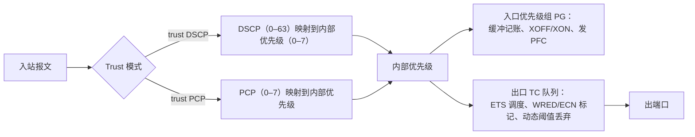

# QoS：DSCP / PCP / ETS / DCBX（RoCEv2 QoS: DSCP, PCP, ETS and DCBX）

> **摘要**：RoCEv2 的服务质量（QoS）完全复用以太网/IP 机制：报文由地址向量（AV）中的 SL（→ 以太网优先级 PCP）与 Traffic Class（→ DSCP）标识；网络按 DSCP 或 PCP 把报文分到优先级与队列，用 ETS 分配带宽、用 PFC 为个别优先级提供无损、用 DCBX 在链路两端交换配置。本文梳理规范要求、trust 模式选择、ETS 与 DCBX 细节、业界常见部署模板以及交换机缓冲区划分。
>
> **规范出处**：Vol1 §A17.9.2（p.1946–1947）；§A17.4.2（p.1937–1938）；CA17-4/CA17-5（§A17.3.1.1.2–A17.3.1.1.3, p.1932）；CA17-13/CA17-14（§A17.3.1.2.1–A17.3.1.2.2, p.1933–1934）；§A17.5.3–A17.5.4（p.1941）；§A17.4.9（p.1940）；§A16.7.5、§A16.8.1（p.1919–1920）；Annex A13 §A13.3（p.1864–1868）
>
> **前置阅读**：[无损以太网与 PFC](01-lossless-ethernet-pfc.md)、[RoCEv2 寻址](../00-overview/04-addressing.md)、[以太网/IP/UDP 头字段规则](../01-packet-format/02-ethernet-ip-udp.md)
>
> **关键词**：SL、PCP、Traffic Class、DSCP、Trust 模式、ETS、TSA、DCBX、LLDP、APP TLV、共享缓冲、动态阈值（α）

---

## 1. 规范视角：RoCEv2 的 QoS 由什么决定

### 1.1 §A17.9.2：与普通 IP 流量无异

§A17.9.2 的要点（意译）〔Vol1 §A17.9.2, p.1946–1947〕：

- RoCEv2 可以利用 IP/以太网的 L3/L2 QoS；由于 RDMA 的典型诉求是低时延、高带宽，在与 TCP/UDP 共享网络的"融合"环境中 QoS 尤其重要；
- 在这方面 **RoCEv2 与其它 IP 流没有区别**：通过正确配置 fabric 中的机制（例如 IEEE 802.1Qaz 的 ETS）获得 QoS；
- 报文/流的识别遵循 IP/以太网的标准做法（DSCP / 802.1Q），由 AV 中的 **Traffic Class** 参数控制。

§A17.9.3 还指出：只要 RoCEv2 与其它流量使用不同的优先级集合、且每组优先级都有带宽分配（脚注 64 注明可用"IEEE 802.1Qaz ETS or similar mechanisms"），两者的拥塞及拥塞反应就不应互相影响〔Vol1 §A17.9.3, p.1947〕。

### 1.2 报文中的 QoS 标识与其来源

| 标识 | 来源（AV 分量） | 报文位置 | 规范依据 |
|---|---|---|---|
| 以太网优先级（PCP，3 bit） | SL：SL 0–7 直接映射为优先级 0–7，SL 8–15 保留 | 802.1Q 标签 | §A17.4.2, p.1938 |
| DSCP（6 bit） | Traffic Class | IPv4 TOS / IPv6 Traffic Class 字节高 6 位 | CA17-4（IPv4, p.1932）、CA17-13（IPv6, p.1933） |
| ECN（2 bit） | 由是否支持 RCM 决定 | 同一字节低 2 位 | CA17-5（p.1932）、CA17-14（p.1934） |

- Verbs 层：对 RoCEv2 端口使用保留 SL（8–15）创建/修改 AH 或 QP 时，*可能*返回 Invalid Address Vector〔Vol1 §A17.5.3–A17.5.4, p.1941〕；RoCE v1 对应的条款 CA16-18 则是强制返回〔Vol1 §A16.8.1, p.1920〕。
- 规范只规定"SL 决定以太网优先级"，并未强制帧上一定携带 VLAN 标签。〔业界实践: Linux mlx5〕驱动把 `sl & 0x7` 写入 QP 路径的 `eth_prio`；NVIDIA 文档说明带 VLAN 标签的帧其 PCP 取 SL 的低 3 位。不带标签时，这个优先级只在网卡内部用于选择发送队列、ETS 类与 PFC 暂停对象。

```text
  IPv4 TOS 字节 / IPv6 Traffic Class 字段（8 bit）
    7   6   5   4   3   2   1   0
  +---+---+---+---+---+---+---+---+
  |         DSCP          |  ECN  |
  +---+---+---+---+---+---+---+---+
  例：Traffic Class = 106 = 0b011010_10 → DSCP = 26（AF31），ECN = 10（ECT(0)）
```

> [!NOTE]
> AV 的 Traffic Class 沿袭自 IB GRH 的 8 bit TClass，而 CA17-4/CA17-13 写的是"DSCP 字段 = Traffic Class"。〔业界实践: Linux rxe、librdmacm〕软件实现把 8 bit Traffic Class **整体**写入 IPv4 TOS / IPv6 Traffic Class 字节（即 DSCP = TC >> 2，ECN = TC & 3）；librdmacm 的 `RDMA_OPTION_ID_TOS` 选项也按 RFC 2474 的 8 bit TOS 解释。因此常见配置"TOS = 106"的含义是 DSCP 26 + ECT(0)。硬件网卡在启用拥塞控制时如何设置 ECN 位，以具体实现为准。

### 1.3 IB QoS（Annex A13）为何不适用

§A17.4.9 指出 Annex A13 的 QoS 管理建立在 IB 链路层能力之上，不适用于 RoCEv2 端口；即使 CA 的 IB 端口声明符合 A13，其 RoCEv2 端口也不需要支持相关属性与计数器〔Vol1 §A17.4.9, p.1940〕。RoCE v1 附录说得更具体：A13 依赖 VL、VL 仲裁、SL→VL 映射，依赖 PortXmitData(VL)、PortRcvData(SL)、PortXmitQueue(VL) 等 IB 性能计数器，且 QoS Manager 与 SA 的 PathRecord 查询紧耦合，这些在以太网中都不存在〔Vol1 §A16.7.5, p.1919〕。

有意思的是，A13 的 QoSClass 在类型为"DiffServ Compatible"时，把 QoSClass.Priority 解释为 RFC 2474 的 DS 字段〔Vol1 §A13.3.1, p.1864〕——IB 的 QoS 框架在概念上早已与 DiffServ 对齐。

| 方面 | InfiniBand（含 Annex A13） | RoCEv2 |
|---|---|---|
| 服务等级标识 | SL（4 bit，位于 LRH） | SL → PCP（3 bit）；Traffic Class → DSCP（6 bit） |
| 逐跳资源 | 虚拟通道 VL，SL→VL 映射表 | 优先级 / TC 队列，DSCP 或 PCP → 优先级 → TC |
| 链路调度 | VL 仲裁表 | ETS（严格优先级、ETS 加权、CBS 等） |
| 无损机制 | 每 VL 基于信用的链路层流控（必备） | 每优先级 PFC（可选，按需启用） |
| 配置主体 | 子网管理器（SM）下发；QoS Manager 过滤 PathRecord | 交换机本地配置、DCBX、网络自动化系统 |
| QoS 意图来源 | PathRecord 请求中的 QoSClass | 应用/中间件设置的 Traffic Class（TOS） |

---

## 2. 两种分类方式：PCP Trust 与 DSCP Trust

"Trust 模式"指设备依据报文中哪个字段决定其内部优先级：

- **PCP trust**：用 802.1Q 标签中的 PCP；不带标签的帧落到端口默认优先级；
- **DSCP trust**：用 IP 头中的 DSCP，经 64→8 的映射表得到优先级；
- 部分设备支持多个选择符并规定优先顺序〔业界实践: Linux `dcb apptrust`〕。

| 维度 | PCP trust | DSCP trust |
|---|---|---|
| 是否依赖 VLAN 标签 | 是 | 否 |
| 跨三层是否保留 | 否（路由会重写以太网头） | 是（除非被策略重写） |
| 取值空间 | 8 | 64 |
| 服务器接入口形态 | 需 tagged/trunk | access 或三层路由口均可 |
| 与 PXE 等无标签启动流程 | 冲突 | 无影响 |
| 典型适用 | 纯二层、RoCE v1 | 三层 Clos 上的 RoCEv2（主流推荐） |

Guo 等在微软的大规模部署中由基于 VLAN（PCP）的 PFC 迁移到基于 DSCP 的 PFC，主要动机正是 VLAN 标签与 PXE 启动、三层化接入设计之间的冲突〔论文: Guo et al., SIGCOMM 2016〕。

**主机侧配置示例**（〔业界实践〕，命令与行为以所用版本文档为准）：

```bash
# Linux iproute2 dcb：信任 DSCP，并建立 DSCP→优先级映射
dcb apptrust set dev eth0 order dscp
dcb app add dev eth0 dscp-prio 26:3 48:6
dcb app show dev eth0 dscp-prio

# RoCEv2 连接的 Traffic Class（rdma_cm 默认值，经 configfs 设置）
mkdir -p /sys/kernel/config/rdma_cm/mlx5_0
echo 106 > /sys/kernel/config/rdma_cm/mlx5_0/ports/1/default_roce_tos
```

- 〔业界实践: Linux mlx5e `en_dcbnl.c`〕通过 dcbnl 添加第一条 DSCP 选择符的 APP 表项时，驱动会把网卡切换到 DSCP trust；删除全部 DSCP 表项后切回 PCP trust。
- 〔业界实践: NVIDIA〕MLNX_OFED/DOCA 附带的 `mlnx_qos` 工具也提供 `--trust dscp`、`--pfc` 等选项，具体语法以其文档为准。
- 应用层：librdmacm 用 `rdma_set_option(id, RDMA_OPTION_ID, RDMA_OPTION_ID_TOS, &tos, sizeof(tos))` 为单个连接设置 TOS；直接使用 Verbs 时在 INIT→RTR 的 `ah_attr.grh.traffic_class` 与 `ah_attr.sl` 中设置；〔业界实践: NCCL 文档〕NCCL 通过 `NCCL_IB_TC`、`NCCL_IB_SL` 设置数据流量的 Traffic Class 与 SL，并可用 `NCCL_IB_FIFO_TC` 让短小的控制消息使用高优先级的 Traffic Class。编程细节见 [Verbs 与编程](../03-verbs-and-resources/05-verbs-roce-specifics-and-programming.md)。

---

## 3. 映射链：DSCP → 优先级 → PG / TC → 队列

交换机对一个入站报文的 QoS 处理可以抽象为两条并行的映射：入口侧决定**缓冲记账与 PFC**，出口侧决定**调度、ECN 标记与丢弃**。



〔业界实践〕一个典型的映射表（各厂商对"内部优先级 / switch priority / traffic class / local priority / PG / queue"等术语叫法不一，以所用设备为准）：

| DSCP | 优先级 | TC / 队列 | 承载流量 | PFC | ECN 标记 | 调度 |
|---|---|---|---|---|---|---|
| 26（AF31） | 3 | TC3 | RoCEv2 数据、ACK/NAK | 开 | 开（WRED-ECN） | ETS，例如 50% |
| 48（CS6） | 6 | TC6 | CNP | 关 | 关 | 严格优先级 |
| 0 及其它 | 0 | TC0 | TCP 等普通流量 | 关 | 可开（如 DCTCP） | ETS，例如 50% |

> [!TIP]
> DSCP 26 与 48 的高 3 位恰好是 3 与 6，和优先级编号一致，便于记忆与核对；但各设备的**默认** DSCP→优先级映射并不统一，务必显式配置。

---

## 4. ETS（IEEE 802.1Qaz）

### 4.1 核心概念

〔外部: IEEE 802.1Qaz〕ETS（Enhanced Transmission Selection）定义了出端口上的带宽分配模型：

- 最多 8 个流量类（Traffic Class, TC）；一张**优先级→TC 分配表**把 8 个优先级映射到 TC；
- 每个 TC 选择一种**传输选择算法（TSA）**：0 = 严格优先级（Strict Priority），1 = 基于信用的整形器（Credit-Based Shaper），2 = ETS，255 = 厂商自定义（编码见 Linux `dcbnl.h`、openlldp `lldp_8021qaz.h`）；
- TSA 为 ETS 的各 TC 分配整数百分比带宽，总和为 100%；某个 TC 空闲时，其份额按比例分给其它 ETS TC（work-conserving）；
- 严格优先级 TC 先于 ETS TC 服务；Linux `dcb-ets(8)` 的语义是"TC 号越大优先级越高"。

### 4.2 与 PFC 的配合

被 PFC 暂停的 TC 暂时失去发送资格，ETS 只在仍有资格的 TC 之间按权重分配。因此"RoCE TC 被暂停时 TCP 可以临时用满链路"是正常现象；反过来，严格优先级 TC 若承载大流量会饿死其它 TC——严格优先级只应留给 CNP、网络控制等低速率流量，必要时配合最大速率整形。

### 4.3 算例（100G 出端口）

配置：TC6 严格优先级（CNP，约 0.1 Gb/s）；TC3 = ETS 50%；TC0 = ETS 50%。

| 场景 | TC3（RoCE）所得 | TC0（TCP）所得 |
|---|---|---|
| 两类都持续积压 | ≈ 49.95 Gb/s | ≈ 49.95 Gb/s |
| TCP 需求只有 10 Gb/s | ≈ 89.9 Gb/s | 10 Gb/s |
| RoCE TC 被下游 PFC 暂停 | 0 | ≈ 99.9 Gb/s |

```bash
# 〔业界实践: Linux iproute2 dcb-ets(8)〕优先级 3→TC3、6→TC6，其余→TC0；TC6 严格优先级，TC0/TC3 各 50%
dcb ets set dev eth0 prio-tc all:0 3:3 6:6 tc-tsa all:ets 6:strict tc-bw all:0 0:50 3:50
dcb ets show dev eth0
```

### 4.4 「硬件实现要点」：网卡侧的 ETS 调度

下面是一个可编译的 C 示意（已用 gcc 编译并验证：两个 ETS TC 在帧长不同时仍按字节 1:1 分配，被暂停的 TC 不参与调度）。硬件中 TC 数量固定为 8，可用并行比较 + 优先级编码器实现严格优先级，用每 TC 一个赤字计数器实现 DWRR：

```c
#include <stdint.h>
#include <stdbool.h>

#define NTC 8
enum tsa { TSA_STRICT = 0, TSA_CBS = 1, TSA_ETS = 2 };

struct tc_state {
    enum tsa tsa;
    uint32_t quantum;   /* DWRR 每轮额度（字节），与带宽百分比成正比，且应 >= 最大帧长 */
    int32_t  deficit;   /* 赤字计数器（字节） */
    bool     paused;    /* 来自 PFC 的暂停掩码 */
    uint32_t head_len;  /* 队首帧长（字节），0 表示队列为空 */
};

/* 返回本次被选中发送的 TC；-1 表示无可发送帧。rr 为 DWRR 轮转指针。 */
int ets_select(struct tc_state tc[NTC], int *rr)
{
    for (int t = NTC - 1; t >= 0; t--)            /* 1) 严格优先级：TC 号大者优先 */
        if (tc[t].tsa == TSA_STRICT && !tc[t].paused && tc[t].head_len)
            return t;

    for (int n = 0; n < 2 * NTC; n++) {           /* 2) ETS：DWRR，最多扫描两轮 */
        int t = *rr;
        struct tc_state *q = &tc[t];
        if (q->tsa == TSA_ETS && !q->paused && q->head_len) {
            if (q->deficit >= (int32_t)q->head_len) {
                q->deficit -= (int32_t)q->head_len;   /* 额度够：发送并留在本 TC */
                return t;
            }
            q->deficit += (int32_t)q->quantum;        /* 额度不足：补充额度后轮到下一个 TC */
        } else {
            q->deficit = 0;                           /* 空队列或被暂停：不累积额度 */
        }
        *rr = (t + 1) % NTC;
    }
    return -1;
}
```

其它网卡侧要点：

- **QP → TC**：在 Modify QP（INIT→RTR）时由 AV 的 SL（PCP trust）或 Traffic Class 经 DSCP→优先级表（DSCP trust）算出优先级，缓存在 QP 上下文中，避免每包查表；
- **DSCP→优先级表**：64 项 × 3 bit = 192 bit，可直接用寄存器实现；收发方向共用；
- **接收方向**同样要按 PCP/DSCP 把帧分到各优先级的接收缓冲，才能按优先级产生 PFC；
- **CNP** 走独立队列与可配置的 DSCP/PCP（见 [ECN 与 CNP](03-ecn-and-cnp.md)），不应排在数据队列后面；
- 每优先级的收发字节/包计数、PFC 计数是调试 QoS 问题的基础。发送调度的整体结构见 [发送数据通路](../06-hardware-implementation/02-tx-datapath.md)。

---

## 5. DCBX：在链路两端交换 DCB 配置

### 5.1 作用与 Willing 语义

DCBX（Data Center Bridging eXchange）借助 LLDP（IEEE 802.1AB）在直连设备之间通告 PFC、ETS 与应用优先级（APP）配置，用于发现能力、检测不一致，并允许一端"愿意（Willing）"接受另一端的配置〔外部: IEEE 802.1Qaz〕。常见做法是交换机不 Willing（作为权威配置源）、主机网卡 Willing；或者两端都静态配置并关闭 DCBX 的自动接受〔业界实践〕。

### 5.2 IEEE 802.1Qaz 的 DCBX TLV

均为组织专用 TLV，OUI = 00-80-C2（IEEE 802.1）〔外部: IEEE 802.1Qaz；openlldp `lldp_8021qaz.h`〕：

| 子类型 | TLV | 主要字段 |
|---|---|---|
| 9 | ETS Configuration | Willing、CBS、Max TCs；优先级分配表（8 × 4 bit）；TC 带宽表（8 × 1 B）；TSA 分配表（8 × 1 B） |
| 10 | ETS Recommendation | 推荐给对端的 TC 带宽表与 TSA 分配表 |
| 11 | PFC Configuration | Willing、MBC（MACsec 旁路能力）、PFC cap（可同时启用 PFC 的 TC 数）、PFC Enable（8 bit 向量） |
| 12 | Application Priority | 若干 3 字节表项：Priority（3 bit）+ 保留（2 bit）+ Sel（3 bit）+ Protocol ID（16 bit） |

APP 表项的选择符（Sel）取值〔外部: IEEE 802.1Qaz 及后续 802.1Q 修订；Linux `dcbnl.h` 注释〕：

| Sel | 含义 | 与 RoCE 相关的示例 |
|---|---|---|
| 1 | EtherType | RoCE v1：0x8915 → 优先级 3 |
| 2 | TCP/SCTP 知名端口 | — |
| 3 | UDP/DCCP 知名端口 | RoCEv2：UDP 4791 → 优先级 3 |
| 4 | TCP/SCTP/UDP/DCCP 端口 | — |
| 5 | DSCP 值（后续修订新增） | DSCP 26 → 优先级 3；DSCP 48 → 优先级 6 |

Linux 的 PFC 管理对象中还有一个 `delay` 字段，含义是"链路往返传播时延的预留量（单位 bit）"〔业界实践: Linux `dcbnl.h`、`dcb-pfc(8)`〕，对应 802.1Qbb 中供 headroom 计算参考的链路时延余量概念。

### 5.3 CEE 与 IEEE 两个版本

| 方面 | CEE DCBX（标准化前的业界版本，常称 DCBX 1.01） | IEEE DCBX（802.1Qaz） |
|---|---|---|
| OUI | 00-1B-21 | 00-80-C2 |
| TLV 组织 | 一个 DCBX TLV 内含 Control、Priority Group、PFC、Application 等子 TLV | 每个功能一个独立 TLV（子类型 9–12） |
| 协商方式 | Control 子 TLV 带序号/确认号，显式握手 | 无握手，依靠 Willing 位与"对称/非对称"属性 |
| 带宽分组术语 | Priority Group（PG） | Traffic Class（TC）+ TSA |
| APP 选择符编码 | 0 = EtherType，1 = TCP/UDP 端口 | 1–5（见上表） |

〔业界实践: openlldp、Linux `dcbnl.h`〕openlldp 同时实现了更早的 CIN 版本与 CEE 版本，并支持自动识别。两端版本不一致（一端 IEEE、一端 CEE）是 DCBX 协商失败的常见原因。

---

## 6. 典型部署模板与交换机缓冲（业界常见实践，非规范）

### 6.1 端到端模板

| 位置 | 配置项 | 典型取值 |
|---|---|---|
| 应用 / rdma_cm | Traffic Class（TOS） | 106（DSCP 26 + ECT(0)） |
| 网卡 | trust 模式 | DSCP |
| 网卡 | DSCP→优先级 | 26→3、48→6、其余→0 |
| 网卡 | PFC | 仅优先级 3 |
| 网卡 | CNP 的 DSCP / 优先级 | 48 / 6（mlx5 对应 `np_cnp_dscp`、`np_cnp_prio` 等参数，见 [DCQCN](04-dcqcn.md)） |
| 交换机 | trust 模式与映射 | 与网卡一致 |
| 交换机 | TC3（RoCE） | 无损：PFC 开、WRED-ECN 开、ETS 权重 |
| 交换机 | TC6（CNP） | 严格优先级 |
| 交换机 | TC0（TCP） | 有损、ETS 权重 |
| 交换机 | PFC Watchdog | 开 |

### 6.2 共享缓冲的划分

现代数据中心交换芯片大多采用共享缓冲。一个常见的逻辑划分如下（名称与细节因厂商而异）：

```text
 交换芯片总缓冲 B
 ┌──────────────────────┬──────────────────────────────────────┬──────────────────────┐
 │ 保底（reserved）       │ 共享池（shared pool）                  │ Headroom 池           │
 │ 每个 PG/队列的最小保证 │ 按动态阈值在各队列/PG 间竞争使用        │ 仅无损 PG 在 XOFF 后  │
 │                      │ ・有损队列：出口侧记账，超阈值丢弃      │ 用于吸收在途数据      │
 │                      │ ・无损 PG：入口侧记账，超阈值发 PFC     │                      │
 └──────────────────────┴──────────────────────────────────────┴──────────────────────┘
```

要点：有损流量在**出口**按动态阈值丢包；无损流量在**入口**按（通常也是动态的）XOFF 发 PFC，出口不丢；headroom 单独预留，见 [无损以太网与 PFC](01-lossless-ethernet-pfc.md) 第 3 节。

### 6.3 动态阈值（Dynamic Threshold, α）

经典的动态阈值算法让每个队列的上限随剩余空闲缓冲变化〔论文: Choudhury & Hahne, Dynamic Queue Length Thresholds for Shared-Memory Packet Switches, IEEE/ACM ToN 1998〕：

```text
T(t) = α · (B − Q(t))        Q(t)：当前全部队列占用之和
```

当 N 个队列同时拥塞并达到稳态时，每个队列占用 q 满足 q = α·(B − N·q)，解得：

```text
q = α·B / (1 + α·N)，   总占用 = α·N·B / (1 + α·N)，   保留空闲 = B / (1 + α·N)
```

单队列占用 / 总占用（以 B 为单位）：

| α \ N | 1 | 4 | 16 | 64 |
|---|---|---|---|---|
| 1/16 | 0.059 / 0.059 | 0.050 / 0.200 | 0.031 / 0.500 | 0.013 / 0.800 |
| 1/4 | 0.200 / 0.200 | 0.125 / 0.500 | 0.050 / 0.800 | 0.015 / 0.941 |
| 1 | 0.500 / 0.500 | 0.200 / 0.800 | 0.059 / 0.941 | 0.015 / 0.985 |
| 8 | 0.889 / 0.889 | 0.242 / 0.970 | 0.062 / 0.992 | 0.016 / 0.998 |

解读：α 越大，单个拥塞队列能吸收的突发越大，但留给新拥塞队列的空闲越少；α 越小，隔离性越好但吸收突发的能力越弱。〔业界实践〕厂商通常以若干离散档位（多为 2 的幂）提供 α，有损队列与无损 PG 可分别设置；DCQCN 论文中 Trident II 的动态 XOFF 参数 β 即是同类机制〔论文: DCQCN, SIGCOMM 2015, §4〕。

---

## 7. 「工程提示」

- **逐跳核对**：主机 TOS、网卡 trust/映射、每台交换机的 trust/映射/PFC/ECN/ETS 必须一致；任何一跳重写 DSCP 都会让后续映射错位。
- **抓包验证**：`tcpdump -i eth0 -nn -vv udp port 4791` 可看到 IPv4 头的 `tos 0x6a`（即 106）；若看到 `tos 0x0`，说明应用或 rdma_cm 未设置 Traffic Class。
- **CNP 与 ACK 的优先级**：确认 CNP 使用预期的 DSCP/优先级且不会被数据优先级的 PFC 一起暂停。
- **DCBX**：明确由哪一端主导；排查时先看 LLDP 邻居与 DCBX 版本是否一致。
- **带宽保证**：RoCE TC 的 ETS 权重应与业务需求匹配；不要把大流量放进严格优先级队列。
- 更完整的配置步骤见 [主机与交换机配置指南](../07-engineering-practice/02-configuration-guide.md)。

---

## 8. 要点回顾

- §A17.9.2：RoCEv2 的 QoS 与普通 IP 流一样，靠 ETS 等 fabric 机制实现，用 DSCP/802.1Q 识别，由 AV 的 Traffic Class 控制。
- SL 0–7 → 以太网优先级 0–7，SL 8–15 保留（§A17.4.2）；Traffic Class → DSCP（CA17-4/CA17-13）；ECN 位由 RCM 支持与否决定（CA17-5/CA17-14）。
- IB 的 Annex A13 QoS 基于 VL/SL→VL/VL 仲裁，不适用于 RoCEv2（§A17.4.9）。
- 三层网络推荐 DSCP trust：无需 VLAN 标签、端到端保留；网卡与交换机映射必须一致。
- ETS：8 个 TC，TSA = 严格优先级 / CBS / ETS / 厂商自定义；ETS 带宽按百分比、可借用；被 PFC 暂停的 TC 不参与调度。
- DCBX（IEEE 版）TLV：OUI 00-80-C2，子类型 9 ETS 配置、10 ETS 推荐、11 PFC、12 APP；APP 选择符 3 + 端口 4791 可标识 RoCEv2，选择符 5 可直接映射 DSCP。
- 业界常见模板：RoCE = DSCP 26 / 优先级 3 / 无损 + ECN；CNP = DSCP 48 / 优先级 6 / 严格优先级；TCP = 优先级 0 / 有损。
- 共享缓冲的动态阈值 T = α(B − Q)：N 个拥塞队列各占 αB/(1+αN)。

---

## 自测

<details><summary>Q1：AV 中把 Traffic Class 设为 106、SL 设为 3，RoCEv2 报文的 DSCP、ECN 与以太网优先级分别是多少？</summary>

答：按业界常见实现，106 = 0b011010_10，DSCP = 26，ECN = 10（ECT(0)）；SL 3 映射为以太网优先级 3（§A17.4.2）。是否在帧上携带 VLAN 标签取决于所用 GID 关联的网络接口；ECN 位最终取值还取决于网卡是否启用了 RCM（CA17-5/CA17-14）。
</details>

<details><summary>Q2：为什么在三层 Clos 网络中更推荐 DSCP trust？</summary>

答：PCP 位于 VLAN 标签，三层转发会重写以太网头，PCP 不能端到端保留，而且要求所有端口携带 VLAN 标签（与 PXE 等无标签流程冲突）；DSCP 位于 IP 头，端到端可见、取值空间更大，无需 VLAN。
</details>

<details><summary>Q3：一个 100G 端口配置 TC3（RoCE）与 TC0（TCP）各 ETS 50%，此时 RoCE 被下游 PFC 暂停，TCP 能用多少带宽？为什么？</summary>

答：几乎全部链路带宽。ETS 是 work-conserving 的，被 PFC 暂停的 TC 暂时失去发送资格，带宽在仍有资格的 TC 之间分配；TC3 恢复后重新按权重共享。
</details>

<details><summary>Q4：如何用 DCBX 的 APP TLV 告诉网卡"RoCEv2 走优先级 3"？若网络按 DSCP 分类又该怎么写？</summary>

答：IEEE APP TLV（子类型 12）中加一条 Sel = 3（UDP 端口）、Protocol ID = 4791、Priority = 3 的表项；按 DSCP 分类时加 Sel = 5、Protocol ID = 26、Priority = 3 的表项（DSCP 选择符是后续修订新增的，设备需支持）。
</details>

<details><summary>Q5：共享缓冲交换机的动态阈值 α = 1，若同时有 4 个出口队列持续拥塞，每个队列最多占用多少缓冲？</summary>

答：q = αB/(1+αN) = B/5 = 0.2B，4 个队列合计 0.8B，保留 0.2B 空闲给新出现的拥塞队列。
</details>

---

## 参考

- 规范：Vol1 §A17.9.2（p.1946–1947）、§A17.9.3 脚注 64（p.1947）；§A17.4.2（p.1937–1938）；CA17-4/CA17-5（p.1932）；CA17-13（p.1933）、CA17-14（p.1934）；§A17.5.3–A17.5.4（p.1941）；§A17.4.9（p.1940）；§A16.7.5（p.1919）；§A16.8.1 / CA16-18（p.1920）；Annex A13 §A13.3.1（p.1864）。
- 外部：IEEE 802.1Q（PCP）、IEEE 802.1Qaz（ETS、DCBX）、IEEE 802.1Qbb（PFC）、IEEE 802.1AB（LLDP）；RFC 2474（DS 字段与 DSCP）；RFC 3168（ECN）。
- 论文：Guo et al., "RDMA over Commodity Ethernet at Scale"，SIGCOMM 2016；Zhu et al., DCQCN，SIGCOMM 2015；Choudhury & Hahne, "Dynamic Queue Length Thresholds for Shared-Memory Packet Switches"，IEEE/ACM ToN 1998。
- 业界实践：Linux iproute2 `dcb-ets(8)`、`dcb-pfc(8)`、`dcb-app(8)`、`dcb-apptrust(8)`；Linux `include/uapi/linux/dcbnl.h`；Linux mlx5e `en_dcbnl.c`；Linux `drivers/infiniband/core/cma_configfs.c`；rdma-core `librdmacm/rdma_cma.h`；openlldp（`lldp_8021qaz.h`、CEE/CIN DCBX 实现）；NVIDIA MLNX_OFED 文档。
