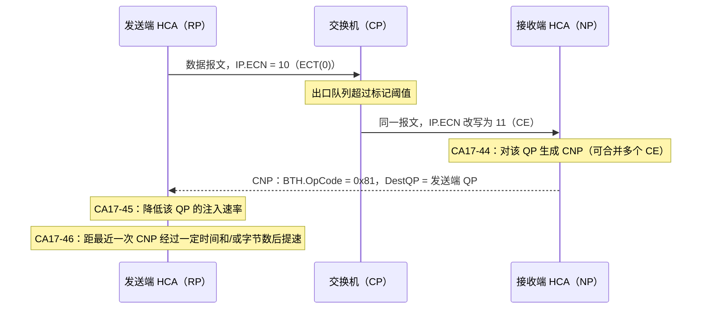
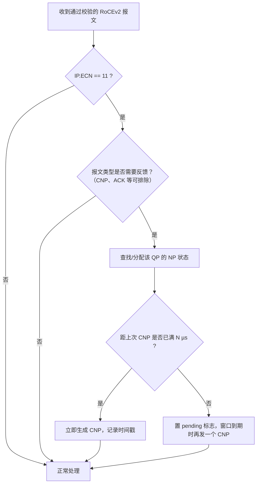

# RoCEv2 拥塞管理（RCM）：ECN 与 CNP（RoCEv2 Congestion Management: ECN and CNP）

> **摘要**：RoCEv2 拥塞管理（RoCEv2 Congestion Management, RCM）是 Annex A17 中**可选**的规范行为：网络设备按 RFC 3168 用 IP 头的 ECN 字段标记拥塞，接收端 HCA（通知点 NP）回送拥塞通知报文 CNP，发送端 HCA（反应点 RP）对相应 QP 降速、之后再提速。本文逐条解读 CA17-44…46、ECN 码点与发送端 ECT 设置、交换机 RED/WRED-ECN 标记，逐字段解析 CNP（Figure 349），并给出 NP/RP 的硬件实现要点。具体的速率调整算法（如 DCQCN）不属于规范，见 [DCQCN](04-dcqcn.md)。
>
> **规范出处**：Vol1 §A17.9.3（p.1947–1948）、Figure 349（p.1948）；§A17.3.1.1.3 / CA17-5（p.1932）；§A17.3.1.2.2 / CA17-14（p.1933–1934）；CA17-20（p.1934）；CA17-22（p.1935–1936）；§A17.4.8 / CA17-29（p.1940）；Table 38（p.259）；§9.2.9–§9.2.10、C9-5、C9-6（p.261）；Annex A10 §A10.3.2（p.1815–1816）
>
> **前置阅读**：[BTH 逐字段详解](../01-packet-format/03-bth.md)、[OpCode 全表](../01-packet-format/05-opcodes.md)、[ICRC](../01-packet-format/06-icrc.md)、[QoS：DSCP/PCP/ETS/DCBX](02-qos-dscp-pcp-ets.md)
>
> **关键词**：RCM、ECN、ECT、CE、RED/WRED、Kmin/Kmax/Pmax、CNP、OpCode 0x81、CP/NP/RP、速率限制器

---

## 1. RCM 概述

### 1.1 规范的意图（§A17.9.3 意译）

- RCM 用于避免拥塞热点、优化 fabric 吞吐：fabric 中**初现的拥塞**被反馈给流量源，源端降低注入速率，从而避免缓冲饱和与排队时延增大；
- 拥塞管理也与共存的 TCP/UDP 流量相关，但只要 RoCEv2 与其它流量使用不同的优先级集合且各有带宽分配（ETS 或类似机制），双方的拥塞与反应不应互相影响；
- 拥塞信令采用 RFC 3168 ECN：网络设备在拥塞时标记 IP 头的 ECN 字段；目的端点按 BTH 中 FECN 的"精神"理解该标记，把拥塞通知**反射回源端**，源端对相应 QP 限制注入速率；
- RCM 是**可选的规范行为**（optional normative）：实现了 RCM 的 HCA 必须遵守本节条款。

〔Vol1 §A17.9.3, p.1947〕

### 1.2 三个角色

| 角色 | 位置 | 职责 | 依据 |
|---|---|---|---|
| CP（Congestion Point，拥塞点） | 交换机/路由器出口队列 | 队列拥塞时把 ECT 报文的 ECN 改为 CE（11） | RFC 3168；具体标记策略不属于 IBTA 规范 |
| NP（Notification Point，通知点） | 接收端 HCA | 收到 ECN = 11 的有效报文后，向报文源发送 CNP；可合并 | CA17-44 |
| RP（Reaction Point，反应点） | 发送端 HCA | 收到 CNP 后降低对应 QP 的注入速率；之后按时间/字节数提速 | CA17-45、CA17-46 |

"CP/NP/RP"这组术语源自 IEEE 802.1Qau（QCN）并被 DCQCN 沿用〔论文: DCQCN, SIGCOMM 2015〕，规范正文并未使用这些缩写。



### 1.3 合规条款一览

| 条款 | 强度 | 内容（意译） | 规范留给实现的部分 |
|---|---|---|---|
| CA17-5 / CA17-14 | shall | **不支持** RCM 的 HCA，所发 RoCEv2 报文的 ECN 必须为 00；支持 RCM 的 HCA *可以*置 01 或 10，表示该报文可被网络标记 | 支持 RCM 时具体用 ECT(0) 还是 ECT(1)、哪些报文置 ECT |
| CA17-44 | shall / may | 支持 RCM 时，收到 IP.ECN = 11 的**有效** RoCEv2 报文，HCA 必须按 Figure 349 生成发往该报文源的 CNP；对同一 QP 的多个标记报文*可以*只发一个 CNP | 合并策略、CNP 的 IP/UDP 字段取值、优先级 |
| CA17-45 | shall | 支持 RCM 时，收到 CNP 必须降低 CNP 所指 QP 的注入速率；降幅由"速率降低参数"决定，其配置不在规范范围内 | 降速算法与参数 |
| CA17-46 | should | 支持 RCM 时，自最近一次收到该 QP 的 CNP 起，经过可配置的时间和/或已发送可配置的字节数后，*应*提高该 QP 的注入速率；时间、字节数与提速幅度的配置不在规范范围内 | 提速算法与参数 |

〔Vol1 CA17-5, p.1932；CA17-14, p.1934；CA17-44/CA17-45, p.1947；CA17-46, p.1948〕

> [!IMPORTANT]
> RCM 本身是可选的；一旦实现，CA17-44 与 CA17-45 是强制要求，CA17-46 为建议。不支持 RCM 的 HCA 必须发送 ECN = 00 的报文（CA17-5/CA17-14），这意味着网络**无法**对其流量做 ECN 标记。

---

## 2. ECN 码点与发送端 ECT 设置

### 2.1 RFC 3168 码点

ECN 位于 IPv4 TOS 字节 / IPv6 Traffic Class 字段的低 2 位（字节布局见 [QoS](02-qos-dscp-pcp-ets.md) §1.2）〔外部: RFC 3168〕：

| ECN 位 | 名称 | 含义 |
|---|---|---|
| 00 | Not-ECT | 端点不支持 ECN，拥塞时交换机只能丢弃（或不处理） |
| 01 | ECT(1) | 支持 ECN（ECN-Capable Transport） |
| 10 | ECT(0) | 支持 ECN |
| 11 | CE | 已经历拥塞（Congestion Experienced），由网络设备置位 |

### 2.2 与 RoCEv2 其它规则的关系

- **ICRC 不受影响**：计算 ICRC 时 IPv4 的 TOS 字节、IPv6 的 Traffic Class 字段整体以全 1 代替（CA17-22），因此交换机把 ECT 改成 CE 不会破坏 ICRC；IPv4 头校验和本来就逐跳更新〔Vol1 CA17-22, p.1935–1936〕。详见 [ICRC](../01-packet-format/06-icrc.md)。
- **不要与 BTH 的 F/B 位混淆**：IB 拥塞控制用 BTH 的 FECN/BECN 位，RoCEv2 端口必须忽略这两位（CA17-29）〔Vol1 §A17.4.8, p.1940〕；RoCEv2 的拥塞信号只在 IP 头中。
- **CE 的检测时机**：CA17-44 针对的是"有效的"RoCEv2 报文，即应在通过 ICRC、IP/UDP 规则检查与传输层报文头校验之后再据 CE 生成 CNP，避免为损坏或伪造的报文发送 CNP。

### 2.3 哪些报文应置 ECT？——实现层面的考量

规范只说"RoCEv2 报文"，并未区分报文类型。下表是设计时需要权衡的点（〔实现考量〕，非规范要求）：

| 报文 | 置 ECT 的意义 | 收到 CE 时 NP 的动作 |
|---|---|---|
| 请求方数据（SEND/WRITE/READ 请求、Atomic） | 主要的受控流量 | 向请求方 QP 发 CNP |
| RDMA READ 响应 | 读数据由响应方发出，同样会造成拥塞 | 请求方作为 NP，向**响应方** QP 发 CNP（DestQP = 响应方 QPN） |
| ACK / NAK | 流量小；对其降速没有直接意义 | IB 附录 A10 规定 CA 忽略 ACK、CNP、多播报文上的 FECN（CA10-22）〔Vol1 p.1809〕，可作参照 |
| CNP | 置 ECT 无意义 | 不应再为 CNP 生成 CNP，避免反馈环路 |
| UD 数据报 | 可受控 | CNP 的 DestQP 取自被标记报文 DETH 中的源 QP |

> [!WARNING]
> 网卡未启用拥塞控制（或驱动未开启对应优先级的 ECN）时，报文是 Not-ECT：交换机无法标记，拥塞控制环路根本不会启动，PFC 成为唯一的拥塞手段。排障时先抓包确认数据报文的 ECN 位确实是 01/10。

---

## 3. 交换机（CP）：RED/WRED-ECN 标记

### 3.1 标记概率曲线

数据中心交换机普遍用 RED/WRED 的"标记而不丢弃"模式实现 ECN。DCQCN 采用的分段线性曲线如下（q 为出口队列长度）〔论文: DCQCN, SIGCOMM 2015, 式 (5)〕：

```text
          0                                q <= Kmin
 p(q) =   (q - Kmin) / (Kmax - Kmin) * Pmax  Kmin < q <= Kmax
          1                                q > Kmax

 标记概率 p
  1.0 ┤                          ┌─────────────
      │                          │
 Pmax ┤                       .──┘
      │                   .─'
      │               .─'
  0.0 ┼───────────────'──────────┴─────────────►  出口队列长度 q
                     Kmin       Kmax
```

| 配置风格 | 参数 | 特点 |
|---|---|---|
| DCTCP 式"截断"标记 | Kmin = Kmax = K，Pmax = 1 | 超过 K 的报文全部标记；简单、反馈强 |
| RED 式概率标记（DCQCN 推荐） | Kmin < Kmax，Pmax 较小 | 速率越高的流被标记的报文越多，配合 NP 的"每 QP 定时发 CNP"更利于公平收敛 |

DCQCN 在 40G 网络中使用 Kmin = 5 KB、Kmax = 200 KB、Pmax = 1%，并论证了 RED 式标记在多瓶颈场景下优于截断式标记〔论文: DCQCN, SIGCOMM 2015, §5–§7〕；参数推导与调优见 [DCQCN](04-dcqcn.md)。

### 3.2 瞬时队列还是平均队列

经典 RED 用队列长度的指数加权平均来判决；数据中心场景更强调反应速度，DCTCP 采用**瞬时队列长度**与单一阈值 K，并给出 K > C·RTT/7 的下限估计〔论文: Alizadeh et al., DCTCP, SIGCOMM 2010〕。交换机上 WRED 的"平均权重"参数决定了用的是瞬时值还是平滑值，部署 RoCE 时通常选择对瞬时队列敏感的配置〔业界实践，以厂商文档为准〕。

### 3.3 入队标记与出队标记：反馈时延

- **入队标记**：报文进入出口队列时按当时队长判决。DCQCN 论文的 CP 描述即"到达出口队列的报文"被标记。被标记的报文必须先排完整个队列才能离开交换机，**反馈时延中包含了该报文自身的排队时延**；
- **出队标记**：报文离开队列时按当时队长判决，拥塞信息不再"陪着报文排队"，反馈更快。有研究专门讨论了出队标记对数据中心 ECN 的改进〔论文: Wu et al., Tuning ECN for Data Center Networks, CoNEXT 2012〕。

量级感受：100 Gb/s 出口上，200 KB 的队列对应 16 µs 排队时延，1 MB 对应 80 µs——与 DCQCN 50 µs 的 CNP 间隔同一量级，足以影响控制环路的稳定性。芯片是否支持出队标记、如何配置，以厂商文档为准。

### 3.4 与 PFC 的配合

ECN 在**出口队列**判决，PFC 在**入口**判决；必须让 ECN 先于 PFC 触发，否则端到端拥塞控制来不及起作用，阈值推导见 [无损以太网与 PFC](01-lossless-ethernet-pfc.md) §5.5。另外：

- 对无损队列应只启用 ECN 标记，不启用 WRED 丢弃；
- 部分设备对 Not-ECT 报文在超过 WRED 阈值后执行丢弃，若 RoCE 报文意外为 Not-ECT，可能在"无损"队列上被丢——务必核对设备行为〔业界实践，以厂商文档为准〕。

---

## 4. CNP 报文格式（Figure 349）

### 4.1 整体结构

Figure 349 规定的 RoCEv2 CNP 由以下部分组成〔Vol1 Figure 349, p.1948〕：

```text
+----------------+-------------------+---------+---------------+--------------------+--------+-------+
| MAC Header     | IPv4 (20 B) or    | UDP     | BTH (12 B)    | Reserved (16 B)    | ICRC   | FCS   |
| 14 B (+4 VLAN) | IPv6 (40 B)       | 8 B     | OpCode = 0x81 | tx: 0 / rx: ignore | 4 B    | 4 B   |
+----------------+-------------------+---------+---------------+--------------------+--------+-------+
```

CNP 本身就是一个 RoCEv2 报文，因此 §A17.3 的以太网/IP/UDP 规则（CA17-1…CA17-21）与 ICRC 规则（CA17-22）同样适用。

### 4.2 BTH 与保留字段

下图偏移相对于 BTH 起始；位号记法与规范一致（每个 32 bit 字最左为 bit 31）：

```text
      3   2                   1                   0
      1 0 9 8 7 6 5 4 3 2 1 0 9 8 7 6 5 4 3 2 1 0 9 8 7 6 5 4 3 2 1 0
     +-+-+-+-+-+-+-+-+-+-+-+-+-+-+-+-+-+-+-+-+-+-+-+-+-+-+-+-+-+-+-+-+
   0 |  OpCode=0x81  |S|M|Pad|  TVer |             P_Key             |
     +-+-+-+-+-+-+-+-+-+-+-+-+-+-+-+-+-+-+-+-+-+-+-+-+-+-+-+-+-+-+-+-+
   4 |F|B|   Resv6   |                     DestQP                    |
     +-+-+-+-+-+-+-+-+-+-+-+-+-+-+-+-+-+-+-+-+-+-+-+-+-+-+-+-+-+-+-+-+
   8 |A|    Resv7    |                    PSN = 0                    |
     +-+-+-+-+-+-+-+-+-+-+-+-+-+-+-+-+-+-+-+-+-+-+-+-+-+-+-+-+-+-+-+-+
  12 |                   Reserved (bytes 0-3 of 16)                  |
     +-+-+-+-+-+-+-+-+-+-+-+-+-+-+-+-+-+-+-+-+-+-+-+-+-+-+-+-+-+-+-+-+
  16 |                   Reserved (bytes 4-7 of 16)                  |
     +-+-+-+-+-+-+-+-+-+-+-+-+-+-+-+-+-+-+-+-+-+-+-+-+-+-+-+-+-+-+-+-+
  20 |                  Reserved (bytes 8-11 of 16)                  |
     +-+-+-+-+-+-+-+-+-+-+-+-+-+-+-+-+-+-+-+-+-+-+-+-+-+-+-+-+-+-+-+-+
  24 |                  Reserved (bytes 12-15 of 16)                 |
     +-+-+-+-+-+-+-+-+-+-+-+-+-+-+-+-+-+-+-+-+-+-+-+-+-+-+-+-+-+-+-+-+
  28 |                              ICRC                             |
     +-+-+-+-+-+-+-+-+-+-+-+-+-+-+-+-+-+-+-+-+-+-+-+-+-+-+-+-+-+-+-+-+
```

| 偏移 | 位 | 宽度 | 字段 | CNP 取值 | 依据 / 备注 |
|---|---|---|---|---|---|
| 0 | 31:24 | 8 | OpCode | 0b1000_0001（0x81） | Figure 349；基础规范 Table 38 中 100_00000 为 IB CNP，100_00001–11111 保留〔p.259〕 |
| 1 | 23 | 1 | SE | 0 | Figure 349 |
| 1 | 22 | 1 | M（MigReq） | 0 | Figure 349 |
| 1 | 21:20 | 2 | PadCnt | 0 | Figure 349 未列出；16 B 保留区已 4 字节对齐，无需填充（推论） |
| 1 | 19:16 | 4 | TVer | 0 | C9-5：所有 IBA 传输报文 TVer = 0〔p.261〕 |
| 2 | 15:0 | 16 | P_Key | 与被 ECN 标记报文 BTH 中的 P_Key 相同 | Figure 349 |
| 4 | 31 | 1 | F（FECN） | 0 | C9-6 发送置 0〔p.261〕；RoCEv2 接收忽略（CA17-29） |
| 4 | 30 | 1 | B（BECN） | 0 | 同上；注意 IB CNP 要求 BECN = 1，RoCEv2 CNP 不用 |
| 4 | 29:24 | 6 | Resv6 | 0 | C9-6 |
| 5 | 23:0 | 24 | DestQP | 需要被降速的 QP，即被标记报文的**源 QP** | Figure 349："QPN for which the RoCEv2 CNP is generated" |
| 8 | 31 | 1 | A（AckReq） | 0 | Figure 349 未列出；CNP 不需要确认（推论） |
| 8 | 30:24 | 7 | Resv7 | 0 | C9-7 |
| 9 | 23:0 | 24 | PSN | 0 | Figure 349 |
| 12 | — | 128 | Reserved | 发送端必须置 0，接收端忽略 | Figure 349："MUST be set to 0 by sender. Ignored by receiver" |
| 28 | — | 32 | ICRC | 按 CA17-22 计算 | 与普通 RoCEv2 报文相同 |

**DestQP 从哪里来**（参照 IB 附录 A10 对 CNP 的同类规定〔Vol1 §A10.3.2, p.1815〕）：

| 被标记报文的服务类型 | NP 如何得到"源 QP" |
|---|---|
| RC / UC | 本端 QP 上下文中记录的远端 QPN |
| XRC | XRC TGT QP 上下文中记录的远端（INI）QPN |
| UD | 被标记报文 DETH 中的源 QP 字段 |
| RDMA READ 响应（请求方作为 NP） | 本端 QP 上下文中的远端 QPN，即响应方 QP |

### 4.3 IP 与 UDP 头：规范未详述的部分

Figure 349 只画出"MAC Header / IPv4/IPv6 Header / UDP Header"三个方框。下表区分了**可由规范推出**与**属于业界实践**的取值：

| 字段 | 取值 | 类别 |
|---|---|---|
| 目的 IP | 被标记报文的源 IP（CA17-44："directed to the source of the received packet"） | 规范推论 |
| 源 IP | 本端地址（通常就是被标记报文的目的 IP / QP 的 SGID） | 规范推论 |
| IPv4 IHL、Flags、Fragment Offset、Protocol | 5、DF = 1、0、0x11（CA17-3/7/8/10） | 规范（CNP 也是 RoCEv2 报文） |
| UDP 目的端口 | 4791（CA17-20，IANA 分配值） | 规范 |
| UDP 校验和 | 0（§A17.3.2.4 should） | 规范 |
| UDP 源端口 | 规范未规定；可复用该 QP 的源端口或其它值，只影响 CNP 在反向路径上的 ECMP 选路 | 实现选择 |
| DSCP / 以太网优先级 | 规范未规定；业界普遍让 CNP 走高优先级（DCQCN 论文："we send CNPs with high priority"），常见示例 DSCP 48 / 优先级 6 | 业界实践 |
| ECN | 规范未规定；建议置 00，CNP 不应参与拥塞标记 | 实现建议 |
| TTL / Hop Limit | RC 等连接型 QP 可用 QP 地址向量中的 Hop Limit；UD 可参照 IB 附录 A10 对 UD CNP 使用 0xFF 的做法（§A10.3.2 注 i） | 实现选择 |

〔论文: DCQCN, SIGCOMM 2015, §3.3〕〔业界实践: Linux mlx5 `cong.c` 中的 `np_cnp_dscp`、`np_cnp_prio_mode`、`np_cnp_prio` 参数〕

### 4.4 CNP 的长度

| 封装 | 以太网帧长（含 FCS） | 线路占用（+ 前导码/SFD 8 B + IFG 12 B） |
|---|---|---|
| IPv4，无 VLAN | 14 + 20 + 8 + 12 + 16 + 4 + 4 = **78 B** | 98 B |
| IPv4，带 VLAN | 82 B | 102 B |
| IPv6，无 VLAN | 98 B | 118 B |
| IPv6，带 VLAN | 102 B | 122 B |

相应的长度字段：IPv4 Total Length = 20 + 8 + 12 + 16 + 4 = **60**（CA17-6）；UDP Length = 8 + 12 + 16 + 4 = **40**（CA17-21）；IPv6 Payload Length = **40**，与 UDP Length 相等。注意 CA17-15 原文写作"starting from the first byte after the IPv6 header (i.e. the BTH)"，括注"i.e. the BTH"是规范笔误——IPv6 头之后紧接的是 UDP 头；按 RFC 8200 的定义与 Linux rxe 等实际实现，Payload Length 必须计入 8 字节 UDP 头〔Vol1 CA17-15, p.1934〕，详见 [以太网/IP/UDP 头字段规则](../01-packet-format/02-ethernet-ip-udp.md)。

**CNP 带宽上界**：若 NP 对某 QP 每 50 µs 至多发 1 个 CNP（DCQCN 的 NP 规则），IPv4 无 VLAN 时每个 QP 最多产生 98 B × 8 / 50 µs ≈ 15.7 Mb/s 的 CNP；1000 个同时被标记的 QP 理论上限约 15.7 Gb/s。实际 CNP 量受标记概率限制，远低于上界，但这一估算说明了"高并发 incast 下 CNP 本身也是可观的反向流量"，也说明了网卡 CNP 生成能力的重要性。

### 4.5 与 IB CNP（Annex A10）的区别

| 项目 | IB CNP（Annex A10） | RoCEv2 CNP（Annex A17） |
|---|---|---|
| OpCode | 0b1000_0000（0x80） | 0b1000_0001（0x81） |
| 拥塞指示 | BTH.BECN = 1 | 由 OpCode 本身表达；F/B 位不用（CA17-29） |
| 触发条件 | 收到 BTH.FECN = 1 的报文 | 收到 IP.ECN = 11 的有效报文 |
| 网络层/链路层头 | LRH（Lver = 0），原报文有 GRH 时带 GRH | 以太网 + IPv4/IPv6 + UDP |
| BTH 之后 | 无载荷 | 16 B 保留字段 |
| 尾部 | ICRC + VCRC | ICRC + FCS |
| DestQP / PSN / P_Key | 源 QP / 0（接收方忽略）/ 同原报文 | 源 QP / 0 / 同原报文 |
| 替代方式 | 对 RC 可把 BECN 放在 ACK 中代替 CNP | 无此替代，统一用 CNP |
| 生成能力要求 | 每 QP 至少 1 个未完成 CN，或集中分配时每端口至少排队 32 个（CA10-24） | 规范未规定 |

〔Vol1 §A10.2.2, p.1808–1810；§A10.3.2, p.1815–1816〕更完整的对比见 [IB 拥塞控制与 RoCEv2 对比](07-ib-cc-vs-rocev2-cc.md)。

> [!NOTE]
> 0x81 在基础规范 Table 38 中属于"CNP 类保留 OpCode"，是 Annex A17 为 RoCEv2 定义的。不支持 RCM 的实现收到 0x81 时，按第 9 章入站校验对不支持的 OpCode 处理即可（通常静默丢弃），见 [事务排序与入站校验](../02-transport/03-ordering-and-validation.md)。

---

## 5. NP 行为：CNP 的生成、合并与限速

### 5.1 规范允许的合并

CA17-44 明确允许"对同一 QP 上的多个 ECN 标记报文只发送一个 CNP"。规范没有规定合并窗口，常见策略：

| 策略 | 描述 | 来源 |
|---|---|---|
| 每 QP 时间窗 | 某流首次收到 CE 立即发 CNP；此后每 N µs 至多一个 CNP，且只有窗口内确有 CE 报文时才发 | 〔论文: DCQCN, SIGCOMM 2015〕N = 50 µs |
| 简单限速 | 距上次 CNP 不足 N µs 的 CE 直接忽略 | 实现简化 |
| 每端口限速 | 限制整个端口的 CNP 发送速率，防止 CNP 风暴 | 实现选择 |

〔业界实践: Linux mlx5〕`np_min_time_between_cnps` 参数用于配置两次 CNP 之间的最小间隔，其单位、作用范围与默认值以 NVIDIA 文档为准。

### 5.2 CNP 生成能力

DCQCN 论文报告：ConnectX-3 Pro 每 1–5 µs 能生成一个 CNP；在 40 Gb/s、1500 B MTU 下，接收端每 50 µs 约收到 166 个满长报文，因此当时只能支撑 10–20 个拥塞流按规则生成 CNP；ConnectX-4 可支撑 200 个以上〔论文: DCQCN, SIGCOMM 2015, §3.3〕。这说明 NP 侧 CNP 生成是需要专门设计的硬件路径，而不是"顺手发一个包"。



---

## 6. RP 行为：速率限制器

- **降速（CA17-45）**：收到 CNP 后，按 BTH.DestQP 找到本端 QP，降低其注入速率。"注入"包括该 QP 发出的所有受控流量：作为请求方时的请求报文，作为响应方时的 RDMA READ 响应。
- **提速（CA17-46）**：自最近一次 CNP 起按"经过的时间"和/或"已发送字节数"提速——这正对应 DCQCN（及其前身 QCN）中的定时器 T 与字节计数器 B。
- **CNP 的接收校验**：CNP 需通过 ICRC 与常规报文头检查（DestQP 有效、P_Key 匹配等）；CNP 不属于任何请求/响应序列，**不得**参与 PSN 检查、不产生 ACK/NAK、不消耗 WQE（IB 附录 A10 明确"PSN 置 0 且接收方忽略"，可作参照）。
- **与静态速率的关系**：若 QP 同时设置了静态速率（IPD），实际速率取两者中更低者（IB 附录 A10 的 CA10-29 规定 IRD 取静态速率控制与拥塞控制两者中较大的延迟），见 [IB 拥塞控制与 RoCEv2 对比](07-ib-cc-vs-rocev2-cc.md)。

---

## 7. 「硬件实现要点」

### 7.1 NP 侧

- **CE 检测**：在接收解析阶段提取 IP.ECN，待 ICRC 与报文头校验通过后，与 QPN 一起送入"CNP 决策"单元。
- **每 QP 状态**：最少需要"上次 CNP 时间戳 + pending 位"。以 1 µs 为单位的 16 bit 时间戳（回绕周期约 65.5 ms，比较时用模减法）加 1 bit pending，64K 个 QP 约需 64K × 17 bit ≈ 136 KB 片上存储。QP 数到百万级时不宜全量存储，可改用**小容量的"近期被标记 QP"缓存**（例如数千项，LRU 替换）：被替换出去的 QP 下次收到 CE 时最多多发一个 CNP，这在 CA17-44 下完全合法。
- **CNP 头部构造**：连接型 QP 直接用 QP 上下文中的地址向量（已解析的 DMAC、SGID/DGID、P_Key、远端 QPN）套用模板；UD 需要从被标记报文中取源 IP、DETH 源 QP、P_Key，下一跳 MAC 需要额外解析（直接复用收到报文的源 MAC 在非对称路由下可能出错）。
- **CNP 发送队列**：独立、高优先级，绕过所属 QP 的速率限制器；配置独立的 DSCP/PCP。
- **ICRC**：CNP 头部大部分字段固定，可预计算常量部分的 CRC 中间状态，仅对 IP 地址、P_Key、DestQP 等可变字段增量计算（CRC 的线性性质），节省一个完整的 ICRC 计算通道。

```c
/* NP 侧 CNP 决策示意（DCQCN 风格：每 QP 每 N 微秒至多一个 CNP）
 * now_us 为 16 bit 微秒计数器；时间比较采用模 2^16 减法，要求 N 远小于回绕周期 */
#include <stdint.h>
#include <stdbool.h>

struct np_state { uint16_t last_cnp_us; bool armed; bool pending; };

/* 收到 CE 标记的有效报文时调用；返回 true 表示应立即发送 CNP */
bool np_on_ce(struct np_state *s, uint16_t now_us, uint16_t n_us)
{
    if (!s->armed || (uint16_t)(now_us - s->last_cnp_us) >= n_us) {
        s->armed = true;
        s->last_cnp_us = now_us;
        s->pending = false;
        return true;
    }
    s->pending = true;            /* 窗口内的后续 CE：合并，窗口结束时补发一个 */
    return false;
}

/* 后台扫描（或定时轮）调用：窗口到期且有 pending 时补发 */
bool np_on_timer(struct np_state *s, uint16_t now_us, uint16_t n_us)
{
    if (s->pending && (uint16_t)(now_us - s->last_cnp_us) >= n_us) {
        s->last_cnp_us = now_us;
        s->pending = false;
        return true;
    }
    return false;
}
```

### 7.2 RP 侧

- **CNP 解析**：OpCode 0x81 在接收流水线早期即可识别；只需 DestQP、P_Key 与通过 ICRC 的结论，不进入请求/响应处理逻辑。
- **CC 事件队列**：解析出的（QPN, 时间戳）写入拥塞控制事件 FIFO，由 CC 引擎异步更新 QP 的速率状态，避免在接收关键路径上做乘法。
- **每 QP 速率限制器**：常见实现是"下一次允许发送时间"或令牌桶，与发送调度器结合（例如按可发送时间排序的时间轮）。只有处于限速状态的 QP 才需要占用速率限制器表项，速率恢复到线速后可释放（QCN 伪代码中即有"速率回到 C 且队列为空时释放限速器"的做法〔外部: IEEE 802.1 QCN 伪代码 au-rong-qcn-serial-hai-pseudo-code〕）。
- 算法状态（Rc、Rt、α、计数器、定时器）的定点表示与存储估算见 [DCQCN](04-dcqcn.md) 第 6 节；发送调度结构见 [发送数据通路](../06-hardware-implementation/02-tx-datapath.md)，接收解析见 [接收数据通路](../06-hardware-implementation/03-rx-datapath.md)。

---

## 8. 「工程提示」

- **先确认 ECT**：`tcpdump -i eth0 -nn -vv udp dst port 4791` 检查数据报文的 TOS 低 2 位是否为 01/10。
- **抓 CNP**：`tcpdump -i eth0 -nn 'udp dst port 4791 and udp[8] == 0x81'`（UDP 头后第 1 个字节即 BTH.OpCode）。
- **网卡计数器**〔业界实践: Linux mlx5，路径 `/sys/class/infiniband/<dev>/ports/<port>/hw_counters/`〕：`np_ecn_marked_roce_packets`（收到的 CE 报文数）、`np_cnp_sent`（发出的 CNP 数）、`rp_cnp_handled`（处理的 CNP 数）、`rp_cnp_ignored`（被忽略的 CNP 数）。
- **按优先级开启**〔业界实践: NVIDIA MLNX_OFED 文档〕：`/sys/class/net/<if>/ecn/roce_np/enable/<prio>` 与 `/sys/class/net/<if>/ecn/roce_rp/enable/<prio>`；不同驱动/版本的接口以文档为准。
- **交换机侧**：确认 RoCE 队列启用了 ECN 标记（而非丢弃），观察每队列的 ECN 标记计数；CNP 所在队列不应拥塞。
- 典型症状：交换机有 ECN 标记但网卡 `np_cnp_sent` 为 0 → NP 未启用；`np_cnp_sent` 增长而对端 `rp_cnp_handled` 不增长 → CNP 在反向路径上被丢或优先级配置错误。更多见 [排障指南](../07-engineering-practice/05-troubleshooting.md)。

---

## 9. 要点回顾

- RCM 可选；实现后 CA17-44（NP 生成 CNP）、CA17-45（RP 降速）强制，CA17-46（RP 提速）为建议；不支持 RCM 的 HCA 必须发 ECN = 00（CA17-5/CA17-14）。
- 拥塞信号在 IP 头 ECN（11 = CE），TOS/Traffic Class 被 ICRC 屏蔽；BTH 的 F/B 位在 RoCEv2 中不用（CA17-29）。
- 交换机用 RED/WRED-ECN 标记：Kmin/Kmax/Pmax；DCQCN 在 40G 下推荐 5 KB / 200 KB / 1%；出队标记可缩短反馈时延。
- CNP（Figure 349）：以太网 + IP + UDP（目的端口 4791）+ BTH（OpCode 0x81、SE = M = 0、PSN = 0、P_Key 同原报文、DestQP = 原报文源 QP）+ 16 B 保留 + ICRC + FCS；IPv4 无 VLAN 时 78 B。
- 规范未规定 CNP 的 DSCP、UDP 源端口、ECN、合并窗口；业界常让 CNP 走高优先级，DCQCN 用每 QP 50 µs 的合并窗口。
- IB CNP 用 OpCode 0x80 + BECN，RoCEv2 CNP 用 0x81、不依赖 BECN。
- 硬件上 NP 需要每 QP 的 CNP 时间状态与高优先级生成路径，RP 需要 CC 事件队列与每 QP 速率限制器。

---

## 自测

<details><summary>Q1：一个不支持 RCM 的 RoCEv2 网卡，可以把 ECN 位置成 10 吗？</summary>

答：不可以。CA17-5（IPv4）与 CA17-14（IPv6）要求不支持 RCM 的 HCA 发送 ECN = 00。只有支持 RCM 的 HCA 才"可以"置 01 或 10，表示报文可被网络标记。
</details>

<details><summary>Q2：主机 A（请求方）对主机 B 发起 RDMA READ，B 返回的读响应在交换机上被标记 CE。谁生成 CNP？CNP 的 DestQP 是什么？谁降速？</summary>

答：读响应由 B 发出、A 接收，A 是 NP，生成 CNP 发往 B；DestQP 为 B 端对应 QP 的 QPN（A 的 QP 上下文中记录的远端 QPN）；B 作为 RP 降低该 QP（读响应）的注入速率。
</details>

<details><summary>Q3：IPv4、无 VLAN 的 RoCEv2 CNP 帧长多少？IP Total Length 与 UDP Length 各是多少？</summary>

答：14 + 20 + 8 + 12 + 16 + 4 + 4 = 78 B（含 FCS）；IP Total Length = 60（IP 头到 ICRC）；UDP Length = 40（UDP 头到 ICRC）。
</details>

<details><summary>Q4：为什么说"入队标记"会增加拥塞反馈时延？在 100 Gb/s 下 200 KB 的队列大约增加多少？</summary>

答：入队时被标记的报文必须排完整个队列才能离开交换机，CE 信息随报文一起排队；出队标记反映的是离开时刻的队列状态。200 KB × 8 / 100 Gb/s = 16 µs。
</details>

<details><summary>Q5：RP 收到 CNP 后，是否需要对其做 PSN 检查或回 ACK？</summary>

答：不需要。CNP 的 PSN 固定为 0，不属于任何请求/响应序列；RP 只需通过 ICRC 与报文头校验（DestQP、P_Key 等）后，把拥塞事件交给速率控制逻辑，不产生 ACK/NAK、不消耗 WQE。
</details>

---

## 参考

- 规范：Vol1 §A17.9.3 与 Figure 349（p.1947–1948）；CA17-5（p.1932）；CA17-14（p.1934）；CA17-6、CA17-15、CA17-20、CA17-21（p.1932–1935）；CA17-22（p.1935–1936）；§A17.4.8 / CA17-29（p.1940）；Table 38（p.259）；§9.2.9–§9.2.10、C9-5、C9-6、C9-7（p.261–262）；Annex A10 §A10.2.2（p.1808–1812）、§A10.3.2（p.1815–1816）。
- 外部：RFC 3168（ECN）；IEEE 802.1Qau（QCN，CP/NP/RP 术语来源）；IEEE 802.1 QCN 伪代码文稿（au-rong-qcn-serial-hai-pseudo-code rev2.0）。
- 论文：Zhu et al., "Congestion Control for Large-Scale RDMA Deployments"（DCQCN），SIGCOMM 2015；Alizadeh et al., "Data Center TCP (DCTCP)"，SIGCOMM 2010；Wu et al., "Tuning ECN for Data Center Networks"，CoNEXT 2012。
- 业界实践：Linux `drivers/infiniband/hw/mlx5/cong.c`（CC 参数）、`counters.c`（`np_cnp_sent` 等计数器）；NVIDIA MLNX_OFED 文档"Explicit Congestion Notification (ECN)"。
