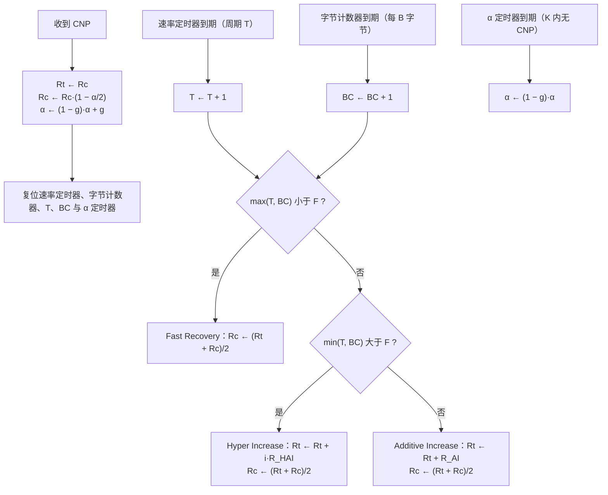

# DCQCN 算法详解（DCQCN: Data Center Quantized Congestion Notification）

> **摘要**：DCQCN（Zhu et al., SIGCOMM 2015）是部署最广的 RoCEv2 拥塞控制算法。它在 RCM 框架（ECN 标记 + CNP 反馈）之上，为交换机（CP）、接收端（NP）、发送端（RP）三个角色给出了具体算法：RED-ECN 标记、每流每 50 µs 至多一个 CNP、DCTCP 式 α 估计 + QCN 式速率恢复。本文给出完整公式与参数（以原论文为准）、状态机、经过运行验证的 Python/C 参考模型、收敛的直观解释、调优经验、NVIDIA mlx5 参数对照，以及定点数、定时器与速率限制器等硬件实现要点。
>
> **规范出处**：DCQCN **不是** IBTA 规范内容。规范只规定 RCM 框架：Vol1 §A17.9.3、CA17-44…CA17-46（p.1947–1948）；DCQCN 是满足该框架的一种业界算法，出处为〔论文: DCQCN, SIGCOMM 2015〕。
>
> **前置阅读**：[ECN 与 CNP](03-ecn-and-cnp.md)、[无损以太网与 PFC](01-lossless-ethernet-pfc.md)
>
> **关键词**：DCQCN、QCN、DCTCP、α、Rc、Rt、Fast Recovery、Additive Increase、Hyper Increase、g、T、B、F、Kmin/Kmax/Pmax、速率限制器、时间轮

---

## 1. 定位：DCQCN 与规范、QCN、DCTCP 的关系

### 1.1 与 RCM 条款的对应

| RCM 条款（规范） | DCQCN 的具体化（论文） |
|---|---|
| CP：网络按 RFC 3168 标记（规范之外） | 出口队列 RED-ECN：Kmin / Kmax / Pmax |
| CA17-44：NP 收到 CE 生成 CNP，可合并 | 每个流首次收到 CE 立即发 CNP，此后每 N = 50 µs 至多一个 |
| CA17-45：RP 按"速率降低参数"降速 | Rc ← Rc·(1 − α/2)，α 为 DCTCP 式的拥塞程度估计 |
| CA17-46：按时间和/或字节数提速 | 定时器 T（55 µs）与字节计数器 B（10 MB）驱动的三阶段恢复 |

### 1.2 设计背景（论文 §2–§3 要点）

- **为何不用 QCN**：IEEE 802.1Qau QCN 的"流"由 L2 地址（及 flow id）定义，交换机直接向源 MAC 发反馈；三层转发会改写以太网头，拥塞交换机找不到反馈对象，因此 QCN 不能用于 IP 路由网络；修改交换芯片代价太大。
- **三个需求**：在无损、三层路由的数据中心中工作；端主机 CPU 开销低（在网卡中实现）；无拥塞时"超快启动"（无慢启动，直接以线速开始）。
- **组合方式**：CP 沿用 DCTCP 的 ECN 标记（仅需交换机已有的 RED/ECN 能力）；RP 的降速沿用 DCTCP 的 α 思路，提速沿用 QCN 的定时器 + 字节计数器机制；NP 用 RoCEv2 已定义的 CNP。
- **实现与部署**：论文中由 Mellanox 网卡（ConnectX-3 Pro 固件）实现，部署于微软数据中心。
- **DCQCN 不能取代 PFC**：流以线速起步，没有 PFC 时突发会造成丢包；论文实测"关闭 PFC 只用 DCQCN"时 8:1 incast 的 10 分位吞吐为 0〔论文: DCQCN, §6.2〕。

---

## 2. 三个角色的完整算法

### 2.1 CP（交换机）：RED-ECN

出口队列对**到达**的报文按队长 q 以概率 p(q) 标记 CE〔论文: DCQCN, §3.1 与式 (5)〕：

```text
p(q) = 0                                   q <= Kmin
p(q) = (q − Kmin) / (Kmax − Kmin) × Pmax    Kmin < q <= Kmax
p(q) = 1                                   q > Kmax
```

令 Kmin = Kmax = K、Pmax = 1 即退化为 DCTCP 式截断标记。论文最终在 40G 网络采用 Kmin = 5 KB、Kmax = 200 KB、Pmax = 1%（理由见第 3 节）。标记曲线与入队/出队标记的讨论见 [ECN 与 CNP](03-ecn-and-cnp.md) 第 3 节。

### 2.2 NP（接收端）：每流每 N µs 至多一个 CNP

每个流（QP）独立执行〔论文: DCQCN, §3.1 与 Figure 6〕：

1. 若收到该流带 CE 的报文、且过去 N µs 内没有为该流发过 CNP，**立即**发送 CNP；
2. 此后每 N µs 至多为该流发送一个 CNP，且仅当该窗口内确有 CE 报文到达时才发。

论文取 **N = 50 µs**，并说明这是受当时硬件限制而固定的值；处理标记报文与生成 CNP 都是"昂贵"操作，因此要尽量减少每个标记报文上的工作量。

```text
时间 ───────────────────────────────────────────────────────────────────────►
CE 到达    x     x  x   x    x  x       x  x                       x
CNP 发送   ▲              ▲              ▲                          ▲
           |<--- 50 µs -->|<--- 50 µs -->|  （窗口内无 CE 则不发）    | 距上次已超过 50 µs：立即发
```

### 2.3 RP（发送端）：降速、α 更新与三阶段提速

**变量**：当前速率 Rc、目标速率 Rt、拥塞程度估计 α（初值为 1）、定时器级数 T、字节计数器级数 BC。

**收到 CNP 时**〔论文: DCQCN, 式 (1)〕（先用旧的 α 降速，再更新 α）：

```text
Rt ← Rc
Rc ← Rc × (1 − α/2)
α  ← (1 − g) × α + g
并复位：速率定时器、字节计数器、T = BC = 0、α 定时器
```

**α 衰减**：若连续 K 时间单位没有收到 CNP，则 α ← (1 − g) × α〔论文: DCQCN, 式 (2)〕。论文取 K = 55 µs，并强调 K 必须大于 NP 的 CNP 生成间隔 N。

**提速**：速率定时器每隔一个周期（论文取 55 µs）到期一次，到期次数 T ← T + 1；字节计数器每发送 B 字节到期一次，到期次数 BC ← BC + 1。每次到期后：

| 条件（论文 Figure 7） | 阶段 | 更新 |
|---|---|---|
| max(T, BC) < F | Fast Recovery（快速恢复） | Rc ← (Rt + Rc) / 2，Rt 不变 |
| min(T, BC) > F | Hyper Increase（超增） | Rt ← Rt + i × R_HAI；Rc ← (Rt + Rc) / 2 |
| 其它 | Additive Increase（加性增） | Rt ← Rt + R_AI；Rc ← (Rt + Rc) / 2 |

- 快速恢复与加性增公式见论文式 (3)、(4)；超增阶段论文只说"细节见 QCN [17]"。按 IEEE 802.1 的 QCN 伪代码，超增量为 **i × R_HAI，其中 i = min(T, BC) − F**〔外部: IEEE 802.1 QCN 伪代码 au-rong-qcn-serial-hai-pseudo-code rev2.0〕。
- 边界细节：DCQCN Figure 7 以"max(T, BC) < F"判定快速恢复、"min(T, BC) > F"判定超增；QCN 伪代码则以"任一计数 > F"离开快速恢复。两者在计数恰为 F 时相差一次迭代，实现时应明确采用哪一种。
- **没有慢启动**：新流在主机上没有其它活跃流时直接以线速发送（否则起始速率由本地 QoS 策略决定）〔论文: DCQCN, §3.1〕。

> [!NOTE]
> 论文中符号 T 有两种用法：Table 2 里 T 表示速率提升定时器的**周期**（55 µs），Figure 7 里 T 表示该定时器的**到期次数**（与字节计数器的到期次数 BC 相对应）。本文 max(T, BC)、min(T, BC) 中的 T 都指到期次数；参数表中的"T = 55 µs"指周期。



### 2.4 参数表（以原论文为准）

| 参数 | 含义 | 论文取值 | 出处 |
|---|---|---|---|
| Kmin / Kmax / Pmax | RED-ECN 标记参数 | 5 KB / 200 KB / 1% | §5.2、Figure 14 |
| N | NP 的 CNP 生成间隔 | 50 µs（受硬件限制固定） | §3.1、§5.2 |
| g | α 更新增益 | 1/256 | Figure 14 |
| K（论文中也记作 τ′） | α 衰减周期 | 55 µs | §3.1、§5.2 |
| T | 速率提升定时器 | 55 µs | §5.2、Figure 14 |
| B | 字节计数器 | 10 MB | §5.2、Figure 14 |
| F | 快速恢复迭代次数 | 5 | §3.1、Table 2 |
| R_AI | 加性增步长 | 40 Mb/s（流体模型中固定） | Table 2 |
| R_HAI | 超增步长 | 论文未给出 | — |
| α 初值 | — | 1 | §3.1 脚注 |

作为对照，论文先试用的"直接照搬 QCN/DCTCP 推荐值"的草案参数为 B = 150 KB、T = 1.5 ms、Kmin = Kmax = 40 KB、Pmax = 1、g = 1/16，结果两条流无法收敛到公平〔论文: DCQCN, §5.2, Figure 11(a)〕。

---

## 3. 参考模型与收敛的直观解释

### 3.1 Python 参考模型（单个 QP 的 RP，按 1 µs 步长推进）

以下代码已在本地运行验证（Python 3.12），可作为硬件实现的"黄金模型"起点：

```python
from dataclasses import dataclass

@dataclass
class DcqcnParams:
    line_rate: float = 100e9      # bit/s
    g: float = 1 / 256            # 论文取值
    T_us: float = 55.0            # 速率提升定时器周期（论文 55 µs）
    K_us: float = 55.0            # α 衰减周期（论文 55 µs）
    B_bytes: float = 10e6         # 字节计数器（论文 10 MB）
    F: int = 5                    # 快速恢复次数（论文 5）
    R_AI: float = 40e6            # 加性增量（论文流体模型 40 Mb/s）
    R_HAI: float = 400e6          # 超增量：示例值，论文未给出
    R_min: float = 10e6           # 速率下限：示例值

class DcqcnRP:
    def __init__(self, p: DcqcnParams):
        self.p = p
        self.Rc = self.Rt = p.line_rate
        self.alpha = 1.0                      # 论文：α 初值为 1
        self.T = self.BC = 0
        self.bytes_acc = 0.0
        self.timer_left = None                # 未被限速时不运行
        self.alpha_left = None

    def on_cnp(self):
        p = self.p
        self.Rt = self.Rc
        self.Rc = max(p.R_min, self.Rc * (1 - self.alpha / 2))
        self.alpha = (1 - p.g) * self.alpha + p.g
        self.T = self.BC = 0
        self.bytes_acc = 0.0
        self.timer_left, self.alpha_left = p.T_us, p.K_us

    def _rate_increase(self):
        p = self.p
        if max(self.T, self.BC) < p.F:        # Fast Recovery
            pass
        elif min(self.T, self.BC) > p.F:      # Hyper Increase（QCN 定义）
            self.Rt += (min(self.T, self.BC) - p.F) * p.R_HAI
        else:                                  # Additive Increase
            self.Rt += p.R_AI
        self.Rt = min(self.Rt, p.line_rate)
        self.Rc = min((self.Rt + self.Rc) / 2, p.line_rate)

    def tick(self, dt_us=1.0):
        if self.timer_left is None:
            return
        p = self.p
        self.bytes_acc += self.Rc * dt_us * 1e-6 / 8
        if self.bytes_acc >= p.B_bytes:        # 字节计数器到期
            self.bytes_acc -= p.B_bytes
            self.BC += 1
            self._rate_increase()
        self.timer_left -= dt_us
        if self.timer_left <= 0:               # 速率定时器到期
            self.timer_left += p.T_us
            self.T += 1
            self._rate_increase()
        self.alpha_left -= dt_us
        if self.alpha_left <= 0:               # K 内无 CNP：α 衰减
            self.alpha_left += p.K_us
            self.alpha *= (1 - p.g)
```

**场景 A：100G 线速的流在 t = 0 收到一个 CNP，此后不再有拥塞**（模型输出）：

| 时刻 | T | BC | Rc（Gb/s） | Rt（Gb/s） | α |
|---|---|---|---|---|---|
| 0（CNP） | 0 | 0 | 50.000 | 100.000 | 1.0000 |
| 55 µs | 1 | 0 | 75.000 | 100.000 | 0.9961 |
| 110 µs | 2 | 0 | 87.500 | 100.000 | 0.9922 |
| 165 µs | 3 | 0 | 93.750 | 100.000 | 0.9883 |
| 220 µs | 4 | 0 | 96.875 | 100.000 | 0.9845 |
| 275 µs | 5 | 0 | 98.438 | 100.000 | 0.9806 |
| 550 µs | 10 | 0 | 99.951 | 100.000 | 0.9616 |
| 2000 µs | 36 | 2 | 100.000 | 100.000 | 0.8686 |

**场景 B：持续拥塞，每 50 µs 一个 CNP**：Rc 依次为 50、25、12.5、6.25 … Gb/s，α 一直停在 1.0——因为 CNP 间隔（50 µs）小于 T 与 K（55 µs），两次 CNP 之间既没有提速也没有 α 衰减。

从模型可以读出几条重要结论：

- **首个 CNP 降速 50%**：α 初值为 1，首次降速最猛；因此一些实现提供"首个 CNP 时设置的速率""最小降速因子"等旋钮（见第 5 节）。
- **快速恢复很快**：k 次快速恢复后 Rc = Rt − (Rt − Rc₀)/2^k，约 5 个定时器周期（≈ 275 µs）即恢复到 Rt 的 98% 以上。
- **α 的记忆很长**：每 55 µs 乘以 (1 − 1/256)，半衰期约 177 个周期 ≈ 9.7 ms；无拥塞 2 ms 后 α 仍约 0.87，下一次 CNP 仍会降速约 43%。
- **T、K 必须大于 N**：否则两次 CNP 之间会发生"不应有的提速"，论文据此把 T 与 K 定为 55 µs（比 N 多 5 µs 余量）〔论文: DCQCN, §5.2〕。

### 3.2 单流与多流收敛的直观解释

- **单流**：拥塞持续时 CNP 不断到来，α 趋近 1，降速趋近 50%/次；拥塞减轻后 CNP 变稀，α 衰减，降速变温和；无 CNP 时依次经历快速恢复（向 Rt 逼近）、加性增、超增（探测新带宽）。流体模型的不动点是 Rc = C/N（C 为瓶颈带宽、N 为流数），稳定队列位于 Kmin 附近（约比 5 KB 高一个数量级）〔论文: DCQCN, §5.1–§5.2〕。
- **多流公平**：乘性降速与当前速率成正比，提速在定时器驱动下对所有流节奏相同，这是 AIMD 式的公平性来源。论文发现两个陷阱与对策：
  1. **字节计数器主导提速会放大不公平**：快流更快攒满 B 字节，提速更频繁，"快者越快"。对策：缩短定时器（T = 55 µs）让定时器主导提速；同时把 B 设大（10 MB），避免过早进入超增。
  2. **截断式标记 + 定时 CNP 会抹平差异**：队列超过 K 时快慢流都被标记，而 NP 每 N µs 每流至多一个 CNP，快慢流收到的 CNP 频率相同。对策：用 Pmax 较小的 RED 式概率标记，使快流的报文更可能在每个窗口内被标记、收到更多 CNP。
- **g 的作用**：g 越小，队列越低、振荡越小，收敛略慢（论文在 2:1 与 16:1 incast 下对比 g = 1/16 与 1/256）。
- **多瓶颈（parking lot）**：经过两个瓶颈的流更容易收到拥塞信号而吃亏；RED 式标记可缓解但不能根治〔论文: DCQCN, §7〕。

---

## 4. 参数调优经验

| 参数 | 调大/调快的效果 | 风险 | 经验来源 |
|---|---|---|---|
| Kmin | 允许更深的稳定队列，吞吐更稳 | 时延增大；更接近 PFC 阈值 | DCQCN：5 KB 即可保持满吞吐（40G） |
| Kmax / Pmax | 标记更"软"或更"硬" | 太硬（截断式）不利公平；太软反馈弱 | DCQCN：200 KB / 1% |
| N（CNP 间隔） | 越小反馈越及时 | CNP 量增大；T、K 必须随之大于 N | DCQCN：50 µs |
| T（定时器） | 越小恢复越快、越公平 | 小于 N 会在两次 CNP 间误提速 | DCQCN：55 µs |
| B（字节计数器） | 越大越不易进入超增 | 太小时快流主导提速 | DCQCN：10 MB |
| g | 越小队列越稳 | 收敛变慢 | DCQCN：1/256 |
| R_AI | 越大收敛越快 | 振荡与 incast 下缓冲饿死风险增加 | DCQCN：40 Mb/s；减半可在 32:1 incast 下避免缓冲饿死 |
| F | 越大快速恢复阶段越长 | 进入探测阶段越晚 | DCQCN：5 |

其它实践要点：

- **先保证"ECN 先于 PFC"**：阈值推导见 [无损以太网与 PFC](01-lossless-ethernet-pfc.md) §5.5。论文把 PFC 阈值误配成静态上限（24.47 KB）而 ECN 阈值为 120 KB 时，效果介于"仅 PFC"和"正确配置的 DCQCN"之间〔论文: DCQCN, §6.2〕。
- **速率越高，阈值需要相应放大**：论文参数基于 40G、反馈时延约 50 µs 的环境，论文明确指出反馈时延显著不同（如 RTT 更大）时参数应随之不同。100G/400G 的推荐值以网卡与交换机厂商的最新文档为准。
- **与 DCTCP 比较**：在 20:1 incast 下，DCQCN 的 95 分位队列长度为 76.6 KB，DCTCP 为 162.9 KB——DCQCN 用硬件速率限制器，突发更小，可用更浅的 Kmin〔论文: DCQCN, §6.3〕。
- **业界案例**：Meta 公开的 AI 训练 RoCE 网络经验（SIGCOMM 2024）指出，转向 400G 时按 200G 的两倍放大 ECN 阈值并使用默认 DCQCN 设置反而性能下降，且遇到固件实现变化带来的问题（如 CNP 计数可见性），最终在 400G 部署中关闭 DCQCN，依靠 PFC 加集合通信库的"接收端驱动准入"（CTS 机制）控制在途流量〔业界实践: Meta, RDMA over Ethernet for Distributed AI Training at Meta Scale, SIGCOMM 2024〕。这说明拥塞控制参数高度依赖负载形态，不存在通用最优值。

---

## 5. 〔业界实践: NVIDIA mlx5〕可调参数对照

上游 Linux 内核 mlx5 驱动通过 debugfs 暴露 DCQCN 相关参数（目录 `/sys/kernel/debug/mlx5/<PCI 地址>/cc_params/`）；MLNX_OFED 另提供 `/sys/class/net/<接口>/ecn/roce_rp|roce_np/` 下的 sysfs 接口（按优先级启用、按参数读写）。下表左列名称取自 Linux 源码 `drivers/infiniband/hw/mlx5/cong.c`，中列为其对应的固件字段名：

| debugfs 名称 | 固件字段 | 对应的 DCQCN / QCN 概念（按名称与算法推断） |
|---|---|---|
| `rp_time_reset` | `rpg_time_reset` | 速率提升定时器周期 T |
| `rp_byte_reset` | `rpg_byte_reset` | 字节计数器 B |
| `rp_threshold` | `rpg_threshold` | 快速恢复次数 F |
| `rp_ai_rate` / `rp_hai_rate` | `rpg_ai_rate` / `rpg_hai_rate` | R_AI / R_HAI |
| `rp_max_rate` / `rp_min_rate` | `rpg_max_rate` / `rpg_min_rate` | 速率上限 / 下限 |
| `rp_min_dec_fac` | `rpg_min_dec_fac` | 单次降速的限制（QCN 中 MIN_DEC_FACTOR 的同类概念） |
| `rp_gd` | `rpg_gd` | 降速增益（QCN 中 GD 的同类概念） |
| `rp_dce_tcp_g` | `dce_tcp_g` | α 更新增益 g（DCTCP 式 α） |
| `rp_dce_tcp_rtt` | `dce_tcp_rtt` | α 衰减周期 K |
| `rp_initial_alpha_value` | `initial_alpha_value` | α 初值 |
| `rp_rate_to_set_on_first_cnp` | `rate_to_set_on_first_cnp` | 首个 CNP 时设置的速率 |
| `rp_rate_reduce_monitor_period` | `rate_reduce_monitor_period` | 两次降速之间的监视周期 |
| `rp_clamp_tgt_rate` / `rp_clamp_tgt_rate_ati` | `clamp_tgt_rate` / `clamp_tgt_rate_after_time_inc` | 收到 CNP 时目标速率 Rt 的钳位策略 |
| `np_min_time_between_cnps` | `min_time_between_cnps` | NP 的 CNP 最小间隔 N |
| `np_cnp_dscp` | `cnp_dscp` | CNP 的 DSCP |
| `np_cnp_prio_mode` / `np_cnp_prio` | `cnp_prio_mode` / `cnp_802p_prio` | CNP 的 802.1p 优先级来源与取值 |
| `rtt_resp_dscp_valid` / `rtt_resp_dscp` | 同名 | RTT 测量响应报文的 DSCP（与基于 RTT 的拥塞控制相关，见 [05](05-advanced-cc-and-lossy-roce.md)） |

> [!WARNING]
> 参数名来自 Linux 内核源码，是可核实的；但"对应概念"一列是按名称与 DCQCN/QCN 定义所做的推断。各参数的单位（Mb/s、µs、字节或芯片内部单位）、取值范围、默认值和精确语义请以 NVIDIA 官方文档及所用固件版本为准，不要直接套用论文数值。

旁证：Linux DCB 子系统为 IEEE 802.1Qau（QCN）定义的管理对象 `struct ieee_qcn` 中同样使用 `rpg_time_reset`、`rpg_byte_reset`、`rpg_threshold`、`rpg_ai_rate`、`rpg_hai_rate`、`rpg_gd`、`rpg_min_dec_fac`、`rpg_min_rate` 等命名〔业界实践: Linux `include/uapi/linux/dcbnl.h`〕，可见 DCQCN 的 RP 参数体系直接继承自 QCN 的反应点（Reaction Point）。

---

## 6. 「硬件实现要点」

### 6.1 每 QP 状态与存储估算

论文指出：RP 状态机需要为每个**正在被限速**的流保存一个定时器和一个计数器，外加 α 等少量状态，这些状态保存在网卡芯片上，速率限制以报文为粒度〔论文: DCQCN, §3.3〕。按 800G 以内设计的一种位宽分配：

| 状态 | 位宽 | 说明 |
|---|---|---|
| Rc、Rt | 20 + 20 bit | 单位 Mb/s，最大约 1.05 Tb/s |
| α | 17 bit | Q1.16 定点，可精确表示 1.0 |
| T、BC | 4 + 4 bit | 饱和计数器 |
| 字节累加器 | 24 bit | 最大 16 MB，覆盖 B = 10 MB |
| 速率定时器、α 定时器截止时刻 | 16 + 16 bit | 以 µs 计的相对时间戳（模运算比较） |
| 令牌桶（令牌 + 上次补充时刻） | 约 56 bit | 见 6.4 |
| 标志位 | 若干 bit | 是否处于限速、是否待处理 CNP 等 |
| **合计** | **约 180 bit（≈ 23 B）** | |

| 限速器表项数 | 片上存储 |
|---|---|
| 4K | ≈ 92 KB |
| 64K | ≈ 1.5 MB |
| 1M | ≈ 23 MB（需借助主机内存/缓存分层） |

**关键设计：只给"被限速的 QP"分配 CC 状态**。速率恢复到线速且一段时间无 CNP 的 QP 释放其限速器表项（QCN 伪代码中即有"速率回到 C 且队列为空时释放限速器"的做法〔外部: IEEE 802.1 QCN 伪代码〕），用 QPN → 表项的哈希/CAM 映射管理一个有限的限速器池。

### 6.2 定点数表示

α 取 Q1.16、g = 2⁻⁸ 时，α 的更新只需移位与加法；唯一的乘法是 Rc × α。以下 C 代码已用 gcc 编译并与上面的浮点模型逐步比对一致：

```c
#include <stdint.h>

#define A_FRAC  16                    /* α 用 Q1.16 定点数表示：1.0 = 1 << 16，需 17 bit */
#define A_ONE   (1u << A_FRAC)
#define G_SHIFT 8                     /* g = 1/256 = 2^-8：乘法退化为移位 */
#define CNT_MAX 15                    /* T、BC 为 4 bit 饱和计数器 */

struct dcqcn_qp {
    uint32_t rc;                      /* 当前速率 Rc，单位 Mb/s */
    uint32_t rt;                      /* 目标速率 Rt，单位 Mb/s */
    uint32_t alpha;                   /* α，Q1.16 */
    uint8_t  t_cnt, bc_cnt;           /* 定时器级数 T、字节计数器级数 BC */
};

static uint8_t sat_inc(uint8_t x) { return x < CNT_MAX ? (uint8_t)(x + 1) : x; }

/* 收到 CNP：Rt←Rc；Rc←Rc(1−α/2)；α←(1−g)α+g；计数器清零 */
void dcqcn_on_cnp(struct dcqcn_qp *q, uint32_t r_min)
{
    uint32_t cut = (uint32_t)(((uint64_t)q->rc * q->alpha) >> (A_FRAC + 1));
    q->rt = q->rc;
    q->rc = (q->rc - cut < r_min) ? r_min : q->rc - cut;
    q->alpha = q->alpha - (q->alpha >> G_SHIFT) + (A_ONE >> G_SHIFT);
    q->t_cnt = q->bc_cnt = 0;
}

/* α 定时器到期（K 时间内无 CNP）：α←(1−g)α */
void dcqcn_on_alpha_timer(struct dcqcn_qp *q)
{
    q->alpha -= q->alpha >> G_SHIFT;
}

/* 速率定时器（by_timer=1）或字节计数器（by_timer=0）到期后的提速 */
void dcqcn_on_increase(struct dcqcn_qp *q, int by_timer, uint8_t f,
                       uint32_t r_ai, uint32_t r_hai, uint32_t line)
{
    if (by_timer) q->t_cnt = sat_inc(q->t_cnt); else q->bc_cnt = sat_inc(q->bc_cnt);
    uint8_t mx = q->t_cnt > q->bc_cnt ? q->t_cnt : q->bc_cnt;
    uint8_t mn = q->t_cnt < q->bc_cnt ? q->t_cnt : q->bc_cnt;
    if (mx >= f) {
        if (mn > f) q->rt += (uint32_t)(mn - f) * r_hai;   /* Hyper Increase */
        else        q->rt += r_ai;                         /* Additive Increase */
        if (q->rt > line) q->rt = line;
    }                                                      /* 否则 Fast Recovery：Rt 不变 */
    q->rc = (q->rt + q->rc + 1) >> 1;                      /* Rc←(Rt+Rc)/2，向上取整以便收敛到 Rt */
}
```

- Rc × α 是 20 bit × 17 bit 的乘法，可放在 CC 引擎中多周期完成，不在收发关键路径上；
- 若要完全避免乘法，可把 α 量化为少数几档并用移位近似（精度换面积），或参考 QCN 的"量化反馈 + 查表"思路；
- (Rt + Rc)/2 用加法与移位实现；注意舍入方向，否则 Rc 可能永远停在 Rt − 1。

### 6.3 大量 QP 的定时器：时间轮、后台扫描与惰性计算

每个限速 QP 有两个周期约 55 µs 的定时器。若 64K 个 QP 同时被限速，每秒需要处理 64K / 55 µs ≈ 11.9 亿次定时事件——逐个硬件定时器或纯时间轮都难以承受。常用组合：

| 方法 | 做法 | 适用 |
|---|---|---|
| 后台轮询扫描 | 在一个有限的限速器池（如 4K 项）上循环扫描：4K / 55 µs ≈ 7450 万次/秒，数百 MHz 的流水线可承受 | 限速 QP 数有上界时最简单 |
| 时间轮（timing wheel / 日历队列） | 按到期时隙把 QP 挂入桶中，每个时隙只处理到期的 QP | 到期事件稀疏、需要精确定时 |
| **惰性计算** | 只记录"最近一次 CNP / 提速 / α 衰减的时刻"；当 QP 被调度发送或收到 CNP 时，一次性计算期间应发生的 n 次事件：α ← α·(1 − g)ⁿ（查表），k 次快速恢复后 Rc = Rt − (Rt − Rc)/2^k | QP 多而活跃度低；把计算推迟到真正需要时 |

〔论文: Carousel, SIGCOMM 2017〕与〔论文: SENIC, NSDI 2014〕讨论了大规模速率限制在主机/网卡上的可扩展实现，可作参考。

### 6.4 速率限制器精度

- **为何不用"每包一个定时器"**：400G 下 4 KB 报文的包间隔约 82 ns，要以 1% 精度控制线速附近的速率，定时分辨率需达亚纳秒级；低速时（如 10 Mb/s）包间隔又长达毫秒级。令牌桶 + 小数令牌可以同时覆盖两端。
- **令牌桶 + 惰性补充**：令牌与速率都带小数位；只在调度器访问该 QP 时按经过的时间补充令牌；速率变化时才做一次除法（把 Mb/s 换算为"字节/ns"）。以下代码已编译验证，在 10 Mb/s 至 400 Gb/s 的设定下实测输出速率与设定值一致：

```c
#include <stdint.h>
#include <stdbool.h>

#define FR_BITS 24                    /* 令牌与速率均带 24 bit 小数 */
#define MAX_IDLE_NS 10000000000ull    /* 单次补充最多按 10 s 计：大于最低速率下的包间隔，且 800G 以内乘积不溢出 64 bit */

struct rate_limiter {
    uint64_t tokens;                  /* 令牌：字节，Q.24 */
    uint64_t bucket;                  /* 桶深：字节，Q.24（例如 2 个 MTU） */
    uint64_t bytes_per_ns;            /* 速率：字节/ns，Q.24；只在 Rc 变化时重算 */
    uint64_t last_ns;                 /* 上次补充令牌的时刻 */
};

/* Rc 变化时调用：1 Mb/s = 1/8000 字节/ns，这里是唯一的除法 */
void rl_set_rate(struct rate_limiter *rl, uint32_t rate_mbps)
{
    rl->bytes_per_ns = ((uint64_t)rate_mbps << FR_BITS) / 8000u;
}

static void rl_refill(struct rate_limiter *rl, uint64_t now_ns)
{
    uint64_t dt = now_ns - rl->last_ns;
    if (dt > MAX_IDLE_NS) dt = MAX_IDLE_NS;
    rl->last_ns = now_ns;
    rl->tokens += dt * rl->bytes_per_ns;
    if (rl->tokens > rl->bucket) rl->tokens = rl->bucket;
}

/* 调度器询问能否发送 len 字节；可以则扣除令牌 */
bool rl_try_send(struct rate_limiter *rl, uint64_t now_ns, uint32_t len)
{
    uint64_t need = (uint64_t)len << FR_BITS;
    rl_refill(rl, now_ns);
    if (rl->tokens < need) return false;
    rl->tokens -= need;
    return true;
}

/* 令牌不足时给出最早可发送时刻，供时间轮/日历队列排程 */
uint64_t rl_eligible_ns(const struct rate_limiter *rl, uint64_t now_ns, uint32_t len)
{
    uint64_t need = (uint64_t)len << FR_BITS;
    if (rl->tokens >= need || rl->bytes_per_ns == 0) return now_ns;
    return now_ns + (need - rl->tokens + rl->bytes_per_ns - 1) / rl->bytes_per_ns;
}
```

- **桶深**决定允许的突发：1–2 个 MTU 可保持平滑；过深会让"限速"变成周期性大突发，削弱 DCQCN 的效果；
- 硬件中 `rl_eligible_ns` 的除法可通过同时保存"1/速率"避免；可发送时刻送入时间轮，调度器只在 QP 变为可发送时才考虑它，详见 [发送数据通路](../06-hardware-implementation/02-tx-datapath.md)；
- **字节计数器 B** 与令牌桶共用"已发送字节"统计即可，不需要单独的数据通路。

### 6.5 CNP 风暴下的事件处理

大规模 incast 时，RP 可能在极短时间内收到大量 CNP。建议：

- CNP 解析后写入 CC 事件 FIFO，FIFO 中对同一 QPN 去重（每 QP 一个"事件已排队"标志），避免溢出；
- CC 引擎吞吐按"最坏情况下 CNP 到达率"设计；对超出能力的 CNP 计数并丢弃（对应 mlx5 的 `rp_cnp_ignored` 一类计数器），而不是阻塞接收流水线；
- NP 侧的 CNP 生成与合并见 [ECN 与 CNP](03-ecn-and-cnp.md) 第 7 节。

---

## 7. 要点回顾

- DCQCN 不是 IBTA 规范内容，它把 RCM 框架（CA17-44…46）具体化为 CP/NP/RP 三部分算法。
- CP：出口队列 RED-ECN（论文 Kmin = 5 KB、Kmax = 200 KB、Pmax = 1%）。
- NP：每流首个 CE 立即回 CNP，此后每 N = 50 µs 至多一个。
- RP：收到 CNP 时 Rt ← Rc、Rc ← Rc(1 − α/2)、α ← (1 − g)α + g；K = 55 µs 内无 CNP 则 α ← (1 − g)α；α 初值 1，g = 1/256。
- 提速由定时器 T = 55 µs 与字节计数器 B = 10 MB 驱动：快速恢复（F = 5）→ 加性增（R_AI = 40 Mb/s）→ 超增（i·R_HAI，按 QCN 定义 i = min(T, BC) − F）。
- 公平收敛的关键：定时器主导提速、B 取大、RED 式小 Pmax 标记；T、K 必须大于 CNP 间隔 N。
- DCQCN 依赖 PFC 兜底（无慢启动），且必须保证 ECN 先于 PFC 触发。
- 硬件实现：只为被限速的 QP 分配约 20 余字节状态；α 用定点数 + 移位；大量定时器用后台扫描/时间轮/惰性计算；速率限制器用带小数令牌的令牌桶。

---

## 自测

<details><summary>Q1：DCQCN 是不是 RoCEv2 规范的一部分？规范对 RP 的降速幅度有何规定？</summary>

答：不是。规范只规定 RCM 框架：CA17-45 要求收到 CNP 后降低对应 QP 的注入速率，降幅由"速率降低参数"决定，其配置不在规范范围内；CA17-46 建议按时间和/或字节数提速，参数同样不在规范范围内。DCQCN 是满足该框架的一种业界算法。
</details>

<details><summary>Q2：一条 100G 的流在 α = 1 时收到 CNP，之后不再拥塞，按 DCQCN 论文参数，约多久恢复到 98% 线速？</summary>

答：CNP 后 Rc = 50G、Rt = 100G。定时器每 55 µs 触发一次快速恢复 Rc ← (Rt + Rc)/2：75、87.5、93.75、96.875、98.4375 Gb/s，约 5 个周期 ≈ 275 µs 后超过 98%。
</details>

<details><summary>Q3：为什么论文要求 α 衰减周期 K 和提速定时器 T 必须大于 CNP 生成间隔 N？</summary>

答：NP 每 N µs 至多发一个 CNP。若 T 或 K 小于 N，在持续拥塞时两次 CNP 之间仍会发生提速或 α 衰减，导致"不应有的提速"，反馈失真、振荡加剧。论文取 N = 50 µs、T = K = 55 µs。
</details>

<details><summary>Q4：为什么把字节计数器 B 设为 10 MB、同时使用 Pmax = 1% 的 RED 式标记有利于公平？</summary>

答：B 小时，快流更快攒满字节、提速更频繁，"快者越快"；把 B 设大、让 55 µs 定时器主导提速，所有流提速节奏一致。RED 式小 Pmax 标记使快流的报文在每个 CNP 窗口内更可能被标记，从而收到更多 CNP、降速更多；截断式标记会让快慢流收到同样频率的 CNP。
</details>

<details><summary>Q5：网卡要支持 64K 个同时被限速的 QP，用每 QP 硬件定时器实现 55 µs 周期事件是否可行？有什么替代方案？</summary>

答：不可行：每秒约 11.9 亿次定时事件。替代方案：限制同时被限速的 QP 数并用后台扫描（如 4K 项约 7450 万次/秒）；用时间轮只处理到期 QP；或采用惰性计算，在 QP 被调度或收到 CNP 时一次性补算 n 个周期的 α 衰减与快速恢复。
</details>

---

## 参考

- 规范：Vol1 §A17.9.3、CA17-44…CA17-46（p.1947–1948）。
- 论文：Zhu et al., "Congestion Control for Large-Scale RDMA Deployments"（DCQCN），SIGCOMM 2015（§3 算法、§4 缓冲设置、§5 流体模型与参数、§6 评估、§7 讨论，Figure 5/6/7/14，Table 2）；Alizadeh et al., "Data Center Transport Mechanisms: Congestion Control Theory and IEEE Standardization"（QCN），Allerton 2008；Alizadeh et al., DCTCP，SIGCOMM 2010；Saeed et al., "Carousel: Scalable Traffic Shaping at End Hosts"，SIGCOMM 2017；Radhakrishnan et al., "SENIC: Scalable NIC for End-Host Rate Limiting"，NSDI 2014。
- 外部：IEEE 802.1Qau（QCN）；IEEE 802.1 文稿 au-rong-qcn-serial-hai-pseudo-code rev2.0（QCN RP 伪代码，含超增定义）。
- 业界实践：Linux `drivers/infiniband/hw/mlx5/cong.c`、`include/uapi/linux/dcbnl.h`；NVIDIA MLNX_OFED 文档"Explicit Congestion Notification (ECN)"；Meta, "RDMA over Ethernet for Distributed AI Training at Meta Scale"，SIGCOMM 2024（及 Meta Engineering 博客 2024-08-05）。
