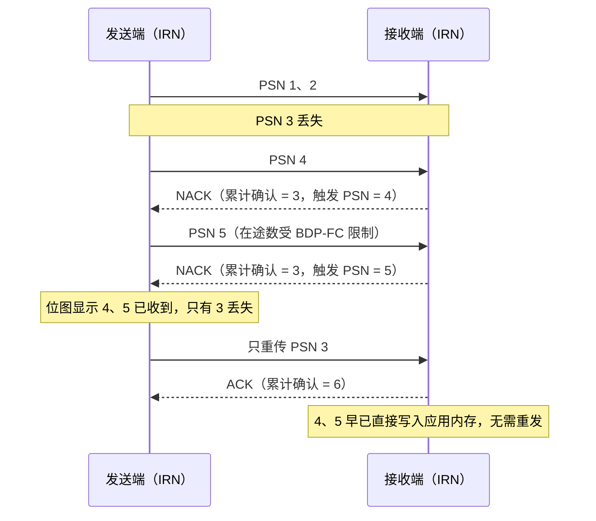

# 其他拥塞控制与有损 RoCE（Advanced Congestion Control and Lossy RoCE）

> **摘要**：DCQCN 之外，业界与学术界提出了多种面向 RDMA 的拥塞控制与可靠传输改进：基于时延的 TIMELY 与 Swift、基于带内网络遥测（INT）的 HPCC，以及通过选择性重传与 BDP 流控让 RoCE 摆脱 PFC 的 IRN 和厂商"有损 RoCE"方案；Ultra Ethernet（UEC）则为 AI/HPC 重新设计了以太网传输。本文梳理这些方案的信号来源、控制律与部署要求，并重点分析选择性重传与乱序数据放置对 RNIC 硬件的要求。**本文讨论的扩展均不在 IBTA Vol1 Release 1.4 规范之内**，规范内的行为是 RCM 框架与 Go-back-N 式恢复。
>
> **规范出处**（作为对照基线）：Vol1 §A17.9.1（p.1946）；§A17.9.3（p.1947–1948）；C9-114（p.343）；§9.7.5.2.3、C9-121/C9-122（p.350）；§9.7.6.1.2（p.360）；§9.5 / o9-20（p.292）
>
> **前置阅读**：[DCQCN](04-dcqcn.md)、[无损以太网与 PFC](01-lossless-ethernet-pfc.md)、[可靠性引擎](../06-hardware-implementation/04-reliability-engine.md)
>
> **关键词**：TIMELY、Swift、HPCC、INT、IRN、选择性重传、SACK、BDP-FC、乱序放置（OOO placement）、有损 RoCE、Ultra Ethernet、UET

---

## 1. 为什么还需要别的方案

DCQCN + PFC 在大量生产网络中工作良好，但也有公认的局限：

| 局限 | 说明 |
|---|---|
| 信号粗糙 | ECN 只给出"是否拥塞"的 1 bit 信息，且经过 NP 的 50 µs 合并；发送端无法知道拥塞程度、位置与可用带宽 |
| 参数敏感 | Kmin/Kmax/Pmax、T、B、g 等参数相互耦合，随速率、拓扑、负载变化需要重调（见 [DCQCN](04-dcqcn.md) 第 4 节）；HPCC 论文指出，DCQCN 基于定时器的提速造成吞吐（定时器更激进）与稳定性（定时器更保守）之间的取舍，基于队列的 ECN 信号又造成时延（ECN 阈值更低）与带宽（阈值更高）之间的取舍〔论文: HPCC, SIGCOMM 2019, §2.3〕 |
| 依赖 PFC | 无慢启动、Go-back-N 恢复，使其离不开 PFC 兜底，因而继承 PFC 的 HOL、拥塞扩散、风暴与死锁风险 |
| 对多路径不友好 | 规范建议有序 QP 使用固定 UDP 源端口（§A17.3.2.1，*should*），乱序到达即触发 NAK 与回退重传，限制了逐包负载均衡（见 [ECMP 与负载均衡](06-ecmp-and-load-balancing.md)） |

按**拥塞信号的来源**可以把后续方案分为几类：ECN 标记（DCQCN）、端到端时延/RTT（TIMELY、Swift）、带内遥测（HPCC）、丢包（有损 RoCE 的恢复机制）、接收端授信（UEC 的可选接收端信用、Meta 的接收端驱动准入）。

---

## 2. TIMELY：基于 RTT 梯度（SIGCOMM 2015）

〔论文: Mittal et al., TIMELY: RTT-based Congestion Control for the Datacenter, SIGCOMM 2015〕

- **信号**：利用网卡硬件时间戳在完成事件上测得微秒级精度的 RTT，不需要交换机参与；
- **控制律**：基于速率；核心是 **RTT 梯度**（相邻两次 RTT 之差，除以最小 RTT 归一化，再做 EWMA 平滑）。梯度为正说明队列在增长，为负说明队列在消退；
- **两个阈值**：RTT 低于 Tlow 时直接加性增（过滤报文突发造成的 RTT 尖峰）；高于 Thigh 时按 (1 − Thigh/RTT) 的比例乘性降，限制尾时延；
- **实现与结果**：在具备 OS-bypass 能力的网卡上以主机软件实现；在启用 PFC 的 fabric 上，对 OS-bypass 消息开启 TIMELY 后 99 分位尾时延降低 9 倍，同时保持接近线速吞吐。

控制律（按论文 Algorithm 1 的逻辑改写）：

```python
def timely_update(st, new_rtt, p):
    """st: 每连接状态（rate、prev_rtt、rtt_diff、neg_count）；p: 参数。"""
    new_diff = new_rtt - st.prev_rtt
    st.prev_rtt = new_rtt
    st.rtt_diff = (1 - p.alpha) * st.rtt_diff + p.alpha * new_diff   # EWMA 平滑
    grad = st.rtt_diff / p.min_rtt                                    # 归一化梯度
    if new_rtt < p.t_low:                                             # 远离拥塞：加性增
        st.rate += p.delta
    elif new_rtt > p.t_high:                                          # 时延过高：按超出比例乘性降
        st.rate *= 1 - p.beta * (1 - p.t_high / new_rtt)
    elif grad <= 0:                                                   # 队列不再增长：加性增
        st.neg_count = st.neg_count + 1 if grad < 0 else 0
        n = 5 if st.neg_count >= 5 else 1                             # 连续 5 次负梯度进入 HAI 模式
        st.rate += n * p.delta
    else:                                                             # 队列在增长：按梯度乘性降
        st.neg_count = 0
        st.rate *= 1 - p.beta * grad
    st.rate = min(max(st.rate, p.min_rate), p.line_rate)
    return st.rate
```

> [!NOTE]
> 后续分析指出，纯 RTT 梯度控制可能存在无穷多个不动点，从而难以保证公平收敛；同一工作还在流体模型下比较了 DCQCN 与 TIMELY 的稳定性〔论文: Zhu et al., ECN or Delay: Lessons Learnt from Analysis of DCQCN and TIMELY, CoNEXT 2016〕。

---

## 3. Swift：时延目标 + AIMD（SIGCOMM 2020）

〔论文: Kumar et al., Swift: Delay is Simple and Effective for Congestion Control in the Datacenter, SIGCOMM 2020〕

- **信号**：依赖网卡硬件时间戳测量端到端时延，并把时延**分解为 fabric 部分与主机（端点）部分**，分别对应网络拥塞与接收端处理拥塞，各自独立控制；
- **控制律**：基于拥塞窗口的 AIMD，以给定的端到端时延为目标；时延目标随路径跳数与并发流数缩放，以兼顾公平；窗口可小于 1 个包（转为按时间间隔发包），以应对大规模 incast；
- **部署与结果**：部署于 Google 数据中心；在每台服务器 100 Gb/s、负载接近 100% 时，短 RPC 的尾时延约 50 µs；
- **与 RoCE 的关系**：Swift 运行在 Google 自研的传输栈上，而非 IB 传输层；但"时延信号 + 主机/网络分解"的思想不需要交换机支持，是 RNIC 拥塞控制的重要参考。

---

## 4. HPCC：基于带内遥测的精确控制（SIGCOMM 2019）

〔论文: Li et al., HPCC: High Precision Congestion Control, SIGCOMM 2019〕

- **信号**：数据报文经过的每台交换机利用芯片的 INT 能力，在报文中追加本跳出端口的 **时间戳 ts、队列长度 qLen、累计发送字节 txBytes、链路带宽 B**；接收端把这些元数据复制到 ACK 中带回发送端；
- **控制对象**：在途字节数（窗口），并按 R = W / T 做速率 pacing（T 为基础 RTT）；初始窗口 W_init = B_NIC × T，即以线速起步；
- **控制律**：对路径上每条链路 j 估算归一化在途量

```text
U_j = qLen_j / (B_j × T) + txRate_j / B_j        其中 txRate_j 由相邻两个 ACK 的 txBytes 与 ts 之差求得
W   = W_c / (max_j U_j / η) + W_AI              η 为目标利用率（论文取 95%），W_AI 为很小的加性增量
```

  W_c 为参考窗口，每个 RTT 才更新一次，用于避免对连续 ACK 中"同一拥塞信息"的重复反应；
- **效果**：反应快、队列接近零，论文报告相对 DCQCN 等方案大幅缩短流完成时间，在大规模 incast 下也几乎不产生拥塞；
- **部署前提**：交换机支持 INT 并在数据报文中插入元数据；网卡需对每个 ACK 做较复杂的计算（论文在商用 FPGA 网卡与可编程交换机上实现）。对 RoCEv2 而言，INT 元数据的承载与回显都超出 IBTA 规范，需要厂商扩展。

---

## 5. IRN：让 RoCE 不再需要 PFC（SIGCOMM 2018）

〔论文: Mittal et al., Revisiting Network Support for RDMA, SIGCOMM 2018（arXiv:1806.08159 为扩展版）〕

### 5.1 核心论点与两项改动

论文的结论是：**对 PFC 的需求是现有 RoCE 网卡设计（Go-back-N）的产物，而不是本质要求**。改进后的网卡（Improved RoCE NIC, IRN）只做两项改动：

1. **高效丢包恢复（选择性重传）**：接收端不丢弃乱序报文；每收到一个乱序报文就回 NACK，携带累计确认（期望序号）与触发该 NACK 的报文序号（简化的 SACK）；发送端维护位图，进入恢复模式后只重传位图指示丢失的报文。在途报文很少时用较小的超时 RTO_low，否则用 RTO_high；
2. **BDP-FC**：把每个流的在途报文数上限设为"网络最长路径的 BDP / MTU"，既减少不必要的排队，也为乱序报文数提供硬上界（从而限定位图大小）。

论文报告：不开 PFC 的 IRN 比开 PFC 的 RoCE 性能好 6%–83%，而实现开销约为网卡资源的 3%–10%。



### 5.2 落地到 RoCE 报文与语义上的改动（论文 §5）

| 问题 | 规范行为 | IRN 的改动 |
|---|---|---|
| READ 响应没有逐包确认 | 请求方不对读响应发 ACK | 新增 read (N)ACK 报文（使用 RC 中未定义的 OpCode）；读响应方（数据源）需要实现超时 |
| 首包信息 | RETH 只在 WRITE 首包中 | 每个 WRITE 报文都携带 RETH，乱序到达也能定位远端地址 |
| 隐式 WQE 匹配 | 按到达顺序消耗接收 WQE | SEND / WRITE-with-Immediate 携带 recv_WQE_SN（SEND 还携带相对偏移）；READ/Atomic 请求携带 read_WQE_SN |
| 尾包信息 | 尾包到达即更新 MSN、生成 CQE | 用 2 个位图记录"已到达"与"是否为触发 MSN/CQE 的尾包"；先到的尾包可提前生成 CQE 暂存于主机内存，待之前的报文全部到达后再交付 |
| 乱序报文的存储 | 直接丢弃 | 直接 DMA 到最终地址，只用位图记录（每包几 bit，而不是每包 1 KB 缓冲） |

论文还指出：Mellanox ConnectX-5 已为支持自适应路由引入了**部分**乱序数据放置能力，但仅限 Write 与 Read 操作〔论文: IRN, §5.3〕。

### 5.3 对应用语义的影响

乱序放置意味着"WRITE 的最后一个字节先到达"成为可能。有些应用靠轮询 WRITE 缓冲区的最后一个字节判断传输完成，这在乱序放置下会失效——但规范本来就不保证这种用法：o9-20 规定，应用在"带立即数的最后一个 WRITE 报文到达并完成""后续 SEND 到达并完成""后续 ATOMIC 更新内存"等事件之一发生前，不得依赖 RDMA WRITE 缓冲区的内容〔Vol1 §9.5, o9-20, p.292〕。

---

## 6. 有损 RoCE 的厂商方案（〔业界实践〕）

| 名称/现象 | 思路 | 依据与说明 |
|---|---|---|
| Resilient RoCE（NVIDIA 术语） | 不依赖 PFC，在有损网络中依靠 ECN 拥塞控制与网卡侧丢包恢复运行 | NVIDIA 公开材料中的术语；适用型号、配置方法与限制以 NVIDIA 文档为准 |
| Zero Touch RoCE（NVIDIA 术语） | 进一步去掉对交换机 PFC/ECN 配置的依赖，由网卡端的拥塞控制（基于 RTT 探测）与增强的丢包恢复实现 | 同上；Linux mlx5 驱动的拥塞控制参数中存在 `rtt_resp_dscp`（RTT 响应报文的 DSCP），可作为网卡支持 RTT 探测报文的旁证 |
| 自适应重传、慢重启 | 根据网络状况调整重传超时、在丢包后以较低速率重新起步 | Linux mlx5 `counters.c` 中的 RoCE 加速计数器 `roce_adp_retrans`、`roce_adp_retrans_to`、`roce_slow_restart`、`roce_slow_restart_cnps`、`roce_slow_restart_trans`，具体语义以 NVIDIA 文档为准 |
| 部分乱序放置 | 支持自适应路由下 Write/Read 报文的乱序到达 | 〔论文: IRN〕对 ConnectX-5 的描述 |
| 接收端驱动准入 | 关闭 DCQCN，依靠 PFC 与集合通信库的 CTS（clear-to-send）限制在途流量 | 〔业界实践: Meta, SIGCOMM 2024〕AI 训练网络经验 |

> [!WARNING]
> 不同厂商的"有损 RoCE"方案都是**私有扩展**，两端网卡通常需要同一厂商、同一能力集才能互通；在混合厂商环境中，可依赖的仍只有规范内的行为（Go-back-N + RCM）。

---

## 7. 「硬件实现要点」：选择性重传与乱序放置对 RNIC 的要求

### 7.1 与规范行为的差异总览

| 方面 | 规范行为（Go-back-N） | 选择性重传 + 乱序放置（扩展） |
|---|---|---|
| 乱序报文 | 响应方返回 NAK（携带期望 PSN，C9-121），并丢弃后续非期望 PSN 的新请求（C9-114/C9-122） | 接收并直接放置，记录位图 |
| 接收端每 QP 状态 | 期望 PSN、MSN 等少量寄存器 | 再加"已到达"位图与"尾包"位图（长度 = BDP 上限） |
| 反馈 | ACK / NAK（AETH） | 带累计确认 + SACK 信息的 NACK（需新报文格式或扩展） |
| 发送端重传 | 从 NAK 指示的 PSN 回退，顺序重发（§9.7.6.1.2） | 按位图逐包重传；需能"随机访问"任意 PSN 对应的 WQE 与数据偏移 |
| READ 恢复 | 请求方检测读响应缺口后重发 READ 请求 | 读响应逐包确认，读响应方维护重传定时器 |
| 报文头开销 | RETH 仅在首包 | 每包携带 RETH 或 WQE 序号/偏移 |
| 完成语义 | 按序到达即可更新 MSN、生成 CQE | 尾包先到时需暂存完成信息，直到之前的报文全部到达 |
| 互通性 | 符合 IBTA 规范 | 私有扩展，需要两端同时支持 |

### 7.2 资源估算

- **位图**：以 400 Gb/s、RTT 10 µs 为例，BDP = 500 KB；4 KB MTU 时约 122 个报文，取 128 bit 位图，两个位图共 256 bit = 32 B/QP；64K 个 QP 全量存储需 2 MB——实际只为"有在途乱序数据"的活跃 QP 分配位图，用缓存管理；
- **报文头开销**：每包多带 16 B 的 RETH，4 KB 载荷时约增加 0.4%，1 KB 载荷时约 1.5%；
- **乱序缓冲 vs 直接放置**：IRN 论文的例子中 BDP 上限约 110 个 MTU 报文，若改为把乱序报文缓存在网卡上，1000 个流需约 110 MB 片上存储，远超商用网卡容量；直接放置把每包状态降到几个 bit〔论文: IRN, §5.3〕。

### 7.3 关键硬件模块

1. **PSN → (WQE, 偏移) 的随机映射**：选择性重传要求发送端能直接定位第 n 个报文对应的 WQE 与数据偏移；Go-back-N 只需要从某点起顺序重放。可在 WQE 中记录起始 PSN 与长度，用二分或索引表定位。
2. **接收端地址计算**：每个乱序报文都要独立算出目标地址——WRITE 依赖每包的 RETH（或基址 + PSN 偏移），SEND 依赖 WQE 序号 + 偏移查到接收 WQE 的散列表项。
3. **位图引擎**：置位、找第一个 0（计算累计确认）、滑窗推进；128～256 bit 的"前导 1 计数"可单周期完成。
4. **完成排序**：尾包先到时，CQE/MSN 更新要延迟到位图前缀全部为 1；需要一个按 PSN 排序的待完成事件队列。
5. **定时器**：RTO_low/RTO_high 两档；读响应方也要有重传定时器。
6. **拥塞控制的配合**：选择性重传不能替代拥塞控制；没有 PFC 时，CC 必须更快地反应（例如基于 RTT 或 INT 的方案），BDP-FC 提供最后一道窗口上限。

相关的规范内可靠性引擎设计见 [可靠性引擎](../06-hardware-implementation/04-reliability-engine.md) 与 [接收数据通路](../06-hardware-implementation/03-rx-datapath.md)。

### 7.4 时延与遥测类拥塞控制的硬件需求

- **TIMELY/Swift**：发送与接收路径上的高精度硬件时间戳（亚微秒），以及每连接的 RTT 滤波与速率/窗口计算；时延信号需要排除主机侧（PCIe、接收队列）引入的时延，Swift 的"fabric/主机分解"正是为此；
- **HPCC**：解析 ACK 中可变长度的逐跳 INT 元数据，每个 ACK 做一次 max_j U_j 与除法（可用倒数查表近似）；交换机必须支持 INT；
- **共性**：以窗口为控制对象时，可直接复用 RC 的在途 PSN 计数作为 inflight 度量。

---

## 8. Ultra Ethernet（UEC）的方向（点到为止）

〔外部: Ultra Ethernet Consortium, UE Specification 1.0（2025 年发布）及后续版本、UEC 1.0 白皮书〕

UEC 定义了全新的 **Ultra Ethernet Transport（UET）**，并非 IB 传输层的延续，但同样运行在以太网/IP/UDP 之上。与本章主题相关的公开要点：

- **多路径包喷洒（packet spraying）**：同一传输上下文的报文可同时使用到达目的地的多条路径；交换机按包括 UDP 源端口在内的字段选路（UDP 源端口在规范中被当作"熵值"使用），由 UET 的拥塞管理机制参与决定各报文所用的熵值；
- **多种交付语义**：可靠无序（RUD）、可靠有序（ROD）、幂等操作的可靠无序（RUDI）、不可靠无序（UUD）——把"是否需要有序"交给上层按需选择；
- **选择性确认**：使用 SACK 位图做丢包恢复；
- **新的拥塞控制**：发送端驱动的拥塞控制（规范中称 NSCC）与可选的接收端信用拥塞控制（RCCC），针对 incast 与多路径设计；可选的交换机"报文截断（packet trimming）"；
- **链路层增强**：链路层重传（LLR）与基于信用的流控（CBFC），后者被定位为 PFC 之外的无损选项。

这与本章前述的研究方向（IRN 的选择性重传、乱序放置、多路径负载均衡、更精细的拥塞信号）是一致的。具体格式与行为以 UEC 规范原文为准。

---

## 9. 方案对比

| 方案 | 拥塞信号来源 | 控制律 | 需要的网络支持 | 对网卡的要求 | 部署难度 | 成熟度 |
|---|---|---|---|---|---|---|
| DCQCN | 交换机 ECN（经 CNP 反馈） | 速率；乘性降（α）+ 三阶段提速 | ECN 标记；通常还需 PFC | CNP 生成/处理、每 QP 速率限制器 | 中（交换机与网卡参数需协同调优） | 高，大规模商用 |
| TIMELY | 端到端 RTT（硬件时间戳） | 速率；RTT 梯度 + 双阈值 | 无（论文环境启用了 PFC） | 精确时间戳 | 低～中 | 论文/生产实践，公平性有争议 |
| Swift | 端到端时延，分解为 fabric/主机 | 窗口；以时延为目标的 AIMD | 无 | 精确时间戳；窗口可小于 1 包 | 中 | 在其作者所在公司大规模部署（非 RoCE 传输） |
| HPCC | 逐跳 INT（qLen、txBytes、ts、B） | 窗口 + pacing；按最拥塞链路的 U/η 乘性调节 + 小幅加性增 | INT 能力交换机 | 解析 INT、逐 ACK 计算 | 高（交换机与网卡都要支持） | 论文 + 部分厂商实现 |
| IRN | 丢包（NACK/SACK）+ 任意 CC | 选择性重传 + BDP 窗口上限 | 无需 PFC | 乱序放置、位图、新报文类型 | 高（私有扩展、两端都需支持） | 研究原型，思想被业界吸收 |
| 厂商有损 RoCE | ECN、RTT、丢包等（视方案） | 厂商私有 | 视方案，目标是减少或免去交换机配置 | 厂商私有 | 低～中（同厂商端到端） | 商用，私有 |
| UEC / UET | 发送端拥塞信号、可选接收端信用、可选报文截断 | 规范定义的 NSCC / RCCC 等 | 可选增强（截断、LLR、CBFC） | 全新传输协议 | 高（新生态） | 规范已发布，产品陆续推出 |

---

## 10. 要点回顾

- 规范内的 RoCEv2 行为是 RCM 框架 + Go-back-N 式恢复；本文所有改进都属于规范之外的扩展或研究。
- TIMELY 以 RTT 梯度控制速率，Swift 以时延目标做 AIMD 并区分 fabric/主机时延，二者都只需网卡硬件时间戳。
- HPCC 利用交换机 INT 的 qLen/txBytes/ts/B 精确估计链路利用率，按 U/η 调整窗口，队列接近零，但需要 INT 交换机。
- IRN 证明了"需要 PFC"源于 Go-back-N：选择性重传 + BDP-FC 即可在无 PFC 网络中优于 RoCE+PFC，开销约 3%–10% 网卡资源。
- 乱序放置要求每包可独立定位目标地址（每包 RETH、WQE 序号与偏移）、位图追踪、延迟完成、读响应确认与超时。
- 厂商"有损 RoCE"是私有扩展，互通依赖同厂商能力集。
- UEC/UET 走向多路径喷洒、按需有序、SACK、新拥塞控制与链路层重传/信用流控。

---

## 自测

<details><summary>Q1：TIMELY 为什么用 RTT 的"梯度"而不是 RTT 绝对值作为主要信号？Tlow 与 Thigh 各起什么作用？</summary>

答：RTT 梯度反映队列是在增长还是消退，相当于瓶颈处"入速率与出速率之差"，可以在稳定队列形成前就做出反应；Tlow 用于过滤报文突发造成的 RTT 尖峰（低于它直接加性增），Thigh 作为可容忍尾时延的上限（超过它按超出比例乘性降）。
</details>

<details><summary>Q2：HPCC 中 U_j = qLen_j/(B_j·T) + txRate_j/B_j 两项分别代表什么？为什么要设 η < 1？</summary>

答：第一项是队列中积压的数据相对"一个基础 RTT 内链路能发送的数据量"的比例，第二项是链路当前的发送利用率；二者之和是归一化的在途量。η（如 95%）让目标利用率略低于 100%，从而保持接近零的队列，为突发留出余量。
</details>

<details><summary>Q3：IRN 的两项改动是什么？为什么 BDP-FC 对硬件实现很重要？</summary>

答：(1) 选择性重传：接收端保留乱序报文，NACK 携带累计确认与触发报文序号，发送端按位图只重传丢失报文；(2) BDP-FC：把在途报文数限制在 BDP/MTU。BDP-FC 给乱序报文数提供硬上界，从而把每 QP 的追踪位图限定在固定大小（例如 128 bit），使硬件实现可行。
</details>

<details><summary>Q4：要在 RNIC 中支持 WRITE 报文的乱序放置，至少需要改变规范中的哪些假设？</summary>

答：规范中只有 WRITE 首包携带 RETH，中间/尾包依赖按序到达隐式推算地址；乱序放置需要每包都能独立算出目标地址（每包携带 RETH 或可推导的偏移），接收端要用位图记录到达情况而不是按 C9-114/C9-122 丢弃乱序报文，且 MSN/完成要等前缀报文全部到达后才能推进。
</details>

<details><summary>Q5：有应用通过轮询 RDMA WRITE 目标缓冲区最后一个字节来判断传输完成，引入乱序放置后会出什么问题？这种用法是否符合规范？</summary>

答：最后一个字节可能先于前面的数据到达并被写入，应用会误判完成、读到不完整数据。这种用法本来就不被规范保证：o9-20 要求应用在带立即数的 WRITE 完成、后续 SEND 完成或后续 ATOMIC 更新等事件之一发生前，不得依赖 WRITE 缓冲区内容。
</details>

---

## 参考

- 规范：Vol1 §A17.9.1（p.1946）；§A17.9.3（p.1947–1948）；§A17.3.2.1（p.1934）；§9.5 / o9-20（p.292）；C9-114（p.343）；§9.7.5.2.3、C9-121/C9-122（p.350）；§9.7.6.1.2（p.360）。
- 论文：Mittal et al., "TIMELY: RTT-based Congestion Control for the Datacenter"，SIGCOMM 2015；Kumar et al., "Swift: Delay is Simple and Effective for Congestion Control in the Datacenter"，SIGCOMM 2020；Li et al., "HPCC: High Precision Congestion Control"，SIGCOMM 2019；Mittal et al., "Revisiting Network Support for RDMA"（IRN），SIGCOMM 2018 / arXiv:1806.08159；Zhu et al., "ECN or Delay: Lessons Learnt from Analysis of DCQCN and TIMELY"，CoNEXT 2016；Zhu et al., DCQCN，SIGCOMM 2015。
- 外部：Ultra Ethernet Consortium, UE Specification（1.0 于 2025 年发布，官网已提供后续版本）与 UEC 1.0 白皮书（ultraethernet.org）。
- 业界实践：Linux `drivers/infiniband/hw/mlx5/cong.c`、`counters.c`；NVIDIA 关于 Resilient RoCE / Zero Touch RoCE 的公开文档；Meta, "RDMA over Ethernet for Distributed AI Training at Meta Scale"，SIGCOMM 2024。
