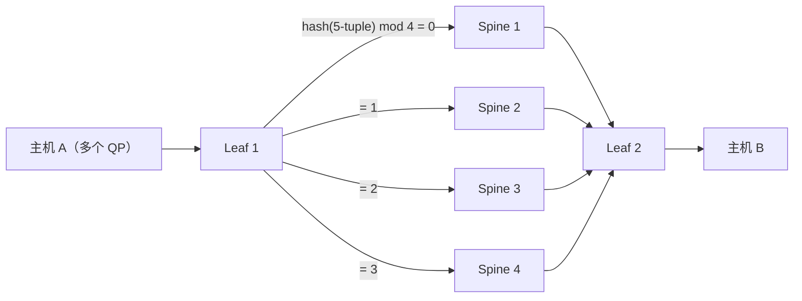
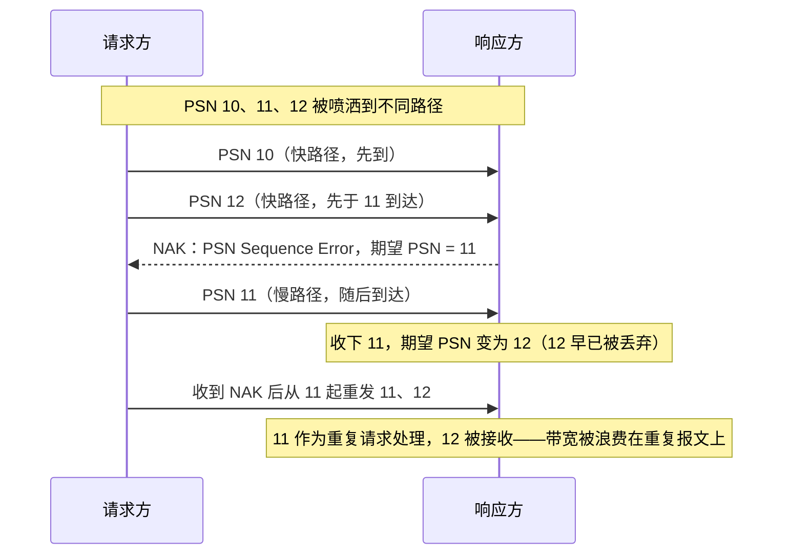

# ECMP、UDP 源端口熵与负载均衡（ECMP, UDP Source Port Entropy and Load Balancing）

> **摘要**：RoCEv2 把 UDP 源端口定义为"不透明的流标识"，供网络做等价多路径（ECMP）选路：有顺序要求的报文序列（如同一连接 QP）应使用固定的源端口（规范用语为 *should*），无顺序约束的报文可以使用不同源端口。本文解释 ECMP 哈希、哈希冲突与极化、大象流与低熵问题、提高熵的源端口/多 QP 策略与 Linux 的源端口算法、IPv6 Flow Label，以及自适应路由/逐包喷洒与 Go-back-N 的冲突和 AI 集群中的负载均衡考量。
>
> **规范出处**：Vol1 §A17.9.4（p.1948–1949）；§A17.3.2.1（p.1934）；§A17.3.2.2 / CA17-20（p.1934）；CA17-22（p.1935–1936）；C9-114（p.343）；C9-121/C9-122（p.350）；C9-137（p.360）
>
> **前置阅读**：[以太网/IP/UDP 头字段规则](../01-packet-format/02-ethernet-ip-udp.md)、[ICRC](../01-packet-format/06-icrc.md)、[事务排序与入站校验](../02-transport/03-ordering-and-validation.md)
>
> **关键词**：ECMP、五元组哈希、UDP 源端口、熵（entropy）、Flow Label、哈希极化、大象流、QP Scaling、自适应路由、逐包喷洒、flowlet、rail-optimized

---

## 1. 规范要求

### 1.1 §A17.9.4 与 §A17.3.2.1（意译）

- 数据中心 IP 网络通常用路径选择机制做负载均衡、提高拓扑利用率，ECMP 是其中最普遍的方法：路由器对报文的若干字段做哈希，在多条等价路径中选一条，以便既能多路径分担，又能保持单个流内的顺序〔Vol1 §A17.9.4, p.1948〕；
- RoCEv2 报文在 **UDP 源端口**中携带一个不透明的流标识，它是 UDP 报文哈希的一部分。因此端点应使**有顺序约束的报文序列**（例如来自一个连接型 QP 的报文）都携带同一个值；**彼此之间没有顺序约束的报文**可以使用不同的值〔Vol1 §A17.9.4, p.1948–1949〕；
- 网络设备可以把源端口作为选路的一个要素，因此 HCA *should* 在需要保序的报文之间使用固定的源端口（例如连接型 QP 的报文）〔Vol1 §A17.3.2.1, p.1934〕。

> [!NOTE]
> 源端口规则是 *should*（建议），不是 CA17 合规条款；但若违反（例如同一 RC QP 的报文使用不同源端口），在 ECMP 网络中报文会走不同路径而乱序到达，触发 Go-back-N 重传（见第 6 节），实际效果与"违规"无异。

### 1.2 相关的其它规则

| 规则 | 对负载均衡的影响 | 出处 |
|---|---|---|
| 目的端口固定为 IANA 分配值 4791 | 目的端口不提供任何熵 | CA17-20, p.1934 |
| UDP 源端口参与 ICRC 计算（未被屏蔽） | 中间设备不得改写源端口（例如 NAT/PAT 会破坏 ICRC） | CA17-22, p.1935–1936 |
| IPv6 Flow Label 在 ICRC 中被屏蔽 | 即使中间设备改写 Flow Label 也不影响 ICRC | CA17-22, p.1935–1936 |
| 接收端不校验源端口取值 | 规范未对源端口规定任何接收端检查；它只是供网络选路的不透明值，接收端不应据此丢包 | §A17.3.2.1 |

### 1.3 哪些报文之间有"顺序约束"

| 报文 | 是否需要固定源端口 | 说明 |
|---|---|---|
| 同一 RC / UC / XRC QP 发出的请求 | 是 | PSN 必须按序到达，否则响应方返回 NAK 并丢弃后续报文（C9-114/C9-122） |
| 响应方 QP 发出的 ACK / READ 响应 | 是（以响应方 QP 为单位） | 请求方按 PSN 检查响应顺序；响应方的源端口不必与请求方相同 |
| 不同 QP 的报文 | 否 | 可以（也应当）使用不同源端口以增加熵 |
| UD 数据报 | 视上层需求 | UD 不保证可靠与顺序；同一 QP 发往不同目的地的数据报之间通常无顺序约束 |
| CNP | 否 | CNP 不属于任何 PSN 序列 |

---

## 2. ECMP 哈希基础

### 2.1 五元组与有效熵

典型的 ECMP 哈希输入是五元组（源 IP、目的 IP、协议号、源端口、目的端口），哈希函数（CRC、异或折叠、Toeplitz 等）加上一个种子（seed），结果对等价下一跳数取模或映射到桶表。对 RoCEv2：

```text
哈希输入 = { SIP, DIP, Protocol = 17, SPORT = 每 QP 的流标识, DPORT = 4791 }
                                       ^^^^^^^^^^^^^^^^^^^^^^^   ^^^^^^^^^^^ 恒定
有效熵   = 主机对数 × 每主机对的 QP（源端口）数
```



### 2.2 哈希冲突：少量大流时的"掷球入桶"

把 m 个等大的流随机哈希到 n 条等价链路上（经典的 balls-into-bins 问题）。对于同步完成的集合通信，**负载最重的那条链路决定完成时间**。Monte-Carlo 计算（每组 10 万次）结果：

| 流数 m | 链路数 n | 理想每链路流数 | 最重链路期望流数 | 完成时间放大 | 期望空闲链路数 |
|---|---|---|---|---|---|
| 8 | 8 | 1 | 2.59 | 2.59× | 2.75 |
| 16 | 8 | 2 | 4.20 | 2.10× | 0.94 |
| 32 | 8 | 4 | 7.05 | 1.76× | 0.11 |
| 64 | 8 | 8 | 12.24 | 1.53× | ≈ 0 |
| 128 | 8 | 16 | 21.91 | 1.37× | ≈ 0 |
| 64 | 64 | 1 | 3.96 | 3.96× | 23.4 |

8 个流落在 8 条链路上完全不冲突的概率只有 8!/8⁸ ≈ 0.24%。结论：**流越少、越大，ECMP 越不均衡**；增加流的数量（更多 QP、更多源端口）能显著改善，但哈希的概率本质决定了它无法做到完美均衡。

### 2.3 哈希极化（Hash Polarization）

若多级交换机使用**相同的哈希函数、种子与字段**，第一级按 h mod 2 = 0 送往上行口 0 的那批流，到了第二级仍然满足 h mod 2 = 0，于是全部被送往同一个下一跳，另一半下一跳闲置：

```text
 第 1 级：h mod 2 == 0 → 上行 0；h mod 2 == 1 → 上行 1
 第 2 级（位于上行 0 之后）：收到的流都满足 h mod 2 == 0
          → 若仍用 h mod 2 选路，全部走下一跳 0，下一跳 1 永远空闲
```

缓解：各级使用不同的哈希种子或函数、取哈希值的不同比特、加入不同的字段〔业界实践，配置方式以交换机文档为准〕。

---

## 3. 大象流与低熵：RDMA 负载的特殊性

RDMA 流量（尤其是 AI 训练与存储复制）往往不符合"大量小流"的 ECMP 理想假设。Meta 公开的 AI 训练网络经验总结了三个特征〔业界实践: Meta, RDMA over Ethernet for Distributed AI Training at Meta Scale, SIGCOMM 2024〕：

1. **低熵**：流的数量与多样性远少于传统数据中心负载，且模式重复、可预测；
2. **突发性**：在毫秒级时间尺度上呈现"开/关"特征；
3. **大象流**：每次突发中单流强度可达网卡线速。

再叠加 RDMA 自身的特点——主机对之间 QP 数少、连接长期存在、网卡硬件限速/pacing 使报文间隙很小——一旦两个大流在 ECMP 上冲突，冲突会持续整个传输过程，表现为局部拥塞、PFC 触发与 DCQCN 降速。Meta 报告，早期 ECMP 因低熵表现不佳，曾改用按目的"slice"固定路径（path pinning），但在机架被部分分配给作业或链路故障时出现严重不均衡，训练性能下降可超过 30%。

---

## 4. 提高熵：源端口与多 QP 策略

### 4.1 〔业界实践: Linux〕内核的源端口算法

Linux RDMA 核心在 `include/rdma/ib_verbs.h` 中提供了 RoCEv2 源端口的统一计算方法（`rdma_calc_flow_label`、`rdma_flow_label_to_udp_sport`、`rdma_get_udp_sport`），注释写明"所有 RoCEv2 驱动都应使用同一约定"。其逻辑（以下为等价的 Python 重写，已运行验证）：

```python
def calc_flow_label(lqpn: int, rqpn: int) -> int:
    """应用未指定 Flow Label 时，由本端/远端 QPN 计算 20 bit 的对称 Flow Label。"""
    v = (lqpn * rqpn) & ((1 << 64) - 1)       # 两个 24 bit QPN 相乘，乘法可交换 → 两端结果相同
    v ^= v >> 20
    v ^= v >> 40
    return v & 0xFFFFF

def flow_label_to_udp_sport(fl: int) -> int:
    """把 20 bit Flow Label 折叠为 14 bit，落在 0xC000–0xFFFF（49152–65535）区间。"""
    lo = (fl & 0x03FFF) ^ ((fl & 0xFC000) >> 14)
    return lo | 0xC000

def get_udp_sport(fl: int, lqpn: int, rqpn: int) -> int:
    return flow_label_to_udp_sport(fl if fl else calc_flow_label(lqpn, rqpn))

assert get_udp_sport(0, 0x11, 0x12) == get_udp_sport(0, 0x12, 0x11) == 0xC132   # 对称
assert get_udp_sport(0, 0x1A3, 0x2B4) == 0xEC8D
assert get_udp_sport(0x12345, 1, 2) == 0xE341                                    # 指定了 Flow Label
```

要点：

- **范围**：源端口落在 49152–65535，即 14 bit 熵；
- **对称性**：两端用 (本端 QPN, 远端 QPN) 计算，乘法可交换，因此请求方与响应方得到同一个 Flow Label 与源端口；
- **应用可控**：若应用在地址向量中给出非零 Flow Label（`ah_attr.grh.flow_label`），源端口由它派生——这给了应用"按 QP 指定路径熵"的手段；
- **谁在用**：上游 mlx5 驱动在 RC/UC/XRC QP 使用 RoCEv2 类型 GID、且设置了目的 QPN 时按此计算 `udp_sport`；Soft-RoCE（rxe）在 Modify QP 设置地址向量时同样调用 `rdma_get_udp_sport`。其它驱动与固件的实际做法以其实现为准。

### 4.2 策略汇总

| 策略 | 做法 | 效果 / 代价 | 来源 |
|---|---|---|---|
| 每 QP 一个源端口（默认） | 按上述算法或驱动策略 | 熵 = QP 数；QP 少时冲突严重 | 规范建议 + 实现 |
| 多 QP 并行（QP Scaling） | 一个逻辑连接使用多个 QP：把每条消息切分到多个 QP，或把消息轮流投递到不同 QP | 流数成倍增加；切分方式会产生更小的消息与更多 ACK | 〔业界实践: Meta, SIGCOMM 2024〕 |
| 交换机按 BTH.DestQP 加哈希（E-ECMP） | 利用交换芯片的自定义字段（UDF）能力，把 RoCE 报文的目的 QP 字段也纳入哈希 | Meta 报告结合 QP Scaling，AllReduce 性能最多提升 40% | 〔业界实践: Meta, SIGCOMM 2024〕 |
| 应用指定 Flow Label | 为不同 QP 设置不同的非零 Flow Label，间接决定源端口 | 可做"有意识"的分散；需要了解网络哈希行为 | 〔业界实践: Linux〕 |
| 拓扑感知调度 | 作业调度器尽量把通信密集的节点放在同一区域，减少跨区（通常有收敛比）流量 | 降低对 ECMP 的依赖 | 〔业界实践: Meta, SIGCOMM 2024〕 |

〔业界实践: NCCL 文档〕集合通信库 NCCL 用 `NCCL_IB_QPS_PER_CONNECTION`（2.10 起，每对 rank 之间每个连接使用的 QP 数，取值 1–128，默认 1；文档明确说明其用途是在多级 fabric 中获得更好的路由熵）实现 QP Scaling，并用 `NCCL_IB_SPLIT_DATA_ON_QPS`（2.18 起）选择"把每条消息均分到各 QP"（1）还是"按消息轮流使用各 QP"（0，自 2.20 起为默认）——正好对应上表中 Meta 比较的两种策略。具体行为以所用 NCCL 版本文档为准。

---

## 5. IPv6 Flow Label 参与哈希

- RFC 6437 定义了 IPv6 Flow Label 的语义，RFC 6438 讨论了用 Flow Label 做 ECMP/LAG 哈希〔外部: RFC 6437, RFC 6438〕；许多交换机可配置把 Flow Label 纳入哈希；
- Annex A17 对 IPv6 头只规定了 DSCP、ECN、Payload Length、Next Header、Hop Limit 与源/目的地址（CA17-13…CA17-19），没有为 Flow Label 规定取值条款；Flow Label 只在 ICRC 计算中被屏蔽（CA17-22）。其取值通常来自地址向量的 Flow Label，具体以实现为准；
- 与源端口一样，**同一个有序 QP 的 Flow Label 也必须保持不变**，否则以 Flow Label 参与哈希的网络会把它拆到多条路径上。

---

## 6. 自适应路由、逐包喷洒与 Go-back-N 的冲突

### 6.1 三类负载均衡手段

| 手段 | 原理 | 乱序风险 | 均衡质量 |
|---|---|---|---|
| 按流哈希（ECMP） | 同一五元组固定一条路径 | 无 | 低熵时差 |
| Flowlet 切换 | 只在流内出现足够大的空隙（大于路径时延差）时换路径，例如 CONGA、LetFlow〔论文: CONGA, SIGCOMM 2014；LetFlow, NSDI 2017〕 | 理论上无 | 取决于空隙；RDMA 线速流空隙少，收益有限 |
| 逐包自适应路由 / 喷洒 | 每个报文按实时负载选路 | 高 | 最好 |

### 6.2 为什么逐包喷洒与规范行为冲突

规范行为下，响应方遇到乱序 PSN 会返回 NAK（PSN Sequence Error）并丢弃后续非期望 PSN 的新请求（C9-114、C9-121、C9-122）；请求方从 NAK 指示的 PSN 起回退重发（§9.7.6.1.2）。对传输层而言，**乱序与丢包无法区分**：



更严重的是：请求方每收到一次针对同一请求报文的 NAK-Sequence Error，就把 3 bit 重试计数器减 1（C9-137）〔Vol1 §9.7.6.1.2, p.360〕。持续的乱序可能使同一报文反复被 NAK，计数耗尽后请求方判定本地错误、QP 进入错误状态——这不是性能问题，而是**可用性问题**。

### 6.3 支持喷洒需要什么

- **网卡容忍乱序**：要么在网卡中做重排序缓冲，要么像 IRN 那样把乱序报文直接放置到最终地址并用位图追踪（见 [其他拥塞控制与有损 RoCE](05-advanced-cc-and-lossy-roce.md) 第 5、7 节）。IRN 论文提到 ConnectX-5 为支持自适应路由引入了部分乱序放置能力（仅限 Write/Read）〔论文: IRN, SIGCOMM 2018〕；
- **端到端一致性**：交换机的自适应路由与网卡的乱序处理必须配套启用，通常意味着同一厂商的端到端方案〔业界实践，以厂商资料为准〕；
- **新传输协议**：UEC 的 UET 把多路径喷洒作为一等公民，用可靠无序交付（RUD）与 SACK 支撑〔外部: UEC Specification〕。

> [!WARNING]
> 在网卡不支持乱序的前提下打开交换机的逐包自适应路由，会看到网卡 `out_of_sequence`、`packet_seq_err` 一类计数器（〔业界实践: Linux mlx5 计数器名〕）快速增长、吞吐下降，严重时 QP 因重试耗尽进入错误状态。

---

## 7. AI 集群拓扑中的负载均衡考虑（外部，简述）

| 话题 | 要点 | 来源 |
|---|---|---|
| Clos / fat-tree | 后端训练网络通常设计为无阻塞两级或三级 Clos；跨区域（如跨 AI Zone）的链路可能有收敛比，靠 ECMP 分担 | 〔业界实践: Meta, SIGCOMM 2024〕 |
| Rail-optimized | 各服务器上"本地编号相同"的 GPU 网卡连接到同一组叶交换机（同一 rail），使大部分集合通信流量在 rail 内一跳完成；跨 rail 流量可先经机内高速互联转到对应 GPU 再出机 | 〔业界实践: NVIDIA DGX SuperPOD 参考架构、NCCL 文档〕 |
| 同步大流 | 集合通信产生同时开始、大小相同的流，最慢的流决定迭代时间，ECMP 冲突会直接放大为作业减速（见 2.2 节表格） | 通用分析 |
| 拓扑感知调度 | 调度器按"最小割"划分节点，减少跨区流量 | 〔业界实践: Meta, SIGCOMM 2024〕 |
| 多路径演进 | 逐包喷洒 + 网卡乱序处理、可编程源端口/路径选择、新传输协议 | 见 [05](05-advanced-cc-and-lossy-roce.md) |

---

## 8. 「硬件实现要点」

- **每 QP 源端口寄存器**：16 bit，存放在 QP 上下文，在 Modify QP（设置地址向量/目的 QPN）时由驱动或硬件计算一次；发送路径直接取用，不要每包计算。
- **UD 的源端口**：UD 每个 WQE 可指向不同地址句柄（AH），源端口可随 AH（例如 AH 的 Flow Label）变化，需要在 WQE 处理阶段确定。
- **接收侧不检查源端口**：源端口是不透明值；入站解析只需确认目的端口为 4791（CA17-20）。不要把源端口作为 QP 查找键的一部分。
- **ICRC**：源端口参与 ICRC；修改源端口的任何"优化"（例如重传时换路径）都必须重新计算 ICRC，并且会破坏该 QP 的顺序假设——只有在支持乱序的扩展协议中才可这样做。
- **多路径扩展**：若要在单个 QP 内使用多条路径，需要每路径的源端口/熵值、每路径的拥塞状态（类似 UEC 的做法）以及乱序接收能力，已超出 IBTA 规范。
- **可观测性**：提供 PSN 乱序（out-of-sequence）、NAK 发送/接收、重复请求等计数器，便于发现网络乱序；硬件计数器设计见 [排障指南](../07-engineering-practice/05-troubleshooting.md)。

---

## 9. 「工程提示」

- **确认哈希字段**：交换机 ECMP/LAG 哈希必须包含 UDP 四层端口（部分设备需显式开启）；IPv6 网络可考虑加入 Flow Label。
- **各级不同种子**：避免哈希极化。
- **增加流数**：增大每连接 QP 数、为不同 QP 设置不同 Flow Label；有条件时使用按 BTH.DestQP 哈希的增强 ECMP。
- **监控不均衡**：对比同一 ECMP 组各成员链路的利用率；集合通信场景下关注"最热链路"。
- **不要 NAT RoCEv2 流量**：源端口参与 ICRC，改写即校验失败（CA17-24：静默丢弃）。
- **启用自适应路由前**：确认网卡端支持乱序接收，否则先保持按流哈希。

---

## 10. 要点回顾

- UDP 源端口是 RoCEv2 的不透明流标识，参与 ECMP 哈希；同一连接 QP 的报文 *should* 使用固定源端口（§A17.3.2.1、§A17.9.4），无顺序约束的报文可用不同值。
- 目的端口固定为 4791，不提供熵；源端口参与 ICRC，中间设备不得改写；IPv6 Flow Label 在 ICRC 中被屏蔽。
- 少量大流时 ECMP 冲突严重：8 流 8 链路无冲突概率仅约 0.24%，最热链路期望 2.59 个流；增加流数可改善但无法消除。
- 多级使用相同哈希会产生极化，应使用不同种子/函数。
- Linux 内核的统一算法：无 Flow Label 时由 (本端 QPN × 远端 QPN) 折叠出对称的 20 bit Flow Label，再折叠为 0xC000–0xFFFF 范围内的源端口。
- 提高熵：QP Scaling、按 DestQP 哈希、应用指定 Flow Label、拓扑感知调度。
- 逐包喷洒在规范行为下等同于丢包：触发 NAK 与回退重传，持续乱序还可能耗尽 3 bit 重试计数器（C9-137）使 QP 出错；需要网卡乱序处理或新传输协议。

---

## 自测

<details><summary>Q1：为什么 RoCEv2 选择用 UDP 源端口而不是目的端口来携带流标识？</summary>

答：目的端口必须是 IANA 分配的 4791（CA17-20），接收端靠它识别 RoCEv2 报文，不能变化；源端口对接收端无语义，可由发送端自由选择，又是 ECMP 五元组哈希的一部分，因此用来携带流熵（§A17.9.4、§A17.3.2.1）。
</details>

<details><summary>Q2：一个 RC QP 的发送端为了"更好地负载均衡"，让每个报文轮流使用 4 个不同的源端口，会发生什么？</summary>

答：报文被 ECMP 分到不同路径、乱序到达；响应方按规范对乱序 PSN 返回 NAK 并丢弃后续报文（C9-114/C9-121/C9-122），请求方回退重发，带宽浪费、时延增大；持续乱序还可能使重试计数器耗尽（C9-137），QP 进入错误状态。
</details>

<details><summary>Q3：按 Linux 的算法，本端 QPN = 0x11、远端 QPN = 0x12、未指定 Flow Label 时，源端口是多少？对端算出的源端口一样吗？</summary>

答：0x11 × 0x12 = 0x132，折叠后 Flow Label = 0x132，源端口 = 0x132 | 0xC000 = 0xC132（49458）。对端用 (0x12, 0x11) 计算，乘法可交换，结果相同。
</details>

<details><summary>Q4：什么是哈希极化？如何避免？</summary>

答：多级交换机使用相同的哈希函数/种子/字段时，经第一级筛选后到达某个第二级交换机的流在第二级哈希上高度相关，只会落到部分下一跳上，导致链路闲置。避免方法：各级使用不同种子或哈希函数、取哈希值的不同比特、加入不同字段。
</details>

<details><summary>Q5：为什么说在不支持乱序的 RoCE 网卡上启用逐包自适应路由不仅是性能问题，还可能是可用性问题？</summary>

答：规范行为下乱序被当作丢包，触发 NAK 与回退重传（性能问题）；而每次针对同一请求报文的 NAK-Sequence Error 都会使 3 bit 重试计数器减 1（C9-137），持续乱序可能把计数器耗尽，请求方判定本地错误、QP 进入错误状态，连接中断（可用性问题）。
</details>

---

## 参考

- 规范：Vol1 §A17.9.4（p.1948–1949）；§A17.3.2.1、§A17.3.2.2 / CA17-20（p.1934）；CA17-13…CA17-19（p.1933–1934）；CA17-22（p.1935–1936）；CA17-24（p.1936）；C9-114（p.343）；C9-121/C9-122（p.350）；§9.7.6.1.2 / C9-137（p.360）。
- 外部：RFC 6437（IPv6 Flow Label Specification）；RFC 6438（Using the IPv6 Flow Label for ECMP and LAG in Tunnels）；Ultra Ethernet Consortium, UE Specification。
- 论文：Alizadeh et al., "CONGA: Distributed Congestion-Aware Load Balancing for Datacenters"，SIGCOMM 2014；Vanini et al., "Let It Flow: Resilient Asymmetric Load Balancing with Flowlet Switching"，NSDI 2017；Mittal et al., "Revisiting Network Support for RDMA"（IRN），SIGCOMM 2018。
- 业界实践：Linux `include/rdma/ib_verbs.h`（`rdma_calc_flow_label`、`rdma_flow_label_to_udp_sport`、`rdma_get_udp_sport`）、`drivers/infiniband/hw/mlx5/qp.c`、`drivers/infiniband/sw/rxe/rxe_verbs.c`、`drivers/infiniband/hw/mlx5/counters.c`；Meta, "RDMA over Ethernet for Distributed AI Training at Meta Scale"，SIGCOMM 2024；NVIDIA DGX SuperPOD 参考架构与 NCCL 文档。
