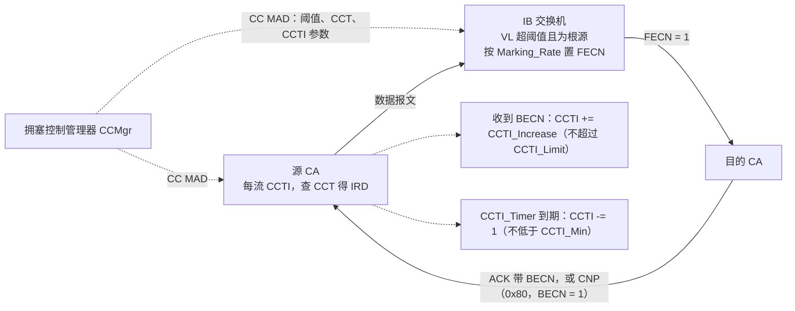

# IB 拥塞控制（Annex A10）与 RoCEv2 对比（InfiniBand Congestion Control vs RoCEv2 Congestion Management）

> **摘要**：InfiniBand 的拥塞控制（Annex A10）由交换机按 VL 检测拥塞并置 BTH.FECN，目的 CA 用 BECN（放在 ACK 中或用 OpCode 0x80 的 CNP）回传，源 CA 查拥塞控制表（CCT）加大包间注入延迟，全部参数由拥塞控制管理器通过 CC MAD 配置。RoCEv2 不使用这套机制（§A17.4.8、CA17-29），而是采用基于 IP ECN 的 RCM。本文介绍 A10 的机制与管理、解释其不适用于 RoCEv2 的原因、给出两者的概念映射与对比大表，并简述第 9.11 节的静态速率控制（IPD）及其与动态拥塞控制的关系。
>
> **规范出处**：Annex A10（p.1797–1847）：§A10.1（p.1797–1802）、§A10.2（p.1803–1814）、§A10.3（p.1814–1816）、§A10.4（p.1816–1834）、§A10.5（p.1834 起）；§A17.4.8（p.1940）；§A17.6（p.1942–1943）；§A16.7.3–A16.7.4（p.1919）；§9.11（p.456–459）；§17.2.6（p.1198–1199）；Annex A13 §A13.3.5（p.1868）
>
> **前置阅读**：[ECN 与 CNP](03-ecn-and-cnp.md)、[BTH 逐字段详解](../01-packet-format/03-bth.md)、[MAD 格式与 GSI](../04-connection-management/03-mad-and-gsi.md)
>
> **关键词**：FECN、BECN、CNP（0x80）、CCT、CCTI、CCTI_Increase、CCTI_Timer、CCTI_Limit、CCTI_Min、IRD、Root/Victim、Victim_Mask、Credit Starvation、CC MAD、CC_Key、静态速率控制、IPD

---

## 1. A10 的设计目标：消除拥塞扩散

A10 用 Figure 332 说明问题〔Vol1 §A10.1.2, p.1799–1801〕：交换机 1 的端口 G 被多个源打满；交换机 2 上的端口 F 也发往 G，耗尽了两台交换机之间链路的信用；此时与 G 毫无关系、只需 20% 带宽的 X→Y 流也因拿不到信用而被阻塞。A10 区分两类拥塞端口：

- **根源（root）**：输出 VL 的队列超过阈值，但**有信用**可以发送——数据能出去，只是到达太快；
- **受害者（victim）**：输出 VL 超过阈值，且因**缺少信用**而发不出去——它是被下游拥塞"传染"的。

A10 的目标是在可能时避免、已发生时消除拥塞扩散：只限制造成根源拥塞的那些源（A–F）的注入速率，使其它流（X→Y）不受影响。A10 也把"连接到处理不过来的 CA 的交换机端口"列为特例：此时交换机会把自己视为受害者，可配置为在受害状态下也进入拥塞状态。

A10 的要点概括〔Vol1 §A10.1.3, p.1801–1802〕：交换机按 VL 检测拥塞并区分根源/受害；用 FECN 标记经过拥塞端口的部分报文；目的 CA 通过 BECN 通知源；源 CA 暂时降低注入速率，随后逐步恢复；可按 QP 或按 SL 控制；交换机与 CA 保存循环日志供管理器读取；访问受 CC_Key 保护；与静态速率控制共存时取两者中更低的速率。

---

## 2. 交换机行为

### 2.1 拥塞检测：0–15 的阈值权重

每个端口的拥塞阈值由 0–15 的权重决定〔Vol1 §A10.2.1.1, p.1803–1804〕：

| 权重 | 含义 |
|---|---|
| 0 | 不标记（CA10-2） |
| 1 | 高阈值：留给在途报文的空间少，拥塞扩散概率高 |
| 2–14 | 在 1 与 15 之间均匀分布 |
| 15 | 低阈值：更不易扩散，但更可能在非拥塞时误标记 |

- 权重 n 产生的阈值必须低于权重 n−1（CA10-3）；共 16 个不同等级（CA10-4）；默认权重 *should* 为 8；
- 权重 15 的标定方法：在每个端口、每个已配置 VL 上，以 256 字节定长报文、均匀随机目的地址、176 字节报文间隔（约 60% 负载）加载时，被标记 FECN 的概率小于 1%；
- 阈值与缓冲架构（输出缓冲、输入缓冲、共享缓冲、VOQ 等）的具体映射留给芯片设计者。

### 2.2 根源与受害判定、标记

- 交换机必须能判定自己是根源还是受害者（CA10-5～CA10-7）；判定可以做时间平滑；
- 端口 VL 在根源状态下必须进入拥塞状态（CA10-8）；在受害状态下，仅当该端口的 **Victim_Mask** 置位时才进入拥塞状态（CA10-9），典型用于增强型端口 0 或连接慢速 CA 的端口；
- 拥塞状态下，交换机在报文 BTH 中**置 F（FECN）位**（CA10-11）；不标记 Raw 报文（CA10-12）；小于 **Packet_Size** 的报文不标记（CA10-13，单位为信用）；按 **Marking_Rate**（相邻两个可标记报文之间的平均报文数）抽样标记（CA10-14）；
- FECN/BECN 所在的 BTH 字节不在 ICRC 覆盖范围内（计算时被屏蔽），因此交换机改写这两位不会破坏 ICRC〔Vol1 §A10.3.1, p.1814–1815；§9.2.9–9.2.10, p.261〕。

### 2.3 日志、计数器与信用饥饿

- **交换机拥塞日志**：15 项循环缓冲（CA10-16），基于由链路比特率派生、以 1.024 µs 递增的 32 bit 自由运行计时器（CA10-18）；
- **计数器**：端口某 VL 处于拥塞状态的时长 PortXmitTimeCong、任一 VL 处于拥塞状态的时长 PortVLXmitTimeCong（CA10-21）；
- **信用饥饿（Credit Starvation，可选）**：面向不支持拥塞控制的上游设备，当某输入端口 VL 的平均缓冲占用超过 CS_Threshold 时，按 CS_ReturnDelay 推迟向上游返还信用（oA10-1～oA10-5）。它会影响经过该端口的所有流，而不仅是经过拥塞根源的流。

---

## 3. CA 行为

### 3.1 目的 CA：把 FECN 反射为 BECN

〔Vol1 §A10.2.2, p.1808–1810〕

- 忽略多播报文、ACK、CNP 上的 FECN（CA10-22）；
- 收到有效 FECN 后，在返回的 **ACK 或 CNP** 的 BTH 中置 B（BECN）位（CA10-23）。对 RC 可把 BECN 放进 ACK 以省去 CNP；但 RDMA READ 响应本身是"ACK 类"报文且可能受 IRD 控制，此时应使用 CNP 把 BECN 送回其源；
- 以 BECN 标记 ACK 时，无论收到报文的 AckReq 位如何都要调度这个 ACK（CA10-26）；合并的 ACK 只要覆盖范围内有一个应带 BECN，就必须置 BECN（CA10-27）；
- 资源要求：每 QP 至少能调度 1 个 CNP，或（集中分配时）每端口至少 32 个（CA10-24）；资源耗尽时丢弃对应的 BECN；
- 收到 FECN 后应尽快调度 ACK 或 CNP。

### 3.2 IB CNP 格式（§A10.3.2）

IB CNP 由 LRH + GRH（原报文带 GRH 时）+ BTH + ICRC + VCRC 组成，没有载荷〔Vol1 §A10.3.2, p.1815–1816〕：

| 字段 | 取值 |
|---|---|
| LRH.LVer | 0x0（对 1.1 及更早的交换机透明） |
| BTH.OpCode | 0b1000_0000（0x80） |
| BTH.B（BECN） | 1 |
| BTH.DestQP | 被标记 FECN 的报文的源 QP：UD 取自 DETH；UC/RC/XRC 取自 QP 上下文；RD 取自 EE 上下文 |
| BTH.PSN | 0，接收方忽略 |
| BTH.P_Key | 与被标记报文的 P_Key 相同 |
| BTH.TVer | 0 |
| SE、M | 不得置位 |
| GRH | 原报文有 GRH 则必须带 GRH；UD 情况下 DGID 取原报文的 SGID，FlowLabel 与 TrafficClass 复制原报文，HopLimit = 0xFF |

### 3.3 源 CA：拥塞控制表（CCT）与注入速率延迟（IRD）

〔Vol1 §A10.2.2.1, p.1810–1812〕

- **CCT**：每端口一张，至少 128 项，只能以 64 项为单位扩展（CA10-30、CA10-31）；容量以 64 项块数报告于 CongestionInfo.ControlTableCap（至少 2 块）；
- **CCT 表项**：16 bit = 2 bit Shift + 14 bit Multiplier；
- **IRD 计算**（CA10-28）：同一流的下一个报文，必须在上一个报文被调度至少 Ts 之后才能调度：

```text
Ts = (TpacketTime >> Shift) × Multiplier
TpacketTime = 发送上一个报文所需时间 = LRH:PktLen × 4 / Lr     （Lr 为端口实际速率）
等效注入速率比例 = TpacketTime / Ts = 2^Shift / Multiplier      （大于 1 时即不限速）
```

| Shift | Multiplier | 速率比例 |
|---|---|---|
| 0 | 1 | 100%（不限速） |
| 0 | 2 | 50% |
| 1 | 3 | 66.7% |
| 3 | 9 | 88.9% |
| 0 | 16383 | ≈ 0.0061%（规范给出的最低约 100/2¹⁴ %） |

- **流的粒度**：按端口设置为"按 QP"或"按 SL"（CACongestionSetting.Port_Control bit 0，二者择一，CA10-35）；每个流维护自己的 CCTI（CA10-36，正文还说明每个流有 CCTI_Min），每个端口 SL 维护 CCTI_Min、CCTI_Increase、CCTI_Timer（CA10-37），并可设置 Trigger_Threshold；按 SL 控制时，同一 SL 上所有 QP 共享一个 CCTI，按 QP 控制时每个 QP 使用其 SL 的参数；
- **降速**：每收到一个 BECN，CCTI 增加该 SL 的 CCTI_Increase（CA10-39、CA10-40），不超过 CCTI_Limit（CA10-41），到达上限后不记录额外的 BECN；
- **提速**：每个端口 SL 的 CCTI_Timer（以 1.024 µs 为单位，范围 1.024 µs～67 ms，CA10-38）到期时，与该 SL 关联的每个流的 CCTI 减 1，但不低于 CCTI_Min 与 0（CA10-42）；CCTI 为 0 时不加任何注入延迟；
- **聚合**：CA 可以先把少量报文（至多 4 个 MTU）聚合后再施加相应的 IRD；
- **与静态速率共存**：IRD 取静态速率控制与拥塞控制两者中**较大**的延迟（CA10-29）。



### 3.4 CA 日志与计数器

- **拥塞阈值事件日志**：CCTI 增大到不小于 Trigger_Threshold 时记录事件；13 项循环缓冲（CA10-44.1.1），32 bit、1.024 µs 计时器（CA10-47）；
- **计数器**：PortPktRcvFECN、PortPktRcvBECN、PortSLRcvFECN、PortSLRcvBECN（CA10-50）。

---

## 4. 拥塞控制管理（§A10.4）

| 项目 | 内容 | 出处 |
|---|---|---|
| 管理代理 | 支持拥塞控制的节点必须有 CC 管理代理（CCMgtA） | CA10-52, p.1816 |
| MAD 类 | 管理类 0x21，ClassVersion = 2 | §A10.4.1, p.1816–1817 |
| MAD 布局 | 24 B 通用 MAD 头 + 8 B CC_Key + 32 B 拥塞日志数据 + 192 B CCMgt 数据 | Table 556, p.1817 |
| 安全 | CC_Key 校验（0 表示不校验）；ProtectBit 与租期（LeasePeriod，单位秒，0 表示无限）定义四种保护级别；校验失败时丢弃 MAD、计数、发 Trap/Notice、启动租期计时 | §A10.4.1.1, p.1817–1820 |
| 方法 | Get 0x01、Set 0x02、GetResp 0x81、Trap 0x05、TrapRepress 0x07 | Table 560, p.1820 |

| 属性 | ID | 适用 | 用途 |
|---|---|---|---|
| ClassPortInfo | 0x0001 | 交换机、CA | 能力位（如 EnhancedPort0CC、静态速率控制可否关闭等） |
| Notice | 0x0002 | 交换机、CA | CC_Key 违规通知 |
| CongestionInfo | 0x0011 | 交换机、CA | 是否支持信用饥饿；CCT 容量（64 项块数） |
| CongestionKeyInfo | 0x0012 | 交换机、CA | CC_Key、保护位、租期、违规计数 |
| CongestionLog | 0x0013 | 交换机、CA | 读取循环日志 |
| SwitchCongestionSetting | 0x0014 | 交换机 | Victim_Mask、Credit_Mask、Threshold、Packet_Size、CS_Threshold、CS_ReturnDelay、Marking_Rate 等 |
| SwitchPortCongestionSetting | 0x0015 | 交换机 | 按端口块（每块 48 个端口）设置阈值/包长/标记率或信用饥饿参数 |
| CACongestionSetting | 0x0016 | CA | Port_Control（按 QP/SL、静态速率开关）与 16 个 SL 的 CCTI_Timer、CCTI_Increase、Trigger_Threshold、CCTI_Min |
| CongestionControlTable | 0x0017 | CA | CCTI_Limit 与最多 64 个 CCT 表项（属性修饰符给出起始块） |
| TimeStamp | 0x0018 | 交换机、CA | 读取 1.024 µs 自由运行计时器 |

〔Vol1 Table 561, p.1821；§A10.4.3, p.1822–1834〕

CCT 分多个 MAD 装载时，规范建议每个 MAD 的 CCTI_Limit 只覆盖到已装载的表项（例如 150 项的表分三次装载，CCTI_Limit 依次设为 63、127、149），避免装载过程中 CCTI 越过有效区域〔Vol1 §A10.4.3.9.1, p.1832–1833〕。A13 还指出，主动型 QoS 管理器若要调整 CCTI_Min、CCTI_Timer、CCT Shift/Multiplier 等参数，应通过拥塞控制管理器进行〔Vol1 §A13.3.5, p.1868〕。

---

## 5. 为何 A10 不适用于 RoCEv2

### 5.1 规范的表述

- **RoCE v1**（§A16.7.4）：A10 要求交换机按 VL 检测拥塞、用 BTH 的 FECN 通知目的 CA、由 IB 拥塞控制管理器配置阈值与注入速率；以太网中既没有 IB 交换机也没有 VL，因此该机制不适用；即使 CA 的 IB 端口声明符合 A10，其 RoCE 端口也不必支持 A10 的属性、计数器与控制；CA16-16 规定 B/F 位不使用、接收时忽略，并特别指出这两位本来就不在 ICRC 覆盖范围内〔Vol1 §A16.7.4, p.1919〕。
- **RoCEv2**（§A17.4.8）：RoCEv2 的拥塞管理由 §A17.9.3 规定；A10 不适用于 RoCEv2 端口，豁免同上；**CA17-29**：BTH 中用于 A10 的 B（BECN）与 F（FECN）位不使用，RoCEv2 端口必须忽略〔Vol1 §A17.4.8, p.1940〕。
- **管理面**（§A17.6）：拥塞控制（Congestion Control）管理类与 SM、SA、PM 等一起被列为不适用于 RoCEv2 端口；RoCEv2 端口接入的 IP 子网按以太网/IP 的常规实践管理〔Vol1 §A17.6, p.1942–1943〕。

### 5.2 背后的工程原因

| A10 依赖的要素 | 在 RoCEv2 网络中的情况 |
|---|---|
| 交换机能解析并改写 BTH.FECN | 以太网/IP 交换机不解析 UDP 载荷中的 BTH；它们普遍支持 IP 头的 ECN（RFC 3168） |
| 基于 VL 与信用的根源/受害判定 | 以太网没有 VL 与信用流控；对应物是优先级队列与（可选的）PFC |
| 子网管理器与拥塞控制管理器下发参数 | 没有 SM/CCMgr，网络由传统网管/自动化系统配置，网卡参数由驱动或厂商工具配置 |
| CCT 的 TpacketTime 基于 LRH:PktLen | RoCEv2 没有 LRH（§A17.4.1.2） |
| 按 SL（16 个）配置的表 | RoCEv2 只有 8 个以太网优先级，SL 8–15 保留 |

因此 RoCEv2 复用了"FECN → 反射 → 源端降速"的**思想**，但把信号换成 IP ECN、把反馈固定为 CNP（0x81）、把算法与配置留给实现（§A17.9.3）。

---

## 6. 概念映射：A10 ↔ RCM

| Annex A10（IB） | RCM（RoCEv2） | 说明 |
|---|---|---|
| 交换机置 BTH.FECN | 交换机置 IP.ECN = 11（CE） | §A17.9.3：目的端点"按 FECN 的精神"理解 ECN 标记 |
| 目的 CA 用 ACK 中的 BECN 或 CNP（0x80）回传 | 目的 HCA 只用 CNP（0x81）回传 | RoCEv2 不在 ACK 中携带拥塞信息 |
| 源 CA：CCTI += CCTI_Increase，查 CCT 得 IRD | 源 HCA：按"速率降低参数"降速（CA17-45），算法不规定 | 业界常用 DCQCN |
| CCTI_Timer 到期 CCTI −1 | 按时间和/或字节数提速（CA17-46） | DCQCN 的定时器 T 与字节计数器 B |
| 交换机 Threshold / Marking_Rate / Packet_Size | RED/WRED-ECN 的 Kmin / Kmax / Pmax | 交换机本地配置 |
| Victim_Mask、根源/受害判定 | 无直接对应：ECN 按出口队列长度标记 | — |
| 信用饥饿 | 大致对应于 PFC 这种链路级反压 | 二者都会波及经过该链路的所有流 |
| CC MAD + CC_Key | 不在规范范围内（厂商工具、sysfs/debugfs 等） | 例如 mlx5 的 `cc_params` |
| 日志与 PortPktRcvFECN 等计数器 | 厂商计数器（如 mlx5 的 `np_ecn_marked_roce_packets`、`np_cnp_sent`、`rp_cnp_handled`） | 见 [ECN 与 CNP](03-ecn-and-cnp.md) |

---

## 7. 对比大表

| 维度 | IB 拥塞控制（Annex A10） | RoCEv2 RCM（Annex A17 §A17.9.3） |
|---|---|---|
| 是否可选 | 可选；实现则须遵守 A10.2 | 可选；实现则须遵守 CA17-44…46 |
| 拥塞检测位置 | 交换机输出端口的每个 VL，区分根源/受害 | 交换机出口队列（具体策略不属于 IBTA 规范） |
| 标记位置 | BTH.FECN（不在 ICRC 覆盖内） | IP.ECN（TOS/Traffic Class，在 ICRC 中被屏蔽） |
| 标记策略参数 | 阈值权重 0–15、Marking_Rate、Packet_Size、Victim_Mask | 业界常用 RED/WRED：Kmin/Kmax/Pmax |
| 反馈方式 | ACK 中的 BECN，或 CNP | 仅 CNP |
| CNP OpCode | 0b1000_0000（0x80），BECN = 1 | 0b1000_0001（0x81），F/B 位不用 |
| CNP 结构 | LRH (+GRH) + BTH + ICRC + VCRC | Eth + IP + UDP + BTH + 16 B 保留 + ICRC + FCS |
| 反馈合并 | ACK 中的 BECN 可合并；CN 资源每 QP ≥1 或每端口 ≥32 | 同一 QP 的多个标记报文可只发一个 CNP |
| 源端算法 | **规范定义**：CCT 查表、CCTI 增减、IRD 公式 | **不规定**：降速/提速参数与算法在规范之外 |
| 控制粒度 | 按 QP 或按端口 SL（二选一） | 按 QP（CNP 中的 DestQP） |
| 提速机制 | 每 SL 的 CCTI_Timer 周期性减 CCTI | 按时间和/或字节数（*should*） |
| 配置与管理 | CCMgr 经 CC MAD（类 0x21）配置，CC_Key 保护，日志与计数器标准化 | 规范之外：交换机与网卡各自配置，计数器为厂商定义 |
| 与静态速率的关系 | 取两者中较大的延迟（CA10-29） | 规范未说明，实现上通常取两者中较低的速率 |
| 对网络设备的要求 | 支持 A10 的 IB 交换机 | 支持 ECN 标记的普通以太网/IP 交换机 |

---

## 8. 静态速率控制（§9.11）与动态拥塞控制的关系

### 8.1 规范内容

〔Vol1 §9.11, p.456–459〕

- **定义**：端点把注入速率保持在预先配置值以下的能力，用于避免高速 CA 向低速路径或低速目的 CA 注入超过其接收能力的流量（例如 10 Gb/s 的 CA 经交换机发往 2.5 Gb/s 的 CA）。规范把它与 A10 的拥塞控制并列为两种拥塞管理机制；
- **三个信息来源**：设备报告的端口速率（ClassPortInfo）、SM 为源/目的对报告的最佳速率（PathRecord）、连接建立 MAD 中的 CA "包间延迟（Inter Packet Delay, IPD）"参数；
- **强制要求**：能以高于 2.5 Gb/s 注入的端口必须提供静态速率控制（o9-163）；同一源端口发往同一目的端口（完整 DLID）的报文，后一个报文必须在前一个报文被调度后至少经过 T 才能调度（o9-164、o9-165）：

```text
T = (IPD + 1) × 发送前一个报文所需时间        发送时间 = LRH:PktLen × 4 / Lr
等效速率比例 = 1 / (IPD + 1)
```

| IPD | 速率 | 规范示例用途 |
|---|---|---|
| 0 | 100% | 速率匹配的链路 |
| 1 | 50% | — |
| 2 | 33% | 30 Gb/s → 10 Gb/s |
| 3 | 25% | 10 Gb/s → 2.5 Gb/s |
| 11 | 8% | 30 Gb/s → 2.5 Gb/s |

- IPD 是非负实数；请求不支持的 IPD 时，CA 必须选一个支持的值并通过 MAD 或 Verbs 返回（C9-226），建议取比请求值大的最近支持值；每个连接型 QP（RD 为 EE 上下文）应编程一个 IPD，UD 在 WQE 中给出；同一端口、同一 DLID 的流量应使用相同 IPD；
- 各链路宽度/速率下必须支持的 IPD 值见 Table 377；对 FDR 及以上速率，必须支持与"所支持速率和任一标准宽度/速率组合之比"相对应的 IPD，例如 4x FDR 端口对 4x QDR 路径的 IPD 为 (14.0625×4)×(128/130) / ((10×4)×(8/10)) − 1 ≈ 0.73〔Vol1 §17.2.6, p.1198–1199〕。

### 8.2 在 RoCE / RoCEv2 中

- **RoCE v1**：CA16-15.1.1 要求 RoCE 端口支持静态速率控制；以太网中确定各路径速率的机制不在附录范围内，由实现提供适合其网络的 IPD 值〔Vol1 §A16.7.3, p.1919〕；
- **RoCEv2**：Annex A17 没有重复这一条款，但 CA17-25 要求遵循第 9 章传输层（含 §9.11）并服从附录中的修改。§9.11 的定义依赖 DLID 与 LRH:PktLen，而 RoCEv2 没有 LRH（§A17.4.1.2），因此实现需要把"目的端口"理解为目的地址（地址向量）、把报文长度换算为以太网帧长——这属于实现层面的解释，规范未明确；
- **Verbs 与实现**：地址向量包含"Static Rate"分量；〔业界实践: Linux〕`ibv_ah_attr.static_rate` 使用 `enum ibv_rate`；上游 mlx5 驱动在设备支持时把它写入 QP 路径的 `stat_rate` 字段（受设备能力 `stat_rate_support` 限制）。

### 8.3 静态与动态的关系

| 方面 | 静态速率控制（IPD） | 动态拥塞控制（A10 / RCM） |
|---|---|---|
| 依据 | 已知的路径/端口速率差 | 运行时的拥塞信号（FECN / ECN） |
| 时间尺度 | 连接建立时确定，基本不变 | 微秒到毫秒级动态调整 |
| 解决的问题 | 高速源压垮低速链路/端点 | 多源竞争共享瓶颈造成的拥塞 |
| 组合方式 | A10.1.3：无拥塞时静态速率起主导作用，拥塞时取两者中较低的速率（较大的包间延迟）；CA10-29 对 IRD 作了同样规定 | RoCEv2 实现中自然的推广：实际速率 = min(静态速率, 拥塞控制速率) |

---

## 9. 「硬件实现要点」

- **RoCEv2 端口对 F/B 位的处理**：发送时置 0（C9-6）；接收时忽略（CA17-29），不得据此触发任何拥塞动作。计算 ICRC 时，F/B/Resv6 所在的整个 BTH 字节按全 1 处理（§7.8.1），因此即使中间设备改写了这两位也不影响校验。
- **OpCode 0x80 与 0x81**：RoCEv2 端口只需识别 0x81（RoCEv2 CNP，且仅在支持 RCM 时）；A10 不适用于 RoCEv2 端口，收到 0x80 时可按不支持的 OpCode 处理（规范未专门规定）。
- **同时支持 IB 与 RoCEv2 端口的 RNIC**：可以共用一套"每流速率限制器"：IB 端口把 CCT 查得的 IRD 换算为速率，RoCEv2 端口由 DCQCN 等算法给出速率；静态速率（IPD）作为另一条约束，最终取最低速率。管理面则分别为 CC MAD（IB）与厂商配置接口（RoCEv2）。
- **CCT 的硬件实现**：Ts = (TpacketTime >> Shift) × Multiplier 只需一个移位器与一个 14 bit 乘法器；CCTI 增减是饱和加减；CCTI_Timer 按 SL 而非按流，16 个定时器即可覆盖整个端口——这是 A10 相对 DCQCN（每 QP 定时器）在硬件上的一大简化，代价是提速节奏按 SL 统一、不能针对单流调整。
- 速率限制器与调度器的结构见 [DCQCN](04-dcqcn.md) 第 6 节与 [发送数据通路](../06-hardware-implementation/02-tx-datapath.md)。

---

## 10. 要点回顾

- A10 针对拥塞扩散：交换机按 VL 区分根源/受害，在拥塞状态下按 Marking_Rate 置 BTH.FECN；目的 CA 用 ACK 中的 BECN 或 CNP（0x80）回传；源 CA 按 CCT 计算 IRD。
- CCT 表项 = 2 bit Shift + 14 bit Multiplier，Ts = (TpacketTime >> Shift) × Multiplier；BECN 使 CCTI 增加 CCTI_Increase（≤ CCTI_Limit），CCTI_Timer（1.024 µs 单位）到期使 CCTI 减 1（≥ CCTI_Min）。
- A10 由 CCMgr 通过 CC MAD（类 0x21）管理，受 CC_Key 保护，日志与计数器标准化。
- A10 不适用于 RoCEv2（§A17.4.8），BTH 的 F/B 位必须忽略（CA17-29），CC 管理类不适用（§A17.6）。
- RCM 复用了"标记 → 反射 → 降速"的思想：ECN-CE ≈ FECN，CNP 0x81 ≈ BECN/CNP 0x80，但源端算法与配置不在规范内。
- 静态速率控制：T = (IPD + 1) × 报文发送时间，速率 = 1/(IPD + 1)；与动态拥塞控制组合时取较低速率（CA10-29）；RoCEv2 中需对 DLID/LRH:PktLen 做实现层面的解释。

---

## 自测

<details><summary>Q1：在 IB 拥塞控制中，"根源"与"受害者"如何区分？为什么要区分？</summary>

答：输出 VL 超过拥塞阈值时，若有信用可发送则为根源，若因缺少信用而发不出去则为受害者（CA10-6、CA10-7）。区分的目的是只对造成根源拥塞的流降速，避免把受拥塞扩散影响的无辜流也限速；受害端口只在 Victim_Mask 置位时才标记（CA10-9）。
</details>

<details><summary>Q2：某 CCT 表项 Shift = 1、Multiplier = 3，该流的注入速率被限制为线速的多少？</summary>

答：Ts = (TpacketTime >> 1) × 3 = 1.5 × TpacketTime，速率比例 = TpacketTime / Ts = 2/3 ≈ 66.7%。
</details>

<details><summary>Q3：RoCEv2 网卡收到 BTH.F = 1 的报文应如何处理？如果中间设备改写了这一位，ICRC 会出错吗？</summary>

答：忽略该位（CA17-29），不触发任何拥塞动作。不会出错：ICRC 计算时 F/B/Resv6 所在的 BTH 字节以全 1 代替，不受改写影响。
</details>

<details><summary>Q4：把 A10 的机制与 RoCEv2 的 RCM 一一对应起来。</summary>

答：交换机置 FECN ↔ 交换机置 IP.ECN = CE；目的 CA 回 BECN（ACK 中或 CNP 0x80）↔ 目的 HCA 回 CNP 0x81；源 CA 的 CCTI 增加/查 CCT 得 IRD ↔ 源 HCA 按速率降低参数降速（CA17-45，算法不规定，常用 DCQCN）；CCTI_Timer 递减 ↔ 按时间和/或字节数提速（CA17-46）；CC MAD 管理 ↔ 规范之外的厂商配置。
</details>

<details><summary>Q5：一个 400G 的 RoCEv2 发送端与一个 100G 的接收端通信，静态速率控制与 DCQCN 各起什么作用？二者如何组合？</summary>

答：静态速率（例如按 1/(IPD+1) 设为约 25%，即 100G）从一开始就避免高速源压垮低速接收链路，减少 PFC 与丢包；DCQCN 则应对运行时多个源竞争共享瓶颈造成的动态拥塞。二者组合时实际速率取较低者——这与 A10 中 IRD 取两者较大延迟（CA10-29）的规则一致。
</details>

---

## 参考

- 规范：Vol1 Annex A10：§A10.1（p.1797–1802）、§A10.2（p.1803–1814，CA10-1～CA10-50、oA10-1～oA10-5）、§A10.3（p.1814–1816，Table 555、Figure 333）、§A10.4（p.1816–1834，Table 556～579）、§A10.5（p.1834 起）；§A17.4.8 / CA17-29（p.1940）；§A17.6（p.1942–1943）；§A16.7.3 / CA16-15.1.1、§A16.7.4 / CA16-16（p.1919）；§9.2.9–9.2.10、C9-6（p.261）；§9.11、o9-163～o9-165、C9-226、Table 66（p.456–459）；§17.2.6、Table 377（p.1198–1199）；Annex A13 §A13.3.5（p.1868）。
- 业界实践：Linux `include/rdma/ib_verbs.h`（`enum ib_rate`）、`drivers/infiniband/hw/mlx5/qp.c`（`stat_rate`）、`drivers/infiniband/hw/mlx5/cong.c`、`counters.c`。
- 相关文件：[ECN 与 CNP](03-ecn-and-cnp.md)、[DCQCN](04-dcqcn.md)、[无损以太网与 PFC](01-lossless-ethernet-pfc.md)、[MAD 格式与 GSI](../04-connection-management/03-mad-and-gsi.md)。
