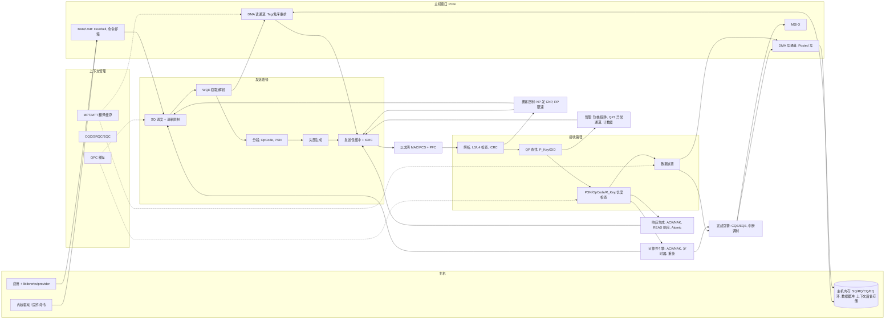
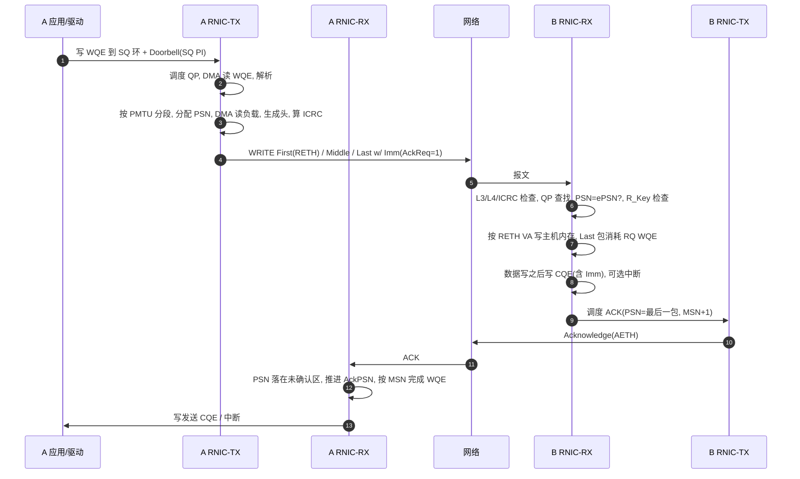

# RNIC 总体架构（RNIC Architecture）

> **摘要**：本文把 IBTA 规范对通道适配器（第 17 章）、传输层（第 9 章）、软件传输接口（第 10 章）以及 RoCEv2 附录（Annex A17）的要求，映射为一个可在 FPGA/ASIC 上落地的 RDMA 网卡（RDMA NIC，RNIC）模块划分；给出控制面/数据面分工、"最小可用"与"全功能"取舍，以及 QP 上下文的规模估算。它是本目录其余 5 篇的总纲。
>
> **规范出处**：Vol1 §17.1–§17.4（p.1187–1206）；§A17.7（p.1944–1945）；§A16.10（p.1926–1927）；§9.10.1–§9.10.2（p.450–454）；§10.8（p.543–555）；§A17.4.2–§A17.4.3（p.1937–1938）
>
> **前置阅读**：[IBA 分层架构在 RoCEv2 中的映射](../00-overview/03-architecture-and-layering.md)、[HCA 资源模型](../03-verbs-and-resources/01-resource-model.md)、[WR/WQE/CQE 处理模型](../03-verbs-and-resources/04-work-requests-and-completions.md)、[帧整体布局](../01-packet-format/01-frame-layout.md)
>
> **关键词**：RNIC, HCA, QPC, CQC, MPT, MTT, Doorbell, DMA, CQE/EQE, 可靠性引擎, 上下文缓存, ICM

## 1. 从规范看 RNIC：必须做什么、可以不做什么

### 1.1 RNIC 在规范中的身份

- IBA 把收发报文的端点称为通道适配器（Channel Adapter, CA）；支持 Verbs 接口的叫主机通道适配器（Host Channel Adapter, HCA），C17-1 要求 HCA 支持 Verbs 接口〔Vol1 §17.1, p.1187〕。RNIC 就是带 RoCEv2 端口的 HCA。
- 规范明确允许 **"硬件 + 驱动"共同构成 HCA**："HCA hardware and the HCA driver being referred to as the host channel adapter"（Figure 234）〔Vol1 §17.4.1, p.1205〕。这为后文的控制面（软件/固件）与数据面（硬件）切分提供了依据——只要 Verbs 语义对外一致，功能放在哪一侧由实现决定。
- Annex A17 是**可选规范性（Optional Normative）**附录：可以不做 RoCEv2，但只要声称支持，就必须满足 CA17-1…CA17-46〔Vol1 §A17.1, p.1928〕。CA17-25 要求遵循第 9 章 IB 传输层（加上 §A17.4 的修改）〔Vol1 §A17.4, p.1936〕。
- 多端口 CA 的各端口**共享同一个传输层**（一套 QP、一套内存翻译表），每个端口有独立的物理/链路/网络层（Figure 224/225）〔Vol1 §17.2.1, p.1188〕；任一时刻每个 QP 只通过一个端口收发（C17-3）〔Vol1 §17.2.1.2, p.1191〕。

### 1.2 第 17 章条款在 RoCEv2 端口上的适用性

§A17.7 声明"第 17 章大部分条款适用于 RoCEv2 端口，本节只列例外"〔Vol1 §A17.7, p.1944〕。下表把与硬件设计相关的条款逐一过一遍（"适用"指未被 §A17.7 排除）：

| 条款 | 内容（意译） | RoCEv2 端口 | 对 RNIC 设计的含义 |
|---|---|---|---|
| C17-1 | HCA 支持 Verbs 接口 | 适用 | 需要内核驱动 + 用户态 provider（见 [Linux RDMA 软件栈](../07-engineering-practice/01-linux-rdma-stack.md)） |
| C17-3 | 每个 QP 同一时刻只经一个端口收发 | 适用 | QPC 记录绑定端口；多端口时 TX 按端口选 MAC |
| C17-4 | 速率 >2.5 Gb/s 的端口须支持静态速率控制 | 适用 | 每 QP 发包间隔（IPD）限速器，可与拥塞控制限速器合并（§9.11）；IPD 必选值表基于 IB 链路宽度/速率（Table 377），以太网端口如何取值规范未定义（工程解读） |
| C17-5 / C17-6 | 按目的 QP 的 P_Key 校验入站 P_Key；每端口 P_Key 表 1–65535 项 | 适用 | RX 路径做 P_Key 匹配（规则见 §10.9.3）；表至少含默认 P_Key |
| C17-7 | P_Key 表由 SM 直接设置 | **不适用**（§A17.7.1, p.1944） | 由驱动/管理软件填表，填表方法规范不定义 |
| C17-8 | 每端口至少一个 GID | 适用 | 端口 GID 表，表项带 GID type（CA17-26） |
| C17-9 | 收发本地路由（无 GRH）报文 | **不适用**（§A17.7.2, p.1945） | — |
| C17-11 | HCA 能在任意 QP 上支持 UD、RC、UC | 适用 | 只做 RC 的精简设计不满足此条（见 §5） |
| C17-12 | 支持某服务即须支持其全部操作（原子操作除外） | 适用 | RC 必须含 SEND/WRITE/READ 及带立即数变体 |
| C17-13 | 能产生并接收 Solicited Event | 适用 | BTH.SE 处理 + CQ 事件 |
| C17-14 | 支持 {256}…{256…4096} 五种 MTU 集合之一 | 适用 | PMTU 可配置 |
| C17-15.2.1 / C17-16 | 非 SRQ 接收队列须产生端到端信用；SQ 须响应信用 | 适用 | AETH 信用字段生成 + 请求方 LSN 逻辑（§9.7.7.2） |
| C17-18 | 自寻址报文须在内部环回、不得上线 | 适用 | TX→RX 内部环回通路 |
| C17-19 / C17-20 | 不得持续反压；不得因出向反压而反压入向 | **不适用**（§A17.7.3, p.1945） | 规范不再约束，但 PFC 死锁风险需工程规避（见 [接收数据通路](03-rx-datapath.md)） |
| C17-21 | 检查链路/网络/传输层错误 | **被 CA17-39 替换** | 对所有入站报文做传输层检查〔§A17.7.4, p.1945〕 |
| C17-22 | 非易失存储中保存 EUI-64 端口 GUID 与 CA GUID | 适用 | 常见做法由端口 MAC 派生 EUI-64〔业界实践: Linux rxe，以源码为准〕 |
| C17-24 | 每端口支持 QP0 与 QP1 | **不适用**（§A17.7.5, p.1945） | 无 QP0：DestQP=0 静默丢弃（CA17-33）；QP1（GSI）仍用于 CM |
| o17-4 | 可选支持自动路径迁移（APM） | 可选 | 不实现时 APM 状态机恒为 MIGRATED（§17.2.8.1.1, p.1202） |

> [!NOTE]
> RoCE v1（Annex A16）的 §A16.10 与 §A17.7 结构几乎一致：同样豁免 C17-7、C17-19/20、C17-24，用 CA16-22 替换 C17-9、用 CA16-23 替换 C17-21，并以 CA16-15.1.1 明确要求 RoCE 端口支持静态速率控制〔Vol1 §A16.10, p.1926–1927; §A16.7.3, p.1919〕。若 RNIC 选做与 RoCE v1 互通（§A17.8，CA17-40…43），这些条款在 v1 模式下同样适用。

## 2. 功能模块分解

### 2.1 总体框图

几点读图说明：

1. **TX 与 RX 并非独立**：RX 路径收到的请求会在 TX 侧产生响应（ACK/NAK、READ 响应、Atomic ACK），收到的 ACK/NAK 又会驱动 TX 侧的重传与完成；QPC 是两条路径共享的、读写最频繁的状态。
2. **DMA 读通道**同时服务三类流量：WQE 获取、请求方负载读取、响应方 READ 响应数据读取；**DMA 写通道**服务 RX 数据放置、READ 响应数据写入、CQE/EQE 写回。
3. **QP1（GSI）报文**走异常通道交给软件处理（CM 由软件实现，见 §4），硬件只需把 DestQP=1 的报文送到一个软件队列，并能从软件队列注入发送。

### 2.2 模块职责与规范依据

| 模块 | 主要职责 | 规范依据（摘要） | 实现要点 |
|---|---|---|---|
| 主机接口 | PCIe 端点、BAR/UAR 映射、Doorbell 接收、MSI-X、DMA 读写引擎 | 架构意图是用户态直接提交 WR、绕过内核〔§10.8.2, p.544〕；WR 资源在完成前归 CI 所有（C10-107/108, p.552–554） | Doorbell 去重与 QP 激活；读请求 Tag 管理与乱序重排；写入顺序保证（CQE 晚于数据） |
| 上下文管理 | QPC/CQC/SRQC/EQC/MPT/MTT 的存储、缓存与一致性 | Table 64 列出实现连接所需的非线上参数（ePSN、SSN、MSN、LSN、重试计数等）〔§9.10.2, p.452–454〕 | 片上缓存 + 后备存储；每 QP 串行化；软件修改走命令接口 |
| WQE 获取与解析 | 按序取 WQE、解析操作类型/SGE/立即数/AV | C10-98.2.1 按提交顺序发起（p.546）；C10-100 Fence（p.548）；C9-25/C9-26 消息与数据按序（p.291） | 预取多个 WQE；Fence 与 READ/ATOMIC 未完成数门控 |
| SQ 调度器 | 在活跃 QP 间仲裁，执行速率限制与信用门控 | C9-13/C9-18 同一 SQ 不得交织多包消息（p.271, p.278）；C17-4 静态速率；CA17-45/46 拥塞降速/升速（p.1947–1948）；C9-162/163 信用受限行为（p.381） | 以"包"或"突发"为调度粒度；多包消息在 QP 内连续，但 QP 间可交织 |
| TX 流水线 | 分段、OpCode/PSN 生成、头部生成、负载拼接、ICRC | C9-11/C9-17/C9-21 分段（p.268–279）；C9-66 PSN 规则（p.314）；C9-67…C9-71 OpCode 与负载长度（p.317）；§A17.3 头字段（CA17-1…22） | 每 QP 头模板 + 每包补丁字段；发送包缓冲避免 MAC 欠载 |
| RX 流水线 | 解析、L3/L4 合法性、ICRC、QP 查找、头部检查 | CA17-23/24/27（p.1936–1939）；§9.6 报文头校验（C9-34…C9-51, p.292–302）；CA17-33 QP0 丢弃（p.1943）；CA17-39 | 静默丢弃语义：不 ACK、不消耗 WQE、不更新 ePSN（p.293） |
| 可靠性引擎 | ACK/NAK 处理、传输定时器、重传、RNR、重复请求 | C9-60（p.305）；C9-133…C9-145（p.355–365），其中定时器 Ttr = 4.096 µs × 2^LocalAckTimeout（C9-140）、超时须在 Ttr～4Ttr 内检测（C9-141）；C9-128…C9-132（p.353–354）；C9-102…C9-110（p.336–341） | Go-back-N + 从主机内存重读；粗粒度定时器（Ttr…4Ttr） |
| 内存翻译与保护 | R_Key/L_Key → MR，PD/权限/边界检查，VA→PA | C10-56/C10-57（p.518）；C9-88…C9-90（p.329） | MPT 按 key 索引；MTT 页表；翻译缓存 |
| 完成与事件 | 生成 CQE、EQE、中断及调制 | C10-102…C10-108（p.551–554）；C9-30/C9-32 按序完成（p.292）；C9-3 SE（p.260） | CQE 写必须排在数据写之后；中断合并 |
| 拥塞控制 | NP：收到 CE 标记生成 CNP；RP：收到 CNP 降速、定时/计字节升速 | CA17-44…46（p.1947–1948）；CNP 格式 Figure 349（p.1948） | 每 QP CNP 限频；每 QP 速率状态（见 [DCQCN](../05-congestion-control-and-qos/04-dcqcn.md)） |
| MAC 接口 | 以太网 MAC/PCS、PFC、优先级映射 | SL 0–7 直接映射以太网优先级〔§A17.4.2, p.1938〕；网络宜无损〔§A17.9.1, p.1946〕 | PFC 暂停按优先级停发；RX 缓冲水线 |
| 管理/固件 | GID 表维护、地址解析、CM、P_Key 表、统计 | GID 表由软件栈维护〔§A17.4.3, p.1938〕；L3→L2 解析不在规范范围〔§A17.4.2, p.1937〕；CM 用第 12 章协议〔§A17.6.1, p.1943〕 | 软核或主机驱动实现；硬件提供 QP1 异常通道 |

## 3. 典型数据流走查

### 3.1 RDMA WRITE with Immediate（RC，请求方 A → 响应方 B）

要点：响应方可以在数据真正写入内存之前调度 ACK——ACK 只表示数据已到达响应方的故障域〔Vol1 §9.7.5.1.6, p.344–345〕；但**接收 CQE 必须在数据对软件可见之后**才可见（C9-33：应用在接收 WQE 完成前不得依赖缓冲内容，反过来意味着完成可见时数据必须已可见）〔Vol1 §9.5, p.292〕。

### 3.2 RDMA READ（RC）

1. 请求方发出一个 READ Request（带 RETH），并为预期的 n 个响应包**预留 n 个 PSN**，下一个请求的 PSN = 本请求 PSN + n（C9-66）〔Vol1 §9.7.3.1, p.314〕。
2. 响应方校验后把请求登记到"响应资源"队列（深度 = 协商的未完成 READ/ATOMIC 数）〔Vol1 §9.4.5.3, p.286–287〕，由响应 TX 引擎 DMA 读本地内存、分段、发送 READ Response First/Middle/Last（首/末/Only 包带 AETH，C9-97/C9-98）。
3. 请求方 RX 按 PSN 顺序接收响应、把负载 DMA 写入本地 SGE，Last/Only 包到达后完成 WQE。
4. 后续 SEND/WRITE 可以先于 READ 执行，但其 ACK 必须排在 READ 响应之后发出（C9-101、C9-27）〔Vol1 §9.7.5.1.3, p.335; §9.5, p.291〕。

### 3.3 SEND / RECV 与 RNR

- 响应方收到 SEND First/Only 时需要一个接收 WQE（RQ 或 SRQ）；没有可用 WQE 时可回 RNR NAK（对 RC 是可选手段，Figure 90）〔Vol1 §9.7.4.1, p.319〕，AETH 的 5 bit 定时值按 Table 48 编码（C9-129）〔Vol1 §9.7.5.2.8, p.353–354〕。
- 硬件需要接收 WQE 的预取缓存，否则每个 SEND 都要等一次 PCIe 读（约 1 µs 量级），会直接拉低小消息包率（工程估算）。

## 4. 控制面与数据面划分

| 功能 | 软件/固件（控制面） | 硬件（数据面） | 依据/说明 |
|---|---|---|---|
| 资源创建/销毁（PD、QP、CQ、SRQ、MR、MW） | 分配号、初始化上下文、建立 MTT | 上下文缓存加载/失效 | Verbs 语义〔§10.2、§11.2〕 |
| QP 状态迁移（Modify QP） | 写入 PMTU、ePSN/起始 PSN、DGID、超时、重试次数等 | 读取并执行；出错时自动进入 Error 并刷新 WQE | C9-65（初始 PSN）、ePSN 只能在 Init 态设置（p.322–323） |
| 内存注册 | 锁页、翻译 VA→PA、写 MPT/MTT | 每次访问做 key/PD/权限/边界检查与翻译 | C10-56/57 |
| GID 表维护 | 跟随主机 IP 地址增删（含 GID type） | 按 SGID index 取源 IP/MAC/VLAN | §A17.4.3（p.1938）明确由软件栈负责 |
| L3→L2 地址解析（ARP/ND） | 由 OS 完成，结果作为 AV 中的 DMAC 下发 | 只使用 DMAC | §A17.4.2（p.1937）：解析不在规范范围 |
| 连接管理（CM，QP1 MAD） | 软件实现 IB CM / rdma_cm | 把 DestQP=1 报文送异常队列；软件构造的 QP1 报文按普通 UD 发出 | §A17.6.1（p.1943）；见 [CM 协议](../04-connection-management/01-cm-protocol.md) |
| P_Key 表、Q_Key | 软件填写 | 每包匹配 | §A17.7.1、§A17.4.7（p.1940） |
| 门铃、WQE 获取、分段、头部、ICRC | — | 全部硬件 | 每包操作，必须线速 |
| PSN/ACK/NAK、定时器、重传、RNR | 只配置参数（超时、重试次数） | 全部硬件 | §A17.9.1："传输层重传逻辑通常由硬件实现"（p.1946） |
| CQE/EQE、中断调制 | 消费 CQ、重新武装通知 | 生成并写回 | C10-111…113（p.555） |
| 拥塞控制 | 配置算法参数 | NP 生成 CNP、RP 每 QP 限速 | CA17-44…46；参数配置不在规范范围 |
| PFC/ETS/DCBX | 配置（或由交换机/LLDP 协商） | MAC 执行按优先级暂停 | 见 [无损以太网与 PFC](../05-congestion-control-and-qos/01-lossless-ethernet-pfc.md) |
| 异常与统计 | 读计数器、处理异步事件 | 计数、上报事件 | 见 [排障指南与计数器字典](../07-engineering-practice/05-troubleshooting.md) |

> [!TIP]
> **设计建议**：控制面接口统一做成"命令邮箱（mailbox）+ 完成通知"的形式：软件写命令（如 `MODIFY_QP`、`SW2HW_MPT`），硬件在上下文缓存中原子地更新并返回状态。软件**不直接改写**正在被硬件使用的上下文内存，可以从根本上避免缓存一致性问题（见 [FPGA 实现要点](05-fpga-implementation-notes.md)）。

## 5. "最小可用 RNIC"与"全功能 RNIC"的取舍

"最小可用"指能与 Linux 软件栈或商用 RNIC 跑通 RC 数据传输、但不追求完整合规的实现（常见于 FPGA 加速器互连）；"全功能"指以通用 HCA 为目标的实现。

| 功能 | 最小可用 RNIC | 全功能 RNIC | 裁剪带来的合规/互通影响 |
|---|---|---|---|
| 传输服务 | 仅 RC | RC、UC、UD（+ 可选 XRC） | 违反 C17-11（HCA 须支持 UD/RC/UC）；无 UD 则 QP1/CM 需另行处理 |
| RC 操作 | SEND、WRITE（含 Imm），READ 建议保留 | 全部 + SEND with Invalidate + Atomic | 去掉 READ 违反 C17-12 与 C10-83（p.538）；Atomic 本身可选（o10-40 等） |
| IP 版本 | 仅 IPv4 | IPv4 + IPv6 | 违反 CA17-1（端口须同时支持两种格式） |
| VLAN / PCP | 单 VLAN 或无 | 每 GID 绑定 VLAN，SL→PCP | 无 PCP 时只能依赖 DSCP 型 PFC〔业界实践，厂商相关〕 |
| QP 数 | 数十～数百，全片上 | 数万以上，片上缓存 + 后备存储 | 无合规影响 |
| 内存保护 | 少量 MR，线性/大页翻译 | MR + MW，完整 MTT，多页大小 | MW 是基础内存管理扩展的一部分，按所声明能力决定 |
| SRQ | 不做 | 支持 | 可选 |
| 端到端信用 | 一律返回"信用无效"（11111） | 按 C9-161 计算 | HCA 非 SRQ 接收队列须产生信用（C17-15.2.1 / C9-150.2.1） |
| 重传 | Go-back-N，从主机内存重读 | 同左，+ 精细定时器、更快恢复 | 无合规影响（实现自由） |
| 拥塞控制 | 只做 NP（回 CNP）或不做 | NP + RP（如 DCQCN） | RCM 可选；不支持则发送 ECN 必须为 00（CA17-5/14） |
| 静态速率控制 | 不做 | 每 QP IPD | C17-4 适用于 RoCEv2 端口（未被 §A17.7 排除） |
| 环回 | 不做 | 内部环回 | 违反 C17-18 |
| CM | 带外 TCP 交换 QPN/PSN/GID | QP1 + IB CM / rdma_cm | 不支持 CM 时只能与同样走带外交换的程序互通（如 perftest 默认模式） |
| APM | 不做 | 可选 | 无（o17-4 可选） |
| RoCE v1 互通 | 不做 | 可选 | 无（§A17.8 可选） |
| 虚拟化（SR-IOV 等） | 不做 | 视产品 | 规范之外 |

> [!WARNING]
> 精简实现**不能宣称"符合 Annex A17"**——CA17-25 把第 9 章与第 17 章大量条款拉进了合规范围。更准确的说法是"与 RoCEv2 线上格式兼容的 RC 子集"。若面向的是嵌入式/加速器专用端点，第 17 章对目标通道适配器（TCA）的要求更宽松（如 o17-1.2.1 端到端信用可选，§17.4.1 不要求通用 Verbs），但 Annex A17 的条款主要以 HCA 表述，声明合规时需逐条核对（工程解读）。精简方案的完整裁剪清单见 [FPGA 实现要点](05-fpga-implementation-notes.md)。

## 6. 上下文规模估算

### 6.1 QP 上下文（QPC）字段与建议位宽

下表是一个 RC 为主的 QPC 设计示例（**设计估算**，非规范规定的格式）；"Table 64 对应"一列指出该字段对应规范列出的连接参数〔Vol1 §9.10.2, Table 64, p.453–454〕。

**请求方（SQ）部分**

| 字段 | 位宽 | Table 64 对应 | 说明 |
|---|---:|---|---|
| QP 状态 / 服务类型 / 端口 | 3 + 3 + 8 | Connect state, Port number | RESET/INIT/RTR/RTS/SQD/SQE/ERR |
| PD | 24 | PD | 与 MPT 中 PD 比较（C10-56） |
| SQ 基址（或页表指针） | 64 | — | 主机内存环形队列 |
| SQ 大小 log2 + WQE 步长 | 8 | — | |
| SQ 生产者索引（Doorbell 写入） | 16 | — | |
| 发送进度：WQE 指针 + 消息内字节偏移 | 16 + 31 | Tx WQE pointer | 消息长度 ≤ 2^31（C9-10） |
| 发送进度：SGE 序号 + SGE 内偏移 | 8 + 32 | — | 也可每次重算 |
| 最早未完成 WQE 指针 | 16 | Tx ACK WQE pointer | 生成发送完成用 |
| Next PSN / 最早未确认 PSN / 最大前进 PSN | 24 × 3 | XmitPSN, AckPSN | 三 PSN 范式（p.358–360） |
| SSN / LSN / 信用有效 | 24 + 24 + 1 | SSN, LSN | 端到端信用（§9.7.7.2） |
| 重试计数 + 初值 | 3 + 3 | Error Retries | C9-142 |
| RNR 重试计数 + 初值 | 3 + 3 | RNR Retry init/counter | C9-132，7 表示无限 |
| Local ACK Timeout + 定时器状态 | 5 + 3 | Local ACK Timeout | 定时器方案见 [可靠性引擎](04-reliability-engine.md) |
| RNR 等待值（来自 RNR NAK） | 5 | RNR NAK retry time | |
| 未完成 READ/ATOMIC 数 + 上限 | 8 + 8 | Num_RDMA_Reads | 上限由连接建立时协商 |
| PMTU / 远端 QPN / P_Key index / Q_Key | 3 + 24 + 16 + 32 | MTU | Q_Key 仅 UD |
| 发送 CQ 号 / MigState / 杂项标志 | 24 + 2 + 8 | Tx Completion Q, MigState | Fence 等待、Drain 等 |
| **小计** | **≈ 513 bit ≈ 64 B** | | |

**响应方（RQ）部分**

| 字段 | 位宽 | Table 64 对应 | 说明 |
|---|---:|---|---|
| ePSN / MSN | 24 + 24 | Rx ePSN, Rx MSN | |
| RQ 基址 + log2 大小 + PI/CI | 64 + 5 + 32 | Rx WQE pointers | 或改为 SRQ 号 |
| SRQ 号 + 使用 SRQ 标志 | 24 + 1 | — | |
| 多包 SEND 进度：接收 WQE 内偏移 + SGE 序号 | 31 + 8 | — | |
| 进行中 WRITE：VA + R_Key + 剩余长度 | 64 + 32 + 32 | — | Middle/Last 包不带 RETH，地址靠此推算 |
| 上一合法包 OpCode 类别 | 3 | — | OpCode 序列检查（Table 45） |
| NAK-序列错误已发标志 | 1 | — | C9-80 / C9-114 |
| 待发 ACK：标志 + PSN + 计数 | 1 + 24 + 8 | RxAckPSN | ACK 合并 |
| 远端访问权限（R/W/Atomic） | 3 | — | |
| 响应资源队列 head/tail/深度 | 5 × 3 | RDMAR/ATOMIC Use | 条目本身另存（见 6.2） |
| 最小 RNR NAK 定时值 / 接收 CQ 号 / 信用计数 | 5 + 24 + 16 | Rx Completion Q, Rx credits | |
| **小计** | **≈ 449 bit ≈ 57 B** | | |

**路径（AV）与拥塞控制部分**

| 字段 | 位宽 | 说明 |
|---|---:|---|
| DGID（目的 IP，IPv4 映射为 ::ffff:a.b.c.d） | 128 | §A17.4.1.1（p.1936） |
| SGID index + GID type | 8 + 2 | GID type 决定 IPv4/IPv6/RoCE v1（CA17-26、CA17-40） |
| DMAC + VLAN ID/有效位 + PCP（来自 SL） | 48 + 13 + 4 | §A17.4.2：DLID 泛化为目的 L2 地址；SL 0–7 → 优先级 0–7 |
| Traffic Class / Hop Limit / Flow Label | 8 + 8 + 20 | CA17-4/9/13/17 |
| UDP 源端口 | 16 | 同一连接 QP 取固定值（§A17.3.2.1, p.1934） |
| 静态速率（IPD） | 8 | C17-4 |
| 拥塞控制状态（当前/目标速率、α、计时与计字节、令牌桶） | ≈ 128–160 | 取决于算法（如 DCQCN） |
| **小计** | **≈ 400–430 bit ≈ 50–54 B** | 若支持 APM，备用路径再加 ≈ 33 B |

合计约 **170–180 B/QP**。工程上常取 **256 B/QP**（2 的幂对齐，留出统计计数与扩展字段），或拆成"热 128 B（每包访问）+ 冷 128 B（建链/出错时访问）"两段以减少缓存带宽。

### 6.2 其它上下文

| 上下文 | 典型大小（设计估算） | 数量级 | 备注 |
|---|---|---|---|
| CQC | 32–64 B | 每 CQ 一个 | 基址、大小、PI/CI、EQ 号、事件武装状态、调制参数 |
| SRQC / EQC | 32–64 B | 每个一个 | |
| 响应资源条目（READ/ATOMIC） | ≈ 32 B | 每 QP × 协商深度 | 起始/结束 PSN、VA、R_Key、长度、类型、Atomic 原值；供重复请求重放（§9.4.5.3, p.286–287） |
| 请求方 PSN↔WQE 映射 | 4–8 B | 每个未完成 WQE | 首 PSN + 包数，用于重传定位 |
| MPT（MR/MW 表项） | 32–64 B | 每个 MR/MW | 起始 VA、长度、PD、权限、key、页大小、MTT 基址 |
| MTT（页表项） | 8 B | 每个注册页 | 1 TB 内存按 4 KB 页注册需 2^28 项 = 2 GB；按 2 MB 页只需 4 MB |

### 6.3 规模—存储量对照

| QP 数 | QPC（256 B/QP） | 响应资源（16 项 × 32 B/QP） | 合计 |
|---:|---:|---:|---:|
| 1K | 256 KB | 512 KB | 768 KB |
| 16K | 4 MB | 8 MB | 12 MB |
| 256K | 64 MB | 128 MB | 192 MB |

### 6.4 对 FPGA 片上存储意味着什么

- 中端 FPGA 的片上 RAM（BRAM/UltraRAM 等）通常只有几 MB，高端器件为数十 MB 量级（以器件手册为准）。因此：**1K QP 级别可以全部放片上**；**16K 级别**放片上代价很大，通常改为"片上缓存 + 板载 DDR/HBM"；**256K 级别**只能用主机内存作后备存储（类似 NVIDIA/Mellanox mlx4/mlx5 驱动中的 ICM〔业界实践，厂商相关〕），片上只放缓存。
- MTT 规模随注册内存线性增长，几乎必然放在片外/主机内存，片上用类似 IOTLB 的翻译缓存；支持大页（2 MB/1 GB）可把表项数降 2–3 个数量级。
- **缓存未命中代价极高**：从主机内存取一个上下文需要一次 PCIe 读（约 1 µs 量级），而 100GbE、64 B 帧时每包预算只有约 2 个 322 MHz 时钟周期（推导见 [发送数据通路](02-tx-datapath.md)）。必须做**非阻塞缓存**：未命中的 QP 进入等待队列，其它 QP 的报文继续处理（hit-under-miss），同一 QP 的报文保持顺序。
- **同一 QP 的背靠背报文**是常态（单流大带宽），QPC 读-改-写（如 ePSN+1）会形成读后写冒险：需要旁路转发（forwarding）或每 QP 串行化单元，不能简单依赖存储器流水。

> [!TIP]
> **设计建议**：Doorbell 到达时就预取该 QP 的 QPC 与首个 WQE；RX 解析出 DestQP 后立即发起 QPC 查找，与 ICRC 校验并行。把"每包必访问"的字段（PSN、进度指针、信用、定时器）与"建链时才用"的字段（AV、P_Key、Q_Key）分开存放，热字段可做多端口 SRAM，冷字段单端口即可。

## 7. 关键共享资源与仲裁点

各模块看似独立，实际上在少数几个共享资源上激烈竞争，这些仲裁点决定了 RNIC 的性能上限与死锁风险（**设计建议**）：

| 共享资源 | 竞争者 | 仲裁建议 | 风险 |
|---|---|---|---|
| PCIe DMA 读通道 | WQE 获取、请求方负载读、响应方 READ 响应数据读、上下文/MTT 未命中回填 | 按类别分 Tag 池与重排缓冲；WQE 与上下文回填优先（小而阻塞后续工作），负载类按字节轮转 | 大块负载读占满 Tag，导致 WQE/上下文回填饿死，整机吞吐塌陷 |
| PCIe DMA 写通道 | 响应方数据放置、请求方 READ 响应数据放置、CQE/EQE、上下文写回 | 数据与 CQE 共用同一有序通道以保证"数据先于 CQE 可见"；上下文写回可走独立低优先级队列 | CQE 越过数据（见 [接收数据通路](03-rx-datapath.md)） |
| QPC 存储端口 | TX 调度/分段、RX 传输检查、可靠性引擎（ACK 处理、定时器事件）、命令接口 | 按 QPN 分 bank 或双端口；同一 QP 的读改写串行化并旁路转发；命令接口最低优先级但须有饥饿保护 | 同 QP 读后写冒险；命令（Modify QP）长期得不到端口 |
| 以太网发送口 | 新请求、重传、READ 响应、ACK/NAK、CNP、QP1 报文 | 小包控制报文优先，大块数据 DRR（见 [发送数据通路](02-tx-datapath.md)） | ACK 被大包阻塞导致对端超时 |
| 接收缓冲 | 各优先级入向流量 | 每优先级独立水线与 PFC | 一个优先级的拥塞拖累其它优先级 |

> [!WARNING]
> 最隐蔽的死锁链是"RX 等 TX、TX 等 PCIe、PCIe 等 RX 释放缓冲"。设计时应画出所有"等待"关系的有向图并确认无环；常用手段是让 RX 侧对 TX 的需求只体现为**有界的状态位**（待发 ACK/NAK 标志、有界的响应资源队列），而不是无界队列（见 [接收数据通路](03-rx-datapath.md) §10.3）。

## 8. 要点回顾

- RNIC = 带 RoCEv2 端口的 HCA；规范允许"硬件 + 驱动"共同构成 HCA，功能在软硬件间的切分由实现决定。
- §A17.7 只豁免了 C17-7、C17-9、C17-19/20、C17-24，并用 CA17-39 替换 C17-21；静态速率控制（C17-4）、环回（C17-18）、UD/UC/RC（C17-11）、端到端信用（C17-15.2.1）等仍适用。
- 模块可分为：主机接口、上下文管理、WQE 获取、SQ 调度、TX 流水线、RX 流水线、可靠性引擎、内存保护、完成引擎、拥塞控制、MAC、管理面；QPC 是 TX/RX/可靠性三者共享的核心状态。
- 每包操作（分段、头部、ICRC、PSN/ACK/重传、R_Key 检查、DMA）放硬件；资源管理、GID 表、ARP/ND、CM、参数配置放软件/固件。
- QPC 约 170–180 B，取 256 B 对齐；QP 数从 1K 增到 256K 时上下文从 KB 级涨到百 MB 级，必须采用"片上缓存 + 后备存储"。
- 缓存设计的关键是非阻塞（hit-under-miss）与同 QP 串行化/旁路，以满足每包仅数个时钟周期的预算。
- PCIe 读/写通道、QPC 端口、以太网发送口、接收缓冲是主要仲裁点；RX 对 TX 的依赖必须做成有界状态，避免形成等待环。
- 精简实现可以与主流栈互通，但不能宣称符合 Annex A17。

## 自测

Q1：RoCEv2 端口为什么不受 C17-19/C17-20（不得持续反压）约束？这是否意味着 RNIC 可以随意发 PFC？

答：C17-19/C17-20 针对的是 IB 链路层信用反压，§A17.7.3 明确它们不适用于 RoCEv2 端口（p.1945）。但这不意味着可以随意反压：RoCEv2 依赖 PFC 实现无损，持续的 PFC 会造成暂停风暴、头阻塞乃至环路死锁，工程上仍须保证 RX 处理不依赖 TX（例如响应资源有界、ACK 状态合并存于 QPC），并配合 PFC 看门狗等机制。

Q2：为什么说 QP1 仍然需要，而 QP0 不需要？硬件如何最省事地支持 QP1？

答：RoCEv2 没有子网管理，QP0 不存在，DestQP=0 的报文静默丢弃（CA17-33）；但 CM 仍沿用第 12 章协议，CM 报文就是发往 QP1 的普通 RoCEv2（UD）报文（§A17.6.1）。硬件只需把 DestQP=1 的报文送到软件队列（异常通道），并允许软件构造的 QP1 报文按 UD 发出，CM 状态机在软件中实现。

Q3：一个 RC QPC 中，哪些字段在每个数据包上都要读写？

答：请求方：Next PSN、发送进度（WQE 指针/偏移）、信用（LSN）、速率限制状态；收到响应时：最早未确认 PSN、重试计数重装、定时器状态、未完成 READ/ATOMIC 数、完成指针。响应方：ePSN、OpCode 序列状态、WRITE/SEND 进度、待发 ACK 状态、MSN。AV、P_Key、Q_Key、PMTU 等基本只读，属于"冷"字段。

Q4：256K QP、每 QP 256 B 的上下文放在哪里？未命中时会发生什么？

答：共 64 MB，超出 FPGA 片上容量，只能放在主机内存（或板载 DDR/HBM）作后备存储，片上做缓存。未命中时需一次 PCIe/DDR 读，延迟在百 ns 到 µs 量级；非阻塞缓存让该 QP 的报文排队等待而其它 QP 继续处理，同时要保证同 QP 报文的顺序。

## 参考

- 规范：Vol1 §17.1–§17.4（p.1187–1206，含 Table 375/376/377）；§A17.1（p.1928）；§A17.4（p.1936–1940）；§A17.6（p.1942–1944）；§A17.7（p.1944–1945）；§A17.9（p.1946–1949）；§A16.7.3、§A16.10（p.1919、p.1926–1927）；§9.10.1–§9.10.2（Table 63/64, p.450–454）；§9.5（p.291–292）；§9.7（p.304–381）；§10.6.4.5.2（p.518）；§10.8（p.543–555）。
- 外部：〔业界实践: Linux rdma-core / rxe（drivers/infiniband/sw/rxe）〕；〔业界实践: NVIDIA/Mellanox mlx4/mlx5 驱动的 ICM 概念，厂商相关〕。
- 本库相关：[发送数据通路](02-tx-datapath.md)、[接收数据通路](03-rx-datapath.md)、[可靠性引擎](04-reliability-engine.md)、[FPGA 实现要点](05-fpga-implementation-notes.md)、[验证与互通测试](06-verification-and-interop.md)、[合规条款清单](../08-reference/03-compliance-checklist.md)。
