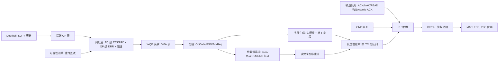

# 发送数据通路（TX Datapath）

> **摘要**：本文按报文在 RNIC 内的流向，逐级拆解发送路径：Doorbell → QP 调度与限速 → WQE 获取 → 分段与 OpCode/PSN/AckReq 生成 → 逐字段头部生成 → 负载 DMA 读与乱序重排 → ICRC → MAC；再讨论响应方（ACK/NAK、READ 响应、Atomic ACK、CNP）的发送与出口仲裁，最后给出 25G～400G 下的包率、位宽、时钟与 PCIe 预算。
>
> **规范出处**：Vol1 §9.10.1（Table 63, p.450–452）；§A17.3（p.1931–1936）；§9.4（p.267–291）；§9.7.3（p.313–317）；§9.7.5.1（p.331–348）；§9.11（p.456–459）；§17.2.8（p.1200–1203）；§A17.9.3–§A17.9.4（p.1947–1949）
>
> **前置阅读**：[RNIC 总体架构](01-rnic-architecture.md)、[以太网/IP/UDP 头字段规则](../01-packet-format/02-ethernet-ip-udp.md)、[BTH 详解](../01-packet-format/03-bth.md)、[OpCode 全表](../01-packet-format/05-opcodes.md)、[ICRC 计算](../01-packet-format/06-icrc.md)
>
> **关键词**：Doorbell, DRR, 速率限制, 分段, PSN, AckReq, 头模板, 增量校验和, MRRS, Tag, 读完成重排, ICRC, 包率

## 1. 发送路径总览



设计主线：**每一级都以"包"为单位流水化**。调度器一次选出一个 QP 及其下一个包（或一小串包），后续各级只携带"包描述符"（QPN、OpCode、PSN、负载地址列表、长度、头模板索引）向前流动，负载数据在 DMA 读回后与头部在包缓冲中汇合。

## 2. Doorbell 与 QP 调度

### 2.1 Doorbell

- 规范只规定"WR 被实例化为工作队列中的下一个空闲 WQE，并通知 CI 有新 WQE"〔Vol1 §10.8.2, p.545〕，WQE 格式与通知方式由实现决定；架构意图是用户态进程不经内核直接把 WR 交给 HCA〔Vol1 §10.8.2, p.544〕。
- 常见做法〔业界实践〕：用户态 provider 把 WQE 写进主机内存中的 SQ 环，执行写屏障后，向映射到本进程的 BAR 页（常称 UAR）写入 `{QPN, SQ 生产者索引}`；部分厂商还支持把小 WQE 直接经 MMIO 写入设备以省掉一次 DMA 读（如 mlx5 的 BlueFlame，厂商相关）。
- 硬件处理：Doorbell FIFO → 更新 `QPC.sq_pi`（只接受"更新"的值，防止乱序到达的旧值回退）→ 若该 QP 不在活跃表中则插入（每 QP 一个"在表中"标志位去重）。
- **安全检查（设计建议）**：每个 UAR 页只允许为属于该页的 QP 敲门铃（在 QPC 中记录 UAR 号并比对），否则一个进程可以替别的进程的 QP 触发发送。

### 2.2 调度的规范约束

| 约束 | 条款 | 对调度器的含义 |
|---|---|---|
| 同一 SQ 的多包消息不得与其它操作交织 | C9-13、C9-18（p.271, p.278） | QP 内按消息连续发包；**不同 QP 之间可以按包交织** |
| 按提交顺序发起 WR | C10-98.2.1（p.546）、C9-25（p.291） | 每 QP 一个 FIFO 游标，不能跳过受阻的 WQE |
| Fence：等待此前所有 READ/ATOMIC 完成 | C10-100（p.548） | 带 Fence 的 WQE 在未完成 READ/ATOMIC 数归零前不合格 |
| 未完成 READ+ATOMIC 不得超过协商值 | §9.4.4（p.281）、§9.4.5.3（p.286） | 计数器门控 |
| 信用受限的 SEND 只发一个包并置 AckReq | C9-162、C9-163（p.381） | 端到端信用门控 |
| 未完成包数不超过 2^23 | C9-61（p.308–309） | PSN 窗口门控（实际上远小于此，由缓冲/定时器决定） |
| 仅 RTS 态处理 SQ；SQD 态只入队不处理；SQE/Error 态完成为错误 | C10-96（p.544） | QP 状态门控 |
| 端口静态速率：同一目的端口的包间隔 ≥ (IPD+1)×当前包发送时间 | o9-164、o9-165（p.457–458）、C17-4 | 每 QP 限速器 |
| 收到 CNP 降低该 QP 注入速率；之后按时间/字节恢复 | CA17-45、CA17-46（p.1947–1948） | 每 QP 速率状态（算法见 [DCQCN](../05-congestion-control-and-qos/04-dcqcn.md)） |

### 2.3 调度结构

推荐两级结构（**设计建议**）：

1. **TC 级**：按以太网优先级（由 SL 映射，§A17.4.2）或 DSCP 分 TC；TC 间用严格优先级/ETS 加权，**被 PFC 暂停的 TC 不参与调度**。发送包缓冲也按 TC 分队列，否则一个被暂停的优先级会把其它优先级堵在同一个 FIFO 里（头阻塞）。
2. **QP 级**：同一 TC 内用 DRR（Deficit Round Robin，按字节公平）在活跃 QP 间轮转；被限速的 QP 从环中移出，放入按"最早可发时间"排序的定时轮，时间到再放回。

QP 级算法对比：

| 算法 | 公平性 | 硬件代价 | 适用 |
|---|---|---|---|
| RR（轮询） | 按"次"公平：大包 QP 占更多带宽 | 最低：活跃环 + 指针 | 所有 QP 包长相近（如统一 PMTU 的大消息） |
| WRR（加权轮询） | 按"次"加权 | 每 QP 权重 + 计数 | 需要按 QP/业务分配比例 |
| DRR（亏空轮询） | 按"字节"公平，可加权 | 每 QP 一个亏空计数器（约 16～20 bit） | 包长差异大（小消息与 4 KB 包混跑），推荐 |

```python
# 设计示意（非规范）：TC 内 DRR + 每 QP "最早可发时间" 限速
def pick_next(tc_rings, now, quantum, timer_wheel):
    for tc in active_tcs_by_ets(now):          # 已被 PFC 暂停的 TC 不在其中
        ring = tc_rings[tc]
        for _ in range(len(ring)):
            qp = ring.head()
            if not eligible(qp):               # 无 WQE/重传、Fence、READ 上限、信用、RNR 等待
                ring.rotate()
                continue
            if qp.next_time > now:             # 限速：移出环，睡到 next_time
                ring.remove(qp)
                timer_wheel.insert(qp, qp.next_time)
                continue
            if qp.deficit <= 0:
                qp.deficit += quantum[tc]
                ring.rotate()
                continue
            n = next_packet_bytes(qp)          # 由分段器给出（≤ PMTU + 头）
            qp.deficit -= n
            qp.next_time = now + n * 8 / qp.rate   # rate = min(静态速率, 拥塞控制速率)
            return qp
    return None
```

工程要点：

- **调度粒度**：每次选中后连续发 1～N 个包（"突发"），可以摊薄 QPC/WQE 缓存的切换开销，但会增加其它 QP 的排队时延；N 常与 PMTU 联动（如累计 16～64 KB）。
- **限速器精度**：100G 下 4 KB 包的发送时间约 0.33 µs，限速定时轮的刻度应在数十 ns 量级；速率用"每包间隔"表示比"令牌桶 + 字节计数"更省状态。
- **重传优先**：可靠性引擎发起的 Go-back-N 重传复用同一个调度入口，只是把 QP 的发送游标回拨到重传起点（见 [可靠性引擎](04-reliability-engine.md)）。

## 3. WQE 获取与解析

- WQE 对用户是抽象的〔Vol1 §10.8.2, p.544〕，格式完全由实现定义。下面是一个 64 B 对齐、可变长的示例格式（**设计示例**）：

| 段 | 字段（位宽） | 说明 |
|---|---|---|
| 控制段 16 B | OpCode(8)、标志(8：Signaled/Fence/SE/Inline)、WQE 序号(16)、总长度(32)、立即数或待失效 R_Key(32)、SGE 数(8) | 每个 WQE 都有 |
| 远端地址段 16 B | 远端 VA(64)、R_Key(32) | WRITE/READ/ATOMIC |
| 原子段 16 B | Swap/Add(64)、Compare(64) | ATOMIC |
| 数据报段 | AV 索引或内嵌 AV、远端 QPN(24)、Q_Key(32) | UD |
| 数据段 16 B × N | 地址(64)、长度(32)、L_Key(32) | 本地 SGE；或改为内联数据 |

- **预取**：一次 DMA 读取 2～4 个 WQE（如 256 B），放入每活跃 QP 的小 WQE 缓存；长 SGE 列表分批读取。
- **本地保护**：L_Key 对应的 MR 必须与 QP 同 PD（C10-54.2.1）、本地访问权限允许该类访问（C10-55）〔Vol1 §10.6.4.5.1, p.517〕；零长度数据段不做保护检查（C10-54.1.1）。失败按"本地保护错误"完成并使 QP 进入 Error（Table 81, p.565）。
- **内联数据**：省掉一次负载 DMA 读，但重传时数据已不在 WQE 缓存里——要么重新读 WQE，要么把内联数据留存到确认为止（**设计权衡**）。

## 4. 分段、OpCode、PSN 与 AckReq

### 4.1 规则汇总

| 项目 | 规则 | 依据 |
|---|---|---|
| 分段 | 大于 PMTU 的 SEND/WRITE 消息、READ 响应按 PMTU 切分 | C9-11、C9-17、C9-21（p.268–279） |
| 负载长度 | First/Middle 必须正好 PMTU；Only 为 0～PMTU；Last 为 1～PMTU | C9-69…C9-71（p.317） |
| 零长度消息 | 只能用单包（Only）OpCode 表示 | C9-70 |
| 扩展头 | WRITE First/Only 与 READ Request 带 RETH；立即数只在 Last/Only；IETH 只在 SEND Last/Only with Invalidate | Table 38（p.257） |
| PSN | 每个请求包 +1（模 2^24）；READ 请求之后的下一个请求 PSN = READ 的 PSN + 预期响应包数 | C9-66、Table 42（p.314） |
| SE 位 | 只应在 SEND/带立即数 WRITE/SEND with Invalidate 的 Last/Only 包置位 | §9.2.3（p.260） |
| PadCnt | 负载补到 4 字节整数倍，取值 0～3；First/Middle 必为 0 | §9.2.5（p.260）、C9-85（p.328） |
| 消息长度 | 0～2^31 字节 | C9-10、C9-16、C9-22 |

### 4.2 分段器参考实现

下面的 Python 参考代码已实际运行验证（含 PSN 回绕）：10000 B 带立即数 WRITE、PMTU=4096、起始 PSN=0xFFFFFE 时输出 First(0xFFFFFE, 4096, RETH) → Middle(0xFFFFFF, 4096) → Last w/ Imm(0x000000, 1808, AckReq)，下一 PSN=0x000001；10000 B READ 只发 1 个请求包，下一 PSN 前进 3。

```python
RC = {"SEND_FIRST": 0x00, "SEND_MIDDLE": 0x01, "SEND_LAST": 0x02, "SEND_LAST_IMM": 0x03,
      "SEND_ONLY": 0x04, "SEND_ONLY_IMM": 0x05, "WRITE_FIRST": 0x06, "WRITE_MIDDLE": 0x07,
      "WRITE_LAST": 0x08, "WRITE_LAST_IMM": 0x09, "WRITE_ONLY": 0x0A, "WRITE_ONLY_IMM": 0x0B,
      "READ_REQ": 0x0C, "SEND_LAST_INV": 0x16, "SEND_ONLY_INV": 0x17}

def segment(op, length, pmtu, psn, imm=False, inv=False, ackreq_every=0):
    """生成 (opcode, psn, payload_len, padcnt, has_reth, ackreq)，返回值为下一个 PSN"""
    assert 0 <= length <= 2**31
    if op == "READ":                                   # 一个请求包，预留 n 个响应 PSN（C9-66）
        n = max(1, -(-length // pmtu))
        yield (RC["READ_REQ"], psn, 0, 0, True, True)
        return (psn + n) & 0xFFFFFF
    npkt = max(1, -(-length // pmtu))
    for i in range(npkt):
        first, last = (i == 0), (i == npkt - 1)
        plen = min(pmtu, length - i * pmtu) if length else 0
        pos = "ONLY" if first and last else "FIRST" if first else "LAST" if last else "MIDDLE"
        name = op + "_" + pos
        if last and imm:
            name += "_IMM"
        if last and inv and op == "SEND":
            name += "_INV"
        ackreq = last or bool(ackreq_every and (i + 1) % ackreq_every == 0)
        yield (RC[name], psn, plen, (-plen) % 4 if last else 0, op == "WRITE" and first, ackreq)
        psn = (psn + 1) & 0xFFFFFF
    return psn
```

硬件实现时，分段器只需在 QPC 中保存"当前 WQE 已发送字节数"，每包计算 `plen = min(PMTU, remain)`、位置（First/Middle/Last/Only）与 `PSN++`；这三者都是单周期组合逻辑。

### 4.3 AckReq 置位策略

规范只要求请求方"自己负责确保需要的响应会到来"（C9-60），并给出了几种手段：每条消息的最后一包置 AckReq、对需要显式响应的消息置位、超时后带 AckReq 重试、发送零长度 WRITE 作为 NOP 等〔Vol1 §9.7, p.305〕。响应方在没有 AckReq 时可以无限期合并 ACK〔Vol1 §9.7.5.1.6, p.344〕，而请求方的传输定时器只在"发出带 AckReq 的包或 READ/ATOMIC 请求"时启动〔Vol1 §9.7.6.1.3, p.363〕。由此得到工程策略（**设计建议**）：

| 策略 | 做法 | 利弊 |
|---|---|---|
| A：每条消息最后一包置位 | 最常用的基线 | 简单；长消息内部丢包要等到最后一包才被 ACK/NAK 暴露 |
| B：A + 每 N 个包置位 | 如每 16 个 4 KB 包（64 KB）置一次 | 缩小重传窗口、尽早释放发送资源；100G 下 ACK 率约 19 万/秒，开销可忽略 |
| C：信用受限时置位 | C9-163 强制 | 必须实现 |
| D：SQ 变空时置位 | 规范建议对 SQ 中最后一个 WQE 的最后一包置位（p.344） | 避免响应方"无限合并"导致超时误判 |

> [!WARNING]
> 若只在部分消息上置 AckReq，而对端选择积极合并 ACK，最后一批未置位的消息可能永远得不到 ACK，最终表现为"偶发超时重传"。这是 RNIC 互通中最常见的性能型 bug 之一（见 [验证与互通测试](06-verification-and-interop.md)）。

## 5. 头部生成

### 5.1 字段来源表

把 §9.10.1 Table 63 的"字段来源"（QP=来自 QP 上下文，WQE=来自 WQE 或其 AV，Tr=传输层计算）〔Vol1 §9.10.1, p.450–452〕与 Annex A17 对 IP/UDP 的规定合并，得到 RoCEv2 发送端的逐字段来源：

| 头 | 字段 | 宽度 | 取值 / 来源 | 依据 |
|---|---|---:|---|---|
| 以太网 | DMAC | 48 | AV 中的"目的 L2 地址"（由软件 ARP/ND 解析后下发；0xFFFFFFFFFFFF 表示由 verbs 实现自行解析） | §A17.4.2（p.1937） |
| 以太网 | SMAC | 48 | 由所选 SGID 隐含（GID 表项所属网络接口的 MAC） | §A17.4.2（p.1937–1938） |
| 802.1Q | PCP / DEI / VID | 3/1/12 | PCP = SL（0–7 直接映射）；VID 通常来自 GID 表项绑定的 VLAN 接口〔业界实践〕 | §A17.4.2（p.1938） |
| 以太网 | EtherType | 16 | 0x0800（IPv4）或 0x86DD（IPv6），由 SGID 表项的 GID type 决定 | §A17.3.1.1/§A17.3.1.2、CA17-40/42 |
| IPv4 | Version / IHL | 4/4 | 4 / 5 | CA17-3 |
| IPv4 | DSCP | 6 | AV 的 Traffic Class | CA17-4 |
| IPv4 | ECN | 2 | 支持 RCM 时可置 01 或 10；不支持时必须 00 | CA17-5、§A17.3.1.1.3 |
| IPv4 | Total Length | 16 | IP 头 + UDP + BTH + 扩展头 + 负载 + 填充 + ICRC | CA17-6 |
| IPv4 | Identification | 16 | **规范未规定**；DF=1 的原子报文可取任意值〔外部: RFC 6864〕；Linux rxe 用内核通用的 `__ip_select_ident()`〔业界实践: Linux rxe〕 | — |
| IPv4 | Flags / Fragment Offset | 3/13 | 010（DF=1）/ 0 | CA17-7、CA17-8 |
| IPv4 | TTL | 8 | AV 的 Hop Limit | CA17-9 |
| IPv4 | Protocol | 8 | 0x11 | CA17-10 |
| IPv4 | Header Checksum | 16 | 按 RFC 791 计算（见 5.3） | §A17.3.1.1 引用 RFC 791 |
| IPv4 | SIP / DIP | 32/32 | SGID 表项中的 IPv4 地址 / DGID 中的 IPv4 地址 | CA17-11、CA17-12 |
| IPv6 | Version | 4 | 6 | CA17-27（接收端检查） |
| IPv6 | Traffic Class | 8 | DSCP = AV Traffic Class；ECN 规则同 IPv4 | CA17-13、CA17-14 |
| IPv6 | Flow Label | 20 | AV/QP 的 Flow Label（Table 63："CA 置 0，或按应用设置"）；rxe 置 0 | Table 63（p.450） |
| IPv6 | Payload Length | 16 | IPv6 头之后的全部字节：UDP 头(8) + BTH + 扩展头 + 负载 + 填充 + ICRC(4)，即**等于 UDP Length**（规范原文措辞有误，见下方说明）〔外部: RFC 8200；业界实践: Linux rxe〕 | CA17-15（p.1934） |
| IPv6 | Next Header / Hop Limit | 8/8 | 0x11 / AV Hop Limit | CA17-16、CA17-17 |
| IPv6 | SIP / DIP | 128/128 | SGID 表项 / DGID | CA17-18、CA17-19 |
| UDP | Source Port | 16 | 不透明流标识；有序报文（如连接型 QP）应取固定值 | §A17.3.2.1（p.1934） |
| UDP | Destination Port | 16 | IANA 分配值 **4791**〔外部: IANA〕 | CA17-20 |
| UDP | Length | 16 | UDP 头 + … + ICRC | CA17-21 |
| UDP | Checksum | 16 | 应置 0 | §A17.3.2.4（p.1935） |
| BTH | OpCode | 8 | Tr：由操作与包位置决定 | Table 38、C9-68 |
| BTH | SE | 1 | WQE | Table 63 |
| BTH | M（MigReq） | 1 | Tr：由 APM 状态决定；**不实现 APM 时状态机恒为 MIGRATED，出站报文 M=1** | §17.2.8.1.1–2（p.1202–1203） |
| BTH | PadCnt | 2 | 由负载长度计算 | §9.2.5 |
| BTH | TVer | 4 | 0 | C9-5（p.261） |
| BTH | P_Key | 16 | QP：端口 P_Key 表[QP 的 P_Key index] | Table 63 |
| BTH | F / B / Resv6 | 1/1/6 | 发送置 0；RoCEv2 不使用 FECN/BECN | C9-6、CA17-29 |
| BTH | DestQP | 24 | QP（UD 时来自 WQE） | Table 63 |
| BTH | AckReq / Resv7 | 1/7 | Tr（RC；UC/UD 为 0）/ 0 | Table 63、C9-7 |
| BTH | PSN | 24 | QP（Next PSN） | C9-64 |
| RETH | VA / R_Key / DMA Length | 64/32/32 | WQE（WRITE 首包/Only 包、READ 请求） | Table 63、C9-19、C9-23 |
| AtomicETH | VA / R_Key / Swap(Add) / Compare | 64/32/64/64 | WQE；线上为大端 | §9.4.5（p.283–284） |
| ImmDt / IETH | 立即数 / 待失效 R_Key | 32/32 | WQE | Table 63 |
| DETH（UD） | Q_Key / Source QP | 32/24 | WQE（或 QP）/ Tr | Table 63 |
| ICRC | — | 32 | Tr，按 CA17-22 计算 | §A17.3.3 |
| FCS | — | 32 | MAC 计算 | 〔外部: IEEE 802.3〕 |

> [!NOTE]
> **DSCP 与 Traffic Class 的位宽差异**：CA17-4/CA17-13 写的是"DSCP 字段 = AV 的 Traffic Class"，但 AV 的 Traffic Class 是 8 bit、DSCP 只有 6 bit。Linux 软件栈的做法是把 8 bit Traffic Class 整体写入 IPv4 TOS / IPv6 Traffic Class 字节（rxe 中 `iph->tos = av->grh.traffic_class`），即 DSCP = TClass[7:2]，低 2 bit 位于 ECN 位置，再由拥塞控制逻辑决定 ECN 取值〔业界实践: Linux rxe〕。硬件实现必须与驱动的约定一致（待核实各厂商行为）。

> [!WARNING]
> **CA17-15 的措辞笔误**：CA17-15 原文写 Payload Length 是"从 IPv6 头之后的第一个字节（即 BTH）"一直到 ICRC 的长度〔Vol1 §A17.3.1.2.3, p.1934〕，但 IPv6 头之后紧跟的是 **UDP 头**而不是 BTH。按 IPv6 本身的定义（Payload Length 覆盖 IPv6 基本头之后的全部字节，〔外部: RFC 8200〕）以及 Linux rxe 等实际实现（`payload_len = skb->len - sizeof(*ip6h)`，此时 skb 已含 UDP 头），正确值是 **UDP 头 8 B + BTH + 扩展头 + 负载 + 填充 + ICRC 4 B，与 UDP Length 相等**。若照字面少算 8 字节，报文会被对端和中间设备判为畸形。

> [!NOTE]
> **IPv4 Identification 被 ICRC 覆盖**：CA17-22 只屏蔽 TTL、Header Checksum、TOS，Identification 不在屏蔽之列，因此发送端可以取任意值（常数、每 QP 计数或全局计数均可），但沿途设备若改写它会导致 ICRC 校验失败。用递增计数更便于抓包排查重复/乱序（**工程建议**）。

### 5.2 头模板与每包补丁字段

- 一个连接型 QP 的 L2/L3/L4/BTH 大部分字段在建链（Modify QP 到 RTR/RTS）时就已确定，可以预先生成**每 QP 头模板**（以太网 14/18 B + IPv4 20 B 或 IPv6 40 B + UDP 8 B + BTH 12 B，最大约 78 B），存于头模板缓存或 QPC 冷字段区（**设计建议**）。
- 每包只需"补丁"少量字段：

| 补丁字段 | 计算 |
|---|---|
| 负载 + 填充 | `paylen + padcnt` |
| UDP Length | `8 + 12 + 扩展头长度 + 负载 + 填充 + 4` |
| IPv4 Total Length / IPv6 Payload Length | `20 + UDP Length` / `UDP Length` |
| IPv4 Identification、Header Checksum | 计数器；增量校验和（见 5.3） |
| BTH OpCode、SE、PadCnt、A、PSN | 分段器输出 |
| RETH / ImmDt / IETH / AtomicETH | WQE 字段（仅特定包） |

- 以太网帧（不含 FCS）短于 60 B 时由 MAC 填充到最小帧长：例如 IPv4 零长度 SEND Only 帧长 14+20+8+12+4(ICRC) = 58 B，MAC 会在 ICRC 之后补 2 B。**接收端必须用 IP/UDP 长度而不是帧长定位 ICRC**（见 [接收数据通路](03-rx-datapath.md)）。

### 5.3 IPv4 首部校验和的增量计算

每 QP 模板中，Total Length、Identification、Checksum 先置 0，预先求出其余 7 个 16 bit 字的和并折叠为 16 bit（S0，存模板旁）；每包只需一个三输入加法加两次折叠。下面的代码已用 10 万组随机首部与完整计算比对验证：

```python
def fold16(s):
    s = (s & 0xFFFF) + (s >> 16)
    s = (s & 0xFFFF) + (s >> 16)
    return s

# 建链时（模板中 Total Length、Identification、Checksum 均为 0）
S0 = fold16(sum(int.from_bytes(tmpl[i:i + 2], "big") for i in range(0, 20, 2)))
# 每包
csum = ~fold16(S0 + total_len + ident) & 0xFFFF
```

若 ECN 或 DSCP 也会逐包变化（例如 CNP 使用独立 DSCP 的厂商做法），把 TOS 字也移出 S0 即可。

### 5.4 UDP 源端口策略

| 策略 | 描述 | 评价 |
|---|---|---|
| 每 QP 固定值 | 例：rxe 取 `0xC000 + (hash_32(QPN, 14) & 0x3FFF)`，落在动态端口段 0xC000–0xFFFF〔业界实践: Linux rxe `rxe_qp.c`〕 | 符合 §A17.3.2.1 的"应"；同一 QP 的包走同一路径、不乱序 |
| 由 Flow Label 派生 | 让软件通过 AV 的 Flow Label 控制熵 | 便于上层做路径选择（实现相关） |
| 超时后换端口 | 怀疑路径故障时重散列 | 规范未禁止（只说"应"固定）；换路径瞬间可能乱序，RC 会把乱序当丢包处理（**工程权衡**） |
| 逐包变化 | 包喷洒（packet spraying） | 仅适用于无顺序约束的报文（§A17.9.4, p.1948–1949）；对 Go-back-N RC 有害 |

更多讨论见 [ECMP 与负载均衡](../05-congestion-control-and-qos/06-ecmp-and-load-balancing.md)。

## 6. 负载 DMA 读

### 6.1 读请求拆分

一个包的负载可能跨多个 SGE、多个物理页，读请求需按以下边界逐级拆分：

1. **SGE 边界**：每个 SGE 有独立的地址与 L_Key；
2. **页边界**：MTT 给出的物理页不连续；
3. **PCIe 4 KB 边界**：单个请求不得跨越 4 KB 地址边界〔外部: PCI Express Base Specification〕；
4. **MRRS**（Max Read Request Size，常见 512 B）；
5. **包边界**：每个包的负载单独成组，便于与头部汇合。

例：PMTU=4096、负载起始物理地址为页内偏移 0xF00、MRRS=512、4 KB 页 → 先读 256 B 到页尾，再读下一页 3840 B（7 个 512 B + 1 个 256 B），共 9 个读请求。

### 6.2 Tag 管理与读完成重排

- PCIe 读完成（Completion）可能按 RCB（Read Completion Boundary，64 或 128 B）拆成多个，单个完成 TLP 的负载也不超过 MPS（Max Payload Size）；同一请求的多个完成按地址顺序返回，不同 Tag 的完成之间可以乱序〔外部: PCI Express Base Specification〕。
- 做法（**设计建议**）：发请求时先分配重排缓冲槽位（按字节计的信用），完成数据按"槽位 + 偏移"写入；包组装器按请求顺序消费。槽位不足时不发新请求，天然形成背压。
- **未完成读请求预算**（带宽 × 延迟，已计算验证）：

| 线速 | PCIe 读延迟 | 在途字节 | 512 B 请求数 | 1024 B 请求数 |
|---|---|---:|---:|---:|
| 100G | 1 µs | 12.2 KB | 25 | 13 |
| 100G | 2 µs | 24.4 KB | 49 | 25 |
| 400G | 1 µs | 48.8 KB | 98 | 49 |
| 400G | 2 µs | 97.7 KB | 196 | 98 |

400G 时请求数逼近 8 bit Tag 的 256 上限，需要 PCIe 4.0 起的 10-bit Tag、更大的 MRRS 或多个功能/通道并行（**工程估算**）。

- **分类隔离**：WQE 获取（小、延迟敏感）、请求方负载、响应方 READ 响应负载最好用独立的 Tag 池/重排缓冲，避免大块负载读把 WQE 获取堵住。

### 6.3 发送包缓冲（逐包存储转发）

- 多数以太网 MAC IP 要求一帧开始发送后数据不得中断，否则产生欠载/坏帧（以所用 MAC 文档为准）。PCIe 读延迟抖动大，因此**发送侧通常在包缓冲中凑齐整包再启动发送**（**设计建议**）；顺带也让 ICRC 可以在写入缓冲时同步算完。
- 缓冲容量估算：覆盖 PCIe 读延迟（100G×2 µs≈25 KB）+ 每个 TC 至少 2 个最大包在排队（8 TC × 2 × 4.2 KB≈67 KB），100G 量级约 64～128 KB（**工程估算**）。

## 7. ICRC 生成与 MAC 接口

- 计算范围与屏蔽规则见 CA17-22（先输入 64 bit 全 1，再从 IP 头首字节到最后一个负载/填充字节；IPv4 屏蔽 TTL、Header Checksum、TOS；IPv6 屏蔽 Traffic Class、Flow Label、Hop Limit；UDP Checksum 与 BTH 第 4 字节也屏蔽为全 1）〔Vol1 §A17.3.3, p.1935–1936; §7.8.1, p.218–219〕。
- **线上字节序**：把 ICRC 当作以太网 FCS 一样发送——等价于"zlib/以太网 CRC-32 结果按小端字节序写入"。用规范 §7.8.4 的样例验证：Table 28 的屏蔽字节流经 `zlib.crc32` 得 0x5AB72596，小端写出为 `96 25 B7 5A`，与规范给出的 ICRC 0x9625B75A（Table 29 第 52–55 字节）一致〔Vol1 §7.8.4.3.1, p.225–226〕。
- 并行 CRC 的硬件结构、"全 1 前缀"预计算、屏蔽字段在线替换与尾拍处理见 [FPGA 实现要点](05-fpga-implementation-notes.md)。
- 若 ICRC 在出口流上计算，需要一条与 CRC 流水线等长的延迟线，使 ICRC 结果能在最后一拍到达 MAC 前拼入；ICRC 可能跨越拍边界（最后一拍剩余不足 4 B 时溢出到新的一拍）。

## 8. 响应方的发送与出口仲裁

### 8.1 响应报文的生成规则

| 响应 | 线上格式 | PSN 规则 | 其它要点 |
|---|---|---|---|
| ACK | BTH(Acknowledge) + AETH | 最近一个**新**请求包的 PSN（C9-95, p.331） | 可合并（§9.7.5.1.2）；收到 AckReq 必须调度响应（C9-116, p.344） |
| NAK | 同上，OpCode 必须为 Acknowledge（C9-113.a1） | 序列错误/无效请求：ePSN（C9-111、C9-121、C9-125）；远端访问错误：出错请求包 PSN（C9-124）；远端操作错误：正在执行的请求 PSN（C9-126） | 序列错误 NAK 发出后，在收到 ePSN 请求前不得再发 ACK/NAK（C9-80、C9-114） |
| RNR NAK | AETH[6:5]=01，低 5 bit 为定时值 | 被 RNR 的包的 PSN（C9-113） | 定时值按 Table 48（C9-129） |
| READ 响应 | First/Last/Only 带 AETH，Middle 不带（C9-24、C9-97、C9-98） | 从 READ 请求 PSN 起连续递增（C9-96、C9-117） | 中途出错：把出错包的 OpCode 改为 Acknowledge 并带 NAK 码，不发出错数据（C9-100） |
| Atomic ACK | BTH + AETH + AtomicAckETH | 等于请求 PSN（o9-58） | 原值以大端返回（§9.4.5） |
| CNP | BTH(OpCode 0x81) + 16 B 保留 | PSN=0 | DestQP=被标记报文的源 QP，P_Key 同被标记报文，SE=M=0（Figure 349, p.1948） |

AETH 中的 MSN 在任何带 AETH 的响应中都要填写（C9-147, p.367），NAK 与重复 ACK 也不例外（C9-149, p.370）。

### 8.2 每 QP 的响应顺序

- 所有确认报文强序：先前的 READ 响应/Atomic 响应必须先于后续的 ACK、READ 响应、Atomic 响应注入网络（C9-27, p.291）；响应必须按请求被接收的 PSN 顺序生成（C9-63, p.312）。
- 响应方可以提前执行 READ 之后的 SEND/WRITE，但在 READ 响应发出之前不得确认它们（C9-101, p.335）。
- 实现：每 QP 一个**响应队列**，条目为 `{类型, PSN, …}`；新 ACK 条目若遇到队尾也是 ACK，则直接覆盖队尾（ACK 合并），从而保证队列深度有界（≤ 响应资源数 × 2 + 1，**设计估算**）。

### 8.3 READ 响应引擎

READ 响应是"响应方发起的大块 DMA 读 + 分段发送"，结构上与请求方的 WRITE 发送几乎相同，可以复用分段器、头部生成与 DMA 读通道，但有三点不同：负载来源由 RETH（VA/R_Key/长度）+ 本地 MPT/MTT 决定；PSN 从请求 PSN 起编号；遇到更早 PSN 的重复请求时必须中止当前响应、转而响应更早的请求（C9-110, p.341）。

### 8.4 出口仲裁优先级（设计建议）

| 优先级 | 流量 | 理由 |
|---|---|---|
| 1 | CNP | 很小、对拥塞控制环路时延敏感；按 QP 限频（CA17-44 允许对多个标记包只发一个 CNP） |
| 2 | ACK / NAK / RNR NAK / Atomic ACK | 很小，能释放对端的发送资源与定时器；仍须服从同一 QP 内的响应顺序 |
| 3 | READ 响应、重传、新请求 | 大块数据；"响应字节"与"请求字节"之间用 DRR，防止一方饿死 |
| 4 | QP1/管理报文 | 量小，交给软件注入 |

> [!IMPORTANT]
> 拥塞控制的降速对象是"CNP 中 DestQP 指定的 QP 的注入速率"（CA17-45）。若被 ECN 标记的是 READ 响应，CNP 会回到**响应方**的 QP，因此 READ 响应流量同样必须受该 QP 限速器约束（工程解读）。ACK/CNP 这类小包通常不纳入限速（设计建议）。

## 9. 关键性能数字

### 9.1 包率（IPv4、无 VLAN；线上开销按前导码 + SFD + 帧间隙共 20 B 计；均已脚本计算）

| 场景 | 帧长（含 FCS） | 100G 包率 | 400G 包率 | 有效负载带宽 |
|---|---:|---:|---:|---:|
| 64 B 最小帧 | 64 B | 148.81 Mpps | 595.24 Mpps | — |
| RC ACK（BTH+AETH）| 66 B（IPv6 为 86 B） | 145.35 Mpps | — | — |
| PMTU 256 | 318 B | 36.98 Mpps | 147.93 Mpps | 75.7% |
| PMTU 1024 | 1086 B | 11.30 Mpps | 45.21 Mpps | 92.6% |
| PMTU 2048 | 2110 B | 5.87 Mpps | 23.47 Mpps | 96.2% |
| PMTU 4096 | 4158 B | 2.99 Mpps | 11.97 Mpps | 98.0% |

计算方法：以 100G、PMTU 4096 为例，帧长 = 14 + 20 + 8 + 12 + 4096 + 4（ICRC）+ 4（FCS）= 4158 B，线上占用 4178 B，包率 = 100×10^9 / (4178×8) ≈ 2.99 Mpps，有效带宽 = 4096/4178 ≈ 98.0%。

### 9.2 数据通路位宽与每包时钟预算

| 速率 | 常见用户侧接口 | 原始容量 | 备注 |
|---|---|---:|---|
| 10G | 64 bit @ 156.25 MHz | 10 Gb/s | 以所用 MAC IP 文档为准 |
| 25G | 64 bit @ 390.625 MHz | 25 Gb/s | 同上 |
| 100G | 512 bit @ 322.265625 MHz | 165 Gb/s | 如 AMD UltraScale+ CMAC 的 AXI4-Stream 接口〔外部: AMD PG203，以文档为准〕 |
| 100G | 512 bit @ 250 MHz | 128 Gb/s | 内部逻辑常用时钟 |
| 400G | 1024 bit @ 390.625 MHz | 400 Gb/s | 无余量，需分段（多包每拍）接口，见 05 |

- 512 bit 总线每拍 64 B。100G 下 64 B 帧时每包只有 **322.27/148.81 ≈ 2.17 个时钟周期**；1 KB PMTU 约 28.5 个周期；4 KB PMTU 约 107.7 个周期。小包场景下所有"每包一次"的操作（QPC 读改写、调度决策、PSN 检查）都必须做到启动间隔（II）≤ 2。
- 宽总线的拍对齐损失：用户侧总线上的帧不含 FCS（MAC 接收时剥离、发送时追加），最坏情况是总线上 65 B（线上 69 B）的帧要占 2 拍。100G 下这种帧为 140.45 Mpps × 2 = 280.9 M 拍/秒，低于 322.27 MHz，所以 512 bit @ 322 MHz 可以覆盖 100G 最坏情况，而 512 bit @ 250 MHz 不行（只能覆盖大包为主的流量）。400G 下 64 B 最小帧本身就是 595.24 Mpps，已超过 1024 bit 总线的 390.625 MHz 时钟；最坏的 129 B 帧需要 326.8 Mpps × 2 = 653.6 M 拍/秒。单包每拍的接口无法满足，必须采用一拍可承载多个包的分段（segmented）接口（见 [FPGA 实现要点](05-fpga-implementation-notes.md)）。顺带：IPv4 ACK 在总线上为 62 B（1 拍），IPv6 ACK 为 82 B（2 拍）。

### 9.3 PCIe 带宽预算（x16，按 128b/130b 编码、每 TLP 约 24 B 开销粗算，未计 DLLP 与描述符流量）

| 代际 | 原始带宽 | MPS 128 | MPS 256 | MPS 512 |
|---|---:|---:|---:|---:|
| Gen3 x16 | 126.0 Gb/s | 106.1 Gb/s | 115.2 Gb/s | 120.4 Gb/s |
| Gen4 x16 | 252.1 Gb/s | 212.3 Gb/s | 230.5 Gb/s | 240.8 Gb/s |
| Gen5 x16 | 504.1 Gb/s | 424.5 Gb/s | 460.9 Gb/s | 481.6 Gb/s |

结论（**工程估算**）：100GbE 单向满速需要 Gen3 x16 或 Gen4 x8，且 WQE/CQE/Doorbell 等控制流量会再吃掉几个百分点；400GbE 需要 Gen5 x16。

## 10. 要点回顾

- 发送路径以"包描述符"流水化：调度 → WQE → 分段 → 头部 → 负载 DMA → 包缓冲 → ICRC → MAC。
- 调度器必须满足：QP 内消息不交织、按序发起、Fence、READ/ATOMIC 上限、端到端信用、QP 状态、静态速率与拥塞控制限速；QP 之间可以按包交织。
- 分段规则：First/Middle 正好 PMTU，Last 1～PMTU，Only 0～PMTU；READ 请求为预期响应包数预留 PSN。
- AckReq 至少在每条消息最后一包、信用受限包、SQ 变空时置位，否则可能因对端 ACK 合并而超时。
- 头部用"每 QP 模板 + 每包补丁"生成；IPv4 校验和可增量计算；UDP 源端口每 QP 固定；UDP 校验和置 0；未实现 APM 时 BTH.M=1。
- 负载读按 SGE/页/4 KB/MRRS 拆分，按 Tag 重排；发送侧逐包存储转发以避免 MAC 欠载。
- ICRC 线上字节序与以太网 FCS 相同（zlib 结果小端写出）。
- 响应按 QP 强序（C9-27），READ 响应也受拥塞控制限速；ACK/CNP 优先发送。
- 100G：64 B 帧 148.81 Mpps、每包约 2.17 拍；4 KB PMTU 约 2.99 Mpps、有效带宽 98%。

## 自测

<details><summary>Q1：一个 READ 请求读取 10000 B，PMTU=4096，请求 PSN=100，下一个请求的 PSN 是多少？响应包各带什么头？</summary>

答：预期响应包数 n=⌈10000/4096⌉=3，下一个请求 PSN=100+3=103（C9-66）。响应为 READ Response First（PSN 100，AETH + 4096 B）、Middle（PSN 101，无 AETH，4096 B）、Last（PSN 102，AETH + 1808 B）。
</details>

<details><summary>Q2：为什么不建议对一个连接型 QP 逐包改变 UDP 源端口？</summary>

答：§A17.3.2.1 建议有顺序要求的报文（如连接型 QP）使用固定源端口，因为网络按源端口做 ECMP 哈希，改变端口可能让报文走不同路径而乱序；RC 的 Go-back-N 会把乱序当作丢包，触发 NAK-序列错误与整段重传。
</details>

<details><summary>Q3：IPv4 零长度 SEND Only 的以太网帧有多长？接收端为什么不能用"帧长减 4"来定位 ICRC？</summary>

答：14+20+8+12+0+4(ICRC)=58 B，加 FCS 为 62 B，不足 64 B 最小帧，MAC 会在 ICRC 后补 2 B。接收端看到的 FCS 前数据为 60 B，末 4 B 并不是 ICRC，应依据 IPv4 Total Length 或 UDP Length 计算 ICRC 位置。
</details>

<details><summary>Q4：100G、512 bit @ 322.27 MHz 时，为什么每包 QPC 访问必须做到 II≤2？</summary>

答：64 B 帧线速 148.81 Mpps，322.27 MHz/148.81 Mpps≈2.17 个周期/包；若每包的 QPC 读-改-写需要 3 个周期，小包线速下就会积压。大包时预算宽裕（4 KB 约 108 周期），但设计必须覆盖 ACK 等小包风暴。
</details>

<details><summary>Q5：READ 响应被网络打上 CE 标记，CNP 发给谁？谁降速？</summary>

答：CNP 发往被标记报文的源端，即 READ 响应的发送者（响应方），DestQP 为响应方的 QP（Figure 349 规定 DestQP 为要降速的 QP）；收到 CNP 的响应方降低该 QP 的注入速率（CA17-45），因此 READ 响应也必须经过该 QP 的限速器。
</details>

## 参考

- 规范：Vol1 §9.2（p.256–262）；§9.4（p.267–291，C9-10…C9-24、Table 38）；§9.5（p.291–292）；§9.7.3（p.313–317）；§9.7.5.1–§9.7.5.2（p.331–355）；§9.10.1（Table 63, p.450–452）；§9.11（p.456–459）；§10.6.4.5.1（p.517）；§10.8（p.543–551）；§17.2.8（p.1200–1203）；§A17.3（p.1931–1936）；§A17.4.2（p.1937–1938）；§A17.9.3–§A17.9.4（p.1947–1949）；§7.8.4（p.221–231）。
- 外部：〔外部: IANA，UDP 端口 4791〕；〔外部: RFC 791、RFC 6864（IPv4 ID）〕；〔外部: PCI Express Base Specification（4 KB 边界、RCB、Tag、排序规则）〕；〔外部: AMD PG203 UltraScale+ 100G Ethernet Subsystem，以文档为准〕；〔业界实践: Linux rxe `rxe_net.c`、`rxe_qp.c`、`rxe_icrc.c`〕；〔业界实践: NVIDIA/Mellanox mlx5 BlueFlame，厂商相关〕。
- 本库相关：[接收数据通路](03-rx-datapath.md)、[可靠性引擎](04-reliability-engine.md)、[FPGA 实现要点](05-fpga-implementation-notes.md)、[帧整体布局](../01-packet-format/01-frame-layout.md)、[ECN 与 CNP](../05-congestion-control-and-qos/03-ecn-and-cnp.md)。
