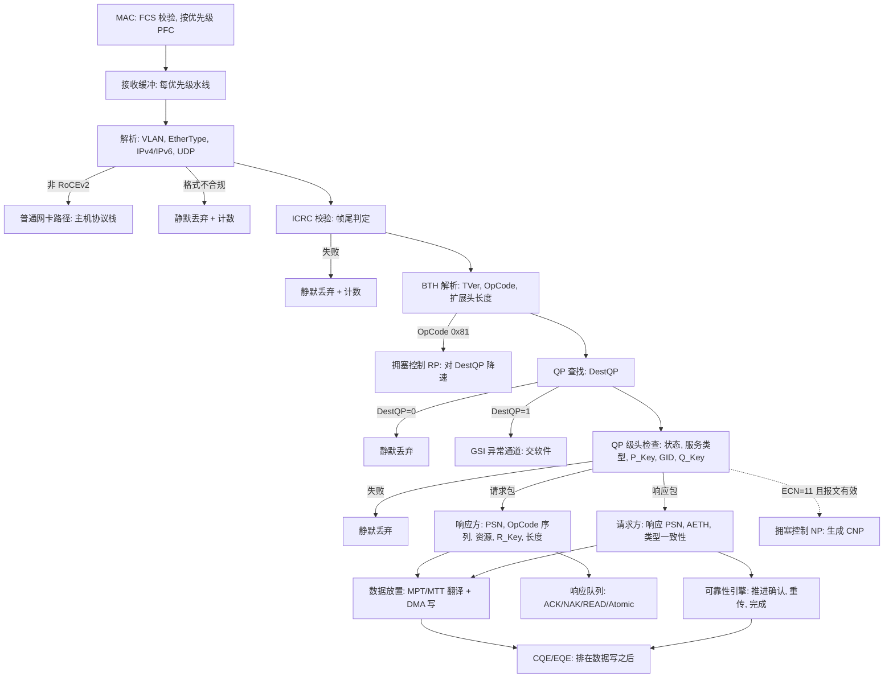

# 接收数据通路（RX Datapath）

> **摘要**：本文沿报文在 RNIC 内的接收方向，逐级说明：解析与 L2/L3/L4 合法性检查、ICRC 校验、BTH 解析与 QP 查找、P_Key/GID/Q_Key 检查、按"响应方/请求方"角色的 PSN 与 OpCode 检查、R_Key 与地址翻译、PCIe 写与可见性顺序、ACK/NAK 与 CQE 生成；并从规范出发分析"存储转发 vs 直通"的取舍，以及没有链路层信用时的接收缓冲与背压设计。
>
> **规范出处**：Vol1 §A17.3.4（p.1936）；§A17.4.4（p.1938–1939）；§A17.6（p.1942–1943）；§A17.7.3–§A17.7.4（p.1945）；§9.6（p.292–303）；§9.7.4–§9.7.5（p.318–355）；§9.7.6（p.355–365）；§10.6.4.5.2（p.518）；§10.9.3（p.558–559）；§9.5（p.291–292）；§17.2.4（p.1198）
>
> **前置阅读**：[RNIC 总体架构](01-rnic-architecture.md)、[事务排序与入站报文头校验](../02-transport/03-ordering-and-validation.md)、[响应方行为](../02-transport/07-responder.md)、[内存注册与 Key](../03-verbs-and-resources/03-memory-management.md)
>
> **关键词**：解析器, 静默丢弃, ICRC, DestQP, P_Key, ePSN, NAK, R_Key, MPT/MTT, Posted Write, Relaxed Ordering, 存储转发, PFC 水线

## 1. 接收路径总览



**"静默丢弃"的确切含义**（本文反复出现）：对响应方，不回 ACK/NAK、不消耗接收 WQE、不执行该请求、此前收到的请求照常执行完成、ePSN 不变、继续等待合法请求；对请求方，不因此完成任何发送 WQE，最多增加错误计数〔Vol1 §9.6, p.293〕。被静默丢弃的报文不计入传输定时器的"收到响应"，QP 状态不变、连接不拆除〔Vol1 §9.6, p.295〕。

## 2. 解析与 L2/L3/L4 合法性检查

### 2.1 检查清单

| 层 | 检查 | 不满足时 | 依据 |
|---|---|---|---|
| L2 | FCS | MAC 丢弃 | 〔外部: IEEE 802.3〕 |
| L2 | DMAC 为本端口单播/已加入的组播/广播 | 丢弃 | 普通网卡行为 |
| L2 | 0～2 层 VLAN 标签；EtherType = 0x0800 / 0x86DD | 其它 EtherType 走普通网卡路径（0x8915 为 RoCE v1，仅在支持 §A17.8 互通时处理） | §A17.3.1、§A17.2.3 |
| IPv4 | Version = 4 | 静默丢弃 | CA17-27 |
| IPv4 | IHL = 5（无选项） | 静默丢弃 | CA17-3 + CA17-24 |
| IPv4 | Header Checksum 正确 | 建议丢弃并计数（**工程建议**：校验和字段被 ICRC 屏蔽，但其余首部字节受 ICRC 保护） | RFC 791 |
| IPv4 | Total Length 与实收长度一致 | 静默丢弃 | CA17-6 + CA17-24 |
| IPv4 | DF=1、MF=0、Fragment Offset=0 | 分片报文无法处理，丢弃；DF=0 严格说也不合规（CA17-24），是否严格检查需考虑互通（待核实其它实现） | CA17-7、CA17-8 |
| IPv4 | Protocol = 0x11 | 不是 RoCEv2，走普通网卡路径 | CA17-10 |
| IPv6 | Version = 6 | 静默丢弃 | CA17-27 |
| IPv6 | Next Header = 0x11（不带扩展头） | 带扩展头的报文不合规，静默丢弃 | CA17-16 + CA17-24 |
| IPv6 | Payload Length 与实收长度一致（正确值 = UDP 头 + BTH + … + ICRC = UDP Length；CA17-15 原文"即 BTH"是笔误，见 [发送数据通路](02-tx-datapath.md)） | 静默丢弃 | CA17-15（p.1934） |
| L3 | 目的 IP 是本端口 GID 表中的某个地址 | 不是发给本端的 RoCE 报文 | 后续 GID 检查的前提（§A17.4.4.2） |
| UDP | Destination Port = 4791 | 不是 RoCEv2，走普通网卡路径 | CA17-20 |
| UDP | Length 与 IP 长度一致 | 静默丢弃 | CA17-21 |
| UDP | Checksum | 发送端"应"置 0；规范未要求接收端校验，非 0 不应据此丢弃（**工程建议**：忽略，端到端由 ICRC 保护） | §A17.3.2.4（p.1935） |
| IP | TTL/Hop Limit | 不检查 | — |
| IP | ECN = 11（CE） | 记入包元数据，报文合法时触发 CNP | CA17-44 |

> [!IMPORTANT]
> CA17-24：不符合 §A17.3.1（以太类型与 IP 头字段）、§A17.3.2（UDP 头字段）、§A17.3.3（ICRC）规则的 RoCEv2 报文**必须静默丢弃**〔Vol1 §A17.3.4, p.1936〕。CA17-27 替换了基础规范对 GRH IPVer 的检查（C9-45）；C9-43.1.1、C9-43.1.2、C9-44 对 RoCEv2 不适用〔Vol1 §A17.4.4, p.1938–1939〕。

### 2.2 长度与偏移计算

- 以太网可能在短帧后补齐到最小帧长（见 [发送数据通路](02-tx-datapath.md)），**一切长度都以 IP/UDP 长度字段为准**，帧尾多出的字节要从 ICRC 计算与数据放置中剔除。
- 各偏移（字节，从 DMAC 起算）：

| 封装 | IP 头起点 | UDP 起点 | BTH 起点 | BTH 所在拍（64 B/拍） |
|---|---:|---:|---:|---|
| IPv4，无 VLAN | 14 | 34 | 42 | 第 0 拍 |
| IPv4，1 层 VLAN | 18 | 38 | 46 | 第 0 拍 |
| IPv4，2 层 VLAN | 22 | 42 | 50 | 第 0 拍 |
| IPv6，无 VLAN | 14 | 54 | 62 | 跨第 0/1 拍 |
| IPv6，1 层 VLAN | 18 | 58 | 66 | 第 1 拍 |
| IPv6，2 层 VLAN | 22 | 62 | 70 | 第 1 拍 |

- 负载长度 = UDP Length − 8 − 12（BTH）− 扩展头长度 − PadCnt − 4（ICRC）；必须 ≥ 0，否则为畸形包。
- **硬件实现要点**：把前两拍（128 B）收齐到头部寄存器，再按"IP 版本 × VLAN 层数"6 种变体做固定偏移的字段抽取，比用通用桶形移位器省资源；IPv6 + 2 层 VLAN + AtomicETH 时头部最长约 14+8+40+8+12+28 = 110 B，仍在两拍之内。

## 3. ICRC 校验

- 规则：按 CA17-22 屏蔽可变字段后计算 CRC-32，与报文末尾 4 字节比较；不一致静默丢弃（CA17-24）。基础规范的定位是"ICRC 在报文交给传输层之前校验，ICRC 无效的报文在到达传输层前即被静默丢弃"（§9.6 脚注 10）〔Vol1 §9.6, p.293〕——即**传输层（PSN、QPC 状态、内存写）不应看到 ICRC 错误的报文**。
- 流水线：屏蔽位置取决于 IP 版本与 VLAN 层数，而这两者在第 0 拍内就能解析出来；CRC 引擎可以与第 0 拍的轻量解析并行，或把数据流延迟 1 拍。
- **帧尾判定**：ICRC 结果只有在最后一拍之后才知道，因此"是否接受此包"的最终决定点在帧尾。两种比较方式：
  1. 计算到 ICRC 之前，与收到的 4 字节比较；
  2. **余式检查**：把收到的 ICRC 也送入 CRC 寄存器，按无末尾取反的反射式寄存器计，正确报文的余式恒为 **0xDEBB20E3**（已用随机报文验证），无需单独抽取 ICRC 字段。
- 并行 CRC、屏蔽字段在线替换、尾拍字节有效掩码处理的完整设计（含经 iverilog 验证的参考 RTL）见 [FPGA 实现要点](05-fpga-implementation-notes.md)。

## 4. BTH 解析与 QP 查找

### 4.1 BTH 与扩展头

- TVer 必须为 0，否则静默丢弃（C9-36）〔Vol1 §9.6.1.1.1, p.295〕。
- OpCode 决定后续扩展头及其长度（Table 38, p.257–259）：RETH 16 B、AETH 4 B、AtomicETH 28 B、AtomicAckETH 8 B、ImmDt 4 B、IETH 4 B、DETH 8 B。解析器用一张 256 项的 OpCode ROM 输出 `{服务类型, 请求/响应, 位置(First/Middle/Last/Only), 扩展头位图, 是否消耗接收 WQE}`。
- OpCode 0x81 是 RoCEv2 CNP（Figure 349, p.1948），交给拥塞控制模块（RP）处理，不走 QP 的 PSN 逻辑；F/B 位（FECN/BECN）一律忽略（CA17-29）。
- OpCode[7:5] 指示的服务若本 CA 不支持（如 RD 010，C9-47.2.1）或与目的 QP 的配置不一致，静默丢弃（C9-38、C9-39）〔Vol1 §9.6.1.1.2, p.295–296〕。

### 4.2 QP 查找与 QP 级检查

| 检查 | 规则 | 失败动作 | 依据 |
|---|---|---|---|
| DestQP = 0 | RoCEv2 没有 QP0 | 静默丢弃 | CA17-33（p.1943） |
| DestQP = 1 | GSI：P_Key 只需是端口 P_Key 表成员；Q_Key 须为 0x80010000 | 不匹配则丢弃；匹配则交软件 | C9-42（p.297）、C9-49（p.301） |
| QP 存在且状态允许 | 请求包：QP 处于 RTR/RTS/SQD/SQE；响应包：RTS/SQD/SQE | 静默丢弃 | C9-37、C9-39、Table 40（p.295–296） |
| 服务类型一致 | OpCode[7:5] 与 QP 类型一致 | 静默丢弃 | C9-38 |
| P_Key | 与目的 QP 绑定的 P_Key 匹配：两者都不是无效 P_Key、低 15 位相同、且不同时为受限成员 | 静默丢弃（"如同发往不存在的设备"） | C9-43（p.297）、C10-124（p.558–559） |
| GID（RC/UC） | 源/目的 IP 映射为 SGID/DGID 后，与该 QP 记录的对端地址、本端地址一致（含 APM 备用路径）；GID type 须与报文协议一致 | 静默丢弃 | C9-47.1.1（p.299）、§A17.4.4.2（p.1939）、CA17-41（p.1945） |
| GID（UD） | 单播不校验 SGID/DGID | — | C9-46（p.298） |
| Q_Key（UD） | 与 QP 的 Q_Key 比较 | UD：静默丢弃 | C9-50（p.301） |

**硬件实现要点**：

- DestQP 在 IPv4 时位于第 0 拍、IPv6 时位于第 1 拍，**QPC 查找可在 ICRC 结果出来之前发起**，用帧的剩余时间掩盖上下文缓存的访问延迟。
- QPN→QPC 的映射可用"QPN 低位直接索引 + 高位作为代际标签"，代际不符视为 QP 不存在，可防止销毁后重建的 QP 收到旧连接的残留报文（规范把防范"陈旧报文"交给连接管理的 Time Wait 机制，§9.7.1, p.308；硬件代际标签是额外防线，**设计建议**）。

## 5. 传输层检查（按角色）

### 5.1 作为响应方：入站请求

检查顺序遵循 Figure 90（RC 入站请求校验）〔Vol1 §9.7.4.1, p.319〕：PSN → OpCode 序列 → 是否支持该操作 → 资源（无接收 WQE 时可回 RNR NAK）→ RDMA/ATOMIC 的 R_Key → 执行 → 本地错误。

PSN 分类（已用 gcc 编译并通过回绕边界用例测试）：

```c
enum psn_cls { PSN_NEW, PSN_DUP, PSN_INVALID };

/* 响应方：入站请求 PSN 分类（有效区宽 2^23，含 ePSN；见 Figure 88） */
static inline enum psn_cls resp_classify(uint32_t psn, uint32_t epsn)
{
    uint32_t d = (psn - epsn) & 0xFFFFFFu;
    if (d == 0)
        return PSN_NEW;
    if (d > 0x800000u)                 /* 落后 ePSN 1 .. 2^23-1：重复区 */
        return PSN_DUP;
    return PSN_INVALID;                /* 超前 1 .. 2^23-1，或恰好落后 2^23 */
}
```

各类错误的响应汇总：

| 情形 | 响应 | 响应中的 PSN | ePSN | 依据 |
|---|---|---|---|---|
| PSN 超前（丢包） | NAK：PSN Sequence Error；在收到 ePSN 请求前不再发其它 ACK/NAK | ePSN | 不变 | C9-79、C9-80、C9-114、C9-121 |
| PSN 落在重复区 | SEND/WRITE：重发 ACK；READ：重新读内存生成响应；ATOMIC：返回保存的结果，不重复执行 | 见 [可靠性引擎](04-reliability-engine.md) | 不变 | Table 44（p.324）、C9-103…C9-110 |
| OpCode 序列错误 | NAK：Invalid Request | ePSN | 不变 | C9-81（p.326）、C9-125 |
| 不支持的操作 / 保留 OpCode | NAK：Invalid Request | ePSN | 不变 | C9-83、C9-84 |
| First/Middle 包 PadCnt≠0 | NAK：Invalid Request | ePSN | 不变 | C9-85 |
| READ/ATOMIC 资源不足 | NAK：Invalid Request | ePSN | 不变 | C9-86 |
| 负载长度与 OpCode/PMTU 不符；SEND 超出接收缓冲 | NAK：Invalid Request | ePSN | 不变 | C9-91…C9-93 |
| READ 的 DMA Length > 2^31 | NAK：Invalid Request | ePSN | 不变 | C9-94 |
| ATOMIC 地址非 8 字节对齐 | NAK：Invalid Request | ePSN | 不变 | §9.4.5（p.283） |
| 无可用接收 WQE | RNR NAK（对 RC 为可选手段），带定时值 | 被 RNR 的包的 PSN | 不变 | Figure 90、C9-113、C9-129 |
| R_Key 无效、越界、权限不足、PD 不符 | NAK：Remote Access Error | 出错请求包的 PSN | 不变 | C9-89、C9-124 |
| 执行中的本地错误（翻译失败、PCIe 错误等） | NAK：Remote Operational Error | 正在执行的请求的 PSN | — | C9-126 |

补充规则：

- 出错请求之前收到的请求必须先执行并完成，再发 NAK（C9-79、C9-87、C9-90）；NAK 的 OpCode 一律为 Acknowledge（C9-113.a1）。
- 零长度 READ/WRITE 不校验 R_Key，即使带立即数（C9-88）。WRITE 的长度/边界检查逐包进行，READ 按 RETH 的 DMA Length 一次检查〔Vol1 §9.7.4.1.5, p.329〕。
- 发出 Invalid Request / Remote Access / Remote Operational 类 NAK 后，按 Table 82，响应方 QP 进入 Error，请求方收到 NAK 后也进入 Error〔Vol1 §10.10.3.1, p.565–566〕（细节见 [错误检测与处理](../02-transport/08-error-handling.md)）。

### 5.2 作为请求方：入站响应

- 先按 §9.6 做头部校验，不合法静默丢弃（C9-133）；检查 AETH 语法，保留 NAK 码的报文视为畸形包丢弃（C9-120、C9-135）〔Vol1 §9.7.6.1, p.355–356〕。
- **响应 PSN 三分法**（三 PSN 范式，p.357–360）：落在 `[最早未确认 PSN, 最大前进 PSN]` 的是期望响应；落后于最早未确认 PSN 的是重复响应（丢弃，但若对端产生端到端信用须从中提取信用，C9-144/C9-145）；其余为幽灵 ACK，丢弃（C9-136）。

```c
enum rsp_cls { RSP_EXPECTED, RSP_DUPLICATE, RSP_GHOST };

/* oldest = 最早未确认 PSN；next_psn = 下一个将分配的 PSN（含 READ 预留）。
 * 无未确认请求时 oldest == next_psn，未确认区为空。 */
static inline enum rsp_cls req_classify(uint32_t psn, uint32_t oldest, uint32_t next_psn)
{
    uint32_t win = (next_psn - oldest) & 0xFFFFFFu;
    if (((psn - oldest) & 0xFFFFFFu) < win)
        return RSP_EXPECTED;
    if ((((oldest - psn) & 0xFFFFFFu) - 1u) < 0x7FFFFFu)   /* 落后 1 .. 2^23-1 */
        return RSP_DUPLICATE;
    return RSP_GHOST;
}
```

- **响应类型一致性**：拥塞场景下，可能在期望 READ/Atomic 响应的位置收到普通 ACK，反之亦然；请求方应检查响应与未完成请求的类型一致，不一致按 Table 59 处理（p.356）。
- **合并 ACK 的隐含语义**（最容易实现错的地方）：若存在 PSN 早于该 ACK PSN 的未完成 READ/ATOMIC，则这个 ACK 对其中最早的那个**隐含 NAK**，其后的请求都未被确认，请求方必须从那个 READ/ATOMIC 起重试（规则 1，Figure 93）〔Vol1 §9.7.5.1.2, p.332–333〕。
- READ 响应：First/Only 包隐含确认更早的请求，Last/Only 包显式确认该 READ（p.347–348）；Middle 包 PSN 必须等于下一个期望的响应 PSN，否则说明中间丢包，丢弃后续响应并从缺口处重新发起 READ（允许只重读未成功的部分，p.282）。
- 发送 WQE 的完成：收到新 MSN 后从最早未完成 WQE 依次完成，但遇到尚未得到显式响应的 READ/ATOMIC 即停止（Figure 104）〔Vol1 §9.7.7.1.1, p.369–370〕。

## 6. 内存翻译与保护

### 6.1 Key 结构与查表

- R_Key/L_Key 的内部结构由实现决定。常见做法是"高位为 MPT 索引 + 低 8 位为每次注册变化的标签"，可在 MR 重注册后让旧 key 失效。例如 Linux rxe 的 MR key = `对象索引 << 8 | 随机 8 bit`〔业界实践: Linux rxe `rxe_mr.c`，以源码为准〕。
- 查表流程：key → MPT 表项（状态、PD、权限、起始 VA、长度、页大小、MTT 基址）→ 页号 = (VA − 对齐后起始 VA) >> 页位移 → MTT[基址 + 页号] → 物理页地址 + 页内偏移。一个 4 KB 包在 4 KB 页上最多跨 2 页，需 2 次翻译。

### 6.2 检查项

| 检查 | 规则 | 依据 |
|---|---|---|
| Key 有效 | MPT 表项存在、状态有效（未被失效）、标签匹配 | §10.6.5（p.518–519） |
| PD | 被访问内存所属 MR 与处理该操作的 QP 同 PD，粒度不超过 4096 B | C10-56（p.518） |
| 远端权限 | MR/MW 的远端读/写/原子权限允许该操作 | C10-57（p.518）、§10.6.7.2（p.523） |
| 边界 | VA 与长度落在 key 对应范围内：规范对 CI 层"强烈建议"检查，传输层把越界定义为 R_Key 违规并回 NAK | §10.6.4.5.2（p.518）、§9.7.4.1.5（p.329） |
| 零长度 | 不检查 | C9-88 |
| QP 远端访问使能 | QP 未开启 RDMA 写时不得写入目标内存 | C10-88（p.538） |

**硬件实现要点**：MPT/MTT 各配一个翻译缓存（类似 IOTLB），顺序流可预取下一页；MR 被本地失效或 Send with Invalidate 失效时，必须在该操作完成之前同步失效硬件缓存中的对应项，否则会出现"已失效的 key 仍可访问"的安全漏洞（**设计建议**）。

## 7. 数据放置：DMA 写主机内存

### 7.1 各操作的放置规则

| 操作 | 目标地址来源 | 接收 WQE | 完成 |
|---|---|---|---|
| SEND First/Middle/Last/Only | 接收 WQE 的 SGE 列表（RQ 或 SRQ），多包 SEND 的进度存于 QPC | 消耗一个（C10-81, p.537） | Last/Only 后生成接收 CQE；SE 置位时触发 CQ 事件（C9-3, p.260） |
| WRITE First/Only | RETH 的 VA/R_Key/长度；存入 QPC 的 WRITE 上下文 | 不消耗（C10-87） | 无 |
| WRITE Middle/Last | QPC 中保存的 VA + 已写字节数 | 不消耗 | 无 |
| WRITE Last/Only with Immediate | 同上 | 成功完成时消耗一个（C10-86） | 生成接收 CQE，携带立即数 |
| READ 响应（在请求方） | 本地 READ WQE 的 SGE，偏移 = (PSN − 首 PSN) × PMTU | — | Last/Only 后可完成该 WQE |
| ATOMIC（在响应方） | AtomicETH 的 VA，读-改-写 8 字节 | 不消耗 | 结果存入响应资源，回 Atomic ACK |

### 7.2 PCIe 写与可见性顺序

- 数据用 Posted Memory Write（MWr）写入：单个 TLP 负载 ≤ MPS，且不得跨 4 KB 边界；按物理页再拆分〔外部: PCI Express Base Specification〕。
- **规范要求的可见性**：应用在接收 WQE 完成前不得依赖接收缓冲内容（C9-33），在 READ 完成前不得依赖 READ 目标缓冲（o9-21），WRITE 数据在随后的 SEND 完成（或带立即数的 WRITE 完成、或随后的 ATOMIC）时才可依赖（o9-20）〔Vol1 §9.5, p.292〕。反过来，RNIC 必须保证：**软件看到 CQE 时，对应（及之前）的数据已经可见**。
- **PCIe 实现**：同一请求者发出的 Posted 写默认按序到达；带 Relaxed Ordering（RO）属性的 Posted 写可以越过之前的 Posted 写〔外部: PCI Express Base Specification〕。因此（**设计建议**）：

| 写类型 | RO 属性 | 理由 |
|---|---|---|
| 负载数据 | 可置 1 | 数据之间无顺序要求（应用不能依赖消息内写入顺序，§9.5, p.292），有些平台可提升吞吐 |
| CQE | 必须为 0 | 不得越过之前的数据写 |
| EQE、MSI-X 中断 | 必须为 0 | 不得越过 CQE |

> [!WARNING]
> 当数据与 CQE 走不同路径时（例如数据经 PCIe P2P 写入 GPU 显存、CQE 写入主机内存），PCIe 排序不再自动保证"数据先于 CQE 可见"。常见补救是写 CQE 前对数据目标发一个读请求作为"刷新"（读完成不能越过此前的 Posted 写）〔外部: PCIe 排序规则；业界实践〕。

### 7.3 ATOMIC 的原子性实现

- 规范要求：同一 CA 上不同 QP 的原子操作之间必须原子（o9-17）；对 CPU/其它设备的原子性可选（o9-18）〔Vol1 §9.4.5.1, p.286〕；操作数在线上为大端，CI 负责与主机字节序转换（o10-41）〔Vol1 §10.7.2.3, p.539〕。
- 两种做法：(1) RNIC 内部对原子操作地址加锁、串行完成"读→改→写"（保证 o9-17，不保证与 CPU 的原子性）；(2) 使用 PCIe AtomicOp（FetchAdd/CAS 等，属可选能力，需 Root Complex 作为完成者支持），可提供与 CPU 原子指令一致的语义〔外部: PCI Express Base Specification〕。对应 verbs 中的原子能力级别（如 libibverbs 的 `IBV_ATOMIC_HCA` / `IBV_ATOMIC_GLOB`）〔业界实践: rdma-core〕。

## 8. ACK/NAK 与 CQE 的生成时机

- **ACK 可以早于数据落地**：对 SEND/WRITE，ACK 只表示数据已到达响应节点的故障域，CA 随后会把数据写入内存，或至少让本地应用得知失败〔Vol1 §9.7.5.1.6, p.344–345〕。因此 ACK 不必等 PCIe 写完成（Posted 写本来也没有完成报文）。
- **但所有检查必须在 ACK 之前完成**：R_Key、翻译、长度等能导致 NAK 的检查一旦在 ACK 之后才发现，就只能以本地完成错误/异步事件报告，对端已认为成功。设计上应在调度 ACK 前完成翻译查找（**设计建议**）。
- 接收 CQE 只在消耗接收 WQE 的消息（SEND、带立即数的 WRITE）完成时生成；同一接收队列的完成按提交顺序（C10-99.2.1, p.547），SRQ 例外。
- 发送 CQE 由 ACK/READ 响应/Atomic ACK 驱动，按 WQE 提交顺序完成（C9-30、C9-32, p.292）；未请求信号的 WQE 不生成 CQE（C10-92, p.542）。
- CQ 满时不能丢弃 CQE 了事，规范定义为 CQ 溢出的异步错误〔Vol1 §10.8.5.2, p.553〕；CQ 号与 EQ 的武装/通知语义见 C10-111…C10-113（p.555）。

## 9. 设计权衡：存储转发 vs 直通

| 维度 | 存储转发（Store-and-Forward） | 直通（Cut-Through） |
|---|---|---|
| 做法 | 整包进缓冲，FCS、ICRC、全部头检查通过后再放置数据、更新状态 | 头部检查通过后即开始 DMA 写，ICRC/FCS 在帧尾才知道 |
| 额外时延 | 约一个包的串行化时间：4 KB@100G≈0.33 µs，@400G≈0.08 µs | 几乎为 0 |
| 片上存储 | 每个在途包一个最大帧缓冲 | 较少 |
| ICRC/FCS 错时 | 包被完整丢弃，无任何副作用 | 数据可能已写入主机内存，无法撤销；只能不推进 PSN、不完成 |
| 头部比特错误 | 被 ICRC/FCS 拦截 | 可能按错误的 VA/QP 写入（仍在授权范围内）后才被发现 |

规范依据与分析：

1. §17.2.4 的原则是"CA 必须在把报文提交到 CA 状态之前对其进行校验"〔Vol1 §17.2.4, p.1198〕（其中的 C17-21 在 RoCEv2 端口被 CA17-39 替换，但原则未变）；§9.6 脚注 10 把 ICRC 校验放在报文交给传输层之前（p.293）。
2. CA17-24 要求 ICRC 错误的报文"静默丢弃"，其语义是"不执行该请求"（p.293）。
3. 可靠服务承诺消息"至多一次、按序、无损坏"地交付〔Vol1 §9.7, p.304〕。
4. 另一方面，应用在完成之前不得依赖目标缓冲内容（C9-33、o9-20）——所以**仅负载损坏**的直通写入，只要随后重传的正确数据覆盖同一地址，最终结果仍正确。

结论（**工程权衡**）：直通的真正风险在**头部比特错误**——RETH 中的 VA、BTH 中的 PSN/DestQP 等只有在帧尾的 ICRC/FCS 才能确认，直通可能把数据写到"授权范围内但错误"的地址，覆盖应用认为已经完成的数据，构成静默数据损坏，与第 3 条冲突。因此推荐**逐包存储转发**；时延敏感的设计可以"边收边做非破坏性工作"（并行发起 QPC/MPT 查找、预取接收 WQE、预分配 PCIe 写缓冲），只把"写内存与提交状态"推迟到 ICRC 通过之后。

## 10. 接收缓冲与背压

### 10.1 没有链路层信用

- IB 链路层靠信用反压，RoCEv2 没有；C17-19/C17-20（不得持续反压、不得因出向反压而反压入向）对 RoCEv2 端口不适用〔Vol1 §A17.7.3, p.1945〕。
- 规范建议网络配置为无损（通常用 IEEE 802.1Qbb PFC），同时强调"无损"不等于绝不丢包，传输层仍有端到端重传〔Vol1 §A17.9.1, p.1946〕。

### 10.2 接收缓冲容量估算（工程估算，已脚本计算）

RNIC 作为终点，在主机侧处理变慢（PCIe 写拥塞、上下文未命中）时需要对交换机发 PFC。发出 XOFF 后仍会到达的数据量（headroom）≈ 2 × 线缆传播时延 × 线速 + 2 × 最大帧 + 对端响应时延 × 线速：

| 100G 线缆长度 | 传播往返 | headroom 估算（4 KB MTU，响应时延按 1 µs） |
|---:|---:|---:|
| 3 m | 30 ns | ≈ 21 KB |
| 100 m | 1 µs | ≈ 33 KB |
| 300 m | 3 µs | ≈ 57 KB |

再加上吸收主机侧抖动的工作缓冲（如 2～5 µs × 12.5 KB/µs ≈ 25～60 KB），100G 下每个无损优先级取 64～128 KB 量级较为稳妥。PFC 参数与交换机侧配置见 [无损以太网与 PFC](../05-congestion-control-and-qos/01-lossless-ethernet-pfc.md)。

### 10.3 避免 RX→TX 依赖造成的死锁

接收处理若需要发送资源（ACK、NAK、READ 响应）才能继续，而发送方向又被对端 PFC 暂停，就可能形成"入向因出向被堵而反压"的环路——这正是 C17-20 原本要防止的情形。虽然它对 RoCEv2 不再是合规条款，工程上仍应避免（**设计建议**）：

1. **ACK 状态化**：待发 ACK 只记录在 QPC（标志 + 最新 PSN + MSN），多次合并为一次，不占队列；
2. **NAK 状态化**：每 QP 至多一个未决 NAK（规范本身也只允许一个序列错误 NAK 在途，C9-114），同样只记状态；
3. **READ/ATOMIC 有界**：响应资源队列深度等于协商值，超出则回 NAK-Invalid Request（C9-86），因此接收侧永远不必为生成 READ 响应而等待；
4. 接收侧的数据放置只依赖 PCIe 写通道，不依赖以太网发送。

做到这几点，RX 路径在 TX 被暂停时仍可持续前进，不会把出向暂停传导为入向暂停。

## 11. 要点回顾

- 接收检查分三层：L2/L3/L4 格式（CA17-24/27 静默丢弃，非 RoCEv2 交普通网卡路径）、ICRC（帧尾判定，余式 0xDEBB20E3）、QP 级与传输层检查。
- 一切长度以 IP/UDP 长度为准，忽略以太网补齐字节；UDP 校验和非 0 不应据此丢弃。
- DestQP=0 丢弃（CA17-33）；DestQP=1 交软件 GSI；P_Key、GID、Q_Key 不匹配静默丢弃；CNP（0x81）交拥塞控制。
- 响应方按 Figure 90 顺序检查；各类错误对应固定的 NAK 码与 PSN 取法；出错请求之前的请求必须先完成。
- 请求方按三 PSN 范式区分期望/重复/幽灵响应；合并 ACK 对更早的未完成 READ/ATOMIC 隐含 NAK。
- R_Key 检查包括有效性、PD、权限、边界；零长度不查；失效操作必须同步清硬件缓存。
- 数据写可用 Relaxed Ordering，CQE/EQE/MSI-X 不可；跨路径（P2P）时需额外刷新。
- 推荐逐包存储转发：直通在头部比特错误时可能造成授权范围内的静默数据损坏。
- 没有链路层信用，依赖 PFC；RX 处理不应依赖 TX 资源，以免出向暂停传导为入向暂停。

## 自测

<details><summary>Q1：收到一个 UDP 目的端口 4791、但 IPv4 IHL=6 的报文，RNIC 应如何处理？若 UDP 校验和非 0 呢？</summary>

答：IHL 必须为 5（CA17-3），不符合 §A17.3.1 规则的 RoCEv2 报文必须静默丢弃（CA17-24）。UDP 校验和"应"置 0 只是对发送端的建议（§A17.3.2.4），接收端不应仅因校验和非 0 而丢弃。
</details>

<details><summary>Q2：响应方 ePSN=100，依次收到 PSN 100、102、103、101，分别如何处理？</summary>

答：100 是新请求，执行并 ePSN→101；102 超前，回 NAK-序列错误（PSN=101），ePSN 不变；103 仍超前，因已发过序列错误 NAK，静默丢弃（C9-114）；101 等于 ePSN，是新请求，正常执行并恢复正常 ACK/NAK 流程。
</details>

<details><summary>Q3：请求方依次发出 SEND(PSN 1)、READ(PSN 2，预期 3 个响应包，占 PSN 2–4)、SEND(PSN 5)，随后收到 PSN=5 的普通 ACK，应如何解释？</summary>

答：按合并 ACK 规则，PSN 1 的 SEND 被确认；PSN 2 的 READ 早于 ACK 的 PSN 且尚未得到响应，被隐含 NAK；其后的 SEND(5) 不算被确认。请求方需从 READ（可只重读未收到的部分）开始重试，再重发 SEND(5)。
</details>

<details><summary>Q4：为什么说直通（cut-through）写内存的主要风险不在负载损坏而在头部损坏？</summary>

答：负载损坏时数据写到正确地址，报文被丢弃不推进 PSN，重传的正确数据会覆盖同一地址，且应用在完成前本就不得依赖缓冲内容。头部（VA、PSN、DestQP 等）损坏只能在帧尾由 ICRC/FCS 发现，直通可能已把数据写到授权范围内的错误位置，覆盖已完成的数据，造成静默损坏。
</details>

<details><summary>Q5：如何在 PCIe 上保证"软件看到 CQE 时数据已可见"？</summary>

答：数据与 CQE 都用 Posted 写，CQE（以及之后的 EQE、MSI-X）不置 Relaxed Ordering，使其不能越过之前的数据写；数据写可以置 RO。若数据经不同路径（如 P2P 到 GPU），写 CQE 前需对数据目标发读请求刷新。
</details>

## 参考

- 规范：Vol1 §9.2（p.256–262）；§9.4.5（p.283–291）；§9.5（p.291–292）；§9.6（p.292–303，Figure 83、Table 40）；§9.7（p.304–381，Figure 88/90/93/104，Table 44/45/47）；§10.6.4.5（p.517–518）；§10.6.5（p.518–521）；§10.7.2（p.537–541）；§10.8（p.543–555）；§10.9.3（p.558–559）；§10.10.3.1（p.564–566，Table 81/82）；§17.2.4（p.1198）；§A17.3（p.1931–1936）；§A17.4（p.1936–1940）；§A17.6（p.1942–1944）；§A17.7（p.1944–1945）；§A17.9（p.1946–1949）。
- 外部：〔外部: IEEE 802.3（FCS）、IEEE 802.1Qbb（PFC）〕；〔外部: RFC 791〕；〔外部: PCI Express Base Specification（MPS、4 KB 边界、Relaxed Ordering、AtomicOp）〕；〔业界实践: Linux rxe `rxe_mr.c`、`rxe_icrc.c`〕；〔业界实践: rdma-core libibverbs 原子能力枚举〕。
- 本库相关：[发送数据通路](02-tx-datapath.md)、[可靠性引擎](04-reliability-engine.md)、[FPGA 实现要点](05-fpga-implementation-notes.md)、[PSN 模型与 ACK/NAK 协议](../02-transport/05-psn-and-ack-nak.md)、[请求方行为](../02-transport/06-requester.md)、[ECN 与 CNP](../05-congestion-control-and-qos/03-ecn-and-cnp.md)。
