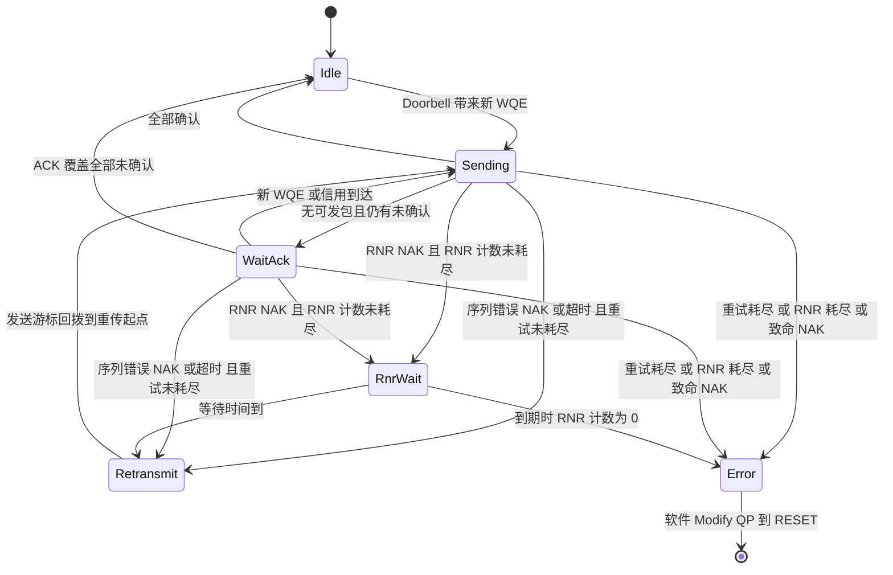
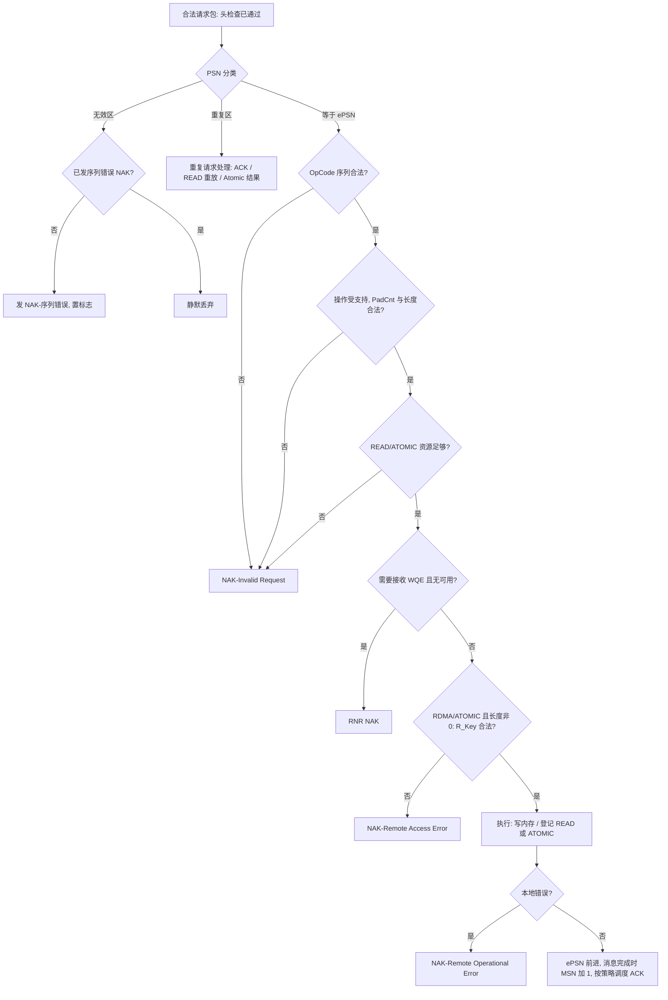

# 可靠性引擎：重传、定时器与重复请求（Reliability Engine）

> **摘要**：可靠性引擎是 RNIC 里状态最多、最容易出错的部分。本文先界定规范强制的行为与留给实现的自由度，再给出请求方/响应方每 QP 状态、PSN 运算、ACK/NAK/RNR 处理流程、Go-back-N 重传与 PSN↔WQE 映射、利用 C9-141 的 Ttr…4Ttr 检测窗口实现低成本定时器的方法、重复请求处理（READ 重放、Atomic 结果缓存）与 ACK 合并，最后讨论它与拥塞控制和错误处理的交互。
>
> **规范出处**：Vol1 §9.7（p.304–381）；§9.4.4–§9.4.5（p.279–291）；§9.6（p.292–295）；§9.10.2（Table 64, p.452–454）；§10.8.3（p.546）；§10.10.3.1（p.564–566）；§A17.9.1（p.1946）
>
> **前置阅读**：[PSN 模型与 ACK/NAK 协议](../02-transport/05-psn-and-ack-nak.md)、[请求方行为](../02-transport/06-requester.md)、[响应方行为](../02-transport/07-responder.md)、[接收数据通路](03-rx-datapath.md)
>
> **关键词**：Go-back-N, 三 PSN 范式, 传输定时器, Ttr, Local ACK Timeout, 重试计数, RNR, 重复请求, 响应资源, ACK 合并, MSN, 端到端信用

## 1. 规范强制什么、留给实现什么

| 类别 | 规范强制（摘要） | 留给实现的自由 |
|---|---|---|
| PSN | 请求方每包插入 PSN，READ 预留响应 PSN（C9-64…C9-66）；响应方用同一规则算 ePSN 并在执行前检查（C9-74…C9-76）；在途包数 ≤ 2^23（C9-61） | 三 PSN 范式的具体实现方法（p.360） |
| 确认 | 每个请求包都要被确认；READ/ATOMIC 必须有显式响应；响应按 PSN 顺序（C9-63）；收到 AckReq 必须调度响应（C9-116） | 何时发 ACK、如何合并（"响应调度本身不作规定"，p.344） |
| NAK | 序列错误 NAK 后在收到 ePSN 前不再发 ACK/NAK（C9-80、C9-114）；各 NAK 的 PSN 取法（C9-111…C9-126） | — |
| 定时器 | 每个 SQ 一个传输定时器（C9-139）；Ttr = 4.096 µs × 2^LocalAckTimeout，0 表示禁用（C9-140）；在 Ttr～4Ttr 之间检测到超时（C9-141） | 计时精度（"不可能也不需要高精度"，p.363）、实现结构 |
| 重试 | 3 bit 重试计数，序列错误 NAK 与超时都减 1，请求被清除时重装，耗尽后再失败即报错（C9-137、C9-142、C9-143） | 重传起点可早于 NAK 指示的 PSN（p.361–362）；数据来源（重读内存或缓冲） |
| RNR | 3 bit RNR 计数，7 表示无限（C9-132）；至少等待 AETH 指示的时间（C9-130）；不得用同一 PSN 替换成别的请求（C9-128） | 等待计时的实现 |
| 重复请求 | SEND/WRITE 只重发 ACK；READ 重新生成响应；ATOMIC 返回保存结果（Table 44、C9-102…C9-110、o9-66…o9-68） | 响应资源的存储方式 |
| 响应校验 | 幽灵 ACK 丢弃（C9-136）；重复 ACK 丢弃但提取信用（C9-144、C9-145）；保留 NAK 码视为畸形包（C9-120） | — |
| MSN | 每个新消息完成后 MSN+1，所有带 AETH 的响应都携带（C9-147…C9-149） | READ 可在校验后即递增（C9-148） |

## 2. 每 QP 状态

### 2.1 请求方（发送侧）

| 字段 | 位宽 | 作用 | 依据 |
|---|---:|---|---|
| `next_psn` | 24 | 下一个要发送的 PSN（重传时回拨） | C9-64…C9-66 |
| `hw_psn`（高水位） | 24 | 曾经分配过的最大 PSN + 1（含 READ 预留），用于判定响应是否在未确认区 | 三 PSN 范式（p.358–360） |
| `oldest_psn` | 24 | 最早未确认 PSN（Table 64 的 AckPSN） | p.357 |
| 发送游标：WQE 序号 + 消息内偏移 | 16 + 31 | 下一个包从哪里取数据 | Table 64 Tx WQE pointer |
| 最早未完成 WQE 序号 | 16 | 生成发送完成 | Table 64 Tx ACK WQE pointer |
| `retry_cnt` / 初值 | 3 / 3 | 序列错误与超时共用 | C9-137、C9-142、Table 64 Error Retries |
| `rnr_cnt` / 初值 | 3 / 3 | 7 = 无限 | C9-132 |
| Local ACK Timeout | 5 | 定时器指数 e | C9-140 |
| 传输定时器状态 | 3 | armed + 2 bit epoch（见 §6） | C9-139、C9-141 |
| RNR 等待状态 | 1 + 5 + 2 | armed + 指数 + epoch | C9-130 |
| 未完成 READ/ATOMIC 数 / 上限 | 8 / 8 | 发起门控 | §9.4.4（p.281） |
| SSN / LSN / 信用有效 | 24 / 24 / 1 | 端到端信用 | §9.7.7.2 |
| 标志 | ≈ 4 | 待重传、等待 RNR、Fence 等待、错误 | — |
| PSN↔WQE 映射（每个未完成 WQE） | 24 + 24 + 2 | 首 PSN、包数（READ 为响应包数）、类型 | 见 §5.3 |

### 2.2 响应方（接收侧）

| 字段 | 位宽 | 作用 | 依据 |
|---|---:|---|---|
| `epsn` | 24 | 期望 PSN | C9-74…C9-76 |
| `msn` | 24 | 已完成消息数（模 2^24） | C9-148 |
| 上一合法包 OpCode 类别 | 3 | OpCode 序列检查 | C9-81、Table 45 |
| `nak_seq_sent` | 1 | 已发序列错误 NAK，等待 ePSN | C9-80、C9-114 |
| 待发 ACK：标志 + PSN | 1 + 24 | ACK 合并 | C9-95、C9-116 |
| 接收进度 / WRITE 上下文 | ≈ 200 | 多包 SEND/WRITE 的地址推算 | — |
| 响应资源环：head/tail/count | 3 × 5 | READ/ATOMIC 记录 | §9.4.5.3（p.286–287） |
| 响应资源条目（每条） | ≈ 256 | 类型、首 PSN、包数、VA、R_Key、长度、Atomic 原值 | 同上 |
| 最小 RNR 定时值 | 5 | 生成 RNR NAK | Table 63 注 b（p.452） |
| 接收信用 | 16 | 计算 AETH 信用字段 | C9-150.2.1、C9-161 |

## 3. PSN 运算

PSN 是 24 bit、模 2^24 的序号。比较大小一律用"模差 + 符号扩展"，**永远不要直接比较原始数值**（经 gcc 编译并测试回绕边界）：

```c
/* 24 位有符号差 a - b，结果在 [-2^23, 2^23-1]；>0 表示 a 在 b 之后 */
static inline int32_t psn_diff(uint32_t a, uint32_t b)
{
    return (int32_t)((a - b) << 8) >> 8;
}
```

- 响应方把 PSN 空间分成"期望 PSN / 重复区 / 无效区"（Figure 88, p.309）；请求方把响应 PSN 分成"未确认区 / 重复区 / 无效区"（Figure 100, p.357）。两者的分类函数见 [接收数据通路](03-rx-datapath.md) §5。
- 有效区宽度是 2^23（含 ePSN），这正是 C9-61 把在途包数限制在 8,388,608 的原因：否则响应方无法区分"重复"与"超前"。

## 4. 请求方：响应处理

### 4.1 处理流程（伪代码，非规范原文）

```text
on_response(pkt):
    cls = req_classify(pkt.psn, oldest_psn, hw_psn)           # 三分法
    if cls == GHOST:      drop; return                        # C9-136
    if cls == DUPLICATE:  take_credits_if_valid(pkt); drop    # C9-144/C9-145
    if aeth.syndrome is reserved NAK code: drop               # C9-120/C9-135
    if pkt type inconsistent with outstanding op: error       # p.356, Table 59
    switch kind(pkt):
      ACK:            ack_upto(pkt.psn)                       # 合并 ACK 语义，见 4.2
      NAK_SEQ_ERR:    ack_upto(pkt.psn - 1)                   # NAK 对更早的 SEND/WRITE 是隐含 ACK
                      start_retry(min(pkt.psn, oldest_unanswered_read_atomic))
                      retry_cnt -= 1 (若已为 0 则报错)         # C9-137
      RNR_NAK:        if rnr_cnt != 7: rnr_cnt -= 1           # C9-132
                      arm_rnr_wait(aeth.timer); retry_from = pkt.psn   # C9-128/C9-130
      NAK_INV_REQ / NAK_REM_ACCESS / NAK_REM_OP:
                      complete_wqe_in_error(); qp -> ERROR; flush        # Table 81
      READ_RESP:      place_data(); if first/only: ack_upto(pkt.psn - 1)
                      if last/only: read_done()
      ATOMIC_ACK:     write_back(orig_value); atomic_done()
    complete_wqes_by_msn_and_psn()                            # Figure 104
    if outstanding: restart_timer() else stop_timer()         # p.363–364
    if progress made: retry_cnt = retry_init                  # "请求被清除时重装"
```

### 4.2 三条最容易写错的规则

1. **合并 ACK 的隐含 NAK**：一个 PSN 为 p 的 ACK，对 PSN 早于 p 的未完成 SEND/WRITE 是隐含 ACK；但若其中有未得到响应的 READ/ATOMIC，则对**最早的那一个**是隐含 NAK，它之后的请求都不算被确认（Figure 93）〔Vol1 §9.7.5.1.2, p.332–333〕。同理，序列错误 NAK 对更早的 READ/ATOMIC 也是隐含 NAK（p.324），重传起点必须取 `min(NAK PSN, 最早未应答 READ/ATOMIC 的 PSN)`。
2. **按 MSN 完成 WQE 的屏障**：MSN 表示响应方已完成的消息数，但 READ/ATOMIC 只能由其显式响应完成。收到新 MSN 时从最早未完成 WQE 依次完成，遇到未应答的 READ/ATOMIC 就停（Figure 104）〔Vol1 §9.7.7.1.1, p.369–370〕。
3. **重复 ACK 不是错误**：重传后响应方可能用"最近完成的新请求 PSN"回 ACK，其 PSN 可能大于重传包的 PSN（三 PSN 范式，Figure 101, p.359）；落后于 `oldest_psn` 的 ACK 是重复 ACK，静默丢弃即可（C9-138）。

### 4.3 请求方状态机



## 5. 重传策略

### 5.1 为什么是 Go-back-N

RC 响应方只接受 PSN 等于 ePSN 的新请求，超前的包一律不执行（只回一次序列错误 NAK，C9-79/C9-114）。因此即使请求方只重发丢失的那一个包，后面已发的包也早已被丢弃——**传输层天然是 Go-back-N**。选择性重传需要改变响应方行为（如 IRN 一类方案，见 [其他拥塞控制与有损 RoCE](../05-congestion-control-and-qos/05-advanced-cc-and-lossy-roce.md)），不在 IBTA 规范范围内。这也是 §A17.9.1 建议无损网络的原因：避免因拥塞丢包触发整窗重传〔Vol1 §A17.9.1, p.1946〕。

### 5.2 重传数据从哪里来

| 方案 | 做法 | 优点 | 缺点 |
|---|---|---|---|
| 从主机内存重读（Go-back-N） | 发送游标回拨，按 WQE 重新 DMA 读负载 | 无需重传缓冲；规范保证 WR 资源在完成前归 CI 所有，应用不得修改发送缓冲〔§10.8.3, p.546〕，重读数据一致 | 每次重传多一次 PCIe 读延迟；重传期间占用 PCIe 读带宽 |
| 片上重传缓冲 | 已发未确认的包保存在片上，NAK/超时时直接重发 | 恢复快、不占 PCIe | 容量 = 在途字节；超时级（ms）等待期间缓冲被占满会卡住新发送；吞吐上限约为 缓冲/RTT（256 KB、RTT 20 µs 时约 104.9 Gb/s） |
| 混合 | 小缓冲只保存最近若干包，用于快速重发；其余回退到重读 | 兼顾 | 复杂度高 |

特殊情形：

- **内联数据**：数据只在 WQE 中，重传要么重读 WQE，要么在确认前保留；
- **READ**：只需重发请求，且可以只请求未收到的部分；
- **ATOMIC**：必须用**原 PSN** 重发，响应方据此返回保存的结果而不是再执行一次（o9-66）；
- **RNR 重试**：必须是"从 RNR NAK 指示的 PSN 开始的同一个请求消息"，不得换成别的请求（C9-128，p.352–353）。

### 5.3 PSN↔WQE 映射表

Go-back-N 的关键是：给定重传起点 PSN p，快速找到"哪个 WQE、第几个包、从哪个字节开始"。

- 每发起一个 WQE，记录 `{首 PSN, 包数 n, 类型}`（READ 的 n 为预期响应包数）。条目按 WQE 顺序存放在与 SQ 平行的环中（片上或主机内存），随 WQE 完成而退休。
- 查找：从最早未完成 WQE 起，找满足 `(p − 首 PSN) mod 2^24 < n` 的条目，包序号 `k = (p − 首 PSN) mod 2^24`。
- 由于 First/Middle 包负载恰为 PMTU（C9-69），**消息内字节偏移就是 `k × PMTU`**，无需逐包记录长度。

下面的 Python 片段已运行验证（含 PSN 回绕）：

```python
def locate(wqes, psn, pmtu):
    """wqes: [(first_psn, npkts, is_read), ...] 最早的在前；返回 (WQE 下标, 包序号, 字节偏移)"""
    for idx, (first, npkts, is_read) in enumerate(wqes):
        k = (psn - first) & 0xFFFFFF
        if k < npkts:
            return idx, k, k * pmtu
    return None

# 例：PMTU=1024，起始 PSN=0xFFFFF0，依次为 3000 B SEND、0 B SEND、10000 B READ、5000 B WRITE
# 映射为 [(0xFFFFF0,3), (0xFFFFF3,1), (0xFFFFF4,10,READ), (0xFFFFFE,5)]
# locate(..., 0x000002, 1024) -> (3, 4, 4096)：第 4 个 WQE（WRITE）的第 5 个包，偏移 4096
```

- **SGE 重定位**：字节偏移确定后，还要找到对应的 SGE 与 SGE 内偏移。SGE 数通常有上限（如 ≤ 30），可逐个累加；或在 WQE 获取时预存 SGE 前缀和（**设计建议**）。
- **READ 的部分重读**：重发 READ 请求时 PSN = p，VA = 原 VA + k×PMTU，长度 = 原长度 − k×PMTU，R_Key 不变。规范允许重试的 READ 不同于原请求，只要是原请求的真子集、且所有可能重复的响应包数据与 PSN 完全一致〔Vol1 §9.4.4, p.282〕。
- **简化方案**：重传起点直接取"包含 p 的 WQE 的第一个包"，响应方会把已收到的包当作重复请求只回 ACK（p.361–362）。实现简单，代价是多发一些包（**工程权衡**）。

### 5.4 回拨与高水位

重传时 `next_psn` 回拨到起点，但 `hw_psn` 保持不变。响应 PSN 的合法区间始终是 `[oldest_psn, hw_psn)`：响应方可能把重传包识别为重复请求，并以"它已推进到的最远 PSN"回 ACK（Figure 101, p.359）。当 `next_psn` 追上 `hw_psn` 后，恢复正常发送新包。

## 6. 传输定时器

### 6.1 规范要求

- 每个 SQ 一个传输定时器（C9-139）。定时器"不是为每个请求单独计时"，而是检测"持续没有响应"：在定时器未运行时，发出带 AckReq 的 SEND/WRITE 包、READ 请求或 ATOMIC 请求即启动；之后每收到一个新的确认包（且仍有未完成的期望响应）就重启；没有未完成的期望响应时停止〔Vol1 §9.7.6.1.3, p.363–364〕。
- Ttr = 4.096 µs × 2^(Local ACK Timeout)，Local ACK Timeout 为 5 bit，0 表示禁用；最小非零值由 CA 厂商定义，低于最小值时可用最小值（C9-140）；超时应在 Ttr ≤ To ≤ 4Ttr 之间被检测到（C9-141）〔Vol1 §9.7.6.1.3, p.364〕。
- 被静默丢弃的报文不计为"收到响应"（p.295）。

| Local ACK Timeout | Ttr | 检测窗口 [Ttr, 4Ttr] |
|---:|---:|---:|
| 8 | 1.05 ms | 1.05～4.19 ms |
| 12 | 16.8 ms | 16.8～67.1 ms |
| 14 | 67.1 ms | 67.1～268 ms |
| 18 | 1.07 s | 1.07～4.29 s |
| 31 | 8796 s（约 2.4 h） | — |

### 6.2 实现方案对比

| 方案 | 结构 | 每 QP 存储 | 启动/重启代价 | 适用 |
|---|---|---|---|---|
| 每 QP 计数器 | 每 QP 一个递减计数器，全部并行计数 | 数十 bit + 计数逻辑 | 写一个寄存器 | QP 很少（几十个） |
| 时间轮（hashed timing wheel） | 按到期时刻散列到桶，每桶链表 | 链表指针（2×log2 N bit） | 每次重启都要摘链/挂链，ACK 率高时开销大 | 需要精确到期、重启不频繁 |
| 周期扫描 + 时间戳 | 存到期时刻，扫描器轮询比较 | 16～32 bit | 写一个时间戳 | 中等规模 |
| **周期扫描 + epoch（推荐）** | 存 2 bit epoch，扫描器轮询 | **3 bit** | 写 2 bit | 大规模 QP |

### 6.3 利用 Ttr～4Ttr 窗口的 epoch 方案（设计建议，已仿真验证）

1. 全局计数器 `T` 每 4.096 µs 加 1（在 250 MHz 下恰为 1024 个周期，在 322.265625 MHz 下恰为 1320 个周期）。
2. 指数为 e 的 QP，其"epoch"定义为 `(T >> e) & 3`，即以 Ttr 为长度的时间片编号的低 2 位。
3. 启动或重启定时器：`armed = 1; epoch = (T >> e) & 3`。停止：`armed = 0`。
4. 扫描器周期 P 遍历所有 QP，若 `armed && ((T >> e) − epoch) & 3 ≥ 2` 即判定超时。

推导：设在时间片 n0 内的时刻 t0 启动，判定条件等价于"当前时间片 ≥ n0 + 2"，故经过时间 > (n0+2)Ttr − (n0+1)Ttr = Ttr，且越过门限的时刻 ≤ t0 + 2Ttr；再加扫描延迟，检测时刻落在 **(Ttr, 2Ttr + P]**。差值是模 4 的，"已超时"的读数 {2, 3} 只持续 2 个时间片，扫描器必须在此期间至少访问一次，所以要求 **P < 2Ttr**，此时检测时刻 ≤ 4Ttr，满足 C9-141。

蒙特卡洛仿真结果（每组 2 万次随机启动时刻与扫描相位）：

| e | 扫描周期 P | 实测检测时刻（以 Ttr 为单位） | 结论 |
|---:|---:|---|---|
| 8 | 0.5 Ttr | [1.016, 2.496] | 满足 |
| 8 | 1.0 Ttr | [1.015, 2.998] | 满足 |
| 8 | 1.9 Ttr | [1.017, 3.886] | 满足 |
| 6 | 2.5 Ttr | [1.023, 6.997] | **违反**（epoch 回绕） |

推广：b bit epoch、门限 K 时，检测时刻落在 ((K−1)E, KE + P]（E 为时间片长度），回绕安全条件为 P < (2^b − K)E。

**规模估算**：每 QP 存 `armed(1) + epoch(2) + e(5)` 共 8 bit，512 bit 宽的定时器表每拍可扫 64 个 QP；256K QP 共 256 KB，250 MHz 下扫一遍约 16.4 µs。由于要求 P < 2Ttr，e=1（2Ttr 恰为 16.4 µs）处于临界，e ≥ 2（Ttr ≈ 16.4 µs）即可稳妥支持。若厂商最小 Local ACK Timeout 定为 8（Ttr≈1 ms），扫描器每拍只扫 1 个 QP 也足够。

> [!WARNING]
> 定时器表只是"提示"。扫描器读出某 QP 超时后，必须把事件送回该 QP 的串行处理单元，在那里**重新确认**仍处于 armed 且 epoch 未被刚到达的 ACK 刷新（例如比较一个定时器代际号），再执行重传与 `retry_cnt` 递减；否则 ACK 与超时竞争会导致误重传甚至误判重试耗尽。

### 6.4 RNR 等待计时

- RNR NAK 的 5 bit 定时值按 Table 48 编码（0.01 ms～655.36 ms）〔Vol1 §9.7.5.2.8, p.354–355〕；规范只要求"至少"等待这么久（C9-130），没有上限，因此可以复用同一套 epoch 机制，取最小的 e 使 2^e × 4.096 µs ≥ 所需延迟：

| RNR 编码 | 要求延迟 | 选用 e | 实际等待范围 |
|---|---:|---:|---|
| 00001 | 0.01 ms | 2 | (0.016, 0.033 + P] ms |
| 00110 | 0.08 ms | 5 | (0.131, 0.262 + P] ms |
| 01110 | 1.28 ms | 9 | (2.10, 4.19 + P] ms |
| 00000 | 655.36 ms | 18 | (1.07, 2.15 + P] s |

- 上表显示粗粒度会多等约 1.6～3.3 倍（另加扫描延迟 P）；若在意 RNR 恢复速度，可对 RNR 计时用 3 bit epoch、门限 K=5，把时间片取为所需延迟的 1/4（**工程权衡**）。
- RNR 计数为 0 时到期即报"RNR 重试超限"错误（C9-132 及其后说明，p.354）。

## 7. 响应方

### 7.1 重复请求的处理

| 重复请求 | 动作 | 响应 PSN | 出错时 | 依据 |
|---|---|---|---|---|
| SEND / WRITE | 不重新执行，只回 ACK（须排在更早的重复 READ/ATOMIC 响应之后） | 最近完成的**新**请求的 PSN | 静默丢弃该重复请求 | C9-105、C9-106、p.339 |
| READ | 重新读内存生成响应；可以是原请求的子集 | 首包 = 重复请求的 PSN，之后按规则递增 | 发出首包前出错：静默丢弃；之后出错：中止响应 | C9-107…C9-109、p.341 |
| ATOMIC | 不重新执行；PSN 与保存的某次 ATOMIC 完全相同则返回保存结果 | 重复请求的 PSN | PSN 不匹配或无法重现结果：静默丢弃 | o9-66…o9-68 |

通用规则：处理重复请求期间 ePSN 保持不变（C9-103）；重复请求按 PSN 顺序响应，若在响应过程中收到 PSN 更早的重复请求，立即停止当前响应、转去响应更早的那个，且不必恢复被打断的响应（C9-110）；处理重复请求出错时不得发 NAK（C9-115）；重复 READ/ATOMIC 的响应必须先于后续重复 SEND/WRITE 的 ACK（C9-104）。

### 7.2 响应资源队列（READ/ATOMIC 记录）

- 只有合法的**新** READ/ATOMIC 才登记（所有头检查通过、PSN = ePSN、R_Key 有效、ATOMIC 地址 8 字节对齐）；按 FIFO 存放，深度等于连接建立时协商的未完成 READ/ATOMIC 数；重复请求不再登记〔Vol1 §9.4.5.3, p.286–287〕。
- 条目：`{类型, 首 PSN, 包数, VA, R_Key, 长度, Atomic 原值}`，约 32 B。
- **环形覆盖是安全的**：请求方未完成的 READ/ATOMIC 不会超过协商值，它要发新的 READ/ATOMIC，必然已收到某个旧请求的最后一个响应包——此时响应方早已发完那个旧响应，覆盖最旧条目不会影响正在进行的响应（**工程推导**）。
- 查找重复：READ 看重复 PSN 是否落在 `[首 PSN, 首 PSN + 包数)` 且所请求的数据范围是原范围的子集；ATOMIC 要求 PSN 完全相等。
- 重放 READ 时要重新校验 R_Key 与 VA（p.282）——期间 MR 若已被失效，按 C9-108/C9-109 处理。

### 7.3 ACK 合并策略

规范约束：收到 AckReq 必须调度响应，且响应 PSN ≥ 该请求 PSN（C9-116）；ACK 的 PSN 是最近一个新请求包的 PSN（C9-95）；没有 AckReq 时可以合并，甚至无限期等待（p.344）；READ 之后的请求在 READ 响应发出前不得确认（C9-101）。常见策略（**设计建议**）：

| 策略 | 触发 | 说明 |
|---|---|---|
| AckReq 触发 | 收到 A=1 的合法包 | 必须实现 |
| 计数触发 | 自上次 ACK 起累计 N 个包 | 限制请求方的未确认窗口，加快释放发送资源 |
| 时间触发 | 首个未确认包到达后 T µs | 防止请求方因 AckReq 策略不当而超时 |
| 空闲触发 | 该 QP 的接收流水线空闲 | 低负载时降低时延 |

> [!TIP]
> 计数/时间触发是"保险"：即使对端只在部分消息上置 AckReq，也不会因 ACK 被无限合并而超时。ACK 本身很小（IPv4 下 66 B），100G 下每 64 KB 一个 ACK 的开销可以忽略。

### 7.4 NAK 与 RNR NAK 的生成

- 序列错误：发 NAK（PSN = ePSN）后置 `nak_seq_sent`，此后除合法重复请求外，PSN ≠ ePSN 的请求一律丢弃，直到收到 PSN = ePSN 的请求才清除（C9-80、C9-114、C9-122）。因为每 QP 至多一个序列错误 NAK 在途，丢失的 NAK 只能靠请求方超时恢复（p.362）。
- RNR NAK：无可用接收 WQE 时生成，PSN 为被 RNR 的包的 PSN（C9-113），定时值通常取自 QP 配置的最小 RNR 定时值（Table 63 注 b, p.452）。RNR 会让请求方整条消息重发，只应在资源偶尔不足时使用（p.355）。

### 7.5 MSN 与端到端信用

- MSN 初值 0；每成功完成一个新的合法请求消息加 1，重复请求不加；READ/ATOMIC 的递增值在其响应的 Last/Only 包中返回，READ 也可在校验通过后就递增并在首个响应包中返回；每条消息只加一次（C9-148）〔Vol1 §9.7.7.1, p.368〕。所有带 AETH 的响应（含 NAK、重复 ACK）都携带 MSN（C9-149）。
- 端到端信用：不关联 SRQ 的 HCA 接收队列必须产生信用（C9-150.2.1），关联 SRQ 的填"无效"码 11111（o9-95.2.2）〔Vol1 §9.7.7.2, p.372–373〕。信用字段是相对 MSN 的编码值，请求方据此算出 LSN = MSN + 信用数（C9-161, p.379）。
- 编码（Table 50）：0–3 直接表示 0–3；之后为 4, 6, 8, 12, …, 32768（2^k 与 1.5×2^k 交替）；11111 为无效。**只能少报不能多报**，即取不超过实际可用数的最大编码。等价的硬件公式（已对 0～70000 全量验证）：

```python
def encode_credits(avail):
    """AETH 信用编码（Table 50）：返回不超过 avail 的最大可表示值的编码"""
    if avail < 4:
        return avail
    if avail >= 32768:
        return 30
    k = avail.bit_length() - 1             # 最高位位置
    return 2 * k + ((avail >> (k - 1)) & 1)  # 次高位决定是 2^k 还是 1.5×2^k
```

### 7.6 响应方处理流程



## 8. 与拥塞控制、错误处理的交互

### 8.1 与拥塞控制

- 重传包与新包走同一个限速器：重传发生时往往正是拥塞时，绕过限速器会加剧拥塞（**设计建议**）。
- Go-back-N 的代价约为"一个在途窗口"：100G、RTT 5 µs 时在途约 62.5 KB（约 15 个 4 KB 包），一次丢包要重发约一个窗口外加检测时延内发出的数据。这是 §A17.9.1 建议无损网络的直接原因。
- 超时与序列错误 NAK 在有损网络中是拥塞信号；规范的 RCM 只定义了基于 ECN/CNP 的降速（CA17-45），对超时是否降速不作规定，有损 RoCE 方案见 [其他拥塞控制与有损 RoCE](../05-congestion-control-and-qos/05-advanced-cc-and-lossy-roce.md)。

### 8.2 与错误处理

| 事件 | 发送 WQE 完成状态 | 本地 QP | 远端 QP | 依据 |
|---|---|---|---|---|
| 超时且重试计数耗尽 | Transport Retry Counter Exceeded | Error | 不受影响 | C9-143、Table 81（p.566） |
| RNR 计数耗尽 | RNR NAK Retry Counter Exceeded | Error | 不受影响 | C9-132、Table 81 |
| 收到 NAK-Invalid Request | Remote Invalid Request | Error | Error | Table 81 |
| 收到 NAK-Remote Access Error | Remote Access | Error | Error | Table 81 |
| 收到 NAK-Remote Operational Error | Remote Operation | Error | Error | Table 81 |
| 其后所有 WQE | Work Request Flushed | — | — | C10-142（p.564–565） |

- **硬件刷新（flush）引擎**：QP 进入 Error 后停止发送，入站报文因 QP 状态不合法被静默丢弃（Table 40）；SQ/RQ 中剩余 WQE 逐个生成"Flushed"错误 CQE。刷新可以由硬件逐个生成，也可以交给驱动（**设计权衡**）。
- 远端在本端 QP 进入 Error 后不会收到任何通知，只会超时（Table 82 注 a, p.566）。恢复需要软件把 QP 改回 RESET 并重新建链。

## 9. 要点回顾

- 规范强制 PSN/ACK/NAK/定时器/重试/重复请求的外部行为，但把计时精度、重传数据来源、ACK 合并策略、三 PSN 范式的实现留给实现者。
- PSN 比较必须用模 2^24 的有符号差；有效区宽 2^23 决定了在途包数上限。
- 合并 ACK 与序列错误 NAK 对更早的未应答 READ/ATOMIC 是隐含 NAK，重传起点要取最早者；READ/ATOMIC 是按 MSN 完成 WQE 的屏障。
- RC 传输层天然是 Go-back-N；数据从主机内存重读是规范允许的（WR 资源在完成前归 CI 所有）。
- PSN↔WQE 映射只需记录每个 WQE 的首 PSN 与包数，字节偏移 = k × PMTU。
- 利用 C9-141 的 Ttr～4Ttr 窗口，每 QP 只需 3 bit（armed + 2 bit epoch）即可实现合规定时器，扫描周期须小于 2Ttr；定时器表只是提示，最终判定要在 QP 串行上下文中确认。
- 响应方：重复 SEND/WRITE 只 ACK，重复 READ 重读内存，重复 ATOMIC 返回保存结果；响应资源环深度等于协商值，覆盖最旧条目是安全的。
- ACK 合并要有计数/时间保险；序列错误 NAK 每 QP 至多一个在途；MSN 与信用编码"只少报不多报"。
- 重试/RNR 耗尽或致命 NAK 使 QP 进入 Error，后续 WQE 以 Flushed 完成。

## 自测

<details><summary>Q1：retry_cnt 初值为 7，最多会重传几次？RNR 重试初值为 7 又意味着什么？</summary>

答：传输重试计数在每次超时或序列错误 NAK 时减 1，计数为 0 后再失败才报错（C9-137、C9-143），所以最多重传 7 次。RNR 重试计数为 7 表示无限重试，收到 RNR NAK 时不递减（C9-132）。
</details>

<details><summary>Q2：Local ACK Timeout=14，扫描器每 50 ms 扫一遍定时器表，用本文的 2 bit epoch 方案是否合规？</summary>

答：Ttr = 4.096 µs × 2^14 ≈ 67.1 ms，要求扫描周期 P < 2Ttr ≈ 134 ms，50 ms 满足；检测时刻落在 (67.1 ms, 2×67.1+50 = 184.2 ms]，在 [Ttr, 4Ttr] = [67.1, 268.4] ms 之内，合规。
</details>

<details><summary>Q3：请求方收到 PSN=p 的序列错误 NAK，但在 p 之前还有一个尚未收到任何响应的 READ（PSN=q<p），应从哪里开始重传？</summary>

答：序列错误 NAK 对更早的 SEND/WRITE 是隐含 ACK，对更早的未应答 READ/ATOMIC 是隐含 NAK（p.324），因此应从 q（READ）开始重传，并在其后按顺序重发到 p 及以后的请求。
</details>

<details><summary>Q4：为什么重复 ATOMIC 不能重新执行，而重复 READ 可以重新读内存？</summary>

答：ATOMIC 不是幂等的，重新执行会改变内存（如再加一次），所以只能返回第一次执行时保存的原值（o9-66）；READ 是只读的，重读得到的数据与原响应一致（规范要求重试/重复响应的数据与 PSN 必须相同，p.282），所以可以重新生成。
</details>

<details><summary>Q5：可用接收 WQE 为 100 个，AETH 信用字段应填什么？</summary>

答：Table 50 中不超过 100 的最大值是 96，编码为 01101（13）。按公式：k=6（64≤100<128），次高位为 1（100≥96），编码 = 2×6+1 = 13。
</details>

## 参考

- 规范：Vol1 §9.4.4（p.279–282）；§9.4.5（p.283–291）；§9.6（p.292–295）；§9.7.1（p.305–311，Figure 88）；§9.7.2–§9.7.3（p.311–317）；§9.7.4（p.318–331，Figure 90）；§9.7.5（p.331–355，Figure 93/101，Table 44/46/47/48）；§9.7.6（p.355–365，Figure 100）；§9.7.7（p.366–381，Figure 104，Table 49/50）；§9.10.2（Table 64, p.452–454）；§10.8.3（p.546）；§10.10.3.1（Table 81/82, p.564–566）；§A17.9.1（p.1946）。
- 外部：〔论文: G. Varghese, T. Lauck, "Hashed and Hierarchical Timing Wheels", SOSP 1987〕（时间轮方案）；〔业界实践: Linux rxe 每 QP 使用内核定时器 `retrans_timer`、`rnr_nak_timer`（`rxe_qp.c`），以源码为准〕。
- 本库相关：[发送数据通路](02-tx-datapath.md)、[接收数据通路](03-rx-datapath.md)、[错误检测与处理](../02-transport/08-error-handling.md)、[QP 状态机](../03-verbs-and-resources/02-qp-state-machine.md)、[DCQCN](../05-congestion-control-and-qos/04-dcqcn.md)、[常数与公式速查](../08-reference/05-constants-and-formulas.md)。
