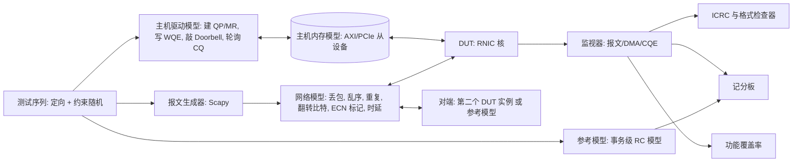

# 验证与互通测试（Verification and Interoperability）

> **摘要**：本文给出一套从规范条款出发、可直接落地的 RNIC 验证方案：把 CA17-1…CA17-46 与第 9 章关键条款映射为测试点；搭建 cocotb/UVM 仿真平台（报文生成、网络错误注入、主机内存模型、参考模型、记分板、ICRC 校验）；用 Scapy 构造 RoCEv2 报文（附经运行验证的代码与坑点）；列出错误注入场景；说明与 Linux Soft-RoCE（rxe）和商用 RNIC 的系统级互通、长稳与性能测试方法；最后汇总常见实现 bug。
>
> **规范出处**：Vol1 Annex A17（p.1928–1949）；§9.6–§9.7（p.292–381）；§7.8.4（p.221–231）；§10.8（p.543–555）；§10.10.3（p.564–566）
>
> **前置阅读**：[合规条款清单](../08-reference/03-compliance-checklist.md)、[工具与测试](../07-engineering-practice/04-tools-and-testing.md)、[RNIC 总体架构](01-rnic-architecture.md)、[可靠性引擎](04-reliability-engine.md)
>
> **关键词**：测试矩阵, cocotb, cocotbext-axi, UVM, Scapy, 参考模型, 记分板, 错误注入, rxe, perftest, rping, Wireshark, 长稳测试, bug 清单

## 1. 验证分层

| 层级 | 对象 | 方法 | 退出标准（建议） |
|---|---|---|---|
| 单元 | ICRC/并行 CRC、解析器、PSN 运算、信用编码、IPv4 校验和、头生成 | 与 Python/zlib 参考模型做大规模随机比对；规范样例 Table 28/33 | 随机 ≥ 10^5 用例零差异；边界用例全覆盖 |
| 模块 | TX 流水线、RX 流水线、可靠性引擎、MPT/MTT、完成引擎 | cocotb 或 UVM：定向 + 约束随机，带功能覆盖率 | 覆盖率达标，所有错误路径至少命中一次 |
| 子系统 | 完整传输核心 + 主机内存模型 + 网络模型 | **两个 DUT 实例背靠背** + 可注入错误的网络模型；另以独立参考模型对打 | 长时随机流量下数据与 CQE 全部正确 |
| FPGA 原型 | 板级；自环光纤或两块板 | 片上逻辑分析仪、计数器、长时间运行 | 无挂死、计数器无异常增长 |
| 互通 | 与 rxe、商用 RNIC | perftest、rping、应用级测试、抓包核对 | 互通矩阵全部通过 |

> [!WARNING]
> "自己和自己互通"只能证明两端理解一致，**发现不了对称性误解**（例如双方都把 ICRC 字节序写反、都按 CA17-15 字面少算 IPv6 Payload Length 8 字节）。每个特性至少要与一个独立实现（rxe 或商用 RNIC）或独立编写的参考模型对打一次。

## 2. 基于规范的测试矩阵

完整条款清单见 [合规条款清单](../08-reference/03-compliance-checklist.md)；下表给出面向硬件的测试点。

### 2.1 Annex A17 条款

| 条款 | 要点 | 测试点 | 方法 |
|---|---|---|---|
| CA17-1、CA17-2 | 同时支持 IPv4/IPv6，格式符合 Figure 348 | 每种操作在 IPv4、IPv6 × 0/1 层 VLAN 下收发 | 仿真 + 互通 |
| CA17-3、CA17-7、CA17-8、CA17-10 | IHL=5、DF=1、分片偏移 0、协议 0x11 | TX 逐字段比对；RX 注入 IHL=6、DF=0、分片报文 → 静默丢弃并计数 | 仿真 |
| CA17-4、CA17-13 | DSCP = AV Traffic Class | 遍历多个 TClass，检查 TOS/TC 字节，并确认与驱动约定的位对齐（见 [发送数据通路](02-tx-datapath.md)） | 仿真 + 抓包 |
| CA17-5、CA17-14 | 不支持 RCM 时 ECN=00；支持时可为 01/10 | 两种配置下检查 ECN 位 | 仿真 |
| CA17-6、CA17-15、CA17-21 | IPv4 Total Length、IPv6 Payload Length、UDP Length 都含 ICRC | 负载 0、1～3、PMTU−1、PMTU、PMTU+1 时检查长度；IPv6 Payload Length 必须等于 UDP Length（CA17-15 原文"即 BTH"为笔误）；RX 注入长度不一致 → 丢弃 | 仿真 + 互通 |
| CA17-9、CA17-17 | TTL / Hop Limit = AV Hop Limit | 多个 Hop Limit 值 | 仿真 |
| CA17-11、CA17-12、CA17-18、CA17-19 | SIP/DIP 来自 SGID 表项与 DGID | 多个 SGID index；IPv4 映射 GID（::ffff:a.b.c.d） | 仿真 |
| CA17-16 | Next Header = 0x11 | RX 注入带扩展头的 IPv6 → 丢弃 | 仿真 |
| CA17-20 | 目的端口 4791 | RX 其它端口 → 交普通网卡路径，不进 RoCE 引擎 | 仿真 |
| CA17-22 | ICRC | TX 与参考模型逐包比对；RX 翻转任一受保护比特 → 丢弃；只改屏蔽字段（TTL、DSCP、ECN、Flow Label、Hop Limit、UDP 校验和、BTH F/B/Resv6）→ 仍接受 | 仿真 |
| CA17-23、CA17-24 | 入站校验与静默丢弃 | 每类非法格式：无 ACK/NAK、ePSN 不变、不消耗 WQE、计数器加 1 | 仿真 |
| CA17-25、CA17-39 | 遵循第 9 章；对所有入站报文做传输层检查 | 见 2.2，覆盖全部支持的 OpCode | 仿真 |
| CA17-26 | GID 表项带 GID type | 驱动/Query 接口检查 | 软件 |
| CA17-27 | IP 版本号 | EtherType=0x0800 而版本=6 等 → 丢弃 | 仿真 |
| CA17-28 | 不支持 Raw 数据报 | 创建 Raw QP 失败 | 软件 |
| CA17-29 | F/B 位不使用、接收忽略 | RX：F/B 置 1 的合法报文正常处理；TX 置 0 | 仿真 |
| CA17-30…CA17-32 | Verbs 修改 | 端口类型为 RoCEv2；不支持 Client Reregistration 与 Port Change Event | 软件 |
| CA17-33 | DestQP=0 静默丢弃 | 注入 DestQP=0 报文 | 仿真 |
| CA17-34…CA17-38 | CM 消息中 LID 字段与禁用码 | CM 软件单元测试；与 rdma_cm 互通 | 软件 + 互通 |
| CA17-40…CA17-43 | 与 RoCE v1 互通（可选） | GID type 决定协议；DGID 检查含协议类型；UD 两种都收 | 仅支持时 |
| CA17-44 | 收到 ECN=11 的有效报文生成 CNP | 检查 CNP：OpCode 0x81、DestQP=被标记报文的源 QP、PSN=0、SE=M=0、P_Key 相同、16 B 保留为 0；同一 QP 多个 CE 可合并 | 支持 RCM 时 |
| CA17-45、CA17-46 | 收 CNP 降速；按时间/字节恢复 | 注入 CNP 后测该 QP 速率下降，停止后回升 | 支持 RCM 时 |

### 2.2 第 9 章关键条款

| 条款 | 测试点 |
|---|---|
| C9-61、C9-64…C9-66 | 初始 PSN、逐包 +1、READ 预留响应 PSN、0xFFFFFF→0 回绕 |
| C9-67…C9-72 | 消息长度 0、1、PMTU−1、PMTU、PMTU+1、k×PMTU、接近 2^31 时的 OpCode 序列与负载长度 |
| C9-74…C9-80、C9-114、C9-121…C9-123 | 响应方 PSN 三分法；序列错误 NAK 的 PSN；NAK 后只接受 ePSN 与合法重复请求 |
| C9-81…C9-87 | OpCode 序列错误、保留 OpCode、First/Middle 包 PadCnt≠0、READ/ATOMIC 资源不足 → NAK-Invalid Request |
| C9-88…C9-90、C9-124 | R_Key 无效/越界/无权限/PD 不符 → NAK-Remote Access Error；零长度 READ/WRITE 不校验 |
| C9-91…C9-94 | SEND 超出接收缓冲、中间包短于 PMTU、READ 长度 > 2^31 |
| C9-95…C9-101、C9-27 | ACK PSN 取值；READ 响应的 PSN 与 AETH 位置；中途出错改发 NAK；响应强序 |
| C9-102…C9-110、o9-66…o9-68 | 重复 SEND/WRITE/READ/ATOMIC；子集 READ；更早 PSN 的重复请求抢占 |
| C9-116 | AckReq=1 的请求一定得到响应 |
| C9-119、C9-120、C9-135 | AETH 编码；保留 NAK 码的报文被丢弃 |
| C9-128…C9-132 | RNR：等待 ≥ 定时值；同一请求重试；RNR 计数 7 表示无限 |
| C9-133…C9-138、C9-144、C9-145 | 幽灵 ACK、重复 ACK、响应类型不一致 |
| C9-139…C9-143 | 定时器在 [Ttr, 4Ttr] 内超时；重试计数耗尽 → QP 进入 Error |
| C9-147…C9-149 | MSN 递增规则；NAK 与重复 ACK 也带 MSN |
| C9-150.2.1、C9-153…C9-163 | 信用编码（Table 50）；LSN；受限 SEND 只发一包且置 AckReq |
| C9-25…C9-33 | 发送/执行/完成顺序；Fence |
| C7-47、C7-48 + CA17-22 | ICRC 样例：Table 28 → 0x9625B75A、Table 33 → 0xB67D1ED1 |

## 3. 仿真环境

### 3.1 平台结构



组件说明：

- **主机内存模型**：用 AXI 从设备模型模拟主机内存（如 cocotbext-axi 的 `AxiRam`〔外部: cocotbext-axi〕）；若 DUT 直接暴露 PCIe TLP 接口，可用 PCIe 根复合体模型（如 cocotbext-pcie〔外部: cocotbext-pcie，以项目文档为准〕）。内存模型应支持**故意打乱不同 Tag 的读完成顺序、按 RCB 拆分完成包**，以覆盖重排逻辑。
- **网络模型**：位于两个 DUT（或 DUT 与参考端）之间，按配置概率丢包、复制、交换顺序、翻转比特、改写屏蔽字段、打 ECN CE 标记、插入时延与 PFC 暂停。
- **参考模型**：事务级 RC 模型（Python），输入"发送了哪些 WR、网络做了什么"，输出"内存最终内容、应有的 CQE 序列与状态"。不必逐包对齐，记分板比较**最终可观察结果**（内存、CQE、QP 状态），这样不会把实现自由（如 ACK 合并时机）误报为错误。
- **ICRC 与格式检查器**：对 DUT 发出的每个报文独立重算 ICRC，并检查 §A17.3 的各字段规则（见 3.3 的函数）。

### 3.2 cocotb 测试骨架

下面是一个结构示意（接口名需按 DUT 调整；已通过 Python 语法检查，`roce_tools` 即 3.3 中的函数）：

```python
import cocotb
from cocotb.clock import Clock
from cocotb.triggers import RisingEdge
from cocotbext.axi import AxiStreamBus, AxiStreamSource, AxiStreamSink, AxiBus, AxiRam

from roce_tools import roce_write_only, icrc_ok      # 即下文的 Scapy 构造与 ICRC 校验函数


class Tb:
    def __init__(self, dut):
        self.dut = dut
        cocotb.start_soon(Clock(dut.clk, 3104, "ps").start())            # 约 322 MHz
        self.net_in = AxiStreamSource(AxiStreamBus.from_prefix(dut, "s_axis_rx"), dut.clk, dut.rst)
        self.net_out = AxiStreamSink(AxiStreamBus.from_prefix(dut, "m_axis_tx"), dut.clk, dut.rst)
        self.host = AxiRam(AxiBus.from_prefix(dut, "m_axi_host"), dut.clk, dut.rst, size=2**24)

    async def reset(self):
        self.dut.rst.value = 1
        for _ in range(10):
            await RisingEdge(self.dut.clk)
        self.dut.rst.value = 0


@cocotb.test()
async def test_write_only_then_ack(dut):
    tb = Tb(dut)
    await tb.reset()
    # 1) 经控制接口建立 QP 0x123（ePSN=0xFFFFFF）并注册 MR（VA 0x7F0000001000 -> 主机地址 0x1000），此处省略
    # 2) 注入一个 RDMA WRITE Only（AckReq=1）
    pkt = roce_write_only(0x000123, 0xFFFFFF, 0x7F0000001000, 0x00010203, b"hello RoCEv2!")
    await tb.net_in.send(bytes(pkt))
    # 3) 期望：数据写入主机内存；回一个 PSN=0xFFFFFF、ICRC 正确的 ACK
    ack = await tb.net_out.recv()
    assert icrc_ok(bytes(ack.tdata))
    assert tb.host.read(0x1000, 13) == b"hello RoCEv2!"
```

UVM 平台的映射关系：以太网 agent（AXI4-Stream）、主机接口 agent（PCIe/AXI）、"verbs 驱动"序列层、寄存器模型（RAL）对应控制接口；参考模型可用 Python 实现后经 DPI-C/进程间通信接入，或用 SystemVerilog 重写事务级模型。

### 3.3 用 Scapy 构造与检查报文

Scapy 的 `scapy.contrib.roce` 模块提供 `BTH`（发送时自动计算并追加 ICRC）、`AETH`、`CNPPadding`、`GRH` 与 `cnp()` 辅助函数，并把 UDP 目的端口 4791 绑定到 BTH；**没有 RETH 等扩展头类**，需要自己按字段打包〔外部: Scapy `scapy/contrib/roce.py`，以所用版本为准〕。下面两个函数已在本地运行验证：生成 IPv4/IPv6 × 有无 VLAN 的 WRITE Only、ACK、CNP 并写入/读回 pcap，ICRC 检查全部通过；翻转负载比特后检查失败；只修改 TTL/TOS 或 IPv6 Hop Limit/Flow Label 时检查仍通过。

```python
import struct, zlib
from scapy.all import Ether, IP, IPv6, UDP, Raw, Dot1Q
from scapy.contrib.roce import BTH

def roce_write_only(dqpn, psn, va, rkey, payload, ipv6=False, vlan=None):
    pad = (-len(payload)) % 4
    eth = Ether(src="02:00:00:00:00:01", dst="02:00:00:00:00:02")   # 显式 MAC，避免 Scapy 做 ARP
    l2 = eth / Dot1Q(vlan=vlan, prio=3) if vlan is not None else eth
    if ipv6:
        l3 = IPv6(src="fd00::1", dst="fd00::2", tc=(26 << 2) | 0b10, hlim=64)   # DSCP 26, ECT(0)
    else:
        l3 = IP(src="192.168.1.1", dst="192.168.1.2", tos=(26 << 2) | 0b10, ttl=64,
                flags="DF", id=0x1234)                                           # CA17-7: DF=1
    bth = BTH(opcode=0x0A, padcount=pad, pkey=0xFFFF, dqpn=dqpn, ackreq=1, psn=psn)
    reth = struct.pack("!QII", va, rkey, len(payload))                           # RETH: VA, R_Key, DMA Length
    return l2 / l3 / UDP(sport=0xC123, dport=4791, chksum=0) / bth / Raw(reth + payload + bytes(pad))

def icrc_ok(frame: bytes) -> bool:
    """frame: 以太网帧（不含 FCS）。按 CA17-22 屏蔽后重算 ICRC 并与报文末 4 字节比较。"""
    off = 12
    while frame[off:off + 2] in (b"\x81\x00", b"\x88\xa8"):        # 跳过 VLAN 标签
        off += 4
    etype = frame[off:off + 2]
    l3 = off + 2
    if etype == b"\x08\x00":
        iplen = struct.unpack("!H", frame[l3 + 2:l3 + 4])[0]
        pkt = bytearray(frame[l3:l3 + iplen])
        pkt[1] = 0xFF; pkt[8] = 0xFF; pkt[10:12] = b"\xff\xff"       # TOS、TTL、Header Checksum
        udp = 20
    elif etype == b"\x86\xdd":
        plen = struct.unpack("!H", frame[l3 + 4:l3 + 6])[0]         # = UDP Length（含 ICRC）
        pkt = bytearray(frame[l3:l3 + 40 + plen])
        pkt[0] |= 0x0F; pkt[1:4] = b"\xff\xff\xff"; pkt[7] = 0xFF    # TC、Flow Label、Hop Limit
        udp = 40
    else:
        return False
    pkt[udp + 6:udp + 8] = b"\xff\xff"                               # UDP Checksum
    pkt[udp + 8 + 4] = 0xFF                                          # BTH 第 4 字节（F/B/Resv6）
    calc = zlib.crc32(b"\xff" * 8 + bytes(pkt[:-4]))
    return struct.pack("<I", calc) == bytes(pkt[-4:])                # 线上为小端（同以太网 FCS）
```

`icrc_ok()` 按 IP 长度截取报文，因而自动忽略以太网短帧补齐字节；它也可以直接用于离线检查抓包文件（`rdpcap()` 读入后逐帧调用）。

> [!WARNING]
> 用 Scapy 造 RoCEv2 报文的几个坑（均已实测）：
> 1. 不显式写 `chksum=0` 时，Scapy 会自动算出非零 UDP 校验和（实测一个 ACK 报文得到 0x9A19）；ICRC 不受影响（UDP 校验和被屏蔽），但与 §A17.3.2.4 的"应置 0"不符，也会掩盖 DUT 是否误校验 UDP 校验和。
> 2. `IP()` 默认 `flags=0`（DF 未置位）、`id=1`；RoCEv2 要求 DF=1（CA17-7），必须写 `flags="DF"`，否则严格实现的 DUT 会丢弃。
> 3. 在没有二层发送能力的环境（如未装 pcap 驱动的 Windows）中，`Ether()` 不显式给 MAC 会触发地址解析失败，构造前务必指定 `src`/`dst`。
> 4. `cnp()` 辅助函数会把 BECN 位置 1（BTH 第 4 字节为 0x40）；RoCEv2 接收端必须忽略 F/B 位（CA17-29），可借此测试 DUT 是否误用了该位。

### 3.4 功能覆盖率要点

- OpCode × 包位置（First/Middle/Last/Only）× 是否带立即数/失效；
- 负载长度 mod 4（PadCnt 0～3）、0 长度、PMTU 边界、跨页、跨 4 KB、跨 MPS/MRRS 边界、SGE 数；
- IPv4/IPv6 × 0/1/2 层 VLAN；ECN 四种取值；
- PSN 回绕（起始 PSN 取 0xFFFFF0 一带）、MSN 回绕；
- 每种 NAK 码、RNR 定时值、重试计数耗尽、RNR 计数耗尽、Ttr 多档；
- 同一 QP 背靠背 vs 多 QP 交织；上下文缓存命中/未命中/逐出；
- 每种 CQE 状态（成功、各类错误、Flushed）。

## 4. 错误注入场景清单

| # | 场景 | 注入方法 | 期望行为 | 依据 |
|---:|---|---|---|---|
| 1 | 丢失中间请求包 | 网络模型丢弃 | 响应方回序列错误 NAK（PSN = ePSN），请求方 Go-back-N，消息最终正确完成 | C9-79、C9-121 |
| 2 | 丢失消息最后一包 | 同上 | 无后续包触发 NAK，请求方在 [Ttr, 4Ttr] 内超时重传 | C9-139…C9-142 |
| 3 | 丢失 ACK | 丢弃响应 | 被后续合并 ACK 覆盖；若无后续则超时，响应方把重传当重复请求只回 ACK | C9-105 |
| 4 | 丢失 NAK | 丢弃 NAK | 请求方超时恢复；响应方在收到 ePSN 前不再发 NAK | C9-114、p.362 |
| 5 | 乱序 | 交换相邻两包 | 超前包触发 NAK，随后的重传被正确处理，无重复执行 | Figure 88 |
| 6 | 重复 SEND/WRITE | 复制报文 | 不重复执行（接收 WQE 只消耗一次），回 ACK | C9-105 |
| 7 | 重复 READ（全量/子集/越界） | 复制或改写 READ 请求 | 重新生成响应；越出原范围的"重复"静默丢弃 | C9-107、p.341 |
| 8 | Atomic 重放 | 复制 CmpSwap/FetchAdd | 返回保存的原值，内存只被修改一次 | o9-66 |
| 9 | ICRC 错 | 翻转负载、头部或 ICRC 字段的比特 | 静默丢弃，计数；不得有内存写入 | CA17-24 |
| 10 | 只改屏蔽字段 | 改 TTL/DSCP/ECN/Flow Label/Hop Limit/UDP 校验和 | 正常接受 | CA17-22 |
| 11 | PSN 跳变 | 超前 1、超前 2^22、恰好落后 2^23 | 超前：序列错误 NAK；落后 2^23：视为无效 | Figure 88 |
| 12 | R_Key 错误 | 无效 key、越界、无写权限、不同 PD | NAK-Remote Access Error（PSN = 出错包），双方 QP 进入 Error | C9-89、C9-124、Table 81/82 |
| 13 | RNR | 不预先投递接收 WQE | RNR NAK；补投递后重试成功；RNR 计数耗尽则报错 | C9-129…C9-132 |
| 14 | 超时耗尽 | 黑洞（丢弃全部响应） | 重试 retry_cnt 次后 WQE 以重试超限完成，后续 WQE 以 Flushed 完成 | C9-143、C10-142 |
| 15 | 保留 NAK 码 | 构造 syndrome 为 0x65～0x7F 的 ACK | 请求方丢弃该包，最终超时 | C9-120 |
| 16 | 幽灵 ACK | PSN 超出未确认区 | 丢弃，状态不变 | C9-136 |
| 17 | 响应类型不符 | 期望 READ 响应时送普通 ACK | 按 Table 59 处理，不得把 READ 当作完成 | p.356 |
| 18 | ECN CE 标记 | 设置 ECN=11 | 生成格式正确的 CNP（支持 RCM 时） | CA17-44 |
| 19 | 非法目的 | DestQP=0、不存在的 QP、P_Key 不符、TVer≠0 | 静默丢弃 | CA17-33、C9-36…C9-43 |
| 20 | OpCode 序列错误 | 去掉 First 直接发 Middle | NAK-Invalid Request | C9-81 |
| 21 | 长度错误 | Middle 包短于 PMTU；SEND 超出接收缓冲 | NAK-Invalid Request | C9-91…C9-93 |
| 22 | 以太网短帧补齐 | IPv4 零长度 SEND Only（帧被补到 60 B） | 依 IP 长度定位 ICRC，正常接收 | — |
| 23 | PSN 回绕 | 初始 PSN = 0xFFFFF0，发长消息 | 跨 0 后一切正常 | C9-66 |
| 24 | 读完成乱序 | 主机内存模型打乱 Tag 顺序、按 RCB 拆分 | 负载顺序正确，ICRC 正确 | 〔外部: PCIe〕 |

## 5. 系统级互通测试

### 5.1 用 Linux rxe 作为对端

```bash
sudo modprobe rdma_rxe
sudo rdma link add rxe0 type rxe netdev eth0          # 在普通以太网口上创建 Soft-RoCE 设备
rdma link show
ibv_devinfo -d rxe0 -v
# 查找所需 GID：类型应为 "RoCE v2"，地址为 IPv4 映射或 IPv6（索引因系统而异）
cat /sys/class/infiniband/rxe0/ports/1/gid_attrs/types/1
cat /sys/class/infiniband/rxe0/ports/1/gids/1
```

rxe 完全由软件实现、源码公开，适合作为"规范行为的可执行参考"；其流量经过内核网络栈，可以直接在该主机上用 tcpdump 抓到〔业界实践: Linux rdma-core / iproute2 `rdma` 工具，命令以所用发行版为准〕。

### 5.2 perftest、ibv_rc_pingpong 与 rping

```bash
# 首次打通：只用 SEND/RECV，QP 信息经 TCP 带外交换
ibv_rc_pingpong -d rxe0 -g 1                       # 服务端
ibv_rc_pingpong -d rxe0 -g 1 192.168.1.10          # 客户端

# 带宽：默认经 TCP 套接字交换 QP 信息，不依赖 CM；-R 改用 rdma_cm
ib_write_bw -d rxe0 -x 1 -s 65536 -D 10 --report_gbits                  # 服务端
ib_write_bw -d rxe0 -x 1 -s 65536 -D 10 --report_gbits 192.168.1.10     # 客户端
# 同类工具：ib_read_bw、ib_send_bw、ib_atomic_bw、ib_write_lat 等，参数相同

# CM 路径：rping 使用 rdma_cm 建链
rping -s -a 192.168.1.10 -v -C 10                  # 服务端
rping -c -a 192.168.1.10 -v -C 10                  # 客户端
```

- 常用参数：`-d` 设备、`-x` GID 索引、`-s` 消息大小、`-a` 遍历所有大小、`-q` QP 数、`-m` MTU、`-D` 时长、`-n` 迭代次数、`-R` 使用 rdma_cm（以所用 perftest 版本的 `--help` 为准）〔外部: linux-rdma/perftest〕。
- 建议的打通顺序：ibv_rc_pingpong（SEND/RECV）→ ib_write_bw → ib_read_bw → ib_send_bw → 带 `-R` 的测试与 rping（验证 QP1/CM 通路）→ ib_atomic_bw（若支持）。
- 若 FPGA 端没有标准 verbs provider，可参照 perftest 的握手流程自行实现对端程序，通过 TCP 交换 QPN、PSN、GID、R_Key、VA（握手格式以 perftest 源码为准）。

### 5.3 Wireshark 抓包核对

- 显示过滤器 `udp.port == 4791`；Wireshark 会把 UDP 4791 解码为 RoCEv2（协议列显示为 RRoCE）并展开 BTH/RETH/AETH 等字段（字段名以所用版本为准）〔外部: Wireshark〕。
- 商用 RNIC 的卸载流量通常不经过主机协议栈，需在交换机上做端口镜像，或使用厂商提供的抓包工具（厂商相关）。
- 核对清单：IPv4 DF=1、TTL/DSCP/ECN 取值、IPv4 Total Length 与 UDP Length 含 ICRC、IPv6 Payload Length 等于 UDP Length、UDP 校验和为 0、同一 QP 源端口恒定、BTH 的 TVer=0 与 F/B/Resv 为 0、PSN 连续且 READ 后有预留空洞、AckReq 位置、ACK 合并间隔、NAK 码与 PSN、MSN 递增、CNP 格式；ICRC 用 3.3 的 `icrc_ok()` 离线批量校验。

### 5.4 与商用 RNIC 互通

| 维度 | 取值 |
|---|---|
| 地址族 | IPv4、IPv6（各自 0/1 层 VLAN） |
| PMTU | 1024、4096（及双方协商结果） |
| 操作 | SEND、WRITE、WRITE with Imm、READ、SEND with Invalidate、Atomic（若支持） |
| 规模 | 1、16、256、上限个 QP；消息 0 B～1 GB |
| 网络 | PFC 开/关；ECN/CNP 开/关（对端开启 DCQCN 类算法时检查 CNP 的生成与响应） |
| 异常 | 中途拔线、对端进程被杀（检查超时与 Error）、未投递接收 WQE（RNR） |

厂商侧配置（PFC、DSCP 信任模式、拥塞控制参数等）见 [主机与交换机配置指南](../07-engineering-practice/02-configuration-guide.md)，各项以厂商文档为准。

## 6. 长时间稳定性与性能测试

- **长稳**：24～72 h 混合负载（大小消息、多 QP、读写混合、周期性注入错误并重建连接），监视挂死、内存/上下文泄漏、计数器异常。
- **PSN 回绕很快就会发生**：每 2^24 ≈ 1678 万个包回绕一次，100G、4 KB PMTU（约 2.99 Mpps）下单个 QP 约 5.6 s 就回绕一次，长稳测试会覆盖成千上万次回绕；MSN 同理按消息数回绕。
- **性能曲线**：带宽 vs 消息大小（`-a`）、时延 vs 消息大小、消息率（小消息 + 多 QP）、带宽 vs QP 数（暴露上下文缓存未命中的拐点）、多打一（incast）下的 PFC/ECN 行为。
- **必看计数器**：每 QP 重传次数、发送/接收的 NAK（按码）、超时、RNR、ICRC 错、各类静默丢弃原因、PFC 暂停帧收发、CNP 收发、PCIe 读延迟与反压、上下文缓存命中率。计数器的含义与排障思路见 [排障指南与计数器字典](../07-engineering-practice/05-troubleshooting.md)。

## 7. 常见实现 bug 清单

| # | Bug | 典型现象 | 根因与正确做法 | 依据 |
|---:|---|---|---|---|
| 1 | PSN 比较未按模 2^24 | 运行一段时间后（回绕处）突然大量 NAK 或丢包 | 用 24 位有符号差比较（见 [可靠性引擎](04-reliability-engine.md)） | §9.7.1 |
| 2 | PadCnt 错 | 对端报长度错误，或接收数据尾部多出 1～3 字节 | Last/Only 包按负载长度补齐到 4 的倍数；接收时扣除；First/Middle 必须为 0 | §9.2.5、C9-85 |
| 3 | ICRC 屏蔽或字节序错 | 自己和自己通，和别人不通 | 屏蔽集合按 CA17-22（含 UDP 校验和与 BTH 第 4 字节）；结果小端写出 | CA17-22、§7.8.1 |
| 4 | IPv4 Header Checksum 错 | 跨路由器后丢包（L2 直连却正常） | 每包重算（可增量）；长度变化后必须更新 | RFC 791 |
| 5 | 长度字段不含 ICRC；IPv6 Payload Length 照 CA17-15 字面少 8 B | 对端/交换机判为畸形包 | IPv4 Total Length、UDP Length、IPv6 Payload Length 都要包含 ICRC；IPv6 Payload Length = UDP Length | CA17-6、CA17-15、CA17-21 |
| 6 | READ 的 PSN 处理错 | READ 后的请求被当作超前包；READ 响应被当作幽灵 | 下一请求 PSN = READ PSN + 响应包数；响应 PSN 从请求 PSN 连续递增 | C9-66、C9-96 |
| 7 | Atomic 字节序与对齐 | 比较总是失败或加错值；非对齐地址未报错 | 线上大端，主机按本端字节序；地址非 8 字节对齐回 NAK-Invalid Request | §9.4.5、o10-41 |
| 8 | MSN 计算错 | 请求方完成 WQE 过早或过晚 | 每个新消息完成加 1、重复不加；NAK/重复 ACK 也带 MSN；READ/ATOMIC 是完成屏障 | C9-148、C9-149、Figure 104 |
| 9 | ACK 合并导致超时误判 | 低负载时偶发"超时重传" | 请求方在消息末包与 SQ 变空时置 AckReq；响应方加计数/时间保险 | C9-60、C9-116、p.344 |
| 10 | Go-back-N 回退定位错 | 重传后数据错位或重复 | 偏移 = (PSN − 首 PSN) × PMTU；考虑隐含 NAK 的 READ/ATOMIC；READ 只重读子集 | §9.7.5.1.2（p.332–333）、§9.4.4（p.282） |
| 11 | CQE 早于数据可见 | 偶发读到旧数据，高负载更明显 | CQE/EQE/MSI-X 不置 Relaxed Ordering；跨路径时先刷新 | C9-33、o9-20 |
| 12 | 把以太网补齐字节当 ICRC | 小包（零长度 SEND）偶发 ICRC 错 | 依 IP/UDP 长度定位 ICRC | — |
| 13 | 逐包改变 UDP 源端口 | 多路径网络中频繁序列错误 NAK | 同一连接 QP 用固定源端口 | §A17.3.2.1 |
| 14 | 零长度 READ/WRITE 仍校验 R_Key | 对端用 0 长度 WRITE 当 NOP 时收到 NAK | 零长度不校验 R_Key | C9-88 |
| 15 | 序列错误 NAK 重复发送 | 丢一个包换来 NAK 风暴 | 发出后置标志，直到收到 ePSN 请求 | C9-80、C9-114 |
| 16 | 定时器启停条件错 | 无未完成请求时仍超时；或重传后不再计时 | 只在发出 AckReq 包/READ/ATOMIC 时启动，收到新确认重启，无期望响应时停止 | p.363–364 |
| 17 | 重复 ACK 被当错误 | 重传后 QP 莫名进入 Error | 重复 ACK 静默丢弃（但提取信用） | C9-138、C9-145 |
| 18 | RNR 计数 7 当成 7 次 | 长时间无接收 WQE 时连接被拆 | 7 表示无限重试 | C9-132 |
| 19 | CNP OpCode 混淆 | 对端不降速 | RoCEv2 CNP 为 0x81，IB（Annex A10）为 0x80 | Figure 349 |
| 20 | P_Key 匹配不看成员位 | 受限成员之间误通或全员不通 | 低 15 位相等且不同时为受限成员 | C10-124 |
| 21 | BTH.M 取值不一致 | 与个别实现互通时出现异常（待核实） | 未实现 APM 时状态机恒为 MIGRATED，出站 M=1；接收端不依赖 M | §17.2.8.1 |
| 22 | 测试平台报文本身不合规 | 严格的 DUT 丢弃测试报文 | Scapy 显式设置 DF、UDP 校验和 0（见 3.3） | CA17-7、§A17.3.2.4 |

## 8. 要点回顾

- 验证分单元、模块、子系统、原型、互通五层；自对打发现不了对称性误解，必须与独立实现对打。
- 测试矩阵以条款为索引：CA17-1…CA17-46 中与格式相关的条款由逐字段检查与非法报文注入覆盖，CA17-25/39 展开为第 9 章的 PSN、ACK/NAK、定时器、RNR、重复请求、长度、R_Key、MSN、信用测试。
- 记分板比较最终可观察结果（内存、CQE、QP 状态），不把 ACK 合并时机等实现自由当作错误。
- Scapy 可构造带 ICRC 的 RoCEv2 报文，但 RETH 等需手工打包，且要显式设置 DF=1 与 UDP 校验和 0。
- 错误注入要覆盖丢包、乱序、重复、ICRC 错、屏蔽字段改写、PSN 跳变、R_Key 错、RNR、超时耗尽、Atomic 重放、CE 标记与读完成乱序。
- 互通顺序建议：ibv_rc_pingpong → ib_write_bw → ib_read_bw → 带 rdma_cm 的测试 → 原子操作；抓包逐字段核对并离线校验 ICRC。
- PSN 回绕在 100G 下几秒一次，长稳测试天然覆盖；性能测试要扫描 QP 数以暴露上下文缓存拐点。

## 自测

<details><summary>Q1：为什么记分板最好比较"最终内存与 CQE"，而不是逐包比较 DUT 与参考模型的输出？</summary>

答：规范把 ACK 何时发送、如何合并、重传从哪里开始等留给实现（如 p.344 的"响应调度不作规定"、p.361–362 的重传起点自由），逐包比较会把合法差异误报为错误；最终可观察结果（内存内容、CQE 顺序与状态、QP 状态）才是规范约束的语义。
</details>

<details><summary>Q2：如何用一个测试同时验证"ICRC 覆盖了该覆盖的字段、又屏蔽了该屏蔽的字段"？</summary>

答：对同一合法报文做两类变异：翻转受保护字段（如 IPv4 Identification、UDP 源端口、BTH 的 PSN、负载）的任一比特，期望被静默丢弃；只改屏蔽字段（TTL、DSCP、ECN、Flow Label、Hop Limit、UDP 校验和、BTH 的 F/B/Resv6），期望仍被接受。
</details>

<details><summary>Q3：FPGA 端尚未实现 QP1/CM，能用哪些工具先与 rxe 互通？</summary>

答：ibv_rc_pingpong 与不带 `-R` 的 perftest（ib_write_bw 等）通过 TCP 带外交换 QP 信息，不依赖 CM，可先用；rping 及带 `-R` 的 perftest 依赖 rdma_cm，需要 QP1/CM 通路后再测。
</details>

<details><summary>Q4：100G、4 KB PMTU 下单个 QP 的 PSN 多久回绕一次？这对测试意味着什么？</summary>

答：2^24 ≈ 1678 万包，约 2.99 Mpps 时约 5.6 s 回绕一次。只要跑几十秒的带宽测试就会多次跨越回绕点，PSN 比较的 bug 会很快暴露；长稳测试则覆盖海量回绕。
</details>

## 参考

- 规范：Vol1 Annex A17（p.1928–1949，CA17-1…CA17-46）；§7.8.4（p.221–231）；§9.2（p.256–262）；§9.4–§9.7（p.267–381）；§10.8（p.543–555）；§10.9.3（p.558–559）；§10.10.3（p.564–566）；§17.2.8（p.1200–1203）。
- 外部：〔外部: Scapy `scapy.contrib.roce`〕；〔外部: cocotb、cocotbext-axi（github.com/alexforencich/cocotbext-axi）、cocotbext-pcie〕；〔外部: linux-rdma/perftest、rdma-core（ibv_rc_pingpong）、librdmacm（rping）〕；〔外部: Wireshark InfiniBand/RRoCE 解码器〕；〔外部: IANA UDP 端口 4791〕；〔外部: PCI Express Base Specification〕；〔业界实践: Linux rxe 与 iproute2 `rdma` 工具〕。
- 本库相关：[合规条款清单](../08-reference/03-compliance-checklist.md)、[工具与测试](../07-engineering-practice/04-tools-and-testing.md)、[排障指南与计数器字典](../07-engineering-practice/05-troubleshooting.md)、[ICRC 计算](../01-packet-format/06-icrc.md)、[发送数据通路](02-tx-datapath.md)、[接收数据通路](03-rx-datapath.md)、[FPGA 实现要点](05-fpga-implementation-notes.md)。
