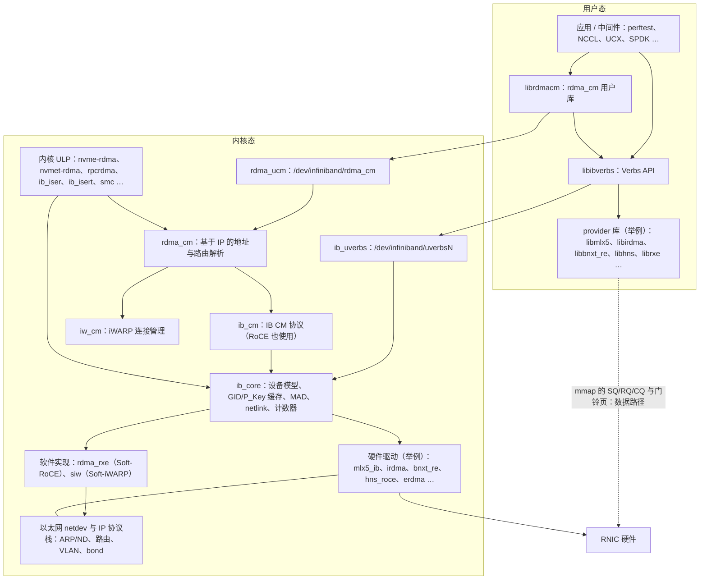
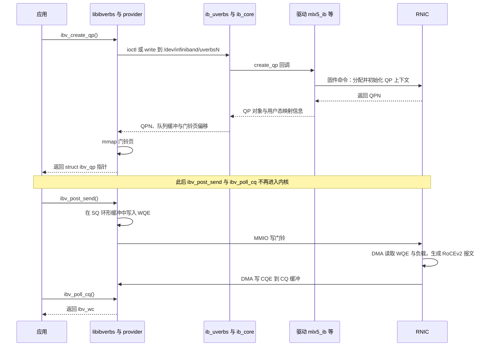
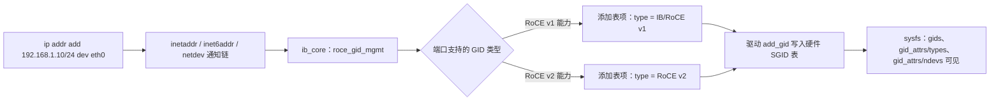

# Linux RDMA 软件栈（Linux RDMA Software Stack）

> **摘要**：本文梳理 Linux 下 RoCEv2 的软件栈：用户态 rdma-core（libibverbs、librdmacm 与各厂商 provider 库）、内核 RDMA 子系统（ib_core、ib_uverbs、rdma_cm、ib_cm、iw_cm）与硬件/软件驱动；说明"控制路径经内核、数据路径旁路内核"的分工；详细介绍规范要求的端口 GID 表在 Linux 中如何随 IP 地址自动维护、如何从 sysfs 查看，以及 Soft-RoCE（rxe）的使用。它是在 Linux 上部署、调试 RoCEv2，乃至用软件实现对测自研 RNIC 的基础。
>
> **规范出处**：Vol1 §A17.4.1–A17.4.3（p.1936–1938，RoCEv2 寻址、Address Vector、端口 GID 表，CA17-26）；Vol1 §A17.5（p.1940–1942，Verbs 修改）；Vol1 §A17.6.1（p.1943，CM 报文）；Vol1 §A17.8（p.1945–1946，与 RoCE v1 互通）；Vol1 §11.1（p.583，Verbs 不规定 API）
>
> **前置阅读**：[RoCEv2 寻址](../00-overview/04-addressing.md)、[资源模型](../03-verbs-and-resources/01-resource-model.md)、[RoCEv2 Verbs 与编程](../03-verbs-and-resources/05-verbs-roce-specifics-and-programming.md)
>
> **关键词**：rdma-core, libibverbs, librdmacm, provider, ib_core, ib_uverbs, rdma_cm, GID table, gid_attrs, Soft-RoCE, rxe, siw, kernel bypass, doorbell

---

## 1. 软件栈总览

### 1.1 分层架构

Linux 的 RDMA 软件栈分为三层：**用户态库（rdma-core）**、**内核 RDMA 子系统（drivers/infiniband/core）** 与 **设备驱动**。InfiniBand、RoCE v1/v2、iWARP 共用同一套 Verbs 抽象，差别主要体现在驱动、地址解析与 CM 路径上〔业界实践: Linux rdma-core / 内核 drivers/infiniband〕。



### 1.2 主要组件

| 组件 | 层 | 作用 | 备注 |
|---|---|---|---|
| **libibverbs** | 用户态 | Verbs API（`ibv_*`），设备枚举、资源创建、`ibv_post_send/ibv_poll_cq` 等 | 数据面函数由 provider 实现，libibverbs 只做分发 |
| **provider 库** | 用户态 | 厂商私有的 WQE/CQE 格式、门铃写法、直接数据路径 | 例：libmlx5、libirdma、libbnxt_re、libhns、librxe；配置文件在 `/etc/libibverbs.d/` |
| **librdmacm** | 用户态 | 基于 IP 地址/端口的连接建立（`rdma_resolve_addr/route`、`rdma_connect/accept`） | 对应规范 Annex A11 的 RDMA IP CM Service，见 [IP CM 与 rdma_cm](../04-connection-management/02-ip-cm-and-rdma-cm.md) |
| **libibumad** | 用户态 | 访问 `/dev/infiniband/umadN`，收发 MAD | RoCE 下主要用于 CM 调试；SM/SA 等管理类不适用〔Vol1 §A17.6, p.1942–1943〕 |
| **ib_core** | 内核 | 设备注册、GID/P_Key 缓存、**RoCE GID 自动管理（roce_gid_mgmt）**、MAD/SA、RDMA netlink、资源跟踪与计数器 | 所有 RDMA 设备的公共底座 |
| **ib_uverbs** | 内核 | 用户态 Verbs 的系统调用入口（write/ioctl）、为用户态 mmap 队列与门铃页 | 控制路径必经之处 |
| **rdma_cm / rdma_ucm** | 内核 | IP→GID/DMAC/路由解析，驱动 ib_cm 或 iw_cm；rdma_ucm 为用户态 librdmacm 提供接口 | 支持 configfs 配置默认 RoCE 模式与 TOS（见第 3.5 节） |
| **ib_cm** | 内核 | IB CM 协议（REQ/REP/RTU…），RoCE 端口上的 CM MAD 走 QP1 | RoCEv2 的 CM 报文就是普通 RoCEv2 报文〔Vol1 §A17.6.1, p.1943〕 |
| **iw_cm** | 内核 | iWARP（TCP 承载）的连接管理 | 与 RoCE 无关，列出以便区分 |
| **硬件驱动** | 内核 | 实现 `ib_device_ops`，把资源/命令下发到 RNIC 固件 | 例：mlx5_ib（NVIDIA）、irdma（Intel E810 支持 iWARP/RoCEv2）、bnxt_re（Broadcom）、hns_roce（华为海思）、erdma（阿里云）；协议与特性以各驱动文档为准 |
| **rdma_rxe / siw** | 内核 | 纯软件实现的 RoCEv2 / iWARP，挂在任意以太网 netdev 上 | 学习、功能测试、对测参考，见第 4 节 |

> [!NOTE]
> 除用户态应用外，内核里也有大量 RDMA 消费者（ULP）：NVMe-oF 主机/目标端（nvme-rdma / nvmet-rdma）、NFS over RDMA（rpcrdma）、iSER（ib_iser / ib_isert）、SMC-R（smc）等。它们直接调用 ib_core 的内核 Verbs，不经过 ib_uverbs；应用场景见 [典型应用场景](06-use-cases.md)。

---

## 2. 控制路径与数据路径

### 2.1 控制路径：资源创建与 Modify QP 必经内核

规范中的 Verbs 只是对主机通道接口行为的抽象定义，明确不规定任何 API〔Vol1 §11.1, p.583〕。Linux 的 libibverbs 是事实上的标准 API，其做法是：**所有涉及资源分配、保护与地址解析的操作走内核**，因为它们需要特权（页面锁定、IOMMU/DMA 映射、写入设备上下文表）。



典型控制路径操作及内核所做的工作：

| Verbs | 内核/驱动所做的事 | RoCEv2 相关要点 |
|---|---|---|
| `ibv_open_device` / `ibv_alloc_pd` | 建立用户上下文（ucontext），分配 PD | — |
| `ibv_reg_mr` | 锁定（pin）用户页、建立 DMA 映射与地址翻译表，返回 L_Key/R_Key | 注册开销大，应复用；见 [性能调优](03-performance-tuning.md) |
| `ibv_create_cq` / `ibv_create_qp` | 分配队列内存、设备上下文（CQC/QPC），映射门铃页 | QP 数量影响网卡上下文缓存命中 |
| `ibv_modify_qp`（→RTR） | 校验属性；**RoCE 下根据 AV 的 SGID index 与 DGID 解析目的 MAC**（查邻居表，必要时触发 ARP/ND），写入 QPC | 规范把 L3→L2 解析留给实现，"使用 OS 现有服务"〔Vol1 §A17.4.2, p.1937〕 |
| `ibv_create_ah`（UD） | 同上，解析 DMAC 后生成地址句柄 | AV 的 GRH 标志对 RoCEv2 恒为 TRUE〔Vol1 §A17.4.2, p.1937〕 |
| `rdma_resolve_addr/route` | 由 IP 选出 netdev 与 SGID，查路由与邻居得到下一跳 MAC，计算 path MTU | 对应规范脚注："L3→L2 解析可先于 AV 生成，如 Linux 的 RDMA CM 实现"〔Vol1 §A17.4.2, p.1937–1938〕 |

### 2.2 数据路径：内核旁路（kernel bypass）

建立好资源后，`ibv_post_send`、`ibv_post_recv`、`ibv_poll_cq` 全部在用户态完成〔业界实践: rdma-core provider 实现〕：

1. provider 把 WR 翻译成厂商格式的 **WQE**，写入用户态内存中的 SQ/RQ 环形缓冲；
2. 更新门铃记录并对 mmap 到用户态的 **门铃寄存器页**（如 mlx5 的 UAR 页）做一次 MMIO 写，通知网卡；
3. 网卡 DMA 读取 WQE 与数据（或直接取 WQE 中的 inline 数据），完成 RoCEv2 封装、ICRC 计算与发送；
4. 完成后网卡把 **CQE** DMA 写入用户态 CQ 缓冲，应用轮询读取。

只有**事件（中断）模式**需要内核参与：`ibv_req_notify_cq` 武装 CQ，网卡触发中断，内核通过 completion channel 的文件描述符唤醒等待的线程。

| 操作 | 是否系统调用 | 典型开销量级（仅供参考，依 CPU/网卡而异） |
|---|---|---|
| `ibv_post_send`（单个 WR） | 否 | 数十～数百 ns（主要是 WQE 写入与 MMIO） |
| `ibv_poll_cq`（命中） | 否 | 数十 ns 量级 |
| `ibv_get_cq_event`（事件模式） | 是（read/poll fd） | 微秒级，受中断与调度影响 |
| `ibv_reg_mr`（MB 级缓冲） | 是 | 数十微秒到毫秒级，随页数增长 |
| `ibv_create_qp` / `ibv_modify_qp` | 是 | 微秒到毫秒级（含固件命令） |

### 2.3 Address Vector 在 Linux 中如何落到报文字段

规范规定 AV 各组成部分与 RoCEv2 报文字段的对应关系；Linux 把这些组成部分映射到 `struct ibv_ah_attr`（`grh` 子结构）上：

| AV 组成（规范） | libibverbs 字段 | 报文字段 | 依据 |
|---|---|---|---|
| SGID index | `ah_attr.grh.sgid_index` | 源 IP（来自该 GID 表项）、源 MAC（来自该表项的 netdev） | CA17-11 / CA17-18；〔Vol1 §A17.4.2, p.1937–1938〕 |
| DGID | `ah_attr.grh.dgid` | 目的 IP（IPv4 时取 `::ffff:a.b.c.d` 的低 32 bit） | CA17-12 / CA17-19；〔Vol1 §A17.4.1.1, p.1936〕 |
| Traffic Class | `ah_attr.grh.traffic_class` | IPv4 TOS / IPv6 Traffic Class 中的 DSCP | CA17-4 / CA17-13 |
| Hop Limit | `ah_attr.grh.hop_limit` | IPv4 TTL / IPv6 Hop Limit | CA17-9 / CA17-17 |
| Flow Label | `ah_attr.grh.flow_label` | IPv6 Flow Label；Linux 还用它派生 UDP 源端口 | 见下文 |
| SL | `ah_attr.sl` | 以太网优先级（有 VLAN 标签时即 PCP），SL 8–15 保留 | 〔Vol1 §A17.4.2, p.1938〕 |
| Destination L2 Address | 内核解析后存入 QPC（用户通常不填） | 目的 MAC | 〔Vol1 §A17.4.2, p.1937〕 |
| GRH 标志 | `ah_attr.is_global = 1` | — | RoCEv2 恒为 TRUE |

> [!NOTE]
> **UDP 源端口的生成**：内核提供 `rdma_get_udp_sport(fl, lqpn, rqpn)`——若 flow label 为 0，先用本端/对端 QPN 计算一个对称的 20 bit flow label，再折叠成 `0xC000–0xFFFF` 范围内的端口号；rxe 在设置带 GRH 的 AV 时即用此函数为 QP 选定源端口〔业界实践: Linux include/rdma/ib_verbs.h、rxe_verbs.c〕。这满足规范"同一连接 QP 的报文使用固定源端口"的建议〔Vol1 §A17.3.2.1, p.1934〕，同时为 ECMP 提供熵，详见 [ECMP 与负载均衡](../05-congestion-control-and-qos/06-ecmp-and-load-balancing.md)。各硬件驱动是否采用同一算法以其实现为准。

> [!WARNING]
> `ah_attr.grh.traffic_class` 是 8 bit 字段。业界实践把它当作完整的 IP TOS 字节解释：高 6 bit 为 DSCP，低 2 bit 位于 ECN 位置。例如 `traffic_class = 106 = 0b011010_10` 表示 DSCP 26。启用拥塞管理时 ECN 位通常由网卡按 RCM 规则自行设置（CA17-5 要求不支持 RCM 的实现必须发 ECN=00），具体行为以网卡文档为准。

### 2.4 硬件实现要点：自研 RNIC 接入 Linux 需要什么

如果在 FPGA/ASIC 上实现 RoCEv2 并希望被标准软件栈使用，需要提供〔业界实践: Linux 内核 ib_device_ops 接口〕：

1. **内核驱动**：调用 `ib_register_device()` 注册设备，实现 `ib_device_ops` 中的 `query_device`、`query_port`、`get_port_immutable`、`alloc_ucontext`、`alloc_pd`、`create_cq`、`create_qp`、`modify_qp`、`reg_user_mr`、`mmap`、`post_send/post_recv/poll_cq`（供内核 ULP 使用）以及 **`add_gid`/`del_gid`**（把 ib_core 维护的 GID 表项及其类型写入硬件 SGID 表，对应 CA17-26）。
2. **端口能力标志**：在 `get_port_immutable` 中声明 RoCEv2 封装能力（如 `RDMA_CORE_PORT_IBA_ROCE_UDP_ENCAP`），ib_core 据此只为端口生成 "RoCE v2" 类型的 GID；若同时声明 RoCE v1 能力，则每个地址生成两条 GID（对应规范的 "RoCE Supported" 能力位与 §A17.8 互通规则）。
3. **用户态 provider**：在 rdma-core 中实现 WQE/CQE 解析、门铃写入等快速路径；否则用户态程序只能经过内核（性能差，且多数 provider 不支持这种模式）。
4. **端口属性**：`query_port` 需正确报告 `link_layer = Ethernet`、`active_mtu`（通常由 netdev MTU 推导，见 [配置指南](02-configuration-guide.md)）、端口状态与 GID 表长度。

> [!TIP]
> 早期 bring-up 阶段，可以先让自研硬件与 Soft-RoCE（rxe）互通：rxe 是一个开源、可读、可抓包的"参考对端"，见第 4.4 节。

---

## 3. GID 表的维护

### 3.1 规范要求与 Linux 的实现方式

规范要求每个 RoCEv2 端口维护一张端口 GID 表，包含配置到该端口的所有 L3 地址；表项必须带有 "GID type" 属性，取值为 IPv4 / IPv6 / IB GID（CA17-26）；**出站协议由所选 SGID 表项的 GID type 决定**；并明确"软件栈负责在 L3 地址增删时维护 GID 表，通常通过订阅 OS 的回调/事件服务实现"〔Vol1 §A17.4.3, p.1938〕。

Linux 正是这样做的：ib_core 中的 `roce_gid_mgmt` 订阅 netdev 与 IPv4/IPv6 地址通知链，地址或设备状态变化时，**对端口支持的每一种 GID 类型各增删一条表项**，再通过驱动的 `add_gid/del_gid` 回调写入硬件〔业界实践: Linux drivers/infiniband/core/roce_gid_mgmt.c〕。



此外，设备注册时 ib_core 会根据 netdev 的 MAC 生成 `fe80::/64` 前缀的**默认 GID**（接口标识按 EUI-48→EUI-64 规则构造），同样按支持的每种类型各占一项〔业界实践: Linux drivers/infiniband/core/cache.c〕。

规范中 GID type 的三种取值与 Linux 表示的对应关系：

| 规范 GID type〔CA17-26〕 | Linux sysfs `gid_attrs/types` 内容 | 出站报文格式 | 说明 |
|---|---|---|---|
| IB GID（用于与 RoCE v1 互通） | `IB/RoCE v1` | Ethertype 0x8915 + GRH | 仅当端口支持 RoCE v1 时出现 |
| IPv4 | `RoCE v2`，且 GID 形如 `::ffff:a.b.c.d` | Ethertype 0x0800 + IPv4 + UDP 4791 | Linux 用 IPv4 映射地址区分 IPv4 |
| IPv6 | `RoCE v2`，普通 IPv6 地址 | Ethertype 0x86DD + IPv6 + UDP 4791 | 含 `fe80::` 链路本地地址 |

> [!IMPORTANT]
> 同一 QP 的两端必须选用**同类型**的 GID：若本端用 RoCE v1 表项而对端期望 RoCE v2，DGID 检查会因"GID type 与报文协议不匹配"而失败（CA17-41），报文被丢弃，请求端最终超时。这是"连接能建立但数据不通"的常见根因之一，排查方法见 [排障指南](05-troubleshooting.md)。

### 3.2 一个典型的 GID 表

以一块同时支持 RoCE v1/v2 的网卡、`eth0` 上配置 `192.168.1.10/24`、`eth0.100`（VLAN 100）上配置 `10.10.0.10/24` 为例，`show_gids`（厂商脚本，见 [工具与测试](04-tools-and-testing.md)）的输出形如：

```text
DEV     PORT  INDEX  GID                                      IPv4           VER  DEV
---     ----  -----  ---                                      ------------   ---  ---
mlx5_0  1     0      fe80:0000:0000:0000:0a00:00ff:fe00:0001                 v1   eth0
mlx5_0  1     1      fe80:0000:0000:0000:0a00:00ff:fe00:0001                 v2   eth0
mlx5_0  1     2      0000:0000:0000:0000:0000:ffff:c0a8:010a  192.168.1.10   v1   eth0
mlx5_0  1     3      0000:0000:0000:0000:0000:ffff:c0a8:010a  192.168.1.10   v2   eth0
mlx5_0  1     4      0000:0000:0000:0000:0000:ffff:0a0a:000a  10.10.0.10     v1   eth0.100
mlx5_0  1     5      0000:0000:0000:0000:0000:ffff:0a0a:000a  10.10.0.10     v2   eth0.100
```

> [!WARNING]
> **不要把 GID 索引写死**（例如"RoCEv2 一定是 3"）。表项顺序取决于地址添加顺序、设备是否支持 v1、是否有 VLAN/IPv6 地址等，地址删除后再添加还可能占用不同索引。脚本和应用应按"类型 = RoCE v2 + 期望的 IP"动态查找，或交给 rdma_cm 自动选择。

### 3.3 sysfs 路径

| 路径 | 内容 | 来源 |
|---|---|---|
| `/sys/class/infiniband/<dev>/ports/<port>/gids/<idx>` | GID 值，8 组 4 位十六进制，空表项为全 0 | ib_core sysfs |
| `/sys/class/infiniband/<dev>/ports/<port>/gid_attrs/types/<idx>` | `IB/RoCE v1` 或 `RoCE v2` | 〔外部: Linux Documentation/ABI/stable/sysfs-class-infiniband〕 |
| `/sys/class/infiniband/<dev>/ports/<port>/gid_attrs/ndevs/<idx>` | 该表项关联的 netdev 名（如 `eth0.100`） | 同上 |
| `/sys/class/infiniband/<dev>/ports/<port>/link_layer` | `Ethernet` 或 `InfiniBand` | 同上 |
| `/sys/class/infiniband/<dev>/ports/<port>/state` | 端口状态，如 `4: ACTIVE` | 同上 |
| `/sys/class/infiniband/<dev>/ports/<port>/hw_counters/` | 驱动提供的硬件计数器 | 同上；字典见 [排障指南](05-troubleshooting.md) |

不依赖厂商脚本、直接从 sysfs 打印非空 GID 表项：

```bash
#!/bin/bash
# 用法: ./gids.sh mlx5_0 1
DEV=${1:-mlx5_0}; PORT=${2:-1}
P=/sys/class/infiniband/$DEV/ports/$PORT
for f in "$P"/gids/*; do
    i=$(basename "$f")
    gid=$(cat "$f" 2>/dev/null) || continue
    [ "$gid" = "0000:0000:0000:0000:0000:0000:0000:0000" ] && continue
    type=$(cat "$P/gid_attrs/types/$i" 2>/dev/null)
    ndev=$(cat "$P/gid_attrs/ndevs/$i" 2>/dev/null)
    printf '%3s  %s  %-10s  %s\n' "$i" "$gid" "$type" "$ndev"
done | sort -n
```

> [!NOTE]
> 读取空表项的 `gid_attrs/types/<idx>` 会返回错误，这是正常现象，脚本中应忽略 stderr。

### 3.4 VLAN 子接口、bond 与 GID

- **VLAN 子接口**：在 `eth0.100` 上配置的 IP 会作为 GID 出现在**父设备端口**的 GID 表里，`ndevs` 指向 `eth0.100`。用这类 SGID 发送的 RoCEv2 帧带 VLAN 100 标签，源 MAC 取自该 netdev〔Vol1 §A17.4.2, p.1937–1938：源 L2 地址由所选 SGID 隐含〕。
- **优先级（PCP）**：规范规定 SL 0–7 直接映射为以太网优先级 0–7〔Vol1 §A17.4.2, p.1938〕。用原生 Verbs 时，PCP 来自 `ah_attr.sl`；用 rdma_cm 时，内核由 TOS 推导 SL：先 `rt_tos2priority(tos)`，再查 netdev 的 prio→tc 映射，或 VLAN 设备的 egress-qos-map〔业界实践: Linux drivers/infiniband/core/cma.c `iboe_tos_to_sl()`〕。因此 **rdma_cm 下的 PCP 并不简单等于 DSCP 的某种截取**，在依赖 PCP 的网络里务必抓包核对 VLAN 标签中的优先级。
- **bond（RoCE LAG）**：部分驱动支持把两个端口聚合成一个 RDMA 设备（如 mlx5 的 `mlx5_bond_0`），GID 跟随 bond 主设备上的地址；能否使用、如何选择出口端口以驱动文档为准。
- **网络命名空间**：`rdma system set netns exclusive` 后，RDMA 设备可被移入特定网络命名空间（`rdma dev set <dev> netns <ns>`），GID 表只反映该命名空间内的地址；容器场景常见〔外部: man rdma-system(8)、rdma-dev(8)〕。

### 3.5 在程序中按类型选择 GID

rdma-core 提供 `ibv_query_gid_ex()` / `ibv_query_gid_table()`，可以直接得到表项的 GID 类型与 netdev 索引，免去解析 sysfs〔业界实践: rdma-core libibverbs/verbs.h〕：

```c
#include <infiniband/verbs.h>
#include <string.h>

/* 返回端口上第一个 "RoCE v2 + IPv4 映射地址" 的 GID 索引，找不到返回 -1 */
static int find_rocev2_ipv4_gid(struct ibv_context *ctx, uint8_t port)
{
    static const uint8_t v4map[12] = {0, 0, 0, 0, 0, 0, 0, 0, 0, 0, 0xff, 0xff};
    struct ibv_port_attr pattr;
    int i;

    if (ibv_query_port(ctx, port, &pattr))
        return -1;
    for (i = 0; i < pattr.gid_tbl_len; i++) {
        struct ibv_gid_entry e;

        if (ibv_query_gid_ex(ctx, port, i, &e, 0))
            continue;                       /* 空表项会返回错误，跳过 */
        if (e.gid_type == IBV_GID_TYPE_ROCE_V2 &&
            memcmp(e.gid.raw, v4map, sizeof(v4map)) == 0)
            return i;
    }
    return -1;
}
```

使用 rdma_cm 时无需手动选择：`rdma_resolve_addr()` 根据源 IP 找到对应 netdev，再按"默认 RoCE 模式"挑出匹配类型的 GID。默认模式可通过 configfs 修改：

```bash
# 需要 rdma_cm 模块已加载、configfs 已挂载
mount | grep -q configfs || mount -t configfs none /sys/kernel/config
mkdir -p /sys/kernel/config/rdma_cm/mlx5_0
cat  /sys/kernel/config/rdma_cm/mlx5_0/ports/1/default_roce_mode    # 例如 "RoCE v2"
echo "RoCE v2" > /sys/kernel/config/rdma_cm/mlx5_0/ports/1/default_roce_mode
echo 106 > /sys/kernel/config/rdma_cm/mlx5_0/ports/1/default_roce_tos  # DSCP 26
```

`default_roce_mode` 可取 `IB/RoCE v1` 或 `RoCE v2`，`default_roce_tos` 为 0–255，可被应用的 `rdma_set_option()` 覆盖〔外部: Linux Documentation/ABI/testing/configfs-rdma_cm〕。较新内核在设备支持 RoCE v2 时默认即选 RoCE v2（以所用内核版本为准）。NVIDIA/Mellanox 的 `cma_roce_mode`、`cma_roce_tos` 脚本只是上述 configfs 操作的封装（厂商相关）。

---

## 4. Soft-RoCE（rxe）与 Soft-iWARP（siw）

### 4.1 rxe 是什么

`rdma_rxe` 是上游内核中的纯软件 RoCEv2 实现：它把 IB 传输层（RC/UC/UD、PSN、ACK/NAK、重传、ICRC）全部放在内核软件里，通过内核 UDP 隧道套接字在普通以太网 netdev 上收发 UDP 4791 报文，并以 `rxe0` 之类的名字注册成一个标准 RDMA 设备；用户态由 rdma-core 中的 `librxe` provider 支持〔业界实践: Linux drivers/infiniband/sw/rxe〕。

| 特性 | rxe 的情况 |
|---|---|
| 协议 | 仅 RoCEv2（IPv4/IPv6），GID 表项均为 `RoCE v2` 类型 |
| 报文发送 | 经内核 IP 栈：IPv4 置 DF，UDP checksum 置 0，源端口按第 2.3 节方法为每个 QP 固定〔rxe_net.c、rxe_qp.c〕 |
| ICRC | 软件计算（`rxe_icrc.c`），可作为硬件实现的参考，算法见 [ICRC](../01-packet-format/06-icrc.md) |
| 拥塞管理 | 上游源码中未见 CNP 生成/处理（RCM 为可选功能）；PFC 取决于底层网卡（以内核版本为准） |
| 性能 | CPU 密集，吞吐与延迟远逊于硬件 RNIC（延迟通常为数十微秒量级，仅供参考） |
| 可观测性 | 报文经过普通 netdev，**可直接用 tcpdump 抓包**；提供 `hw_counters`（见 [排障指南](05-troubleshooting.md)） |

### 4.2 使用步骤

```bash
# 1) 加载模块并在 eth0 上创建 rxe 设备（两端都要做）
sudo modprobe rdma_rxe
sudo rdma link add rxe0 type rxe netdev eth0
rdma link show                      # 例: link rxe0/1 state ACTIVE physical_state LINK_UP netdev eth0
ibv_devices                         # 应能看到 rxe0
ibv_devinfo -d rxe0 -v | grep -E 'state|active_mtu|GID'

# 2) 找到 IPv4 映射的 RoCE v2 GID 索引（这里假设为 1，务必以实际输出为准）
# 3) 连通性测试：服务端 / 客户端
ibv_rc_pingpong -d rxe0 -g 1                 # 服务端
ibv_rc_pingpong -d rxe0 -g 1 192.168.1.10    # 客户端，参数为服务端 IP（用于 TCP 带外交换 QP 信息）

# 4) 抓包（rxe 的流量对 tcpdump 可见）
sudo tcpdump -i eth0 -w rxe.pcap udp port 4791

# 5) 删除
sudo rdma link delete rxe0
```

> [!NOTE]
> `rdma link add NAME type TYPE netdev NETDEV` 是 iproute2 的标准语法，TYPE 可为 `rxe` 或 `siw`〔外部: man rdma-link(8)〕。旧版 rdma-core 中的 `rxe_cfg` 脚本已被 `rdma link` 取代。

### 4.3 siw

`siw`（Soft-iWARP）以同样方式工作：`modprobe siw` 后 `rdma link add siw0 type siw netdev eth0`。它实现的是基于 TCP 的 iWARP（RDMAP/DDP/MPA），**不是 RoCE**，报文格式与本知识库讨论的 RoCEv2 完全不同；列在这里只是为了与 rxe 区分。

### 4.4 把 rxe 当作自研硬件的对测参考

| 用途 | 做法 | 注意 |
|---|---|---|
| 黄金报文 | 在两台装有 rxe 的主机间跑 `ibv_rc_pingpong`/`ib_write_bw`，抓包得到合法的 RC/UD 报文序列，作为仿真激励或比对基准 | rxe 只实现规范的一个子集与某种实现选择（如 ACK 合并策略），不等于规范本身 |
| 互通测试 | 自研 RNIC 一端、rxe 另一端，验证 CM 建链、SEND/WRITE/READ/ATOMIC、重传与 RNR 流程 | 双方 MTU、GID 类型、PSN 起始值须一致；对端计数器可帮助定位问题 |
| ICRC 交叉验证 | 对同一报文分别用 rxe 抓包结果、Scapy（见 [工具与测试](04-tools-and-testing.md)）与硬件结果比对 ICRC | 注意 ICRC 在字段中按小端存放的约定，见 [ICRC](../01-packet-format/06-icrc.md) |
| 错误注入 | 用 `tc netem` 在 rxe 侧注入丢包/乱序，观察硬件对 NAK、重传、超时的处理 | netem 作用于普通 netdev，对硬件卸载流量无效 |

更系统的互通与验证方法见 [验证与互通测试](../06-hardware-implementation/06-verification-and-interop.md)。

---

## 5. 常用诊断入口一览

| 想知道什么 | 命令/路径 | 详见 |
|---|---|---|
| 有哪些 RDMA 设备，对应哪个 netdev | `rdma link show`、`ibv_devices` | [工具与测试](04-tools-and-testing.md) |
| 端口状态、MTU、GID 表 | `ibv_devinfo -v`、`show_gids`（厂商脚本）、第 3.3 节 sysfs | [工具与测试](04-tools-and-testing.md) |
| 当前有哪些 QP/CQ/MR，QP 处于什么状态 | `rdma resource show qp`、`rdma res show qp -dd` | [排障指南](05-troubleshooting.md) |
| 传输层/拥塞计数器 | `rdma statistic show`、`hw_counters/` | [排障指南](05-troubleshooting.md) |
| rdma_cm 默认 RoCE 模式与 TOS | `/sys/kernel/config/rdma_cm/<dev>/ports/<port>/` | 第 3.5 节、[配置指南](02-configuration-guide.md) |
| 内核日志 | `dmesg` 中过滤 mlx5、rdma、infiniband、rxe 等关键字（命令见 [排障指南](05-troubleshooting.md) 第 1.3 节） | — |

---

## 6. 要点回顾

- Linux RDMA 栈 = 用户态 rdma-core（libibverbs、librdmacm、provider）+ 内核 ib_core/ib_uverbs/rdma_cm/ib_cm + 硬件驱动或 rxe/siw 软件实现。
- **控制路径经内核**（资源创建、内存注册、Modify QP 时的 DMAC 解析），**数据路径旁路内核**（用户态写 WQE、MMIO 门铃、轮询 CQ）。
- 规范要求 GID 表项带 GID type（CA17-26），且由软件栈跟随 L3 地址变化维护〔§A17.4.3〕；Linux 的 roce_gid_mgmt 为每个地址按支持的每种类型各生成一条表项。
- sysfs 的 `gids/`、`gid_attrs/types/`、`gid_attrs/ndevs/` 是查看 GID 表的权威入口；GID 索引不可写死。
- VLAN 子接口的地址出现在父设备的 GID 表中；rdma_cm 下 PCP 由 TOS 经内核映射推导，需抓包核实。
- rdma_cm 的默认 RoCE 模式与 TOS 可通过 configfs 配置；原生 Verbs 需自行选择 GID 与 traffic_class。
- Soft-RoCE（rxe）用 `rdma link add rxe0 type rxe netdev eth0` 创建，流量可用 tcpdump 抓取，是学习与对测自研硬件的理想参考对端。
- 自研 RNIC 接入 Linux 需要内核驱动（含 `add_gid/del_gid`）与 rdma-core provider 两部分。

## 自测

<details><summary>Q1：为什么 ibv_post_send 不需要系统调用，而 ibv_modify_qp 需要？</summary>

答：post_send 只是把 WQE 写入已映射到用户态的队列内存并对门铃页做 MMIO 写，资源的合法性早已在创建时由内核检查并固化在设备上下文中；modify_qp 需要修改设备中的 QP 上下文，RoCE 下还要由内核根据 SGID/DGID 查路由与邻居表解析目的 MAC，这些都需要特权与内核服务。
</details>

<details><summary>Q2：给 eth0 新增一个 IPv4 地址后，一块同时支持 RoCE v1/v2 的网卡的 GID 表会发生什么变化？</summary>

答：ib_core 的 roce_gid_mgmt 收到地址通知，为该地址生成 `::ffff:a.b.c.d` 形式的 GID，并为 RoCE v1 与 RoCE v2 两种类型各添加一条表项，经驱动 `add_gid` 写入硬件；sysfs 中对应索引的 `gid_attrs/types` 分别显示 `IB/RoCE v1` 与 `RoCE v2`，`ndevs` 显示 `eth0`。
</details>

<details><summary>Q3：两台主机都能 ping 通，ibv_rc_pingpong 的 QP 也能进入 RTS，但数据始终不通、最终报重试超限，GID 方面最可能是什么问题？</summary>

答：两端选择的 GID 类型不一致（一端 RoCE v1、一端 RoCE v2），或者一端选了 IPv4 映射 GID、另一端选了 IPv6 GID。接收端的 DGID 检查因 GID type 与报文协议不匹配而失败（CA17-41），报文被静默丢弃，请求端传输定时器超时、重试计数耗尽。
</details>

<details><summary>Q4：为什么说 rxe 适合作为自研 RoCEv2 硬件的对测参考？它有什么局限？</summary>

答：rxe 开源、实现完整的 IB 传输层且报文经过普通 netdev，可直接抓包、读源码、看计数器，并可用 netem 注入异常；局限是性能低、未实现 RCM/CNP 等可选功能，而且它体现的是一种实现选择（如 ACK 合并策略），不能替代规范本身作为判定依据。
</details>

## 参考

- 规范：Vol1 §A17.3.2.1（p.1934）、§A17.4.1–A17.4.3（p.1936–1938）、§A17.5（p.1940–1942）、§A17.6.1（p.1943）、§A17.8（p.1945–1946）
- 外部：Linux 内核文档 `Documentation/ABI/stable/sysfs-class-infiniband`、`Documentation/ABI/testing/configfs-rdma_cm`
- 外部：iproute2 手册 rdma(8)、rdma-link(8)、rdma-dev(8)、rdma-resource(8)、rdma-statistic(8)、rdma-system(8)
- 业界实践：Linux 内核源码 `drivers/infiniband/core/`（roce_gid_mgmt.c、cache.c、cma.c）、`drivers/infiniband/sw/rxe/`、`include/rdma/ib_verbs.h`
- 业界实践：rdma-core（https://github.com/linux-rdma/rdma-core）——libibverbs、librdmacm、providers
- 业界实践：NVIDIA mlnx-tools（`show_gids`、`cma_roce_mode`、`cma_roce_tos` 脚本，厂商相关）
