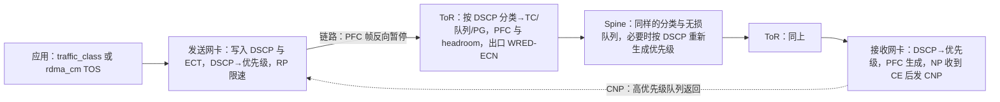
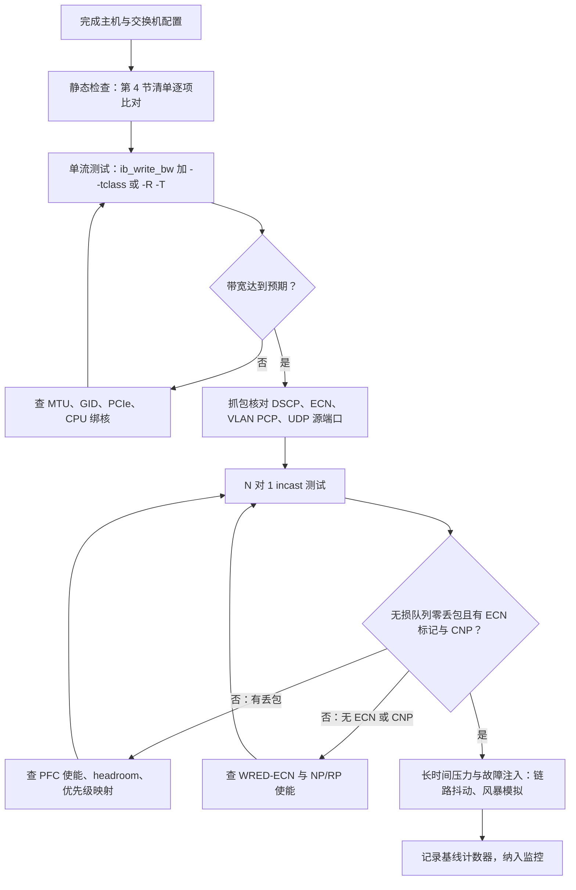

# 主机与交换机配置指南（Host and Switch Configuration Guide）

> **摘要**：RoCEv2 能否稳定跑满带宽，取决于"端到端一致"的配置：主机网卡的 MTU、GID 选择、DSCP 与优先级、trust 模式、PFC、ECN/DCQCN，必须与每一跳交换机的分类映射、无损队列、PFC、缓冲、ECN/WRED、PFC watchdog 严格匹配。本文先给出配置全景与参考规划，再分别列出主机侧的通用命令（iproute2 `dcb`、`lldptool`、rdma_cm configfs）与厂商工具示例、交换机侧与厂商无关的配置清单与 SONiC 示例，最后给出端到端一致性检查清单与验证流程。
>
> **规范出处**：Vol1 §A17.9.1–A17.9.4（p.1946–1949，无损网络、QoS、RCM、ECMP）；Vol1 §A17.3.1（p.1931–1934，DSCP/ECN/TTL/DF 字段规则 CA17-4/5/7/9/13/14/17）；Vol1 §A17.4.2（p.1937–1938，SL→以太网优先级）
>
> **前置阅读**：[无损以太网与 PFC](../05-congestion-control-and-qos/01-lossless-ethernet-pfc.md)、[QoS：DSCP/PCP/ETS](../05-congestion-control-and-qos/02-qos-dscp-pcp-ets.md)、[ECN 与 CNP](../05-congestion-control-and-qos/03-ecn-and-cnp.md)、[Linux RDMA 软件栈](01-linux-rdma-stack.md)
>
> **关键词**：MTU, active_mtu, GID index, default_roce_mode, TOS, DSCP, PCP, trust, PFC, ETS, DCBX, ECN, WRED, DCQCN, headroom, PFC watchdog, SONiC

---

## 1. 配置全景

### 1.1 规范对网络的要求是什么

Annex A17 对网络配置只给出**建议性**要求（should），具体机制交给 IEEE/IETF 标准与运维实践〔Vol1 §A17.9, p.1946–1949〕：

| 主题 | 规范要点 | 落到配置上 |
|---|---|---|
| 无损网络 | 底层网络应配置为无损，典型做法是 IEEE 802.1Qbb PFC；"无损"不等于绝不丢包，传输层仍有端到端重传；跨三层时路由器应为 RoCEv2 报文生成一个在下一子网启用了 PFC 的 L2 优先级；非 RoCE 流量用另一组优先级〔§A17.9.1, p.1946〕 | PFC、DSCP→优先级映射、路由器重标记、流量隔离 |
| QoS | 与普通 IP 流相同：用 ETS（802.1Qaz）分配带宽，用 DSCP/802.1Q 标识，标识由 AV 的 Traffic Class 控制〔§A17.9.2, p.1946–1947〕 | ETS 权重、DSCP 规划 |
| 拥塞管理（RCM） | 可选；交换机按 RFC 3168 做 ECN 标记，接收端对 CE 报文回 CNP（CA17-44），发送端降速（CA17-45）并在一段时间/字节后提速（CA17-46）〔§A17.9.3, p.1947–1948〕 | 交换机 WRED-ECN、网卡 NP/RP 使能与参数 |
| ECMP | UDP 源端口是不透明流标识，参与 ECMP 哈希；有序报文序列应使用恒定源端口〔§A17.9.4, p.1948–1949〕 | 交换机哈希字段包含 L4 端口 |
| 报文字段 | DSCP = AV Traffic Class（CA17-4/13）；不支持 RCM 时 ECN 必须为 00（CA17-5/14）；IPv4 DF=1（CA17-7）；TTL/Hop Limit = AV Hop Limit（CA17-9/17）〔§A17.3.1, p.1932–1934〕 | 主机侧 TOS/Hop Limit 设置、MTU 规划（不分片） |

### 1.2 报文经过的配置点



### 1.3 一个常见的参考规划

下表是业界广泛采用的约定（例如 NVIDIA 文档与许多部署使用 DSCP 26/优先级 3 承载 RoCE），**不是规范要求**；组织内只要两端、每一跳一致即可：

| 流量 | DSCP | TOS 字节（含 ECN） | 以太网优先级 | 交换机 TC/队列 | PFC | ECN 标记 | 调度 |
|---|---|---|---|---|---|---|---|
| RoCEv2 数据与 ACK | 26 | 104（ECN=00）/ 106（ECN=10） | 3 | 3 | 开 | 开（WRED-ECN，不丢弃） | ETS，按业务分配权重 |
| CNP | 48 | 192 | 6 | 6 | 一般不开 | 不适用 | 严格优先级或高权重 |
| 普通 TCP/IP | 0 等 | 0 | 0 | 0 | 关 | 可选 | ETS |

> [!NOTE]
> TOS 字节 = DSCP × 4 + ECN。`106 = 26 × 4 + 2` 表示 DSCP 26、ECN=10（ECT(0)）。在支持 RCM 的网卡上，ECN 位通常由硬件按 CA17-5 的规则自行设置，软件给的低 2 bit 是否生效依实现而定。

---

## 2. 主机侧配置

### 2.1 前置检查

```bash
rdma link show                                   # RDMA 设备 ↔ netdev 映射与端口状态
ibv_devinfo -d mlx5_0 | grep -E 'fw_ver|state|active_mtu|link_layer'
ethtool -i eth0                                  # 驱动与固件版本
ulimit -l                                        # 锁页内存上限，非 root 应用需足够大
```

内存注册需要锁定物理页，受 `RLIMIT_MEMLOCK` 限制。生产环境通常在 `/etc/security/limits.conf` 中为相应用户设置 `memlock unlimited`，systemd 服务则设置 `LimitMEMLOCK=infinity`。

### 2.2 MTU：以太网 MTU 与 RoCE active_mtu

RoCE 的"MTU"指 IB 意义上的**路径 MTU**：一个报文 BTH 之后负载的最大字节数，只能取 256/512/1024/2048/4096〔规范定义见 [帧布局与 MTU](../01-packet-format/01-frame-layout.md)〕。Linux 中多数 RoCE 驱动（mlx5、mlx4、bnxt_re、hns、qedr 等）以及 rdma_cm 都用内核函数 `iboe_get_mtu()` 由 netdev MTU 推导：先减去 96 字节（GRH 40 + UDP 8 + BTH 12 + XRCETH 4 + AtomicETH 28 + ICRC 4，按最坏情况预留），再向下取最大的合法 IB MTU〔业界实践: Linux include/rdma/ib_addr.h〕。

| netdev MTU | 减去 96 后 | `active_mtu` | 说明 |
|---|---|---|---|
| 1500 | 1404 | 1024 | 默认以太网 MTU，包率与开销都不理想 |
| 2200 | 2104 | 2048 | — |
| **4096** | 4000 | **2048** | 常见误区：设成 4096 只得到 2048 |
| 4200 | 4104 | 4096 | 刚好满足 4096 的最小值附近 |
| 9000 | 8904 | 4096 | 最常见的主机设置 |

```bash
ip link set dev eth0 mtu 9000
ibv_devinfo -d mlx5_0 | grep -E 'max_mtu|active_mtu'    # 期望 active_mtu: 4096 (5)
```

> [!WARNING]
> RoCEv2 报文 IPv4 必须置 DF（CA17-7），不分片、也不依赖 PMTUD。**交换机/路由器所有接口的 MTU 必须不小于主机发出的最大帧**（4096 负载 + 各层头部 + 可能的 VLAN 标签），通常交换机配置 9216。若路径上某处 MTU 偏小，典型症状是"小消息正常、大消息全部重试超限"，见 [排障指南](05-troubleshooting.md)。

> [!TIP]
> QP 实际使用的路径 MTU 在 Modify QP（→RTR）时确定：rdma_cm 用本地 `iboe_get_mtu(netdev MTU)`；原生 Verbs 由应用填 `path_mtu`（`ibv_rc_pingpong` 默认 1024，可用 `-m 4096`；perftest 默认取 `active_mtu`，可用 `-m` 指定）。两端应取相同值。

### 2.3 选择 RoCEv2 GID

- **原生 Verbs**：应用必须给出 `sgid_index`。用 `show_gids`（厂商脚本）、`ibv_devinfo -v` 或 sysfs 找到"类型为 RoCE v2 且 IP 正确"的索引，详见 [Linux RDMA 软件栈](01-linux-rdma-stack.md) 第 3 节。常见工具的参数：perftest `-x <idx>`、`ibv_rc_pingpong -g <idx>`、NCCL `NCCL_IB_GID_INDEX`、UCX `UCX_IB_GID_INDEX`。
- **rdma_cm**：自动按源 IP 选 GID，类型由 `default_roce_mode` 决定：

```bash
mount | grep -q configfs || mount -t configfs none /sys/kernel/config
mkdir -p /sys/kernel/config/rdma_cm/mlx5_0
echo "RoCE v2" > /sys/kernel/config/rdma_cm/mlx5_0/ports/1/default_roce_mode
```

> [!IMPORTANT]
> 两端 GID 类型与 IP 版本必须一致，否则接收端 DGID 检查失败（CA17-41），报文被静默丢弃〔Vol1 §A17.8, p.1945〕。

### 2.4 设置 DSCP（Traffic Class）

规范要求 IP 头的 DSCP 取自 AV 的 Traffic Class（CA17-4/CA17-13）。在 Linux 上有以下几种设置途径：

| 方式 | 作用范围 | 示例 |
|---|---|---|
| 原生 Verbs：`ah_attr.grh.traffic_class` | 单个 QP（Modify QP→RTR）或 AH | 见下方代码 |
| rdma_cm：`rdma_set_option(..., RDMA_OPTION_ID_TOS, ...)` | 单个 `rdma_cm_id`，需在解析路由前设置 | 见下方代码 |
| rdma_cm 全局默认：configfs `default_roce_tos` | 某设备某端口上所有未显式设置的 rdma_cm 连接 | `echo 106 > /sys/kernel/config/rdma_cm/mlx5_0/ports/1/default_roce_tos` |
| perftest | 测试 | 原生：`--tclass=106`；rdma_cm 模式：`-R -T 106` |
| NCCL / UCX | 框架 | `NCCL_IB_TC=106`；`UCX_IB_TRAFFIC_CLASS=106` |
| 厂商端口级设置（如 MLNX_OFED 的 `/sys/class/infiniband/<dev>/tc/<port>/traffic_class`） | 整个端口的默认/强制 Traffic Class | 厂商相关，与应用设置的优先关系以厂商文档为准 |

```c
#include <infiniband/verbs.h>
#include <rdma/rdma_cma.h>

/* 原生 Verbs：在 Modify QP 到 RTR 时设置 */
static void set_rtr_tclass(struct ibv_qp_attr *attr)
{
    attr->ah_attr.is_global = 1;           /* RoCEv2 必须带 GRH 语义 */
    attr->ah_attr.grh.traffic_class = 106; /* DSCP 26 */
    attr->ah_attr.grh.hop_limit = 64;      /* 写入 IPv4 TTL / IPv6 Hop Limit */
}

/* rdma_cm：在 rdma_resolve_route() 之前设置 */
static int set_cm_tos(struct rdma_cm_id *id)
{
    uint8_t tos = 106;
    return rdma_set_option(id, RDMA_OPTION_ID, RDMA_OPTION_ID_TOS,
                           &tos, sizeof(tos));
}
```

### 2.5 trust 模式与 DSCP→优先级映射

网卡和交换机都需要把报文归入某个**优先级**，PFC 才知道暂停/被暂停的是谁。归类依据（trust 模式）有两种：

| trust | 依据 | 优点 | 缺点 |
|---|---|---|---|
| PCP | VLAN 标签的 PCP | 二层标准做法 | 服务器端口必须为 trunk/带 VLAN；跨三层时 PCP 不会被保留 |
| DSCP | IP 头的 DSCP | 不需要 VLAN，跨三层天然保留 | 需要在每一跳配置 DSCP→优先级映射 |

微软在大规模部署中因 VLAN 方案与 PXE 装机冲突、且三层网络无法保留 PCP，提出并采用了基于 DSCP 的 PFC〔论文: Guo et al., RDMA over Commodity Ethernet at Scale, SIGCOMM 2016〕；这也是当今三层 RoCEv2 网络的主流做法。

**通用方式（iproute2 `dcb`，需驱动支持 DCB netlink）**〔外部: man dcb-apptrust(8)、dcb-app(8)〕：

```bash
dcb apptrust set dev eth0 order dscp pcp        # 先信任 DSCP，其次 PCP
dcb app add dev eth0 dscp-prio 26:3 48:6        # DSCP 26→优先级 3，DSCP 48→优先级 6
dcb app show dev eth0 dscp-prio
dcb ets set dev eth0 prio-tc 0:0 1:1 2:2 3:3 4:4 5:5 6:6 7:7   # 优先级→TC 一一对应
```

**厂商方式（NVIDIA，mlnx_qos，厂商相关）**〔业界实践: Mellanox/mlnx-tools `mlnx_qos`〕：

```bash
mlnx_qos -i eth0 --trust dscp
mlnx_qos -i eth0 --dscp2prio set,26,3
mlnx_qos -i eth0                                 # 打印当前 trust、PFC、ETS、缓冲配置
```

> [!NOTE]
> 部分驱动（如 mlx5）会在 APP 表中出现 DSCP 条目时自动切换为 DSCP trust，删除全部 DSCP 条目后回到 PCP trust（mlnx_qos 帮助文本对此有说明）。不同驱动行为不同，配置后务必用 `dcb apptrust show dev eth0` 或厂商工具确认。

### 2.6 PFC

```bash
# 通用：只在优先级 3 上启用 PFC
dcb pfc set dev eth0 prio-pfc all:off 3:on
dcb pfc show dev eth0                            # pfc-cap、prio-pfc、delay 等
dcb pfc show dev eth0 requests indications       # 已发送/已接收的 PFC 帧计数（驱动支持时）

# 由 lldpad 管理 DCBX 时
lldptool -T -i eth0 -V PFC enabled=3
lldptool -T -i eth0 -V PFC willing=no
lldptool -t -i eth0 -V PFC -c enabled

# 厂商（NVIDIA）
mlnx_qos -i eth0 --pfc 0,0,0,1,0,0,0,0

# 关闭全局 802.3x PAUSE，避免与 PFC 冲突
ethtool -A eth0 rx off tx off
```

> [!WARNING]
> **DCBX 管理权**：DCB 参数可能由网卡固件、OS 中的 lldpad 或交换机通过 DCBX（willing 位）下发。多方同时配置会互相覆盖。例如 mlnx_qos 帮助文本明确提示：DCBX 处于 OS 模式时不要与 lldptool 等工具并用。选定一种管理方式并在主机初始化脚本中固化。

网卡侧还可配置**接收缓冲/headroom**与**PFC 风暴防护**：

```bash
dcb buffer show dev eth0                          # prio-buffer 映射与各缓冲大小（驱动支持时）
mlnx_qos -i eth0 --cable_len 10                   # 厂商：按线缆长度重算 xoff/xon（NVIDIA）
ethtool --get-tunable eth0 pfc-prevention-tout    # 网卡 PFC 风暴防护超时（ms）
ethtool --set-tunable eth0 pfc-prevention-tout 100
```

`pfc-prevention-tout` 是内核 ethtool 通用 tunable（`ETHTOOL_PFC_PREVENTION_TOUT`），单位为毫秒，0 表示禁用、65535 表示 auto〔外部: man ethtool(8)〕；mlx5、bnxt、hns3 等驱动实现了它。以 mlx5 为例，它用于网卡侧 PFC 风暴防护：设备接收侧停滞超过该时长时不再继续发送 PFC，相关事件计入 `tx_pause_storm_*` 计数器，防止风暴扩散到网络（各驱动的具体语义以其文档为准）〔业界实践: Linux include/uapi/linux/ethtool.h 及各驱动〕。

### 2.7 ECN 与 DCQCN（RCM）使能

RCM 在规范中是可选的〔§A17.9.3, p.1947〕；绝大多数数据中心网卡以 DCQCN（或厂商改进算法）实现它，算法本身不属于规范，见 [DCQCN](../05-congestion-control-and-qos/04-dcqcn.md)。主机侧需要确认三件事：

1. **发送端（RP，Reaction Point）**：对 RoCE 优先级使能"收到 CNP 后降速"；
2. **接收端（NP，Notification Point）**：对 RoCE 优先级使能"收到 ECN=11 的报文后发送 CNP"（CA17-44）；
3. **CNP 的标记**：CNP 的 DSCP/优先级应映射到高优先级队列，避免拥塞反馈被拥塞本身延迟。

不同厂商/驱动的配置入口不同，下面仅为示例：

| 环境 | 入口（厂商相关，以所用版本文档为准） |
|---|---|
| NVIDIA MLNX_OFED / DOCA-OFED 驱动 | `/sys/class/net/<if>/ecn/roce_np/enable/<prio>`、`/sys/class/net/<if>/ecn/roce_rp/enable/<prio>`（写 1 使能），`/sys/class/net/<if>/ecn/roce_np/cnp_dscp` 等 |
| 上游内核 mlx5_ib | debugfs `/sys/kernel/debug/mlx5/<PCI 地址>/cc_params/` 下的 `rp_*`（如 `rp_ai_rate`、`rp_hai_rate`、`rp_time_reset`、`rp_byte_reset`、`rp_threshold`、`rp_min_rate`、`rp_gd` 等）与 `np_*`（`np_min_time_between_cnps`、`np_cnp_dscp`、`np_cnp_prio_mode`、`np_cnp_prio`）参数文件〔业界实践: Linux drivers/infiniband/hw/mlx5/cong.c〕 |
| 其他厂商（Broadcom、Intel、华为等） | 各自的工具、configfs/devlink 参数或固件配置，参考厂商文档中 RoCE 拥塞控制（roce_np/roce_rp、DCQCN、CC）相关章节 |

验证方法：在 N:1 incast 测试中观察计数器 `np_ecn_marked_roce_packets`、`np_cnp_sent`（接收端）与 `rp_cnp_handled`（发送端）是否增长；若发送端 `rp_cnp_ignored` 增长，说明收到了 CNP 但 RP 未使能。计数器释义见 [排障指南](05-troubleshooting.md)。

### 2.8 其他主机侧要点

- **同网段多网卡**：多块 RoCE 网卡位于同一子网时，需要 `arp_ignore`/`arp_announce` 与基于源地址的策略路由，否则 ARP 应答或出口端口可能与 GID 所在网卡不一致（常见做法，具体参数以发行版与厂商文档为准）：

```bash
sysctl -w net.ipv4.conf.all.arp_ignore=1
sysctl -w net.ipv4.conf.all.arp_announce=2
ip rule add from 192.168.1.10 table 101
ip route add 192.168.1.0/24 dev eth0 src 192.168.1.10 table 101
```

- **防火墙**：硬件卸载的 RoCEv2 报文不经过主机 netfilter；但 Soft-RoCE 的 UDP 4791、perftest/pingpong 用于带外交换 QP 信息的 TCP 端口（默认 18515）会受主机防火墙影响。云环境还需检查安全组/ACL。
- **配置持久化**：MTU、dcb/mlnx_qos 设置、sysfs/configfs 写入在重启或驱动重载后会丢失，应纳入网络配置管理（NetworkManager/netplan/systemd 单元等）。

---

## 3. 交换机侧配置（与厂商无关的清单）

### 3.1 配置项清单

| 配置项 | 作用 | 要点 |
|---|---|---|
| 入口分类 / trust | 把报文映射到 TC、队列与优先级组（PG） | 三层网络用 DSCP 分类；`DSCP 26 → TC 3`，`DSCP 48 → TC 6`（与主机一致） |
| 无损队列 / PG | 为 RoCE 的 TC 指定无损 PG 与出口队列 | 无损类越多，所需 headroom 越多；微软在 9 MB/12 MB 浅缓冲交换机上只能为两个无损类预留 headroom〔论文: SIGCOMM 2016〕 |
| PFC 使能 | 在服务器端口与交换机间链路上对 RoCE 优先级启用 | 两端的 PFC 优先级集合必须一致 |
| Headroom | 发出 PFC 后仍可能到达的在途数据所需缓冲 | 随链路速率与线缆长度增长，见 3.2 节 |
| XOFF/XON 阈值 | 何时发 PAUSE、何时恢复 | 常与共享缓冲动态阈值联动 |
| 共享缓冲与动态阈值 α | 队列可占用的共享缓冲 = α × 剩余共享缓冲 | α 大则突发吸收能力强但公平性差；见 3.3 节 |
| ECN / WRED | 在 RoCE 出口队列上按队列长度做 ECN 标记（而非丢弃） | Kmin/Kmax/Pmax；**必须保证 ECN 先于 PFC 触发**，见 3.4 节 |
| PFC watchdog | 检测"队列长时间无法排空且持续收到 PAUSE"并处置 | 动作：丢弃/转发/告警；见 3.5 节 |
| CNP 队列 | 让 CNP 快速返回 | 映射到严格优先级或高权重队列 |
| ETS | 在 RoCE 与 TCP 等类之间分配带宽 | 与主机 `dcb ets` 不必相同，但无损类应有足够保证带宽 |
| 三层重标记 | 路由后按 DSCP 重新生成出口优先级 | 对应规范"路由器应生成启用 PFC 的 L2 优先级"〔§A17.9.1, p.1946〕 |
| MTU | 承载最大 RoCE 帧 | 常用 9216 |
| ECMP 哈希 | 让不同 QP 分布到不同路径 | 哈希字段包含 UDP 源端口〔§A17.9.4〕；部分 ASIC 可用 UDF 额外哈希 BTH DestQP〔论文: Gangidi et al., SIGCOMM 2024〕 |
| 监控 | 每端口每优先级 PFC 收发、ECN 标记、丢包、缓冲水位 | 为排障提供第一手数据 |

### 3.2 Headroom 估算

发出 PFC 后，上游在收到并执行暂停前仍会继续发送，这段在途数据必须由 headroom 吸收。常用近似式（各分项的精确取值以交换芯片厂商的 headroom 计算工具为准，原理详见 [无损以太网与 PFC](../05-congestion-control-and-qos/01-lossless-ethernet-pfc.md)）：

```text
Headroom ≈ 2 × MaxFrame                      // 本端正在发送、对端正在发送的最大帧各一个
         + 2 × L_cable × t_prop × Rate / 8   // 线缆往返传播期间的在途数据
         + Rate / 8 × (t_gen + t_resp)       // 本端生成 PFC 与对端响应 PFC 的内部延迟
```

示例：100 GbE、线缆 100 m（t_prop ≈ 5 ns/m）、MaxFrame = 9216 B，内部延迟合计按 1 µs 估：

```text
2 × 9216                         = 18432 B
2 × 100 m × 5 ns/m × 12.5 B/ns   = 12500 B
1 µs × 12.5 B/ns                 = 12500 B
合计 ≈ 43 KB / 每端口 / 每个无损 PG
```

速率翻倍（如 400 GbE）时，与时间相关的两项按比例翻倍；线缆越长、无损类越多，headroom 总量越大。

### 3.3 共享缓冲与动态阈值

现代交换芯片多采用共享缓冲，队列的可用上限按动态阈值计算：`limit = α × (B_shared − B_used)`〔论文: Choudhury & Hahne, Dynamic Queue Length Thresholds for Shared-Memory Packet Switches, IEEE/ACM ToN 1998〕。对无损 PG，这个动态上限往往就是 XOFF 触发点。微软的经验是启用端口间动态缓冲共享可以吸收更多突发、减少 PAUSE 向网络内部传播〔论文: SIGCOMM 2016〕。α 的取值与芯片相关，需结合 incast 测试调整。

### 3.4 ECN/WRED 阈值

交换机按出口队列长度线性计算标记概率：低于 Kmin 不标记，Kmin～Kmax 之间从 0 线性升到 Pmax，高于 Kmax 全部标记〔论文: DCQCN, SIGCOMM 2015〕。阈值高度依赖链路速率、缓冲深度与流量模式，以下数字只用于建立量级感：

| 来源 | Kmin | Kmax | Pmax | 背景 |
|---|---|---|---|---|
| DCQCN 论文的数据中心参数 | 5 KB | 200 KB | 1% | 40 GbE 时代的测试床与部署〔论文: DCQCN, SIGCOMM 2015〕 |
| SONiC 默认模板 `AZURE_LOSSLESS` | 1048576 B | 2097152 B | 由 drop_probability 字段给出 | 默认 QoS 模板中的值，以所用平台模板为准〔业界实践: sonic-buildimage qos_config.j2〕 |
| Meta AI 训练网络的实验基线（深缓冲 CTSW） | 5 MB | 5 MB | — | 论文报告：相对该基线，把阈值收紧到 300 KB/600 KB 反而降低了 AllReduce 性能〔论文: Gangidi et al., SIGCOMM 2024〕 |

> [!IMPORTANT]
> **ECN 必须先于 PFC 触发**：ECN 在出口队列上标记，PFC 由入口（PG）占用触发；DCQCN 论文专门推导了在最坏情况下（所有出口队列的报文都来自同一入口）保证"PFC 不早于 ECN"所需的阈值关系〔论文: DCQCN, SIGCOMM 2015〕。若 PFC 先触发，拥塞会以 PAUSE 的形式向上游扩散，而发送端得不到降速信号。

### 3.5 PFC watchdog

PFC 风暴（某端持续发送 PAUSE）会让暂停沿拓扑逐级扩散，可能阻塞整个网络。微软在 NIC 侧与 ToR 侧都部署了 watchdog：NIC 的微控制器发现接收流水线停滞一段时间（默认 100 ms）且仍在发 PAUSE 时，禁止网卡再发 PAUSE；ToR 发现面向服务器的出口队列无法排空且持续收到 PAUSE 时，对该端口关闭无损模式、丢弃进出该网卡的无损报文〔论文: Guo et al., SIGCOMM 2016〕。今天主流交换机 NOS 都提供类似功能（检测时间、动作、恢复时间三要素），主机侧对应第 2.6 节的 `pfc-prevention-tout`。

### 3.6 SONiC 示例（示例，字段与命令以所用 SONiC 版本为准）

CONFIG_DB 中与 RoCE 相关的表（节选，值为示例）：

```json
{
  "DSCP_TO_TC_MAP": {
    "AZURE": { "0": "0", "26": "3", "48": "6" }
  },
  "PORT_QOS_MAP": {
    "Ethernet0": {
      "dscp_to_tc_map": "AZURE",
      "tc_to_queue_map": "AZURE",
      "tc_to_pg_map": "AZURE",
      "pfc_to_queue_map": "AZURE",
      "pfc_enable": "3"
    }
  },
  "WRED_PROFILE": {
    "AZURE_LOSSLESS": {
      "ecn": "ecn_all",
      "wred_green_enable": "true",
      "green_min_threshold": "1048576",
      "green_max_threshold": "2097152",
      "green_drop_probability": "5"
    }
  },
  "QUEUE": {
    "Ethernet0|3": { "wred_profile": "AZURE_LOSSLESS" }
  }
}
```

常用 CLI〔业界实践: sonic-utilities〕：

```bash
sudo config qos reload                         # 按平台模板重新生成 QoS 与缓冲配置（会覆盖手工修改）
show pfc counters                              # 每端口每优先级 PFC 收发计数
show queue counters Ethernet0                  # 每队列转发/丢弃计数
show priority-group watermark headroom         # PG headroom 水位
ecnconfig -l                                   # 查看 WRED/ECN 配置
sudo ecnconfig -p AZURE_LOSSLESS -gmin 1048576 -gmax 2097152
sudo pfcwd start --action drop --restoration-time 400 all 400   # 检测 400 ms，恢复 400 ms
pfcwd show config
pfcwd show stats
```

> [!NOTE]
> SONiC 默认模板通常把优先级 3、4 设为无损（`pfc_enable: "3,4"`），并使用 `AZURE` 系列映射名；pfcwd 的检测时间取值范围为 100–5000 ms、恢复时间为 100–60000 ms（sonic-utilities 的参数校验）。

---

## 4. 端到端一致性检查清单

| # | 检查项 | 主机端 | 交换机端 | 验证方法 | 不一致的后果 |
|---|---|---|---|---|---|
| 1 | RoCE 数据的 DSCP | traffic_class / TOS（如 106→DSCP 26） | DSCP 26→无损 TC | 抓包看 `ip.dsfield.dscp`；交换机按队列计数 | 进入有损队列，拥塞时丢包、重传 |
| 2 | trust 模式 | DSCP（`dcb apptrust` / `mlnx_qos --trust`） | DSCP | 工具回显 | 优先级判定错误，PFC 不生效 |
| 3 | DSCP→优先级 | 26→3 | 26→TC3→PG3 | `dcb app show`；交换机映射表 | PAUSE 暂停了错误的优先级 |
| 4 | PFC 优先级集合 | 只开 3 | 只开 3 | `dcb pfc show`；`show pfc counters` | 一端发 PAUSE、另一端不理会，丢包 |
| 5 | 全局 PAUSE | 关闭 | 关闭 | `ethtool -a eth0` | 与 PFC 冲突，全端口被暂停 |
| 6 | MTU | 9000，`active_mtu` 4096 | ≥ 9216，全路径 | `ibv_devinfo`；`ping -M do -s 8972 <对端>` | 大报文丢弃，重试超限 |
| 7 | ECN 能力 | NP/RP 对优先级 3 使能 | 队列 3 启用 WRED-ECN | incast 时 `np_ecn_marked_roce_packets`、`np_cnp_sent`、`rp_cnp_handled` 增长 | 只有 PFC 起作用，拥塞扩散 |
| 8 | CNP 标记 | CNP DSCP/优先级（如 48/6） | 48→高优先级队列 | 抓包看 OpCode 0x81 报文的 DSCP | CNP 被延迟，降速滞后 |
| 9 | 缓冲/headroom | 网卡 `cable_len`/buffer | 按速率与线缆长度配置 | incast 下无损队列零丢包 | 无损队列丢包 |
| 10 | PFC watchdog | `pfc-prevention-tout` | pfcwd 已启动 | 查看配置与触发统计 | 风暴扩散到全网 |
| 11 | ECMP 熵 | 每 QP 不同 UDP 源端口 | 哈希包含 L4 端口 | 各上行链路利用率是否均衡 | 少数链路过载 |
| 12 | GID 类型与 IP 版本 | 两端均为 RoCE v2 + 同一 IP 版本 | — | `show_gids`；抓包看 Ethertype | 报文被静默丢弃 |

### 4.1 验证流程



---

## 5. 要点回顾

- 规范只建议"无损 + DSCP/802.1Q 标识 + ETS + 可选 RCM + UDP 源端口参与 ECMP"〔§A17.9〕，具体参数全靠两端与每一跳的一致配置。
- `active_mtu` 由 netdev MTU 减 96 字节后向下取 IB MTU：要得到 4096，netdev MTU 至少约 4192，常用 9000；交换机 MTU 常用 9216。
- 两端必须选同类型（RoCE v2）、同 IP 版本的 GID；rdma_cm 用 configfs 的 `default_roce_mode`/`default_roce_tos` 控制默认值。
- TOS 字节 = DSCP×4 + ECN；DSCP 26/优先级 3、CNP DSCP 48/优先级 6 是常见约定而非规范。
- 三层 RoCEv2 网络推荐 DSCP trust；`dcb apptrust`/`dcb app`/`dcb pfc` 是通用工具，`mlnx_qos` 等为厂商工具，DCBX 管理权只能有一个。
- 交换机需配置：DSCP 分类、无损 PG/队列、PFC、headroom、动态阈值、WRED-ECN、PFC watchdog、CNP 高优先级、ECMP 哈希。
- ECN 必须先于 PFC 触发；ECN 阈值的量级随速率、缓冲与业务差异巨大，需实测调优。
- 用"单流 → 抓包核对 → incast → 计数器"的流程验证配置。

## 自测

<details><summary>Q1：主机把 eth0 的 MTU 设为 4096，ibv_devinfo 显示 active_mtu 为 2048，为什么？</summary>

答：内核 `iboe_get_mtu()` 先从 netdev MTU 中减去 96 字节的最坏情况头部开销（GRH 40、UDP 8、BTH 12、XRCETH 4、AtomicETH 28、ICRC 4），4096−96=4000，小于 4096，只能取 2048。要得到 4096，需要 netdev MTU 至少约 4192，常用 9000。
</details>

<details><summary>Q2：TOS 字节 106 对应什么 DSCP 和 ECN？为什么很多文档用它？</summary>

答：106 = 26×4 + 2，即 DSCP 26（AF31）、ECN=10（ECT(0)）。DSCP 26 映射到优先级 3 是业界常见的 RoCE 约定，带 ECT 表示报文可被 ECN 标记；不支持 RCM 的实现则必须发 ECN=00（CA17-5）。
</details>

<details><summary>Q3：为什么三层 RoCEv2 网络通常选择 DSCP trust 而不是 PCP trust？</summary>

答：PCP 位于 VLAN 标签中，要求服务器端口带 VLAN（与 PXE 装机等运维流程冲突），且跨三层路由时 PCP 没有标准方式保留；DSCP 位于 IP 头，天然随报文跨越三层。微软 SIGCOMM 2016 论文即因这两个问题提出基于 DSCP 的 PFC。
</details>

<details><summary>Q4：incast 测试中交换机无损队列没有丢包，但 np_cnp_sent 一直为 0，可能是什么原因？</summary>

答：可能是交换机没有在该队列启用 WRED-ECN（或 Kmin 过高，PFC 先于 ECN 触发），也可能是接收端网卡未对该优先级使能 NP，或者发送端发出的报文 ECN=00（不可标记）。可先抓包看是否出现 ECN=11 的报文，再看 `np_ecn_marked_roce_packets` 是否增长来定位是交换机还是网卡的问题。
</details>

<details><summary>Q5：100 GbE、100 m 线缆的端口，为什么每个无损优先级要预留几十 KB headroom？</summary>

答：PFC 帧从发出到上游真正停发之间，有两端各一个最大帧的发送时间、线缆往返传播时间以及双方生成/响应 PFC 的内部延迟，这期间的在途数据都必须被接收端缓冲。按 100 Gb/s=12.5 B/ns 估算，往返 1 µs 的传播就对应 12.5 KB，加上两个 9 KB 帧与内部延迟，合计约 40 KB 量级。
</details>

## 参考

- 规范：Vol1 §A17.3.1（p.1931–1934）、§A17.4.2（p.1937–1938）、§A17.8（p.1945–1946）、§A17.9.1–A17.9.4（p.1946–1949）
- 外部：IEEE 802.1Qbb（PFC）、IEEE 802.1Qaz（ETS/DCBX）、RFC 3168（ECN）、RFC 2474（DSCP）
- 外部：iproute2 手册 dcb(8)、dcb-app(8)、dcb-apptrust(8)、dcb-pfc(8)、dcb-ets(8)、dcb-buffer(8)；open-lldp 手册 lldptool-pfc(8)
- 外部：Linux 内核文档 `Documentation/ABI/testing/configfs-rdma_cm`；内核源码 `include/rdma/ib_addr.h`（iboe_get_mtu）、`drivers/infiniband/hw/mlx5/cong.c`
- 论文：Guo et al., "RDMA over Commodity Ethernet at Scale", SIGCOMM 2016
- 论文：Zhu et al., "Congestion Control for Large-Scale RDMA Deployments"（DCQCN）, SIGCOMM 2015
- 论文：Gangidi et al., "RDMA over Ethernet for Distributed AI Training at Meta Scale", SIGCOMM 2024
- 论文：Choudhury & Hahne, "Dynamic Queue Length Thresholds for Shared-Memory Packet Switches", IEEE/ACM ToN 1998
- 业界实践：Mellanox/mlnx-tools（mlnx_qos、cma_roce_mode、cma_roce_tos）；SONiC sonic-utilities 与 sonic-buildimage QoS 模板（厂商/版本相关）
