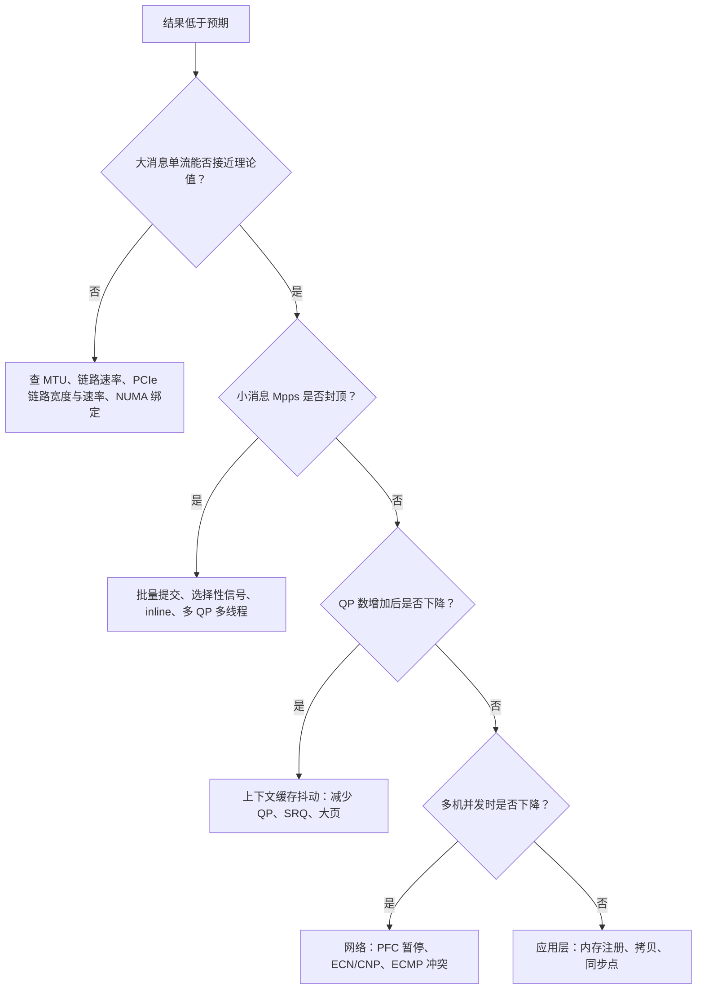

# 性能调优（Performance Tuning）

> **摘要**：RoCEv2 的性能由线速与协议效率、网卡消息速率与上下文缓存、PCIe、CPU 的发起/回收开销、内存注册以及网络拥塞共同决定。本文按"建立性能模型 → 定位瓶颈 → 针对性调优"的思路，讲解 MTU、消息大小与包率、QP 规模、inline/批量提交/选择性信号、CQ 轮询与事件、SRQ、多线程与 NUMA/中断亲和、PCIe（MPS/MRRS、Relaxed Ordering、ATS/ACS）、内存注册与 GPUDirect RDMA，并给出延迟与吞吐的取舍和评估方法。文中所有数量级仅供参考，实际结果依硬件、固件与软件版本而异。
>
> **规范出处**：Vol1 §A17.3（p.1931–1936，报文格式与开销来源）；Vol1 §11.1.1（p.583，WR 列表提交属于 Base Queue Management Extensions）；Vol1 §10.7.3.1 与 §10.8.6（p.542–543、554，选择性信号 C10-90/91/92、C10-108）；Vol1 §10.2.9（p.475–477，SRQ）；Vol1 §9.7.9.1（p.399–401，XRC）；Vol1 §9.7.5.2.8（p.352–355，RNR NAK 与定时器编码 Table 48）
>
> **前置阅读**：[帧布局、开销与 MTU](../01-packet-format/01-frame-layout.md)、[WR/WQE/CQE 处理模型](../03-verbs-and-resources/04-work-requests-and-completions.md)、[Linux RDMA 软件栈](01-linux-rdma-stack.md)、[配置指南](02-configuration-guide.md)
>
> **关键词**：goodput, message rate, inline, post list, doorbell batching, unsignaled completion, CQ moderation, SRQ, NUMA, IRQ affinity, PCIe MPS/MRRS, Relaxed Ordering, ATS/ACS, hugepage, ODP, GPUDirect RDMA

---

## 1. 先建立性能模型

### 1.1 吞吐由最紧的那道约束决定

```text
可达吞吐 ≈ min( 线速 × 协议效率(消息大小, MTU),
               网卡消息速率 × 消息大小,
               PCIe 有效带宽,
               CPU 发起与回收速率 × 消息大小,
               在途字节 / RTT（READ/ATOMIC 受未完成数限制）,
               网络可用带宽（拥塞、ECMP 冲突、PFC 暂停） )
```

| 约束 | 典型表现 | 观测手段 | 主要手段 |
|---|---|---|---|
| 线速与协议效率 | 大消息带宽接近但达不到线速 | 计算第 2 节的理论值对比 | MTU 4096、减少小包 |
| 网卡消息速率 | 小消息 Mpps 封顶，加线程不再增长 | `ib_write_bw -s 64` 系列测试 | 消息聚合、多 QP、inline |
| QP/上下文缓存 | QP 数增加后总吞吐下降 | 改变 `-q` 观察拐点 | 减少 QP、SRQ/XRC、大页 |
| PCIe | 双端口/双向时上不去；读方向更差 | `lspci -vvv` 查链路；对比单/双向 | 正确插槽、MPS/MRRS、Relaxed Ordering |
| CPU | 单核 100%，post/poll 成为瓶颈 | `perf top`、perftest `--cpu_util` | 批量提交、选择性信号、多线程 |
| 在途窗口 | READ 带宽远低于 WRITE | `-o`（outstanding）对比 | 增大 initiator depth、多 QP |
| 网络 | 单机满速、多机并发下降，计数器出现 PFC/CNP | 交换机与网卡计数器 | 见 [ECMP](../05-congestion-control-and-qos/06-ecmp-and-load-balancing.md)、[DCQCN](../05-congestion-control-and-qos/04-dcqcn.md) |

### 1.2 定位流程



---

## 2. MTU 与协议开销

每个 RoCEv2（IPv4、无 VLAN）报文在线路上的固定开销为 82 字节：前导码+SFD 8、帧间隙 12、以太网头 14、FCS 4、IPv4 20、UDP 8、BTH 12、ICRC 4；IPv6 再加 20 字节；RDMA WRITE/READ 请求首包还有 16 字节 RETH。按"满 MTU 的中间包"计算的协议效率〔字段长度见 [帧布局](../01-packet-format/01-frame-layout.md)〕：

| 路径 MTU | IPv4 效率 | 100 GbE 下的负载上限 | IPv6 效率 |
|---|---|---|---|
| 1024 | 92.59% | ≈ 92.6 Gb/s | 90.94% |
| 2048 | 96.15% | ≈ 96.2 Gb/s | 95.26% |
| 4096 | 98.04% | ≈ 98.0 Gb/s | 97.57% |

> [!TIP]
> 大消息场景应让 `active_mtu` 达到 4096（主机 netdev MTU 通常设 9000，交换机 9216，推导关系见 [配置指南](02-configuration-guide.md) 第 2.2 节）。IB 路径 MTU 最大就是 4096，以太网 MTU 再大也不会产生更大的 RoCE 报文。

---

## 3. 消息大小与包率瓶颈

小消息时，瓶颈从"带宽"变为"包率/消息速率"。100 GbE 上单个 RDMA WRITE ONLY（IPv4，含 RETH）的线路包率上限：

| 负载 | 以太网帧长 | 线路包率上限 | 对应负载带宽 |
|---|---|---|---|
| 8 B | 86 B | ≈ 117.9 Mpps | ≈ 7.5 Gb/s |
| 64 B | 142 B | ≈ 77.2 Mpps | ≈ 39.5 Gb/s |
| 256 B | 334 B | ≈ 35.3 Mpps | ≈ 72.3 Gb/s |
| 1024 B | 1102 B | ≈ 11.1 Mpps | ≈ 91.3 Gb/s |

（计算：包率 = 100 Gb/s ÷ [(帧长 + 20 B 前导与间隙) × 8]，帧长不足 64 B 时按 64 B 计。）

实际能否达到这个上限取决于：

- **网卡消息速率**：各代网卡标称的单端口/单卡消息速率从数十到一两百 Mpps 不等（厂商标称，依型号与测试方法而异）。
- **CPU 发起开销**：perftest README 指出，单线程逐个 `post_send` 时软件发起速率约 10 Mpps 量级，必须借助 post list 才能看到真实的硬件消息速率〔业界实践: perftest README〕。
- **应用层手段**：把多个小消息聚合成一个大消息（例如批量写入环形缓冲后用一次 RDMA WRITE 推送），往往比任何底层优化都有效。

---

## 4. QP 规模与网卡上下文缓存

许多 RNIC 把 QP 上下文（QPC）、内存保护表（MPT）与地址翻译表（MTT）等主体放在主机内存中，只在片上缓存一小部分（具体结构依厂商而异）；活跃 QP 或活跃内存范围超过缓存容量后，每次未命中都要经 PCIe 读回上下文，吞吐与延迟随之恶化〔论文: Kalia et al., Design Guidelines for High Performance RDMA Systems, ATC 2016〕。微软报告过一个实例：所用网卡的 MTT 只有 2K 项，4 KB 页时只能覆盖 8 MB 内存，缺失导致接收流水线变慢并持续发出 PFC（"slow-receiver symptom"），改用 2 MB 大页后缓解〔论文: Guo et al., SIGCOMM 2016〕。硬件侧的缓存设计见 [RNIC 总体架构](../06-hardware-implementation/01-rnic-architecture.md)。

| 手段 | 原理 | 代价 |
|---|---|---|
| 减少 QP：每对线程/进程共享连接 | 降低活跃 QPC 数 | 需要应用层多路复用 |
| SRQ | 多个 QP 共享接收 WQE 与缓冲〔Vol1 §10.2.9, p.475〕 | 接收端顺序与流控需额外设计 |
| XRC | 接收端按"节点"而非"进程"共享连接：全互联时每节点 RC 需 N·p·p 个 QP，XRC 只需 N·p 个 INI QP、p 个 XRC SRQ 与 N·p 个 TGT QP（N 为节点数，p 为每节点进程数）〔Vol1 §9.7.9.1, p.399–401〕 | 编程复杂度增加；单个 INI/TGT 对是单向的 |
| 厂商的动态连接（如 NVIDIA DCT） | 按需与对端建立/拆除连接上下文 | 厂商私有，以文档为准 |
| UD + 软件可靠性 | 一个 UD QP 与任意对端通信，避免 RC 的 QP 爆炸〔论文: Kalia et al., FaSST, OSDI 2016〕 | 需自行处理重传、分片 |
| 大页、合并 MR | 减少 MTT/MPT 项 | 内存管理更复杂 |

> [!NOTE]
> QP 数并非越少越好：Meta 在 AI 训练网络中为提高 ECMP 熵而为每个连接使用多个 QP（QP scaling），同时指出 QP 缓冲是网卡上的稀缺资源，需要在不同负载间权衡 QP 数量〔论文: Gangidi et al., SIGCOMM 2024〕。

---

## 5. 发送路径：inline、批量提交与选择性信号

### 5.1 三个关键技巧

| 技巧 | 做法 | 收益 | 注意 |
|---|---|---|---|
| **inline 数据** | QP 创建时设置 `cap.max_inline_data`，WR 带 `IBV_SEND_INLINE` | CPU 把负载随 WQE 一起写入，网卡省去一次 DMA 读负载；小消息延迟和包率明显改善；inline 数据不检查 L_Key（无需注册内存），post 返回后缓冲即可复用 | 仅适用于 SEND 与 RDMA WRITE；大小受设备上限约束（创建 QP 后读回 `cap.max_inline_data`）；inline 不是 IB 规范概念，而是 Verbs 实现的扩展〔外部: man ibv_post_send(3)〕 |
| **post list（WR 链表）** | 一次 `ibv_post_send` 传入 `next` 链接的多个 WR | provider 写完全部 WQE 后通常只敲一次门铃，减少 MMIO 次数；规范把"一次提交 WR 列表"列为 Base Queue Management Extensions 的一部分〔Vol1 §11.1.1, p.583〕 | 链表中某个 WR 出错时，`bad_wr` 指向第一个失败的 WR |
| **选择性信号** | 创建 QP 时 `sq_sig_all = 0`，只给部分 WR 置 `IBV_SEND_SIGNALED` | 减少 CQE 写入（PCIe 写）与轮询开销 | 见下方规范规则 |

规范对"无信号完成"（Unsignaled Completion）的规定〔Vol1 §10.7.3.1 与 §10.8.6, p.542–543、554〕：

- 出错的 WR **总会**产生 CQE（C10-91），即使它请求了无信号完成；
- 一个成功完成的无信号 WR，只有在**同一 SQ 上之后某个 WR 的完成**从 CQ 中取出后才算被确认；此后 CI 不再访问该 WR 的缓冲（C10-108）。

由此得出两条工程规则：① 每隔不超过 SQ 深度的若干个 WR 必须至少有一个是 signaled，否则 SQ 槽位无法回收、最终 post 失败；② 无信号 WR 的数据缓冲要等到后续 signaled WR 的完成被取出后才能重用。

### 5.2 示例代码

以下代码已对 rdma-core 头文件做过语法检查：

```c
#include <infiniband/verbs.h>
#include <stdint.h>
#include <string.h>

#define BATCH      32
#define SIG_EVERY  16              /* 每 16 个 WR 请求一次完成 */

/* QP 创建：允许选择性信号，并申请 inline 能力 */
static struct ibv_qp *create_rc_qp(struct ibv_pd *pd, struct ibv_cq *cq)
{
    struct ibv_qp_init_attr qia = {
        .send_cq    = cq,
        .recv_cq    = cq,
        .cap        = { .max_send_wr = 1024, .max_recv_wr = 1024,
                        .max_send_sge = 1, .max_recv_sge = 1,
                        .max_inline_data = 64 },
        .qp_type    = IBV_QPT_RC,
        .sq_sig_all = 0,           /* 0：由每个 WR 的 IBV_SEND_SIGNALED 决定 */
    };
    return ibv_create_qp(pd, &qia);  /* 返回后 qia.cap 为实际分配值 */
}

/* 一次 ibv_post_send 提交 BATCH 个 RDMA WRITE（链表），小消息走 inline */
static int post_write_batch(struct ibv_qp *qp, struct ibv_sge *sge,
                            uint64_t raddr, uint32_t rkey,
                            uint32_t max_inline, uint64_t *posted)
{
    struct ibv_send_wr wr[BATCH], *bad = NULL;
    int i;

    memset(wr, 0, sizeof(wr));
    for (i = 0; i < BATCH; i++) {
        wr[i].wr_id               = *posted + i;
        wr[i].sg_list             = &sge[i];
        wr[i].num_sge             = 1;
        wr[i].opcode              = IBV_WR_RDMA_WRITE;
        wr[i].wr.rdma.remote_addr = raddr + (uint64_t)i * sge[i].length;
        wr[i].wr.rdma.rkey        = rkey;
        if (sge[i].length <= max_inline)
            wr[i].send_flags |= IBV_SEND_INLINE;   /* 数据随 WQE 写入，省一次 DMA 读 */
        if ((*posted + i + 1) % SIG_EVERY == 0)
            wr[i].send_flags |= IBV_SEND_SIGNALED; /* 选择性信号 */
        wr[i].next = (i + 1 < BATCH) ? &wr[i + 1] : NULL;
    }
    *posted += BATCH;
    return ibv_post_send(qp, wr, &bad);             /* 一次调用，provider 通常只敲一次门铃 */
}
```

> [!TIP]
> rdma-core 还提供基于 `ibv_qp_ex` 的新发送接口（`ibv_wr_start`/`ibv_wr_rdma_write`/`ibv_wr_set_sge`/`ibv_wr_complete`），省去构造 `ibv_send_wr` 链表的开销；perftest 默认即使用新接口（`--use_old_post_send` 可切回旧接口对比）〔业界实践: perftest 手册〕。

### 5.3 硬件实现要点

对 RNIC 设计者而言，上述软件技巧对应的硬件需求是：支持 WQE 内嵌数据（inline）、支持一次门铃处理多个 WQE、支持按 WQE 标志决定是否写 CQE、尽量减少每个 WQE 的 PCIe 读次数（门铃中携带 WQE 或预取）。这些设计取舍见 [发送数据通路](../06-hardware-implementation/02-tx-datapath.md)。

---

## 6. 完成处理：轮询、事件与合并

| 模式 | 做法 | 延迟 | CPU | 适用 |
|---|---|---|---|---|
| 忙轮询 | 循环调用 `ibv_poll_cq` | 最低 | 一个核 100% | 延迟敏感、核数充足 |
| 事件 | `ibv_req_notify_cq` + `ibv_get_cq_event` | 增加中断与调度延迟（微秒级以上） | 低 | 大量连接、低负载 |
| 混合 | 先轮询 N 次，再武装 CQ 并睡眠 | 负载高时接近轮询 | 中 | 通用服务 |
| 事件合并 | `ibv_modify_cq` 设置 `cq_count`/`cq_period` | 增加至多一个合并周期 | 更低 | 吞吐型事件驱动服务 |

```c
/* 混合模式：先忙轮询 spin 次，仍无完成则武装 CQ 并阻塞等待中断 */
static int poll_hybrid(struct ibv_comp_channel *ch, struct ibv_cq *cq,
                       struct ibv_wc *wc, int max, int spin)
{
    struct ibv_cq *ev_cq;
    void *ev_ctx;
    int n;

    while (spin-- > 0) {
        n = ibv_poll_cq(cq, max, wc);              /* 一次最多取 max 个 CQE */
        if (n != 0)
            return n;                              /* >0：完成数；<0：出错 */
    }
    if (ibv_req_notify_cq(cq, 0))                  /* 武装 CQ */
        return -1;
    n = ibv_poll_cq(cq, max, wc);                  /* 再查一次，防止武装前到达的 CQE 被漏掉 */
    if (n != 0)
        return n;
    if (ibv_get_cq_event(ch, &ev_cq, &ev_ctx))     /* 阻塞等待完成事件 */
        return -1;
    ibv_ack_cq_events(ev_cq, 1);                   /* 生产代码宜批量 ack */
    return ibv_poll_cq(cq, max, wc);
}

/* CQ 事件合并：累计 16 个 CQE 或 8 µs 才触发一次事件 */
static int moderate_cq(struct ibv_cq *cq)
{
    struct ibv_modify_cq_attr attr = {
        .attr_mask = IBV_CQ_ATTR_MODERATE,
        .moderate  = { .cq_count = 16, .cq_period = 8 },
    };
    return ibv_modify_cq(cq, &attr);
}
```

其他要点：

- 每次 `ibv_poll_cq` 取多个 CQE（如 16～64），分摊调用开销；CQ 深度必须不小于可能同时未取出的 CQE 数，否则 CQ 溢出会使关联 QP 进入错误状态。
- 内核 ULP（NVMe-oF、iSER 等）使用的 CQ 可通过 `rdma dev set <dev> adaptive-moderation on` 启用自适应中断合并〔外部: man rdma-dev(8)〕。

---

## 7. 接收侧：预投递、SRQ 与 RNR

- **RQ 饿死的代价很高**：SEND 到达而 RQ 无可用 WQE 时，RC 响应方回 RNR NAK，请求方至少等待 AETH 中 RNR 定时器指定的时间后才重试；编码 00001 为 0.01 ms，00000 则为 655.36 ms〔Vol1 §9.7.5.2.8 Table 48, p.354–355〕。一次 RNR 就可能让尾延迟增加约 10 微秒到数百毫秒。网卡计数器 `out_of_buffer`（mlx5）增长即提示 RQ/SRQ 不足。
- **批量补充接收 WQE**：用 `ibv_post_recv` 的 WR 链表一次补充多个（perftest 的 `--recv_post_list` 用于测试这一点）；保持 RQ 深度覆盖"一个轮询周期内可能到达的消息数"。
- **SRQ**：多个 QP 共享接收 WQE 与缓冲〔Vol1 §10.2.9, p.475–477〕；用 `ibv_modify_srq` 设置 SRQ Limit，收到 `IBV_EVENT_SRQ_LIMIT_REACHED` 异步事件时补货。连接数多、每连接负载稀疏时内存节省显著。
- **min_rnr_timer**：响应方在 Modify QP 时设置的 RNR 定时器编码决定请求方的退避时间；设得过大会放大偶发 RNR 的影响，设得过小则在接收方长时间无缓冲时浪费带宽。

---

## 8. 多线程、NUMA 与中断亲和

| 项 | 建议 | 命令/接口 |
|---|---|---|
| 线程模型 | 每线程独占 QP 与 CQ，避免锁竞争；单线程使用的资源可通过线程域（`ibv_alloc_td`）与 parent domain 让 provider 省去内部锁 | rdma-core `ibv_alloc_td`、`ibv_alloc_parent_domain` |
| NUMA | 线程与缓冲放在网卡所在 NUMA 节点 | `cat /sys/class/net/eth0/device/numa_node`；`numactl --cpunodebind=N --membind=N ./app` |
| perftest 绑核 | 新版 perftest 默认自动绑定到网卡所在 NUMA 节点，可用 `--pin_cores`、`--numa_node`、`--disable_numa` 控制 | 〔业界实践: perftest README〕 |
| 中断亲和（事件模式） | 让完成中断落在处理线程所在核或同 NUMA 节点 | `/proc/irq/<n>/smp_affinity_list`；或厂商脚本（如 mlnx-tools 的 `set_irq_affinity*`） |
| CPU 频率与 C-state | 测试与生产时固定高性能策略 | `cpupower frequency-set -g performance`；perftest 的 `-F` 仅用于忽略频率告警 |
| 隔离 | 延迟敏感时隔离轮询核 | 内核参数 `isolcpus=`、`nohz_full=`（按发行版文档） |

---

## 9. PCIe

### 9.1 带宽预算

| PCIe 链路 | 原始速率（x16，128b/130b 编码后） | 写方向近似上限（MPS 256） | 适配的以太网端口 |
|---|---|---|---|
| Gen3 x16 | ≈ 126 Gb/s | ≈ 114 Gb/s | 单口 100 GbE |
| Gen4 x16 | ≈ 252 Gb/s | ≈ 229 Gb/s | 单口 200 GbE 或双口 100 GbE |
| Gen5 x16 | ≈ 504 Gb/s | ≈ 458 Gb/s | 单口 400 GbE |

近似上限按每个写 TLP 约 26 字节开销（帧定界、序号、4DW 头、LCRC）估算：MPS 128/256/512 时负载效率约 83%/91%/95%，尚未计入 DLLP 与读完成拆分等开销。网卡发送时需要 DMA **读**主机内存（读请求 + 带数据的完成包），效率低于写方向，且受 MRRS 与完成包边界（RCB）影响。

```bash
BDF=$(basename "$(readlink /sys/class/net/eth0/device)")
lspci -s "$BDF" -vvv | grep -E 'LnkCap:|LnkSta:|MaxPayload|MaxReadReq|RlxdOrd|ACSCtl'
```

| 检查项 | 期望 | 不符时的后果 |
|---|---|---|
| `LnkSta` 速率/宽度 | 与 `LnkCap` 一致（如 16GT/s x16） | 插错槽位或降速，带宽直接减半甚至更多 |
| `MaxPayload`（MPS） | 路径上所有设备取最小值，常见 256/512 | 过小时写方向效率下降 |
| `MaxReadReq`（MRRS） | 常见 512–4096 | 过小时读方向（网卡发送）效率下降 |

> [!WARNING]
> 不要随意用 `setpci` 修改 MPS/MRRS：MPS 必须在整条路径上一致，配置错误可能导致数据损坏或系统挂起。应通过 BIOS/固件与厂商建议的方式调整。

### 9.2 Relaxed Ordering

PCIe Relaxed Ordering 允许网卡的 DMA 写在根复合体中乱序完成，部分 CPU 平台上能显著提升吞吐。rdma-core 提供可选访问标志 `IBV_ACCESS_RELAXED_ORDERING`（设备不支持时忽略），平台侧需在 `DevCtl` 中允许 `RlxdOrd`；perftest 的 `--disable_pcie_relaxed` 可用于对比〔业界实践: rdma-core、perftest 手册〕。数据与完成通知之间的可见性顺序由设备保证，具体机制以厂商实现为准。

```c
/* 注册内存：允许 PCIe Relaxed Ordering（设备不支持时该可选标志被忽略） */
static struct ibv_mr *reg_buf(struct ibv_pd *pd, void *buf, size_t len)
{
    return ibv_reg_mr(pd, buf, len,
                      IBV_ACCESS_LOCAL_WRITE | IBV_ACCESS_REMOTE_WRITE |
                      IBV_ACCESS_REMOTE_READ | IBV_ACCESS_RELAXED_ORDERING);
}
```

### 9.3 IOMMU、ATS 与 ACS（与 P2P 相关）

- **IOMMU**：每次 DMA 都要经 IOMMU 翻译；对主机内存的 RDMA，常见做法是 `iommu=pt`（直通）以降低开销，安全要求高的环境需权衡。
- **ACS**：PCIe 交换机下游端口的 ACS "P2P Request Redirect" 会把设备间（如 GPU↔网卡）的 P2P 请求强制送往根复合体，导致 GPUDirect RDMA 带宽下降甚至不可用；可用 `lspci -vvv | grep ACSCtl` 查看。
- **ATS**：设备缓存地址翻译后，可配合 ACS 的 "Direct Translated P2P" 让已翻译的请求直接在交换机内转发。

是否关闭 ACS、启用 ATS 涉及平台安全与虚拟化隔离，应遵循服务器、GPU 与网卡厂商的联合建议。

---

## 10. 内存注册

| 问题 | 建议 |
|---|---|
| 注册慢（锁页 + 建翻译表，随页数增长） | 启动时一次性注册大块缓冲，运行期复用；需要动态缓冲时使用注册缓存（MPI/UCX 等中间件内置） |
| 翻译表项多导致网卡缓存未命中 | 使用大页：`echo 2048 > /proc/sys/vm/nr_hugepages` 后以 `mmap(MAP_HUGETLB)` 或 hugetlbfs 分配；直接或经 libhugetlbfs 等间接使用大页时，按手册设置 `RDMAV_HUGEPAGES_SAFE`（让库检查实际页大小，与下文的 fork 支持配合使用，会增加注册开销）〔外部: man ibv_fork_init(3)〕 |
| 锁页内存超限 | 提高 `ulimit -l`（见 [配置指南](02-configuration-guide.md) 第 2.1 节） |
| 进程 `fork()` 后父进程 RDMA 缓冲异常 | 调用 `ibv_fork_init()` 或设置 `RDMAV_FORK_SAFE`/`IBV_FORK_SAFE`，代价是每次注册多一次系统调用〔外部: man ibv_fork_init(3)〕 |
| 不想锁定大量内存 | ODP（`IBV_ACCESS_ON_DEMAND`）：网卡按需缺页，首次访问会有缺页延迟，可用 `ibv_advise_mr` 预取；perftest 用 `--odp` 测试；是否支持以设备能力为准 |

---

## 11. GPUDirect RDMA

GPUDirect RDMA 让网卡经 PCIe P2P 直接读写 GPU 显存，省去显存与主机内存之间的拷贝〔业界实践: NVIDIA GPUDirect RDMA 文档〕：

| 要素 | 说明 |
|---|---|
| 注册路径 | ① 加载 `nvidia-peermem` 内核模块（peer memory 机制）后，可直接对 GPU 指针 `ibv_reg_mr`；② DMA-BUF 路径 `ibv_reg_dmabuf_mr`，perftest README 列出的要求为 CUDA 11.7 及以上、NVIDIA 开源 GPU 内核模块 515 及以上 |
| 拓扑 | `nvidia-smi topo -m` 中网卡与 GPU 的关系最好是 PIX/PXB（同一 PCIe 交换机下），PHB/SYS 需穿过根复合体或 CPU 互连，带宽与延迟变差 |
| PCIe 设置 | ACS/ATS、IOMMU 设置直接影响 P2P 路径（第 9.3 节） |
| 测试 | `ib_write_bw -d mlx5_0 --use_cuda=0 -a`；DMA-BUF 路径加 `--use_cuda_dmabuf`〔业界实践: perftest README〕 |
| 框架 | NCCL 通过 `NCCL_NET_GDR_LEVEL` 等变量控制何时使用 GPUDirect，见 [典型应用场景](06-use-cases.md) |

---

## 12. 网络侧因素

- **ECMP 冲突**：少量大流的哈希冲突会让部分链路过载。RoCEv2 用 UDP 源端口携带流熵〔Vol1 §A17.9.4, p.1948〕，增加 QP 数（每个 QP 不同源端口）可提高熵；详见 [ECMP 与负载均衡](../05-congestion-control-and-qos/06-ecmp-and-load-balancing.md)。
- **PFC 暂停**：`rx_prio3_pause` 等计数持续增长说明下游缓冲吃紧，吞吐会被周期性打断；先解决拥塞根因而不是一味加大 headroom。
- **拥塞控制参数**：DCQCN 降速过猛或提速过慢都会造成带宽利用率不足，见 [DCQCN](../05-congestion-control-and-qos/04-dcqcn.md)。
- **READ 的在途限制**：每个 QP 同时未完成的 RDMA READ/ATOMIC 受 initiator depth / responder resources 限制（iSER 附录将二者分别对应 ORD/IRD〔Vol1 §A12.2, p.1857–1858〕），单 QP 的 READ 带宽约为 `在途数 × 消息大小 / RTT`；用更大的 READ、更多 QP，或 perftest 的 `-o` 参数验证。

---

## 13. 延迟优化与吞吐优化的取舍

| 旋钮 | 延迟优先 | 吞吐优先 |
|---|---|---|
| 消息大小 | 尽量小、尽早发送 | 聚合成大消息（≥ 64 KB） |
| inline | 小消息全部 inline | 仅控制消息 inline |
| 提交方式 | 每条消息立即 post | post list 批量提交 |
| 完成通知 | 每个 WR signaled、忙轮询 | 选择性信号、批量 poll、事件合并 |
| QP 数 | 少量、热数据在网卡缓存内 | 适度增加以提高并行度与 ECMP 熵 |
| CPU | 独占核、关闭节能、隔离 | 多线程并行，可容忍调度抖动 |
| 网络 | 低 ECN 阈值、浅队列、CNP 高优先级 | 较高阈值以保持高链路利用率 |
| 操作类型 | 单边 WRITE / 小 SEND | 大 WRITE；READ 需足够在途数 |

---

## 14. 性能评估方法

### 14.1 指标与命令

| 指标 | 命令示例（两端选项须一致，客户端在末尾加服务端 IP） | 说明 |
|---|---|---|
| 带宽 | `ib_write_bw -d mlx5_0 -x 3 -s 65536 -q 4 -D 10 --report_gbits` | `-D` 按时长测试，`-q` 多 QP |
| 消息速率 | `ib_write_bw -d mlx5_0 -x 3 -s 64 -q 8 -l 32 -D 10` | `-l` post list，观察 MsgRate[Mpps] 列 |
| 延迟分布 | `ib_write_lat -d mlx5_0 -x 3 -s 8 -n 100000 -I 64` | 报告 min/典型/平均/尾延迟分位；`-H` 输出全部样本 |
| CPU 占用 | `ib_send_bw ... -D 10 --cpu_util` | `--cpu_util` 仅在 Duration 模式有效 |
| 测试期间计数器 | `ib_write_bw ... -W counters/port_xmit_data,hw_counters/out_of_buffer` | `-W` 报告计数器变化〔业界实践: perftest 手册〕 |
| 全尺寸扫描 | `ib_write_bw -a --report_gbits` | 从 2 B 到 8 MB 逐级测试 |

GID 索引 `-x 3` 仅为示例，务必按实际 GID 表选择；参数说明见 [工具与测试](04-tools-and-testing.md)。

### 14.2 典型数量级（仅供参考，依硬件、固件、拓扑而异）

| 项目 | 数量级 |
|---|---|
| 100 GbE、MTU 4096、大消息 RDMA WRITE 单向带宽 | 接近第 2 节理论值（约 97～98 Gb/s） |
| 小消息（≤ 64 B）单向延迟，背靠背或单跳交换机 | 约 1～3 µs |
| 同等条件下内核 TCP 小消息延迟 | 约 10 µs 及以上 |
| Soft-RoCE（rxe）小消息延迟 | 数十微秒 |
| 单线程逐个 post 的软件发起速率 | 约 10 Mpps 量级（perftest README） |

### 14.3 方法学要点

1. **控制变量**：固定固件/驱动/内核版本、CPU 频率策略、NUMA 绑定与中断亲和，一次只改一个参数。
2. **预热与时长**：带宽测试用 `-D` 时长模式（WRITE/READ/ATOMIC 带宽测试还可加 `--perform_warm_up`），延迟测试用足够大的 `-n`，避免首次缺页与缓存冷启动影响结果。
3. **多次重复**：至少重复 3～5 次，报告中位数与离散程度；延迟看分位数而不是平均值。
4. **同时采集计数器**：带宽异常时，PFC、CNP、重传类计数器往往直接给出原因（见 [排障指南](05-troubleshooting.md)）。
5. **记录环境**：网卡型号与固件、交换机型号与 NOS 版本、MTU、QoS 配置、拓扑与线缆长度。

---

## 15. 调优检查清单

- [ ] `active_mtu` = 4096，路径 MTU 两端一致，交换机 MTU 足够。
- [ ] PCIe `LnkSta` 与 `LnkCap` 一致；网卡插在正确的 NUMA 节点对应的槽位。
- [ ] 线程、内存、中断都在网卡本地 NUMA 节点；CPU 频率策略为 performance。
- [ ] 小消息使用 inline、post list 与选择性信号；CQ 批量轮询。
- [ ] 接收队列/SRQ 深度足够，`out_of_buffer` 不增长。
- [ ] 活跃 QP 数与内存范围在网卡缓存可承受范围内；大缓冲使用大页。
- [ ] 内存注册在初始化阶段完成，运行期不反复注册/注销。
- [ ] GPUDirect 场景下 GPU 与网卡的 PCIe 拓扑为 PIX/PXB，ACS/IOMMU 设置符合厂商建议。
- [ ] 多机测试时 PFC/CNP/重传计数器在预期范围内。

## 16. 要点回顾

- 可达吞吐由线速×协议效率、消息速率、PCIe、CPU、在途窗口与网络中最紧的约束决定，先建模再调优。
- MTU 4096 时 IPv4 RoCEv2 中间包效率约 98%，MTU 1024 约 92.6%；小消息受包率与消息速率限制。
- 活跃 QP 与内存范围超过网卡片上缓存会导致吞吐下降，可通过减少 QP、SRQ/XRC、大页缓解。
- inline 省去负载 DMA 读，post list 合并门铃，选择性信号减少 CQE；无信号 WR 的确认依赖后续 WR 的完成（C10-108），出错 WR 总会产生 CQE（C10-91）。
- 延迟敏感用忙轮询，资源敏感用事件或混合模式，并可用 CQ 事件合并。
- RQ 饿死引发 RNR NAK，定时器编码使退避从 0.01 ms 到 655.36 ms 不等，须保证接收 WQE 充足。
- PCIe 代际与宽度决定带宽上限；Relaxed Ordering、ACS/ATS、IOMMU 设置会显著影响吞吐，尤其是 GPUDirect RDMA。
- 评估时固定环境、预热、多次重复，并同时采集网卡/交换机计数器。

## 自测

<details><summary>Q1：100 GbE 上用 MTU 1024 跑大消息 RDMA WRITE，理论负载带宽上限约是多少？换成 4096 呢？</summary>

答：IPv4 下每包固定开销 82 B，MTU 1024 的效率为 1024/1106 ≈ 92.6%，约 92.6 Gb/s；MTU 4096 为 4096/4178 ≈ 98.0%，约 98.0 Gb/s（未计首包 RETH 等少量额外开销）。
</details>

<details><summary>Q2：为什么只给每 16 个 WR 中的 1 个置 IBV_SEND_SIGNALED 是安全的？有什么前提？</summary>

答：规范规定无信号 WR 在同一 SQ 上之后某个 WR 的完成被取出时即视为完成（§10.8.6，C10-108），出错的 WR 无论如何都会产生 CQE（C10-91），所以错误不会被漏掉。前提是 QP 以 `sq_sig_all = 0` 创建，并且两个 signaled WR 之间的 WR 数小于 SQ 深度，否则 SQ 槽位无法回收；无信号 WR 的缓冲也要等后续 signaled 完成取出后才能复用。
</details>

<details><summary>Q3：增加 QP 数后总带宽不升反降，可能的硬件原因是什么？如何缓解？</summary>

答：活跃 QP 上下文、MPT/MTT 等超出网卡片上缓存，未命中时需经 PCIe 从主机内存取回，增加延迟并占用 PCIe 带宽。可减少活跃 QP（共享连接）、使用 SRQ/XRC 或厂商动态连接、改用 UD + 软件可靠性，以及用大页减少翻译表项。
</details>

<details><summary>Q4：RDMA READ 单 QP 带宽远低于 RDMA WRITE，最可能的原因是什么？</summary>

答：READ 需要等待响应返回，单 QP 的未完成 READ 数受 initiator depth / responder resources 限制，带宽约为"在途数 × 消息大小 / RTT"。应增大消息、提高在途数（在设备能力范围内）或使用多个 QP。
</details>

<details><summary>Q5：GPUDirect RDMA 带宽明显偏低，在 PCIe 层面应检查什么？</summary>

答：用 `nvidia-smi topo -m` 确认 GPU 与网卡是否在同一 PCIe 交换机下（PIX/PXB）；检查交换机下游端口的 ACS 是否把 P2P 请求重定向到根复合体，以及 ATS/IOMMU 设置；同时确认 PCIe 链路速率/宽度正常。
</details>

## 参考

- 规范：Vol1 §A17.3（p.1931–1936）；§9.7.5.2.8 与 Table 48（p.352–355）；§9.7.9.1（p.399–401，XRC 的 QP 数量）；§10.2.9（p.475–477）；§10.7.3.1（p.542–543）；§10.8.6（p.554）；Annex A12 §A12.2（p.1857–1858，IRD/ORD 与 Responder Resources/Initiator Depth 的对应）
- 论文：Kalia, Kaminsky, Andersen, "Design Guidelines for High Performance RDMA Systems", USENIX ATC 2016
- 论文：Kalia, Kaminsky, Andersen, "FaSST: Fast, Scalable and Simple Distributed Transactions with Two-sided (RDMA) Datagram RPCs", OSDI 2016
- 论文：Guo et al., "RDMA over Commodity Ethernet at Scale", SIGCOMM 2016
- 论文：Gangidi et al., "RDMA over Ethernet for Distributed AI Training at Meta Scale", SIGCOMM 2024
- 业界实践：rdma-core libibverbs 手册（ibv_post_send、ibv_modify_cq、ibv_reg_mr、ibv_fork_init、ibv_alloc_td）
- 业界实践：perftest README 与 man perftest（https://github.com/linux-rdma/perftest）
- 外部：PCI Express Base Specification（MPS/MRRS、Relaxed Ordering、ACS、ATS 的定义）
- 业界实践：NVIDIA GPUDirect RDMA 文档（厂商相关）
