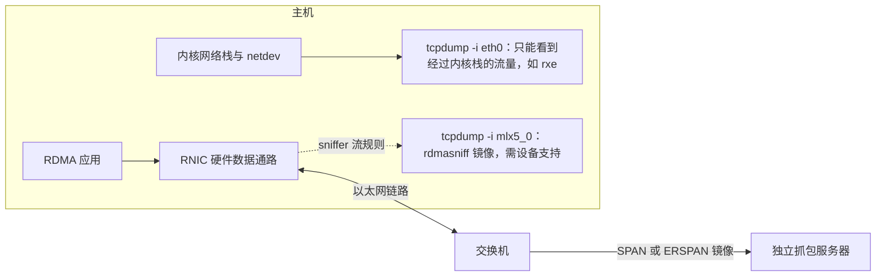

# 工具与测试（Tools and Testing）

> **摘要**：本文是 RoCEv2 日常使用的工具手册：设备与状态查询（ibv_devices、ibv_devinfo、ibstat、show_gids、iproute2 `rdma`、ethtool、sysfs），连通性与性能测试（ibv_*_pingpong、rping、perftest、qperf），抓包与解码（tcpdump、libpcap rdmasniff、端口镜像、Wireshark 显示过滤器），以及用 Scapy 构造 RoCEv2 报文（BTH 与 ICRC 自动计算，示例脚本已实际运行并用独立实现交叉验证 ICRC）。命令参数均已对照官方手册或源码核实，厂商工具单独标注。
>
> **规范出处**：Vol1 §A17.3（p.1931–1936，IP/UDP 字段规则与 ICRC，用于解读抓包）；Vol1 §A17.9.3（p.1947–1948，CNP 格式 Figure 349）；Vol1 §9.2–9.3（p.256–267，BTH 与扩展传输头）；Vol1 Table 46/47（p.348–349，AETH Syndrome 与 NAK 码）；Vol1 §A17.5.1（p.1940–1941，RoCEv2 端口上无效的端口属性）
>
> **前置阅读**：[BTH](../01-packet-format/03-bth.md)、[扩展传输头](../01-packet-format/04-extended-transport-headers.md)、[OpCode 全表](../01-packet-format/05-opcodes.md)、[ICRC](../01-packet-format/06-icrc.md)、[Linux RDMA 软件栈](01-linux-rdma-stack.md)
>
> **关键词**：ibv_devinfo, show_gids, rdma statistic, ethtool -S, ibv_rc_pingpong, rping, perftest, qperf, tcpdump, rdmasniff, ERSPAN, Wireshark display filter, Scapy, scapy.contrib.roce

---

## 1. 工具全景

| 工具 | 来源（包名依发行版而异） | 主要用途 | RoCE 下的注意事项 |
|---|---|---|---|
| `ibv_devices`、`ibv_devinfo` | rdma-core（libibverbs 工具包） | 列设备、查端口状态/MTU/能力/GID 表 | `-v` 打印 GID 及其类型 |
| `ibv_rc_pingpong` 等 | rdma-core（libibverbs 工具包） | 最小化 RC/UC/UD/SRQ 连通性测试 | 必须用 `-g` 指定 GID 索引 |
| `rping`、`ucmatose`、`udaddy`、`mckey` | rdma-core（librdmacm 工具包） | 基于 rdma_cm 的建链与收发测试 | 用 IP 地址寻址，自动选 GID |
| `ibstat`、`ibstatus` | infiniband-diags（已并入 rdma-core） | 端口状态速览 | LID、SM 等字段对 RoCEv2 无意义 |
| `rdma` | iproute2 | 设备/链路/资源/计数器/命名空间 | 上游通用，推荐优先使用 |
| `ethtool`、`dcb`、`lldptool` | ethtool、iproute2、open-lldp | 以太网计数器、DCB/PFC/ETS | 计数器名依驱动而异 |
| `show_gids`、`ibdev2netdev`、`mlnx_qos` | NVIDIA mlnx-tools / MLNX_OFED（厂商） | GID 表、设备映射、QoS 配置 | 厂商相关，以文档为准 |
| perftest（`ib_write_bw` 等） | linux-rdma/perftest | 带宽、包率、延迟微基准 | 两端参数必须一致 |
| qperf | linux-rdma/qperf | 带宽/延迟、含 TCP 对照 | RoCE 下通常配合 `-cm1` |
| tcpdump、Wireshark/tshark | 各发行版 | 抓包与协议解码 | 硬件卸载流量默认抓不到 |
| Scapy | secdev/scapy（`scapy.contrib.roce`） | 构造/解析 RoCEv2 报文 | 仅内置 BTH/AETH 等部分头 |

---

## 2. 设备与状态查询

### 2.1 ibv_devices 与 ibv_devinfo

```bash
ibv_devices                     # 列出设备名与 node GUID
ibv_devinfo -d mlx5_0           # 端口摘要
ibv_devinfo -d mlx5_0 -i 1 -v   # 详细能力 + GID 表
```

RoCE 端口的典型输出片段（示意，数值依设备而异）：

```text
hca_id: mlx5_0
        transport:                      InfiniBand (0)
        phys_port_cnt:                  1
                port:   1
                        state:                  PORT_ACTIVE (4)
                        max_mtu:                4096 (5)
                        active_mtu:             4096 (5)
                        sm_lid:                 0
                        port_lid:               0
                        port_lmc:               0x00
                        link_layer:             Ethernet
                        GID[  3]:               ::ffff:192.168.1.10, RoCE v2
```

| 字段 | 含义 | 关注点 |
|---|---|---|
| `transport` | 传输类型；RoCE 设备同样显示 InfiniBand，因为传输层就是 IB 传输层 | — |
| `link_layer` | `Ethernet` 即 RoCE | 若为 InfiniBand 则是原生 IB 端口 |
| `state` | `PORT_ACTIVE` 才能收发 | DOWN 时先查物理链路与 netdev |
| `active_mtu` | 当前可用的最大 IB 路径 MTU（1–5 对应 256–4096） | 由 netdev MTU 推导，见 [配置指南](02-configuration-guide.md) |
| `sm_lid`/`port_lid` | IB 子网管理概念 | RoCEv2 端口上 Base LID/LMC、SM 信息均无效〔Vol1 §A17.5.1, p.1940–1941〕 |
| `max_qp_rd_atom` 等（`-v`） | 单 QP 作为请求方/响应方可同时进行的 READ/ATOMIC 数 | 影响 RDMA READ 带宽，见 [性能调优](03-performance-tuning.md) |
| `GID[n]`（`-v`） | GID 值与类型（`RoCE v1`/`RoCE v2`） | 选择 RoCE v2 且 IP 正确的索引 |

### 2.2 ibstat（infiniband-diags）

```bash
ibstat mlx5_0 1
```

输出中 `Link layer: Ethernet`、`State: Active`、`Rate` 有参考价值；`Base lid`、`SM lid`、`Capability mask` 中与子网管理相关的位对 RoCEv2 端口无意义（规范规定这些属性在 RoCEv2 端口上被忽略〔Vol1 §A17.5.1, p.1940–1941〕）。infiniband-diags 中依赖 SM/SA 或 PerfMgt MAD 的工具（如 `ibnetdiscover`、`perfquery`）面向 IB 子网，RoCEv2 网络应使用以太网/IP 的管理手段〔Vol1 §A17.6, p.1942–1943〕。

### 2.3 厂商脚本：show_gids 与 ibdev2netdev（厂商相关）

NVIDIA mlnx-tools 中的 `show_gids` 遍历 sysfs 打印每个非空 GID 的索引、值、IPv4 形式、类型（v1/v2）与 netdev，输出示例见 [Linux RDMA 软件栈](01-linux-rdma-stack.md) 第 3.2 节；`ibdev2netdev` 打印 `mlx5_0 port 1 ==> eth0 (Up)` 形式的映射。没有安装这些脚本时，上游等价手段是 `rdma link show` 与 sysfs `gid_attrs`。

### 2.4 iproute2 `rdma`

```bash
rdma dev show                                   # 设备、固件版本、node GUID
rdma link show                                  # 端口状态、物理状态、关联 netdev
rdma -d link show mlx5_0/1                      # 详细信息
rdma resource show                              # 每设备资源汇总（pd/cq/qp/cm_id/mr/ctx）
rdma res show qp link mlx5_0/1                  # QP 列表：lqpn、type、state、sq-psn、pid、comm
rdma res show qp link mlx5_0/1 -dd              # 含驱动私有细节
rdma res show cm_id                             # rdma_cm 连接：源/目的地址与端口、状态
rdma statistic show link mlx5_0/1               # 端口默认计数器（同 sysfs hw_counters）
rdma statistic qp set link mlx5_0/1 auto type on        # 按 QP 类型自动绑定计数器
rdma statistic qp show link mlx5_0/1            # 每个计数器集合的统计
rdma statistic mode supported link mlx5_0/1     # 支持的可选计数器
rdma statistic set link mlx5_0/1 optional-counters cc_rx_ce_pkts,cc_rx_cnp_pkts
rdma -j -p statistic show                       # JSON 输出，便于监控采集
rdma monitor                                    # 监听 RDMA 设备/链路事件
```

以上语法均来自 iproute2 手册 rdma(8)、rdma-dev(8)、rdma-link(8)、rdma-resource(8)、rdma-statistic(8)。`rdma res show qp` 能直接看到 QP 是否已处于 `ERR` 状态，是排障的第一步之一；按 QP 绑定计数器则可以把重传、NAK 等计数精确到某个应用。

### 2.5 ethtool 与 sysfs

```bash
ethtool eth0                                    # 速率、双工、链路状态
ethtool -a eth0                                 # 全局 PAUSE 设置（使用 PFC 时应关闭）
ethtool -S eth0 | grep -E 'prio3_pause|pause_storm|discards_phy|crc_errors_phy|vport_rdma'
ethtool -m eth0                                 # 光模块诊断（DOM，模块支持时）
```

以 mlx5 为例的常用以太网计数器（名称依驱动而异）〔业界实践: Linux drivers/net/ethernet/mellanox/mlx5/core/en_stats.c〕：

| 计数器 | 含义 |
|---|---|
| `rx_prio3_pause` / `tx_prio3_pause` | 优先级 3 收到/发出的 PFC 帧数 |
| `rx_prio3_pause_duration` / `tx_prio3_pause_duration` | 优先级 3 处于暂停状态的累计时长 |
| `rx_prio3_pause_transition` | 优先级 3 暂停状态切换次数 |
| `tx_pause_storm_warning_events` / `tx_pause_storm_error_events` | 网卡侧 PFC 风暴检测的告警/错误事件 |
| `rx_discards_phy` / `tx_discards_phy` | 物理端口层面的丢弃（如接收缓冲不足） |
| `rx_crc_errors_phy` | FCS 错误帧数（物理层/线缆问题） |
| `rx_vport_rdma_unicast_packets`/`_bytes`，`tx_vport_rdma_unicast_*` | 经该 vport 收发的 RDMA 单播流量 |

RDMA 传输层计数器位于 `/sys/class/infiniband/<dev>/ports/<port>/hw_counters/`，通用端口计数器位于 `.../counters/`，二者的字典见 [排障指南](05-troubleshooting.md)。PCIe 链路状态用 `lspci -vvv` 查看，见 [性能调优](03-performance-tuning.md) 第 9 节。

---

## 3. 连通性测试

### 3.1 ibv_*_pingpong（原生 Verbs）

rdma-core 自带 `ibv_rc_pingpong`、`ibv_uc_pingpong`、`ibv_ud_pingpong`、`ibv_srq_pingpong`、`ibv_xsrq_pingpong`，两端先通过 TCP（默认端口 18515）交换 LID/QPN/PSN/GID，再进行 ping-pong〔外部: man ibv_rc_pingpong(1)〕：

```bash
# 服务端
ibv_rc_pingpong -d mlx5_0 -i 1 -g 3 -m 4096 -s 4096 -n 1000
# 客户端（最后一个参数是服务端主机名/IP，仅用于 TCP 带外交换）
ibv_rc_pingpong -d mlx5_0 -i 1 -g 3 -m 4096 -s 4096 -n 1000 192.168.1.10
```

| 参数 | 含义 | RoCE 注意 |
|---|---|---|
| `-g` | 本端 GID 索引 | **RoCE 必填**，不填时不带 GRH，无法建立 RoCE 连接 |
| `-m` | 路径 MTU（默认 1024） | 两端一致，且不超过 `active_mtu` |
| `-s` / `-n` | 消息大小（默认 4096）/ 次数（默认 1000） | — |
| `-l` | SL（默认 0） | 映射为以太网优先级 0–7〔Vol1 §A17.4.2, p.1938〕 |
| `-e` | 事件模式（默认轮询） | — |
| `-c` | 校验接收数据 | 便于发现数据通路错误 |
| `-p` | TCP 带外端口（默认 18515） | 主机防火墙需放行 |

输出中的 `local address: LID 0x0000, QPN 0x..., PSN 0x..., GID ...` 可用于和抓包中的 QPN/PSN 对照。

### 3.2 rping 与其他 rdma_cm 工具

```bash
rping -s -a 0.0.0.0 -v -C 10              # 服务端：绑定任意地址
rping -c -a 192.168.1.10 -v -C 10         # 客户端：连接服务端 IP，打印 10 次 ping 数据
rping -c -a 192.168.1.10 -V -S 4096 -C 100   # 校验数据、消息 4096 B
```

`-s/-c` 选择角色，`-a` 地址，`-p` 端口，`-C` 次数，`-S` 消息大小，`-v` 打印数据，`-V` 校验，`-d` 调试，`-P` 持久服务端〔外部: man rping(1)〕。rping 走 rdma_cm，能同时验证 IP 路由、ARP、GID 选择与 CM 建链；`ucmatose`（RC 建链）、`udaddy`（UD）、`mckey`（多播）可覆盖其他场景。

> [!TIP]
> 排查顺序建议：`ping`（IP 可达）→ `rping`（rdma_cm + RC 收发）→ `ibv_rc_pingpong -g`（指定 GID 的原生 Verbs）→ perftest（性能）。哪一步失败，问题就在哪一层，详见 [排障指南](05-troubleshooting.md)。

---

## 4. 性能测试

### 4.1 perftest

perftest 包含 `ib_send_bw/lat`、`ib_write_bw/lat`、`ib_read_bw/lat`、`ib_atomic_bw/lat` 等程序〔业界实践: perftest README〕。要点：**两端参数必须相同**；单向带宽由客户端测量；延迟测试测 RTT 后报告一半作为单向延迟；默认用 TCP 18515 交换参数，`-R` 时改由 rdma_cm 建链。

| 参数 | 含义 |
|---|---|
| `-d <dev>` / `-i <port>` | 设备与端口 |
| `-x <idx>` | GID 索引（RoCE 用） |
| `-s <size>` / `-a` | 消息大小 / 扫描 2 B 至 8 MB |
| `-n <iters>` / `-D <sec>` | 迭代次数 / 按时长测试 |
| `-q <num>` | QP 数 |
| `-c <RC/UC/UD/...>` | 连接类型（默认 RC） |
| `-m <mtu>` | QP 的 MTU（默认取 `active_mtu`） |
| `-R` | 用 rdma_cm 建链 |
| `-T <tos>` | rdma_cm QP 的 TOS（仅与 `-R` 一起用） |
| `--tclass=<value>` | GRH 的 Traffic Class（即 RoCEv2 的 DSCP/TOS） |
| `-S <sl>` | Service Level |
| `-u <timeout>` | QP 超时 = 4.096 µs × 2^timeout（默认 14） |
| `--retry_count=<n>` | rdma_cm 模式下的重试次数 |
| `-b` | 双向带宽 |
| `-t` / `-r` | 发送/接收队列深度 |
| `-l <n>` / `--recv_post_list=<n>` | 发送/接收 post list 长度 |
| `-I <size>` | inline 上限 |
| `-o <num>` | READ/ATOMIC 的 outstanding 数 |
| `-A <type>` | 原子类型 `CMP_AND_SWAP` 或 `FETCH_AND_ADD` |
| `-e` | 事件模式 |
| `-F` | CPU 频率未锁定时不告警 |
| `-H` / `-U` | 延迟测试输出全部样本 / 不排序 |
| `--report_gbits` | 带宽以 Gb/s 报告 |
| `--cpu_util` | 报告 CPU 占用（仅 Duration 模式） |
| `-W <list>` | 报告指定计数器的变化，如 `counters/port_xmit_data,hw_counters/out_of_buffer` |
| `--perform_warm_up` | 正式测量前预热（帮助文本注明仅对 ATOMIC、READ、WRITE 带宽测试有效） |
| `--use_cuda=<gpu>` / `--odp` | GPU 显存 / 按需分页 |
| `--rate_limit=<rate>` | 限速（默认单位 Gb/s） |

以上参数来自 perftest README 与 man perftest。常用组合（服务端运行不带 IP 的同一命令）：

```bash
# 带宽：4 QP、64 KB 消息、10 秒
ib_write_bw -d mlx5_0 -x 3 -s 65536 -q 4 -D 10 --report_gbits 192.168.1.10

# rdma_cm 建链并设置 TOS 106（DSCP 26）
ib_send_bw -d mlx5_0 -R -T 106 -s 65536 -D 10 --report_gbits 192.168.1.10

# 非 rdma_cm，直接指定 traffic class
ib_write_bw -d mlx5_0 -x 3 --tclass=106 -s 65536 -D 10 --report_gbits 192.168.1.10

# 读带宽：提高 outstanding
ib_read_bw -d mlx5_0 -x 3 -s 65536 -o 16 -D 10 --report_gbits 192.168.1.10

# 包率：小消息 + post list + 多 QP
ib_write_bw -d mlx5_0 -x 3 -s 64 -q 8 -l 32 -D 10 192.168.1.10

# 原子
ib_atomic_bw -d mlx5_0 -x 3 -A FETCH_AND_ADD -D 10 192.168.1.10

# 延迟：小消息，inline，10 万次
ib_write_lat -d mlx5_0 -x 3 -s 8 -I 64 -n 100000 192.168.1.10

# 带宽测试同时观察计数器
ib_write_bw -d mlx5_0 -x 3 -D 10 -W hw_counters/out_of_sequence,hw_counters/np_cnp_sent 192.168.1.10
```

> [!WARNING]
> `-o` 不能超过设备的 `max_qp_rd_atom`/`max_qp_init_rd_atom`（`ibv_devinfo -v` 可查）；`-x` 选错 GID 类型会导致建链后数据不通；两端 `-m`、`-c`、`-s`、`-q` 等任何一项不一致都可能让测试挂起或结果失真。

### 4.2 qperf

```bash
qperf                                                    # 服务端：不带参数运行
qperf -cm1 192.168.1.10 rc_rdma_write_bw rc_lat          # 客户端：-cm1 表示用 rdma_cm 建链
qperf -cm1 -m 65536 -t 10 192.168.1.10 rc_bw rc_rdma_read_bw
qperf 192.168.1.10 tcp_bw tcp_lat                        # 同一工具测 TCP，便于对照
```

`-cm1` 设置使用 CM，`-m` 消息大小，`-t` 测试时长，`-i` 指定 `设备:端口`〔业界实践: linux-rdma/qperf 源码与帮助文本〕。在 RoCE 上，经验做法是始终加 `-cm1`，由 rdma_cm 解决 GID 与地址解析。

---

## 5. 抓包与解码

### 5.1 能抓到什么

| 场景 | 在主机 netdev 上用 tcpdump | 可行方法 |
|---|---|---|
| Soft-RoCE（rxe） | **能**，报文经过内核网络栈 | `tcpdump -i eth0 udp port 4791` |
| 硬件 RNIC 卸载的流量 | **默认抓不到**：报文由网卡直接收发，不经过内核网络栈 | 见下列三种方法 |
| 硬件 RNIC：方法 1 | libpcap 的 rdmasniff 支持：在 RDMA 设备上创建 sniffer 类型的流规则（`IBV_FLOW_ATTR_SNIFFER`）接收镜像报文 | `tcpdump -i mlx5_0 -w x.pcap`（需 libpcap 编译了 RDMA 支持、设备与驱动支持 sniffer，以版本文档为准） |
| 硬件 RNIC：方法 2 | 厂商提供的卸载流量抓包功能或工具 | 厂商相关，以文档为准 |
| 硬件 RNIC：方法 3 | 交换机端口镜像（SPAN/ERSPAN）或 TAP 到抓包服务器 | ERSPAN 会额外加 GRE 封装；镜像在高负载下可能丢包 |

> [!NOTE]
> PFC 帧属于 MAC 控制帧，通常在网卡/交换机 MAC 层被消费，主机上一般抓不到，镜像口能否看到也依设备而异；观察 PFC 首选双方的计数器。



### 5.2 tcpdump / tshark 常用命令

```bash
tcpdump -i eth0 -nn -s 0 -w roce.pcap 'udp dst port 4791'
tcpdump -i eth0 --time-stamp-precision=nano -w roce.pcap 'udp port 4791'   # 纳秒时间戳（设备支持时）
tcpdump -i mlx5_0 -w roce.pcap                                             # rdmasniff（支持时）

# 用 tshark 提取关键字段，便于脚本分析
tshark -r roce.pcap -Y 'udp.dstport == 4791' -T fields \
  -e frame.time_relative -e ip.src -e ip.dst -e udp.srcport \
  -e infiniband.bth.opcode -e infiniband.bth.destqp -e infiniband.bth.psn \
  -e infiniband.bth.a -e infiniband.aeth.syndrome -e infiniband.aeth.msn
```

### 5.3 Wireshark 解码与显示过滤器

Wireshark 把 UDP 端口 4791 的报文交给 InfiniBand 解析器（端口可在 InfiniBand 协议首选项 "RRoce UDP Port" 中修改），协议列显示为 RRoCE，并逐层显示 BTH、RETH/AETH/DETH 等扩展头与 ICRC〔业界实践: Wireshark `epan/dissectors/packet-infiniband.c`〕。下表字段名均出自 Wireshark 显示过滤器参考（InfiniBand、MAC Control 两节）〔外部: Wireshark Display Filter Reference〕：

| 目的 | 显示过滤器 |
|---|---|
| 全部 RoCEv2 报文 | `udp.dstport == 4791` |
| 某个目的 QP | `infiniband.bth.destqp == 0x000123` |
| PSN 区间 | `infiniband.bth.psn >= 1000 && infiniband.bth.psn <= 1100` |
| 请求了 ACK 的报文 | `infiniband.bth.a == 1` |
| RC ACK/NAK（OpCode 0x11） | `infiniband.bth.opcode == 0x11` |
| 正 ACK（Syndrome 0x00–0x1F） | `infiniband.aeth.syndrome < 0x20` |
| RNR NAK（Syndrome 0x20–0x3F） | `infiniband.aeth.syndrome >= 0x20 && infiniband.aeth.syndrome < 0x40` |
| NAK（Syndrome 0x60–0x7F） | `infiniband.aeth.syndrome >= 0x60` |
| PSN 序列错误 NAK（码 0） | `infiniband.aeth.syndrome == 0x60` |
| CNP（OpCode 0x81） | `infiniband.bth.opcode == 0x81` |
| RDMA 请求的远端地址/R_Key/长度 | `infiniband.reth.va`、`infiniband.reth.r_key`、`infiniband.reth.dmalen` |
| UD 的源 QP | `infiniband.deth.srcqp` |
| ICRC 字段 | `infiniband.invariant.crc` |
| ECN CE 标记 | `ip.dsfield.ecn == 3`（IPv6：`ipv6.tclass.ecn == 3`） |
| DSCP | `ip.dsfield.dscp == 26`（IPv6：`ipv6.tclass.dscp == 26`） |
| VLAN 优先级（PCP） | `vlan.priority == 3` |
| PFC 帧及优先级 3 的暂停时间 | `macc.opcode == 0x0101`、`macc.cbfc.pause_time.c3` |
| CM 报文（发往 QP1 的 MAD） | `infiniband.bth.destqp == 1` |

AETH Syndrome 的编码依据规范 Table 46：bit 7 保留为 0，bits[6:5] = 00 为 ACK（低 5 位是信用）、01 为 RNR NAK（低 5 位是 RNR 定时器）、11 为 NAK（低 5 位是 NAK 码），10 保留〔Vol1 §9.7.5.2 Table 46, p.348〕；NAK 码 0–4 依次为 PSN Sequence Error、Invalid Request、Remote Access Error、Remote Operational Error、Invalid RD Request〔Vol1 §9.7.5.2.2 Table 47, p.349〕。CNP 的 OpCode 为 0b1000_0001（0x81）、PSN=0，其后跟 16 字节保留区〔Vol1 §A17.9.3 Figure 349, p.1948〕。基于这些字段的分析技巧（NAK、重传、RNR、ACK 延迟）见 [排障指南](05-troubleshooting.md)。

---

## 6. 用 Scapy 构造 RoCEv2 报文

### 6.1 scapy.contrib.roce 提供什么

Scapy 的 `scapy.contrib.roce` 模块提供 `BTH`、`AETH`、`GRH`（RoCE v1 用）、`CNPPadding` 等层以及 `opcode()`、`cnp()` 辅助函数，并把 UDP 目的端口 4791 绑定到 `BTH`；`BTH` 末尾带一个 ICRC 字段，构建报文时若未指定则按 RoCEv2 规则自动计算（前置 8 字节全 1、屏蔽 IP 可变字段与 UDP 校验和、BTH 第 4 字节置全 1），并按小端写入〔业界实践: secdev/scapy `scapy/contrib/roce.py`〕。它**没有**内置 RETH、DETH、AtomicETH、ImmDt 等扩展头，需要自行定义。

下面的脚本在 **Scapy 2.8.0** 上实际运行通过，并用一份独立的 ICRC 实现（按 CA17-22 规则编写）逐包交叉验证；该独立实现还用 Scapy 测试集中一个在 ConnectX-4 Lx 网卡上实际抓到的 CNP 报文核对过，计算结果与报文中的 ICRC（字节序列 `82 fd 00 2a`）一致〔业界实践: secdev/scapy `test/contrib/roce.uts`〕。其他 Scapy 版本请以实际运行结果为准。

### 6.2 示例脚本

```python
#!/usr/bin/env python3
# 用 scapy.contrib.roce 构造 RoCEv2 报文（已在 scapy 2.8.0 上验证）
import struct
import zlib

from scapy.all import Ether, IP, IPv6, UDP, Raw, Packet, bind_layers, wrpcap, raw
from scapy.fields import XLongField, XIntField, IntField
from scapy.contrib.roce import BTH, AETH, opcode, cnp


class RETH(Packet):
    """RDMA Extended Transport Header (16 B): VA(64) | R_Key(32) | DMA Length(32)"""
    name = "RETH"
    fields_desc = [XLongField("va", 0), XIntField("rkey", 0), IntField("dlen", 0)]


# scapy.contrib.roce 未内置 RETH，这里为 RDMA WRITE ONLY (0x0A) 绑定自定义 RETH
bind_layers(BTH, RETH, opcode=opcode("RC", "RDMA_WRITE_ONLY")[0])

SMAC, DMAC = "02:00:00:00:00:01", "02:00:00:00:00:02"
SIP, DIP = "192.168.1.1", "192.168.1.2"
SPORT = 0xC001          # RoCEv2: 源端口是流标识，同一 QP 应保持不变
DSCP, ECT0 = 26, 0b10   # TOS = DSCP<<2 | ECN


def l2l3(proto_ip=IP):
    if proto_ip is IP:
        ip = IP(src=SIP, dst=DIP, tos=(DSCP << 2) | ECT0, ttl=64, flags="DF")
    else:
        ip = IPv6(src="fd00::1", dst="fd00::2", tc=(DSCP << 2) | ECT0, hlim=64)
    return Ether(src=SMAC, dst=DMAC) / ip / UDP(sport=SPORT, dport=4791, chksum=0)


# 1) RC SEND ONLY，payload 5 字节 -> PadCnt=3 补齐到 4 字节边界
payload = b"hello"
pad = (-len(payload)) % 4
send_only = l2l3() / BTH(opcode=opcode("RC", "SEND_ONLY")[0], padcount=pad,
                         pkey=0xFFFF, dqpn=0x000123, ackreq=1, psn=100) \
    / Raw(payload + b"\x00" * pad)

# 2) RC RDMA WRITE ONLY + RETH
write_only = l2l3() / BTH(opcode=opcode("RC", "RDMA_WRITE_ONLY")[0],
                          dqpn=0x000123, ackreq=1, psn=101) \
    / RETH(va=0x7F0000001000, rkey=0x1234, dlen=8) / Raw(b"ABCDEFGH")

# 3) RC ACK：AETH syndrome=0x1F（ACK，信用无效），MSN=2
ack = l2l3() / BTH(opcode=opcode("RC", "ACKNOWLEDGE")[0], dqpn=0x000456, psn=101) \
    / AETH(syndrome=0x1F, msn=2)

# 4) RC NAK：syndrome=0x60（NAK，码 0 = PSN Sequence Error）
nak = l2l3() / BTH(opcode=opcode("RC", "ACKNOWLEDGE")[0], dqpn=0x000456, psn=100) \
    / AETH(syndrome=0x60, msn=1)

# 5) CNP（OpCode 0x81，16 字节保留区），通过 IPv6 发送
cnp_pkt = l2l3(IPv6) / cnp(dqpn=0x000456)

pkts = [send_only, write_only, ack, nak, cnp_pkt]


def my_icrc(frame: bytes) -> bytes:
    """独立实现 CA17-22：64bit 全 1 + IP 起始（屏蔽可变字段）... 结果按小端放入 ICRC 字段"""
    ip = bytearray(frame[14:-4])
    if ip[0] >> 4 == 4:
        ip[1] = 0xFF                      # TOS
        ip[8] = 0xFF                      # TTL
        ip[10:12] = b"\xff\xff"           # Header Checksum
        udp = 20
    else:
        ip[0] |= 0x0F                     # Traffic Class 高 4 位
        ip[1] = 0xFF                      # Traffic Class 低 4 位 + Flow Label 高 4 位
        ip[2:4] = b"\xff\xff"             # Flow Label 低 16 位
        ip[7] = 0xFF                      # Hop Limit
        udp = 40
    ip[udp + 6:udp + 8] = b"\xff\xff"     # UDP Checksum
    ip[udp + 8 + 4] = 0xFF                # BTH 第 4 字节（Resv8a / F,B,Resv6）
    crc = zlib.crc32(b"\xff" * 8 + bytes(ip)) & 0xFFFFFFFF
    return struct.pack("<I", crc)


for p in pkts:
    b = raw(p)
    ok = b[-4:] == my_icrc(b)
    print(f"{p[BTH].sprintf('%BTH.opcode%'):<22} len={len(b):3d} "
          f"ICRC={b[-4:].hex()} independent_check={'OK' if ok else 'MISMATCH'}")

wrpcap("rocev2_demo.pcap", pkts)
print("wrote rocev2_demo.pcap")
```

实际运行输出（帧长不含以太网 FCS）：

```text
RC_SEND_ONLY           len= 66 ICRC=a33cda04 independent_check=OK
RC_RDMA_WRITE_ONLY     len= 82 ICRC=7ab47e36 independent_check=OK
RC_ACKNOWLEDGE         len= 62 ICRC=df1afe36 independent_check=OK
RC_ACKNOWLEDGE         len= 62 ICRC=1fd2cba1 independent_check=OK
CNP                    len= 94 ICRC=51a52b07 independent_check=OK
wrote rocev2_demo.pcap
```

用 `rdpcap` 回读可确认长度字段：SEND ONLY 的 IPv4 Total Length = 52、UDP Length = 32（均包含 4 字节 ICRC，符合 CA17-6、CA17-21）；CNP 的 IPv6 Payload Length = 40，与其 UDP Length 相等（UDP 8 + BTH 12 + 保留 16 + ICRC 4），BTH 中 PSN = 0。

> [!NOTE]
> CA17-15 原文把 IPv6 Payload Length 描述为 "starting from the first byte after the IPv6 header (i.e. the BTH)"，括号中的 "BTH" 是规范笔误：IPv6 头之后紧跟的是 UDP 头。按 RFC 8200 的定义以及 Linux rxe 等实际实现，Payload Length 包含 UDP 头，即 UDP 头 + BTH + 扩展头 + 负载 + pad + ICRC，数值上等于 UDP Length〔Vol1 §A17.3.1.2.3, p.1934〕。Scapy 的计算结果与此一致。

### 6.3 使用注意

| 事项 | 说明 |
|---|---|
| DF 与 UDP 校验和 | Scapy 默认 IPv4 `flags=0`、自动计算 UDP 校验和；为符合 CA17-7（DF=1）与"UDP checksum 应置 0"〔Vol1 §A17.3.2.4, p.1935〕，应像示例一样显式设置 `flags="DF"`、`chksum=0` |
| `cnp()` 的 BECN 位 | `scapy.contrib.roce.cnp()` 会把 BTH 的 `becn` 置 1。上述 ConnectX-4 Lx 实抓 CNP 的 BTH 第 4 字节同样是 0x40（BECN=1），此外其 DSCP 为 48、ECN 为 10、UDP 源端口为 0（这些都是该网卡的实现选择，规范未规定）。规范规定 RoCEv2 端口不使用并**忽略** F/B 位（CA17-29），所以接收端实现绝不能依赖这两位；生成测试向量时可用 `BTH(opcode=0x81, dqpn=..., becn=0) / CNPPadding()` 与 `becn=1` 两种形式分别验证 |
| 指定错误的 ICRC | 给 `icrc` 字段赋值（如 `pkt[BTH].icrc = 0xDEADBEEF`）后不再自动计算，原值按大端写入，可用于负向测试：接收端应静默丢弃（CA17-24） |
| 发送到真实网卡 | `sendp(pkts, iface="eth0")` 需要 root；硬件 RNIC 会丢弃不属于任何已建立 QP 或 PSN 不在期望范围内的报文，这本身符合规范；构造报文更适合用来驱动自研硬件的仿真/硬件测试，或与已知 QPN/PSN 的 rxe 对测 |
| 生成仿真激励 | `raw(pkt).hex()` 得到十六进制字节流，可直接写入 testbench 的激励文件；`wrpcap()` 生成的 pcap 可用 Wireshark 检查解码 |

> [!TIP]
> 负向测试矩阵（ICRC 错、UDP 目的端口错、IHL≠5、IP 版本与 Ethertype 不符、DestQP=0、P_Key 不匹配、保留 OpCode 等）可全部用 Scapy 生成，期望行为对照 [合规清单](../08-reference/03-compliance-checklist.md) 与 [验证与互通测试](../06-hardware-implementation/06-verification-and-interop.md)。

---

## 7. 要点回顾

- `ibv_devinfo -v`、`rdma link/res/statistic`、sysfs 与 `ethtool -S` 是查看端口、GID、QP 状态与计数器的基本手段；`show_gids`、`mlnx_qos` 等是厂商脚本。
- RoCEv2 端口上 LID、LMC、SM 等 IB 子网管理属性无效〔§A17.5.1〕，依赖 SM/SA/PerfMgt 的 IB 诊断工具不适用。
- 原生 Verbs 工具（pingpong、perftest 非 `-R` 模式）必须指定 GID 索引；rdma_cm 工具（rping、perftest `-R`、qperf `-cm1`）按 IP 自动选 GID。
- perftest 两端参数必须一致；常用 `-x`、`-s`、`-q`、`-D`、`--report_gbits`、`-R -T`、`--tclass`、`-l`、`-o`、`-W`。
- 硬件卸载的 RoCE 流量在主机 netdev 上默认抓不到，可用 rdmasniff、厂商工具或交换机镜像；Soft-RoCE 流量可直接抓取。
- Wireshark 以 InfiniBand 解析器解码 UDP 4791，常用 `infiniband.bth.*`、`infiniband.aeth.syndrome`、`ip.dsfield.ecn`、`macc.opcode` 等过滤器。
- Scapy 的 `scapy.contrib.roce` 能自动计算 ICRC，但需自定义 RETH 等扩展头，并显式设置 DF 与 UDP 校验和 0。

## 自测

<details><summary>Q1：ibv_devinfo 对一块 RoCE 网卡显示 "transport: InfiniBand (0)"，是否说明配置错误？</summary>

答：不是。RoCE 使用的就是 IB 传输层，transport 显示 InfiniBand 是正常的；区分 RoCE 与原生 IB 要看 `link_layer`，RoCE 为 Ethernet。
</details>

<details><summary>Q2：在一台使用硬件 RNIC 的主机上执行 tcpdump -i eth0 udp port 4791，测试流量很大却一个包也抓不到，为什么？怎么办？</summary>

答：硬件 RNIC 直接在网卡内完成 RoCEv2 收发，报文不经过内核网络栈，netdev 上的普通抓包看不到。可以使用支持 rdmasniff 的 libpcap 在 RDMA 设备上抓包（设备与驱动支持时）、使用厂商提供的卸载流量抓包功能，或在交换机上做端口镜像/ERSPAN。
</details>

<details><summary>Q3：写出筛选"所有 NAK（不含 RNR NAK）"与"所有 CNP"的 Wireshark 显示过滤器。</summary>

答：NAK：`infiniband.aeth.syndrome >= 0x60`（Syndrome bits[6:5]=11）；CNP：`infiniband.bth.opcode == 0x81`。
</details>

<details><summary>Q4：用 Scapy 构造的 RoCEv2 报文需要手动处理哪些字段才能符合 Annex A17？</summary>

答：IPv4 需显式设置 `flags="DF"`（CA17-7）；UDP 校验和应置 0（§A17.3.2.4）；UDP 目的端口为 4791；TOS/Traffic Class 按 DSCP 与 ECN 规则设置；scapy 未内置的扩展头（RETH 等）需自定义；ICRC 由 BTH 层自动计算，若手工赋值则不再计算。
</details>

<details><summary>Q5：perftest 的 -T 与 --tclass 有什么区别？</summary>

答：`-T` 设置 rdma_cm QP 的 TOS，只能与 `-R`（rdma_cm 建链）一起使用；`--tclass` 直接设置 GRH 的 Traffic Class，用于非 rdma_cm 的原生 Verbs 建链。二者最终都决定 RoCEv2 报文 IP 头的 DSCP。
</details>

## 参考

- 规范：Vol1 §9.2–9.3（p.256–267）、Table 46/47（p.348–349）、§A17.3（p.1931–1936）、§A17.5.1（p.1940–1941）、§A17.6（p.1942–1943）、§A17.9.3 与 Figure 349（p.1947–1948）
- 外部：rdma-core 手册 ibv_devinfo(1)、ibv_rc_pingpong(1)、rping(1)（https://github.com/linux-rdma/rdma-core）
- 外部：iproute2 手册 rdma(8)、rdma-dev(8)、rdma-link(8)、rdma-resource(8)、rdma-statistic(8)
- 业界实践：perftest README 与 man perftest（https://github.com/linux-rdma/perftest）；qperf（https://github.com/linux-rdma/qperf）
- 业界实践：libpcap `pcap-rdmasniff.c`（https://github.com/the-tcpdump-group/libpcap）
- 外部：Wireshark Display Filter Reference：InfiniBand（https://www.wireshark.org/docs/dfref/i/infiniband.html）、MAC Control（https://www.wireshark.org/docs/dfref/m/macc.html）
- 业界实践：Wireshark 源码 `epan/dissectors/packet-infiniband.c`（RRoCE 解码与 UDP 4791 端口首选项，https://gitlab.com/wireshark/wireshark）
- 业界实践：Scapy `scapy/contrib/roce.py` 与测试集 `test/contrib/roce.uts`（含 ConnectX-4 Lx 实抓 CNP，https://github.com/secdev/scapy）
- 业界实践：Linux mlx5 以太网计数器 `drivers/net/ethernet/mellanox/mlx5/core/en_stats.c`；NVIDIA mlnx-tools（show_gids、ibdev2netdev，厂商相关）
