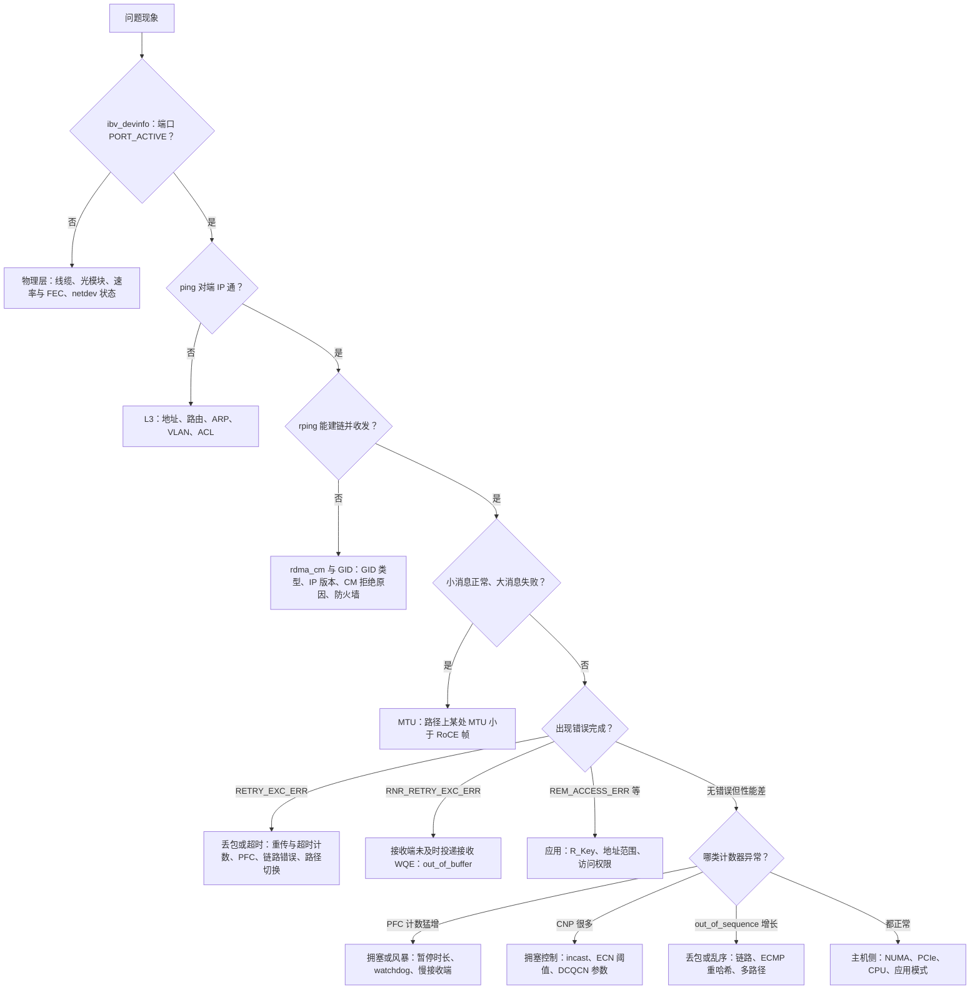
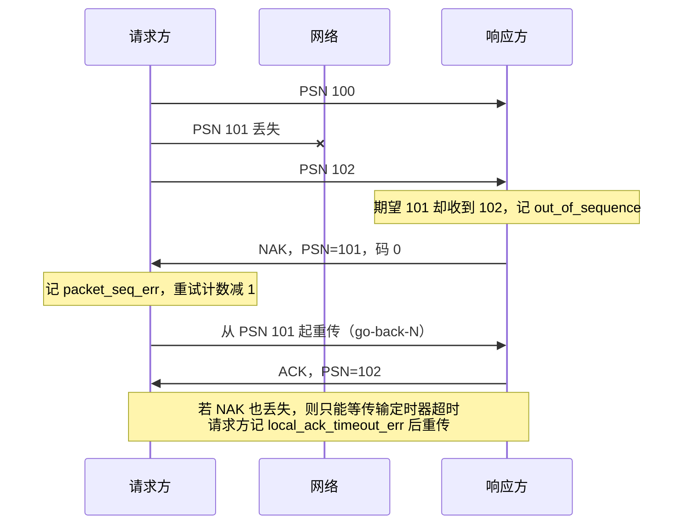
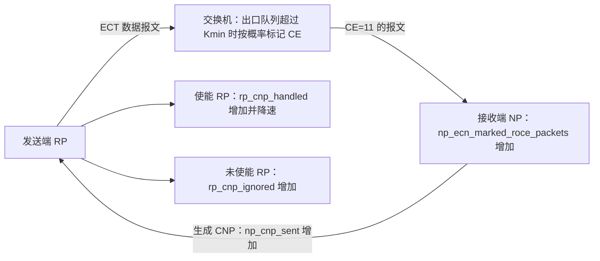

# 排障指南与计数器字典（Troubleshooting Guide and Counter Dictionary）

> **摘要**：本文给出 RoCEv2 的分层排障方法论（物理/链路 → L2/PFC → L3/IP → UDP/RoCE 封装 → 传输层 → 应用）与决策流程图、"症状 → 可能原因 → 检查方法 → 解决办法"大表、几类典型问题的机制分析、把 Linux（mlx5、rxe）计数器映射回规范概念的计数器字典，以及基于抓包识别 NAK、重传、RNR 并测量 ACK 延迟的方法与一个经过验证的离线分析脚本。计数器名依驱动与固件而异，本文所列名称均已对照上游内核源码核实。
>
> **规范出处**：Vol1 §9.6–9.6.1（p.292–303，入站报文头校验与静默丢弃，Figure 83）；§9.7.5.2（p.348–355，AETH Syndrome、NAK 码、RNR NAK 与定时器 Table 46/47/48）；§9.7.6.1.2–9.7.6.1.3（p.360–365，NAK 响应、传输定时器与重试计数 C9-137、C9-140～C9-143）；§9.9.2–9.9.3（p.424–438，请求方与响应方错误行为 Table 59/60/61）；§11.6.2（p.687–690，完成状态）；§A17.3.4（p.1936，CA17-24）；§A17.8（p.1945–1946，CA17-41）；§A17.9（p.1946–1949）
>
> **前置阅读**：[PSN 与 ACK/NAK](../02-transport/05-psn-and-ack-nak.md)、[请求方行为](../02-transport/06-requester.md)、[响应方行为](../02-transport/07-responder.md)、[错误处理](../02-transport/08-error-handling.md)、[工具与测试](04-tools-and-testing.md)
>
> **关键词**：IBV_WC_RETRY_EXC_ERR, IBV_WC_RNR_RETRY_EXC_ERR, NAK, PSN sequence error, go-back-N, out_of_sequence, hw_counters, PFC storm, deadlock, CNP, ICRC, MTU, tshark

---

## 1. 分层排障方法论

### 1.1 自下而上逐层确认

| 层 | 检查什么 | 主要工具 | 典型问题 |
|---|---|---|---|
| 物理/链路 | 链路 up、速率/FEC 协商、FCS 错误、光功率 | `ethtool`、`ethtool -S`、`ethtool -m`、交换机端口统计 | 线缆/光模块劣化导致零星丢包 |
| L2 / PFC / QoS | trust 模式、DSCP→优先级、PFC 优先级集合、全局 PAUSE、L2 MTU、VLAN | `dcb`、`mlnx_qos`（厂商）、`ethtool -a`、交换机 QoS 配置 | 两端 PFC 不一致，拥塞时丢包 |
| L3 / IP | IP 可达、ARP/ND、路由、ACL、L3 MTU | `ping`、`ping -M do -s`、`ip neigh`、`ip route get` | 路径 MTU 偏小、ACL 拦截 UDP 4791 |
| UDP / RoCE 封装 | GID 类型与 IP 版本、DSCP/ECN、UDP 源端口、ICRC | `show_gids`/sysfs、抓包、`rx_icrc_encapsulated` | v1/v2 混用、中间设备改写字段 |
| 传输层 | QP 状态、PSN、重传/超时/NAK/RNR | `rdma res show qp`、`hw_counters`、抓包 | 丢包引起重试超限、RNR |
| 应用 | 完成状态、R_Key/地址、接收缓冲投递、CQ 大小 | 应用日志、`ibv_wc_status_str()` | 访问错误、RQ 饿死、CQ 溢出 |

> [!TIP]
> 规范要求 RoCEv2 端口对不合规的报文**静默丢弃**：IP/UDP/ICRC 规则不符（CA17-24）、IP 版本不符（CA17-27）、DestQP=0（CA17-33）、GID 类型与报文协议不匹配导致 DGID 检查失败（CA17-41），以及基础规范中目的 QP 不存在或状态不对（C9-39）、P_Key 不匹配（C9-43）等头部校验失败〔Vol1 §9.6 Figure 83, p.294〕。静默丢弃时响应方不回任何 ACK/NAK，请求方只会看到超时——所以"超时/重试超限"是许多不同根因的共同表象，必须结合计数器与抓包区分。

### 1.2 决策流程



### 1.3 第一现场信息收集

```bash
#!/bin/bash
# roce_snapshot.sh <rdma_dev> <port> <netdev>：采集一次 RoCE 现场快照
DEV=${1:-mlx5_0}; PORT=${2:-1}; NDEV=${3:-eth0}
P=/sys/class/infiniband/$DEV/ports/$PORT
echo "== 版本";   uname -r; ethtool -i "$NDEV"; ibv_devinfo -d "$DEV" | grep -E 'fw_ver|state|mtu|link_layer'
echo "== 链路";   rdma link show "$DEV/$PORT"; ip -d link show "$NDEV"; ip addr show "$NDEV"
echo "== GID";    grep -H . "$P"/gid_attrs/types/* 2>/dev/null
echo "== QoS";    dcb pfc show dev "$NDEV" 2>/dev/null; dcb app show dev "$NDEV" 2>/dev/null; ethtool -a "$NDEV"
echo "== QP";     rdma res show qp link "$DEV/$PORT"
echo "== 计数器"; grep -H . "$P"/hw_counters/* 2>/dev/null
echo "== 以太网"; ethtool -S "$NDEV" | grep -E 'pause|discard|crc|err' | grep -v ': 0$'
echo "== 日志";   dmesg | grep -iE 'mlx5|rdma|infiniband|rxe' | tail -n 50
```

计数器的**变化率**比绝对值更有意义。持续观察时可每秒打印非零增量：

```bash
#!/bin/bash
# counter_delta.sh <rdma_dev> <port>：每秒打印 hw_counters 中发生变化的项
D=/sys/class/infiniband/${1:-mlx5_0}/ports/${2:-1}/hw_counters
declare -A prev
while true; do
    for f in "$D"/*; do
        n=$(basename "$f"); [ "$n" = lifespan ] && continue
        v=$(cat "$f"); d=$(( v - ${prev[$n]:-$v} )); prev[$n]=$v
        [ "$d" -ne 0 ] && printf '%-34s %+d\n' "$n" "$d"
    done
    echo "---- $(date +%T)"; sleep 1
done
```

---

## 2. 症状 → 原因 → 检查 → 解决

| 症状 | 可能原因 | 检查方法 | 解决办法 |
|---|---|---|---|
| **连接建立失败**（rdma_cm 报 ADDR_ERROR/ROUTE_ERROR/UNREACHABLE/REJECTED；pingpong 报 modify QP 到 RTR 失败） | 选不到合适的 GID（类型/IP 不符）；IP 不可达或 ARP 失败；对端无监听（REJECTED）；网络 ACL/安全组（Soft-RoCE 时还有主机防火墙）拦截 UDP 4791——CM 报文本身就是发往 QP1 的 RoCEv2 报文〔Vol1 §A17.6.1, p.1943〕，被拦截时 rdma_cm 超时报 UNREACHABLE；perftest/pingpong 的 TCP 带外端口（默认 18515）被防火墙拦截 | `show_gids`/sysfs；`ping`、`ip neigh`；`rdma res show cm_id`；对端抓包看 CM 报文是否到达；防火墙/ACL 规则 | 选对 GID 或配置 `default_roce_mode`；修复路由/邻居；放行 UDP 4791 与带外端口 |
| **建链成功但数据不通**，最终 `IBV_WC_RETRY_EXC_ERR`（12） | 两端 GID 类型或 IP 版本不一致，接收端 DGID 检查失败而静默丢弃（CA17-41）；中间设备/安全组丢弃 UDP 4791 | 对端抓包看是否收到；请求方 `local_ack_timeout_err` 增长而对端无任何 RoCE 计数增长 | 两端统一 RoCE v2 与 IP 版本；放行 UDP 4791 |
| **小消息正常、大消息失败** | 路径上某处 MTU 小于 RoCE 帧（交换机接口、隧道/overlay 封装开销）；IPv4 置 DF（CA17-7），无法分片 | `ping -M do -s <size>`；交换机接口 MTU；两端 `active_mtu` 与 QP `path_mtu` | 全路径 MTU 统一（如 9216），或降低 QP 的 `path_mtu` |
| **单流带宽低** | `active_mtu` 只有 1024/2048；PCIe 降速/降宽；跨 NUMA；CPU 降频；单 QP 的 READ 在途数不足 | `ibv_devinfo`；`lspci -vvv` 的 `LnkSta`；`numactl -H`；perftest 参数 | 见 [性能调优](03-performance-tuning.md) |
| **多机并发时带宽低** | ECMP 哈希冲突；PFC 暂停频繁；CNP 过多；交换机缓冲不足 | 交换机上行链路利用率；`rx/tx_prioN_pause`；`np_cnp_sent`/`rp_cnp_handled` | 增加 QP 数/调哈希；调 ECN 阈值与 DCQCN；检查缓冲配置 |
| **偶发 `IBV_WC_RETRY_EXC_ERR`** | 丢包：线路 FCS 错误、无损配置不一致导致拥塞丢包、交换机缓冲溢出；链路抖动或路由收敛期间丢包；ACK/NAK 本身丢失；Local ACK Timeout 设置过小而网络 RTT 偶发拉长 | 请求方 `local_ack_timeout_err`、`packet_seq_err`、`req_transport_retries_exceeded`；`rx_crc_errors_phy`；交换机丢包计数与链路日志 | 先消除丢包源；适当增大 `timeout`（如 18～20）并保持 `retry_cnt = 7`；见第 3.1 节 |
| **`IBV_WC_RNR_RETRY_EXC_ERR`（13）** | 接收端没有及时 `post_recv`/SRQ 耗尽；`rnr_retry` 太小；`min_rnr_timer` 太小 | 请求方 `rnr_nak_retry_err`、`req_rnr_retries_exceeded`；响应方 `out_of_buffer`；抓包 Syndrome 0x20–0x3F | 加深 RQ/SRQ 并批量补充；合理设置 `rnr_retry` 与 `min_rnr_timer`，见第 3.2 节 |
| **`IBV_WC_REM_ACCESS_ERR`（10）** | R_Key 错误、地址越界、MR 未授予远端访问权限、MR 已注销 | 抓包 NAK 码 2；响应方 `resp_remote_access_errors` | 核对 rkey/va/len 与 `IBV_ACCESS_REMOTE_*` 标志及 MR 生命周期 |
| **`IBV_WC_REM_INV_REQ_ERR`（9）** | 对端 QP 不支持该操作（如 QP 未开启远端读/原子权限）；SEND 消息超出对端接收缓冲；RDMA WRITE 实际负载与 RETH 的 DMA Length 不符；消息超过端口支持的最大长度〔Vol1 §9.9.3 Table 61, p.436–438〕 | 抓包 NAK 码 1；响应方 `resp_local_length_error` | 核对 QP 访问标志、接收缓冲大小与消息长度 |
| **大量 `IBV_WC_WR_FLUSH_ERR`（5）** | QP 已进入 Error 状态，后续 WR 被冲刷——这是**结果而非原因** | 找到第一个非 flush 的错误完成；`rdma res show qp` 看状态 | 解决首个错误后重建或复位 QP |
| **PFC 风暴** | 某端持续发送 PAUSE：接收流水线停滞、驱动/固件异常、慢接收端；PFC 死锁 | `tx_prioN_pause` 与 `tx_prioN_pause_duration` 持续猛增；`tx_pause_storm_*`；交换机 pfcwd 触发记录 | 沿拓扑找到源头端口并隔离；启用双端 watchdog；修复主机；排查死锁，见第 3.3 节 |
| **CNP 过多、带宽骤降** | 多打一 incast；ECN 阈值过低；DCQCN 降速过猛/提速过慢；ECN 标记配置在错误队列 | 接收端 `np_ecn_marked_roce_packets`、`np_cnp_sent`；发送端 `rp_cnp_handled`；交换机 ECN 标记计数 | 调整 Kmin/Kmax/Pmax 与 DCQCN 参数；降低扇入；CNP 走高优先级，见第 3.4 节 |
| **ICRC 错误** | 中间设备改写了 ICRC 覆盖的不变字段（NAT 改 IP、负载均衡改 UDP 源端口）；设备内部数据损坏而 FCS 被重算；自研实现的 ICRC 屏蔽字段或字节序错误 | `rx_icrc_encapsulated` 增长；抓包后离线重算 ICRC（见 [工具与测试](04-tools-and-testing.md)） | 不对 RoCE 流量做 NAT/端口改写；修复实现，见第 3.5 节 |
| **乱序：`out_of_sequence` 增长** | 最常见的是丢包（缺失 PSN 使后续包被判乱序）；其次是多路径（包级喷洒、自适应路由、ECMP 重哈希、链路切换） | 响应方 `out_of_sequence`、请求方 `packet_seq_err`、响应方 `duplicate_request`；交换机丢包计数 | 消除丢包；同一 QP 使用固定 UDP 源端口〔§A17.3.2.1〕；使用多路径技术时需网卡支持乱序容忍，见第 3.6 节 |
| **`rp_cnp_ignored` 增长** | 发送端收到 CNP 但未对该优先级使能 RP（拥塞控制） | 发送端 RP 配置 | 使能 RP，或核对 CNP/数据的优先级配置 |
| **CQ 溢出 / QP 被置错** | CQ 深度小于可能积压的 CQE 数 | 异步事件 `IBV_EVENT_CQ_ERR`/`IBV_EVENT_QP_FATAL` | 增大 CQ、加快轮询 |
| **`ibv_reg_mr` 返回 ENOMEM** | 锁页内存上限（RLIMIT_MEMLOCK）不足 | `ulimit -l` | 提高 memlock 限制，见 [配置指南](02-configuration-guide.md) |

### 2.1 完成状态与规范的对应

| `ibv_wc_status`（值） | 规范完成状态〔Vol1 §11.6.2, p.687–690〕 | 典型触发 | 请求方错误类别〔Vol1 §9.9.2.3 Table 59/60, p.428–430〕 |
|---|---|---|---|
| `IBV_WC_RETRY_EXC_ERR`（12） | Transport Retry Counter Exceeded | 超时或 NAK-PSN 序列错误导致的重试次数耗尽 | RC：Class B |
| `IBV_WC_RNR_RETRY_EXC_ERR`（13） | RNR Retry Counter Exceeded | RNR NAK 重试次数耗尽 | Class B |
| `IBV_WC_REM_INV_REQ_ERR`（9） | Remote Invalid Request Error | NAK 码 1（Invalid Request） | Class B |
| `IBV_WC_REM_ACCESS_ERR`（10） | Remote Access Error | NAK 码 2（如 R_Key 违规） | Class B |
| `IBV_WC_REM_OP_ERR`（11） | Remote Operation Error | NAK 码 3（响应方本地错误） | Class B |
| `IBV_WC_BAD_RESP_ERR`（7） | Bad Response Error | 期望 PSN 上收到意外的响应 OpCode | Class B |
| `IBV_WC_LOC_LEN_ERR`（1） | Local Length Error | 发送总长超过端口消息上限，或接收缓冲不足以容纳到达的消息 | — |
| `IBV_WC_LOC_PROT_ERR`（4） | Local Protection Error | 本地 SGE 引用的 MR 无效或权限不足 | — |
| `IBV_WC_LOC_QP_OP_ERR`（2） | Local QP Operation Error | 本地 QP 内部一致性错误 | — |
| `IBV_WC_WR_FLUSH_ERR`（5） | Work Request Flushed Error | QP 进入 Error 状态时尚未完成的 WR | — |

Class B 的行为是：当前 WQE 以错误完成，SQ 转入错误状态，其后的 WQE 全部 flush（C9-214，Table 60）。数值取自 rdma-core `enum ibv_wc_status` 的定义顺序，可用 `ibv_wc_status_str()` 得到可读字符串。

---

## 3. 典型问题的机制分析

### 3.1 `IBV_WC_RETRY_EXC_ERR`：超时与重试计数

规范要点：

- 传输定时器间隔 **Ttr = 4.096 µs × 2^(Local ACK Timeout)**，Local ACK Timeout 为 5 bit，0 表示禁用定时器（C9-140）；超时应在 Ttr 到 4·Ttr 之间被检测到（C9-141）〔Vol1 §9.7.6.1.3, p.364〕。
- 请求方维护 **3 bit 重试计数器**：每次传输定时器超时（C9-142）或收到 NAK-PSN 序列错误（C9-137）都减 1，请求被确认后重新装载；计数减到 0 后再次超时，即宣告本地检测到的错误（C9-143）〔Vol1 §9.7.6.1.2–9.7.6.1.3, p.360–365〕，完成状态为 Transport Retry Counter Exceeded。
- 超时与 PSN 序列错误共用一个重试计数器，RNR NAK 使用另一个（C9-212）〔Vol1 §9.9.2.4.1, p.431〕。

因此，从首次发送到报错，最多经历 `retry_cnt + 1` 次超时等待，每次等待介于 Ttr 与 4·Ttr 之间：

| `timeout` | Ttr | `retry_cnt = 7` 时报错前的大致时长 |
|---|---|---|
| 14（perftest 默认 `-u`） | ≈ 67.1 ms | ≈ 0.5 s 起 |
| 17 | ≈ 537 ms | ≈ 4.3 s 起 |
| 18 | ≈ 1.07 s | ≈ 8.6 s 起 |
| 20（NCCL 2.23 起的默认 `NCCL_IB_TIMEOUT`） | ≈ 4.29 s | ≈ 34 s 起 |

（下限按每次等待 Ttr、共 8 次计算——C9-143 规定计数减到 0 后再次超时才报错；NCCL 文档按 7 次粗略估算，如 timeout=20 时约 30 s。实现可在 4·Ttr 内检测，实际时长可能更长。）



排查要点：

1. **区分"有 NAK"与"什么都没回来"**：`packet_seq_err` 增长说明报文到达了响应方但有缺口（丢包在途中）；只有 `local_ack_timeout_err` 增长而对端毫无反应，说明报文根本没被接受（GID/IP 版本不匹配、ICRC 错、ACL、MTU 等"静默丢弃"类原因），或 ACK/NAK 在返回路径丢失。
2. **找丢包点**：沿路径查看交换机各队列丢包、端口 FCS 错误、网卡 `rx_discards_phy`；拥塞丢包通常意味着无损配置有缺口（PFC 未开在 RoCE 优先级、映射不一致）。
3. **超时设置**：Meta 指出 ACK/NAK 丢失会造成毫秒级的 Local ACK Timeout 等待，因此需要快速发现并隔离不健康的网元，并谨慎调节超时时长〔论文: Gangidi et al., SIGCOMM 2024〕。`timeout` 太小会在拥塞或路径切换时误判；太大则让真实故障的恢复变慢。

### 3.2 RNR：接收端没准备好

- 响应方在 RQ 没有可用接收 WQE 等情况下回 RNR NAK，AETH 的低 5 位是 RNR 定时器编码（Table 48：00001 = 0.01 ms … 11111 = 491.52 ms，00000 = 655.36 ms）；请求方至少等待该时长后，从同一 PSN 起重发同一请求（C9-128～C9-130）〔Vol1 §9.7.5.2.8, p.352–355〕。
- 请求方的 RNR 重试计数器为 3 bit，**取值 7 表示无限重试**（C9-132）；耗尽后完成状态为 RNR Retry Counter Exceeded。
- 相关计数器：请求方 `rnr_nak_retry_err`（收到的 RNR NAK 数，未超限）与 `req_rnr_retries_exceeded`；响应方 `out_of_buffer`（因无接收 WQE 而丢弃的次数）。rxe 对应 `rcvd_rnr_err`、`send_rnr_err`、`retry_rnr_exceeded_err`。

> [!WARNING]
> `rnr_retry = 7` 可以避免 RNR 报错，但接收端若长期不投递接收 WQE，请求方会无限期地重试，把问题从"显式报错"变成"悄无声息地卡住"。根本解决办法是保证接收 WQE 充足（批量补充、SRQ、SRQ Limit 事件）。

### 3.3 PFC 风暴与 PFC 死锁

- **风暴**：一块故障网卡的接收流水线停止工作后持续发出 PAUSE，ToR 随之暂停其他端口与上行端口，暂停逐级扩散到 Leaf、Spine，单个故障网卡可能阻塞整个网络。微软的对策是在 NIC 与 ToR 两侧都部署 watchdog（NIC 侧：接收流水线停滞一段时间（默认 100 ms）且仍在发 PAUSE 时禁止其发 PAUSE；ToR 侧：面向服务器的出口队列无法排空且持续收到 PAUSE 时，对该端口关闭无损模式并丢弃进出该网卡的无损报文）〔论文: Guo et al., SIGCOMM 2016〕。
- **定位源头**：沿拓扑追踪"发出 PAUSE 很多、但自己收到的 PAUSE 很少"的端口——它就是暂停的起点。`tx_prioN_pause_duration` 接近观测时长、`tx_pause_storm_*` 事件、交换机 pfcwd 统计都是直接证据。
- **死锁**：PFC 在环形缓冲依赖下会死锁。微软遇到的实例并非来自路由环路：ToR 的 ARP 表与 MAC 表老化时间不同，产生"ARP 有、MAC 表无"的不完整表项，交换机把无损报文泛洪到所有端口，破坏了 Clos 的 up-down 路由并形成循环依赖；他们选择的修复是**丢弃 ARP 表项不完整的无损报文**〔论文: Guo et al., SIGCOMM 2016〕。原理详见 [无损以太网与 PFC](../05-congestion-control-and-qos/01-lossless-ethernet-pfc.md)。

### 3.4 CNP 过多导致带宽骤降



- 规范允许 NP 对同一 QP 的多个 CE 报文只回一个 CNP（CA17-44），因此 `np_cnp_sent` 通常小于 `np_ecn_marked_roce_packets`；NP 两次 CNP 的最小间隔是可配置参数（如 mlx5 的 `np_min_time_between_cnps`）。
- 规范只要求 RP 收到 CNP 后降速（CA17-45）、并在一段时间/字节后提速（CA17-46），降速幅度、提速节奏都是实现参数〔Vol1 §A17.9.3, p.1947–1948〕；DCQCN 的参数含义见 [DCQCN](../05-congestion-control-and-qos/04-dcqcn.md)。
- 排查顺序：先确认拥塞点（交换机 ECN 标记计数、队列水位）与流量模式（incast 扇入度）→ 再看 ECN 阈值是否过低 → 最后才调 RP 参数。CNP 自身若排在拥塞队列中，反馈会被延迟，应映射到高优先级队列。

### 3.5 ICRC 错误

- ICRC 覆盖从 IP 头到负载的全部不变字段；计算时 IPv4 的 TTL、Header Checksum、TOS，IPv6 的 Traffic Class、Flow Label、Hop Limit 以及 UDP Checksum 被替换为全 1（CA17-22）〔Vol1 §A17.3.3, p.1935–1936〕。因此路由器修改 TTL、重标记 DSCP/ECN **不会**破坏 ICRC，而 NAT 改写 IP 地址、负载均衡器改写 UDP 源端口（不在屏蔽范围内）**会**。
- 不合规的 ICRC 报文被静默丢弃（CA17-24），请求方表现为超时；mlx5 的 `rx_icrc_encapsulated` 统计收到的 ICRC 错误报文。
- 自研实现最常见的错误：漏掉前置 64 bit 全 1、屏蔽字段遗漏（如 BTH 第 4 字节）、ICRC 写入字节序与对端不一致。用 Scapy/rxe 生成的报文逐字节比对即可定位，算法与参考实现见 [ICRC](../01-packet-format/06-icrc.md)。

### 3.6 乱序与重传

- 响应方收到 PSN 大于期望值的报文即为 PSN 序列错误：响应方在 NAK 的 BTH 中填入**自己期望的 PSN**（C9-121），请求方据此回退重传〔Vol1 §9.7.5.2.3, p.350〕；响应方任一时刻至多有一个未解决的 NAK〔Vol1 §9.7.6.1.3, p.362〕，NAK 丢失只能靠超时恢复。
- 计数器链条：响应方 `out_of_sequence` ↑ → 请求方 `packet_seq_err` ↑ → 请求方 go-back-N 重传；若请求方从更早的 PSN 开始重传，或 ACK 丢失后超时重传，响应方 `duplicate_request` ↑。
- 规范建议同一连接 QP 的报文使用固定 UDP 源端口，使 ECMP 不会把它们分到不同路径〔Vol1 §A17.3.2.1, p.1934〕。启用包级喷洒或自适应路由时，必须确认网卡能容忍乱序，否则每次乱序都会触发 NAK 与回退重传。
- 微软报告过早期网卡采用 go-back-0（从消息第一个包重传）导致 0.4% 丢包率下应用吞吐为零的"活锁"，改为 go-back-N 后解决〔论文: Guo et al., SIGCOMM 2016〕；更高效的选择性重传等方案见 [有损 RoCE 与高级拥塞控制](../05-congestion-control-and-qos/05-advanced-cc-and-lossy-roce.md)。

---

## 4. 计数器字典

### 4.1 位置与读取方式

| 位置 | 内容 |
|---|---|
| `/sys/class/infiniband/<dev>/ports/<port>/hw_counters/` | 驱动提供的硬件计数器（下表）；同目录 `lifespan` 控制刷新间隔（毫秒，默认 10）〔外部: Linux ABI sysfs-class-infiniband〕 |
| `/sys/class/infiniband/<dev>/hw_counters/` | 设备级计数器（若驱动提供） |
| `/sys/class/infiniband/<dev>/ports/<port>/counters/` | IB PortCounters 语义的通用计数器（如 `port_xmit_data`、`port_rcv_data`，单位为 4 字节） |
| `rdma statistic show link <dev>/<port>` | 与 hw_counters 相同的默认计数器 |
| `rdma statistic qp ...` | 按 QP（或 QP 组）绑定的计数器，可精确到某个应用 |
| `ethtool -S <netdev>` | 以太网/MAC/PFC 计数器（名称依驱动而异） |

> [!NOTE]
> 计数器名依驱动而异，同一驱动的计数器是否出现还取决于固件能力。例如上游 mlx5 只有在设备报告相应能力时才提供 `out_of_sequence`、`rx_icrc_encapsulated` 与拥塞类计数器〔业界实践: Linux drivers/infiniband/hw/mlx5/counters.c〕。

### 4.2 mlx5 `hw_counters`（名称取自上游内核源码，含义依 NVIDIA 文档意译）

| 计数器 | 所在侧 | 含义 | 对应规范概念 | 详见 |
|---|---|---|---|---|
| `rx_write_requests` / `rx_read_requests` / `rx_atomic_requests` | 响应方 | 收到的 WRITE / READ / ATOMIC 请求数 | 各类请求操作 | [操作与报文序列](../02-transport/02-operations.md) |
| `rx_dct_connect` | 响应方 | DCT 连接请求数 | 厂商扩展（DCT），非规范 | — |
| `out_of_buffer` | 响应方 | 因关联 RQ/SRQ 没有可用 WQE 而丢弃的次数 | RNR 条件（RC 下回 RNR NAK）〔§9.7.5.2.8〕 | [响应方行为](../02-transport/07-responder.md) |
| `out_of_sequence` | 响应方 | 收到的乱序（PSN 不连续）报文数 | PSN 序列错误，NAK 码 0〔Table 47；C9-121〕 | [PSN 与 ACK/NAK](../02-transport/05-psn-and-ack-nak.md) |
| `duplicate_request` | 响应方 | 收到的重复请求数（此前已执行过的请求） | 重复请求处理 | [响应方行为](../02-transport/07-responder.md) |
| `rnr_nak_retry_err` | 请求方 | 收到的 RNR NAK 数（未超出重试上限） | RNR NAK Retry error，Class A〔Table 59〕 | [请求方行为](../02-transport/06-requester.md) |
| `packet_seq_err` | 请求方 | 收到的 NAK-PSN 序列错误数（未超出重试上限） | Packet sequence error，Class A〔Table 59〕 | 同上 |
| `implied_nak_seq_err` | 请求方 | 在期待 READ/ATOMIC 响应时收到 PSN 更大的 ACK 的次数 | Implied NAK sequence error，Class A〔Table 59〕 | 同上 |
| `local_ack_timeout_err` | 请求方 | 传输定时器超时次数（RC/XRC/DCT，未超出重试上限） | Local Ack Timeout error，Class A〔C9-140～C9-142〕 | 同上 |
| `req_transport_retries_exceeded` | 请求方 | 传输重试次数耗尽的次数 | Transport Retry Counter Exceeded，Class B | 第 3.1 节 |
| `req_rnr_retries_exceeded` | 请求方 | RNR 重试次数耗尽的次数 | RNR Retry Counter Exceeded，Class B | 第 3.2 节 |
| `req_cqe_error` / `resp_cqe_error` | 请求方 / 响应方 | 以错误状态完成的 CQE 数 | 完成错误〔§11.6.2〕 | [错误处理](../02-transport/08-error-handling.md) |
| `req_cqe_flush_error` / `resp_cqe_flush_error` | 请求方 / 响应方 | 以 flush 错误完成的 CQE 数 | Work Request Flushed Error | 同上 |
| `req_remote_invalid_request` | 请求方 | 检测到的远端无效请求错误数 | NAK 码 1 → Remote Invalid Request | 同上 |
| `req_remote_access_errors` | 请求方 | 检测到的远端访问错误数 | NAK 码 2 → Remote Access Error | 同上 |
| `resp_remote_access_errors` | 响应方 | 检测到的远端访问错误数（如 R_Key 违规） | 响应方生成 NAK 码 2 | [内存管理](../03-verbs-and-resources/03-memory-management.md) |
| `resp_local_length_error` | 响应方 | 检测到的本地长度错误数 | 接收缓冲不足等长度错误 | [错误处理](../02-transport/08-error-handling.md) |
| `rx_icrc_encapsulated` | 接收侧 | 收到的 ICRC 错误的 RoCE 报文数 | ICRC 校验失败即静默丢弃（CA17-22、CA17-24） | [ICRC](../01-packet-format/06-icrc.md) |
| `np_ecn_marked_roce_packets` | NP（接收侧） | 收到的 ECN=11（CE）RoCEv2 报文数 | RCM：CE 标记〔§A17.9.3〕 | [ECN 与 CNP](../05-congestion-control-and-qos/03-ecn-and-cnp.md) |
| `np_cnp_sent` | NP（接收侧） | 因收到 CE 报文而发出的 CNP 数 | CA17-44 | 同上 |
| `rp_cnp_handled` | RP（发送侧） | 收到并据此降速的 CNP 数 | CA17-45 | [DCQCN](../05-congestion-control-and-qos/04-dcqcn.md) |
| `rp_cnp_ignored` | RP（发送侧） | 收到但被忽略的 CNP 数（通常因 RP 未使能） | CA17-45 未生效 | 同上 |
| `roce_adp_retrans`、`roce_adp_retrans_to`、`roce_slow_restart`、`roce_slow_restart_cnps`、`roce_slow_restart_trans` | 发送侧 | 厂商的自适应重传与慢启动机制的计数 | 厂商扩展，非规范，以厂商文档为准 | — |

可选计数器（默认关闭，需 `rdma statistic set link <dev>/<port> optional-counters ...` 开启）：`cc_rx_ce_pkts`、`cc_rx_cnp_pkts`、`cc_tx_cnp_pkts`、`rdma_tx_packets`、`rdma_tx_bytes`、`rdma_rx_packets`、`rdma_rx_bytes`〔外部: man rdma-statistic(8)；业界实践: mlx5 counters.c〕。

### 4.3 rxe（Soft-RoCE）`hw_counters`

| 计数器 | 含义（依上游 rxe 源码中的计数位置归纳，语义可能随内核版本变化） |
|---|---|
| `sent_pkts` / `rcvd_pkts` | 发送/接收的报文数 |
| `sent_bytes` / `rcvd_bytes` | 发送/接收的字节数（较新内核才有） |
| `duplicate_request` | 响应方收到的重复请求 |
| `out_of_seq_request` | 响应方收到的乱序请求 |
| `rcvd_seq_err` | 请求方收到的 NAK-PSN 序列错误 |
| `rcvd_rnr_err` / `send_rnr_err` | 请求方收到的 RNR NAK / 响应方发出的 RNR NAK |
| `retry_exceeded_err` / `retry_rnr_exceeded_err` | 传输重试耗尽 / RNR 重试耗尽 |
| `completer_retry_err` | 请求方 completer 发起重传的次数（超时或 NAK-PSN 序列错误触发，未耗尽） |
| `ack_deferred` | 请求方收到的响应报文被排队、交由 completer 任务处理的次数（实现内部计数） |
| `send_err` | 发送失败（如 netdev 发送错误） |
| `link_downed` | 链路 down 事件 |
| `rdma_sends` / `rdma_recvs` | 成功完成的 SEND 类 WQE 数（请求方）/ 成功完成的接收 WQE 数（响应方） |

### 4.4 以太网与交换机侧

| 来源 | 计数器（示例） | 用途 |
|---|---|---|
| mlx5 `ethtool -S` | `rx_prioN_pause`、`tx_prioN_pause`、`*_pause_duration`、`rx_prioN_pause_transition` | PFC 收发与暂停时长，判断谁在暂停谁 |
| mlx5 `ethtool -S` | `tx_pause_storm_warning_events`、`tx_pause_storm_error_events` | 网卡侧 PFC 风暴检测 |
| mlx5 `ethtool -S` | `rx_discards_phy`、`rx_crc_errors_phy` | 接收缓冲不足丢包、FCS 错误 |
| 交换机 | 每端口每优先级 PFC 收/发、每队列转发/丢弃、ECN 标记数、PG/队列水位、pfcwd 触发统计 | 拥塞点、丢包点与风暴源头定位 |

---

## 5. 抓包分析技巧

### 5.1 识别 NAK 与 RNR

AETH Syndrome 的 bits[6:5] 决定类型（Table 46）：`00` ACK（低 5 位为信用，11111 表示信用无效）、`01` RNR NAK（低 5 位为 RNR 定时器编码）、`11` NAK（低 5 位为 NAK 码），`10` 保留〔Vol1 §9.7.5.2 Table 46, p.348〕。常用判断：

| Syndrome 字节 | 含义 | Wireshark 过滤器 |
|---|---|---|
| 0x00–0x1F | ACK | `infiniband.aeth.syndrome < 0x20` |
| 0x20–0x3F | RNR NAK，定时器 = 低 5 位 | `infiniband.aeth.syndrome >= 0x20 && infiniband.aeth.syndrome < 0x40` |
| 0x60 | NAK：PSN Sequence Error | `infiniband.aeth.syndrome == 0x60` |
| 0x61 / 0x62 / 0x63 | NAK：Invalid Request / Remote Access Error / Remote Operational Error | `infiniband.aeth.syndrome >= 0x61 && infiniband.aeth.syndrome <= 0x63` |

- NAK-PSN 序列错误报文的 BTH PSN 是**响应方期望的 PSN**（C9-121），据此可直接知道缺失的是哪个包。
- 对 RNR NAK，可测量"RNR NAK 到请求方重发"的时间差，验证请求方是否遵守了定时器（C9-130 要求至少等待该时长）——这是验证自研请求方实现的好方法。

### 5.2 识别重传

请求方向上同一 QP 的 PSN 出现**回退**（新报文的 PSN 不大于已发送的最大 PSN，按模 2^24 比较）即为重传。go-back-N 表现为从 NAK 指示的 PSN 起连续重发；超时重传则表现为一段静默后从最早未确认的 PSN 重发。

### 5.3 测量 ACK 延迟

把带 AckReq（`infiniband.bth.a == 1`）的请求或 READ 请求，与反方向上 PSN 相同的 ACK/READ 首个响应配对，时间差即"网络往返 + 响应方处理"时间。注意：

- 响应方可能合并 ACK：一个 ACK 确认其 PSN 及之前的所有请求，配对时应以 PSN 相等者为准，其余视为累积确认；
- 抓包点决定了测量含义：在请求方侧抓包测到的是完整往返，交换机镜像点测到的是该点到响应方再返回的部分；
- pcap 默认时间戳精度为微秒，测量微秒级延迟应使用 `tcpdump --time-stamp-precision=nano` 并尽量使用硬件时间戳。

### 5.4 离线分析脚本

下面的脚本基于 Scapy 读取 pcap，报告 PSN 回退（重传）、NAK/RNR（含 NAK 码与 RNR 等待时长）、CNP、ECN-CE 计数以及 ACK 延迟统计；已用 Scapy 2.8.0 在一段人工构造的 RC 轨迹（含 PSN 跨越 2^24 回绕、丢包后 NAK 与 go-back-N、RNR NAK 与重试、CNP、CE 标记）上验证。

```python
#!/usr/bin/env python3
"""rocev2_trace_check.py — 离线分析 RoCEv2 抓包：重传(PSN 回退)、NAK/RNR、ACK 延迟、CNP、ECN-CE。
依赖: scapy >= 2.4.3（scapy.contrib.roce）。用法: python3 rocev2_trace_check.py trace.pcap
假设: 抓包只包含一对端点间的一个 RC 连接（或已用 Wireshark 按 IP/QPN 过滤）。"""
import sys
from collections import defaultdict

from scapy.all import rdpcap, IP, IPv6, UDP
from scapy.contrib.roce import BTH, AETH

PSN_MOD = 1 << 24
RNR_MS = [655.36, 0.01, 0.02, 0.03, 0.04, 0.06, 0.08, 0.12, 0.16, 0.24, 0.32, 0.48,
          0.64, 0.96, 1.28, 1.92, 2.56, 3.84, 5.12, 7.68, 10.24, 15.36, 20.48, 30.72,
          40.96, 61.44, 81.92, 122.88, 163.84, 245.76, 327.68, 491.52]   # Table 48
NAK_CODES = {0: "PSN Sequence Error", 1: "Invalid Request", 2: "Remote Access Error",
             3: "Remote Operational Error", 4: "Invalid RD Request"}
RESPONSE_OPS = {0x0D, 0x0E, 0x0F, 0x10, 0x11, 0x12}   # RC READ 响应 / ACK / ATOMIC ACK


def psn_diff(a, b):
    """返回 a-b 的有符号差（模 2^24）"""
    return ((a - b + (PSN_MOD >> 1)) % PSN_MOD) - (PSN_MOD >> 1)


def l3(pkt):
    if IP in pkt:
        return pkt[IP].src, pkt[IP].dst, pkt[IP].tos & 0x3
    return pkt[IPv6].src, pkt[IPv6].dst, pkt[IPv6].tc & 0x3


def main(path):
    max_psn = {}                      # (src,dst) -> 已发送的最大请求 PSN
    pending = defaultdict(dict)       # (src,dst) -> {psn: 发送时间}（仅 AckReq=1 的请求）
    stats = defaultdict(int)
    ack_lat_us = []
    for pkt in rdpcap(path):
        if UDP not in pkt or pkt[UDP].dport != 4791 or BTH not in pkt:
            continue
        src, dst, ecn = l3(pkt)
        t = float(pkt.time)
        bth = pkt[BTH]
        op, psn = bth.opcode, bth.psn
        if ecn == 3:
            stats["ecn_ce"] += 1
        if op == 0x81:
            stats["cnp"] += 1
            print(f"{t:.6f} CNP {src}->{dst} 被降速 QP=0x{bth.dqpn:06x}")
            continue
        if (op >> 5) != 0:            # 本脚本只分析 RC（OpCode 高 3 位 000）
            continue
        if op in RESPONSE_OPS:        # 响应方向：key 取反向
            key = (dst, src)
            nak = False
            if AETH in pkt:
                syn = pkt[AETH].syndrome
                kind, low5 = (syn >> 5) & 0x3, syn & 0x1F
                if kind == 1:
                    nak = True
                    stats["rnr_nak"] += 1
                    print(f"{t:.6f} RNR NAK PSN={psn} 等待≥{RNR_MS[low5]} ms")
                elif kind == 3:
                    nak = True
                    stats["nak"] += 1
                    print(f"{t:.6f} NAK PSN={psn} 码={low5}({NAK_CODES.get(low5, '保留')})")
            if not nak:
                sent = pending[key].pop(psn, None)
                if sent is not None:
                    ack_lat_us.append((t - sent) * 1e6)
            for p in [p for p in pending[key] if psn_diff(p, psn) < 0]:
                del pending[key][p]   # 累积确认：PSN 更早的请求一并视为已确认
            continue
        key = (src, dst)              # 请求方向
        stats["req"] += 1
        if key in max_psn and psn_diff(psn, max_psn[key]) <= 0:
            stats["retx"] += 1
            print(f"{t:.6f} 重传: PSN 回退 {max_psn[key]} -> {psn}")
        else:
            max_psn[key] = psn
        if bth.ackreq or op == 0x0C:  # AckReq=1 或 READ 请求会产生响应
            pending[key][psn] = t
    print("统计:", dict(stats))
    if ack_lat_us:
        s = sorted(ack_lat_us)
        print(f"ACK 延迟(us): n={len(s)} min={s[0]:.2f} "
              f"p50={s[len(s) // 2]:.2f} max={s[-1]:.2f}")


if __name__ == "__main__":
    main(sys.argv[1])
```

在上述人工轨迹上的输出（PSN 从 16777210 开始，跨越 2^24 回绕；轨迹以微秒精度保存，故延迟呈整数微秒）：

```text
1000.000004 NAK PSN=16777215 码=0(PSN Sequence Error)
1000.000004 重传: PSN 回退 1 -> 16777215
1000.000004 重传: PSN 回退 1 -> 0
1000.000005 重传: PSN 回退 1 -> 1
1000.000011 RNR NAK PSN=2 等待≥1.28 ms
1000.001311 重传: PSN 回退 2 -> 2
1000.001314 CNP 10.0.0.2->10.0.0.1 被降速 QP=0x000011
统计: {'req': 13, 'ecn_ce': 1, 'nak': 1, 'retx': 4, 'rnr_nak': 1, 'cnp': 1}
ACK 延迟(us): n=3 min=2.00 p50=2.00 max=4.00
```

解读：NAK 指出响应方期望 PSN 16777215，请求方随即从 16777215 起 go-back-N 重传到 1（跨回绕）；随后的 SEND 被 RNR NAK（定时器编码 01110 = 1.28 ms），请求方约 1.3 ms 后重发同一 PSN 2，符合 C9-130。

> [!NOTE]
> 脚本按 IP 地址对把响应与请求配对，适用于单个 RC 连接的抓包；多连接场景应先按 QPN 过滤（注意：请求的 DestQP 是响应方 QPN，ACK 的 DestQP 是请求方 QPN，需结合建链信息建立 QPN 对应关系）。

---

## 6. 要点回顾

- 自下而上排查：物理 → L2/PFC → L3 → UDP/RoCE 封装 → 传输层 → 应用；`ping` → `rping` → `ibv_rc_pingpong -g` → perftest 逐级验证。
- 许多不合规报文被**静默丢弃**（CA17-24/27/33/41），在请求方只表现为超时；必须结合双方计数器与抓包区分根因。
- `IBV_WC_RETRY_EXC_ERR` = 传输重试耗尽：Ttr = 4.096 µs × 2^timeout，超时与 NAK-PSN 序列错误共用 3 bit 计数器，最多 `retry_cnt + 1` 次超时后报错。
- `IBV_WC_RNR_RETRY_EXC_ERR` = RNR 重试耗尽：根因是接收 WQE 不足；`rnr_retry = 7` 表示无限重试，可能掩盖问题。
- `packet_seq_err`（有 NAK）与只有 `local_ack_timeout_err`（无回应）指向不同的故障位置；`out_of_sequence`/`duplicate_request` 揭示丢包与重传。
- `np_ecn_marked_roce_packets` → `np_cnp_sent` → `rp_cnp_handled`/`rp_cnp_ignored` 构成 ECN/CNP 链条，可逐段定位拥塞控制问题。
- ICRC 不覆盖 TTL、DSCP/ECN、UDP 校验和等可变字段，但覆盖 IP 地址与 UDP 源端口；`rx_icrc_encapsulated` 增长要查中间设备与实现。
- PFC 风暴要找"只发不收 PAUSE"的源头并依赖双端 watchdog；PFC 死锁可能源于不完整 ARP 表项引起的泛洪。
- 抓包分析：Syndrome 判 ACK/RNR/NAK，PSN 回退判重传，PSN 配对测 ACK 延迟，时间戳精度要足够。

## 自测

<details><summary>Q1：perftest 报 "transport retry counter exceeded"，请求方 local_ack_timeout_err 大量增长，但 packet_seq_err 为 0，对端的 RoCE 计数器毫无变化。最可能是哪一类问题？</summary>

答：报文根本没有被对端传输层接受——属于"静默丢弃"类问题，例如两端 GID 类型/IP 版本不一致导致 DGID 检查失败（CA17-41）、中间设备丢弃 UDP 4791、路径 MTU 不足或 ICRC 被破坏。应先在对端抓包确认报文是否到达，再逐项核对 GID、ACL、MTU。
</details>

<details><summary>Q2：timeout=14、retry_cnt=7 时，一条完全断开的路径大约多久后才会报错？</summary>

答：Ttr = 4.096 µs × 2^14 ≈ 67.1 ms；重试计数从 7 减到 0 后再次超时才报错，共 8 次超时，每次至少 Ttr、至多约 4·Ttr，因此至少约 0.54 s，实际取决于实现的超时检测粒度。
</details>

<details><summary>Q3：抓包看到一个 AETH Syndrome 为 0x2E 的 ACKNOWLEDGE 报文，它表示什么？请求方应如何处理？</summary>

答：0x2E 的 bits[6:5]=01，是 RNR NAK；低 5 位 01110 对应 Table 48 中的 1.28 ms。请求方必须至少等待 1.28 ms 后，从该报文 PSN 起重发同一请求（C9-128、C9-130），并把 RNR 重试计数减 1（计数为 7 时不减，C9-132）。
</details>

<details><summary>Q4：接收端 np_ecn_marked_roce_packets 很大、np_cnp_sent 也在增长，但发送端 rp_cnp_ignored 增长而 rp_cnp_handled 为 0，说明什么？</summary>

答：交换机 ECN 标记与接收端 NP 都在正常工作，CNP 也到达了发送端，但发送端没有对该优先级使能 RP（拥塞控制反应点），所以收到的 CNP 被忽略、没有降速。应在发送端使能 RP，并确认 CNP 与数据流量的优先级配置一致。
</details>

<details><summary>Q5：为什么路由器修改 TTL 或重标记 DSCP 不会造成 ICRC 错误，而 NAT 会？</summary>

答：CA17-22 规定计算 ICRC 时把 IPv4 的 TTL、Header Checksum、TOS（DSCP+ECN）以及 UDP Checksum 等可变字段替换为全 1，这些字段在途中改变不影响 ICRC；而 IP 地址与 UDP 源端口属于 ICRC 覆盖的不变字段，NAT 或端口改写会使接收端重算的 ICRC 不一致，报文被静默丢弃（CA17-24）。
</details>

## 参考

- 规范：Vol1 §9.7.5.2（p.348–355，Table 46/47/48，C9-121、C9-128～C9-132）；§9.7.6.1.2–9.7.6.1.3（p.360–365，C9-137、C9-140～C9-143）；§9.9.2–9.9.3（p.424–438，Table 59/60/61，C9-212、C9-214）；§11.6.2（p.687–690）；§A17.3.2.1（p.1934）；§A17.3.3–A17.3.4（p.1935–1936，CA17-22、CA17-24）；§A17.8（p.1945–1946，CA17-41）；§A17.9.3（p.1947–1948，CA17-44～46）
- 业界实践：Linux 内核 `drivers/infiniband/hw/mlx5/counters.c`、`drivers/infiniband/sw/rxe/rxe_hw_counters.c`（计数位置见同目录 `rxe_comp.c`、`rxe_resp.c`、`rxe_net.c`、`rxe_recv.c`）、`drivers/net/ethernet/mellanox/mlx5/core/en_stats.c`；NVIDIA 文档 "Understanding mlx5 Linux Counters and Status Parameters"（计数器含义，厂商相关）
- 外部：Linux `Documentation/ABI/stable/sysfs-class-infiniband`；iproute2 手册 rdma-statistic(8)、rdma-resource(8)
- 业界实践：rdma-core `libibverbs/verbs.h`（`enum ibv_wc_status`）；NCCL 环境变量文档（NCCL_IB_TIMEOUT、NCCL_IB_RETRY_CNT）
- 论文：Guo et al., "RDMA over Commodity Ethernet at Scale", SIGCOMM 2016
- 论文：Gangidi et al., "RDMA over Ethernet for Distributed AI Training at Meta Scale", SIGCOMM 2024
- 外部：Wireshark Display Filter Reference（InfiniBand）
