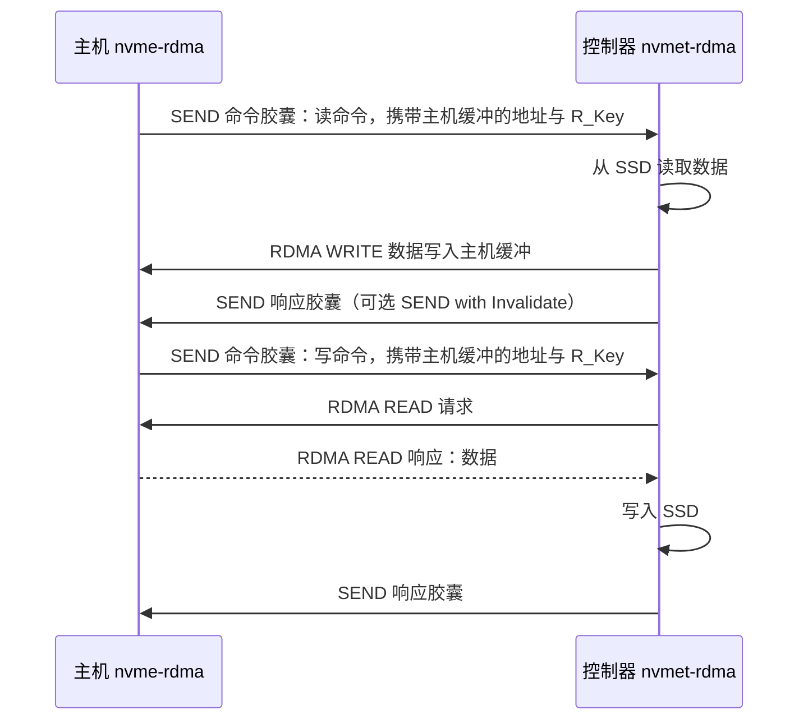
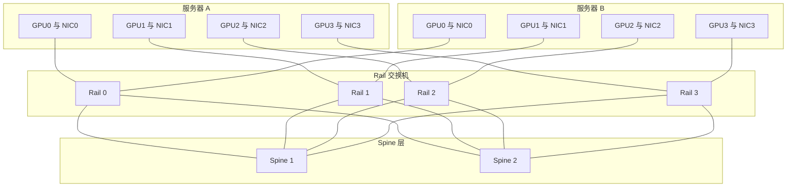

# 典型应用场景（Typical Use Cases）

> **摘要**：本文从存储（NVMe-oF、iSER、SMB Direct、NFS over RDMA、分布式与云存储）、AI/HPC（NCCL、GPUDirect RDMA、MPI/UCX、大规模训练网络）到云数据中心（微软、Meta、阿里等公开的大规模 RoCEv2 部署经验，以及 FaRM、HERD 等研究系统）梳理 RoCEv2 的主要应用，说明每类场景使用哪些 RDMA 操作、需要多少 QP、对无损网络与拥塞控制有多敏感，最后汇总成对比表。场景中的协议细节以各自标准与项目文档为准，本文只给出与 RoCEv2 相关的要点。
>
> **规范出处**：Vol1 Annex A12（p.1857–1862，iSER 支持，CA12-1～CA12-17）；Vol1 Annex A11 §A11.5（p.1852，RDMA IP CM Service 的 Service ID 格式 Table 597）；Vol1 §A17.6.1（p.1943，RoCEv2 沿用 IB CM）；Vol1 §9.7.9.1（p.399–401，XRC 的 QP 数量）；Vol1 §A17.9（p.1946–1949，网络建议）
>
> **前置阅读**：[服务类型](../02-transport/01-service-types.md)、[操作与报文序列](../02-transport/02-operations.md)、[IP CM 与 rdma_cm](../04-connection-management/02-ip-cm-and-rdma-cm.md)、[性能调优](03-performance-tuning.md)
>
> **关键词**：NVMe-oF, nvme-rdma, nvmet-rdma, iSER, SMB Direct, NFS/RDMA, RPC-over-RDMA, Ceph, NCCL, GPUDirect RDMA, UCX, MPI, rail-optimized, dual-plane, FaRM, HERD, FaSST

---

## 1. 场景总览

| 场景 | 代表协议/软件 | RoCEv2 带来的主要价值 |
|---|---|---|
| 块存储 | NVMe-oF（RDMA 传输）、iSER | 微秒级附加延迟、主机 CPU 几乎不参与数据搬运 |
| 文件存储 | SMB Direct、NFS over RDMA | 大块读写零拷贝，降低服务器 CPU 占用 |
| 分布式/云存储 | Ceph（实验性）、Lustre、Storage Scale、云厂商自研存储 | 前后端网络的高吞吐与低尾延迟 |
| AI 训练/推理 | NCCL、GPUDirect RDMA | GPU 显存之间直接搬运，集合通信带宽接近线速 |
| HPC | MPI over UCX/libfabric | 小消息低延迟与大消息零拷贝 |
| 内存型系统 | KV 存储、分布式事务（FaRM、HERD 等研究） | 单边访问远端内存，极低延迟与高包率 |

---

## 2. 存储

### 2.1 NVMe over Fabrics（RDMA 传输）

NVMe-oF 把 NVMe 的提交/完成队列模型延伸到网络上：主机（host）端的每个 NVMe 队列对应一个 RC QP，命令和完成以"胶囊"（capsule）形式传递，数据由控制器（target）侧发起 RDMA 搬运〔外部: NVM Express over Fabrics 与 NVMe RDMA Transport 规范〕：

| 动作 | RDMA 操作 | 方向 |
|---|---|---|
| 提交命令（SQE，可带少量内嵌数据） | SEND | 主机 → 控制器 |
| 主机写（数据从主机到盘） | 控制器按命令中带 R_Key 的 SGL 描述符发起 **RDMA READ** | 数据：主机 → 控制器 |
| 主机读（数据从盘到主机） | 控制器发起 **RDMA WRITE** 写入主机缓冲 | 数据：控制器 → 主机 |
| 返回完成（CQE） | SEND（按需可用 SEND with Invalidate 让主机的 R_Key 失效） | 控制器 → 主机 |



要点：

- **Service ID**：Linux nvme-rdma 使用 rdma_cm 的 TCP 端口空间，常用端口 4420。按 Annex A11 的格式（字节 4 = 0x01、字节 5 = IP 协议号、字节 6–7 = 端口），其 Service ID 为 `0x0000000001061144`（0x06 为 TCP，0x1144 = 4420）〔Vol1 §A11.5 Table 597, p.1852〕。
- **QP 规模**：每个主机有 1 个管理队列与若干 I/O 队列（Linux 默认按在线 CPU 数创建 I/O 队列，可用 `nvme connect` 的 `--nr-io-queues` 调整），每个队列一个 RC QP；目标端的 QP 数 ≈ 主机数 × 每主机队列数。
- **流量特征**：写 I/O 时目标端发起 READ，多个主机的数据同时汇聚到目标端口，形成 incast；读 I/O 则是目标端向多主机扇出。尾延迟对 PFC 暂停与重传极其敏感。

Linux 使用示例〔业界实践: nvme-cli、Linux nvmet configfs〕：

```bash
# 主机端
modprobe nvme-rdma
nvme discover -t rdma -a 192.168.1.20 -s 4420
nvme connect  -t rdma -n nqn.2024-01.io.example:target1 -a 192.168.1.20 -s 4420
nvme list
nvme disconnect -n nqn.2024-01.io.example:target1

# 目标端（内核 nvmet，经 configfs 配置）
modprobe nvmet-rdma
cd /sys/kernel/config/nvmet
mkdir subsystems/nqn.2024-01.io.example:target1
echo 1 > subsystems/nqn.2024-01.io.example:target1/attr_allow_any_host
mkdir subsystems/nqn.2024-01.io.example:target1/namespaces/1
echo /dev/nvme0n1 > subsystems/nqn.2024-01.io.example:target1/namespaces/1/device_path
echo 1 > subsystems/nqn.2024-01.io.example:target1/namespaces/1/enable
mkdir ports/1
echo rdma         > ports/1/addr_trtype
echo ipv4         > ports/1/addr_adrfam
echo 192.168.1.20 > ports/1/addr_traddr
echo 4420         > ports/1/addr_trsvcid
ln -s /sys/kernel/config/nvmet/subsystems/nqn.2024-01.io.example:target1 ports/1/subsystems/
```

> [!TIP]
> SPDK 等用户态 NVMe-oF 目标端同样基于 libibverbs/librdmacm，调优手段与 [性能调优](03-performance-tuning.md) 相同：绑核到网卡所在 NUMA 节点、MTU 4096、足够深的接收队列（或 SRQ），并确认 RoCE 流量落在无损优先级上。

### 2.2 iSER（iSCSI Extensions for RDMA）

iSER 是 IETF 标准（RFC 7145），把 iSCSI 承载在支持 RDMA 的传输上；IBTA 在 Annex A12 中规定了它在 InfiniBand 架构中的建链细节〔Vol1 Annex A12, p.1857–1862〕。RoCEv2 沿用 IB CM 协议〔Vol1 §A17.6.1, p.1943〕，因此这些基于 CM 消息的规则在 RoCEv2 上同样适用：

| 规范要点 | 内容 |
|---|---|
| 服务类型 | 所有 iSER 消息只走 RC（CA12-2） |
| Service ID | 使用 Annex A11 定义的 RDMA-Aware Service ID，字节 5 为 0x06（TCP），字节 6–7 为 iSCSI 端口（CA12-3，Table 601）；Annex A11 给出的示例是 `0x000000000106035C`（端口 860） |
| CM 私有数据 | REQ 私有数据前 36 字节为 IP CM 扩展，随后的位标志声明发起方是否**不支持** Zero-Based Virtual Address（ZBVA）与 Send with Invalidate（CA12-4，Table 602）；REP 中给出本连接的最终选择（CA12-8，Table 603） |
| 安全 | 源 IP 与端口须由特权内核模式填写，被动方检查特权 Q_Key 0x80010000（CA12-6） |
| 回退 | 目标端不支持 iSER 时回 REJ "Invalid Service ID"，发起方可改用 iSCSI over IPoIB |
| 读/写深度 | Responder Resources 与 Initiator Depth 分别对应 iSER 的 IRD 与 ORD，登录与 Hello 交换中应反映 CM 协商值；iSCSI 登录阶段须协商 `RDMAExtensions=Yes`（CA12-10） |

数据通路：iSCSI 命令/响应 PDU 走 SEND（响应可用 Send with Invalidate）；SCSI 读数据由目标端 RDMA WRITE 到发起方缓冲，写数据由目标端 RDMA READ 从发起方拉取〔外部: RFC 7145〕，缓冲以 STag 标识——在 IB/RoCE 中远端访问用的 STag 就是 R_Key〔Vol1 §A12.2, p.1858〕。Linux 中发起方为 `ib_iser`（配合 open-iscsi），目标端为 LIO 的 `ib_isert`：

```bash
modprobe ib_iser
iscsiadm -m iface -I iser0 -o new
iscsiadm -m iface -I iser0 -o update -n iface.transport_name -v iser
iscsiadm -m discovery -t sendtargets -p 192.168.1.20:3260 -I iser0
iscsiadm -m node -p 192.168.1.20:3260 -I iser0 --login
```

（open-iscsi 预置了一个名为 `iser` 的特殊 iface，也可直接用 `-I iser`；自建 iface 时不要命名为 `default` 或 `iser`〔业界实践: open-iscsi README §5.1〕。）

### 2.3 SMB Direct

SMB Direct（[MS-SMBD]）是 SMB 3.x 在 RDMA 上的传输：协议消息通过 SEND/RECEIVE 传递并以信用（credit）做流控，大块读写则由**服务器端**发起 RDMA WRITE（客户端读）或 RDMA READ（客户端写），缓冲描述符由客户端在 SMB2 请求中给出〔外部: Microsoft [MS-SMBD]、[MS-SMB2] 协议文档〕。

- **Windows**：SMB Multichannel 自动发现支持 RDMA 的网卡，可用 PowerShell `Get-NetAdapterRdma`、`Get-SmbClientNetworkInterface` 查看；使用 RoCE 时通常要求配置 DCB/PFC（以微软文档为准）。
- **Linux**：内核 SMB 服务器 ksmbd 支持 SMB Direct；cifs 客户端在启用 `CONFIG_CIFS_SMB_DIRECT` 时可用 `mount -t cifs //server/share /mnt -o rdma,vers=3.1.1,...` 挂载，`rdma` 选项要求 SMB 版本不低于 3.0〔业界实践: Linux `fs/smb/client/fs_context.c`〕。

### 2.4 NFS over RDMA

NFS 通过 RPC-over-RDMA（RFC 8166）承载，NFS 的上层绑定见 RFC 8267；常用端口 20049。RPC 消息走 SEND，大块数据以 "chunk" 描述：读 chunk 由服务器 RDMA READ 拉取，写 chunk/应答 chunk 由服务器 RDMA WRITE 推送——**所有 RDMA 操作都由服务器发起**〔外部: RFC 8166〕。Linux 配置〔外部: Linux Documentation/admin-guide/nfs/nfs-rdma.rst〕：

```bash
# 服务器：让 nfsd 监听 RDMA 端口
echo rdma 20049 > /proc/fs/nfsd/portlist
# 客户端
mount -o rdma,port=20049 192.168.1.20:/export /mnt
```

### 2.5 分布式与云存储

| 系统 | RDMA 支持情况（以各项目文档为准） |
|---|---|
| Ceph | async messenger 提供 RDMA 后端（`ms_type = async+rdma`），长期处于实验状态，生产中较少采用 |
| Lustre | LNet 的 o2iblnd 基于 RDMA Verbs，可运行在 IB 与 RoCE 上 |
| IBM Storage Scale（GPFS） | 支持基于 Verbs 的 RDMA 数据传输 |
| DAOS 等 HPC 存储 | 通过 libfabric/UCX 等通信库使用 RDMA |
| 云厂商自研存储 | 阿里云与微软 Azure 都公开报告了在云存储前后端大规模使用 RoCEv2 的经验〔论文: Gao et al., When Cloud Storage Meets RDMA, NSDI 2021；Bai et al., Empowering Azure Storage with RDMA, NSDI 2023〕 |

---

## 3. AI 与 HPC

### 3.1 NCCL 在 RoCE 上运行

NCCL 的 "IB" 网络插件基于 Verbs，同时支持 InfiniBand 与 RoCE。数据主要通过 RC QP 上的 RDMA WRITE 传输，接收方通过短小的 RDMA WRITE 控制消息回送信用，Meta 将其描述为"接收方发起"（receiver-initiated）的通信模式〔业界实践: NCCL 环境变量文档；论文: Gangidi et al., SIGCOMM 2024〕。RoCE 部署中最常用的环境变量（含义与默认值以所用 NCCL 版本文档为准）：

| 变量 | 作用 | 备注 |
|---|---|---|
| `NCCL_IB_HCA` | 选择 RDMA 设备与端口，可附带 rail/plane 标识 | 用 `=` 前缀做精确匹配，否则 `mlx5_1` 也会匹配 `mlx5_10`… |
| `NCCL_IB_GID_INDEX` | 指定 RoCE GID 索引 | 较新版本（2.21 起）不设置时由 NCCL 自动选择，可配合 `NCCL_IB_ROCE_VERSION_NUM`（默认 2）、`NCCL_IB_ADDR_FAMILY` |
| `NCCL_IB_TC` / `NCCL_IB_SL` | 数据流量的 Traffic Class（DSCP）与 SL | 与网络 QoS 规划一致，如 TC 106 |
| `NCCL_IB_FIFO_TC` | 控制消息（信用回送）的 Traffic Class | 可放入高优先级、低延迟的类 |
| `NCCL_IB_TIMEOUT` / `NCCL_IB_RETRY_CNT` | Local ACK Timeout 指数与重试次数 | 超时 = 4.096 µs × 2^timeout；新版本默认 20 与 7，见 [排障指南](05-troubleshooting.md) |
| `NCCL_IB_QPS_PER_CONNECTION` | 每个连接使用的 QP 数 | 提高 ECMP 熵 |
| `NCCL_CROSS_NIC` | 是否允许跨 NIC（跨 rail）通信 | 与网络是否 rail-optimized 有关 |
| `NCCL_NET_GDR_LEVEL` | 何时使用 GPUDirect RDMA | 取决于 GPU 与网卡的 PCIe 距离 |
| `NCCL_SOCKET_IFNAME` | 引导（bootstrap）用的 IP 接口 | 与 RDMA 数据面无关 |

```bash
# 示例（值仅为示意）
export NCCL_IB_HCA==mlx5_0,mlx5_1,mlx5_2,mlx5_3
export NCCL_IB_GID_INDEX=3
export NCCL_IB_TC=106
export NCCL_IB_QPS_PER_CONNECTION=4
export NCCL_SOCKET_IFNAME==eth0
```

### 3.2 GPUDirect RDMA

网卡直接经 PCIe P2P 读写 GPU 显存，免去 GPU↔主机内存的拷贝；需要 `nvidia-peermem` 或 DMA-BUF 注册路径，并要求 GPU 与网卡位于合适的 PCIe 拓扑（同一 PCIe 交换机下最佳），ACS/ATS/IOMMU 设置对性能影响很大，详见 [性能调优](03-performance-tuning.md) 第 9、11 节。

### 3.3 MPI 与 UCX

| 方面 | 做法 |
|---|---|
| 传输选择 | UCX 在 RoCE 上可用 `rc_verbs`/`rc_mlx5`、`ud_verbs`/`ud_mlx5`，NVIDIA 网卡还有 `dc_mlx5`（厂商 DCT）；`ucx_info -d` 列出设备与传输 |
| 常用变量 | `UCX_NET_DEVICES=mlx5_0:1`、`UCX_TLS`（如 `rc,ud,sm,self`）、`UCX_IB_GID_INDEX`、`UCX_IB_TRAFFIC_CLASS`、`UCX_IB_SL`〔业界实践: UCX FAQ〕 |
| Open MPI | `mpirun --mca pml ucx -x UCX_NET_DEVICES=mlx5_0:1 ./app` |
| 协议 | 小消息走 eager（SEND，常配合 inline），大消息走 rendezvous（RDMA READ/WRITE 零拷贝） |
| QP 规模 | 全互联 RC 需要每节点 N·p·p 个 QP（N 节点、每节点 p 进程），XRC 只需 N·p 个 INI QP、N·p 个 TGT QP 与 p 个 XRC SRQ〔Vol1 §9.7.9.1, p.399–401〕；UD 或厂商动态连接进一步降低连接状态 |

### 3.4 大规模训练集群网络

AI 训练流量的特点是：每台主机只有少量、周期性、同步爆发的大流（如 400 Gb/s 级），集合通信（AllReduce、AllGather、MoE 的 AlltoAll）要求所有参与者同步完成，因此**ECMP 哈希冲突**与**单点故障**的代价远高于通用云计算〔论文: Qian et al., Alibaba HPN, SIGCOMM 2024〕。

| 设计 | 含义 | 公开案例 |
|---|---|---|
| Rail-optimized | 每台服务器上编号相同的网卡（rail）接到同一组 ToR，同号 GPU 之间一跳可达，跨 rail 流量先经机内 NVLink 转换 | NVIDIA DGX SuperPOD 参考架构；阿里 HPN 的 tier1 采用 rail-optimized，单个 tier1 可容纳约 1K GPU〔论文: Alibaba HPN, SIGCOMM 2024〕 |
| 双平面 / 多平面 | 把网络拆成多个相互独立的平面，网卡端口分属不同平面，减少聚合层 ECMP 与哈希极化 | 阿里 HPN：两层、双平面架构，单 Pod 互联约 15K GPU，并以非堆叠双 ToR 消除 ToR 单点故障〔论文: Alibaba HPN, SIGCOMM 2024〕 |
| 两级 Clos + 深缓冲 spine | 机架内 RTSW（leaf），机架间 CTSW（spine，深缓冲、VOQ），更大规模再加 ATSW 层 | Meta 的 AI Zone〔论文: Gangidi et al., SIGCOMM 2024〕 |
| 提高路由熵 | 多 QP（QP scaling）、交换机用 UDF 额外哈希 BTH 的目的 QP（E-ECMP）、集中式流量工程 | Meta 报告 E-ECMP 加 QP scaling 使 AllReduce 性能最多提升 40%〔论文: Gangidi et al., SIGCOMM 2024〕 |
| 拥塞管理 | 在 PFC（单一无损队列）基础上，Meta 发现 DCQCN 难以调到对集合通信明显有利，转而在集合通信库中实现接收方驱动的流量准入 | 〔论文: Gangidi et al., SIGCOMM 2024〕 |

> [!NOTE]
> 业界也在探索 RoCEv2 之外的方向：Ultra Ethernet Consortium（UEC）发布的规范定义了不同于 RoCEv2 的新传输协议，强调多路径与包喷洒等能力；与有损 RoCE、选择性重传等方向的对比见 [高级拥塞控制与有损 RoCE](../05-congestion-control-and-qos/05-advanced-cc-and-lossy-roce.md)（细节以 UEC 官方文档为准）。

下图示意一个最小的 rail-optimized 拓扑：两台各有 4 张 GPU/网卡的服务器，编号相同的网卡接到同一台 rail 交换机，rail 交换机再全连接到 spine。同号 GPU 之间的流量（集合通信中占比最大）在 rail 交换机内一跳完成；跨 rail 的流量先在机内经 NVLink 转到目标 rail 的 GPU，再走网络（NCCL 的 `NCCL_CROSS_NIC` 等参数与此相关）。



对 RoCEv2 配置的直接影响：

| 方面 | 影响 |
|---|---|
| QoS 与无损 | 每个 rail 是独立的拥塞域，PFC/ECN 配置须在所有 rail 上完全一致，否则最慢的 rail 决定集合通信完成时间 |
| GID 与地址 | 每张网卡通常位于各自 rail 的子网，需按网卡选择正确的 GID（`NCCL_IB_HCA` 与各网卡 GID 索引对应） |
| 故障域 | 单个 rail 交换机故障会影响所有服务器的同号网卡，双 ToR/双平面设计（如阿里 HPN）用于缓解 |
| 监控 | 按 rail 汇总 PFC、CNP、重传计数，便于发现"某一 rail 偏慢"的问题 |

---

## 4. 云与数据中心

### 4.1 微软：大规模 RoCEv2 部署的经验

微软在 SIGCOMM 2016 发表了把 RoCEv2 用于其高可靠、延迟敏感服务的经验〔论文: Guo et al., RDMA over Commodity Ethernet at Scale, SIGCOMM 2016〕，其教训至今仍是 RoCE 运维的基础：

| 问题 | 现象与根因 | 对策 |
|---|---|---|
| VLAN-based PFC 不可扩展 | 服务器端口须为 trunk 模式，与 PXE 装机冲突；三层网络无法保留 PCP | 提出 **DSCP-based PFC**（PFC 帧格式不变，优先级取自 DSCP） |
| 传输层活锁 | 网卡采用 go-back-0，丢包率 1/256 时链路满载而应用吞吐为零 | 改为 go-back-N |
| PFC 死锁 | ARP 表与 MAC 表老化时间不同产生不完整表项，交换机把无损报文泛洪，破坏 up-down 路由形成循环依赖 | 丢弃 ARP 表项不完整的无损报文 |
| 网卡 PFC 风暴 | 故障网卡接收流水线停止却持续发 PAUSE，逐级扩散 | NIC 与 ToR 双侧 watchdog |
| 慢接收端 | 网卡 MTT 仅 2K 项，4 KB 页只覆盖 8 MB，缓存缺失拖慢接收并产生 PAUSE | 使用 2 MB 大页；交换机启用动态缓冲共享 |
| 缓冲与无损类数量 | 浅缓冲交换机（9 MB/12 MB）与最长约 300 m 的距离，只够为两个无损类预留 headroom | 实时流量与批量流量各一个无损类 |
| 监控 | 需要持续验证 RDMA 配置与健康状态 | 配置监控、PFC/无损流量监控，以及以 512 字节探测报文测量 RTT 的 RDMA Pingmesh |

论文报告：在一个存在多打一 incast 的服务中，RDMA 的 99 分位延迟约为 90 µs，而 TCP 为 700 µs，RDMA 的 99.9 分位约 200 µs，仍远低于 TCP 的 99 分位〔论文: SIGCOMM 2016〕。拥塞控制使用 DCQCN，PFC 作为防丢包的最后一道防线。

### 4.2 研究系统：如何"用好" RDMA

| 系统 | 会议 | RDMA 使用方式 | 启示 |
|---|---|---|---|
| Pilaf | USENIX ATC 2013 | 客户端用单边 RDMA READ 直接读取 KV 数据结构，自校验防并发修改 | 单边读可绕过服务器 CPU |
| FaRM | NSDI 2014（及 SOSP 2015 的事务系统） | 用 RDMA 构建分布式共享内存，单边 READ 读取远端对象，基于 RDMA WRITE 的消息缓冲做通信 | 以内存语义构建分布式系统 |
| HERD | SIGCOMM 2014 | 请求用 UC RDMA WRITE 写入服务器内存，响应用 UD SEND，避免一次查找需要多次单边 READ | 选择合适的 Verbs 组合比"全用单边"更重要 |
| FaSST | OSDI 2016 | 基于 UD 的双边 RPC 实现分布式事务 | UD 规避 RC 的 QP 规模与网卡缓存问题 |
| DrTM | SOSP 2015 | 结合 HTM 与 RDMA 的内存事务 | RDMA 与本地并发控制协同 |

这些系统共同揭示的工程规律——网卡缓存容量、门铃与 PCIe 事务数、入站/出站操作速率的差异——被系统总结在 Kalia 等人的设计指南中〔论文: Design Guidelines for High Performance RDMA Systems, ATC 2016〕，调优方法见 [性能调优](03-performance-tuning.md)。

---

## 5. 场景对比

| 场景 | 主要 RDMA 操作 | 典型 QP 规模 | 消息特征 | 对无损网络/拥塞控制的敏感性 | 关键调优点 |
|---|---|---|---|---|---|
| NVMe-oF | SEND（胶囊）＋目标端发起的 READ/WRITE（可选 SEND with Invalidate） | 主机数 × 每主机 I/O 队列数（RC） | 64 B 命令 + 4 KB～1 MB I/O | 高：尾延迟敏感，写路径在目标端形成 incast | 队列数与绑核、MTU 4096、PFC/ECN 一致性 |
| iSER | SEND＋目标端 READ/WRITE | 每会话连接一个 RC QP | 与块 I/O 相同 | 中高 | IRD/ORD、MTU、接收缓冲 |
| SMB Direct | SEND/RECEIVE（信用）＋服务器 READ/WRITE | 每个 RDMA 通道若干 QP | 大块文件 I/O | 中高：通常要求 DCB/PFC | Multichannel、网卡 RDMA 能力识别 |
| NFS over RDMA | SEND＋服务器 READ/WRITE（chunk） | 每挂载若干连接 | 元数据小消息 + 大块数据 | 中 | 端口 20049、服务器线程与 CPU |
| NCCL 训练 | RC 上的 RDMA WRITE 为主＋小型控制 WRITE | GPU 对 × 通道数 × 每连接 QP 数 | MB 级、同步突发、流少熵低 | 很高：AllReduce/AlltoAll 产生 incast 与 ECMP 冲突 | TC 规划、多 QP、rail-optimized、拥塞控制与超时 |
| MPI / UCX | eager SEND（inline）＋rendezvous READ/WRITE | 每对端一个 RC 或使用 UD/DC/XRC | 小到大均有 | 小消息延迟敏感 | 传输选择、绑核、QP 规模 |
| 内存型 KV/事务 | 单边 READ/WRITE、UD SEND | 连接数大，倾向 UD 或共享 QP | ≤ 1 KB 小消息 | 包率与延迟敏感 | 门铃批量、inline、网卡缓存 |
| 云存储后端 | SEND、WRITE、READ 混合 | 大量长连接 | 混合 | 极高：可靠性优先 | 双侧 watchdog、监控、故障隔离 |

---

## 6. 要点回顾

- NVMe-oF/RDMA：命令与完成走 SEND，数据由目标端发起 RDMA READ（主机写）或 RDMA WRITE（主机读）；每个 NVMe 队列一个 RC QP；端口 4420 对应 Service ID `0x0000000001061144`。
- iSER 的 IB/RoCE 建链细节由 Annex A12 规定：只用 RC，使用 A11 的 RDMA-Aware Service ID，私有数据声明 ZBVA 与 Send with Invalidate 能力，IRD/ORD 对应 Responder Resources/Initiator Depth。
- SMB Direct 与 NFS over RDMA 都由服务器发起 RDMA READ/WRITE 搬运大块数据，协议消息走 SEND。
- NCCL 在 RoCE 上的关键是 GID/TC 选择、多 QP 提高熵、合理的超时，以及与网络拓扑（rail-optimized、多平面）匹配。
- 大规模 AI 网络的公开经验：ECMP 熵不足与 ToR 单点故障是首要问题（阿里 HPN、Meta），拥塞控制方案需要与集合通信库协同设计（Meta）。
- 微软的部署经验（DSCP-based PFC、go-back-N、死锁与风暴防护、大页与动态缓冲、Pingmesh 监控）是运维 RoCEv2 网络的基础清单。
- FaRM、HERD、FaSST 等研究表明：选择合适的 Verbs 组合并尊重网卡缓存/PCIe 规律，比单纯追求"单边操作"更重要。

## 自测

<details><summary>Q1：在 NVMe-oF/RDMA 中，主机执行一次写 I/O 时，数据是由谁、用什么操作搬运的？这会对网络产生什么影响？</summary>

答：由控制器（目标端）根据命令胶囊中携带 R_Key 的 SGL 描述符发起 RDMA READ，从主机内存把数据拉到目标端。多个主机同时写时，READ 响应数据会同时汇聚到目标端端口，形成 incast，需要无损网络与拥塞控制配合。
</details>

<details><summary>Q2：按 Annex A11，NVMe-oF 常用端口 4420 对应的 Service ID 是多少？怎么算出来的？</summary>

答：`0x0000000001061144`。Table 597 规定字节 0–3 为 0x00、字节 4 为 0x01（RDMA-aware ULP 范围），字节 5 为 IP 协议号（TCP 为 0x06），字节 6–7 为端口号（4420 = 0x1144）。
</details>

<details><summary>Q3：Annex A12 规定 iSER 连接在 CM 私有数据中协商哪两项可选能力？为什么需要协商？</summary>

答：Zero-Based Virtual Address 与 Send with Invalidate。IETF 的 iSER 标准依赖这两项功能，而它们在 InfiniBand 中是可选的，所以发起方在 REQ 中声明自己不支持哪项，目标端在 REP 中给出本连接最终采用的方式（不支持 ZBVA 时使用扩展的 iSER 头携带虚拟地址）。
</details>

<details><summary>Q4：为什么 AI 训练网络比通用云网络更容易受 ECMP 哈希冲突影响？有哪些公开的应对方法？</summary>

答：训练流量由每台主机少量、周期性同步爆发的大流组成，流的数量少、熵低，一旦两条大流被哈希到同一链路就会拖慢整个集合通信。公开的应对包括：每连接使用多个 QP 并让交换机额外哈希 BTH 目的 QP（Meta 的 QP scaling 与 E-ECMP）、集中式流量工程、rail-optimized 拓扑以及双平面/多平面设计（阿里 HPN）。
</details>

<details><summary>Q5：微软 SIGCOMM 2016 论文中的"传输层活锁"是什么？如何解决？</summary>

答：网卡在丢包后采用 go-back-0，从整条消息的第一个包重新发送；在 1/256 的丢包率下，4 MB 消息几乎每次都会再次遇到丢包，导致链路满载但应用吞吐为零。改为从首个丢失报文开始重传的 go-back-N 后问题消除。
</details>

## 参考

- 规范：Vol1 Annex A11 §A11.5 与 Table 597（p.1852）；Annex A12（p.1857–1862）；§9.7.9.1（p.399–401）；§A17.9（p.1946–1949）
- 外部：NVM Express over Fabrics Specification 与 NVMe RDMA Transport Specification（NVM Express, Inc.）；nvme-cli；Linux nvmet configfs
- 外部：RFC 7145（iSER）；RFC 8166（RPC-over-RDMA Version 1）；RFC 8267（NFS Upper-Layer Binding to RPC-over-RDMA Version 1）；Linux Documentation/admin-guide/nfs/nfs-rdma.rst
- 业界实践：open-iscsi README（iface 配置，https://github.com/open-iscsi/open-iscsi）
- 外部：Microsoft [MS-SMBD]（SMB2 Remote Direct Memory Access Transport Protocol）、[MS-SMB2]
- 业界实践：NCCL 环境变量文档（https://docs.nvidia.com/deeplearning/nccl/user-guide/docs/env.html）；UCX FAQ（https://github.com/openucx/ucx）；NVIDIA DGX SuperPOD 参考架构（厂商相关）
- 论文：Guo et al., "RDMA over Commodity Ethernet at Scale", SIGCOMM 2016
- 论文：Gangidi et al., "RDMA over Ethernet for Distributed AI Training at Meta Scale", SIGCOMM 2024
- 论文：Qian et al., "Alibaba HPN: A Data Center Network for Large Language Model Training", SIGCOMM 2024
- 论文：Gao et al., "When Cloud Storage Meets RDMA", NSDI 2021；Bai et al., "Empowering Azure Storage with RDMA", NSDI 2023
- 论文：Mitchell et al., Pilaf, USENIX ATC 2013；Dragojević et al., FaRM, NSDI 2014；Kalia et al., HERD, SIGCOMM 2014；Kalia et al., FaSST, OSDI 2016；Wei et al., DrTM, SOSP 2015；Kalia et al., Design Guidelines for High Performance RDMA Systems, USENIX ATC 2016
