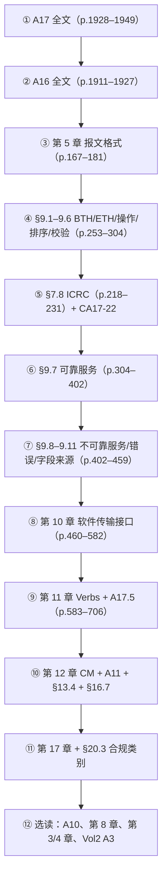

# 规范章节 ↔ 知识库对照（Spec Section Map）

> **摘要**：把 IBTA Vol1 / Vol2 Release 1.4 的全部章节与附录逐一标注"与 RoCEv2 的相关度"、原因（多数引用 Annex A17 的适用性声明）和对应的知识库文件，并给出"带着 RoCEv2 视角读 IB 规范"的推荐阅读顺序与反向索引。规范约 2700 页，RoCEv2 实现真正需要精读的不到 1/4，本文帮助你把时间花在刀刃上。
>
> **规范出处**：Vol1 目录（p.3–72）；Vol1 Annex A17（p.1928–1949）；Vol1 Annex A16（p.1911–1927）；Vol2 目录（p.3–24）；Vol2 Annex A3（p.688–691）
>
> **前置阅读**：[RoCE 演进](../00-overview/02-roce-evolution.md)、[IBA 分层映射](../00-overview/03-architecture-and-layering.md)
>
> **关键词**：Vol1, Vol2, Annex A17, Annex A16, 阅读顺序, 适用性, Not Applicable

## 1. 如何使用本表

### 1.1 相关度等级

| 等级 | 含义 | 典型例子 |
|---|---|---|
| **核心** | RoCEv2 实现必须逐条掌握，含大量直接适用的合规条款 | Annex A17、第 9 章传输层、§7.8.1 ICRC |
| **高** | 直接适用，需要熟悉；A17 只做少量修改 | 第 10/11/12 章、Annex A16、Annex A11 |
| **中** | 部分适用，或作为背景/对比阅读很有价值 | 第 3/4/8/13 章、Annex A10（对比） |
| **低** | 与 RoCEv2 关系很弱，仅作背景 | 第 1 章、Annex A1、A4、A12 |
| **不适用** | A17 明确声明不适用，或依赖 IB 物理层/链路层/子网管理 | 第 6、14、15、18、19 章，Annex A13 |

> [!NOTE]
> "不适用"多数有 A17 原文依据：RoCEv2 用以太网替换 IB 的链路层与物理层〔Vol1 §A17.2.2, p.1928〕；LRH 及其字段对 RoCEv2 端口全部不适用〔Vol1 §A17.4.1.2, p.1936〕；SM、SA、PM、DevMgt、BM、SNMP 隧道、Vendor、Application、CC、Boot、BIS 等管理类不适用〔Vol1 §A17.6, p.1942–1943〕；IB 拥塞控制（A10）与 IB QoS（A13）不适用〔Vol1 §A17.4.8–A17.4.9, p.1940〕。没有原文依据而由本文推断的，标注"（解读）"。

### 1.2 页码约定

- 页码为规范印刷页码（= PDF 页码）。章级范围写成"起始页–结束页"。
- 小节范围写成"本节起始页–下一节起始页"，边界页可能与相邻小节共享（这与本知识库其他文件的写法一致，如"§9.2（p.256–262）"）。
- 小节编号沿用规范目录：X.Y 为二级小节，X.Y.Z 为三级小节。

## 2. Vol1 章级总览

| 章节 | 标题 | 页码 | 相关度 | 原因 | 对应知识库文件 |
|---|---|---|---|---|---|
| 第 1 章 | Introduction | 73–83 | 低 | 背景与文档约定；§1.5.1 字节序（p.81）值得一看 | [RDMA 基础](../00-overview/01-rdma-fundamentals.md) |
| 第 2 章 | Glossary | 84–100 | 中 | 术语定义，RoCEv2 沿用 | [术语表](01-glossary.md) |
| 第 3 章 | Architectural Overview | 101–157 | 中 | QP、服务类型、Key、分层与语义的总体介绍；链路/子网管理部分不适用 | [RDMA 基础](../00-overview/01-rdma-fundamentals.md)、[分层架构](../00-overview/03-architecture-and-layering.md) |
| 第 4 章 | Addressing | 158–166 | 中 | GID 规则（§4.1.1）是理解 GID 的基础；LID 部分不适用（§A17.4.1.2） | [寻址](../00-overview/04-addressing.md) |
| 第 5 章 | Data Packet Format | 167–181 | 高 | 传输头字段总表直接适用；LRH/GRH/VCRC/Raw 不适用 | [帧布局](../01-packet-format/01-frame-layout.md) |
| 第 6 章 | Physical Layer Interface | 182–185 | 不适用 | 物理层由以太网替代〔Vol1 §A17.2.2〕 | [IB 物理层对比](04-ib-physical-layer-vs-ethernet.md) |
| 第 7 章 | Link Layer | 186–244 | 低（§7.8 核心） | 链路层由以太网替代；但 §7.8.1 ICRC 规则被 CA17-22 直接引用 | [ICRC](../01-packet-format/06-icrc.md) |
| 第 8 章 | Network Layer | 245–252 | 中 | GRH 被 IP 头替代；GRH 字段语义（TClass/FlowLabel/HopLmt）映射到 IP | [以太网/IP/UDP](../01-packet-format/02-ethernet-ip-udp.md) |
| 第 9 章 | Transport Layer | 253–459 | **核心** | CA17-25：RoCEv2 HCA 须符合第 9 章（含 A17 列出的例外） | [02-transport 全部](../02-transport/01-service-types.md) |
| 第 10 章 | Software Transport Interface | 460–582 | 高 | 资源、QP 状态、内存管理、WR 处理、分区、错误语义均适用；AV 按 §A17.4.2 修改 | [资源模型](../03-verbs-and-resources/01-resource-model.md) |
| 第 11 章 | Software Transport Verbs | 583–706 | 高 | CA17-30：按 §A17.5 修改后适用 | [Verbs 的 RoCEv2 修改](../03-verbs-and-resources/05-verbs-roce-specifics-and-programming.md) |
| 第 12 章 | Communication Management | 707–771 | 高 | RoCEv2 沿用 IB CM，仅去掉 LID 相关内容〔Vol1 §A17.6.1〕 | [CM 协议](../04-connection-management/01-cm-protocol.md) |
| 第 13 章 | Management Model | 772–864 | 中 | MAD 格式与 GSI（QP1）仍用于 CM；SMI/子网管理部分不适用 | [MAD 与 GSI](../04-connection-management/03-mad-and-gsi.md) |
| 第 14 章 | Subnet Management | 865–1014 | 不适用 | §A17.6：子网管理类不适用；无 QP0（CA17-33） | [MAD 与 GSI](../04-connection-management/03-mad-and-gsi.md) |
| 第 15 章 | Subnet Administration | 1015–1078 | 不适用 | §A17.6；但 PathRecord 中 MTU/Rate/PacketLifeTime 的编码可作参考 | [常数与公式](05-constants-and-formulas.md) |
| 第 16 章 | General Services | 1079–1186 | 低（§16.7 高） | PM/BM/DevMgt/SNMP/Vendor/App 均不适用〔Vol1 §A17.6〕；§16.7 CM 类属性与方法适用 | [MAD 与 GSI](../04-connection-management/03-mad-and-gsi.md) |
| 第 17 章 | Channel Adapters | 1187–1208 | 高 | §A17.7：大部分合规条款适用，列出 C17-7/9/19/20/21/24 等例外 | [合规清单](03-compliance-checklist.md)、[RNIC 架构](../06-hardware-implementation/01-rnic-architecture.md) |
| 第 18 章 | Switches | 1209–1227 | 不适用 | RoCEv2 用以太网交换机 | [无损以太网与 PFC](../05-congestion-control-and-qos/01-lossless-ethernet-pfc.md) |
| 第 19 章 | Routers | 1228–1240 | 不适用 | IB 路由器按 GRH 转发；RoCEv2 由普通 IP 路由器转发 | [RoCE 演进](../00-overview/02-roce-evolution.md) |
| 第 20 章 | Volume 1 Compliance Summary | 1241–1288 | 中 | §20.3 HCA-CI 合规类别（p.1246）用于确定 HCA 必须满足的条款范围 | [合规清单](03-compliance-checklist.md) |
| Annex A1 | I/O Infrastructure | 1289–1307 | 低 | IOU/IOC 等 I/O 概念背景 | — |
| Annex A2 | Console Service Protocol | 1308–1340 | 不适用 | 基于 IB 管理的控制台服务（解读） | — |
| Annex A3 | Application Specific Identifiers | 1341–1362 | 中 | Service ID 结构（§A3.2）是理解 A11 映射的基础 | [IP CM 与 rdma_cm](../04-connection-management/02-ip-cm-and-rdma-cm.md) |
| Annex A4 | Sockets Direct Protocol (SDP) | 1363–1437 | 低 | 历史上的 ULP 示例 | [典型场景](../07-engineering-practice/06-use-cases.md) |
| Annex A5 | Booting Annex | 1438–1569 | 不适用 | Boot Management 类不适用〔Vol1 §A17.6〕 | — |
| Annex A6 | Boot Information Service | 1570–1602 | 不适用 | BIS 不适用〔Vol1 §A17.6〕 | — |
| Annex A7 | Configuration Management | 1603–1673 | 不适用 | 依赖 IB 管理类与 SM 基础设施（解读） | — |
| Annex A8 | Device Management | 1674–1795 | 不适用 | DevMgt 类不适用〔Vol1 §A17.6〕 | — |
| Annex A9 | Verb Extensions Annex | 1796 | 中 | 仅一页说明：FRMR、MW 失效、Type 2 MW、SRQ、Reserved L_Key、零基 VA 等扩展已并入正文第 10/11 章 | [内存管理](../03-verbs-and-resources/03-memory-management.md) |
| Annex A10 | Congestion Control | 1797–1847 | 不适用（对比价值高） | §A17.4.8 声明不适用；其 FECN/BECN/CNP 思想是 RCM 的"精神来源"〔Vol1 §A17.9.3〕 | [IB CC 对比](../05-congestion-control-and-qos/07-ib-cc-vs-rocev2-cc.md) |
| Annex A11 | RDMA IP CM Service | 1848–1856 | 高 | rdma_cm 使用的 REQ 私有数据格式与 Service ID 映射 | [IP CM 与 rdma_cm](../04-connection-management/02-ip-cm-and-rdma-cm.md) |
| Annex A12 | Support for iSER | 1857–1862 | 低 | iSER ULP 的 CM 用法 | [典型场景](../07-engineering-practice/06-use-cases.md) |
| Annex A13 | Quality of Service (QoS) | 1863–1885 | 不适用 | §A17.4.9：基于 IB 链路层能力（VL、SL→VL），不适用 | [QoS](../05-congestion-control-and-qos/02-qos-dscp-pcp-ets.md) |
| Annex A14 | XRC Transport Service | 1886 | 中 | 仅一页指引：XRC 已并入第 9/10/11/12 章 | [服务类型](../02-transport/01-service-types.md) |
| Annex A15 | Hierarchy Information | 1887–1910 | 不适用 | 依赖 SM/SA 扩展（解读） | — |
| Annex A16 | RDMA over Converged Ethernet (RoCE) | 1911–1927 | 高 | RoCEv2 的直接前身，A17 多处写"As with RoCE" | [RoCE 演进](../00-overview/02-roce-evolution.md) |
| Annex A17 | RoCEv2 (IP Routable RoCE) | 1928–1949 | **核心** | RoCEv2 的全部定义，合规条款 CA17-1～CA17-46 | [合规清单](03-compliance-checklist.md) |
| Annex A18 | Virtualization | 1950–1981 | 低 | 面向 IB 子网的 VHCA/VPort 虚拟化，依赖 SM/SA（解读）；RoCE 虚拟化通常用 SR-IOV 等以太网机制〔业界〕 | [典型场景](../07-engineering-practice/06-use-cases.md) |

## 3. Vol1 重点章节细目

### 3.1 第 3 章 Architectural Overview（p.101–157）

| 小节 | 标题 | 页码 | 相关度 | 说明 | 知识库 |
|---|---|---|---|---|---|
| 3.1 | Architecture Scope | 102–105 | 低 | IB 拓扑与组件 | [分层架构](../00-overview/03-architecture-and-layering.md) |
| 3.2 | Communication | 105–109 | 中 | 队列模型（WQ/CQ）与连接概念 | [RDMA 基础](../00-overview/01-rdma-fundamentals.md) |
| 3.3 | Communications Stack | 109–111 | 中 | 分层栈，对照 A17 Figure 344/347 理解替换关系 | [分层架构](../00-overview/03-architecture-and-layering.md) |
| 3.4 | IBA Components | 111–116 | 低 | CA/交换机/路由器/管理组件；交换机、路由器、SM 不适用 | [分层架构](../00-overview/03-architecture-and-layering.md) |
| 3.5 | IBA Features | 116–132 | 中 | QP、服务类型（§3.5.2 p.117）、Key（§3.5.3 p.119）、PD、分区；VL（§3.5.7）不适用 | [资源模型](../03-verbs-and-resources/01-resource-model.md) |
| 3.6 | Channel & Memory Semantics | 132–139 | 中 | SEND/RECV 与 RDMA 语义 | [操作类型](../02-transport/02-operations.md) |
| 3.7 | IBA Layered Architecture | 139–147 | 中 | 物理/链路层（§3.7.1–3.7.2）不适用，网络/传输层（§3.7.3–3.7.4）对照阅读 | [分层架构](../00-overview/03-architecture-and-layering.md) |
| 3.8 | IBA Transaction Flow | 147–148 | 中 | 一次事务的端到端流程 | [分层架构](../00-overview/03-architecture-and-layering.md) |
| 3.9 | IBA Management Infrastructure | 148–155 | 低 | MAD/SMI/GSI 概览；只有 GSI 与 CM 相关 | [MAD 与 GSI](../04-connection-management/03-mad-and-gsi.md) |
| 3.10 | I/O Operation | 155–157 | 低 | I/O 模型背景 | — |

### 3.2 第 4 章 Addressing（p.158–166）

| 小节 | 标题 | 页码 | 相关度 | 说明 | 知识库 |
|---|---|---|---|---|---|
| 4.1 | Terminology And Concepts | 159–160 | 中 | GUID/EUI-64/GID 概念 | [寻址](../00-overview/04-addressing.md) |
| 4.1.1 | GID Usage and Properties | 160–164 | 中 | Reserved GID（::）、Loopback GID（::1）、多播 GID 格式仍影响 GID 校验；默认前缀 FE80::/64 的规则面向 IB | [寻址](../00-overview/04-addressing.md) |
| 4.1.2 | CA, Switch, Router Addressing Rules | 164 | 低 | LID/LMC 相关规则不适用 | [寻址](../00-overview/04-addressing.md) |
| 4.1.3 | Local Identifiers | 164–166 | 不适用 | LID 不适用〔Vol1 §A17.4.1.2〕 | — |

### 3.3 第 5 章 Data Packet Format（p.167–181）

| 小节 | 标题 | 页码 | 相关度 | 说明 | 知识库 |
|---|---|---|---|---|---|
| 5.1 | Packet Types | 167–168 | 中 | IBA 包与 Raw 包；RoCEv2 只有 IBA 传输包 | [帧布局](../01-packet-format/01-frame-layout.md) |
| 5.2 | Data Packet Format | 168–179 | 高 | 头部组合总图 | [帧布局](../01-packet-format/01-frame-layout.md) |
| 5.2.1 | LRH - 8 Bytes | 171 | 不适用 | 由以太网 MAC 头替代 | [RoCE 演进](../00-overview/02-roce-evolution.md) |
| 5.2.2 | GRH - 40 Bytes | 171–172 | 中 | RoCE v1 使用；RoCEv2 由 IP 头替代 | [RoCE 演进](../00-overview/02-roce-evolution.md) |
| 5.2.3 | BTH - 12 Bytes | 172–174 | 核心 | 字段总表 | [BTH](../01-packet-format/03-bth.md) |
| 5.2.4–5.2.12 | RDETH/DETH/RETH/AtomicETH/XRCETH/AETH/AtomicAckETH/ImmDt/IETH | 174–178 | 核心 | 扩展传输头字段总表 | [扩展传输头](../01-packet-format/04-extended-transport-headers.md) |
| 5.2.13 | Payload | 178 | 高 | 负载与填充 | [帧布局](../01-packet-format/01-frame-layout.md) |
| 5.2.14 | Invariant CRC | 179 | 核心 | ICRC 位置 | [ICRC](../01-packet-format/06-icrc.md) |
| 5.2.15 | Variant CRC | 179 | 不适用 | RoCE 用以太网 FCS 代替（CA16-3） | [ICRC](../01-packet-format/06-icrc.md) |
| 5.3 | Raw Packet Format | 179–180 | 不适用 | CA17-28 | — |
| 5.4 | Packet Examples | 180–181 | 中 | 头部组合示例（需把 LRH/GRH 换成 Eth/IP/UDP 理解） | [帧布局](../01-packet-format/01-frame-layout.md) |

### 3.4 第 6–8 章 物理层 / 链路层 / 网络层（p.182–252）

| 小节 | 标题 | 页码 | 相关度 | 说明 | 知识库 |
|---|---|---|---|---|---|
| 6.1–6.3 | Physical Layer Interface | 182–185 | 不适用 | 物理层由以太网替代 | [IB 物理层对比](04-ib-physical-layer-vs-ethernet.md) |
| 7.1–7.5 | Overview / Link States / Receiver States / Packet Checks | 186–199 | 不适用 | IB 链路状态机与链路层检查 | — |
| 7.6 | Virtual Lanes Mechanisms | 199–215 | 低 | VL 与 SL→VL 不适用；但理解"每 VL 独立缓冲 + 信用流控"有助于理解 RoCE 为何需要 PFC | [无损以太网与 PFC](../05-congestion-control-and-qos/01-lossless-ethernet-pfc.md) |
| 7.7 | Local Route Header | 215–218 | 不适用 | §A17.4.1.2 | — |
| 7.8.1 | Invariant CRC (ICRC) | 218–219 | **核心** | 多项式、初值、比特序、屏蔽规则；CA17-22 在此基础上修改 | [ICRC](../01-packet-format/06-icrc.md) |
| 7.8.2–7.8.3 | VCRC / LPCRC | 219–221 | 不适用 | 链路层 CRC | [ICRC](../01-packet-format/06-icrc.md) |
| 7.8.4 | CRC Calculation Samples | 221–231 | 高 | Table 28（ICRC = 0x9625B75A）与 Table 33（0xB67D1ED1）可用于验证 CRC 引擎 | [ICRC](../01-packet-format/06-icrc.md) |
| 7.9 | Flow Control | 232–235 | 低 | IB 绝对信用流控（以 64 字节块计）；RoCEv2 用 PFC 替代（对比阅读） | [无损以太网与 PFC](../05-congestion-control-and-qos/01-lossless-ethernet-pfc.md) |
| 7.10 | IBA and Raw Packet Multicast | 235–242 | 低 | 交换机多播复制规则不适用；端点多播规则见 §10.5 | [不可靠服务](../02-transport/04-unreliable-services.md) |
| 7.11–7.12 | Subnet Multipathing / Error Handling | 242–244 | 不适用 | IB 子网内多路径与链路错误 | — |
| 8.1–8.2 | Overview / Packet Routing | 245–248 | 不适用 | IB 路由器语义；RoCEv2 由 IP 路由 | [RoCE 演进](../00-overview/02-roce-evolution.md) |
| 8.3 | Global Route Header | 248–249 | 中 | GRH 各字段；RoCEv2 中对应 IPv6 头字段，ICRC 屏蔽规则相同 | [以太网/IP/UDP](../01-packet-format/02-ethernet-ip-udp.md) |
| 8.4 | Global Route Header Usage | 249–252 | 中 | GRH 生成/修改/校验规则；RoCEv2 改用 §A17.3.1 与 §A17.4.4 | [排序与校验](../02-transport/03-ordering-and-validation.md) |

### 3.5 第 9 章 Transport Layer（p.253–459）——核心

| 小节 | 标题 | 页码 | 相关度 | 说明 | 知识库 |
|---|---|---|---|---|---|
| 9.1 | Overview | 253–256 | 高 | 传输服务类型属性对比（Table 37） | [服务类型](../02-transport/01-service-types.md) |
| 9.2 | Base Transport Header | 256–262 | 核心 | BTH 逐字段；F/B 位按 CA17-29 忽略 | [BTH](../01-packet-format/03-bth.md) |
| 9.2.1–9.2.2 | OpCode / Reserved OpCodes | 257–260 | 核心 | Table 38 OpCode 全表；RoCEv2 CNP 使用 100_00001 | [OpCode](../01-packet-format/05-opcodes.md) |
| 9.3 | Extended Transport Headers | 262–267 | 核心 | RDETH/DETH/RETH/AtomicETH/AETH/AtomicAckETH/ImmDt/IETH/XRCETH | [扩展传输头](../01-packet-format/04-extended-transport-headers.md) |
| 9.4.1–9.4.3 | SEND / RESYNC / RDMA WRITE | 268–279 | 核心 | 分段规则与报文序列 | [操作类型](../02-transport/02-operations.md) |
| 9.4.4–9.4.6 | RDMA READ / ATOMIC / 保留与厂商 OpCode | 279–291 | 核心 | READ 响应 PSN 规则、原子 8 字节对齐 | [操作类型](../02-transport/02-operations.md) |
| 9.5 | Transaction Ordering | 291–292 | 核心 | 请求/响应排序规则 | [排序与校验](../02-transport/03-ordering-and-validation.md) |
| 9.6 | Packet Transport Header Validation | 292–304 | 核心 | 入站校验：§9.6.1.1 BTH 检查适用；§9.6.1.2 GRH 检查按 §A17.4.4 替换；§9.6.1.6 LRH 检查（SLID/DLID）不适用 | [排序与校验](../02-transport/03-ordering-and-validation.md) |
| 9.7.1–9.7.2 | PSN / ACK-NAK Protocol | 305–313 | 核心 | PSN 有效区/重复区、ACK/NAK 基本协议 | [PSN 与 ACK/NAK](../02-transport/05-psn-and-ack-nak.md) |
| 9.7.3 | Requester: Generating Request Packets | 313–318 | 核心 | PSN 生成（Table 42）、AckReq 规则 | [请求方](../02-transport/06-requester.md) |
| 9.7.4 | Responder: Receiving Inbound Request Packets | 318–331 | 核心 | PSN/OpCode 序列/R_Key/长度检查 | [响应方](../02-transport/07-responder.md) |
| 9.7.5 | Responder: Generating Responses | 331–355 | 核心 | 合并 ACK、重复请求、NAK、AETH 格式（Table 46–48） | [响应方](../02-transport/07-responder.md) |
| 9.7.6 | Requester: Receiving Responses | 355–366 | 核心 | 响应校验、传输定时器（C9-140）、重试计数 | [请求方](../02-transport/06-requester.md) |
| 9.7.7 | Reliable Connections | 366–382 | 核心 | RC 特性、MSN、端到端信用（Table 50） | [PSN 与 ACK/NAK](../02-transport/05-psn-and-ack-nak.md) |
| 9.7.8 | Reliable Datagram | 382–399 | 低 | RD 极少实现（业界） | [服务类型](../02-transport/01-service-types.md) |
| 9.7.9 | XRC | 399–402 | 中 | XRC 传输细节 | [服务类型](../02-transport/01-service-types.md) |
| 9.8.1–9.8.3 | Unreliable: Validation / UC / UD | 403–420 | 高 | UC、UD 行为；UD 的 L3 头放置按 §A17.4.5 修改 | [不可靠服务](../02-transport/04-unreliable-services.md) |
| 9.8.4 | Raw datagrams | 420–422 | 不适用 | CA17-28 | — |
| 9.9 | Error detection and handling | 422–450 | 核心 | 请求方/响应方错误分类与行为 | [错误处理](../02-transport/08-error-handling.md) |
| 9.10 | Header and Data Field Source | 450–456 | 高 | 发包时各字段来源；表中 LRH 行不适用 | [发送通路](../06-hardware-implementation/02-tx-datapath.md) |
| 9.11 | Static Rate Control | 456–459 | 中 | IPD 速率控制 | [请求方](../02-transport/06-requester.md) |

### 3.6 第 10 章 Software Transport Interface（p.460–582）

| 小节 | 标题 | 页码 | 相关度 | 说明 | 知识库 |
|---|---|---|---|---|---|
| 10.1 | Overview | 460–461 | 中 | — | [资源模型](../03-verbs-and-resources/01-resource-model.md) |
| 10.2 | Managing HCA Resources | 461–483 | 高 | 寻址（§10.2.2 p.462，SGID 选择）、PD、QP、Q_Key（§10.2.5 p.470）、CQ、SRQ、XRC、头字段来源（§10.2.11 p.479） | [资源模型](../03-verbs-and-resources/01-resource-model.md) |
| 10.3 | Resource States | 483–493 | 高 | QP/EE 状态机 | [QP 状态机](../03-verbs-and-resources/02-qp-state-machine.md) |
| 10.4 | Automatic Path Migration | 493–497 | 中 | APM 状态图；RoCEv2 中备用路径为 IP 路径 | [QP 状态机](../03-verbs-and-resources/02-qp-state-machine.md) |
| 10.5 | Multicast Services | 497–501 | 中 | UD 多播，DestQP 0xFFFFFF（o10-35）；MLID 无效 | [不可靠服务](../02-transport/04-unreliable-services.md) |
| 10.6 | Memory Management | 501–536 | 高 | 注册、Key、MW、失效、访问控制 | [内存管理](../03-verbs-and-resources/03-memory-management.md) |
| 10.7 | Work Requests | 536–543 | 高 | WR 类型与内容 | [WR 与完成](../03-verbs-and-resources/04-work-requests-and-completions.md) |
| 10.8 | Work Request Processing Model | 543–556 | 高 | 排序、Fence（C10-100）、完成处理 | [WR 与完成](../03-verbs-and-resources/04-work-requests-and-completions.md) |
| 10.9 | Partitioning | 556–563 | 中 | P_Key 规则（默认 0xFFFF，C10-115）适用；P_Key 表由 SM 设置的部分不适用（§A17.7.1） | [寻址](../00-overview/04-addressing.md) |
| 10.10 | Error Handling Semantics | 563–582 | 高 | 错误类型与对 QP 的影响 | [错误处理](../02-transport/08-error-handling.md) |

### 3.7 第 11 章 Software Transport Verbs（p.583–706）

| 小节 | 标题 | 页码 | 相关度 | 说明 | 知识库 |
|---|---|---|---|---|---|
| 11.1 | Verbs Introduction and Overview | 583–587 | 中 | Verb 类别与扩展 | [Verbs 的 RoCEv2 修改](../03-verbs-and-resources/05-verbs-roce-specifics-and-programming.md) |
| 11.2.1 | HCA（Open/Query/Modify HCA） | 587–598 | 高 | Query/Modify HCA 端口属性按 §A17.5.1–A17.5.2 修改 | [Verbs 的 RoCEv2 修改](../03-verbs-and-resources/05-verbs-roce-specifics-and-programming.md) |
| 11.2.2 | Address Management Verbs | 598–602 | 高 | AH 的 AV 按 §A17.5.3 修改（SL 8–15 可返回 Invalid AV） | [寻址](../00-overview/04-addressing.md) |
| 11.2.3–11.2.4 | SRQ / XRC SRQ | 602–608 | 高 | — | [资源模型](../03-verbs-and-resources/01-resource-model.md) |
| 11.2.5 | Queue Pair | 608–622 | 高 | Create/Modify/Query QP；AV 与备用路径按 §A17.5.4 修改 | [QP 状态机](../03-verbs-and-resources/02-qp-state-machine.md) |
| 11.2.6 | Get Special QP | 622–624 | 高 | 只适用于 QP1；C11-13（QP0 部分）、o11-1 不适用〔Vol1 §A17.5.8〕 | [MAD 与 GSI](../04-connection-management/03-mad-and-gsi.md) |
| 11.2.7–11.2.9 | XRC Target QP / CQ / EE Context | 624–644 | 中 | EE Context 仅 RD 使用 | [资源模型](../03-verbs-and-resources/01-resource-model.md) |
| 11.2.10 | Memory Management Verbs | 644–661 | 高 | — | [内存管理](../03-verbs-and-resources/03-memory-management.md) |
| 11.3 | Multicast | 661–663 | 中 | Attach/Detach 的 MLID 被忽略〔Vol1 §A17.5.6〕 | [不可靠服务](../02-transport/04-unreliable-services.md) |
| 11.4 | Work Request Processing | 663–683 | 高 | Post Send（无 Raw，§A17.5.9）、Poll（UD 远端地址，§A17.5.7） | [WR 与完成](../03-verbs-and-resources/04-work-requests-and-completions.md) |
| 11.5 | Event Handling | 683–684 | 中 | — | [WR 与完成](../03-verbs-and-resources/04-work-requests-and-completions.md) |
| 11.6 | Result Types | 684–706 | 高 | 完成状态码与异步事件；Client Reregistration、Port Change 事件不支持（CA17-31/32） | [错误处理](../02-transport/08-error-handling.md) |

### 3.8 第 12 章 Communication Management（p.707–771）

| 小节 | 标题 | 页码 | 相关度 | 说明 | 知识库 |
|---|---|---|---|---|---|
| 12.1–12.5 | Overview / Establishment / APM / Release / Service Types | 707–712 | 高 | 连接建立与释放的总体流程 | [CM 协议](../04-connection-management/01-cm-protocol.md) |
| 12.6 | Communication Management Messages | 712–729 | 高 | REQ/MRA/REJ/REP/RTU/DREQ/DREP 格式；REQ 的 LID 字段与 REJ 码 13/19 按 CA17-34/35 处理 | [CM 协议](../04-connection-management/01-cm-protocol.md) |
| 12.7 | Message Field Details | 729–739 | 高 | 各字段语义（超时编码、Starting PSN、IRD/ORD、Retry Count 等） | [CM 协议](../04-connection-management/01-cm-protocol.md) |
| 12.8 | Alternate Path Management | 739–746 | 中 | LAP/APR/SAP/SPR；CA17-36/37/38 | [CM 协议](../04-connection-management/01-cm-protocol.md) |
| 12.9 | State Transition Diagrams | 746–761 | 高 | CM 状态机、TimeWait、MRA、超时与重试 | [CM 协议](../04-connection-management/01-cm-protocol.md) |
| 12.10 | Ladder Diagrams | 761–768 | 中 | 典型交互梯形图 | [CM 协议](../04-connection-management/01-cm-protocol.md) |
| 12.11 | Service ID Resolution Protocol | 768–771 | 中 | SIDR_REQ/SIDR_REP（UD） | [CM 协议](../04-connection-management/01-cm-protocol.md) |

### 3.9 第 13 章 Management Model 与第 16 章 §16.7

| 小节 | 标题 | 页码 | 相关度 | 说明 | 知识库 |
|---|---|---|---|---|---|
| 13.1–13.3 | Introduction / Scope / Managers, Agents, Interfaces | 772–780 | 低 | 管理框架背景；SM 相关不适用 | [MAD 与 GSI](../04-connection-management/03-mad-and-gsi.md) |
| 13.4 | Management Datagrams | 780–818 | 中 | MAD 256 字节格式（C13-3）、管理类值（Table 122）、超时（§13.4.6.2）适用于 CM MAD | [MAD 与 GSI](../04-connection-management/03-mad-and-gsi.md) |
| 13.5 | MAD Processing | 818–841 | 中 | GSI 接口、MAD 校验、可逆路径响应（A16.4.4 给出 RoCE 版本） | [MAD 与 GSI](../04-connection-management/03-mad-and-gsi.md) |
| 13.6 | Reliable Multi-Packet Transaction Protocol | 841–864 | 低 | RMPP，CM 不使用 | [MAD 与 GSI](../04-connection-management/03-mad-and-gsi.md) |
| 16.1–16.6 | PM / BM / DevMgt / SNMP / Vendor / Application | 1079–1182 | 不适用 | §A17.6 | — |
| 16.7 | Communication Management（MAD 格式、方法、属性） | 1182–1186 | 高 | CM 类方法（ComMgtSend 0x03 等，Table 371）与属性 ID（REQ 0x0010 … SPR 0x001C，Table 372） | [MAD 与 GSI](../04-connection-management/03-mad-and-gsi.md) |

### 3.10 第 17 章 Channel Adapters（p.1187–1208）

| 小节 | 标题 | 页码 | 相关度 | 说明 | 知识库 |
|---|---|---|---|---|---|
| 17.1 | Overview | 1187–1188 | 中 | — | [RNIC 架构](../06-hardware-implementation/01-rnic-architecture.md) |
| 17.2.1 | Multiple Ports per CA | 1188–1194 | 中 | 端口属性；C17-7（P_Key 表由 SM 设置）不适用 | [合规清单](03-compliance-checklist.md) |
| 17.2.2 | Channel Adapter Attributes | 1194–1197 | 高 | Table 376：HCA 须支持 UD/RC/UC、MTU 集合、端到端流控、回环；C17-9 不适用 | [合规清单](03-compliance-checklist.md) |
| 17.2.3 | Deadlock Prevention | 1197–1198 | 不适用 | C17-19/C17-20 不适用〔Vol1 §A17.7.3〕 | [合规清单](03-compliance-checklist.md) |
| 17.2.4 | Checking Incoming Packets | 1198 | 高 | C17-21 由 CA17-39 替换 | [合规清单](03-compliance-checklist.md) |
| 17.2.5–17.2.6 | Non-Volatile State / Static Rate Control | 1198–1199 | 中 | C17-4 静态速率控制要求按 §A17.7 仍适用（解读） | [请求方](../02-transport/06-requester.md) |
| 17.2.7 | Management Messages | 1199–1200 | 中 | QP0 部分（C17-24）不适用；QP1/GSI 适用 | [MAD 与 GSI](../04-connection-management/03-mad-and-gsi.md) |
| 17.2.8 | Automatic Path Migration | 1200–1203 | 中 | APM 协议 | [QP 状态机](../03-verbs-and-resources/02-qp-state-machine.md) |
| 17.3–17.4 | Host CA / Target CA | 1203–1208 | 中 | HCA 回环、TCA 差异 | [RNIC 架构](../06-hardware-implementation/01-rnic-architecture.md) |

### 3.11 Annex A10 / A11 / A13

| 小节 | 标题 | 页码 | 相关度 | 说明 | 知识库 |
|---|---|---|---|---|---|
| A10.1–A10.2 | CC in IB Networks / CC Mechanism | 1797–1814 | 不适用（对比） | 交换机标记 FECN、CA 回 BECN、CCT 降速 | [IB CC 对比](../05-congestion-control-and-qos/07-ib-cc-vs-rocev2-cc.md) |
| A10.3 | Packet Formats | 1814–1816 | 不适用（对比） | IB CNP（OpCode 0x80，DestQP = 被标记包的源 QP，PSN = 0） | [ECN 与 CNP](../05-congestion-control-and-qos/03-ecn-and-cnp.md) |
| A10.4–A10.7 | CC Management / Counters / Compliance | 1816–1847 | 不适用 | CC MAD 与计数器 | — |
| A11.1–A11.3 | Introduction / Glossary / Convention | 1848–1849 | 高 | — | [IP CM 与 rdma_cm](../04-connection-management/02-ip-cm-and-rdma-cm.md) |
| A11.4 | IP Connection Establishment | 1849–1852 | 高 | REQ 私有数据格式（Table 596：版本、IPV、源端口、源/目的 IP） | [IP CM 与 rdma_cm](../04-connection-management/02-ip-cm-and-rdma-cm.md) |
| A11.5 | IP Protocol Ports Mapping into Service IDs | 1852 | 高 | Service ID = 0x0000000001 + 协议号 + 端口（Table 597） | [IP CM 与 rdma_cm](../04-connection-management/02-ip-cm-and-rdma-cm.md) |
| A11.6–A11.8 | Error Handling / REJ Reasons / Compliance | 1852–1856 | 中 | — | [IP CM 与 rdma_cm](../04-connection-management/02-ip-cm-and-rdma-cm.md) |
| A13.1–A13.8 | QoS 全部 | 1863–1885 | 不适用 | §A17.4.9 | [QoS](../05-congestion-control-and-qos/02-qos-dscp-pcp-ets.md) |

### 3.12 Annex A16 RoCE（p.1911–1927）

| 小节 | 标题 | 页码 | 相关度 | 说明 | 知识库 |
|---|---|---|---|---|---|
| A16.1–A16.2 | Introduction / Overview | 1911–1912 | 高 | RoCE 架构目标：保留 Verbs、内存模型与全部传输服务 | [RoCE 演进](../00-overview/02-roce-evolution.md) |
| A16.3 | RoCE On-the-wire Formats | 1912–1913 | 高 | MAC 头替代 LRH、必带 GRH、无 VCRC、Ethertype 0x8915；ICRC 同样先算 64 bit 全 1（§A16.3.2） | [ICRC](../01-packet-format/06-icrc.md) |
| A16.4 | Management Considerations | 1913–1916 | 高 | 无 SM/SA/QP0；默认 RespTimeValue 19、SubnetTimeout 18（CA16-9）；可逆路径响应规则 | [MAD 与 GSI](../04-connection-management/03-mad-and-gsi.md) |
| A16.5 | RoCE Addressing | 1916–1917 | 高 | L2 地址解析不在范围；CM 的 LID 字段处理（与 CA17-34～37 对应） | [寻址](../00-overview/04-addressing.md) |
| A16.6 | Link Layer Considerations | 1917 | 中 | 无 Raw 服务（CA16-14） | — |
| A16.7 | Transport Considerations | 1917–1920 | 高 | LRH 相关校验取消、回环、静态速率控制（CA16-15.1.1）、F/B 位忽略且不在 ICRC 覆盖内 | [排序与校验](../02-transport/03-ordering-and-validation.md) |
| A16.8 | Software Transport Interface | 1920–1921 | 高 | AV 只含 GID；SL 0–7 → 优先级 0–7（CA16-18） | [QoS](../05-congestion-control-and-qos/02-qos-dscp-pcp-ets.md) |
| A16.9 | Verbs Considerations | 1921–1926 | 高 | 各 Verb 的逐条修改（A17.5 的蓝本，描述更细） | [Verbs 的 RoCEv2 修改](../03-verbs-and-resources/05-verbs-roce-specifics-and-programming.md) |
| A16.10 | Channel Adapters | 1926–1927 | 高 | 第 17 章例外（与 §A17.7 对照：A16 用 CA16-22 替换 C17-9，A17 直接声明 C17-9 不适用） | [合规清单](03-compliance-checklist.md) |

### 3.13 Annex A17 RoCEv2（p.1928–1949）——核心，到三级

| 小节 | 标题 | 页码 | 合规条款 | 要点 | 知识库 |
|---|---|---|---|---|---|
| A17.1 | Introduction | 1928 | — | 可选规范（Optional Normative） | [RoCE 演进](../00-overview/02-roce-evolution.md) |
| A17.2.1–A17.2.4 | IBA / RoCE / 可路由的需求 / RoCEv2 | 1928–1931 | — | 用 IP+UDP 替代 GRH；UDP 目的端口区分 RoCEv2、源端口作流标识 | [RoCE 演进](../00-overview/02-roce-evolution.md) |
| A17.3.1 | Ethertypes and IP Header Fields | 1931–1932 | CA17-1、CA17-2 | 必须同时支持 IPv4 与 IPv6 | [以太网/IP/UDP](../01-packet-format/02-ethernet-ip-udp.md) |
| A17.3.1.1 | RoCEv2 with IPv4 | 1932–1933 | CA17-3～CA17-12 | IHL、DSCP、ECN、Total Length、DF、TTL、Protocol、SIP/DIP | [以太网/IP/UDP](../01-packet-format/02-ethernet-ip-udp.md) |
| A17.3.1.2 | RoCEv2 with IPv6 | 1933–1934 | CA17-13～CA17-19 | DSCP、ECN、Payload Length、Next Header、Hop Limit、SIP/DIP | [以太网/IP/UDP](../01-packet-format/02-ethernet-ip-udp.md) |
| A17.3.2.1–A17.3.2.4 | UDP Source Port / Destination Port / Length / Checksum | 1934–1935 | CA17-20、CA17-21 | 源端口 should 固定；目的端口 IANA 值；Checksum should 为 0 | [以太网/IP/UDP](../01-packet-format/02-ethernet-ip-udp.md) |
| A17.3.3 | ICRC for RoCEv2 Packets | 1935–1936 | CA17-22 | 64 bit 全 1 + IP 头起算 + 可变字段置 1 + UDP 校验和置 1 | [ICRC](../01-packet-format/06-icrc.md) |
| A17.3.4 | Inbound Packet Validation | 1936 | CA17-23、CA17-24 | 不合规报文静默丢弃 | [排序与校验](../02-transport/03-ordering-and-validation.md) |
| A17.4（引言） | IB Transport Protocol Considerations | 1936 | CA17-25 | 必须符合第 9 章 | [服务类型](../02-transport/01-service-types.md) |
| A17.4.1.1–A17.4.1.2 | L3 Addresses / L2 Addresses | 1936 | — | IP 即 GID（IPv4 映射）；LRH 全部不适用 | [寻址](../00-overview/04-addressing.md) |
| A17.4.2 | Address Vector | 1937–1938 | — | GRH 标志恒 TRUE、SGID index、目的 L2 地址、SL→优先级 | [寻址](../00-overview/04-addressing.md) |
| A17.4.3 | Port GID Table | 1938 | CA17-26 | GID type：IPv4/IPv6/IB GID | [寻址](../00-overview/04-addressing.md) |
| A17.4.4.1–A17.4.4.2 | GRH Checks: IP Version / Address Validation | 1938–1939 | CA17-27 | C9-43.1.1/C9-43.1.2/C9-44 不适用，C9-45 被替换 | [排序与校验](../02-transport/03-ordering-and-validation.md) |
| A17.4.5.1–A17.4.5.2 | UD CQE / UD 中 L3 头的放置 | 1939 | — | CQE 带源 MAC 与协议标志；40 字节 L3 区，IPv4 放偏移 20 | [不可靠服务](../02-transport/04-unreliable-services.md) |
| A17.4.6 | IB Raw Datagrams | 1939 | CA17-28 | 不支持 Raw | [不可靠服务](../02-transport/04-unreliable-services.md) |
| A17.4.7–A17.4.9 | Partitioning / IB CC / IB QoS | 1940 | CA17-29 | 默认 P_Key；A10、A13 不适用；F/B 位忽略 | [IB CC 对比](../05-congestion-control-and-qos/07-ib-cc-vs-rocev2-cc.md) |
| A17.5.1–A17.5.10 | Verbs Considerations | 1940–1942 | CA17-30～CA17-32 | Query/Modify HCA、AH、QP、EE、多播、Poll、Get Special QP、Post Send、异步事件 | [Verbs 的 RoCEv2 修改](../03-verbs-and-resources/05-verbs-roce-specifics-and-programming.md) |
| A17.6（引言） | IB Management Considerations | 1942–1943 | CA17-33 | 管理类不适用；无 QP0 | [MAD 与 GSI](../04-connection-management/03-mad-and-gsi.md) |
| A17.6.1.1–A17.6.1.5 | REQ / REJ / LAP / APR / SAP | 1943–1944 | CA17-34～CA17-38 | LID 字段保留忽略、禁发 REJ 13/19 与 APR 7 | [CM 协议](../04-connection-management/01-cm-protocol.md) |
| A17.7.1–A17.7.5 | Channel Adapters 例外 | 1944–1945 | CA17-39 | C17-7/9/19/20/24 不适用，C17-21 被替换 | [合规清单](03-compliance-checklist.md) |
| A17.8 | Interoperability with RoCE Endnodes | 1945–1946 | CA17-40～CA17-43 | GID type 决定 RoCE/RoCEv2 模式 | [寻址](../00-overview/04-addressing.md) |
| A17.9.1 | Lossless Network | 1946 | — | 建议无损（PFC），非 RoCE 流量用其他优先级 | [无损以太网与 PFC](../05-congestion-control-and-qos/01-lossless-ethernet-pfc.md) |
| A17.9.2 | RoCEv2 QoS | 1946–1947 | — | ETS + DSCP/802.1Q | [QoS](../05-congestion-control-and-qos/02-qos-dscp-pcp-ets.md) |
| A17.9.3 | RoCEv2 Congestion Management | 1947–1948 | CA17-44～CA17-46 | ECN→CNP→降速→提速；CNP 格式 Figure 349 | [ECN 与 CNP](../05-congestion-control-and-qos/03-ecn-and-cnp.md) |
| A17.9.4 | ECMP for RoCEv2 | 1948–1949 | — | 有序报文用恒定源端口 | [ECMP](../05-congestion-control-and-qos/06-ecmp-and-load-balancing.md) |

## 4. Vol2（物理层规范）对照

Vol2 定义 IB 的电气/光学/机械/链路物理层。RoCEv2 使用以太网物理层（IEEE 802.3），因此 Vol2 绝大部分**不适用**；它的价值在于：理解 IB 与以太网 PHY 的异同、共享线缆/光模块时的管理接口差异（Annex A3）。

| 章节 | 标题 | 页码 | 相关度 | 原因 | 知识库 |
|---|---|---|---|---|---|
| 第 1 章 | Introduction | 25–39 | 低 | 文档约定、参考文献 | — |
| 第 2 章 | Glossary | 40–61 | 低 | 物理层术语 | [术语表](01-glossary.md) |
| 第 3 章 | Physical Layer Overview | 62–73 | 低（对比价值高） | 端口、lane 宽度（1x/2x/4x/8x/12x）、速率代际 SDR～HDR；RoCEv2 不使用 | [IB 物理层对比](04-ib-physical-layer-vs-ethernet.md) |
| 第 4 章 | Port Signal Definitions | 74–83 | 不适用 | IB 端口信号定义 | — |
| 第 5 章 | Link/Phy Interface | 84–284 | 不适用（对比价值高） | 8b/10b、64b/66b、PAM4、FEC、链路训练、Heartbeat 等；RoCEv2 用以太网 PCS/PMA | [IB 物理层对比](04-ib-physical-layer-vs-ethernet.md) |
| 第 6 章 | High Speed Electrical Interfaces | 285–396 | 不适用 | 电气规范（含 §6.9 HDR-PAM4） | — |
| 第 7 章 | Electrical Connectors for Modules and Cables | 397–526 | 低 | QSFP/CXP 等连接器与以太网共享形态（多源协议），但规格以以太网/SFF 为准 | [IB 物理层对比](04-ib-physical-layer-vs-ethernet.md) |
| 第 8 章 | Management Interface | 527–597 | 低 | QSFP+/CXP 模块管理内存映射的 IB 定义；与 Annex A3 对照阅读 | [IB 物理层对比](04-ib-physical-layer-vs-ethernet.md) |
| 第 9 章 | Fiber Attachment - 2.5/5/10 Gb/s | 598–663 | 不适用 | SDR～QDR 光接口 | — |
| Annex A1 | FDR, EDR, HDR Compliance Boards and Test Setups | 664–680 | 不适用 | 电气一致性测试夹具 | — |
| Annex A2 | Cable Electrical Parameters for FDR, EDR and HDR | 681–687 | 不适用 | 线缆参数与链路预算 | — |
| Annex A3 | Management Interface Modifications for RoCE Support | 688–690 | **中（例外）** | IBTA 针对 RoCE 线缆/光模块说明 IB 与以太网在 QSFP/CXP 管理内存映射上的差异（CDR 默认值、Identifier、合规码等），直接影响 RoCE 网卡对线缆的识别 | [IB 物理层对比](04-ib-physical-layer-vs-ethernet.md) |

Vol2 第 5 章（p.84–284）二级小节速览（全部"不适用"，对比阅读用）：

| 小节 | 标题 | 页码 | 对比阅读价值 |
|---|---|---|---|
| 5.1 | Introduction | 84–87 | 字节条带化到 1/2/4/8/12 lane |
| 5.2 | Symbol Encoding (8b/10b) | 87–100 | 与千兆以太网相同的编码 |
| 5.3 | Block Encoding (64b/66b) | 100–108 | 与 10GBASE-R（IEEE 802.3 Clause 49）类似；EDPL 每 lane CRC-8 为 IB 特有 |
| 5.4 | Modulation | 108–110 | NRZ（SDR～EDR）与 PAM4（HDR）格雷码 |
| 5.5 | Forward Error Correction | 110–147 | Fire-code 与三种 RS-FEC |
| 5.6–5.8 | 控制符号/有序集、MAD 控制接口、单/多 lane 包格式 | 147–202 | IB 特有 |
| 5.9 | Link Initialization and Training | 202–250 | 宽度/速率/FEC 协商（以太网对应 AN/LT） |
| 5.10–5.15 | PRBS、物理错误处理、回环、时钟补偿、重定时器、Fine Tuning | 250–274 | — |
| 5.16 | Link Heartbeat | 274–276 | IB 特有：每 100 ms 心跳并测量链路往返时延 |
| 5.17–5.19 | Max Packet Rate / FDR+ 发送均衡 / 一致性测试 | 276–284 | — |

## 5. 带着 RoCEv2 视角读 IB 规范：推荐阅读顺序

| 步骤 | 章节 | 页码 | 阅读重点 | 可以跳过 | 对应知识库 |
|---|---|---|---|---|---|
| ① | Annex A17 全文 | 1928–1949 | 先建立"改了什么"的全景：报文格式规则（§A17.3）、ICRC 修改、AV/GID 表、哪些基础条款失效、Verbs/CM 修改、RCM 与 CNP 格式 | — | [合规清单](03-compliance-checklist.md) |
| ② | Annex A16 全文 | 1911–1927 | A17 多处"As with RoCE"的出处；§A16.9 对每个 Verb 的修改比 A17 更细；§A16.4.4 MAD 可逆路径与默认超时 | — | [RoCE 演进](../00-overview/02-roce-evolution.md) |
| ③ | 第 5 章 | 167–181 | 各头部字段总表与组合；把 LRH/GRH 换成 Eth/IP/UDP 理解 | §5.2.1 LRH、§5.2.15 VCRC、§5.3 Raw | [帧布局](../01-packet-format/01-frame-layout.md) |
| ④ | §9.1–9.6 | 253–304 | BTH 字段、OpCode 表（Table 38）、扩展头、SEND/WRITE/READ/ATOMIC 分段规则、排序规则、入站校验流程 | §9.6.1.6 LRH 检查（SLID/DLID）；GRH 检查按 §A17.4.4 理解 | [BTH](../01-packet-format/03-bth.md)、[排序与校验](../02-transport/03-ordering-and-validation.md) |
| ⑤ | §7.8.1、§7.8.4 | 218–231 | CRC 参数、比特序、Resv8a 屏蔽；用 Table 28/33 样例验证实现；再回看 CA17-22 | §7.8.2–7.8.3 VCRC/LPCRC | [ICRC](../01-packet-format/06-icrc.md) |
| ⑥ | §9.7 | 304–402 | PSN 有效区/重复区、ACK 合并、NAK 码与 RNR 定时器、传输定时器与重试、RC 的 MSN 与信用；硬件可靠性引擎的全部依据 | §9.7.8 RD（除非要实现 RD） | [PSN 与 ACK/NAK](../02-transport/05-psn-and-ack-nak.md)、[可靠性引擎](../06-hardware-implementation/04-reliability-engine.md) |
| ⑦ | §9.8–9.11 | 402–459 | UC/UD 行为、错误分类与处理（Class A/B/C 等）、发包字段来源表、静态速率控制 | §9.8.4 Raw；表中 LRH 行 | [不可靠服务](../02-transport/04-unreliable-services.md)、[错误处理](../02-transport/08-error-handling.md) |
| ⑧ | 第 10 章 | 460–582 | QP/CQ/SRQ/XRC 资源、QP 状态机、内存注册与 Key、WR 处理与 Fence、分区、错误语义 | §10.9 中依赖 SM 设置 P_Key 表的部分 | [资源模型](../03-verbs-and-resources/01-resource-model.md) |
| ⑨ | 第 11 章 + §A17.5 | 583–706 | 对照 §A17.5 逐个看 Query HCA、AH、Modify QP、Get Special QP、Poll CQ 的修改 | EE Context（RD）相关 Verb | [Verbs 的 RoCEv2 修改](../03-verbs-and-resources/05-verbs-roce-specifics-and-programming.md) |
| ⑩ | 第 12 章 + A11 + §13.4 + §16.7 | 707–771、1848–1856、780–818、1182–1186 | CM 消息与状态机、超时公式、IP CM 私有数据、MAD 头、CM 属性 ID | §12.8 备用路径（若不做 APM） | [CM 协议](../04-connection-management/01-cm-protocol.md)、[IP CM 与 rdma_cm](../04-connection-management/02-ip-cm-and-rdma-cm.md) |
| ⑪ | 第 17 章 + §20.3 | 1187–1208、1246–1261 | HCA 最低能力（Table 376）、§A17.7 例外、HCA-CI 合规类别 | §17.4 TCA | [合规清单](03-compliance-checklist.md) |
| ⑫ | 选读 | — | A10（理解 RCM 的来源）、第 8 章 GRH（理解 IPv6 字段映射）、第 3/4 章（建立概念）、Vol2 A3（线缆管理差异） | 第 14/15/18/19 章、A1–A8、A13、A15、A18 | [IB CC 对比](../05-congestion-control-and-qos/07-ib-cc-vs-rocev2-cc.md)、[IB 物理层对比](04-ib-physical-layer-vs-ethernet.md) |

> [!TIP]
> 初学者可以先读第 3 章（p.101–157）建立概念再进入①；硬件实现者可在⑥之后直接对照 [硬件实现](../06-hardware-implementation/01-rnic-architecture.md) 系列与 [合规清单](03-compliance-checklist.md) 做设计评审。

> [!WARNING]
> 读基础规范时，凡遇到 LID、LRH、VL、SM/SA、QP0、Raw、VCRC、FECN/BECN 的条款，都要先问一句"A17 是否声明了不适用/替换"。完整清单见 [合规清单 §3](03-compliance-checklist.md)。

## 6. 反向索引：知识库文件 → 规范章节

| 知识库文件 | 主要规范依据 |
|---|---|
| [00-overview/01-rdma-fundamentals.md](../00-overview/01-rdma-fundamentals.md) | Vol1 §1.2（p.77–79）、§3.2（p.105–109）、§3.6（p.132–139） |
| [00-overview/02-roce-evolution.md](../00-overview/02-roce-evolution.md) | Annex A16（p.1911–1927）、§A17.1–A17.2（p.1928–1931） |
| [00-overview/03-architecture-and-layering.md](../00-overview/03-architecture-and-layering.md) | §3.3–3.5、§3.7（p.109–132、139–147）；A17 Figure 344/347（p.1929–1931） |
| [00-overview/04-addressing.md](../00-overview/04-addressing.md) | 第 4 章（p.158–166）、§10.2.2（p.462–465）、§10.9（p.556–563）、§A17.4.1–A17.4.3（p.1936–1938）、§A17.8（p.1945–1946） |
| [01-packet-format/01-frame-layout.md](../01-packet-format/01-frame-layout.md) | 第 5 章（p.167–181）、§A17.3（p.1931–1936） |
| [01-packet-format/02-ethernet-ip-udp.md](../01-packet-format/02-ethernet-ip-udp.md) | §A17.3.1–A17.3.2（p.1931–1935）；对照 §8.3（p.248–249） |
| [01-packet-format/03-bth.md](../01-packet-format/03-bth.md) | §9.2（p.256–262）、§5.2.3（p.172–174） |
| [01-packet-format/04-extended-transport-headers.md](../01-packet-format/04-extended-transport-headers.md) | §9.3（p.262–267）、§5.2.4–5.2.12（p.174–178） |
| [01-packet-format/05-opcodes.md](../01-packet-format/05-opcodes.md) | Table 38（§9.2.1–9.2.2, p.257–260）、§9.4（p.267–291）、Figure 349（p.1948） |
| [01-packet-format/06-icrc.md](../01-packet-format/06-icrc.md) | §7.8.1、§7.8.4（p.218–231）、§A16.3.2（p.1913）、§A17.3.3（p.1935–1936） |
| [02-transport/01-service-types.md](../02-transport/01-service-types.md) | §3.5.2（p.117–119）、§9.1（p.253–256）、§9.7.7–9.7.9（p.366–402）、§9.8（p.402–422） |
| [02-transport/02-operations.md](../02-transport/02-operations.md) | §9.4（p.267–291）、§3.6（p.132–139） |
| [02-transport/03-ordering-and-validation.md](../02-transport/03-ordering-and-validation.md) | §9.5–9.6（p.291–304）、§A17.3.4（p.1936）、§A17.4.4（p.1938–1939） |
| [02-transport/04-unreliable-services.md](../02-transport/04-unreliable-services.md) | §9.8（p.402–422）、§10.5（p.497–501）、§A17.4.5–A17.4.6（p.1939） |
| [02-transport/05-psn-and-ack-nak.md](../02-transport/05-psn-and-ack-nak.md) | §9.7.1–9.7.2（p.305–313）、§9.7.5.2（p.348–355）、§9.7.7.2（p.371–381） |
| [02-transport/06-requester.md](../02-transport/06-requester.md) | §9.7.3（p.313–318）、§9.7.6（p.355–366）、§9.9.2（p.424–435）、§9.11（p.456–459） |
| [02-transport/07-responder.md](../02-transport/07-responder.md) | §9.7.4–9.7.5（p.318–355）、§9.9.3（p.435–450） |
| [02-transport/08-error-handling.md](../02-transport/08-error-handling.md) | §9.9（p.422–450）、§10.10（p.563–582）、§11.6（p.684–706） |
| [03-verbs-and-resources/01-resource-model.md](../03-verbs-and-resources/01-resource-model.md) | §10.2（p.461–483）、§11.2（p.587–661） |
| [03-verbs-and-resources/02-qp-state-machine.md](../03-verbs-and-resources/02-qp-state-machine.md) | §10.3–10.4（p.483–497）、§11.2.5（p.608–622）、§A17.5.4（p.1941） |
| [03-verbs-and-resources/03-memory-management.md](../03-verbs-and-resources/03-memory-management.md) | §10.6（p.501–536）、§11.2.10（p.644–661）、Annex A9（p.1796） |
| [03-verbs-and-resources/04-work-requests-and-completions.md](../03-verbs-and-resources/04-work-requests-and-completions.md) | §10.7–10.8（p.536–556）、§11.4（p.663–683）、§11.6.2（p.687–690） |
| [03-verbs-and-resources/05-verbs-roce-specifics-and-programming.md](../03-verbs-and-resources/05-verbs-roce-specifics-and-programming.md) | §A17.5（p.1940–1942）、§A16.9（p.1921–1926）、第 11 章 |
| [04-connection-management/01-cm-protocol.md](../04-connection-management/01-cm-protocol.md) | 第 12 章（p.707–771）、§A17.6.1（p.1943–1944）、§16.7（p.1182–1186） |
| [04-connection-management/02-ip-cm-and-rdma-cm.md](../04-connection-management/02-ip-cm-and-rdma-cm.md) | Annex A11（p.1848–1856）、§A3.2（p.1342–1356） |
| [04-connection-management/03-mad-and-gsi.md](../04-connection-management/03-mad-and-gsi.md) | §13.4–13.5（p.780–841）、§A16.4（p.1913–1916）、§A17.5.8（p.1942）、§A17.6（p.1942–1943） |
| [05-congestion-control-and-qos/01-lossless-ethernet-pfc.md](../05-congestion-control-and-qos/01-lossless-ethernet-pfc.md) | §A17.9.1（p.1946）；外部 IEEE 802.1Qbb |
| [05-congestion-control-and-qos/02-qos-dscp-pcp-ets.md](../05-congestion-control-and-qos/02-qos-dscp-pcp-ets.md) | §A17.9.2（p.1946–1947）、§A17.4.2（p.1938）、§A16.8.1（p.1920）；外部 IEEE 802.1Qaz |
| [05-congestion-control-and-qos/03-ecn-and-cnp.md](../05-congestion-control-and-qos/03-ecn-and-cnp.md) | §A17.9.3（p.1947–1948）、§A17.3.1.1.3、§A17.3.1.2.2（p.1932–1934）；外部 RFC 3168 |
| [05-congestion-control-and-qos/04-dcqcn.md](../05-congestion-control-and-qos/04-dcqcn.md) | 非规范算法；规范只给框架 CA17-44～CA17-46（p.1947–1948） |
| [05-congestion-control-and-qos/05-advanced-cc-and-lossy-roce.md](../05-congestion-control-and-qos/05-advanced-cc-and-lossy-roce.md) | 非规范；§A17.9.1"无损不等于绝不丢包"（p.1946） |
| [05-congestion-control-and-qos/06-ecmp-and-load-balancing.md](../05-congestion-control-and-qos/06-ecmp-and-load-balancing.md) | §A17.3.2.1（p.1934）、§A17.9.4（p.1948–1949） |
| [05-congestion-control-and-qos/07-ib-cc-vs-rocev2-cc.md](../05-congestion-control-and-qos/07-ib-cc-vs-rocev2-cc.md) | Annex A10（p.1797–1847）、§A17.4.8（p.1940）、§A17.9.3（p.1947） |
| [06-hardware-implementation/01-rnic-architecture.md](../06-hardware-implementation/01-rnic-architecture.md) | 第 17 章（p.1187–1208）、§A17.7（p.1944–1945）、§10.2（p.461–483） |
| [06-hardware-implementation/02-tx-datapath.md](../06-hardware-implementation/02-tx-datapath.md) | §9.7.3（p.313–318）、§9.10.1（p.450–452）、§A17.3（p.1931–1936） |
| [06-hardware-implementation/03-rx-datapath.md](../06-hardware-implementation/03-rx-datapath.md) | §9.6（p.292–304）、§9.7.4（p.318–331）、§A17.3.4、§A17.4.4（p.1936–1939） |
| [06-hardware-implementation/04-reliability-engine.md](../06-hardware-implementation/04-reliability-engine.md) | §9.7（p.304–402）、§9.9（p.422–450） |
| [06-hardware-implementation/05-fpga-implementation-notes.md](../06-hardware-implementation/05-fpga-implementation-notes.md) | §7.8（p.218–231）、Vol2 Annex A3（p.688–690） |
| [06-hardware-implementation/06-verification-and-interop.md](../06-hardware-implementation/06-verification-and-interop.md) | Annex A17 全部合规条款、§7.8.4 样例（p.221–231）、第 20 章（p.1241–1288） |
| [07-engineering-practice/01-linux-rdma-stack.md](../07-engineering-practice/01-linux-rdma-stack.md) | §A17.4.3（GID 表由软件栈维护, p.1938）；其余为业界实践 |
| [07-engineering-practice/02-configuration-guide.md](../07-engineering-practice/02-configuration-guide.md) | §A17.9（p.1946–1949）；其余为业界实践 |
| [07-engineering-practice/03-performance-tuning.md](../07-engineering-practice/03-performance-tuning.md) | 业界实践为主；§9.7.7.2 信用（p.371–381）、§12.7.29–12.7.30 IRD/ORD（p.736） |
| [07-engineering-practice/04-tools-and-testing.md](../07-engineering-practice/04-tools-and-testing.md) | 业界实践 |
| [07-engineering-practice/05-troubleshooting.md](../07-engineering-practice/05-troubleshooting.md) | §9.9（p.422–450）、§11.6.2（p.687–690）；其余为业界实践 |
| [07-engineering-practice/06-use-cases.md](../07-engineering-practice/06-use-cases.md) | Annex A4（p.1363–1437）、Annex A12（p.1857–1862）；其余为业界实践 |
| [08-reference/01-glossary.md](01-glossary.md) | 第 2 章（p.84–100） |
| [08-reference/03-compliance-checklist.md](03-compliance-checklist.md) | Annex A17（p.1928–1949）、§17.2（p.1188–1203） |
| [08-reference/04-ib-physical-layer-vs-ethernet.md](04-ib-physical-layer-vs-ethernet.md) | Vol2 第 3、5 章（p.62–73、84–284）、Vol2 Annex A3（p.688–690）、Vol1 §A17.2.2（p.1928） |
| [08-reference/05-constants-and-formulas.md](05-constants-and-formulas.md) | 第 9 章各表、§12.7、§13.4.6.2、§A17.3 等 |
| [08-reference/06-faq.md](06-faq.md) | 综合 |

## 7. 要点回顾

- RoCEv2 只替换 IB 的**链路层、物理层、网络层头与管理框架**，传输层（第 9 章）与 Verbs（第 10–11 章）、CM（第 12 章）几乎全盘沿用——这三块是精读重点。
- Annex A17（22 页）是"差异说明书"：先读它，再带着"哪些条款被改了"的清单读基础规范，效率最高。
- Annex A16 是 A17 的蓝本，A17 中大量"As with RoCE"的细节（Verb 修改、MAD 默认超时、可逆路径）要回 A16 查。
- 第 7 章只有 §7.8 ICRC 是核心；第 8 章 GRH 用来理解 IPv6 字段映射；第 14/15/18/19 章与多数管理类附录不适用。
- Vol2 对 RoCEv2 几乎不适用，唯一例外是 Annex A3：IB 与以太网线缆/光模块管理内存映射的差异。
- 阅读时遇到 LID、LRH、VL、SM、QP0、Raw、VCRC、FECN/BECN，先查 A17 的适用性声明。

## 参考

- 规范：IBTA Vol1 Release 1.4（2020）目录与 Annex A16、A17（p.1911–1949）；IBTA Vol2 Release 1.4（2020-04-07）目录与 Annex A3（p.688–691）。
- 知识库：[合规清单](03-compliance-checklist.md)、[IB 物理层对比](04-ib-physical-layer-vs-ethernet.md)、[术语表](01-glossary.md)。
