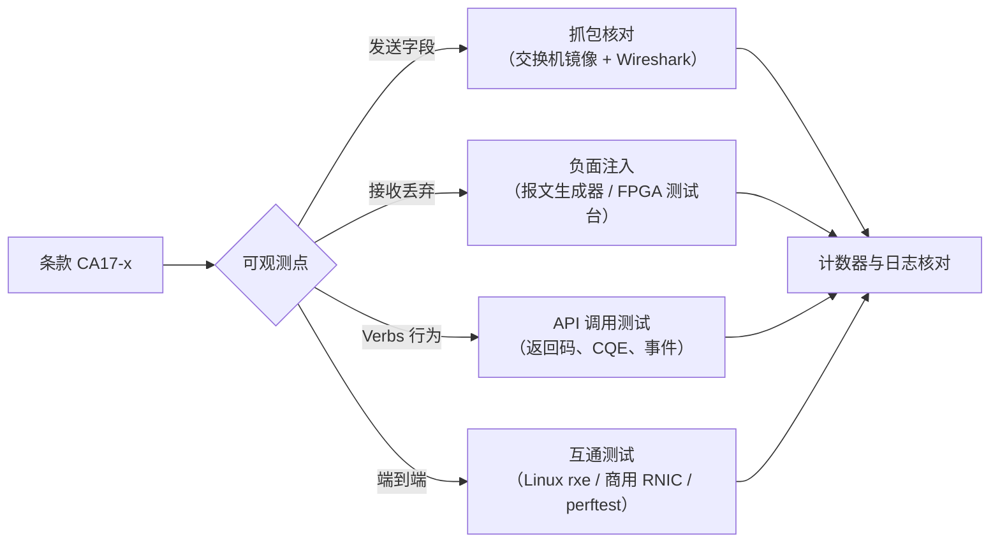

# Annex A17 合规条款清单（RoCEv2 Compliance Checklist）

> **摘要**：逐条列出 Annex A17 的全部 46 条合规条款（CA17-1～CA17-46）——页码、所属小节、适用对象、要求要点、强制性、验证方法与知识库链接；并汇总被 A17 声明"不适用/替换"的基础规范条款、A17 中未编号的 should/may 要求、与 Annex A16（RoCE v1）条款的对照，最后给出按模块分组的实现自检表。可直接用作 RoCEv2 网卡/IP 核的设计评审与验收清单。
>
> **规范出处**：Vol1 Annex A17（p.1928–1949）；Vol1 Annex A16（p.1911–1927）；Vol1 §9.6.1.2（p.297–299）、§11.2.6（p.622）、§17.2（p.1188–1203）
>
> **前置阅读**：[规范章节对照](02-spec-section-map.md)、[帧布局](../01-packet-format/01-frame-layout.md)、[以太网/IP/UDP 字段](../01-packet-format/02-ethernet-ip-udp.md)
>
> **关键词**：CA17, compliance, shall, silently drop, Not Applicable, 验收, 自检表

## 1. 使用说明

### 1.1 条款的法律效力

- Annex A17 是**可选规范（Optional Normative）**：是否实现 RoCEv2 由产品决定，但一旦声称支持，就必须满足附录内的合规条款〔Vol1 §A17.1, p.1928〕。
- CA17-25 进一步要求含 RoCEv2 端口的 HCA 满足第 9 章 IB 传输层（A17 列出的调整除外），§A17.7 说明第 17 章大部分条款同样适用。因此"RoCEv2 合规" = **A17 的 46 条 + 第 9 章 + 第 17 章（除列明例外）+ 按 §A17.5 修改后的 Verbs 要求**。
- 部分条款是**条件性**的：CA17-5/CA17-14 只约束"不支持 RCM 的 HCA"；CA17-40～CA17-43 只约束"同时支持 RoCE v1 的 RoCEv2 端口"；CA17-44～CA17-46 只约束"支持 RCM 的 HCA"。

### 1.2 表格列说明

| 列 | 含义 |
|---|---|
| 编号 / 页码 / 小节 | 规范原编号、所在页、所属 A17 小节 |
| 适用对象 | 发送（TX 报文生成）、接收（RX 校验）、ICRC、寻址（GID 表/AV）、传输层、Verbs、CM、拥塞管理、互通（与 RoCE v1） |
| 要求要点 | 中文意译，不是原文 |
| 强制性 | 按原文措辞：shall / shall not / should / may；"条件"表示仅在特定能力存在时适用 |
| 实现检查项 | 建议的验证方法：抓包核对、负面注入、Verbs 调用、互通测试 |

### 1.3 条款分布

| A17 小节 | 条款 | 数量 | 主题 |
|---|---|---|---|
| §A17.3 报文格式 | CA17-1～CA17-24 | 24 | 以太类型、IPv4/IPv6 头、UDP 头、ICRC、入站丢弃 |
| §A17.4 传输层考量 | CA17-25～CA17-29 | 5 | 遵循第 9 章、GID type、IP 版本、无 Raw、忽略 F/B |
| §A17.5 Verbs | CA17-30～CA17-32 | 3 | Verbs 修改、无 Client Reregistration / Port Change |
| §A17.6 管理与 CM | CA17-33～CA17-38 | 6 | 丢弃 QP0 报文、CM 消息中的 LID 字段 |
| §A17.7 通道适配器 | CA17-39 | 1 | 入站传输层检查 |
| §A17.8 与 RoCE 互通 | CA17-40～CA17-43 | 4 | GID type 决定模式（条件） |
| §A17.9 拥塞管理 | CA17-44～CA17-46 | 3 | ECN→CNP→降速→提速（条件） |
| **合计** | | **46** | 除 CA17-46 为 should 外均为强制 |

## 2. 逐条清单

### 2.1 §A17.3 报文格式（CA17-1～CA17-24）

| 编号 | 页码 | 小节 | 适用对象 | 要求要点 | 强制性 | 实现检查项 | 知识库 |
|---|---|---|---|---|---|---|---|
| CA17-1 | 1932 | A17.3.1 | 发送/接收 | RoCEv2 端口必须**同时**支持 IPv4 与 IPv6 两种 RoCEv2 报文格式 | shall | 分别用 IPv4、IPv6 类型 GID 建立 RC 连接并双向收发，UD 双栈收发；抓包核对 Ethertype 0x0800 / 0x86DD | [以太网/IP/UDP](../01-packet-format/02-ethernet-ip-udp.md) |
| CA17-2 | 1932 | A17.3.1 | 发送 | 报文符合 Figure 348 格式，字段按 §A17.3.1.1（IPv4）或 §A17.3.1.2（IPv6）设置 | shall | 覆盖全部 OpCode（含 ACK/NAK、READ 响应、Atomic 响应、CNP）的抓包全字段比对；Wireshark 无畸形告警 | [帧布局](../01-packet-format/01-frame-layout.md) |
| CA17-3 | 1932 | A17.3.1.1.1 | 发送 | IPv4 IHL = 5（不带 IP 选项） | shall | 抓包 IHL = 5；接收端对 IHL ≠ 5 的报文按 CA17-24 丢弃 | [以太网/IP/UDP](../01-packet-format/02-ethernet-ip-udp.md) |
| CA17-4 | 1932 | A17.3.1.1.2 | 发送 | IPv4 DSCP = 该报文关联 AV 的 Traffic Class | shall | 遍历多个 TClass 值抓包核对 DSCP；响应类报文（ACK/NAK/READ 响应）的 DSCP 取自 QP 上下文中的 AV，同样要核对。TClass 为 8 bit 而 DSCP 为 6 bit，常见实现取 TClass 高 6 bit〔业界，厂商相关〕 | [QoS](../05-congestion-control-and-qos/02-qos-dscp-pcp-ets.md) |
| CA17-5 | 1932 | A17.3.1.1.3 | 发送/拥塞管理 | 不支持 RCM 的 HCA：IPv4 ECN 必须为 00（支持 RCM 时可置 01 或 10，见 §3） | shall（条件） | 未实现或关闭 RCM 时抓包 ECN = 00 | [ECN 与 CNP](../05-congestion-control-and-qos/03-ecn-and-cnp.md) |
| CA17-6 | 1932 | A17.3.1.1.4 | 发送 | IPv4 Total Length = IPv4 头 + UDP 头 + BTH … 直到并包含 ICRC | shall | 用 0 长度负载、PadCnt = 0/1/2/3 等边界构造，核对 Total Length = 帧长 − L2 头 − FCS | [常数与公式](05-constants-and-formulas.md) |
| CA17-7 | 1932 | A17.3.1.1.5 | 发送 | IPv4 Flags = 010（DF = 1，MF = 0） | shall | 抓包核对；接收端对分片（MF = 1）报文丢弃 | [以太网/IP/UDP](../01-packet-format/02-ethernet-ip-udp.md) |
| CA17-8 | 1933 | A17.3.1.1.6 | 发送 | IPv4 Fragment Offset = 0 | shall | 抓包核对；接收端对偏移 ≠ 0 的报文丢弃 | [以太网/IP/UDP](../01-packet-format/02-ethernet-ip-udp.md) |
| CA17-9 | 1933 | A17.3.1.1.7 | 发送 | IPv4 TTL = AV 的 Hop Limit | shall | 设 Hop Limit 为 1/64/255 抓包核对；跨路由器测试（TTL 被递减后 ICRC 仍通过） | [以太网/IP/UDP](../01-packet-format/02-ethernet-ip-udp.md) |
| CA17-10 | 1933 | A17.3.1.1.8 | 发送 | IPv4 Protocol = 0x11（UDP） | shall | 抓包核对 | [以太网/IP/UDP](../01-packet-format/02-ethernet-ip-udp.md) |
| CA17-11 | 1933 | A17.3.1.1.9 | 发送/寻址 | IPv4 源地址 = AV 的 port + SGID index 所指端口 GID 表项中编码的 IPv4 地址 | shall | 端口配多个 IP，切换 sgid_index 抓包核对 SIP（含响应包） | [寻址](../00-overview/04-addressing.md) |
| CA17-12 | 1933 | A17.3.1.1.9 | 发送/寻址 | IPv4 目的地址 = AV 的 DGID 中编码的 IPv4 地址（::ffff:a.b.c.d 的低 32 bit） | shall | 抓包核对；建议在 Verbs 层拒绝"IPv4 类型 SGID + 非 IPv4 映射 DGID"的组合（实现建议） | [寻址](../00-overview/04-addressing.md) |
| CA17-13 | 1933 | A17.3.1.2.1 | 发送 | IPv6 DSCP = AV 的 Traffic Class | shall | 同 CA17-4（IPv6） | [QoS](../05-congestion-control-and-qos/02-qos-dscp-pcp-ets.md) |
| CA17-14 | 1934 | A17.3.1.2.2 | 发送/拥塞管理 | 不支持 RCM 的 HCA：IPv6 ECN 必须为 00 | shall（条件） | 同 CA17-5（IPv6） | [ECN 与 CNP](../05-congestion-control-and-qos/03-ecn-and-cnp.md) |
| CA17-15 | 1934 | A17.3.1.2.3 | 发送 | IPv6 Payload Length = 从 IPv6 头之后第一个字节起到 ICRC（含 4 字节）的长度 | shall | 原文括号注"即 BTH"，但 RoCEv2 中 IPv6 头之后紧跟 UDP 头；按 IPv6（RFC 8200）语义与业界实现〔业界: Linux rxe prepare_ipv6_hdr()〕，Payload Length 应等于 UDP Length（含 8 字节 UDP 头）。互通时以 Wireshark 校验（解读） | [常数与公式](05-constants-and-formulas.md) |
| CA17-16 | 1934 | A17.3.1.2.4 | 发送 | IPv6 Next Header = 0x11（即不带扩展头） | shall | 抓包核对；接收端对带扩展头的报文按 CA17-24 处理 | [以太网/IP/UDP](../01-packet-format/02-ethernet-ip-udp.md) |
| CA17-17 | 1934 | A17.3.1.2.5 | 发送 | IPv6 Hop Limit = AV 的 Hop Limit | shall | 同 CA17-9 | [以太网/IP/UDP](../01-packet-format/02-ethernet-ip-udp.md) |
| CA17-18 | 1934 | A17.3.1.2.6 | 发送/寻址 | IPv6 源地址 = SGID index 所指 GID 表项中的 IPv6 地址 | shall | 多个 IPv6 地址（link-local 与 global）间切换 sgid_index 核对 | [寻址](../00-overview/04-addressing.md) |
| CA17-19 | 1934 | A17.3.1.2.6 | 发送/寻址 | IPv6 目的地址 = AV 的 DGID | shall | 抓包核对 | [寻址](../00-overview/04-addressing.md) |
| CA17-20 | 1934 | A17.3.2.2 | 发送/接收 | UDP 目的端口 = IANA 为 RoCEv2 分配的值（即 4791〔外部: IANA〕；原文脚注称"分配后更新"） | shall | 抓包核对；接收分类器只把 dport = 4791 的 UDP 报文送入 RoCE 引擎，其余交主机协议栈 | [以太网/IP/UDP](../01-packet-format/02-ethernet-ip-udp.md) |
| CA17-21 | 1935 | A17.3.2.3 | 发送 | UDP Length = 从 UDP 头起到 ICRC（含 4 字节）的字节数 | shall | 与 CA17-6 同法覆盖填充边界；IPv4 下 UDP Length = Total Length − 20 | [常数与公式](05-constants-and-formulas.md) |
| CA17-22 | 1935–1936 | A17.3.3 | ICRC | ICRC 生成/校验沿用 §7.8.1，但：(a) 先输入 64 bit 全 1；(b) 接着从 IP 头首字节覆盖到 ICRC 前最后一个负载字节；(c) IP 可变字段以 1 替换——IPv4：TTL、Header Checksum、TOS（DSCP+ECN），IPv6：Traffic Class（DSCP+ECN）、Flow Label、Hop Limit；(d) UDP Checksum 以 1 替换 | 强制（合规条款，陈述句式） | ① 用 §7.8.4 Table 28/33（0x9625B75A / 0xB67D1ED1）验证 CRC 内核；② 与已知正确实现互发并比对 ICRC；③ 改写可变字段（TTL、DSCP、ECN、Flow Label、UDP 校验和）后 ICRC 仍通过；④ 改写不变字段（UDP 源端口、IP 地址、BTH、负载）后 ICRC 必失败 | [ICRC](../01-packet-format/06-icrc.md) |
| CA17-23 | 1936 | A17.3.4 | 接收 | 入站 RoCEv2 报文须按第 9 章校验，并采用 §A17.4 列出的修改 | shall | 以 §9.6 校验流程 + §A17.4.4 替换规则建立负面测试矩阵（见 §5.2） | [排序与校验](../02-transport/03-ordering-and-validation.md) |
| CA17-24 | 1936 | A17.3.4 | 接收 | 不符合 §A17.3.1（以太类型/IP 头）、§A17.3.2（UDP 头）、§A17.3.3（ICRC）规则的入站报文须**静默丢弃** | shall | 注入 ICRC 错、IHL ≠ 5、分片、Protocol ≠ 0x11、长度字段不一致等报文 → 无 ACK/NAK、无 CQE、QP 状态不变，仅丢弃计数增加。注意：发送侧专属规则（如 DSCP = AV TClass）接收端无法判定；UDP 校验和为 should 规则且已被 ICRC 屏蔽，接收端不宜因其非 0 丢包（解读） | [排序与校验](../02-transport/03-ordering-and-validation.md) |

### 2.2 §A17.4 InfiniBand 传输协议考量（CA17-25～CA17-29）

| 编号 | 页码 | 小节 | 适用对象 | 要求要点 | 强制性 | 实现检查项 | 知识库 |
|---|---|---|---|---|---|---|---|
| CA17-25 | 1936 | A17.4 | 传输层 | 含 RoCEv2 端口并声称符合本附录的 HCA 须符合第 9 章 IB 传输层，A17 明确列出的调整与例外除外 | shall | 按第 9 章合规条款（C9-x / o9-x）建立测试；与 IB 或 RoCE 参考实现互通 | [服务类型](../02-transport/01-service-types.md) |
| CA17-26 | 1938 | A17.4.3 | 寻址 | 端口 GID 表项须带"GID type"属性，取值 IPv4 / IPv6 / IB GID | shall | Query GID 能返回类型；IP 地址增删后表项与类型同步更新（Linux 可查 sysfs gid_attrs/types〔业界〕） | [寻址](../00-overview/04-addressing.md) |
| CA17-27 | 1939 | A17.4.4.1 | 接收 | IPv6 报文版本号 ≠ 6、IPv4 报文版本号 ≠ 4 时静默丢弃（替换 C9-45） | shall | 注入 Ethertype 0x0800 但 Version = 6、0x86DD 但 Version = 4 的报文 → 丢弃 | [排序与校验](../02-transport/03-ordering-and-validation.md) |
| CA17-28 | 1939 | A17.4.6 | Verbs/传输层 | 不得在 RoCEv2 端口上支持 IB Raw 数据报（Raw IPv6、Raw Ethertype） | shall not | 申请 Raw 类型特殊 QP、Post Send Raw 操作均失败 | [不可靠服务](../02-transport/04-unreliable-services.md) |
| CA17-29 | 1940 | A17.4.8 | 接收/拥塞管理 | BTH 中 IB 拥塞控制用的 B（BECN）、F（FECN）位不使用，RoCEv2 端口须忽略 | shall | 发送时 F/B = 0（C9-6）；注入 F/B = 1 的报文 → 正常处理（两位位于 ICRC 屏蔽的 Resv8a 字节内，ICRC 不受影响） | [IB CC 对比](../05-congestion-control-and-qos/07-ib-cc-vs-rocev2-cc.md) |

### 2.3 §A17.5 Verbs 考量（CA17-30～CA17-32）

| 编号 | 页码 | 小节 | 适用对象 | 要求要点 | 强制性 | 实现检查项 | 知识库 |
|---|---|---|---|---|---|---|---|
| CA17-30 | 1940 | A17.5 | Verbs | RoCEv2 HCA 须采纳 §A17.5.1–A17.5.10 的全部 Verbs 修改：Query HCA（Base LID/LMC、VL 数、InitTypeReply、SM 地址、IsSM/IsSMDisabled/IsSNMPTunnelingSupported/IsClientReregistrationSupported 位无效；新增端口类型"RoCEv2"与"RoCE Supported"能力位）；Modify HCA（IsSM、IsSNMPTunnelingSupported 位保留）；AH/QP/XRC TGT QP/EE 的 AV 与备用路径按 §A17.4.2 修改；多播 MLID 忽略；UD 完成的远端地址信息；Get Special QP 仅 QP1；Post Send 去掉 Raw | shall | 逐个 Verb 测：端口类型与能力位；用 SL = 8 创建 AH/Modify QP 的返回；UD CQE 中的源 MAC 与 IPv4/IPv6/RoCE 标志；Get Special QP 请求 QP0 返回"Invalid Special QP Type" | [Verbs 的 RoCEv2 修改](../03-verbs-and-resources/05-verbs-roce-specifics-and-programming.md) |
| CA17-31 | 1942 | A17.5.10 | Verbs | RoCEv2 端口不得支持 Client Reregistration | shall not | 不产生该非关联异步事件，相关能力位不置位 | [Verbs 的 RoCEv2 修改](../03-verbs-and-resources/05-verbs-roce-specifics-and-programming.md) |
| CA17-32 | 1942 | A17.5.10 | Verbs | RoCEv2 端口不得支持可选的 Port Change Event | shall not | 不产生该事件；注意与 OS 软件栈自定义的通知（如 GID 表变化）区分（业界实现层面） | [Verbs 的 RoCEv2 修改](../03-verbs-and-resources/05-verbs-roce-specifics-and-programming.md) |

### 2.4 §A17.6 管理与通信管理（CA17-33～CA17-38）

| 编号 | 页码 | 小节 | 适用对象 | 要求要点 | 强制性 | 实现检查项 | 知识库 |
|---|---|---|---|---|---|---|---|
| CA17-33 | 1943 | A17.6 | 接收 | 到达 RoCEv2 端口、BTH DestQP = QP0 的报文须静默丢弃 | shall | 注入 DestQP = 0 的各类 OpCode → 无响应、无 CQE | [MAD 与 GSI](../04-connection-management/03-mad-and-gsi.md) |
| CA17-34 | 1943 | A17.6.1.1 | CM | RoCEv2 端口间建连时，REQ 的 Primary Local/Remote Port LID、Alternate Local/Remote Port LID 四字段保留，接收时忽略且不得校验 | shall | 发送 LID 字段为随机值的 REQ → 连接正常建立 | [CM 协议](../04-connection-management/01-cm-protocol.md) |
| CA17-35 | 1944 | A17.6.1.2 | CM | REJ 中不得发送原因码 13（Primary Remote Port LID rejected）、19（Alternate Remote Port LID rejected） | shall not | 枚举各种拒绝场景，抓包确认无 13/19 | [CM 协议](../04-connection-management/01-cm-protocol.md) |
| CA17-36 | 1944 | A17.6.1.3 | CM | 建立备用路径时，LAP 的 Alternate Local/Remote Port LID 保留，接收时忽略且不得校验 | shall | 发送 LID 为随机值的 LAP → 正常处理 | [CM 协议](../04-connection-management/01-cm-protocol.md) |
| CA17-37 | 1944 | A17.6.1.4 | CM | APR 中不得发送状态码 7（Proposed Alternate Remote Port LID rejected） | shall not | 抓包确认 | [CM 协议](../04-connection-management/01-cm-protocol.md) |
| CA17-38 | 1944 | A17.6.1.5 | CM | SAP 的 Alternate Local Port LID 保留，接收时忽略 | shall | 发送随机值的 SAP → 正常处理 | [CM 协议](../04-connection-management/01-cm-protocol.md) |

### 2.5 §A17.7 通道适配器（CA17-39）

| 编号 | 页码 | 小节 | 适用对象 | 要求要点 | 强制性 | 实现检查项 | 知识库 |
|---|---|---|---|---|---|---|---|
| CA17-39 | 1945 | A17.7.4 | 接收 | RoCEv2 端口上，CA 须对所有入站报文做传输层错误检查（替换 C17-21 的"链路、网络、传输层"检查） | shall | 复用 CA17-23/24 的负面测试矩阵；链路层错误（FCS）由以太网 MAC 负责 | [排序与校验](../02-transport/03-ordering-and-validation.md) |

### 2.6 §A17.8 与 RoCE 端点互通（CA17-40～CA17-43）

| 编号 | 页码 | 小节 | 适用对象 | 要求要点 | 强制性 | 实现检查项 | 知识库 |
|---|---|---|---|---|---|---|---|
| CA17-40 | 1945 | A17.8 | 互通/发送 | 支持 RoCE 的 RoCEv2 端口：连接型 QP 按 Modify QP 所配 GID 表项的 GID type 工作在 RoCE 或 RoCEv2 模式 | shall（条件） | 分别用 IB GID 类型与 IPv4/IPv6 类型表项建连，抓包确认 Ethertype 0x8915 与 0x0800/0x86DD | [寻址](../00-overview/04-addressing.md) |
| CA17-41 | 1945 | A17.8 | 接收 | 对需做 DGID 检查的入站报文（§9.6.1.2.3），若匹配到的 GID 表项类型与报文协议不符，检查视为失败 | shall | 向 RoCEv2 连接注入同 DGID 的 RoCE v1 报文（反之亦然）→ 丢弃 | [排序与校验](../02-transport/03-ordering-and-validation.md) |
| CA17-42 | 1945 | A17.8 | 互通/发送 | 支持 RoCE 的 RoCEv2 端口：UD QP 按 WQE 中 AV 所引用 GID 表项的类型选择 RoCE 或 RoCEv2 发包 | shall（条件） | 同一 UD QP 交替使用两类 AH 发送，抓包确认封装 | [不可靠服务](../02-transport/04-unreliable-services.md) |
| CA17-43 | 1946 | A17.8 | 互通/接收 | 支持 RoCE 的 RoCEv2 端口：UD QP 须把 RoCE 与 RoCEv2 报文都视为有效 | shall（条件） | 同一 UD QP 接收两种封装均产生 CQE，CQE 中协议标志正确 | [不可靠服务](../02-transport/04-unreliable-services.md) |

### 2.7 §A17.9.3 RoCEv2 拥塞管理（CA17-44～CA17-46）

| 编号 | 页码 | 小节 | 适用对象 | 要求要点 | 强制性 | 实现检查项 | 知识库 |
|---|---|---|---|---|---|---|---|
| CA17-44 | 1947 | A17.9.3 | 拥塞管理（接收侧） | 支持 RCM 时：收到 IP.ECN = 11 的**有效** RoCEv2 报文，须按 Figure 349 格式生成 RoCEv2 CNP 发往该报文的源端；同一 QP 上多个被标记报文可只回一个 CNP（may） | shall（条件） | 交换机或注入器把 ECN 置 11 → 抓到 CNP：OpCode 0x81、DestQP = 需降速的 QP（被标记报文的源 QP）、PSN = 0、SE = 0、M = 0、P_Key 与被标记报文相同、16 字节保留区为 0、ICRC 正确；ICRC 错等无效报文不应触发 CNP | [ECN 与 CNP](../05-congestion-control-and-qos/03-ecn-and-cnp.md) |
| CA17-45 | 1947 | A17.9.3 | 拥塞管理（发送侧） | 支持 RCM 时：收到 CNP 后须降低 CNP 所指 QP 的注入速率；降幅由速率削减参数决定，其配置不在规范范围 | shall（条件） | 周期注入 CNP，测量该 QP 速率下降，其他 QP 不受影响 | [DCQCN](../05-congestion-control-and-qos/04-dcqcn.md) |
| CA17-46 | 1948 | A17.9.3 | 拥塞管理（发送侧） | 支持 RCM 时：自最近一次 CNP 起经过可配置的时间和/或该 QP 已发送可配置的字节数后，应提高该 QP 的注入速率；时间、字节数与增幅的配置不在规范范围 | should（条件） | 停止注入 CNP，观察速率按定时器与字节计数器两种触发方式恢复 | [DCQCN](../05-congestion-control-and-qos/04-dcqcn.md) |

> [!IMPORTANT]
> Figure 349（p.1948）规定 RoCEv2 CNP 格式：MAC 头 + IPv4/IPv6 头 + UDP 头 + BTH + 16 字节保留（发送方**必须**置 0、接收方忽略）+ ICRC + FCS；BTH 中 OpCode = 0b1000_0001，DestQP = 为之生成 CNP 的 QP 号，PSN = 0，SE = 0，M = 0，P_Key 与被 ECN 标记报文的 BTH 相同。这些字段要求是 CA17-44 的一部分。

## 3. A17 中未编号的要求（should / may / 规范性描述）

| 出处 | 页码 | 要求 | 强度 | 检查建议 |
|---|---|---|---|---|
| §A17.3.1.1.3、§A17.3.1.2.2 | 1932、1933 | 支持 RCM 的 HCA 可把 ECN 置 01 或 10，表示报文可被网络标记 | may | 开启 RCM 后抓包确认 ECT 值，交换机能正确标记 CE |
| §A17.3.2.1 | 1934 | 有顺序要求的报文（如同一连接 QP 的报文）应使用固定 UDP 源端口 | should | 同一 QP 全部报文（含重传、READ 响应）源端口恒定；不同 QP 的端口有足够熵 |
| §A17.3.2.4 | 1935 | UDP Checksum 应置 0 | should | 抓包确认为 0 |
| §A17.4.1.1 | 1936 | IPv4 地址按 ::ffff:<IPv4> 编码进 SGID/DGID | 规范性描述 | GID 表与 AV 中 IPv4 地址格式 |
| §A17.4.1.2 | 1936 | 规范中所有 LRH 及其字段的引用对 RoCEv2 端口不适用 | 规范性描述 | 设计中不残留 LRH 相关逻辑 |
| §A17.4.2 | 1937–1938 | AV 的"发送 GRH"标志恒为 TRUE；SGID 经 SGID index 引用；L3→L2 解析不在范围（用 OS 的 ARP/路由）；DLID 泛化为"目的 L2 地址"，0xFFFFFFFFFFFF 表示由 Create AH/Modify QP 的实现自行解析；Source Path Bits 不适用；源 MAC 由所选 SGID 隐含；SL 0–7 映射到以太网优先级 0–7，SL 8–15 保留 | 规范性描述 | Verbs 层与 QP 上下文字段设计 |
| §A17.4.3 | 1938 | 软件栈负责随 L3 地址的增删维护 GID 表（通常订阅 OS 事件） | 规范性描述 | 增删 IP、VLAN 接口后 GID 表同步 |
| §A17.4.4 | 1938 | 基础规范 §9.6.1.2 的 GRH 检查由 A17 规则取代（见 §4） | 规范性描述 | 见 CA17-27、CA17-41 |
| §A17.4.4.2 | 1939 | §9.6.1.2.3 的 SGID/DGID 校验规则适用：IPv6 的 SIP/DIP 即 SGID/DGID，IPv4 按 ::ffff 映射；DGID 检查追加协议类型校验（CA17-41） | 规范性描述 | RC/UC/XRC 入站报文的地址校验 |
| §A17.4.5.1 | 1939 | UD 的 CQE 远端地址信息 = 源 L2 地址 + 标志（IPv4 / IPv6 / RoCE 报文） | 规范性描述（经 §A17.5.7 成为 Verbs 要求） | UD CQE 字段 |
| §A17.4.5.2 | 1939 | UD 接收缓冲前 40 字节保留给 L3 头：IPv6 头占满 40 字节；IPv4 头放在后 20 字节（偏移 20），前 20 字节内容未定义 | 规范性描述 | 抓取接收缓冲内容核对偏移 |
| §A17.4.7 | 1940 | P_Key 表上电初始化时至少含默认 P_Key；入站 BTH 的 P_Key 仍按第 9 章校验；P_Key 表填充方法不在范围 | 规范性描述 | P_Key 表初值与校验逻辑 |
| §A17.4.8–A17.4.9 | 1940 | 声称支持 A10/A13 的 CA，其 RoCEv2 端口不需要支持 A10/A13 的任何属性、计数器与控制 | 规范性描述 | — |
| §A17.5.8 | 1942 | 对 RoCEv2 端口调用 Get Special QP 请求 QP1 以外的 QP，**须**返回"Invalid Special QP Type" | shall（未编号） | Verbs 测试 |
| §A17.6 | 1942–1943 | SM、SA、PM、DevMgt、BM、SNMP 隧道、Vendor、Application、CC、Boot、BIS 管理类及其合规条款不适用；指向 RoCE 端口的 IB 方法/属性组合可返回 MAD 状态码 7（字段值无效） | 规范性描述 / may | GSI 收到非 CM 类 MAD 的处理 |
| §A17.6.1 | 1943 | CM 报文就是与目标连接同类型（IPv4 或 IPv6）的普通 RoCEv2 报文；与 RoCE v1 端点的连接，其 CM 报文是 RoCE 报文 | 规范性描述 | 抓包核对 CM MAD 的封装 |
| §A17.7.1 | 1944 | P_Key 表的设置方法不由规范定义（默认 P_Key 要求除外） | 规范性描述 | — |
| §A17.8 | 1945 | RoCEv2 端口**可选**地支持生成/处理 RoCE v1 报文；协议选择由 GID type 控制 | 可选 | "RoCE Supported"能力位与实际行为一致 |
| §A17.9.1 | 1946 | 网络应配置为无损（通常用 802.1Qbb PFC）；跨多个二层子网时，三层路由器应把 RoCEv2 报文映射到下一子网中启用 PFC 的优先级；非 RoCEv2 流量应使用另一组可关闭 PFC 的优先级 | should | 网络配置评审 |
| §A17.9.2 | 1946–1947 | QoS 通过 ETS（802.1Qaz）等机制实现；流识别沿用 DSCP / 802.1Q，由 AV 的 Traffic Class 控制 | 规范性描述 | 交换机 QoS 配置 |
| §A17.9.4 | 1948–1949 | 有序报文序列（如连接 QP）携带恒定 UDP 源端口；彼此无顺序约束的报文可使用不同源端口 | 规范性描述（与 §A17.3.2.1 的 should 呼应） | ECMP 路径一致性测试 |

## 4. 被 A17 声明"不适用/替换"的基础规范条款

| 基础规范条款 / 范围 | 原页码 | 原要求（意译） | A17 的处理 | A17 出处 | 对照 A16（RoCE v1） |
|---|---|---|---|---|---|
| 所有涉及 LRH 及其字段的内容 | §5.2.1 p.171、§7.7 p.215 等 | IB 链路层路由头 | 对 RoCEv2 端口全部不适用 | §A17.4.1.2, p.1936 | 相同（§A16.3.1：以 MAC 头替代 LRH） |
| C9-43.1.1 | 298 | UD 多播包若无 GRH 须静默丢弃 | 不适用（RoCEv2 每包都有 IP 头） | §A17.4.4, p.1938 | — |
| C9-43.1.2 | 298 | RC/RD/UC/XRC：报文是否带 GRH 与 QP/EEC 配置一致即通过 GRH 存在性检查 | 不适用 | §A17.4.4, p.1938 | — |
| C9-44 | 298 | GRH 存在时须检查 Next Header，非 0x1B（IBA 传输）则静默丢弃 | 不适用（RoCEv2 的 Protocol/Next Header 为 0x11） | §A17.4.4, p.1938 | RoCE v1 带 GRH，仍适用 |
| C9-45 | 298 | GRH 版本 ≠ 6 则静默丢弃 | **替换为 CA17-27** | §A17.4.4.1, p.1938–1939 | — |
| §9.6.1.2.3（C9-46、C9-47.1.1） | 298–299 | SGID/DGID 校验规则 | **仍适用**：IPv4 按 ::ffff 映射；DGID 检查追加 GID type 一致性（CA17-41） | §A17.4.4.2, p.1939 | — |
| §9.8.4 Raw datagrams 及所有 Raw 报文引用 | 420–422 | Raw IPv6 / Raw Ethertype 服务 | 不适用；CA17-28 禁止支持 | §A17.4.6, p.1939 | CA16-14、CA16-19 |
| Annex A10 全部属性、计数器、控制 | 1797–1847 | IB 拥塞控制 | RoCEv2 端口不要求；F/B 位忽略（CA17-29） | §A17.4.8, p.1940 | §A16.7.4、CA16-16 |
| Annex A13 全部 | 1863–1885 | IB QoS 管理 | RoCEv2 端口不要求 | §A17.4.9, p.1940 | §A16.7.5 |
| C11-13 | 622 | Get Special QP 须支持 QP0 与 QP1 | 关于 QP0 的部分不适用 | §A17.5.8, p.1942 | §A16.9.13 |
| o11-1 | 622 | 若 HCA 支持 Raw 数据报 QP，Get Special QP 也须支持 | 不适用 | §A17.5.8, p.1942 | §A16.9.13 |
| Post Send 操作类型矩阵中的 Raw 行 | §11.4.1 | Raw 服务允许的操作 | 删除该行 | §A17.5.9, p.1942 | §A16.9.14、CA16-19 |
| 管理类 SM、SA、PM、DevMgt、BM、SNMP 隧道、Vendor、Application、CC、Boot、BIS 及其合规条款 | 第 13–16 章、A5、A6、A8、A10 | IB 管理框架 | 不适用，改用以太网/IP 管理实践 | §A17.6, p.1942–1943 | §A16.4（除 CM 外均不在范围；CA16-5/6/7） |
| QP0（SMI） | — | 子网管理专用 QP | 与 RoCEv2 无关；DestQP = 0 报文静默丢弃（CA17-33） | §A17.6, p.1943 | CA16-8 |
| C17-7 | 1193 | P_Key 表无需 OS 参与，直接由 SM 的 MAD 设置 | 不适用 | §A17.7.1, p.1944 | §A16.10.1 相同 |
| C17-9 | 1196 | CA 须能对所有 QP 收发本地路由（无 GRH）报文 | 不适用（RoCEv2 不存在本地路由报文） | §A17.7.2, p.1945 | A16 用 CA16-22 **替换**（RoCE 本地报文也带 GRH） |
| C17-19 | 1197 | 防死锁：不得持续、永久地施加反压（不授予链路信用） | 不适用 | §A17.7.3, p.1945 | §A16.10.3 相同 |
| C17-20 | 1197 | 防死锁：不得因出方向受反压而对入方向施加反压 | 不适用 | §A17.7.3, p.1945 | §A16.10.3 相同 |
| C17-21 | 1198 | 检查所有入站报文的链路、网络、传输层错误 | **替换为 CA17-39**（只要求传输层检查） | §A17.7.4, p.1945 | CA16-23 |
| C17-24 | 1200 | 每个端口须支持 QP0（SMA）与 QP1（GSA） | 不适用；QP1/GSI 仍是 CM 的载体（§A17.5.8、§A17.6.1） | §A17.7.5, p.1945 | §A16.10.5（移除 QP0 要求） |

> [!NOTE]
> 以下几处 A17 没有点名，但按其适用性声明可推出（解读，待核实）：
> - §10.9 中 P_Key 表"只能经 SMP 修改"（C10-122）等依赖 SM 的条款实际无法适用，因为 §A17.4.7 / §A17.7.1 声明 P_Key 表填充方法不在规范范围。
> - §A17.7 称第 17 章"大部分条款适用"，因此 C17-4（速率高于 2.5 Gb/s 的端口须支持静态速率控制）、C17-11（HCA 须在任何 QP 上支持 UD、RC、UC）、C17-18（自寻址报文不得上线路）等仍应视为适用。
> - Query HCA 中 LID/LMC/VL/SM 等字段属于 CA17-30 的"无效并忽略"范畴，不是删除。

## 5. 与 Annex A16（RoCE v1）条款对照

| A17 条款 | A16 对应条款 | 差异说明 |
|---|---|---|
| CA17-1～CA17-24（IP/UDP 封装与 ICRC） | CA16-1～CA16-4（MAC 头、Ethertype 0x8915、无 VCRC、必带 GRH） | 封装不同；两者 ICRC 都先输入 64 bit 全 1（§A16.3.2） |
| CA17-25 | CA16-15 | 都要求符合第 9 章 |
| CA17-26、CA17-40～CA17-43 | — | RoCEv2 新增（GID type 与 v1/v2 互通） |
| CA17-27 | — | RoCEv2 新增（IP 版本检查） |
| CA17-28 | CA16-14、CA16-19 | 都不支持 Raw |
| CA17-29 | CA16-16 | 都忽略 F/B；A16 额外指出 F/B 不在 ICRC 覆盖范围 |
| CA17-30 | §A16.9（无编号） | A16 对每个 Verb 的修改描述更细 |
| §A17.5.3–A17.5.5：SL 8–15 **可**返回 Invalid AV（may） | CA16-18：使用保留 SL **须**返回 Invalid AV（shall） | A17 措辞放宽；实现上建议仍拒绝保留 SL |
| CA17-31、CA17-32 | CA16-20、CA16-21 | 相同 |
| CA17-33 | CA16-8 | 相同 |
| CA17-34～CA17-37 | CA16-10～CA16-13 | 相同 |
| CA17-38（SAP） | — | A17 新增 |
| CA17-39 | CA16-23 | A16 措辞同时涵盖 IB 端口 |
| — | CA16-9（RespTimeValue 默认 19、SubnetTimeout 默认 18） | A17 无对应条款；RoCEv2 实现可沿用这两个默认值（解读） |
| — | CA16-15.1.1（RoCE 端口须支持静态速率控制） | A17 未单列；按 §A17.7 由 C17-4 覆盖（解读） |
| CA17-44～CA17-46（RCM） | — | RoCEv2 新增；A16 没有拥塞管理 |

## 6. 实现自检表（按模块）

### 6.1 报文生成（TX）

- [ ] 以太网头：DMAC 来自 AV/QP 上下文（AV 中为 0xFFFFFFFFFFFF 时由实现解析），SMAC 由 SGID 对应的网络接口决定（§A17.4.2）
- [ ] 若带 VLAN 标签：TPID 0x8100，PCP = SL（0–7），VID 取 GID 所在的 VLAN 接口〔业界〕
- [ ] Ethertype：IPv4 0x0800 / IPv6 0x86DD，两种都支持（CA17-1、CA17-2）
- [ ] IPv4：Version 4、IHL 5、DSCP = TClass、ECN（00 或 ECT）、Total Length、DF = 1 / MF = 0、Fragment Offset 0、TTL = Hop Limit、Protocol 0x11、SIP/DIP（CA17-3～CA17-12）
- [ ] IPv4 Header Checksum 正确（RFC 791 要求，A17 未单列；它在 ICRC 中被屏蔽，但路由器会校验）
- [ ] IPv6：Version 6、Traffic Class（DSCP + ECN）、Flow Label、Payload Length、Next Header 0x11、Hop Limit、SIP/DIP（CA17-13～CA17-19）
- [ ] UDP：源端口每 QP 固定（should）、目的端口 4791、Length、Checksum = 0（should）（§A17.3.2、CA17-20、CA17-21）
- [ ] BTH：TVer = 0（C9-5）；F/B/Resv6 = 0（C9-6）；Resv7 = 0（C9-7）；PadCnt 与负载长度一致；P_Key、DestQP、PSN 正确
- [ ] 扩展头组合与 OpCode 一致（Table 38）
- [ ] ICRC 紧跟在负载/填充之后；FCS 由以太网 MAC 生成
- [ ] 响应类报文（ACK/NAK、READ 响应、Atomic 响应、CNP）同样满足以上规则，地址/DSCP/TTL/源端口取自 QP 上下文

### 6.2 报文接收（RX）

- [ ] 分类链：Ethertype（含 VLAN 剥离）→ IP 版本与 Ethertype 一致（CA17-27）→ IHL = 5 / 无 IPv6 扩展头 → 非分片 → Protocol/Next Header = 0x11 → UDP 目的端口 4791
- [ ] 长度一致性：IP 长度、UDP Length、实际帧长、OpCode 决定的头长与 PadCnt 相容
- [ ] ICRC 错误 → 静默丢弃（CA17-24），只计数
- [ ] DGID（目的 IP）在端口 GID 表中，且 GID type 与报文协议一致（CA17-41）；RC/UC/XRC 按 §9.6.1.2.3 校验 SGID/DGID
- [ ] TVer = 0；OpCode 与目的 QP 的服务类型相符
- [ ] DestQP = 0 → 静默丢弃（CA17-33）；QP 不存在或状态不允许 → 按第 9 章处理
- [ ] P_Key 校验：QP1 对比端口 P_Key 表（C9-42），其他 QP 对比 QP 的 P_Key（C9-43）
- [ ] UD：Q_Key 校验（QP1 使用知名 Q_Key 0x80010000，C9-49）
- [ ] 忽略 BTH F/B 位（CA17-29）
- [ ] UD：接收缓冲前 40 字节写入 L3 头（IPv4 写在偏移 20）；CQE 带源 MAC 与 IPv4/IPv6/RoCE 标志（§A17.4.5）
- [ ] 支持 RCM 时：**有效**报文的 ECN = 11 → 触发 CNP（CA17-44）

### 6.3 ICRC

- [ ] CRC-32 多项式 0x04C11DB7、初值 0xFFFFFFFF、结果取反、比特/字节序与以太网 CRC 一致（§7.8.1, p.218–219）
- [ ] 先输入 64 bit 全 1（CA17-22(a)）
- [ ] 覆盖范围：IP 头首字节 → ICRC 前最后一个负载/填充字节；不含以太网头、VLAN 标签、FCS
- [ ] 屏蔽为全 1：IPv4 的 TOS、TTL、Header Checksum；IPv6 的 Traffic Class、Flow Label、Hop Limit；UDP Checksum；BTH 的 Resv8a 字节（F/B/Resv6）
- [ ] 不屏蔽：UDP 源/目的端口、IP 地址、IPv4 Identification 与 Flags 等
- [ ] 用 §7.8.4 样例（0x9625B75A、0xB67D1ED1）和真实 RoCEv2 抓包验证，包括 ICRC 4 字节写入线上的字节顺序

### 6.4 寻址与 GID 表

- [ ] GID 表项带 GID type（CA17-26）；IPv4 以 ::ffff:a.b.c.d 存储（§A17.4.1.1）
- [ ] 软件栈随 IP 地址增删同步 GID 表（§A17.4.3）
- [ ] AV 字段：GRH 标志恒 TRUE、SGID index、DGID、Hop Limit、Traffic Class、Flow Label、SL（0–7）、目的 L2 地址（§A17.4.2）
- [ ] L3→L2 解析借助 OS（ARP/ND）；邻居表变化时更新 AV/QP 中缓存的 DMAC（实现建议）
- [ ] P_Key 表上电即含默认 P_Key 0xFFFF（§A17.4.7、C10-115）

### 6.5 Verbs

- [ ] Query HCA/Port：端口类型"RoCEv2"；支持互通时置"RoCE Supported"；LID/LMC/VL/SM 相关字段被忽略（§A17.5.1）
- [ ] Modify HCA：IsSM、IsSNMPTunnelingSupported 位保留（§A17.5.2）
- [ ] AH / Modify QP / Modify XRC TGT QP / Modify EE：使用 SL 8–15 时可返回 Invalid Address Vector（§A17.5.3–A17.5.5）
- [ ] 多播 Attach/Detach 忽略 MLID，不返回"Invalid multicast MLID"（§A17.5.6）
- [ ] Poll CQ：UD 远端地址信息按 §A17.4.5.1（§A17.5.7）
- [ ] Get Special QP：只支持 QP1，其余返回"Invalid Special QP Type"（§A17.5.8）
- [ ] 无 Raw 服务（CA17-28、§A17.5.9）；不支持 Client Reregistration（CA17-31）与 Port Change Event（CA17-32）

### 6.6 CM / GSI

- [ ] QP1（GSI）可用；MAD 负载 256 字节（C13-3），ComMgt 类 0x07；CM MAD 作为 UD 报文发往对端 QP1，Q_Key 0x80010000
- [ ] CM 报文的 IP 版本与目标连接一致；与 RoCE v1 端点的连接用 RoCE 报文（§A17.6.1）
- [ ] REQ/LAP/SAP 中的 LID 字段忽略且不校验（CA17-34、CA17-36、CA17-38）
- [ ] 不发送 REJ 原因码 13/19 与 APR 状态码 7（CA17-35、CA17-37）
- [ ] 使用 rdma_cm 时：REQ 私有数据按 Annex A11 格式，Service ID 前缀 0x0000000001
- [ ] CM 超时字段按 4.096 µs × 2^n 编码（§12.7.4–12.7.5、§12.7.32–12.7.34）

### 6.7 拥塞管理（RCM，可选）

- [ ] 发送 ECT（01 或 10）；不支持 RCM 时 ECN = 00（CA17-5、CA17-14）
- [ ] 接收侧：CE 检测 → 按 Figure 349 生成 CNP，可按 QP 合并（CA17-44）
- [ ] 发送侧：收到 CNP → 降低对应 QP 速率（CA17-45）；按时间/字节计数器提速（CA17-46）
- [ ] 降速/提速参数可配置（规范不给数值，算法见 [DCQCN](../05-congestion-control-and-qos/04-dcqcn.md)）
- [ ] 不使用 BTH F/B 位（CA17-29）

### 6.8 网络配置（§A17.9 的非强制建议）

- [ ] RoCEv2 所在优先级启用 PFC（802.1Qbb）；非 RoCE 流量使用其他优先级
- [ ] 跨三层时路由器把 RoCEv2 报文映射到下一子网启用 PFC 的优先级（DSCP → 优先级）
- [ ] ETS 为 RoCE 与其他流量分配带宽
- [ ] 使用 RCM 时交换机开启 ECN 标记
- [ ] ECMP 哈希包含 UDP 源端口

## 7. 验证方法速记

- **抓包**：RNIC 绕过内核协议栈，主机上的 tcpdump 通常看不到 RoCE 流量，应在交换机端口镜像抓包，或使用厂商提供的抓包工具〔业界，厂商相关〕；Wireshark 默认把 UDP 4791 解析为 RoCEv2（RRoCE）。
- **负面注入**：除被测字段外其余字段（尤其 ICRC）必须正确，否则测到的只是 ICRC 丢弃；每个用例同时检查"无响应、无 CQE、QP 状态不变、丢弃计数 +1"。
- **互通**：Linux Soft-RoCE（rxe）是方便的参考端；perftest 可用 `-x` 指定 GID index、`-R` 走 rdma_cm〔业界〕。
- 详细测试矩阵见 [验证与互通测试](../06-hardware-implementation/06-verification-and-interop.md) 与 [工具与测试](../07-engineering-practice/04-tools-and-testing.md)。

## 8. 要点回顾

- A17 共 46 条合规条款：CA17-1～24 管报文格式与 ICRC，25～29 管传输层适配，30～32 管 Verbs，33～38 管 QP0 与 CM，39 管入站检查，40～43 管与 RoCE v1 互通（条件），44～46 管 RCM（条件，46 为 should）。
- 接收侧的"静默丢弃"散布在 CA17-24、CA17-27、CA17-33 以及第 9 章的 P_Key/Q_Key/QP 检查中，硬件要统一实现为"丢弃 + 计数，不回 NAK、不产生 CQE"。
- 被替换/不适用的基础条款：C9-43.1.1、C9-43.1.2、C9-44 不适用，C9-45→CA17-27；C11-13（QP0 部分）、o11-1 不适用；C17-7、C17-9、C17-19、C17-20、C17-24 不适用，C17-21→CA17-39；所有 LRH、Raw、A10、A13、SM 类管理内容不适用。
- UDP 源端口固定、UDP 校验和为 0 都是 should；ECN 置 ECT 是 may；Get Special QP 对非 QP1 返回错误是未编号的 shall。
- CA17-15 原文括号"即 BTH"与报文结构不符，实践中 IPv6 Payload Length 等于 UDP Length。
- A17 相对 A16 新增了 GID type、IP 版本检查、SAP LID、RCM；把保留 SL 的处理从 shall 放宽为 may。

## 参考

- 规范：Vol1 Annex A17（p.1928–1949）；Annex A16（p.1911–1927）；§7.8（p.218–231）；§9.6.1.2（p.297–299）；§11.2.6（p.622）；§17.2（p.1188–1203）；§10.9.1.2（p.557）；§9.6.1.5.1（p.301）。
- 外部：IANA Service Name and Transport Protocol Port Number Registry（UDP 4791）；RFC 791、RFC 768、RFC 8200、RFC 3168；IEEE 802.1Qbb、802.1Qaz。
- 业界实践：Linux 内核 drivers/infiniband/sw/rxe（rxe_net.c）；Wireshark InfiniBand/RRoCE 解析器；linux-rdma/perftest。
