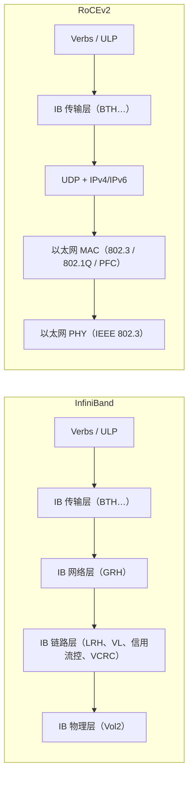

# IB 物理层（Vol2）与以太网 PHY 对比（IB Physical Layer vs. Ethernet PHY）

> **摘要**：RoCEv2 不使用 InfiniBand 的物理层和链路层，而是直接运行在以太网 PHY/MAC 之上。本文先摘要 IBTA Vol2 Release 1.4 定义的 IB 物理层（端口、lane 宽度、SDR～HDR 速率代际、8b/10b / 64b/66b / PAM4 / FEC、链路训练、Link Heartbeat），再与 IEEE 802.3 以太网 PHY 对比，说明 RoCEv2 为何不依赖 IB 物理/链路层、Vol2 Annex A3 对 RoCE 线缆管理接口的特别说明，以及这对 FPGA/ASIC 实现意味着什么。
>
> **规范出处**：Vol2 §3（p.62–73）、§5.1–5.5（p.84–147）、§5.9（p.202–250）、§5.16–5.17（p.274–277）、§6.9（p.371–396）、Annex A3（p.688–690）；Vol1 §7.6、§7.9（p.199–235）；Vol1 §A17.2.2（p.1928）
>
> **前置阅读**：[IBA 分层映射](../00-overview/03-architecture-and-layering.md)、[无损以太网与 PFC](../05-congestion-control-and-qos/01-lossless-ethernet-pfc.md)
>
> **关键词**：Vol2, SDR, DDR, QDR, FDR, EDR, HDR, 8b/10b, 64b/66b, PAM4, RS-FEC, Fire-code, QSFP28, Annex A3

## 1. 为什么 RoCEv2 工程师要了解 IB 物理层

规范对 RoCE 的定位很明确：RoCE 保留 IB 的 Verbs 语义及传输、网络协议，**用以太网的链路层和物理层替换 IB 的链路层和物理层**，网络管理基础设施也采用以太网的〔Vol1 §A17.2.2, p.1928〕；RoCEv2 在此基础上再用 IP/UDP 头替换 GRH〔Vol1 §A17.2.4, p.1930〕。



既然不用，为什么还要读 Vol2？

1. **同代际、同形态**：IB EDR 4x 与 100GBASE-CR4/SR4 共用 QSFP28 连接器与 25G 级信号速率，但在模块管理接口上有"小而关键"的差异〔Vol2 §A3.1, p.688〕，直接影响网卡能否识别线缆。
2. **理解无损的代价**：IB 链路层天生按 VL 做信用流控、不因拥塞丢包；以太网要靠 PFC 才能近似做到。理解二者差异，才能理解 RoCEv2 网络配置的要点。
3. **FPGA/ASIC 选型**：明确"哪些 IB 功能根本不需要实现"，把资源集中在传输层。

## 2. Vol2 概览

| 章节 | 页码 | 内容摘要 |
|---|---|---|
| 第 1–2 章 | 25–61 | 文档约定、参考文献、术语 |
| 第 3 章 Physical Layer Overview | 62–73 | 物理层结构、端口类型、电/光信号、链路物理层、速率与宽度协商 |
| 第 4 章 Port Signal Definitions | 74–83 | 端口信号分组 |
| 第 5 章 Link/Phy Interface | 84–284 | 编码（8b/10b、64b/66b）、调制、FEC、控制符号与有序集、链路初始化与训练、PRBS、错误处理、Heartbeat、最大包率、一致性测试 |
| 第 6 章 High Speed Electrical Interfaces | 285–396 | 电气规范，§6.9 HDR-PAM4 |
| 第 7 章 Connectors for Modules and Cables | 397–526 | 1X、microGigaCN、QSFP+、CXP 等连接器与线缆 |
| 第 8 章 Management Interface | 527–597 | QSFP+ / CXP 模块管理内存映射 |
| 第 9 章 Fiber Attachment | 598–663 | 2.5/5/10 Gb/s 光接口 |
| Annex A1–A2 | 664–687 | FDR/EDR/HDR 一致性测试板、线缆电气参数 |
| Annex A3 | 688–690 | 面向 RoCE 的管理接口修改（IB 与以太网模块内存映射差异） |

物理层的分层结构〔Vol2 §3.1, Figure 1, p.62〕：链路层字节流 → Link/Phy（编码后的 lane）→ 电/光信号 → 端口信号 → 连接器，旁路还有机械/热、电源与硬件管理。物理链路是两个网络元件之间的全双工传输路径，终结于端口；端口有背板端口、线缆端口、光纤端口三类〔Vol2 §3.2, p.63〕。

> [!NOTE]
> 背板相关的 IB 管理链路、辅助电源、大电源信号自 Rel 1.3 起已被弃用（deprecated）〔Vol2 §3.2 Implementation Note, p.64〕。现代 IB 设备主要使用线缆/光模块端口。

## 3. IB 物理层要点

### 3.1 链路宽度

规范定义五种链路宽度，由链路训练协商〔Vol2 §3.5.2, p.68–69〕：

| 宽度 | 电缆（差分对） | 光纤 | 备注 |
|---|---|---|---|
| 1x | 每方向 1 对，共 2 对 / 4 线 | 2 芯 | — |
| 2x | 每方向 2 对，共 4 对 / 8 线 | 4 芯 | Rel 1.4 新增定义〔Vol2 p.67〕 |
| 4x | 每方向 4 对，共 8 对 / 16 线 | 8 芯 | 最常用（QSFP） |
| 8x | 每方向 8 对，共 16 对 / 32 线 | 16 芯 | — |
| 12x | 每方向 12 对，共 24 对 / 48 线 | 24 芯 | CXP |

链路层字节流按字节轮流"条带化"（byte striping）到各 lane：4x 时字节 0/1/2/3 分别进入 lane 0/1/2/3〔Vol2 §5.1, Figure 8, p.84〕。

### 3.2 速率代际（Rel 1.4 覆盖 SDR～HDR）

| 代际 | 引入版本 | 每 lane 信号速率 | 调制 | 线路编码 | FEC（Vol2 §5.5） | 每 lane 有效数据率（计算） | 4x 有效数据率（计算） | UI / 符号时间〔Vol2 p.203〕 |
|---|---|---|---|---|---|---|---|---|
| SDR | 初版 | 2.5 Gb/s | NRZ | 8b/10b | 无 | 2.0 Gb/s（250 MB/s） | 8 Gb/s | 400 ps |
| DDR | Rel 1.2 | 5.0 Gb/s | NRZ | 8b/10b | 无 | 4.0 Gb/s | 16 Gb/s | 200 ps |
| QDR | Rel 1.2 | 10.0 Gb/s | NRZ | 8b/10b | 无 | 8.0 Gb/s | 32 Gb/s | 100 ps |
| FDR | Rel 1.3 | 14.0625 Gb/s | NRZ | 64b/66b | Fire-code 必须支持；RS(528,514)、RS(271,257) 可选 | 13.64 Gb/s | 54.5 Gb/s | 71.11 ps |
| EDR | Rel 1.3 | 25.78125 Gb/s | NRZ | 64b/66b | RS(528,514) 必须支持；Fire-code 禁止；RS(271,257) 可选 | 25.0 Gb/s | 100 Gb/s | 38.79 ps |
| HDR | Rel 1.4 | 26.5625 GBd PAM4 = 53.125 Gb/s | PAM4（格雷码） | 64b/66b（启用 RS-FEC 时转码为 256b/257b） | RS(544,514) 必须支持；RS(528,514)、Fire-code 禁止；RS(271,257) 可选 | 50.0 Gb/s（RS(544,514)） | 200 Gb/s（2x 为 100 Gb/s） | 37.68 ps（PAM4 符号） |

出处：信号速率与代际〔Vol2 §3.3, p.67；§5.9, p.202〕；编码〔Vol2 §3.5, p.67–68〕；调制〔Vol2 §5.4, p.108–109〕；FEC 支持要求〔Vol2 §5.5, p.110〕。

有效数据率的计算方法（本文推算，非规范原文）：

```text
8b/10b ：          有效速率 = 信号速率 × 8/10
64b/66b（无 FEC）： 有效速率 = 信号速率 × 64/66
Fire-code(2112,2080)：2112 bit 承载 32 × 64 = 2048 bit 数据 → 效率 2048/2112 = 64/66（与无 FEC 相同）
RS(528,514)：      20 个 257 bit 转码块 = 80 × 64 = 5120 bit 数据 / 5280 bit 码字 → 效率 64/66
RS(544,514)：      5120 bit 数据 / 5440 bit 码字 → 效率 ≈ 0.941
RS(271,257)：      10 个转码块 = 2560 bit 数据 / 2710 bit 码字 → 效率 ≈ 0.945（开销更大、时延更低）

例：EDR = 25.78125 × 64/66 = 25.0 Gb/s；HDR = 53.125 × 5120/5440 = 50.0 Gb/s
```

> [!WARNING]
> Vol2 §5.4（p.109）把 FDR 写作"14.025 GBd"，而 §3.3（p.67）与 §5.9（p.202）均为 14.0625 Gb/s；按上下文应以 14.0625 为准（疑为原文笔误）。另外，Rel 1.4 最高只定义到 HDR，更高速率（如 NDR）属于后续版本，不在本文依据的规范范围内。

### 3.3 编码、加扰与调制

| 机制 | 要点 | 出处 |
|---|---|---|
| 8b/10b | SDR/DDR/QDR 必须使用（C5-1）；与 Fibre Channel、千兆以太网同源，提供直流平衡、有限游程、码组同步与 K/D 字符区分 | Vol2 §5.2, p.87 |
| 64b/66b 块 | 2 bit 同步头：01 = 数据块，10 = 控制块，00/11 非法；同步头先发，随后字节 0～7，每字节 LSB 先发；"与 10GbE（IEEE 802.3 Clause 49）类似" | Vol2 §5.3, p.100 |
| 加扰 | 自同步加扰 G(x) = 1 + x^39 + x^58，无需初始化，接收 58 bit 后自动同步；无 RS-FEC 时每 lane 独立加扰，有 RS-FEC 时整个端口一个加扰器 | Vol2 §5.3.1, p.100–103 |
| 块锁定 | 连续 64 个块同步头合法即锁定；1024 块窗口内出现 65 个非法同步头即失锁 | Vol2 §5.3.3, p.104 |
| EDPL | 64b/66b 下的逐 lane 误码定位：CRC-8（x^8 + x^2 + x + 1，种子 FFh），在加扰前计算，结果取反后放入 SKIP 块 | Vol2 §5.3.4, p.107–108 |
| PAM4 | 每 2 bit 映射 1 个符号，格雷码：{0,0}→0、{0,1}→1、{1,1}→2、{1,0}→3；四电平 {−1, −1/3, +1/3, +1} | Vol2 §5.4.1, p.109；§6.9.1.1, p.371 |
| Fire-code FEC | 每 lane 独立编码；块长 2112 bit = 32 行 × 65 bit（64 bit 负载 + 1 个转码位）+ 32 bit 校验 | Vol2 §5.5.1, p.111–112 |
| RS-FEC | 所有 lane 联合编码；先把 4 个 66 bit 块转码为 1 个 257 bit 块；RS(528,514)、RS(544,514) 的每个消息含 20 个转码块，RS(271,257) 含 10 个；RS(528,514) 与 RS(271,257) 可纠正最多 7 个符号错误 | Vol2 §5.5.2, p.119–139 |
| 对齐标记 | RS-FEC 启用时，x4/x8/x12 分别每 16/32/48 个码字插入对齐序列，用于 lane 去偏斜 | Vol2 §5.5.2.1.2, p.122–123 |

### 3.4 链路初始化与训练

链路训练让两端互相学习能力并配置〔Vol2 §5.9, p.202〕：链路宽度、链路速率（支持 QDR 以上速率的端口同时支持 64b/66b 与 8b/10b）、可选的 lane 反序纠正、可选的差分极性反转纠正、FEC 启用与码型选择、Max Packet Rate、Fine Tuning。

- 训练序列 TS1/TS2 提供 lane 去偏斜、lane 编号、极性信息；TS3 额外携带支持/使能的速率、Heartbeat 使能、TS3 版本、驱动去加重/均衡请求、FEC 请求、测试码型（PRBS11/PRBS13Q 或默认 PRBS23/PRBS23Q）等〔Vol2 §5.9.1, p.203–205〕。
- 多 lane 链路的 lane 间偏斜来自芯片 I/O、PCB、线缆、SerDes 与重定时器；一条链路最多可有两个重定时器〔Vol2 p.203〕。
- 链路总是工作在两端都支持且通道质量允许的最高速率〔Vol2 p.204〕。

### 3.5 Link Heartbeat 与 Max Packet Rate

- **Link Heartbeat**：DDR 及以上速率接收信号幅度低、无"信号检测"，断线后可能把本端串扰误当数据。处于 LinkUp 时每 100 ms 发送一次 SND HEARTBEAT（OpCode 5Dh），对端回 ACK HEARTBEAT（OpCode ACh）；发送方测得往返时延，以 4 ns 为单位报告为 PortInfo:LinkRoundTripLatency（复位值 FFFF_FFFFh）〔Vol2 §5.16, p.274–276〕。声称支持 Rel 1.2 增强信令的端口必须实现（C5-20.2.1）。
- **Max Packet Rate**：FDR 及以上速率，发送方两个包起始定界（SDP）之间至少间隔 64 字节（8 个块），不足时插入空闲块；可经 TS3 的 MPR 位协商关闭〔Vol2 §5.17, p.276–277〕。

### 3.6 IB 链路层（Vol1 第 7 章）中与 RoCE 对比相关的部分

| 机制 | IB 的做法 | 出处 |
|---|---|---|
| 虚通道 | VL0 必须支持、VL1–14 可选（数据 VL），VL15 专供子网管理；每个 VL 独立缓冲 | Vol1 §7.6, Table 16–17, p.199–201 |
| 链路级流控 | "绝对"信用流控：接收方通告信用上限（以 64 字节块计），发送方周期性通告已发总块数用于纠错；每个数据 VL 独立，VL15 不受流控；每个 VL 至少每 65,536 个符号时间发送一次流控包 | Vol1 §7.9, p.232–233 |
| 链路 CRC | VCRC（16 bit，多项式 0x100B），逐跳重算 | Vol1 §7.8.2, p.219–220 |
| 链路头 | LRH 8 字节（VL、SL、DLID、SLID、PktLen 等） | Vol1 §7.7, p.215–218 |

正因为 IB 链路层"按 VL 信用放行"，IB 网络在拥塞时只会反压而不会丢包。以太网没有信用机制，RoCEv2 必须用 PFC 构造类似效果（且只能按 8 个优先级粒度），或者依靠拥塞控制与重传在有损网络上工作。

## 4. 与以太网 PHY 的对比

### 4.1 速率与 PHY 对照（外部资料）

| 以太网速率 | 主要 IEEE 标准 | 每 lane 电气速率 / 调制 | 编码 / FEC | 典型模块 | 可类比的 IB 代际 |
|---|---|---|---|---|---|
| 10GbE（10GBASE-R） | 802.3ae（PCS 为 Clause 49） | 10.3125 GBd NRZ | 64b/66b；背板可选 BASE-R FEC（Clause 74 Fire-code） | SFP+ | QDR 1x（速率相近但编码不同） |
| 25GbE（25GBASE-R） | 802.3by | 25.78125 GBd NRZ | 64b/66b；可选 BASE-R FEC（Clause 74）或 RS(528,514)（Clause 108） | SFP28 | EDR 1x |
| 50GbE（50GBASE-R） | 802.3cd | 26.5625 GBd PAM4 | 256b/257b + RS(544,514)（Clause 134） | SFP56 | HDR 1x |
| 100GbE（100GBASE-CR4/SR4/KR4） | 802.3bj、802.3bm | 4 × 25.78125 GBd NRZ | 256b/257b + RS(528,514)（Clause 91） | QSFP28 | **EDR 4x**（Vol2 A3 明确指出共用 QSFP28 与 25G 信号） |
| 100GbE（100GBASE-CR2/SR2 等） | 802.3cd | 2 × 26.5625 GBd PAM4 | RS(544,514) | QSFP56 等 | HDR 2x |
| 200GbE（200GBASE-CR4/SR4/DR4/FR4…） | 802.3cd、802.3bs | 4 × 26.5625 GBd PAM4 | RS(544,514)（Clause 119） | QSFP56 | **HDR 4x** |
| 400GbE（400GBASE-SR8/DR4/FR4…） | 802.3bs、802.3cm、802.3cu、802.3ck | 8 × 26.5625 GBd 或 4 × 53.125 GBd PAM4 | RS(544,514) | QSFP-DD、OSFP | 超出 Rel 1.4 |
| 800GbE | 802.3df | 8 × 53.125 GBd PAM4 | RS(544,514) | QSFP-DD800、OSFP | 超出 Rel 1.4 |

〔外部: IEEE 802.3 各修订版〕具体 PMD（介质、距离、AN/LT 要求）以 IEEE 802.3 原文与模块 MSA 为准。

### 4.2 机制对比

| 维度 | InfiniBand（Vol1 第 7 章 + Vol2） | 以太网（IEEE 802.3 / 802.1） | 对 RoCEv2 的影响 |
|---|---|---|---|
| 链路级流控 | 每 VL 信用流控，链路层天然无损 | 默认无；可用 802.3x PAUSE 或 802.1Qbb PFC（按 8 个优先级） | 需要配置 PFC，或依赖拥塞控制 + 端到端重传 |
| 流量隔离 | 最多 15 个数据 VL + VL15，SL→VL 由 SM 配置 | 8 个优先级（PCP）+ 交换机队列 | AV 的 SL 0–7 直接映射为优先级 0–7〔Vol1 §A17.4.2, p.1938〕 |
| 链路层头 | LRH 8 字节 | MAC 头 14 字节（VLAN 再加 4） | MAC 头替代 LRH |
| 逐跳 CRC | VCRC 16 bit | FCS 32 bit | RoCE 不带 VCRC（CA16-3） |
| 端到端 CRC | ICRC 32 bit | 以太网层无端到端 CRC（端到端校验靠 L3/L4 校验和，而 RoCEv2 的 UDP 校验和通常为 0） | RoCEv2 保留 ICRC（CA17-22） |
| 寻址 | SM 分配 LID；GID = 前缀 + GUID | 出厂 MAC + 管理员/DHCP 分配 IP | RoCEv2 GID = IP 地址 |
| 最大负载 | 包负载 ≤ 4096 字节 | 标准 1500，巨帧常见 9000 左右 | RoCE 路径 MTU ≤ 4096，以太网 MTU 需覆盖头部开销（见 [常数与公式](05-constants-and-formulas.md)） |
| 线路编码 | 8b/10b → 64b/66b → PAM4 | 64b/66b（10G+）→ 256b/257b + RS-FEC → PAM4 | 同代际技术高度相似 |
| 链路建立 | TS1/TS2/TS3 训练，协商宽度、速率、FEC | 铜缆/背板用 Clause 73 自协商 + Clause 72/136 链路训练；光模块一般固定速率〔外部〕 | — |
| 链路监测 | Link Heartbeat + 往返时延测量 | 无对应机制；故障由 PCS 的 Local/Remote Fault 有序集通告〔外部: IEEE 802.3 Clause 46/81〕 | — |
| 管理 | SM/SMA 经 QP0 管理 PortInfo 等 | MDIO 寄存器、LLDP/DCBX、厂商管理平面 | RoCEv2 无 SM、无 QP0 |
| 模块管理 | Vol2 第 8 章 QSFP+/CXP 内存映射 | SFF-8636、CMIS 等〔外部〕 | 见 §6 Annex A3 |

## 5. 为什么 RoCEv2 不依赖 IB 物理层/链路层

1. **定义使然**：RoCE 的设计目标就是"在以太网上提供 IB 传输服务"，替换 IB 链路层与物理层，网络管理也采用以太网的〔Vol1 §A17.2.2, p.1928〕；RoCEv2 进一步用 IP 头替换 GRH，以便跨三层路由〔Vol1 §A17.2.3–A17.2.4, p.1929–1930〕。
2. **规范层面的裁剪**：LRH 及其字段对 RoCEv2 端口全部不适用〔Vol1 §A17.4.1.2〕；IB Raw 数据报（由 IB 链路层提供）不适用（CA17-28）；依赖 IB 链路层能力的 QoS（Annex A13）与拥塞控制（Annex A10）不适用〔Vol1 §A17.4.8–A17.4.9〕；第 17 章中与链路信用反压相关的 C17-19/C17-20 不适用〔Vol1 §A17.7.3〕。
3. **生态收益**：复用以太网网卡、交换机、光模块、布线与运维体系，RDMA 与 TCP/IP 流量共享同一张"融合"网络。
4. **代价**：失去链路层天然无损，需要 PFC/ECN 配置（§A17.9）；失去 SM 集中管理，GID/P_Key/路径参数改由 OS 与网络配置提供。

## 6. Vol2 Annex A3：面向 RoCE 的管理接口修改

背景：IBTA 负责 RoCE 架构的管理与推广。2015 年 8 月 IBTA 首次 RoCE 互通测试（plugfest）发现，IB-EDR-4X 线缆与 100GBASE-CR4 / 100GBASE-SR4 共用 QSFP28 连接器和 25G 信号速率，但存在"小而关键"的差异；IEEE 不规定连接器，QSFP/CXP 等由多源协议定义。Annex A3 因此总结 IB-EDR-4x、IB-HDR-4x 与 100GE 线缆在 QSFP+/QSFP28 管理接口上的差异〔Vol2 §A3.1, p.688〕。

### 6.1 QSFP / QSFP+ 内存映射差异〔Vol2 §A3.2, p.688–689〕

| 位置 | 字段 | InfiniBand | 以太网 |
|---|---|---|---|
| 低页 Byte 98 | CDR 使能 | 默认 0（各通道 CDR 关闭，兼容 FDR/QDR） | 默认 1（CDR 视为 100GE PMA 的一部分，应开启） |
| 低页 Byte 113 | 远端/近端实现 | 保留 | Bits 6–4 描述远端（连接器数、每连接器通道数），Bits 3–0 描述近端已实现通道 |
| 上页 00 Byte 128 | Identifier | 建议用 QSFP+ 标识 0Dh（兼容 4x FDR/QDR 主机） | 无明确定义，100GE 线缆通常用 QSFP28（11h） |
| 上页 00 Bytes 131–138 | 规范合规码 | 置 00h，电气兼容性见 Byte 164 | Byte 131 为 10/40/100G 以太网合规码，bit7 表示使用 Byte 192 扩展码 |
| 上页 00 Byte 139 | Encoding | FDR 及以上置 00h（未指定），因须同时支持 64b/66b 与 8b/10b | 通常 00h，也可按 SFF-8024 填具体编码 |
| 上页 00 Byte 164 | IB 扩展模块码 | 支持速率位图：HDR、EDR、FDR、QDR、DDR、SDR | 不用，置 00h |
| 上页 00 Byte 192 | 扩展规范合规码 | 置 00h | 按 SFF-8024 Table 4-4，如 02h = 100GBASE-SR4、0Bh = 100GBASE-CR4、18h/19h = 100G AOC/ACC、40h = 200GBASE-CR4、33h = 200GAUI-4 C2M AOC |
| 上页 03 Byte 224 | Tx 输入均衡幅度、Rx 输出加重幅度 | 主机用于管理模块均衡 | 主机不使用 |
| 上页 03 Bytes 234–239 | Tx 输入均衡、Rx 输出加重、无均衡时的输出幅度 | 主机控制模块均衡 | 隐含在主机/模块接口要求中 |

### 6.2 CXP / CXP+ 内存映射差异〔Vol2 §A3.3, p.689–690〕

| 位置 | 字段 | InfiniBand | 以太网 |
|---|---|---|---|
| Tx/Rx 低页 Byte 3 | 版本控制 | 标识所遵循的 CXP 规范版本 | 可能相同也可能不同 |
| Tx Byte 41 / Rx Byte 42 | 速率选择 | 主机据此优化模块工作速率（EDR/FDR/QDR/DDR/SDR） | 未规定 |
| Tx/Rx Byte 43 bit 0 | CDR 旁路/使能 | 默认 0（CDR 关闭，兼容 FDR/QDR） | 未规定 |
| Tx Bytes 62–67 等 | Tx 输入均衡、Rx 输出幅度/去加重控制 | 主机控制模块均衡 | 隐含在主机/模块接口要求中 |
| 上页 00 Byte 128 | Identifier | 建议 CXP（0Eh），兼容 12x FDR/QDR 主机 | CXP（0Eh）或 CXP28（12h），依实现 |
| 上页 00 Byte 149 | 支持的数据速率 | EDR、FDR、QDR、DDR、SDR | 未规定 |

### 6.3 工程含义

> [!WARNING]
> 按 IB 习惯编程 EEPROM 的线缆/光模块插到以太网 RoCE 网卡或交换机上，可能出现：Identifier 为 0Dh 被主机当成 40G QSFP+；合规码为 0 导致主机无法判断介质类型并据此选择 FEC/链路训练；CDR 默认关闭导致 100GE 链路不稳定。这些都是"物理层看似兼容、实则起不来或误码高"的典型原因。

> [!TIP]
> 工程提示：RoCE 部署优先选用按以太网规范编码的模块/线缆，并参考网卡与交换机厂商的兼容列表；排障时读取模块 EEPROM（如 Linux `ethtool -m <接口>`〔业界〕）核对 Identifier、合规码与 CDR 状态。

## 7. 对 FPGA/硬件实现的意义

### 7.1 架构：RoCEv2 引擎直接挂在以太网 MAC 之上

```text
+--------------------------- FPGA / ASIC -----------------------------+
|  Host I/F (PCIe DMA)                                                |
|        |                                                            |
|  RoCEv2 传输引擎：WQE 调度、分段、BTH/ETH、PSN/ACK、重传、CNP/DCQCN   |
|        |   Eth/IPv4/IPv6/UDP 头生成与解析、IPv4 头校验和、ICRC          |
|        v   （AXI4-Stream / Avalon-ST 等流接口，厂商相关）               |
|  以太网 MAC（前导码/SFD、FCS、IFG、PAUSE/PFC 帧收发）                  |
|        |                                                            |
|  PCS（64b/66b、256b/257b 转码、对齐标记）+ RS-FEC                     |
|        |                                                            |
|  PMA / SerDes（NRZ 或 PAM4）                                          |
+--------|------------------------------------------------------------+
         v
   QSFP28 / QSFP56 / QSFP-DD 以太网光模块或 DAC
```

### 7.2 「硬件实现要点」

1. **直接复用以太网 IP**：MAC/PCS/PMA 与 RS-FEC 使用器件自带的以太网硬核或成熟软核即可（如 AMD/Xilinx 的 CMAC/MRMAC/DCMAC、Intel/Altera 的 E-Tile/F-Tile 以太网硬核等，**厂商相关，能力与接口以器件文档为准**）。IB 的 8b/10b、Fire-code、TS1/TS2/TS3 训练、Link Heartbeat、VL 信用流控、LRH、VCRC 一概不需要实现。
2. **RoCE 逻辑自行负责的"以太网以上"字段**：IPv4 头校验和（MAC 不会算）、IP/UDP 长度、DSCP/ECN、TTL/Hop Limit、UDP 源端口、ICRC；VLAN/PCP 可由 RoCE 逻辑或 MAC 插入，需统一规划。
3. **PFC 是必选集成点**：确认 MAC 支持 802.1Qbb（按优先级生成/响应暂停帧，MAC 控制帧 Ethertype 0x8808、opcode 0x0101〔外部〕）；把"某优先级被暂停"的信号接到 RoCE 发送调度器，按优先级停止出包；接收缓冲按优先级设置 XOFF/XON 水位，并预留 headroom（估算见 [常数与公式](05-constants-and-formulas.md)）。若硬核不支持 PFC，需在软逻辑中实现 PFC 帧生成与解析。
4. **吞吐与包率**：以太网 MAC 负责前导码（8 字节）与 IFG（12 字节），RoCE 引擎要按"帧长 + 20 字节"估算线速包率；100GbE 下 64 字节小包可达约 148.8 Mpps，ACK、CNP 等小包会显著消耗处理能力。
5. **物理层健康度是 RoCE 性能的前提**：RS-FEC 不可纠错误会表现为 FCS 错误 → 丢包 → RoCE 超时/重传。应把 PCS/FEC 计数（纠正/未纠正符号错误）纳入监控，作为丢包的早期预警。
6. **不要试图直连 IB 交换机**：RoCEv2 端口在链路层就是以太网，只能接以太网交换机；与 IB 网络互通需要网关（业界方案，超出规范范围）。

## 8. 要点回顾

- Vol2 Rel 1.4 定义 1x/2x/4x/8x/12x 链路宽度与 SDR、DDR、QDR（8b/10b，NRZ）、FDR、EDR（64b/66b，NRZ）、HDR（PAM4）六代速率；4x 有效速率依次约为 8/16/32/54.5/100/200 Gb/s。
- FEC：FDR 必须支持 Fire-code，EDR 必须支持 RS(528,514)，HDR 必须支持 RS(544,514)，RS(271,257) 为低时延可选；Fire-code 逐 lane 编码，RS-FEC 跨 lane 联合编码并使用 256b/257b 转码。
- IB 物理层与 10G+ 以太网 PHY 在编码、FEC、PAM4 上高度相似，EDR 4x ↔ 100GbE、HDR 4x ↔ 200GbE 可类比。
- RoCEv2 用以太网替换 IB 的物理层与链路层（§A17.2.2），因此不需要 VL 信用流控、LRH、VCRC、链路训练与 Heartbeat，但需要 PFC/ECN 等以太网机制来弥补"无损"。
- Vol2 Annex A3 是 Vol2 中唯一专门面向 RoCE 的内容：IB 与以太网在 QSFP/CXP 模块内存映射（CDR 默认值、Identifier、合规码、均衡控制）上的差异。
- FPGA 实现应直接复用以太网 MAC/PCS/RS-FEC 硬核与标准光模块，把精力放在传输层与 PFC 集成上。

## 自测

<details><summary>Q1：IB EDR 4x 与 100GBASE-SR4 有哪些相同点和不同点？</summary>

答：相同点是都使用 QSFP28 连接器、4 lane × 25.78125 Gb/s NRZ、64b/66b 编码并以 RS(528,514) 为主要 FEC，有效速率都是 100 Gb/s。不同点在链路层以上（IB 用 LRH/VL 信用流控，以太网用 MAC/PFC）以及模块管理接口：Identifier、合规码、CDR 默认值、均衡控制方式不同〔Vol2 §A3, p.688–690〕。
</details>

<details><summary>Q2：HDR 的 53.125 Gb/s 每 lane 速率为什么只能承载 50 Gb/s 数据？</summary>

答：HDR 使用 RS(544,514) 并先做 256b/257b 转码：每个码字 5440 bit 只承载 20 × 4 × 64 = 5120 bit 数据，53.125 × 5120/5440 = 50 Gb/s（本文推算）。
</details>

<details><summary>Q3：RoCEv2 网卡需要实现 IB 的 Link Heartbeat 吗？</summary>

答：不需要。Heartbeat 属于 IB 物理层（Vol2 §5.16），RoCEv2 用以太网物理层替换了 IB 物理层〔Vol1 §A17.2.2〕；以太网链路故障由 PCS 的 Local/Remote Fault 机制通告。
</details>

<details><summary>Q4：为什么 IB 不需要 PFC，而 RoCEv2 通常需要？</summary>

答：IB 链路层按 VL 做"绝对信用"流控〔Vol1 §7.9, p.232〕，发送方只有拿到信用才发包，拥塞时只会反压不会溢出丢包；以太网没有这种机制，需要 802.1Qbb PFC 按优先级暂停来近似实现无损，规范也建议 RoCEv2 网络配置为无损〔Vol1 §A17.9.1, p.1946〕。
</details>

## 参考

- 规范：IBTA Vol2 Release 1.4：§3（p.62–73）、§5.1–5.5（p.84–147）、§5.9（p.202–250）、§5.16–5.17（p.274–277）、§6.9（p.371）、Annex A3（p.688–690）；IBTA Vol1 Release 1.4：§7.6–7.9（p.199–235）、§A17.2（p.1928–1931）、§A17.4、§A17.7、§A17.9。
- 外部：IEEE 802.3（Clause 46、49、73、74、81、91、108、119、134 等；802.3ae/by/bj/bm/cd/bs/cm/cu/ck/df 修订）；IEEE 802.1Qbb；SFF-8024、SFF-8636、CMIS。
- 业界实践：Linux `ethtool -m` 模块 EEPROM 读取；FPGA 厂商以太网硬核文档（AMD/Xilinx、Intel/Altera，以所用器件文档为准）。
