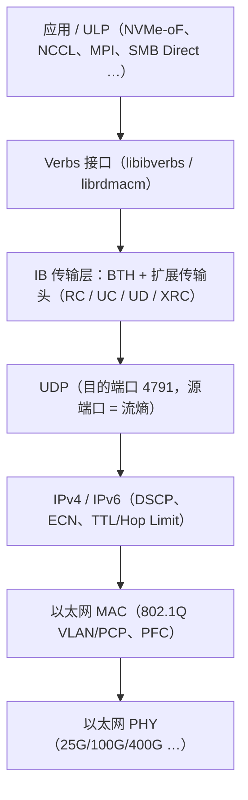
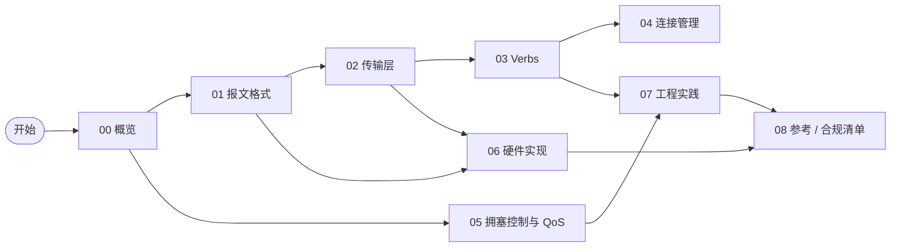

# RoCEv2 知识库

> 面向工程师的 **RoCEv2（RDMA over Converged Ethernet v2，IP Routable RoCE）** 系统化知识库：从原理、报文字段级细节、可靠传输机制、Verbs 编程，到拥塞控制、硬件（FPGA/ASIC）实现与工程运维。
>
> **一手资料**：InfiniBand Trade Association（IBTA）发布的 InfiniBand 架构规范 Release 1.4（受版权保护，**本仓库不包含规范 PDF**，请从 [IBTA 官网](https://www.infinibandta.org/) 获取）
> - **Vol1**（`IB Specification Vol 1-Release-1.4-2020.pdf`，通用规范，RoCEv2 定义于 **Annex A17**，RoCE v1 定义于 **Annex A16**）
> - **Vol2**（`IB Specification Vol 2-Release-1.4-2020-04-07.pdf`，物理层规范，与 RoCEv2 关系较弱，Annex A3 例外）
>
> 文中页码均为规范印刷页码（与 PDF 页码一致），可直接在 PDF 中跳转核对。

---

## RoCEv2 一图速览



```text
 RoCEv2 帧（以 IPv4 为例）
+---------+--------+----------+-------+--------+-------------+--------------+------+------+
| Eth Hdr | [VLAN] |   IPv4   |  UDP  |  BTH   | [扩展传输头] | Payload(+Pad)| ICRC | FCS  |
|  14 B   |  4 B   |  20 B    |  8 B  |  12 B  |  RETH/AETH… | ≤ Path MTU   | 4 B  | 4 B  |
+---------+--------+----------+-------+--------+-------------+--------------+------+------+
  Ethertype 0x0800（IPv6 为 0x86DD，IPv6 头 40 B）   UDP dport 4791
  |<----------------- ICRC 覆盖范围：前置 64 bit 全 1 + IP 头 … Payload（可变字段置 1）----------------->|
```

**RoCEv2 = IB 传输层（BTH 及以后）+ UDP/IP 封装 + 以太网**。它保留了 InfiniBand 的传输语义与 Verbs，替换了 IB 的链路层与网络层，因此可以跨三层路由，并沿用以太网/IP 的管理、QoS 与拥塞通知机制（PFC、ECN）。

---

## 目录

### 00 概览 —— 建立整体认识
| 文件 | 内容 |
|---|---|
| [01-rdma-fundamentals.md](00-overview/01-rdma-fundamentals.md) | RDMA 基础：零拷贝/内核旁路/CPU 卸载，Channel 与 Memory 语义，IB/RoCEv1/RoCEv2/iWARP 对比 |
| [02-roce-evolution.md](00-overview/02-roce-evolution.md) | 从 InfiniBand 到 RoCEv1、RoCEv2 的演进；RoCEv2 改了什么、没改什么 |
| [03-architecture-and-layering.md](00-overview/03-architecture-and-layering.md) | IBA 分层架构在 RoCEv2 中的映射；一次 RDMA WRITE 的端到端流程 |
| [04-addressing.md](00-overview/04-addressing.md) | GID 与 IP 地址、端口 GID 表与 GID type、Address Vector、QPN、P_Key |

### 01 报文格式 —— 字段级细节
| 文件 | 内容 |
|---|---|
| [01-frame-layout.md](01-packet-format/01-frame-layout.md) | 帧整体布局、各类报文长度、线速效率与包率、IB MTU 与以太网 MTU |
| [02-ethernet-ip-udp.md](01-packet-format/02-ethernet-ip-udp.md) | 以太网 / IPv4 / IPv6 / UDP 每个字段的取值规则（CA17-1…24） |
| [03-bth.md](01-packet-format/03-bth.md) | 基本传输头 BTH 12 字节逐字段详解 |
| [04-extended-transport-headers.md](01-packet-format/04-extended-transport-headers.md) | RETH / AETH / AtomicETH / AtomicAckETH / ImmDt / IETH / DETH / XRCETH |
| [05-opcodes.md](01-packet-format/05-opcodes.md) | OpCode 全表、报文头组合、合法包序列、硬件查找表 |
| [06-icrc.md](01-packet-format/06-icrc.md) | ICRC 计算规则、屏蔽字段、Python 参考实现（已用规范样例验证）、并行 CRC 硬件实现 |

### 02 传输层 —— 可靠传输的核心
| 文件 | 内容 |
|---|---|
| [01-service-types.md](02-transport/01-service-types.md) | RC / UC / UD / XRC / RD 服务类型对比与选型 |
| [02-operations.md](02-transport/02-operations.md) | SEND / WRITE / READ / ATOMIC 语义、分段规则与报文序列 |
| [03-ordering-and-validation.md](02-transport/03-ordering-and-validation.md) | 事务排序规则；入站报文头校验的完整流程 |
| [04-unreliable-services.md](02-transport/04-unreliable-services.md) | UC、UD（Q_Key、40 字节 L3 头区）、多播 |
| [05-psn-and-ack-nak.md](02-transport/05-psn-and-ack-nak.md) | PSN 模型、ACK/NAK 协议、AETH Syndrome、RNR 定时器、Credit 与 MSN |
| [06-requester.md](02-transport/06-requester.md) | 请求方：传输定时器、重试计数、Go-back-N 重传、READ/ATOMIC 处理 |
| [07-responder.md](02-transport/07-responder.md) | 响应方：PSN 检查、重复请求处理、NAK 生成、Atomic 结果缓存 |
| [08-error-handling.md](02-transport/08-error-handling.md) | 错误分类、完成状态、QP 错误态与 Flush、静默丢弃条件 |

### 03 Verbs 与资源 —— 软件接口
| 文件 | 内容 |
|---|---|
| [01-resource-model.md](03-verbs-and-resources/01-resource-model.md) | PD / QP / CQ / SRQ / AH / MR / MW / XRC 资源模型与能力属性 |
| [02-qp-state-machine.md](03-verbs-and-resources/02-qp-state-machine.md) | QP 状态机与 Modify QP 属性（含 RoCEv2 地址向量） |
| [03-memory-management.md](03-verbs-and-resources/03-memory-management.md) | 内存注册、L_Key/R_Key、访问检查、Memory Window、MPT/MTT 设计 |
| [04-work-requests-and-completions.md](03-verbs-and-resources/04-work-requests-and-completions.md) | WR 类型、处理模型、CQE 与完成状态码 |
| [05-verbs-roce-specifics-and-programming.md](03-verbs-and-resources/05-verbs-roce-specifics-and-programming.md) | RoCEv2 对 Verbs 的修改 + libibverbs 完整编程示例 |

### 04 连接管理
| 文件 | 内容 |
|---|---|
| [01-cm-protocol.md](04-connection-management/01-cm-protocol.md) | IB CM 消息、字段、状态机、梯形图及 RoCEv2 中的修改 |
| [02-ip-cm-and-rdma-cm.md](04-connection-management/02-ip-cm-and-rdma-cm.md) | Annex A11 IP CM Service、Service ID 映射、librdmacm 流程 |
| [03-mad-and-gsi.md](04-connection-management/03-mad-and-gsi.md) | MAD 通用格式、GSI/QP1、RoCEv2 下的管理差异 |

### 05 拥塞控制与 QoS
| 文件 | 内容 |
|---|---|
| [01-lossless-ethernet-pfc.md](05-congestion-control-and-qos/01-lossless-ethernet-pfc.md) | 无损以太网、PFC 帧格式、Headroom 计算、PFC 死锁/风暴 |
| [02-qos-dscp-pcp-ets.md](05-congestion-control-and-qos/02-qos-dscp-pcp-ets.md) | SL→PCP、Traffic Class→DSCP、Trust 模式、ETS、DCBX |
| [03-ecn-and-cnp.md](05-congestion-control-and-qos/03-ecn-and-cnp.md) | RoCEv2 拥塞管理（RCM）：ECN 标记、CNP 格式、NP/RP 行为 |
| [04-dcqcn.md](05-congestion-control-and-qos/04-dcqcn.md) | DCQCN 算法详解、参数与硬件实现 |
| [05-advanced-cc-and-lossy-roce.md](05-congestion-control-and-qos/05-advanced-cc-and-lossy-roce.md) | TIMELY / HPCC / Swift / IRN、有损 RoCE、Ultra Ethernet 方向 |
| [06-ecmp-and-load-balancing.md](05-congestion-control-and-qos/06-ecmp-and-load-balancing.md) | ECMP、UDP 源端口熵、负载均衡与乱序 |
| [07-ib-cc-vs-rocev2-cc.md](05-congestion-control-and-qos/07-ib-cc-vs-rocev2-cc.md) | IB 拥塞控制（Annex A10）与 RoCEv2 RCM 对比 |

### 06 硬件实现 —— RNIC / FPGA
| 文件 | 内容 |
|---|---|
| [01-rnic-architecture.md](06-hardware-implementation/01-rnic-architecture.md) | RNIC 模块划分、控制面/数据面、上下文规模估算 |
| [02-tx-datapath.md](06-hardware-implementation/02-tx-datapath.md) | 发送通路：调度、WQE 处理、分段、头部生成、DMA、ICRC |
| [03-rx-datapath.md](06-hardware-implementation/03-rx-datapath.md) | 接收通路：解析、校验、QP 查找、PSN 检查、地址翻译、DMA 写、ACK/CQE |
| [04-reliability-engine.md](06-hardware-implementation/04-reliability-engine.md) | 可靠性引擎：重传、定时器、PSN↔WQE 映射、重复请求处理 |
| [05-fpga-implementation-notes.md](06-hardware-implementation/05-fpga-implementation-notes.md) | FPGA 要点：数据通路位宽、并行 CRC、字节移位、存储规划、精简方案 |
| [06-verification-and-interop.md](06-hardware-implementation/06-verification-and-interop.md) | 基于合规条款的测试矩阵、仿真、错误注入、互通测试、常见 bug |

### 07 工程实践
| 文件 | 内容 |
|---|---|
| [01-linux-rdma-stack.md](07-engineering-practice/01-linux-rdma-stack.md) | Linux RDMA 软件栈、GID 表维护、Soft-RoCE（rxe） |
| [02-configuration-guide.md](07-engineering-practice/02-configuration-guide.md) | 主机与交换机配置：MTU、GID、DSCP、PFC、ECN |
| [03-performance-tuning.md](07-engineering-practice/03-performance-tuning.md) | 性能调优：MTU、批量提交、Inline、NUMA、PCIe、内存注册 |
| [04-tools-and-testing.md](07-engineering-practice/04-tools-and-testing.md) | ibv_* / rdma / perftest / Wireshark / Scapy |
| [05-troubleshooting.md](07-engineering-practice/05-troubleshooting.md) | 分层排障方法、症状-原因表、计数器字典、抓包分析 |
| [06-use-cases.md](07-engineering-practice/06-use-cases.md) | 存储、AI/HPC、云数据中心等典型场景 |

### 08 参考资料
| 文件 | 内容 |
|---|---|
| [01-glossary.md](08-reference/01-glossary.md) | 术语表（中英对照） |
| [02-spec-section-map.md](08-reference/02-spec-section-map.md) | 规范章节 ↔ 知识库对照，带 RoCEv2 视角的规范阅读顺序 |
| [03-compliance-checklist.md](08-reference/03-compliance-checklist.md) | Annex A17 合规条款 CA17-1…46 清单 + 实现自检表 |
| [04-ib-physical-layer-vs-ethernet.md](08-reference/04-ib-physical-layer-vs-ethernet.md) | IB 物理层（Vol2）摘要与以太网 PHY 对比 |
| [05-constants-and-formulas.md](08-reference/05-constants-and-formulas.md) | 常数与公式速查（端口、OpCode、Syndrome、定时器、长度计算） |
| [06-faq.md](08-reference/06-faq.md) | FAQ 与自测题 |

---

## 学习路线



| 路线 | 适合 | 建议阅读顺序 |
|---|---|---|
| **入门路线** | 初次接触 RDMA/RoCE | 00 全部 → [帧布局](01-packet-format/01-frame-layout.md) → [BTH](01-packet-format/03-bth.md) → [服务类型](02-transport/01-service-types.md) → [操作](02-transport/02-operations.md) → [资源模型](03-verbs-and-resources/01-resource-model.md) → [编程实践](03-verbs-and-resources/05-verbs-roce-specifics-and-programming.md) → [FAQ](08-reference/06-faq.md) |
| **硬件 / FPGA 实现路线** | 实现 RoCEv2 RNIC 或 IP 核 | 01 全部（重点 [ICRC](01-packet-format/06-icrc.md)） → 02 全部（重点 05–08） → [内存管理](03-verbs-and-resources/03-memory-management.md) → [WR/CQE](03-verbs-and-resources/04-work-requests-and-completions.md) → [ECN/CNP](05-congestion-control-and-qos/03-ecn-and-cnp.md) → [DCQCN](05-congestion-control-and-qos/04-dcqcn.md) → 06 全部 → [合规清单](08-reference/03-compliance-checklist.md) |
| **网络 / 运维路线** | 部署与调优 RoCE 网络 | [演进](00-overview/02-roce-evolution.md) → [以太网/IP/UDP 字段](01-packet-format/02-ethernet-ip-udp.md) → 05 全部 → 07 全部 → [错误处理](02-transport/08-error-handling.md) |
| **软件 / 应用开发路线** | 基于 Verbs 写 RDMA 应用 | 00 全部 → 02 的 01–04 → 03 全部 → 04 全部 → [性能调优](07-engineering-practice/03-performance-tuning.md) → [工具](07-engineering-practice/04-tools-and-testing.md) |

---

## 阅读约定

- **规范引用**：`〔Vol1 §A17.3.2.1, p.1934〕` 表示 Vol1 的 A17.3.2.1 小节、第 1934 页；`CA17-20`、`C9-140`、`o9-71` 为规范原有的合规条款编号：以 `C` 开头的条款在其合规类别中始终适用，以 `o` 开头的条款仅在产品声明支持相应可选功能时适用〔Vol1 第 20 章, p.1245〕。注意 Annex A17 整体是"可选规范"（Optional Normative），一旦声明支持 RoCEv2，其中的 `CA17-*` 条款即为必须满足的要求。
- **非规范内容**均有来源标注：`〔外部: IEEE 802.1Qbb〕`、`〔外部: RFC 3168〕`、`〔论文: …〕`、`〔业界实践: …〕`。厂商相关的命令、参数、计数器以所用版本的官方文档为准。
- **提示框**：`[!IMPORTANT]` 规范强制要求；`[!TIP]` 工程建议；`[!WARNING]` 常见陷阱；`[!NOTE]` 补充说明。
- 每篇文档结构统一：摘要 / 规范出处 / 前置阅读 → 正文 → 要点回顾 → 自测（可折叠答案）→ 参考。

### 阅读工具建议
- **Obsidian**：直接打开 `RoCEv2-KB` 目录作为 Vault，Mermaid 与提示框原生渲染。
- **VS Code**：内置 Markdown 预览即可阅读；如需渲染 Mermaid 图，可安装 "Markdown Preview Mermaid Support" 扩展。
- **GitHub / GitLab**：Mermaid、提示框与 `<details>` 折叠均可原生渲染。

---

## 规范速查：RoCEv2 相关章节

| 主题 | 规范位置 | 页码 |
|---|---|---|
| RoCEv2 全部定义 | Vol1 Annex A17 | 1928–1949 |
| RoCE（v1） | Vol1 Annex A16 | 1911–1927 |
| 数据包格式总览 | Vol1 第 5 章 | 167–181 |
| ICRC 计算 | Vol1 §7.8 | 218–231 |
| 传输层（BTH、可靠/不可靠服务、错误处理） | Vol1 第 9 章 | 253–459 |
| 软件传输接口（资源、QP 状态、内存管理） | Vol1 第 10 章 | 460–582 |
| Verbs | Vol1 第 11 章 | 583–706 |
| 通信管理 CM | Vol1 第 12 章 | 707–771 |
| RDMA IP CM Service | Vol1 Annex A11 | 1848–1856 |
| IB 拥塞控制（对比用） | Vol1 Annex A10 | 1797–1847 |
| 面向 RoCE 的管理接口修改 | Vol2 Annex A3 | 688–691 |

完整对照见 [02-spec-section-map.md](08-reference/02-spec-section-map.md)。

---

> **说明**：IBTA 规范版权归 InfiniBand Trade Association 所有。本知识库是基于规范的中文学习笔记，以意译、归纳为主，涉及规范强制性要求时请以规范原文为准；外部资料（IEEE、IETF、论文、厂商文档）以其原始出处为准。
